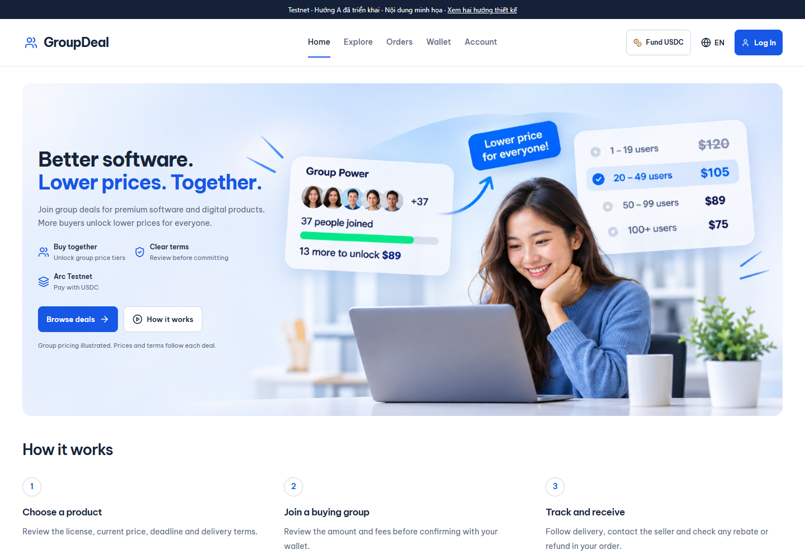

# GroupDeal

**Buy digital products together. Settle with USDC on Arc.**

GroupDeal is an independently developed personal project exploring group buying for software and digital goods. Buyers review a deal's license and delivery terms, then commit USDC. As the group reaches published thresholds, better price tiers can unlock. Sellers manage products and fulfillment; buyers track delivery and claim any allocated rebate or refund.

[Testnet app](https://testnet.groupdeal.tech/) · [Roadmap](ROADMAP.md) · [Architecture](docs/architecture.md) · [Run locally](docs/development.md) · [Tiếng Việt](README.vi.md)



*Local interface preview, captured on 4 November 2026. Products, people, prices and participation figures in the preview and artwork are illustrative. [Mobile screenshot and capture details](docs/images/README.md).*

## Why GroupDeal

Buying software as a group should make the price and terms easier to understand. GroupDeal brings the product, group pricing, commitment deadline and delivery conditions into one deal page, with an order record afterward.

- **Buyers:** discover digital products, review group prices and terms, and follow delivery, rebates and refunds.
- **Sellers:** organize campaigns, manage digital inventory and fulfill orders.
- **Integrations:** connect seller tools through public read APIs, a TypeScript SDK and signed webhooks.

The project is in active development on **Arc Testnet**, using test tokens. Real-user validation and Mainnet readiness are future milestones.

## How it works

1. **Choose a deal.** Review the product, pinned license, price tiers, deadline and delivery terms.
2. **Join the group.** Review the amount and fees before authorizing a USDC commitment with your wallet.
3. **Settle the campaign.** The contract determines final pricing and allocations under the campaign's rules.
4. **Receive the product.** Track digital delivery and use the applicable confirmation or dispute process.
5. **Claim allocated funds.** Buyers and sellers claim amounts allocated to their respective wallets.

## Built with Arc and Circle

| Component | Role in GroupDeal |
| --- | --- |
| Arc and USDC | Settlement for commitments, final pricing, allocations and claims |
| GroupDealHub | Solidity escrow and campaign rules; the authority for financial state |
| Circle User-Controlled Wallets | Email-based wallet access |
| Reown AppKit | External EVM wallet connection |
| Circle App Kit | USDC funding/bridge integration |
| Backend and indexer | Authentication, chain-event projections, delivery and integration APIs |

The current network is **Arc Testnet, chain ID 5042002**. Contract references are in [the Testnet manifest](shared/manifests/arc-testnet.json). See [architecture](docs/architecture.md) for trust boundaries and [Arc's documentation](https://docs.arc.io/arc/references/connect-to-arc) for network details.

## Project status

| Area | Current position |
| --- | --- |
| Core implementation | Buyer, seller and operator interfaces; contract, backend, delivery and integration code are present |
| Testnet | [testnet.groupdeal.tech](https://testnet.groupdeal.tech/) is the application domain for testing and feedback |
| Mainnet | [groupdeal.tech](https://groupdeal.tech/) is the Mainnet domain and currently shows a construction notice; a GroupDeal Mainnet release is pending |
| Validation | Automated checks and Testnet work continue; full live-journey and independent security review remain open |
| Next focus | Finish Testnet validation, separate environments and prepare a small real-user pilot |

Hosting separation remains open: the construction page does not establish an isolated Mainnet runtime. [Deployment status](docs/deployment-status.md) records the intended domain roles and observed configuration.

The [roadmap](ROADMAP.md) separates implemented work, work in progress and planned milestones. [GitHub Actions](https://github.com/tanka420/group-deal/actions/workflows/local-candidate.yml) records automated checks for individual revisions.

## Preview locally

Use Node.js 24 and npm. From a fresh clone:

```sh
git clone https://github.com/tanka420/group-deal.git
cd group-deal
npm ci --prefix frontend
npm run preview:testnet-design
```

Open **http://127.0.0.1:5178/**. This serves the actual interface with read-only, illustrative catalog fixtures. No backend, production database or live wallet credentials are needed. Authentication, checkout and account workspaces need a configured application; the preview does not perform demo transactions.

See [development and testing](docs/development.md) for workspace installation and checks.

## Repository map

| Directory | Contents |
| --- | --- |
| [frontend/](frontend/) | React, TypeScript, Vite; English/Vietnamese buyer, seller and operator UI |
| [contracts/](contracts/) | Solidity contract, local models and regression tests |
| [backend/](backend/) | TypeScript API, indexer, accounting projections and digital delivery |
| [shared/](shared/) | Contract ABIs, manifests and shared representations |
| [sdk/](sdk/README.md) | TypeScript client and vendor examples |
| [integrations/](integrations/) | Integration implementations, including a webhook receiver |
| [docs/](docs/README.md) | Architecture, development and deployment context |

## Development and feedback

Created and maintained as a personal project by [tanka420](https://github.com/tanka420). Feedback from buyers, digital-product sellers and Arc developers is welcome through [Issues](https://github.com/tanka420/group-deal/issues).

For a bug, include the page, language, browser, expected behavior and steps to reproduce with sample data. For an integration idea, describe the product and workflow you want to connect. Please discuss larger changes before starting a pull request.

Security-sensitive reports follow [SECURITY.md](SECURITY.md). Follow [ROADMAP.md](ROADMAP.md) for development milestones and [CHANGELOG.md](CHANGELOG.md) for selected changes.

## License

GroupDeal-authored software uses [MIT](LICENSE), consistent with existing package metadata and contract headers. Bundled skills, fonts and third-party material retain their own terms; see [third-party notices](THIRD_PARTY_NOTICES.md).
