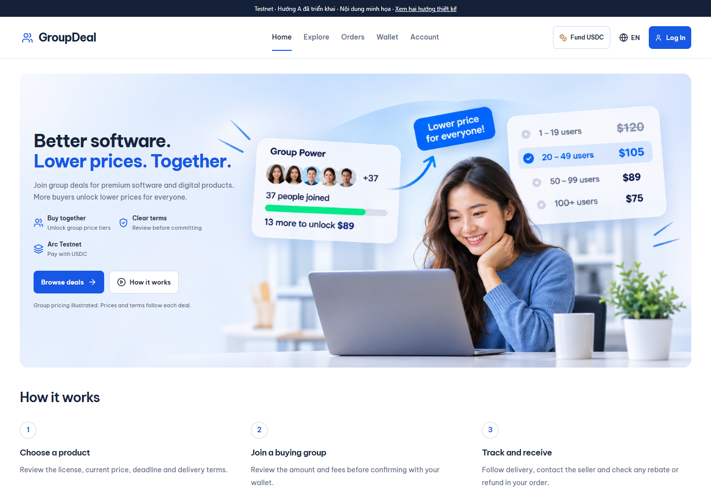

# GroupDeal

**Cùng mua sản phẩm số. Thanh toán bằng USDC trên Arc.**

GroupDeal là dự án cá nhân được phát triển độc lập, khám phá cách mua chung phần mềm và sản phẩm số. Người mua xem điều khoản license và giao hàng của deal rồi cam kết USDC. Khi nhóm đạt các ngưỡng đã công bố, mức giá tốt hơn có thể được mở khóa. Người bán quản lý sản phẩm và giao hàng; người mua theo dõi đơn và nhận khoản rebate hoặc refund được phân bổ.

[Ứng dụng Testnet](https://testnet.groupdeal.tech/) · [Lộ trình](ROADMAP.md) · [Kiến trúc](docs/architecture.md) · [Chạy local](docs/development.md) · [English](README.md)



*Ảnh giao diện local ngày 04/11/2026. Sản phẩm, nhân vật, giá và số người tham gia trong preview và artwork là minh họa. [Ảnh mobile và thông tin chụp](docs/images/README.md).*

## GroupDeal giải quyết điều gì?

Mua chung phần mềm cần giúp người mua hiểu rõ cả giá và điều khoản. GroupDeal đưa sản phẩm, giá nhóm, hạn cam kết và điều kiện giao hàng vào cùng một trang deal, sau đó giữ lại thông tin để người mua theo dõi đơn.

- **Người mua:** khám phá sản phẩm số, xem giá và điều khoản, theo dõi giao hàng cùng rebate/refund.
- **Người bán:** tổ chức chiến dịch, quản lý kho sản phẩm số và hoàn tất đơn hàng.
- **Tích hợp:** kết nối công cụ riêng của người bán qua public read API, TypeScript SDK và webhook có chữ ký.

Dự án đang phát triển trên **Arc Testnet**, sử dụng token thử nghiệm. Kiểm chứng với người dùng thật và chuẩn bị Mainnet là các cột mốc tiếp theo.

## Cách hoạt động

1. **Chọn deal:** xem sản phẩm, license đã ghim, các bậc giá, thời hạn và điều kiện giao hàng.
2. **Tham gia nhóm:** kiểm tra số tiền và phí trước khi xác nhận cam kết USDC bằng ví.
3. **Chốt chiến dịch:** contract xác định giá cuối và phân bổ theo quy tắc chiến dịch.
4. **Nhận sản phẩm:** theo dõi giao hàng số, xác nhận hoặc sử dụng quy trình tranh chấp phù hợp.
5. **Nhận khoản được phân bổ:** người mua và người bán claim về ví tương ứng.

## Tích hợp Arc và Circle

| Thành phần | Vai trò trong GroupDeal |
| --- | --- |
| Arc và USDC | Settlement cho cam kết, giá cuối, phân bổ và claim |
| GroupDealHub | Contract Solidity quản lý escrow và quy tắc chiến dịch; nguồn quyết định trạng thái tài chính |
| Circle User-Controlled Wallets | Truy cập ví qua email |
| Reown AppKit | Kết nối ví EVM bên ngoài |
| Circle App Kit | Tích hợp nạp/bridge USDC |
| Backend và indexer | Xác thực, dữ liệu chiếu từ sự kiện onchain, giao hàng và API tích hợp |

Mạng hiện tại là **Arc Testnet, chain ID 5042002**. Tham chiếu contract nằm trong [Testnet manifest](shared/manifests/arc-testnet.json). Xem [kiến trúc](docs/architecture.md) để hiểu ranh giới quyền hạn và [tài liệu Arc](https://docs.arc.io/arc/references/connect-to-arc) để xem thông tin mạng.

## Trạng thái dự án

| Phần | Hiện tại |
| --- | --- |
| Mã nguồn chính | Đã có giao diện buyer, seller, operator; contract, backend, giao hàng và tích hợp |
| Testnet | [testnet.groupdeal.tech](https://testnet.groupdeal.tech/) là domain ứng dụng dành cho thử nghiệm và phản hồi |
| Mainnet | [groupdeal.tech](https://groupdeal.tech/) dành cho Mainnet, hiện có trang đang hoàn thiện; bản phát hành GroupDeal Mainnet còn chờ |
| Kiểm chứng | Tiếp tục kiểm thử tự động và Testnet; hành trình live đầy đủ và rà soát bảo mật độc lập còn mở |
| Ưu tiên tiếp theo | Hoàn thiện kiểm chứng Testnet, tách môi trường và chuẩn bị pilot nhỏ với người dùng thật |

Việc tách hạ tầng vẫn còn mở: trang thông báo chưa đồng nghĩa đã có runtime Mainnet độc lập. [Trạng thái triển khai](docs/deployment-status.md) ghi rõ vai trò domain và cấu hình đã quan sát.

[Roadmap](ROADMAP.md) phân biệt phần đã triển khai, đang hoàn thiện và dự kiến. [GitHub Actions](https://github.com/tanka420/group-deal/actions/workflows/local-candidate.yml) ghi kết quả kiểm tra tự động của từng revision.

## Xem giao diện trên máy

Dùng Node.js 24 và npm. Bắt đầu từ clone mới:

```sh
git clone https://github.com/tanka420/group-deal.git
cd group-deal
npm ci --prefix frontend
npm run preview:testnet-design
```

Mở **http://127.0.0.1:5178/**. Bản này dùng giao diện thật với catalog minh họa chỉ đọc, không cần backend, database vận hành hay credential ví thật. Đăng nhập, checkout và workspace tài khoản cần ứng dụng đã cấu hình; preview không thực hiện giao dịch demo.

Xem [hướng dẫn phát triển và kiểm thử](docs/development.md) để cài workspace và chạy checks.

## Khám phá mã nguồn

| Thư mục | Nội dung |
| --- | --- |
| [frontend/](frontend/) | React, TypeScript, Vite; UI Anh/Việt cho buyer, seller và operator |
| [contracts/](contracts/) | Contract Solidity, model local và regression tests |
| [backend/](backend/) | API TypeScript, indexer, dữ liệu kế toán và giao hàng số |
| [shared/](shared/) | ABI, manifest và biểu diễn dữ liệu dùng chung |
| [sdk/](sdk/README.md) | TypeScript client và ví dụ cho người bán |
| [integrations/](integrations/) | Các tích hợp, gồm webhook receiver |
| [docs/](docs/README.md) | Kiến trúc, phát triển và bối cảnh triển khai |

## Phát triển và góp ý

Được [tanka420](https://github.com/tanka420) xây dựng và duy trì như một dự án cá nhân. Phản hồi từ người mua, người bán sản phẩm số và developer Arc được đón nhận qua [Issues](https://github.com/tanka420/group-deal/issues).

Khi báo lỗi, hãy ghi trang, ngôn ngữ, trình duyệt, kết quả mong đợi và cách tái hiện bằng dữ liệu mẫu. Với ý tưởng tích hợp, mô tả sản phẩm và quy trình muốn kết nối. Các thay đổi lớn nên được trao đổi trước khi bắt đầu pull request.

Báo cáo nhạy cảm về bảo mật theo [SECURITY.md](SECURITY.md). Theo dõi lộ trình ở [ROADMAP.md](ROADMAP.md) và thay đổi được chọn ở [CHANGELOG.md](CHANGELOG.md).

## Giấy phép

Phần mềm do GroupDeal viết dùng [MIT](LICENSE), nhất quán với metadata package và header contract hiện có. Skill, font và nội dung bên thứ ba giữ điều khoản riêng; xem [third-party notices](THIRD_PARTY_NOTICES.md).
