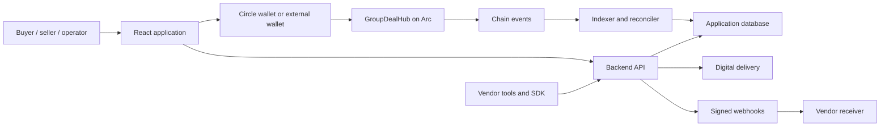

# Architecture

GroupDeal combines a digital-product marketplace interface with USDC group-buy settlement on Arc. Buyers, sellers and operators use role-specific capabilities. The current implementation targets Arc Testnet (5042002).

## Product flow

1. A seller defines a product, license version, campaign price tiers and delivery terms.
2. A buyer reviews the pinned terms and authorizes a USDC commitment.
3. The contract records the commitment and applies campaign settlement rules.
4. The seller fulfills the order through a supported digital-delivery workflow.
5. Confirmation, deadlines or dispute resolution determine applicable allocations. Buyers and sellers claim allocated funds to pinned wallets.

## Components

| Layer | Implementation | Responsibility |
| --- | --- | --- |
| Interface | React, TypeScript, Vite, CSS | Discovery/orders, seller workspace, operator review; English/Vietnamese |
| Contract | Solidity GroupDealHub | Escrow, pricing, settlement, delivery/dispute rules, allocations and claims |
| API | Node.js and TypeScript | Authentication, metadata, operation preparation and authorized resource access |
| Indexer/reconciler | Backend services | Project chain events into application views and compare relevant state |
| Storage | SQLite and encrypted resources | Account/session state, metadata, projections and delivery content |
| Integration | TypeScript SDK and webhook receiver | Connect APIs and delivery/events with seller tools |

Source entry points: [contract](../contracts/contracts/GroupDealHub.sol), [backend](../backend/src/), [frontend](../frontend/src/), [SDK](../sdk/README.md), [receiver](../integrations/cloudflare-receiver/README.md).

## Arc, USDC and wallets

Arc is the settlement layer. The [Testnet manifest](../shared/manifests/arc-testnet.json) identifies the current contract; [shared/contracts.json](../shared/contracts.json) supplies application contract references and ABI. A deployment reference is not an independent audit.

The business layer uses integer six-decimal USDC base units, including strings in JSON. Arc's native gas-balance view uses 18 decimals. These are views of the same USDC balance and must not be added together. [Arc's documentation](https://docs.arc.io/arc/references/connect-to-arc) explains network setup and native USDC.

Circle User-Controlled Wallets supports email-based access; Reown AppKit supports external EVM wallets. Circle App Kit supplies funding/bridge integration. Provider settings, origins and user authorization remain separate from a fixture test.

## Financial authority and recovery

The contract is authoritative for financial state. The database contains projections and operational metadata; an API response, support status or local timer cannot create a refund or claim right by itself.

Contract accounting conserves committed value across buyer allocations, seller gross allocations and amounts still unallocated. Buyer identity and payout-principal bindings, signed purchase authorizations and nonces constrain who may act and where money may be claimed.

The application tracks transaction intent, wallet preparation, broadcast hashes and receipts. Recovery must reconcile the existing operation before preparing another signature. HTTP success is not a successful chain transaction; a broadcast hash alone is not final delivery or settlement.

## Delivery and trust boundaries

Private license keys and delivery content are encrypted offchain with authenticated encryption and checked against order access. The backend can decrypt this content: the current system is not buyer-only end-to-end encryption. Uploaded resources and external fulfillment providers have different capabilities.

Operator permissions support bounded operational and dispute work; they do not replace contract accounting rules. Signed webhooks authenticate events; durable receiver storage and idempotent processing handle duplicates. The [SDK guide](../sdk/README.md) explains the constraints.

## Environments and evidence

- `testnet.groupdeal.tech` is the Testnet application domain.
- `groupdeal.tech` is the Mainnet domain and currently shows a construction page.
- Local previews use illustrative fixtures and do not prove live wallet or delivery behavior.
- Automated checks cover defined source/fixture scopes. Open live validation and independent review are tracked in the [roadmap](../ROADMAP.md).

Hosting isolation between the two domains is pending. See [deployment status](deployment-status.md); separate Mainnet services or data stores are not established by this document.
