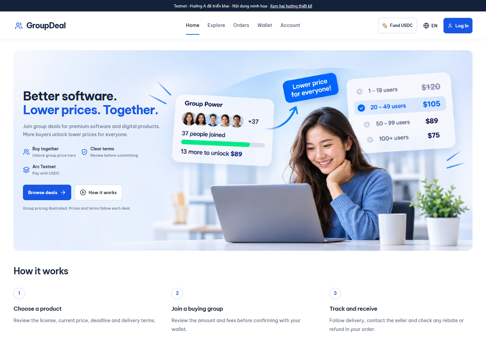
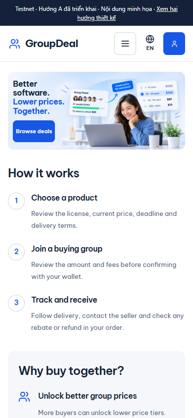

# Interface screenshots

These are captures of the actual frontend through the read-only local preview, not images of a live buyer session.

| Capture | Viewport | Language |
| --- | --- | --- |
| [Desktop homepage](home-desktop.png) | 1440 × 1000 | English |
| [Mobile homepage](home-mobile.png) | 390 × 844 | English |

Captured on **4 November 2026** from frontend source `1edb3dfd1452423ea7c0741be1feec0510c73c56`. This documentation change does not modify that frontend source.

The preview uses catalog fixtures from `design/testnet-concepts/content.mjs` and `frontend/e2e/fixtures/`. Names, products, prices, participant counts and artwork figures are illustrative, not live traction, customer testimonials or sales. The homepage artwork was supplied by the project maintainer. No authenticated session, private customer data or wallet transaction is shown.

## Reproduce

Follow [development setup](../development.md), start `npm run preview:testnet-design`, select English and capture the homepage at the listed viewport. Wait for fonts and images to load. Keep the preview's illustrative-content notice visible.

