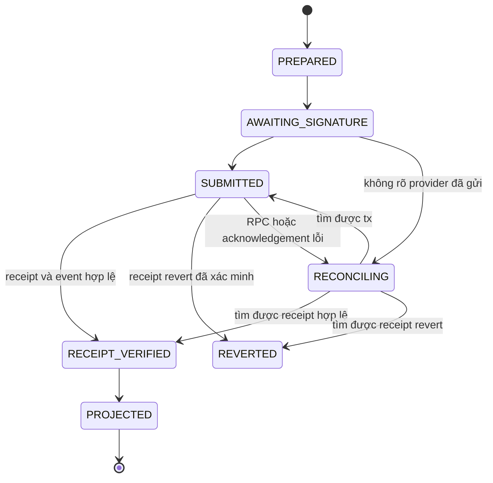

# GroupDeal giao dịch ví indexer và tích hợp

Phần 3 của thiết kế kỹ thuật, gồm mục 7–10. State, workflow và endpoint là thiết kế đề xuất; semantics tuân theo nhóm 01 và contract/schema ở phần 02B.

[Mục lục](./README.md) · [Phần trước](./02B_CONTRACT_VA_DU_LIEU.md) · [Phần tiếp](./02D_BAO_MAT_VA_VAN_HAN.md)

## 7 Lifecycle của một operation có transaction

Đây là sơ đồ chính; cần thêm nhánh từ chối ký trước broadcast, authorization expired, replaced và superseded với điều kiện chứng minh riêng. Không đánh dấu dropped/retryable chỉ vì hết timeout hoặc RPC trả chưa tìm thấy.

Workflow chuẩn:

1. API nhận hành động với idempotency key; kiểm session, ownership/capability và manifest; lưu intent/payload bất biến.
2. Đọc chain ở block cố định và tạo quote/capability. Trả chain/hub/principal, function/calldata, amount cap, expected event và deadline.
3. Frontend hiển thị quantity, terms, tiền/gas; kiểm wallet/address/chain trước khi xin duyệt.
4. Ví người dùng ký/gửi; lưu operation ID, provider challenge ID và tx hash sớm. Nếu kết quả không rõ, giữ operation để recover.
5. Verifier kiểm chain, tx sender/to/function/calldata/value/nonce theo intent, receipt status, emitter/event/arguments và block. Tx hash do client cung cấp không tự là bằng chứng.
6. Upsert journal/projection idempotent; hợp nhất private metadata đã staged dù API hay indexer đến trước.
7. Trả kết quả tài chính đã xác minh và trạng thái projection riêng; email/webhook chạy qua outbox.

Indexer đến trước API phải tìm được binding/order từ chain evidence; API đến trước indexer không tạo order tài chính bằng dữ liệu tự khai. Cross-device recovery cần record backend đúng account, không chỉ localStorage.

Replacement phải chứng minh sender/nonce và calldata/intended action. Cùng nonce với call khác không là buy thành công. Hết hạn authorization không đủ để kết luận giao dịch cũ chưa được xử lý; cần đọc nonce/receipt và state liên quan trước retry.

## 8 Ví và funding

Circle User-Controlled Wallet yêu cầu user có phiên xác thực và duyệt thao tác ký; backend không giữ private key của user. Bản này chọn EOA theo yêu cầu sản phẩm. [Circle User-controlled wallets](https://developers.circle.com/wallets/user-controlled).

Reown là connector cho ví ngoài, cấu hình Project ID và network/adapter tương thích. Auth challenge của GroupDeal và transaction approval là hai bước có mục đích khác nhau. [Reown AppKit](https://docs.reown.com/appkit/overview).

Funding panel cần số dư USDC, commitment và ước lượng gas riêng. Native 18 decimals và ERC-20 6 decimals là hai biểu diễn của cùng giá trị; đọc một balance nghiệp vụ, không cộng hai số dư. Nếu quy đổi gas 18 → 6 để kiểm đủ tiền, dùng cách làm tròn tăng bảo thủ hoặc so sánh toàn bộ ở precision đủ cao.

Faucet/test USDC và ví đã có tiền phục vụ bản Testnet. Giữ hướng tích hợp App Kit Bridge cho tuyến được hỗ trợ, có quote/fee/expiry và operation recovery. Bảng capability phải kiểm từ SDK/tài liệu hiện hành, không coi mọi chain/asset đều dùng được. [App Kit supported blockchains](https://docs.arc.io/app-kit/references/supported-blockchains).

Bridge hoàn tất chỉ là funding; mua hàng vẫn cần approve/commit riêng và chain evidence riêng. Approval chỉ cho token/spender/amount cần thiết; xử lý allowance cũ và allowance insufficient có preflight. API key Circle, authorization key và SMTP secret chỉ ở server/secret store.

## 9 Indexer và đối soát

Arc có deterministic finality; dùng receipt/block hợp lệ, không mặc định buffer nhiều confirmation như Ethereum. Sắp event theo block, transaction index, log index; backfill HTTP và stream WebSocket, checkpoint bền vững, gap detection. Native USDC Transfer 18 decimals và ERC-20 Transfer 6 decimals có emitter khác nhau; không đếm trùng một chuyển động. Gas deduction không có Transfer event. [Arc event indexing](https://docs.arc.io/integrate/infrastructure/indexing-events).

Projection chính của escrow đi từ Hub events, không suy settlement từ USDC Transfer đơn lẻ. Mọi read provider phải kiểm chain; hỗ trợ timeout/failover nhưng không trộn các snapshot block không đồng nhất.

Reconciliation chọn một block B, có projection as-of B và đọc contract state tại B. Kiểm coverage, terms/principal, quantity/tier, final price, B/S/U và cumulative claims per-order; sau đó kiểm tổng campaign và liability/balance/surplus. RPC lỗi, thiếu coverage hoặc snapshot lệch phải trả `UNVERIFIED`, `STALE` hoặc `MISMATCH` có lý do, không mặc định healthy.

Rebuild chạy vào projection/database mới từ deployment block, không reset dữ liệu active. Bắt kịp block kiểm tra, compare per-order và totals, rồi chuyển generation theo quy trình có rollback. Replay không gửi lại email, webhook hay cấp lại entitlement. Account/session, key mapping, product/license snapshots, support và bí mật không dựng lại được chỉ từ chain.

## 10 API và tích hợp đề xuất

Endpoint tên cụ thể có thể điều chỉnh trước khi khóa OpenAPI; mọi action tài chính dùng operation lifecycle chung.

| Scope | Endpoint hoặc nhóm | Vai trò |
|---|---|---|
| Public | `GET /api/v1/catalog`, `/campaigns/:id`, `/sellers/:id` | Discovery và dữ liệu allowlist, filter/sort/cursor |
| Public | `GET /api/v1/campaigns/:id/widget` | Widget chỉ đọc đúng visibility |
| Auth | `/api/v1/auth/otp`, `/auth/me`, `/auth/sessions` | OTP/session/logout/revocation/contact |
| Wallet | `/api/v1/wallets/challenges`, `/wallets/bindings` | Chứng minh và quản lý liên kết ví |
| Seller | `/api/v1/products`, `/product-versions`, `/rights` | Product/license/rights, tài nguyên và review workflow |
| Seller | `/api/v1/campaign-drafts` | Save/version/preview/delivery test, chuẩn bị publish |
| Buyer | `GET /api/v1/orders`, `/orders/:id/entitlements` | Order riêng tư và quyền đọc tài nguyên |
| Hành động | `POST /api/v1/operations` | Prepare publish/buy/delivery/confirm/breach/dispute/resolve/claim theo capability |
| Hành động | `/api/v1/operations/:id/submit`, `/recover` và `GET /:id` | Broadcast evidence, verify, status và resume |
| Support/review | `/api/v1/support-threads`, `/orders/:id/reviews` | Thread/attachments, eligibility và seller response |
| Thông báo | `/api/v1/notifications`, `/preferences`, `/follows` | Inbox/read state/subscription |
| Operator | `/api/v1/operator/reviews`, `/disputes`, `/reconciliation`, `/health` | Hàng đợi, evidence, allocation preparation và vận hành |
| Seller integration | `/api/v1/webhook-subscriptions`, `/delivery-probes` | Secret/endpoint review, test, retry/DLQ |

Private reads kiểm ownership theo account và object, trả `Cache-Control: no-store` khi thích hợp. Public DTO không chứa email, campaign identity mapping, provider credentials, unpublished drafts, evidence hoặc entitlement. Catalog không discover unlisted; direct link policy phải đặc tả riêng và không làm lộ qua search, aggregate hay widget list.

Response amount là integer string kèm unit/decimals; financial snapshot có chain/hub/protocol/block và verification/lag state. Error có code ổn định, message i18n và operation ID khi đã tạo; không trả stack/secret. Pagination cursor gắn filter/sort/deployment và có order ổn định.

Webhook event schema có version, event ID, subscription/campaign/order scope, thời gian và payload allowlist. HMAC-SHA256 ký raw body cùng timestamp theo canonical format đã định; receiver kiểm constant-time, strict timestamp/window và dedup bền vững `(subscriptionId,eventId)`. Timestamp window không thay dedup. Retry/redrive giữ cùng event ID. Endpoint outbound phải có SSRF/DNS/redirect/private-IP và egress policy.

SDK phải đóng gói types/exports/version, có consumer test từ package được pack, ví dụ receiver có durable inbox và đúng workflow prepare → user sign → verify → recover. API key authentication chỉ được ghi là khả năng hỗ trợ khi đã được thiết kế và triển khai; không dùng tên API key cho session token.

