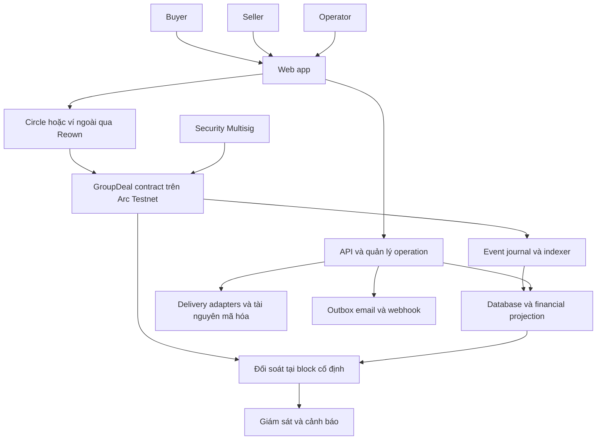

# GroupDeal kiến trúc tổng thể và cấu hình

Kiến trúc phải giữ một ranh giới rõ: contract quyết định tiền và quyền tài chính; backend quản lý danh tính, nội dung riêng tư và workflow; indexer tạo bản đọc cho ứng dụng. Frontend điều phối trải nghiệm và xin người dùng ký đúng hành động. Mọi kết quả tài chính phải có chứng cứ chain.

Các tên module, bảng, enum và endpoint dưới đây là **thiết kế đề xuất cho codebase mới**, không phải cam kết các interface đó đã tồn tại trong repository hiện tại. Quy tắc nghiệp vụ phải tuân theo [đặc tả sản phẩm](./01_SAN_PHAM_VA_NGHIEP_VU.md).

[Mục lục](./README.md) · [Phần tiếp](./02B_CONTRACT_VA_DU_LIEU.md)

## 1 Phân chia các thành phần



| Thành phần | Trách nhiệm |
|---|---|
| Contract | Campaign terms, commit, metric/tier, principal, final price, allocation, dispute, cancel và claim |
| API | Session, wallet proof, product/rights/draft, intent, authorization, receipt verification, support và private metadata |
| Indexer | Canonical journal, projection, checkpoint, backfill, đồng bộ các operation đã xác minh |
| Reconciler | So per-order/per-campaign giữa projection và contract tại cùng block; cảnh báo delta |
| Delivery workers | Reserve/assign tài nguyên, gọi provider, retry có idempotency và kiểm chứng giao hàng |
| Outbox workers | Email, in-app source events, signed webhook, retries, DLQ và redrive |
| Web app | Ba khu vực buyer/seller/operator, state giao dịch, account/wallet/funding và recovery |
| SDK và widget | Seller tích hợp delivery/events; public reads và widget chỉ đọc |

Một backend theo module, có worker/process riêng khi cần, là điểm khởi đầu đủ rõ. Số service và topology phải theo nhu cầu tải, đồng thời và vận hành đã chốt.

## 2 Stack và cấu trúc repository đề xuất

Stack tham chiếu từ dự án hiện tại là React/Vite/TypeScript, Node.js/TypeScript, Solidity, ethers hoặc viem, Circle Wallets, Reown và Playwright. Bản mới có thể dùng nền này với cấu trúc sạch; pin runtime, compiler và dependency đã kiểm tương thích thay vì sao chép version từ báo cáo cũ.

```text
groupdeal-new/
  apps/
    web/                  buyer, seller, operator và funding UX
    api/                  REST API, auth, policy và operation lifecycle
    workers/              indexer, delivery, outbox và reconciliation
  contracts/              protocol, deploy scripts, contract/invariant tests
  packages/
    domain/               schema, amount types, state/capability definitions
    sdk/                  public reads, seller workflow, webhook receiver helpers
    ui/                   design tokens và component dùng chung nếu cần
  config/
    deployments/          manifest theo môi trường và deployment
  docs/                   đặc tả, ADR, API, runbook và hồ sơ nghiệm thu
  tests/                  integration, E2E, load và outage/recovery
```

Không bắt buộc thư mục `ui` hoặc một framework monorepo cụ thể. Tách reference accounting model khỏi code thực hiện tính tiền của contract/projection để kiểm chứng độc lập.

SQLite với transaction/WAL và một writer có thể dùng cho triển khai Testnet nhỏ. Nếu chạy nhiều instance ghi hoặc cần HA, chọn database phù hợp như PostgreSQL ngay từ quyết định topology. Với cả hai lựa chọn, phải có domain tables, constraints, migration và kiểm thử concurrency; lưu snapshot JSON toàn ứng dụng không thay được các yêu cầu đó.

## 3 Manifest và cấu hình mạng

Baseline tài liệu chính thức được đối chiếu ngày 06/10/2026:

| Giá trị | Arc Testnet |
|---|---|
| Chain ID | `5042002` |
| HTTP RPC tham chiếu | `https://rpc.testnet.arc.io` |
| WebSocket tham chiếu | `wss://rpc.testnet.arc.io` |
| Explorer tham chiếu hiện hành | `https://explorer.testnet.arc.io` |
| Tài sản nghiệp vụ | USDC ERC-20, 6 decimals |
| USDC ERC-20 | `0x3600000000000000000000000000000000000000` |
| Native gas | USDC, 18 decimals |

Chain/RPC/explorer và một số dư USDC được mô tả trong [Connect to Arc](https://docs.arc.io/arc/references/connect-to-arc). Địa chỉ ERC-20 và cách phân biệt native/ERC-20 event được mô tả trong [Index Arc Events](https://docs.arc.io/integrate/infrastructure/indexing-events). Kiểm lại các giá trị và bytecode thực khi triển khai.

Manifest của một deployment cần có environment, chain ID, hub address, deployment block, protocol version, ABI/schema version hoặc hash, source/build fingerprint, USDC address/decimals, RPC/explorer và authority addresses. Frontend, API, worker, SDK và tooling dùng cùng manifest đã xác minh.

Startup phải kiểm chain ID, contract/code/roles và scope projection trước khi nhận thao tác hoặc mở worker. Sai manifest, RPC trả nhầm chain, database của deployment khác hoặc authority không khớp thì từ chối tác vụ liên quan và báo health có lý do.

Local chain, mock token, fixtures và test provider ở môi trường kiểm thử riêng. Bản triển khai Arc dùng đúng token hệ thống và các dịch vụ cấu hình thật. Địa chỉ hub và deployment block của dự án mới phải sinh từ deployment mới; không lấy địa chỉ candidate cũ làm mặc định.

## 4 Nguồn dữ liệu theo loại thông tin

| Thông tin | Nguồn quyết định | Vai trò database |
|---|---|---|
| Terms tài chính, tier, quantity, principal | Contract và snapshot terms đã ghim | Projection có chain/deployment/block |
| Commit, final price, allocation, claims | State/event contract đã xác minh | Bản đọc dựng lại được, cumulative amounts |
| Delivery timestamp và dispute window tài chính | Transition contract hợp lệ | Projection và scheduler theo mốc chain |
| Account, session, wallet binding | Auth/policy backend và proof ví | Dữ liệu riêng tư, không replay từ chain |
| Product/license/rights | Phiên bản offchain đã publish và hash/snapshot | Nội dung, chứng cứ review và lịch sử |
| Entitlement, attachments, support | Delivery/support backend có ACL | Encrypted payload hoặc private object storage |
| Notification/webhook/email | Event source và outbox đã dedup | Queue bền vững, retry và trạng thái gửi |

Terms hash phải dùng encoding/schema có version và quy tắc canonical rõ, không hash JSON tùy thứ tự field. Nó ràng buộc snapshot vật chất của campaign. Không hash một license key bí mật để thay thế việc công bố điều khoản sử dụng.

