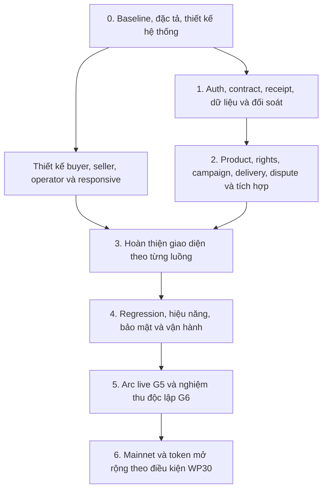

## Hiện hành — 19/10/2026: Safe T/A/N giữ và khôi phục riêng từng ví

Thay trạng thái hiện hành trong ghi chú lịch sử bên dưới. User trả lời **“T, A, N”** theo thứ tự ví trong câu hỏi, rồi xác nhận **“Mỗi người chỉ khôi phục ví của mình”**. Mapping được ghi theo khai báo trực tiếp:

| Owner | Giữ seed/backup và tự khôi phục |
|---|---|
| 0x73307bdd39d875f98857ffce0fed1cdc62f50b6d | T |
| 0x7366adbf19e511095e7737138498f625d737db22 | A |
| 0xc289b853d90f2c604fd38458b1ce4b991156d18b | N |

Không có quyền khôi phục chéo theo khai báo; không nhận/đọc seed, privatekey hoặc backup. Ba chữ ký verified ngày18/10 giữ nguyên context/timestamp; **challenge30fea22 đã hết hạn08:27:27 ngày19/10UTC+7, không dùng lại như control mới trênb989**. Không yêu cầu ký thêm/đổiowner/quorum/miễnđiềukiện. Khai báo đủ để chuyển sang rà soát độc lập, chưa gọi danh tính/custody vật lý đã được người độc lập kiểm. Các kết luận “1 người/NOT MET” lịch sử đã được sửa bởi khai báo ba người; không tái dùng làm kết luận hiện hành.

Readback **2026-10-19T05:23:35.823Z**, finalized **67960192**, hash0xae24e1e98cddfd3ee7b75e2777c88d663076a2bf08155587183ca674e42e6f3a: **14checks đạt**. Safe1.5.0 đúng3owners/quorum2-of3/nonce0/modulesrỗng; Hub roles/codehash/manifest/canonicalblock và noPendingSecurityAuthority khớp. Chỉ đọc, không execution/drill/giao dịch. Runtime383/public186/backendb989/frontend0c61/opsf021/helper9ccb/PID536813/NRestarts0 và BACKUP_CURRENT/privateRestore verified giữ. Native05:24:17UTC:19users/6campaigns/6orders/44ops/8grants/12inventory;ledger52/72/SHAee7087ef1992baf86b322aaf1259487d90fa0a17bf7c544c7ef5c16c3559ce17/5đơncũ/95held giữ. Không source implementation/deploy/restart/fullCI/backup mới.

**Tiếp:** không còn câu hỏi custody/chữ ký đang chờ ở bước này; tiếp tục vận hành và G5 độc lập. FILE_LINKorder6 đã rút đủ/escrow0/2ACTIVE; không mua/giao/confirm/claim lại. Circle/admin khác hoãn, username/socialPOSTV1, policy3backup/OneDrive làm sau/offhostRPO RTOOPEN; các branch live còn thiếu và independentreview/finalcandidatecontrol giữ phạm vi riêng. **NOT_FROZEN/G5OPEN/G6OPEN/acceptanceEligible=false/wholeProjectAccepted=false.**

CURRENT [CHECKS.json](E:/apps/group-deal/reports/evidence/safe-custody-mapping/2026-10-19T05-25-26-274Z/CHECKS.json), SHA256 **1770114f5660e8e793af68fcff63f8a3ad82e5a5b458080029461ba9a884eef3**, **291277 byte/14 artifacts/14branches**; parentG5 15artifacts/Safe8artifacts kiểm hash. [Báo cáo](E:/apps/group-deal/reports/evidence/safe-custody-mapping/2026-10-19T05-25-26-274Z/SAFE_CUSTODY_MAPPING.md). Observer .cache/safe-custody-readback.cjs /safe-custody-native.cjs /safe-custody-ops.cjs; clone đổi outputwx khi đọc tiếp; native dir .cache/application-recovery/drill-crvXHh/candidate. Source chỉ sửa checkout sạch .cache/ci/c-322e58ff, remote github; HEAD trước docs **9bd9e79028694bbdff7e8c4de079c131eba4408d**, HEAD sau có thể chỉ tiến bằng docs.

## Hiện hành — 19/10/2026: FILE_LINK #6 khép hành trình; guard chỉ đọc đã kiểm

Trạng thái này thay ghi chú lịch sử bên dưới. **Đơn #6 đã mua/giao2quyền/tải ZIP/confirm/buyer rút0,4/seller rút1,6USDC; escrow0, orderCONFIRMED, hai grantACTIVE. Không ký hoặc làm lại bước nào của đơn này.** Hai receipt và net wallet delta đã canonical/finalized/native-verified trong parent;48checks. Gas buyer0,06192002/seller0,003680775USDC native, ví tăng ròng0,33807998/1,596319225.

Gói mới thêm **4 eth_call** ở finalized block67956392: buyer/seller claim lặp và dùng principal đối diện đều revert đúng lý do; **4 GET** không token/cookie ở hai grant download-link/download đều401 đúng auth error/private/no-store. Không ký/gửi giao dịch/tạo intent/dùng phiên authenticated/đọc bytes tài nguyên. Không coi mô phỏng này là receipt lỗi hoặc negative API/UI authenticated. Single-value X-Content-Type-Options bị lặp nosniff, nosniff: browser algorithm nhận giá trị đầu theo [Fetch §3.6](https://fetch.spec.whatwg.org/#x-content-type-options-header), còn header conformance cleanupOPEN. Diagnostic inspector đầu giữ; chỉ derived analysis đổi cách đọc header, không sửa product/Nginx.

Native **2026-10-19T04:52:41.724Z** khớp toàn bộ trường chọn của parent:19users/6campaigns/6orders/44ops/8grants/12inventory; **52flows/72reservations/SHAee7087ef1992baf86b322aaf1259487d90fa0a17bf7c544c7ef5c16c3559ce17**, năm đơn cũSHAf864e1a7…/95held giữ. Buyer nonce27/seller15 không pending, claimflags true/escrow0. Runtime383/public186/backendb989/frontend0c61/opsf021/helper9ccb/PID536813/NRestarts0 và BACKUP_CURRENT/privateRestore verified giữ. Không implementation/deploy/restart/fullCI/backup mới cho gói chỉ đọc. Policy3managedverified+1unknownarchive/OneDrive làm sau/offhostOPEN.

**Câu hỏi cần user:** ai giữ seed/backup và có thể khôi phục từng Safe owner73307bdd…50b6d,7366adbf…7db22,c289b853…6d18b. User đã sửa câu “1 người” thành ba người khác nhau ký; giữ việc này, chỉ hỏi phần quyền khôi phục còn thiếu, có thể dùng A/B/C và không gửi bí mật. **Chưa cần ký thêm.** Challenge cũ đã hết hạn/context backend cũ; chỉ dùng như bằng chứng lịch sử, không tái dùng cho candidate hiện hành. Tiếp tục phần độc lập khi chờ. Circle/admin khác vẫn hoãn; username/socialPOSTV1; provider/email/offhost và nhánh G5 còn thiếu giữOPEN. **NOT_FROZEN/G5OPEN/G6OPEN/acceptanceEligible=false/wholeProjectAccepted=false.**

CURRENT [CHECKS.json](E:/apps/group-deal/reports/evidence/file-link-negatives/2026-10-19T04-53-56-266Z/CHECKS.json), SHA256 **80c19a78d0793940ae9823f62ab23cf3098225cd224aba30754a9b067ae38222**, **286494 byte/15 artifacts/14 branches**; parent claims23artifacts kiểm hash. [Báo cáo](E:/apps/group-deal/reports/evidence/file-link-negatives/2026-10-19T04-53-56-266Z/FILE_LINK_NEGATIVES.md). Claims CURRENT riêng giữ packet reports/evidence/file-link-claims/2026-10-19T04-49-34-254Z/CHECKS.json /SHA82fbfbaad7e6608f2311101d667fb121b09c45b549e628eb1f9aa7efc0383446 /285258byte/23artifacts. Observer **.cache/file-link-negative-native.cjs**, **.cache/file-link-negative-ops.cjs**, native dir **.cache/application-recovery/drill-crvXHh/candidate**; clone đổi outputwx trước khi đọc tiếp. Source chỉ sửa checkout sạch **.cache/ci/c-322e58ff**, remote github; HEAD trước docs **c3021977f90e1ba33e2026f5536581f661235240**, HEAD sau có thể chỉ tiến bằng docs.

## Hiện hành — 19/10/2026: FILE_LINK #6 đã rút đủ; escrow bằng 0

Phần này thay trạng thái hiện hành trong các ghi chú lịch sử bên dưới. **Đơn #6 đã đi đủ mua → giao2quyền → tải/kiểm ZIP → xác nhận → buyer rebate → seller claim. Không cần user ký thêm cho đơn này; không lặp lại giao dịch đã xong.** Buyer580c/seller24F, campaign5/draft_d702. Order CONFIRMED, hai grant ACTIVE, buyerClaimedAmount400000/sellerClaimedAmount1600000/refund0, escrow **0 USDC**.

| Khoản đã finalized/PROJECTED | Hash | Gốc về ví | Gas USDC native | Ví tăng ròng |
|---|---|---:|---:|---:|
| Buyer /nonce26/block67955473 | 0x965da6a92cf3ba19b452535048b7b240c841768483cdc9ba084efc499be863be | 0,4 USDC | 0,06192002 | 0,33807998 USDC |
| Seller /nonce14/block67955929 | 0xa4e73a7a8b7c60ce796fa67f6a01387409e29a8773ae32d074651e3deba6cd28 | 1,6 USDC | 0,003680775 | 1,596319225 USDC |

Mỗi khoản **24 kiểm tra** exact call/principal/calldata/orderIds=[6]/FundsClaimed/Transfer/canonical/finalized/native claim flags/escrow/net wallet delta đạt. Escrow **2→1,6→0**. Buyer op_b523f49b-513b-4a0a-a4cb-55dbf2a06627; seller op_c852efe2-cdb0-4600-b0ea-9cd37d43d7fc; đều PROJECTED. Latest=pending buyer27/seller15 ở mốc canonical. RPC estimate không phải trần phí; chưa biết thiết lập OKX/nguyên nhân chênh lệch.

Native **2026-10-19T04:48:23.228Z**:19users/6campaigns/6orders/**44operations**/8grants/12inventory; ledger52flows/**72reservations**/SHA **ee7087ef1992baf86b322aaf1259487d90fa0a17bf7c544c7ef5c16c3559ce17**. Parent42/70→44/72 do hai chữ ký thật, không manual release. Năm đơn cũSHAf864e1a7f21a123450f6d17111f2f0bbc5514557bb47d048b1cd521622b24ae9/grants/95held giữ. Không đổi implementation/deploy/restart/fullCI.

Runtime383/public186/backendb989/frontend0c61/opsf021/helper9ccb/PID536813/NRestarts0 giữ, hash khớp. Backup sau cả hai khoản **private-restore verified/BACKUP_CURRENT**, đúng44ops/8grants/95held. Giữ3managedverified+1unknownarchive; OneDrive làm sau/offhost RPO RTOOPEN. Màn ký/download không do agent quan sát sau browser4/tab1905950848 debugger unattached; receipt/native/localfile có bằng chứng riêng. Không yêu cầu login lặp lại vì thiếu điều khiển.

**Bước tiếp:** tiếp tục G5 độc lập, ưu tiên kiểm rejection chỉ đọc của khoản đã claim và quyền ví; tuyệt đối không gửi giao dịch lặp. Các recovery/session/device/batch/provider/negative khác vẫn có yêu cầu bằng chứng riêng. Circle/admin khác hoãn, username/socialPOSTV1, Safe proof/context cũ giữ. Một hành trình FILE_LINK không chứng minh mọi nhánh G5. **NOT_FROZEN/G5OPEN/G6OPEN/acceptanceEligible=false/wholeProjectAccepted=false.**

CURRENT [CHECKS.json](E:/apps/group-deal/reports/evidence/file-link-claims/2026-10-19T04-49-34-254Z/CHECKS.json), SHA256 **82fbfbaad7e6608f2311101d667fb121b09c45b549e628eb1f9aa7efc0383446**, **285258 byte/23 artifacts/14 branches**. Parent confirm15artifacts kiểm hash; download20/delivery50 kiểm ở gói trước. [Báo cáo](E:/apps/group-deal/reports/evidence/file-link-claims/2026-10-19T04-49-34-254Z/FILE_LINK_CLAIMS_VERIFIED.md). Observer **.cache/file-link-seller-claim-native.cjs**, **.cache/file-link-claims-ops.cjs**; clone đổi outputwx trước khi đọc tiếp. Native dir **.cache/application-recovery/drill-crvXHh/candidate**. Source chỉ sửa checkout sạch **.cache/ci/c-322e58ff**, remote github; HEAD trước docs **31eb9a255188d1634471ba772acf16cb7c41a98f**, HEAD sau có thể chỉ tiến bằng docs.

## Hiện hành — 19/10/2026: FILE_LINK #6 đã tải, kiểm ZIP và xác nhận nhận hàng

Phần này thay trạng thái hiện hành trong các ghi chú lịch sử bên dưới. Đơn #6 **CONFIRMED**, hai grant **ACTIVE**. Không mua, xuất bản, giao hoặc xác nhận lại. Buyer **0x580cdb6a6354313f73ff16b160b15dcc914d21ae**, seller **0x24F0c19a6E77cc687181500455BeE3550E617580**.

- User tải ZIP tại C:/Users/MKT/Downloads/GROUPDEAL_CSV_STUDIO_1.0_FILE_LINK.zip: **6852 byte**, SHA256 **5f90be577b10d60f6622b92782af0939ef717ebee12851e53477a8e8bb6bc429**, khớp resource. Sáu kiểm tra đạt: size/hash/CRC/path và loại entry/đúng 4 tệp/toàn bộ byte khớp sample. Nginx ghi cả hai grant download 200/6852 byte lúc 11:21:03 và 11:21:09 UTC+7. Chỉ một tệp local được kiểm; không quan sát browser download do debugger chưa attach. Diagnostic đầu kỳ vọng sai 5 entry được giữ; chỉ sửa inspector, không sửa ZIP/source/runtime.
- Human tự ký **confirmReceipt(5,6)**, op **op_011ad8a3-f733-4e9d-865c-cec4c5715865 PROJECTED**, tx **0x2ca0610e243ec42ba5dd9b45a45e31486032bdb76e34999a2d92d3eeaa33a519**, nonce25/block67954400/11:34:40 UTC+7. **22 kiểm tra** exact call/event/canonical/finalized/native/tài chính/grants đạt. Buyer latest=pending26 tại mốc đọc. Xác nhận đã kết thúc quyền mở tranh chấp; không yêu cầu ký lại.
- Seller được phân bổ **1,6 USDC**, buyer rebate **0,4 USDC**, refund0; **cả hai chưa rút**, escrow2 USDC. Hai khoản rút chỉ mô phỏng read-only, mỗi khoản10checks đạt: buyer claimBuyerFunds(5,[6]), seller claimSellerProceeds(5,[6]). Chưa tạo claim intent trong snapshot 04:39:10 UTC. User đã được hướng dẫn tự rút buyer0,4; chưa có receipt claim trong hồ sơ này. Phải đọc lại cùng intent/hash sau phản hồi, không suy đã rút từ thông báo user.
- Phí confirm thực tế **0,0760286672 USDC native**, khác RPC estimate0,003168375. Chưa quan sát thiết lập phí OKX hoặc nguyên nhân chênh lệch. Không coi estimate/margin là trần phí; user kiểm phí cuối trong ví trước từng chữ ký. G5-02 giữ yêu cầu bằng chứng riêng về estimate và phí ví.
- Native **2026-10-19T04:39:10.133Z**:19users/6campaigns/6orders/**42operations**/8grants/12inventory; ledger52flows/**70reservations**, SHA **b2c33fc87c8322acac1cf70383b0ad98ef8fcd753a4862445291a157db48d7df**. 69→70 do readiness/chữ ký thật; không manualrelease. Năm đơn cũ SHA **f864e1a7f21a123450f6d17111f2f0bbc5514557bb47d048b1cd521622b24ae9**, 95held giữ.
- Runtime/source không đổi: backend **b989bfdfcdcb5ef2b35a3d43498de378b768c419**, ops **f0213a72f52de3c152c67cded6613dc8e93eb61f**, frontend **0c61f06f7aa5dc4d3cd9f5c7fddaf9bc8ed2e876**, PID536813/NRestarts0, **383runtime/186activepublic** khớp. Helper SHA **9ccb5ee9cbc91011fd582ffac8461887cf87d5fbd722aa6e458c657d002a3dc1**. Backup sau confirm lúc04:38:26.813UTC đã private-restore verified/BACKUP_CURRENT, đúngcounts/95held. Giữ3managedverified+1unknownarchive; OneDrive làm sau, offhost/RPO/RTOOPEN. Không đổi implementation/deploy/restart/fullCI trong hai gói này.

**Bước tiếp:** buyer580c tự review phí/ký rút rebate0,4 USDC tại [đơn #6](https://groupdeal.thanhtan.top/orders/6?returnTo=%2Forders), kiểm receipt/Transfer/claim flag/escrow rồi seller24F tự rút1,6 USDC. Giữ intent/hash đang chờ; không ký hoặc tạo yêu cầu thay thế. Browser4/tab1905950848 trước đó debugger unattached; không yêu cầu login lặp lại chỉ vì phiên điều khiển thiếu. Circle/admin khác hoãn; username/socialPOSTV1; Safe giữ proof/context cũ. **NOT_FROZEN/G5OPEN/G6OPEN/acceptanceEligible=false/wholeProjectAccepted=false.**

CURRENT [CHECKS.json](E:/apps/group-deal/reports/evidence/file-link-confirm/2026-10-19T04-36-15-107Z/CHECKS.json), SHA256 **785f05d8cc9def1b254f70761f752327a0aef2095faac0cf0798fa286c5bcd66**, **277706 byte/15 artifacts/14 branches**. Parent download [CHECKS.json](E:/apps/group-deal/reports/evidence/file-link-download/2026-10-19T04-23-29-686Z/CHECKS.json), SHA **e49e906e6a72debca606bfd5eb5cc745275d503f6d53a12e2c1fea2d63137b5f**, 274360 byte/20artifacts; delivery parent50artifacts đã kiểm hash. [Báo cáo confirm](E:/apps/group-deal/reports/evidence/file-link-confirm/2026-10-19T04-36-15-107Z/FILE_LINK_CONFIRM_VERIFIED.md). Observer hiện hành **.cache/file-link-confirm-native.cjs** và **.cache/file-link-confirm-ops.cjs**; clone đổi outputwx trước khi đọc tiếp. Native dir **.cache/application-recovery/drill-crvXHh/candidate**. Source chỉ sửa checkout sạch **.cache/ci/c-322e58ff**, remote **github**, HEAD trước docs **26bcd12411b12ec9be221b7f19f759cc181426d3**; HEAD sau có thể chỉ tiến bằng docs.

## Hiện hành — 19/10/2026: FILE_LINK đơn #6 đã giao; sửa đọc lịch sử RPC

Phần này thay trạng thái hiện hành trong các ghi chú lịch sử bên dưới. **Đơn #6 đã mua và giao thành công. Không mua, xuất bản hoặc ký giao hàng lại.** Buyer **0x580cdb6a6354313f73ff16b160b15dcc914d21ae**, seller **0x24F0c19a6E77cc687181500455BeE3550E617580**.

- Seller tự ký cùng DELIVER **op_2fc3d8e7-8d5e-4ac8-974f-c9359e99a1fe**, nay **PROJECTED**; tx **0x997348b35f8d46ad11acf1292718fe1013d82d5970a7e04c5424693372ca2104**, nonce13/block67951184/11:07:31 UTC+7.21 kiểm tra exact call/proof/event/canonical/finalized/native/grants/tài chính đạt. Hai grant cùng IDs từ STAGED thành **ACTIVE**, mỗi đơn vị1seat; ZIP6852/SHA5f90be…/resource res_258c1523-2adb-4c54-9fc9-594786fda36f và product/license ghim khớp. Gas thực tế **0,002657148USDC native**. Latest=pending14.
- Hold trước ký do RPC thiếu lịch sử đã tái hiện: primary/Blockdaemon/Quicknode trả null cho6receipt/hash cũ; dRPC chỉ request đơn đọc được, batch không đáp ứng. Backend **b989bfdfcdcb5ef2b35a3d43498de378b768c419** / ops **f0213a72f52de3c152c67cded6613dc8e93eb61f** đã push/deploy. Chỉ sửa ArcReadProvider để dùng từng envelope cho dRPC, ưu tiên đọc hash/receipt ở đó và thử endpoint cố định khi null; chain/ID/revert/mutation checks giữ, mọi nơi thiếu vẫn chặn. Signer/nonce/receipt/finality guards giữ nguyên. Helper chỉ đổi expectedSource.
-10ca hồi quy mới, bộ RPC cũ,11ca signer adapter synthetic và backendbuild đạt; không fullCI.13receipt seller nonce0–12 và pure planner trên dữ liệu thật đạt23.273s, không apply. Native upgrade2runtimefiles giữ toàn bộ live fields/ledger, privateRecovery và accounting reconciliation HEALTHY; maintenance21.396s.383runtime/186activepublic khớp, frontend0c61f06/Nginx giữ; PID**536813**/restarts0, native dir **.cache/application-recovery/drill-crvXHh/candidate**. Helper SHA **9ccb5ee9cbc91011fd582ffac8461887cf87d5fbd722aa6e458c657d002a3dc1**.
- Native04:12:40UTC:19users/6campaigns/6orders/**41operations/8grants**/12inventory; ledger52flows/**69reservations**, SHA **94ac9f7ef1127e821422ccef67e95b75dbcd231457d4167d66cfbac1e6449dc9**. Prepare tạo1DELIVER/2grant; upgrade giữ52/68; human ready+ký giao mới thành52/69.5đơn cũSHAf864e1a7…/95held giữ, không manualrelease/clearDB/replay. Rebate0,4 đã phân bổ nhưng chưa rút; seller/refund0, escrow2USDC; buyer chưa confirm/claim.
- Backup sau receipt giao đã private-restore verified/BACKUP_CURRENT, cùng6orders/41ops/8grants/95held. Policy3managedverified+1unknownarchive giữ; OneDrive làm sau/offhost/RPO/RTO OPEN. Bộ test signer gọi trực tiếp đầu thiếu môi trường fixture nên FAILcases0, rerun đúng localCheckEnvironment PASS; diagnostic giữ. Không nói đã tải file: Chrome kết nối đổi ID3→4; agent đã đọc nhầm phiên Chrome khác, sau URL user/inventory mới tìm đúng tab **1905950848/browser4**, nhưng debugger chưa attach. User báo “Chưa kết nối được”. Đây không phải bằng chứng lỗi login của app hoặc user đăng nhập sai.

**Bước tiếp:** khôi phục điều khiển đúng tab [đơn #6](https://groupdeal.thanhtan.top/orders/6?returnTo=%2Forders), kiểm phiên buyer580c rồi tải/kiểm ZIP. Nếu chưa kết nối được, user có thể tải ZIP thủ công và cung cấp localpath để agent kiểm hash. Sau đó user tựconfirm và claim rebate; seller claim khi được phân bổ. Chưa yêu cầu login/ký giao hàng lại. Giữ Circle/admin khác hoãn, username/social POSTV1, Safe proof/context cũ. **NOT_FROZEN/G5OPEN/G6OPEN/acceptanceEligible=false/wholeProjectAccepted=false.**

CURRENT [CHECKS.json](E:/apps/group-deal/reports/evidence/file-link-delivery/2026-10-19T03-52-44-222Z/CHECKS.json), SHA256 **0fce7aa83edf3a4029bf9a01ee469c95e1a7cd190152e38212f7bc1027bf70cc**, 276263bytes/**50artifacts/14branches**;26artifact parent kiểm hash. [Báo cáo](E:/apps/group-deal/reports/evidence/file-link-delivery/2026-10-19T03-52-44-222Z/FILE_LINK_DELIVERY_RPC_RECOVERY.md). Observer hiện hành **.cache/file-link-delivery-receipt-native.cjs** / **.cache/file-link-delivery-ops-handoff.cjs**; clone đổi outputwx khi đọc tiếp, dùng backendb989/PID536813/helper9ccb5e. Source chỉ sửa checkout sạch **.cache/ci/c-322e58ff**, remote github; HEAD trước docsf0213a72f52de3c152c67cded6613dc8e93eb61f, HEAD sau có thể chỉ tiến bằng docs.

## Hiện hành — 19/10/2026: FILE_LINK đã mua thật, đơn #6

Phần này thay trạng thái hiện hành trong các ghi chú lịch sử bên dưới. **Đơn #6 đã mua thành công**, không yêu cầu mua hoặc xuất bản lại. Buyer do user chọn là **0x580cdb6a6354313f73ff16b160b15dcc914d21ae**; seller **0x24F0c19a6E77cc687181500455BeE3550E617580**.

- Sau bản sửa timeout frontend0c61f06, user báo đã đến màn phí rồi tự ký. Approve đúng Hub2USDC: **0x100e397c616253f73c5458caefece28056bda9c8a323c6ba50876268ef924289**, nonce23. Mua2đơn vị/2USDC: **0xe0148def1dd031d64fe2debd6c005c24046c8b38f9076ca04b186fd4a1deff99**, nonce24/block67947791.24 kiểm tra receipt/canonical/finalized/principal/calldata/event đạt; latest=pending25. Agent không ký/broadcast/đồng ý điều khoản. Màn phí trước ký không được agent chụp.
- BUY **op_d4767d88-a004-4d83-ba79-ee32baa86efe** từ UNKNOWN/RECEIPT_NOT_VERIFIED đã phục hồi qua UI **cùng hash** thành PROJECTED/order6. Ledger không đổi qua phục hồi. Campaign#5 bán hết2đơn vị và tự FINALIZED ở giá0,8USDC/đơn vị. Native/chain9kiểm tra tài chính đạt: rebate0,4USDC đã phân bổ/chưa rút; seller/refund0; escrow2USDC. Gas thực tế approve+mua **0,42299852USDC native**, riêng tiền hàng2USDC; dự phòng0,07 trong ghi chú cũ không phải phí thực tế. Diagnostic observer getter/enum sai ban đầu được giữ, đã sửa riêng observer theo contract.
- Đơn #6 **PENDING giao hàng**, chưa proof/hash/grant, chưa download/confirm/claim. SLA **10:38:51 ngày20/10 UTC+7**. Ghim pv_9a577a80-9b57-4db8-9559-0e6015fa9c84 / lv_2730410d-3b49-476d-9d54-4589ea2e20d8; dùng lại resource res_258c1523-2adb-4c54-9fc9-594786fda36f/ZIP6852/SHA5f90be…/rights đã duyệt. Không upload/duyệt/publish lại. Seller đã login, dialog giao đúng đơn6 đã mở; chưa prepare hoặc ký giao hàng trong gói này.
- Native03:48:48UTC:19users/6campaigns/**6orders/40operations**/6grants/12inventory; ledger52flows/**68reservations**/SHA7e8dad079f216f12a6d59031a7e7d28748993652e94ee5b84c73cc1c49f6d080.67→68 do mua thật của user;5đơn cũ SHA f864e1a7…/publication#5/**95held giữ nguyên**. Hai intent cũ EXPIRED, swap cũ giữ nguyên.
- Backup sau PROJECTED tại03:44:35UTC đã private-restore verified/BACKUP_CURRENT, chứa6orders/40ops/95held. Giữ3bản managed verified và1unknown archive theo policy hiện hành; OneDrive làm sau, offhost/RPO/RTO OPEN. Runtime383/public186 hash khớp; backendf52dac9/frontend0c61f06/PID205372/restarts0 giữ. Không đổi source implementation, deploy, restart hoặc fullCI trong gói.

**Bước tiếp:** prepare tài nguyên cho đúng order6 bằng phiên seller hiện tại, kiểm proof và2unit grants; user seller24F tự kiểm phí/ký recordDelivery. Sau receipt, buyer580c tải/kiểm ZIP rồi tựconfirm và claim; kiểm khoản seller sau confirm. Không replay đơn1–5 hoặc mua lại6. Circle/admin khác hoãn; username/social POSTV1; Safe giữ proof/context gốc. **NOT_FROZEN/G5OPEN/G6OPEN/acceptanceEligible=false/wholeProjectAccepted=false.**

CURRENT [CHECKS.json](E:/apps/group-deal/reports/evidence/file-link-purchase/2026-10-19T03-39-53-121Z/CHECKS.json), SHA256 **8a8239df3e5ca472ae4ca6ea8ad02d8729220cd7725e6bb3267296e51ac07cbe**, 264009bytes/**26artifacts/14branches**;47artifact parent đã kiểm hash. [Báo cáo](E:/apps/group-deal/reports/evidence/file-link-purchase/2026-10-19T03-39-53-121Z/FILE_LINK_PURCHASE_VERIFIED.md). Observer .cache/file-link-purchase-detail-native.cjs, ops-final.cjs, canonical.cjs, financial-v2-observer.cjs; clone đổi outputwx. Source chỉ sửa checkout sạch **.cache/ci/c-322e58ff**, remote github, HEAD trước docs7b4a824301d59c55abfae541746700995c29924e; HEAD sau có thể chỉ tiến bằng docs.

## Hiện hành —19/10/2026: sửa timeout ready trước mở ví

Phần này thay trạng thái hiện hành trong các ghi chú lịch sử bên dưới. Frontend **0c61f06f7aa5dc4d3cd9f5c7fddaf9bc8ed2e876** đãpush/deploy: chỉPOST /api/transactions/op_UUID/ready chờ45s, các request khác10s,không auto retry. Có tiến trình READY nói đang kiểm giá/lịch sử ví trước chữ ký;aria-current bước1. EntireWeb3Context/signing/approve vàbackend/shared/config/scripts giữ;CampaignDetail chỉ thêm1setTxStep.

- Đã xác định currenttimeout: frontend cắt ready10s,server kiểm signer+quote hoàn tất khoảng20.5s;Nginx499 ở cảop97cfvàop3080,rồi native mớiAWAITING_SIGNATURE. Regressionloopback12s FAILTimeoutErrorởbảncũ/PASS12072msởbảnmới/1request.7ca auth/path/method/payload/timeout/no-retry+10samehashrecovery đạt,typecheck/build/secretscan0,1CUAactual1536px/5assertions,18HTTPS đạt. Fixture0API/khôngDB/ví đãdừng,initialfixtureparseerror giữdiagnostic. KhôngfullCI/408matrix. Chưahumanpostfixbuyreceipt.
- User attempt mới **op_3080356a-215a-4713-9ea2-76314558d968** từngAWAITING_SIGNATURE/nohashdo bảncũtimeout. Saudeadline10:35:22,UIguardkiểm cùngintent thành**EXPIRED**.9independentcanonical/finalized/signature/principal/noncechecks đạt;identityNonce0unused/EVMlatest=pending23. Intentop97cfcũ vẫnEXPIRED. Khôngmanualrelease/clearDB/ký/broadcast.
- Nativefinal theoCURRENT:19users/6campaigns/**5orders/39operations**/6grants/12inventory;ledger52flows/**67reservations**/SHAa5c3fa5ca86cb7280e863bb81d7941fbea0899461312af3151cfb28d8d5df2df.66→67 là delta app sau human bấm mua trước gói;deploy/expirygiữledger.5đơn cũSHAf864e1a7…/publication#5/95heldgiữ.
- Backendf52dac9/PID205372/NRestarts0/383runtime/Nginx308ee39/helper6a7d3f9giữ;**186activepublic=182main+4Safe/3590filesystem**,86assetmới,mọi3504preimage ngoài3mutableentries/Safe/immutablegiữ. BACKUP_CURRENT/3managedverified/1unknownarchivegiữ;OneDrive làm sau,offhost/RPO/RTOOPEN.

**Bước tiếp:** dùngbuyer **0x580cdb6a6354313f73ff16b160b15dcc914d21ae**,OKXChrome/RPC.io đãuserxácnhận. Mở đúng [deal#5](https://groupdeal.thanhtan.top/deals/draft_d702e1b5-2db3-4795-943c-a08dad36cafb),kiểm cùngintent đểUI nhậnEXPIRED qua guard,rồireview2đơn vị/gross2USDC. User tựđồngý điều khoản,giữtabtrước tronglúcREADY,rồibáokhiđếnmànphíthật;user tựký. Agentkhôngbấmmuacuối hoặc tạoBUY;khôngreplayđơn1–5. Khôngdùnghasha34df9…cũ:đó là1USDCswapadapter17/10,requestswapPLANNEDgiữ. FILE_LINKmua/giao/tải/confirm/rebate/claimcònOPEN;Circle/adminkhác hoãn,username/socialPOSTV1,Safecontextkếthừa. NOT_FROZEN/G5OPEN/G6OPEN/acceptanceEligiblefalse.

CURRENT [CHECKS.json](E:/apps/group-deal/reports/evidence/checkout-timeout/2026-10-19T03-21-47-089Z/CHECKS.json),SHA256 **53709b8ec5e564c3dcba7190f52b8956b5e80813b2f3d30f043586b4bc588a33**,262217bytes/**47artifacts/14branches**;parent17artifacts đãkiểmhash. [Báo cáo](E:/apps/group-deal/reports/evidence/checkout-timeout/2026-10-19T03-21-47-089Z/CHECKOUT_READY_TIMEOUT.md). Observer .cache/checkout-timeout-native.cjs/ops-final.cjs/expiry-canonical.cjs,manifest .cache/checkout-timeout-public-files.json;clone đổioutputwx. Source chỉsửa checkout sạch .cache/ci/c-322e58ff,remote github;HEAD0c61f06cóthểtiếnbằngdocs.

## Hiện hành —19/10/2026: buyer FILE_LINK và chứng thực mua hết hạn

Phần này thay trạng thái hiện hành trong các ghi chú lịch sử bên dưới. **Buyer user chọn là 0x580cdb6a6354313f73ff16b160b15dcc914d21ae**, thay e48b trong packet cũ. Đã login buyer/đối chiếu địa chỉ đầy đủ,OKXChrome/RPC https://rpc.testnet.arc.io do user xác nhận. Seller đã xuất bản campaign#5 đúngdraft_d702/v3/UNLISTED/FILE_LINK; không yêu cầu ký publication lại.

- Review2đơn vị/gross2USDC/fee0; tại lúc đọc số dư15.592337748875104305USDC,gas reserve0.07/tổng2.07. Budget60giây có thể hết hạn; đọc lại trước consent. Rebate0.4chỉ là kịch bản, chưa phân bổ. Agent không tích điều khoản/bấm mua cuối/ký/broadcast.
- Human bấm mua tạo1BUY **op_97cf4086-10b0-45ee-8e17-da476aaf8836**, từng AWAITING_SIGNATURE/nohash. User gửi hash **0xa34df91f5573a8fe9bd8bb222f647ba718e5332c6e3a3f47e38b50572ac45058**: success/canonical/finalized nhưng là approve **1USDC cho swap adapter**,nonce21,lúc00:44:56 ngày17/10 UTC+7. Không phải approve cho Hub của lần mua#5. Requestswapwop_d1b90d2c…c80/step1PLANNED giữ,khôngresume.
- Sau deadline10:16:42, dùng chức năng UI kiểm hết hạn đã ghi **EXPIRED/BUY_AUTHORIZATION_EXPIRED_UNCONSUMED**. Block67945204,hash0x12167bb2119a44261f8c0ea8c6b52aa58bbca27ede1a429ad8c16eacd39c8429,timestamp1792379820>deadline1792379802,authorizationNonce0chưa dùng.9kiểm independent canonical/finalized/nonce/principal/EIP712/quantity/campaign đạt. EVM latest=pending23. Đây là expiry proof, chưa receipt mua. Không manualrelease hoặc clear DB.
- Native03:17:17UTC:19users/6campaigns/**5orders/38operations**/6grants/12inventory. Ledger52flows/**66reservations**/SHAac716a598a17898298c19945035460ca52a7a5013495ff85ab4d6d9620abbe9c;65→66 do app tạo intent sau human click,không đổi sauexpiry.5đơn cũSHAf864e1a7…/publication#5/95held giữ.
- Backendf52dac9/frontend6e01dc3/ops36b33ca/Nginx308ee39 giữ;ops03:14:24UTC khớp383runtime/186activepublic/PID205372/NRestarts0/BACKUP_CURRENT. Khôngsourceimplementation/deploy/restart/fullCI.1diagnostic chạy đúng read-provider frontend trong Node trảallowance0,không thay browser signing proof. Lỗi generic trước mở ví chưa tái hiện,không nói đã sửa bug.

**Tiếp theo:** mở đúng [deal#5](https://groupdeal.thanhtan.top/deals/draft_d702e1b5-2db3-4795-943c-a08dad36cafb),kiểm cùng intent để UI nhận EXPIRED/dọn checkpoint qua guard; review mới2đơn vị/2USDC, user tự đồng ý điều khoản/phí và ký request mới đúng ví580c. Agent chỉ chuẩn bị review,không tự tạo BUY hoặc ký. Nếu lỗi lặp lại giữ intent/hash và đúng bước lỗi,không bấm mua nhiều lần. Không replay đơn1–5. FILE_LINK mua/giao/tải/confirm/rebate/claim cònOPEN; Circle/admin khác hoãn,username/socialPOSTV1;3managedbackup/1unknownarchivegiữ/OneDrive làm sau/offhostOPEN. NOT_FROZEN/G5OPEN/G6OPEN/acceptanceEligiblefalse.

CURRENT [CHECKS.json](E:/apps/group-deal/reports/evidence/file-link-buyer-expiry/2026-10-19T03-17-29-913Z/CHECKS.json),SHA256 **7abc271c5c6a5055f1c67634991f7d0496c6c1c34c4e3d6198bc259c7f7fe4ab**,248344bytes/**17artifacts/14branches**;parent30artifacts kiểm hash,grandparent57đã kiểm tronggói trước. [Báo cáo](E:/apps/group-deal/reports/evidence/file-link-buyer-expiry/2026-10-19T03-17-29-913Z/FILE_LINK_BUYER_PROGRESS.md). Observer .cache/file-link-buyer-expiry-native.cjs/ops-handoff.cjs/expiry-canonical.cjs;clone đổi outputwx,không rerun ghi đè. Source chỉ sửa checkout sạch .cache/ci/c-322e58ff,remote github;HEAD3e50f14 có thể tiến bằng docs.

## Hiện hành —19/10/2026: bảng chiến dịch và FILE_LINK#5

Phần này thay các trạng thái lịch sử bên dưới. Frontend **6e01dc33ba1abeefc89704eb3fdc40e8c87833c9** đã push/deploy: bảng5cột, trạng thái/hiển thị, cam kết/bậc giá, thời gian UTC+7, icon hover/focus; form ghi chú/thay thế mở dialog. Có tìm/lọc và3cách sắp xếp; mobile chuyển dòng có nhãn, không cuộn ngang. Giữ brand/sidebar, không thêm thư viện.12ca pure/9CUA/7viewport thực tế375–1536px VI/ENsubset/typecheck/build/15HTTPS/live6rows đạt; khôngfullCI/408matrix.

**Seller đã ký xuất bản thành công, không yêu cầu ký lại.** Campaign **#5**, draft_d702e1b5-2db3-4795-943c-a08dad36cafb/v3,UNLISTED/FILE_LINK. Cùngop_1510d8a7-f9d8-4c8e-bb38-4eebe9079f8b **PROJECTED**,tx **0xe1e638b3713605796f4f7d289813c0c6c4e5aafadd80bcaeacddabba51e46f26**,nonce12,block67938825; exactcall/event/canonical/finalized verified.13receipt seller nonce0–12 đạt; latest=pending=finalized13. Thông báo hold trước đó không tái hiện trong pure verifier; user xác nhận ví khôngPending. Không kết luận đã sửa một bug signer chưa tái hiện.

Native2026-10-19T02:47:05.169Z:19users/6campaigns/5orders/37operations/6grants/12inventory; ledger52flows/**65reservations**/SHA33e41bda177a1445cbe210604d0e30cd12756460253640802dd2e270a86eb183.64→65 là delta app theo chữ ký thật của user, không manualrelease. Sau đó góiUI giữ nguyên ledger/campaign/op/5đơn cũSHAf864e1a7…/95held. Backendf52dac9/PID205372/NRestarts0/383runtime giữ;**186activepublic(182main+4Safe)/3504filesystem**,88asset mới,oldimmutable/Safe/Nginx giữ.

Backup sau xuất bản đã privateRestoreverified/BACKUP_CURRENT. Giữ3bản managed verified theo user,1unknown archive giữ riêng; OneDrive làm sau,offhost/RPO/RTO cònOPEN. Helper6a7d3f9/ops36b33ca/Nginx308ee39 giữ. Observer **.cache/campaign-table-ops-final.cjs**,manifest **.cache/campaign-table-public-files.json**,native **.cache/campaign-table-native.cjs**;clone đổioutputwx khi quan sát lại.

**Tiếp theo:** FILE_LINK chưa có buyer purchase/delivery/download/rebate/claim thật. Khi tiếp tục cần buyer **0xe48b30ea70f77e5fa6311471c2e9687f8a701ead** tựlogin đúng realm GroupDeal,review quantity2/gross2USDC/quote/gas rồi tựký. Chưa tạo BUY/đơn mới; không replay đơn1–5,không dùng draft_060mặc định. Không yêu cầu seller xuất bản lần nữa. Circle/admin khác hoãn;username/socialPOSTV1;Safe giữ proof/context cũ;R5–R7 source/UI hồ sơ đãkhép,NOT_FROZEN/G5OPEN/G6OPEN/acceptanceEligiblefalse.

CURRENT [CHECKS.json](E:/apps/group-deal/reports/evidence/campaign-table/2026-10-19T02-27-35-906Z/CHECKS.json),SHA256 **fbb2cd0d74884b9ebaa72c2115022c9392b3c0203e3651288a820cdb14c4c5de**,253052bytes/**57artifacts/14branches**. Parent59artifacts kiểm hash; các execution kế thừa giữ timestamp/context. [Báo cáo](E:/apps/group-deal/reports/evidence/campaign-table/2026-10-19T02-27-35-906Z/CAMPAIGN_TABLE_AND_PUBLICATION.md). Source chỉ sửa checkout sạch E:/apps/group-deal/.cache/ci/c-322e58ff,branch codex/license-key-csv-studio,remote github;HEAD có thể tiến thêm bằng docs. Kiểm CURRENT/source/runtime/hash trước thao tác; không stage/reset root.

## Hiện hành — 19/10/2026: phục hồi nháp, lịch sử và backup

Phần này thay trạng thái hiện hành trong các ghi chú lịch sử bên dưới. Frontend/backup helper **36b33ca83aaae579b1bdd50652fd45bf7ba5d8df**, Nginx route **308ee3920dc9574e7d26016689ec0805ec4f0087** đã push/deploy. Backend **f52dac9762d4ce4558b42502ccaceca916a36cc1** giữ PID205372/NRestarts0;383runtime/185activepublic(181main+4Safe)/3416filesystem. Không restart app, không đổi dữ liệu ứng dụng.

- Đã sửa nhánh biên nhận kiểm tra giao hàng hoàn tất nhưng UI chỉ báo giữ checkpoint. Khôi phục đúng publication sẵn có khi toàn bộ scope/version/input/intent khớp; chưa có publication thì giữ checkpoint và có nút tiếp tục với biên nhận đã xác nhận. Không tạo probe/prepare mới từ bước kiểm tra/hủy.
- **Lịch sử & phục hồi** là mục sidebar riêng: https://groupdeal.thanhtan.top/seller/transactions. Form tạo deal không còn bảng lịch sử ở cuối. Đã sửa cả route Nginx khi mở trực tiếp.
- 27ca pure recovery/route,8ca backup policy, frontend typecheck/build,6CUA chức năng/5quan sát375–1536px(VI/ENsubset),15HTTPS đạt. Live đọc đúng seller session, lịch sử và draftv3 ở bước5 với publication cũ. Không fullCI/408matrix; chưa thực thi chữ ký xuất bản mới.
- Backup từng STALE/storage limit. User quyết định **tạm giữ3bản managed verified gần nhất; OneDrive làm sau**. Đã áp dụng, prune128bản managed verified, tạo/restore verify bản mới và trả BACKUP_CURRENT. Giữ nguyên1archive thiếu metadata quản lý, không tính vào3bản verified. HelperSHA256 **6a7d3f920f00d5b88a341f055c19a4084983edb3d16e940eb5c754de6a239b29**; quota512MiB/freshness90phút/timer giữ. Chính sách3bản thay7ngày local theo user; chưa upload/cấu hình OneDrive; offhost/RPO/RTO vẫnOPEN.
- Native2026-10-19T02:04:24.246Z:19users/6campaigns/5orders/37operations/6grants/12inventory;5đơn cũ/hashf864e1a7…,ledger52flows/64reservations/hash209d178f…,95held giữ. PUBLISH **op_1510d8a7-f9d8-4c8e-bb38-4eebe9079f8b PREPARED/nohash**; draft **draft_d702e1b5-2db3-4795-943c-a08dad36cafb/v3**,termsHash0x0dfdab… giữ.

**Cần user:** đã quan sát phiên seller còn hiệu lực, hiện không yêu cầu login lại. User tự kiểm lịch sử/yêu cầu còn chờ của ví **0x24F0c19a6E77cc687181500455BeE3550E617580**, rồi ký cùng publication tại https://groupdeal.thanhtan.top/seller/create?draft=draft_d702e1b5-2db3-4795-943c-a08dad36cafb. Tab mới đã mở đúng bước5. Nếu ví cũ còn yêu cầu chờ, xử lý yêu cầu đó trước; không tạo intent khác hoặc ký trùng. Agent chưa bấm ký. Sau receipt thật mới tiếp tục buyer/giao FILE_LINK/rebate/claim; không replay đơn1–5 hoặc publish draft_060mặc định.

CURRENT: [CHECKS-v2.json](E:/apps/group-deal/reports/evidence/seller-recovery-2026-10-19T01-42-37-064Z/CHECKS-v2.json), SHA256 **4bb050b7d4016aa3f6f3eef95325e787c8965895ecb9e026d176036f9829a8d1**,247584bytes/59artifacts/14branches.59artifact và60artifact parent đều được kiểm hash; CHECKS.json ban đầu giữ nguyên, v2 sửa metadata schema và cờ session, không đổi execution proof. [Báo cáo](E:/apps/group-deal/reports/evidence/seller-recovery-2026-10-19T01-42-37-064Z/SELLER_RECOVERY_HISTORY.md).

Observer dùng **.cache/seller-recovery-ops-after.cjs**, manifest **.cache/seller-recovery-public-files.json**, native **.cache/seller-recovery-native.cjs**; clone đổi output`wx` khi quan sát lại. Kiểm CURRENT/source/runtime/hash trước thao tác. Source chỉ sửa tại **E:/apps/group-deal/.cache/ci/c-322e58ff**, branch codex/license-key-csv-studio; remote github; không stage/reset checkout gốc. HEAD có thể tiến thêm bằng commit docs.

Circle/admin live khác hoãn; username/social POST-V1. Safe3chữ ký và user khai3người giữ giữ context gốc; challenge đã hết hạn không được coi là proof mới. R5–R7 source/UI trong hồ sơ đã khép; ưu tiên Người dùng/Phân quyền → hành trình thật thiếu → vận hành → G5/G6. **NOT_FROZEN/G5OPEN/G6OPEN/acceptanceEligible=false/wholeProjectAccepted=false.**

**Quyết định tiếp tục — 18/10/2026:** người dùng đã đồng ý hoãn cả username bắt buộc cho seller và liên kết xác thực X/GitHub/Discord sang kế hoạch sau bản đầu. Xem reports/KE_HOACH_PHAT_TRIEN_SAU_BAN_DAU.md (POST-V1-01); không đưa gói này vào phạm vi chặn G5/G6 hiện hành. Đề xuất cũ triển khai social/username trước G5/G6 đã bị thay thế.

**Prompt bàn giao mới nhất:** E:/apps/group-deal/reports/PROMPT_CHAT_MOI_2026-10-18.md. Tiếp tục Người dùng/Phân quyền → hành trình thật còn thiếu → vận hành → G5/G6; giữ phần source/UI R5–R7 đã khép trong phạm vi hồ sơ hiện hành, chỉ mở lại khi có lỗi/delta. Admin authenticated live vẫn do user hoãn; tiếp tục phần độc lập khi chờ ký/offhost. Gói này chỉ sửa tài liệu, không quan sát lại hay triển khai ứng dụng; CURRENT G5 vẫn giữ proof r567-matrix/2026-10-17T18-24-51-868Z, NOT_FROZEN/G5 OPEN/G6 OPEN.

# KẾ HOẠCH THỐNG NHẤT HOÀN THIỆN GROUPDEAL

**Phiên bản:** 2.0 — 03/10/2026. **Mục tiêu duy nhất:** hoàn thiện GroupDeal thành sản phẩm mua chung sản phẩm số hoạt động đầy đủ, đúng nghiệp vụ, an toàn về tài chính, dễ dùng, responsive và có thể vận hành, bảo trì, kiểm chứng.

**Baseline mã nguồn khi rà soát:** nhánh `codex/arc-candidate`, commit `e80e5dd9369eccd96a54189e74ae2a7861cf2198`. Thư mục ảnh và hai báo cáo định hướng ngày 03/10 chưa được commit tại thời điểm rà soát. Kế hoạch này là kết quả đối chiếu tài liệu với mã nguồn; lượt lập kế hoạch không chạy lại toàn bộ test, không thực hiện giao dịch và không chứng nhận trạng thái live hiện tại.

**Trạng thái chung:** chưa hoàn tất dự án. Có nền contract, auth, ví, indexer, checkout và deployment đã được sửa/kiểm thử ở những phạm vi cụ thể; còn lỗi, khoảng trống chức năng và thiếu bằng chứng nghiệm thu toàn bộ sản phẩm. G5/G6 cũ đã bị thu hồi và chưa được thay bằng hồ sơ nghiệm thu mới.

**Hiệu lực:** đây là đầu mối duy nhất cho phạm vi, thứ tự và điều kiện hoàn thành công việc. Thay thế lịch thực thi và trạng thái tổng hợp trong các kế hoạch trước. Báo cáo cũ được giữ làm bằng chứng lịch sử. Bản kế hoạch v1.7 được lưu nguyên nội dung tại [bản lưu v1.7](./archive/KE_HOACH_HOAN_TAT_DU_AN_V1_7_03_10_2026.md); đường dẫn tương đối bên trong bản lưu thuộc vị trí `reports/` của tài liệu gốc.

## 1. Kết quả cuối cùng phải đạt

Phạm vi nghiệm thu cơ sở là **sản phẩm hoàn chỉnh trên Arc Testnet theo [PLAN.md](../PLAN.md)**, dùng các dịch vụ thật và hành trình người dùng thật. Bản này phải đủ tính năng để vận hành thử có kiểm soát, không phải giao diện trình diễn hay bộ test local. Việc mở rộng token và đưa lên Arc Mainnet được giữ trong WP30, có điều kiện triển khai và nghiệm thu riêng; nghiệm thu Testnet không đồng nghĩa đã sẵn sàng nhận tiền thật trên Mainnet.

Sản phẩm hoàn tất khi đồng thời đạt các điều kiện sau:

1. Buyer có thể khám phá sản phẩm, hiểu giá và quyền sử dụng, đăng nhập, chọn ví, chuẩn bị USDC/gas, mua, theo dõi giao dịch, nhận entitlement thật, xác nhận hoặc tranh chấp, nhận rebate/refund và rút phần được phép rút.
2. Seller có hồ sơ và payout wallet đã xác minh; tạo sản phẩm, khai báo quyền phân phối, cấu hình delivery, tạo/sửa bản nháp, thử luồng giao, publish, chia sẻ, quản lý campaign/order và rút phần được phân bổ. Chính sách sửa/hủy khớp khả năng contract.
3. Operator xử lý kiểm duyệt, tranh chấp, hỗ trợ và sự cố theo quyền cụ thể; mọi thao tác quan trọng có audit và bằng chứng. Security Safe vận hành được bằng các principal độc lập.
4. Mỗi khoản commit, allocation và claim đối chiếu được theo order/campaign, cùng một block; không có trạng thái thành công giả, số âm, claim bị khóa vì đã rút một phần, hoặc DB tự quyết định tài chính.
5. Giao diện bám phong cách năm ảnh đã chốt, có đầy đủ trạng thái, hỗ trợ mobile/tablet/desktop, bàn phím, tiếng Việt và các luồng cốt lõi tiếng Anh. Số liệu và lời hứa tài chính đều có nguồn dữ liệu, định nghĩa và hành vi thật.
6. Dữ liệu bền vững; indexer phục hồi được; webhook có retry/dedup; backup/restore, cảnh báo, migration, quản lý secret/key và runbook đã được thử.
7. Kiểm thử và hồ sơ nghiệm thu gắn với một candidate cố định: contract/reference model, API, browser, delivery provider, Arc live và rà soát độc lập đều có bằng chứng đúng tầng.

Không gọi dự án hoàn tất chỉ vì build PASS, số test tăng, trang đẹp, tổng escrow khớp hoặc giao dịch do một script đặc quyền thực hiện thành công.

## 2. Nguồn đã hợp nhất và cách đọc trạng thái

### 2.1. Sổ nguồn

| Nguồn | Vai trò trong kế hoạch thống nhất |
|---|---|
| [PLAN.md](../PLAN.md), [README.md](../README.md) | Yêu cầu sản phẩm ban đầu và mô tả hiện tại; PLAN là gốc phạm vi. README phải được chỉnh theo khả năng và bằng chứng cuối cùng. |
| [Frontend implementation brief người dùng cung cấp](./reference/GROUPDEAL_FRONTEND_IMPLEMENTATION_BRIEF.txt) | Bản sao nguyên văn để giữ căn cứ lâu dài: ba khu vực riêng, pricing rail, wizard, bốn master screens và responsive. Giới hạn “chỉ frontend” thuộc brief ban đầu; yêu cầu hiện tại của người dùng là hoàn thiện toàn dự án nên kế hoạch bao gồm các sửa backend/contract cần thiết. Không đổi semantics chỉ để khớp ảnh. |
| [Báo cáo kiểm tra dự án](./BAO_CAO_KIEM_TRA_DU_AN.md) | Mã phát hiện gốc F01–F32, UI01–UI04; giữ nguyên mã để truy vết. |
| [Kế hoạch thực thi cũ](./KE_HOACH_THUC_THI.md) | Ý định khắc phục ban đầu; checklist cũ không biểu thị trạng thái hiện tại. |
| [Báo cáo khắc phục toàn diện](./BAO_CAO_KHAC_PHUC_TOAN_DIEN.md), [báo cáo nghiệm thu và khắc phục](./BAO_CAO_NGHIEM_THU_VA_KHAC_PHUC.md) | Các thay đổi và kết luận ở mốc trước; đối chiếu lại phạm vi test và mã hiện tại. |
| [Báo cáo tái nghiệm thu 29/09](./BAO_CAO_TAI_NGHIEM_THU_29_09_2026.md), [thẩm tra nghiệm thu cuối](./BAO_CAO_THAM_TRA_NGHIEM_THU_CUOI.md) | Phát hiện A01–A14, sai tầng bằng chứng và các điều kiện chưa đạt. Mã A dùng theo báo cáo thẩm tra, không dùng cách đặt tên khác trong hồ sơ G6 cũ. |
| [G0 baseline inventory](./G0_BASELINE_INVENTORY.md), [G0](./evidence/G0_GATE_REPORT.md) | Inventory và baseline lịch sử; cập nhật candidate, dữ liệu, môi trường và phạm vi test trong WP01. |
| [G1](./evidence/G1_GATE_REPORT.md), [G2](./evidence/G2_GATE_REPORT.md), [G3](./evidence/G3_GATE_REPORT.md), [G4](./evidence/G4_GATE_REPORT.md) | Bằng chứng từng lớp đã có. Các chữ PASS trong tài liệu chỉ áp dụng candidate và phạm vi ghi ở đó; các phần bị lỗi mới tác động phải nghiệm thu lại. |
| [G5 dossier](./evidence/G5_ACCEPTANCE_DOSSIER.md), [G6 sign-off](./evidence/G6_FINAL_DELIVERY_SIGNOFF.md) | Hồ sơ đã bị thu hồi; không dùng làm bằng chứng hoàn tất mới. |
| [Kiến trúc Arc và phạm vi tích hợp](./KIEN_TRUC_ARC_VA_PHAM_VI_TICH_HOP.md), [runbook Arc](./RUNBOOK_VAN_HAN_ARC.md) | Ràng buộc mạng, gas, settlement, vận hành và phân biệt Testnet/Mainnet; cập nhật theo candidate cuối. |
| [Chuẩn bị tái triển khai 30/09](./BAO_CAO_CHUAN_BI_TAI_TRIEN_KHAI_ARC_30_09_2026.md), [tiến độ live 30/09](./BAO_CAO_TIEN_DO_LIVE_ARC_30_09_2026.md) | Lịch sử Safe, candidate mới, cleanup deployment cũ và khoảng trống live. Không tự tái deploy/cleanup vì đọc lại đề xuất cũ. |
| [Rà soát ví 02/10](./BAO_CAO_RA_SOAT_VI_VA_DU_AN_02_10_2026.md), [sửa lỗi và checkout 03/10](./BAO_CAO_SUA_LOI_VA_CHECKOUT_03_10_2026.md) | Sửa Circle identity/SDK, RPC, allowance, checkpoint, bridge và các kiểm thử đã thực hiện. Những sửa này phải được giữ và regression test. |
| [Kiểm tra GitHub 03/10](./BAO_CAO_KIEM_TRA_GITHUB_03_10_2026.md) | Trạng thái repository, dependency audit và giới hạn bằng chứng ở mốc gần nhất. |
| [Định hướng sản phẩm/frontend 03/10](./BAO_CAO_DINH_HUONG_SAN_PHAM_VA_FRONTEND_03_10_2026.md) | Khoảng trống Product/rights/delivery/accounting/API/UX và đề xuất mở rộng cần thiết. |
| [Phân tích ảnh và thiết kế 03/10](./PHAN_TICH_ANH_VA_DINH_HUONG_THIET_KE_FRONTEND_03_10_2026.md), [thư mục ảnh](../image/) | Hướng thiết kế đã được chốt; dùng bố cục và phong cách, chỉnh nội dung/logic theo nghiệp vụ thật. |

### 2.2. Kết luận hiện trạng đã hòa giải

| Nhóm | Đã có nền/bằng chứng lịch sử | Việc còn bắt buộc |
|---|---|---|
| Auth và ví | Đã bỏ luồng custody cũ; dùng Circle User-Controlled Wallet, sửa enum SDK, định danh qua Circle user đã xác thực; challenge bền vững, secret theo mục đích, payout proof. | Live OTP/ví độc lập; liên kết tài khoản an toàn; contact email được xác minh; ổn định campaign identity khi xoay secret; recovery và fallback embedded. |
| Contract | Có guards về conservation, zero fee, finalization/cancel theo batch, principal và cumulative quantity. Có 24 contract test tại mốc báo cáo. | Xem lại early rebate và validation; fuzz đúng nghĩa; ABI/state matrix; các race; kiểm thử lượng order lớn và quyền thực tế. |
| Backend/dữ liệu | Có receipt verifier, event journal, SQLite WAL, webhook queue và 16 script test tại mốc báo cáo. | Sửa claim projection, post-receipt race, publish binding; đối soát per-order; relational persistence/migration; rebuild an toàn; delivery adapter thật. |
| Checkout | Có BigInt, dự toán gas, exact allowance, xử lý allowance lớn cũ, Web Locks theo ví, kiểm receipt `CommitmentMade`, checkpoint browser. | Recovery backend/cross-device, dropped/replaced/unknown transaction, receipt đã có nhưng API chưa ghi, warning ví, funding live và RPC toàn hệ thống. |
| Frontend | Có trang/luồng cơ bản; 15 browser test Chrome có mock tại mốc 03/10; typecheck đã PASS trong lượt phân tích trước. | Thiết kế mới cho đủ buyer/seller/operator; states đúng; dữ liệu thật; responsive/a11y/i18n; browser thật trên nhiều kích thước. |
| Arc/authority | Candidate Hub `0x2A7aECd1CE90f1284EB060488c8dDEF4b1bE0574`; Safe `0xdDB2458855170cd4A0eF5aff1f65A78782Ca72e6`, threshold 2/3 đã được xác minh lịch sử. Deployment cũ đã được cleanup có receipt. | Đọc lại manifest/roles/balance ở block cố định trước nghiệm thu; chứng minh sử dụng các principal độc lập qua hành trình sản phẩm. |
| Credential/readiness | Bằng chứng readiness ngày 02/10 ghi secret phân biệt, Circle app khớp, SMTP xác minh kết nối không gửi mail, Reown đúng format, manifest khớp. | Kiểm tra còn hiệu lực khi chạy live và thử chức năng thật; không quay lại kết luận chung rằng credential chưa được cấu hình. |
| Nghiệm thu | Các test và deployment là nền hữu ích; G5/G6 cũ bị thu hồi vì principal/role và phạm vi hành trình không đạt. | G5 mới qua UI/API/provider/chain; G6 mới trên đúng candidate với người rà soát độc lập. Cleanup sau đó không hợp thức hóa G5 cũ. |

Dependency audit gần nhất ghi backend 0, frontend 43, contracts 46 phát hiện; nhóm contracts thuộc tooling phát triển. Đây là số liệu lịch sử theo scope audit, không phải số lỗ hổng độc lập hay kết luận rủi ro runtime hiện tại. WP01/WP24 phải đánh giá lại lockfile, đường khai thác và bản vá; không dùng `npm audit fix --force` hoặc đổi major thiếu kiểm chứng.

Trạng thái một WP chỉ được ghi **Hoàn tất** khi đủ đầu ra và bằng chứng nghiệm thu. Các trạng thái làm việc: **Chưa bắt đầu → Đang làm → Chờ xác minh → Hoàn tất**; nếu vướng thì ghi rõ điều kiện, phạm vi bị vướng và việc vẫn làm được. “Đã sửa trong báo cáo cũ” là thuộc tính bằng chứng, không tự chuyển WP sang Hoàn tất.

Tại mốc v2.0, WP01–WP29 chưa được đóng theo phạm vi thống nhất mới; các nền đã có được ghi ở bảng trên để tái sử dụng và kiểm phần bị tác động. WP30 là mở rộng production có điều kiện.

## 3. Quyết định nghiệp vụ và kiến trúc áp dụng xuyên suốt

| Chủ đề | Quyết định triển khai |
|---|---|
| Stack | Tiếp tục React/Vite/TypeScript, Node/TypeScript và Solidity hiện có. Không đổi framework hoặc viết lại dự án chỉ để đạt giao diện mới. Tách module khi cần cho trách nhiệm và test. |
| Product và Campaign | Product mô tả sản phẩm/license/quyền phân phối; Campaign là đợt bán có điều khoản tài chính; Order giữ snapshot của phiên bản đã mua. Không đồng nhất cả ba thành một record campaign. |
| Giá và tier | Lock giá hiện tại **trước** khi tăng buyer/units; tier đã mở không lùi. Giá cuối là mức tốt nhất đã mở; không diễn giải “chưa đủ người” thành campaign thất bại nếu protocol không có funding goal. |
| Giá trị tiền | USDC dùng số nguyên 6 decimals cho nghiệp vụ; gas native 18 decimals là cùng tài sản dưới cách biểu diễn khác. Không cộng hai balance; không dùng floating point cho số tiền/fee/refund. |
| Quantity/identity | BUYER_COUNT và UNITS_COUNT có định nghĩa riêng. Authorization `maxQuantity` phải bao phủ tổng units đã mua cộng units yêu cầu theo contract hiện tại. Một account/campaign có identity ổn định; ví commit đầu ghim principal tài chính. |
| Privacy | Không đưa PII/entitlement lên chain. Campaign identity không làm ví công khai trở nên không liên kết được: cùng địa chỉ vẫn có thể được quan sát giữa các campaign. Persist mapping và key version trước khi xoay secret. |
| Thanh toán và rebate | Người dùng commit USDC vào escrow ngay khi mua; rebate/refund tăng allocation và được rút bằng pull-claim. Không viết “trả sau”, “chỉ giữ authorization”, “tự động hoàn tiền về ví” khi chưa có cơ chế đó. Claim không hết hạn tùy tiện. |
| Early rebate | Chốt công thức fixed hoặc bps, tính theo quantity/slot, giới hạn bởi phần chênh lệch được phép; validate tổ hợp cấu hình. Dùng cùng một đặc tả và reference model cho contract, API, UI. Thay đổi economics của campaign đã có commit cần protocol version, không sửa âm thầm. |
| Fee | V1 hiện dùng platform fee 0. UI và seller ledger phải hiển thị theo version, không lấy 10%/15% trong ảnh. Phí tương lai cần contract/allocation/policy và nghiệm thu version riêng. |
| Sửa/hủy | Bản nháp được sửa đầy đủ. Sau first paid commit, terms và material snapshot bất biến. Contract hiện chỉ có sửa hash trước commit, không sửa mọi numeric term: nếu cần đổi giá/tier của campaign đã publish nhưng chưa có commit, dùng cancel + campaign mới liên kết phiên bản; muốn sửa tại chỗ phải thiết kế protocol mới. Quyền hủy của buyer phải được đặc tả trước khi làm CTA. |
| Nội dung và quyền | Identity verification, rights review và quyền phân phối là trạng thái khác nhau. Có loại quyền, phạm vi, chứng cứ, phiên bản, kết quả review và lịch sử. “Đã gửi review” không hiển thị thành “đã duyệt”. |
| Delivery | Chỉ gọi delivered/activated khi có entitlement thực và bằng chứng đúng order. SLA 24/48h từ `finalizedAt`; cửa sổ dispute 48h từ delivery onchain. Secret được bảo vệ bằng mã hóa và access control; không quảng cáo mã hóa đầu cuối nếu backend vẫn giải mã được. |
| Authority | Seller/buyer ký thao tác thuộc quyền của mình; operator phân bổ tranh chấp trong giới hạn; Safe xử lý emergency theo policy. Security cancel chỉ xử lý phần chưa phân bổ, không thu hồi phần đã thuộc buyer/seller. |
| Chain và backend | Chain quyết định tài chính. API ghi intent/private metadata, xác minh receipt và project event idempotent; indexer là nguồn dựng lại projection. Giữ transaction history riêng cho từng thao tác. |
| Storage và scale | SQLite có thể phù hợp một writer trên Testnet nếu giao dịch dữ liệu đúng. Thay snapshot toàn bộ JSON bằng domain tables/transactions cho phần cần đồng thời và constraints. Chọn Postgres khi nhu cầu multi-instance/HA được xác định; không thêm microservices để né lỗi dữ liệu. |
| Finality/indexer | Arc có finality xác định; không bê nguyên mô hình chờ nhiều confirmation/reorg của Ethereum. Vẫn cần cursor, backfill, reconnect và kiểm block/receipt. Arc yêu cầu truy event theo block và có hai log format USDC cần tránh đếm trùng. [Tài liệu Arc về indexing](https://docs.arc.io/integrate/infrastructure/indexing-events). |
| UX giao dịch | Mỗi thao tác có bước chuẩn bị, ký, gửi, pending, receipt xác minh, projection và kết quả. Timeout không đồng nghĩa thất bại; retry không tạo giao dịch mới nếu chưa xác định giao dịch cũ. |
| Số liệu | Gross là tổng committed thật theo từng order; seller withdrawable, gross allocation, buyer refund và revenue đã thực hiện là các đại lượng riêng. Không tính gross bằng giá tier hiện tại × buyer count. Không dựng số bán, rating hoặc forecast. |

**Ví dụ kiểm tra nội dung UI:** nếu order mới lock 105 USDC và final price về 89 USDC thì rebate cơ bản là 16 USDC mỗi unit, trước các điều chỉnh hợp lệ khác; 31 USDC chỉ áp dụng order đã lock 120. Không đưa “maximum commitment 120” trong ảnh thành số tiền thực thu của order lock 105. Với 37 buyer, mỗi người một unit, 20 order đầu lock 120 và 17 order tiếp lock 105 thì gross là 4.185 USDC, không phải `37 × 105 = 3.885`. Khi số units khác nhau, dùng tổng amount của order, không thay buyer count bằng quantity tùy tiện.

## 4. Những việc phải mở lại hoặc bổ sung từ mã nguồn hiện tại

Đây là các bổ sung vào backlog lịch sử; không đánh số lại F/A/UI. **P0:** correctness tài chính/bảo mật phải chặn phát hành. **P1:** chức năng và độ tin cậy bắt buộc. **P2:** chất lượng trải nghiệm/vận hành; các mục P2 thuộc phạm vi nghiệm thu vẫn phải hoàn tất trước khi đóng dự án.

| Mã | Phát hiện/cần giải quyết | Ưu tiên | WP |
|---|---|---|---|
| N01 | Indexer còn dùng boolean `buyerClaimed`/`sellerClaimed`, không biểu diễn claim từng phần; nhánh seller kiểm `claimType = 1` trong khi contract emit seller là `2`. | P0 | WP05, WP10, WP11 |
| N02 | Projection tính early rebate có thể thiếu cap/công thức tương ứng contract. UI và đối soát có thể sai dù số trên chain đúng. | P0 | WP02, WP05, WP10 |
| N03 | Reconciler đọc token balance tại block, nhưng allocations/liability chủ yếu lấy từ DB hiện tại; chưa đối chiếu Hub từng order/campaign. Tổng bảo toàn có phần được dựng theo công thức nên tự khớp; surplus hoặc projection thiếu vẫn có thể HEALTHY. | P0 | WP11 |
| N04 | Confirm/open/resolve dispute kiểm DB state trước receipt; nếu indexer đã cập nhật state thì request receipt hợp lệ bị từ chối, reason/evidence/notes có thể mất. | P0 | WP07, WP08, WP15 |
| N05 | `OrderRecord.txHash` dùng cho nhiều thao tác có thể ghi đè hash commitment; checkpoint chưa đủ recovery server/cross-device/replaced transaction. | P1 | WP04, WP08, WP09 |
| N06 | Publish cần tách ID nội bộ và ID onchain, chống publish trùng/race, lấy timestamps/terms từ event; không reset thời gian bằng DB hiện tại. | P0 | WP07, WP13 |
| N07 | Update hash trước commit không đồng nghĩa đã sửa numeric terms trong contract; editor mới cần workflow phù hợp, snapshot và version rõ. | P0 | WP02, WP05, WP13 |
| N08 | Delivery test hiện còn fake keys, metadata file và callback flag; chưa chứng minh protected file/activation/provider thật. | P1 | WP14, WP27, WP28 |
| N09 | SDK `fulfillOrder` gửi secret nhưng chưa gửi `txHash` mà API yêu cầu; workflow SDK/API đang lệch. Replay verifier cần event dedup, không chỉ timestamp window. | P1 | WP18 |
| N10 | Campaign identity phụ thuộc secret hiện tại; encryption payload chưa có key version. Rotation/recovery cần migration tránh đổi principal mapping hoặc mất giải mã. | P0 | WP03, WP09, WP25 |
| N11 | SQLite vẫn lưu snapshot `state_json` và thay cả các bảng hỗ trợ mỗi lần save; WAL không tự giải quyết lost update/multi-writer. | P0 | WP09 |
| N12 | Chưa có model Product/license/rights/profile đầy đủ cho giao diện và thao tác seller đã chốt. | P1 | WP12, WP13, WP17 |
| N13 | Test có tên accounting fuzz vẫn là hai kịch bản cố định; chưa là stateful generator/reference differential có seed và shrinking. | P0 | WP26 |
| N14 | Có hàm dispute onchain chưa chứng minh buyer Circle embedded dùng được khi app/backend/evidence service mất. | P1 | WP06, WP15, WP28 |
| N15 | Ảnh/một số copy có giá, rebate, fee, forecast, success và lời hứa bảo mật chưa đúng protocol. | P1 | WP19–WP23 |
| N16 | RPC failover mới bao phủ một số đọc balance/authorization; verifier/indexer/reconciler cần chung chính sách endpoint/chain/error. | P1 | WP07, WP10, WP11, WP25 |
| N17 | Funding cần chứng minh warning ví bằng method/spender/request/receipt thật; bridge retry phải phục hồi transfer cũ, không burn lại. | P1 | WP04, WP27, WP28 |
| N18 | Dependency, bundle lớn, `vm-browserify`/eval, CSP và font cần đánh giá theo runtime thực; lỗi tải Google font không chứng minh OTP hỏng. | P1/P2 | WP01, WP24, WP27 |
| N19 | Cấu hình early rebate cần validate fixed/bps/disabled slot và quantity boundaries; API draft đang đóng cứng một số cấu hình nên chưa đáp ứng editor đầy đủ. | P0/P1 | WP02, WP05, WP13 |
| N66 | Explore tải danh sách không phân trang, lọc phía browser, dùng Number cho token amounts và thiếu Việt/Anh; cần catalog API đúng deployment/public boundary, giá widget và totals qua mọi trang. | P1 | WP18, WP20, WP23, WP27 |

## 5. Trình tự làm việc đã thống nhất

Không làm toàn bộ backend rồi mới bắt đầu nghĩ về frontend. Chốt mô hình và flow, sửa nền tài chính/dữ liệu trước; thiết kế hệ thống giao diện song song từ đầu; sau đó triển khai từng luồng xuyên suốt API → UI → kiểm thử. Việc tích hợp frontend phải dựa vào contract/API đã có đặc tả và fixtures đúng nghiệp vụ.

| Giai đoạn | Công việc chính | Điều kiện chuyển tiếp |
|---|---|---|
| 0 — Chốt nền | WP01–WP02; thiết kế WP19; schema/API và acceptance scenarios. | Có baseline có thể tái tạo, ledger issue, state/terms/identity specification và kế hoạch migration. Chưa gọi G0 hoàn tất chỉ vì inventory cũ tồn tại. |
| 1 — Sửa nền | WP03–WP11 và kiểm thử tài chính WP26; regression checkout hiện có. | Không còn sai lệch P0 đã xác nhận trong auth/contract/projection/reconcile/persistence; receipt/API xử lý race idempotent; đối soát per-order có test corruption. |
| 2 — Đủ nghiệp vụ | WP12–WP18; chuẩn bị providers/fixture thật; hoàn thiện SDK và API. | Buyer/seller/operator thực hiện được flow chức năng qua API và provider; snapshots/rights/delivery/dispute đều có định nghĩa và bằng chứng. |
| 3 — Giao diện mới | WP19–WP23; ghép lần lượt khám phá → mua → nhận/claim → seller → operator. | Mỗi luồng có UI đẹp theo ảnh, API thật, trạng thái đầy đủ, mobile/a11y/i18n và browser acceptance. Không chờ xong mọi backend mới triển khai luồng đã sẵn sàng. |
| 4 — Chất lượng vận hành | WP24–WP27; WP25 bắt đầu sớm cùng WP09/WP10. | Bộ test đúng tầng PASS, dependency/CSP được xử lý, có backup/restore/rebuild drill, monitoring và runbook. Candidate cố định được tạo. |
| 5 — Nghiệm thu sản phẩm | WP28–WP29. | G5 mới và G6 mới đạt trên cùng candidate, không còn lỗi release-blocking, đầy đủ handover và bằng chứng. |
| 6 — Mở rộng production | WP30 sau nền đã đạt; chuẩn bị thiết kế có thể làm sớm. | Mainnet/token chỉ được phát hành khi có manifest/provider/contract/liquidity/risk và bằng chứng riêng. Không bật cấu hình Mainnet trên candidate Testnet. |

Không cam kết ngày hoàn tất từ ước lượng cũ. Sau WP01–WP02, chia từng WP thành task đủ nhỏ, estimate theo khối lượng sửa đã xác định, provider và bằng chứng cần thu; cập nhật lịch trong chính tài liệu này.

Riêng frontend, **bốn màn hình thiết lập chuẩn trước** là Buyer Deal Detail, Buyer Join Deal, Seller Create Deal và Operator Deal Detail. Làm prototype/component và polish ở desktop/tablet/mobile, kiểm data/state/terms, rồi mở rộng các trang còn lại theo cùng hệ thống. Bốn màn hình là mốc thiết kế và cấu trúc, không thay nghiệm thu toàn sản phẩm; typed fixtures được cô lập khỏi UI và không xuất hiện như dữ liệu production.

## 6. Các gói công việc bắt buộc

Mỗi WP có một người phụ trách chính theo vai trò; người rà soát không tự dùng kết quả test của mình làm nghiệm thu độc lập cuối. Trước khi làm, task phải ghi issue liên quan, file/module dự kiến, phụ thuộc, dữ liệu tác động, cách kiểm chứng và cách rollback nếu có migration/deployment.

### WP01 — Baseline, inventory và phân loại rủi ro

**Phụ trách:** kỹ thuật/release. **Phụ thuộc:** không. **Ưu tiên:** P0.

- Chốt source commit, dirty files, lockfiles, runtime, manifest, ABIs, script và cấu hình theo môi trường; phân biệt app dữ liệu thật, fixture/demo và output test.
- Lập inventory DB/campaign/order/entitlement/journal/outbox và backup trước migration; không reset dữ liệu hoặc chạy seed vào môi trường nghiệm thu.
- Chạy các kiểm tra hiện có đúng scope; audit dependency theo workspace/runtime, ghi lỗi có thể tái tạo và ảnh hưởng. Bảo toàn các sửa Circle, checkout, Safe, cleanup và test isolation đã có.
- **Đầu ra/đạt:** baseline và issue ledger gắn commit; môi trường tái tạo được; mọi kết luận PASS/FAIL ghi rõ local/mock/network/live, thời điểm và dữ liệu. Tất cả mã F/A/UI/N được giao WP.

### WP02 — Đặc tả nghiệp vụ, state và giao diện dữ liệu

**Phụ trách:** sản phẩm + kỹ thuật tài chính/API. **Phụ thuộc:** WP01. **Ưu tiên:** P0.

- Chốt state matrix Campaign/Order/Delivery/Claim/Dispute/Rights/Transaction; authority cho từng transition; tính giá, early rebate, quantity, hủy, thời gian và fee theo version.
- Định nghĩa ProductVersion, LicenseVersion, CampaignTerms, OrderSnapshot; material/nonmaterial amendment; cơ chế relink campaign mới khi đổi terms trước commit; signed authorization và mapping IDs.
- Đặc tả API DTO/error code, cursor, filter/sort, amounts dạng base-unit string, event schema, operation/receipt status, các trường public/private; dùng chung type/schema để tránh string/enum tự viết lệch ABI.
- **Đầu ra/đạt:** đặc tả có ví dụ số, bảng transition và acceptance cases; contract/reference/API/UI cùng thuật ngữ. Giải quyết các chỗ chưa rõ bằng test và quyết định có lý do trước khi làm UI hoặc thay economics.

### WP03 — Auth, account, identity và liên kết ví

**Phụ trách:** backend/auth. **Phụ thuộc:** WP02. **Ưu tiên:** P0.

- Giữ Circle User-Controlled Wallet và identity đã xác thực; không lấy device-sub hoặc email do client gửi làm account identity. Không tự merge khi token thiếu verified email.
- Bổ sung contact email xác minh riêng, account recovery/linking có proof, session expiry/logout/revocation/rate limit và role context. Wallet/payout challenge bind domain/chain/account/purpose/nonce/deadline, sử dụng một lần theo transaction DB.
- Persist campaign identity mapping và derivation version; rotation không đổi account/order principal. Chuyển ví chỉ đổi ví hoạt động khi được phép, không chuyển quyền của order cũ.
- **Đầu ra/đạt:** test takeover/replay/cross-account/admin boundary và live OTP; credential không xuất hiện trong log/báo cáo; account liên kết an toàn, principal và contact không bị thay ngầm.

### WP04 — Ví, funding và vòng đời giao dịch

**Phụ trách:** frontend/web3 + backend operations. **Phụ thuộc:** WP02–WP03; tích hợp WP07–WP08. **Ưu tiên:** P1, lỗi gây giao dịch trùng là P0.

- Kiểm account/chain/connected wallet/principal; balance, gas budget và allowance BigInt; giữ exact allowance và xử lý allowance legacy. Vì gas và payment cùng dùng USDC trên Arc, budget phải đủ amount cộng các bước gas dự kiến và margin, không kiểm hai nguồn tiền độc lập. Token approval chỉ đúng spender/hub trên manifest.
- Bridge USDC từ mạng được provider hỗ trợ; hiển thị source/destination/recipient/amount/fee/gas/TTL. Giữ trạng thái transfer và khả năng resume/retry; không tạo burn mới để sửa transfer đang pending. Điều tra warning bằng request và receipt cụ thể, không hướng dẫn bỏ qua warning.
- Quản lý reject, pending, revert, network loss, timeout, dropped/replaced, wallet switch, reload, nhiều tab và cross-device. Web Locks theo tab là một lớp bảo vệ, backend idempotency vẫn bắt buộc.
- **Đầu ra/đạt:** UI hiển thị đúng bước và quyền; user quay lại nhận đúng operation/order; receipt được xác minh trước success; test external/embedded, thiếu gas/USDC, bridge resume và thao tác lặp.

### WP05 — Contract, accounting và điều khoản tài chính

**Phụ trách:** smart contract/accounting. **Phụ thuộc:** WP02. **Ưu tiên:** P0.

- Kiểm conservation, allocation/claim cumulative, additional rebate sau claim trước, lock-price trước count, sold-out last order, quantity/principal/nonce, timing, delivery breach và dispute/cancel interleaving.
- Chốt early rebate fixed/bps/cap/quantity/slot và validation: cấu hình không hợp lệ hoặc yêu cầu slot khi disabled phải được giải thích/định nghĩa nhất quán. Không làm thay economics campaign cũ qua backend.
- Bảo đảm fee v1 = 0, cancel chỉ phần chưa phân bổ, finalize/cancel có progress bounded; benchmark nhiều order và gas/batch có số đo. Kiểm sửa terms đúng khả năng contract và snapshot invariance.
- **Đầu ra/đạt:** đặc tả/reference/contract khớp; regression và WP26 PASS. Nếu đổi contract: version, ABI/manifest, migration/deployment và compatibility được ghi rõ; deployment mới chỉ khi cần và có test chứng minh.

### WP06 — Phân quyền, Safe và thao tác khẩn cấp

**Phụ trách:** security/contract + vận hành. **Phụ thuộc:** WP02, WP05. **Ưu tiên:** P0/P1.

- Ma trận owner/operator/authorization signer/seller payout/buyer principal/Safe; loại bỏ role dev khỏi môi trường nghiệm thu; secrets tách mục đích và rotate an toàn.
- Chứng minh Safe 2/3 do các chủ thể độc lập điều khiển; pause/unpause/security cancel chỉ cho đúng role và đúng phạm vi; có playbook signer unavailable/key compromise.
- Công cụ fallback tối thiểu tách khỏi app/backend chính: kiểm chain/hub/ABI/IDs và gọi giao dịch bằng quyền buyer/seller đúng. Nêu rõ dependency Circle/provider và những failure domains đã thực sự thử.
- **Đầu ra/đạt:** role matrix, readback ở block cố định, test positive/negative và drill emergency; không dùng một private key dev để chứng minh nhiều principal độc lập.

### WP07 — Receipt verification, publish và binding onchain

**Phụ trách:** backend/chain. **Phụ thuộc:** WP02, WP05. **Ưu tiên:** P0.

- Dùng ABI được sinh từ contract cho mọi writer/decoder; loại bỏ drift từ ABI string cục bộ. Verifier kiểm chain, hub, sender/role, event, order/campaign, terms, amount, quantity và receipt status.
- Publish transaction tạo campaign phải nối local ID với onchain ID atomically; chống concurrent publish; timestamps và numeric terms lấy từ chain/event, không từ thời gian save DB.
- RPC client dùng chính sách chung: endpoint đúng chain, timeout/failover có giới hạn, classify unavailable/mismatch; không fail-open khi không xác minh được receipt.
- **Đầu ra/đạt:** receipt giả/sai chain/sai hub/sai buyer/sai amount không thay đổi tài chính; receipt hợp lệ dùng lặp trả kết quả cùng operation; publish race không tạo mapping sai hoặc ghi đè campaign.

### WP08 — API operation, idempotency và phục hồi race

**Phụ trách:** backend/API. **Phụ thuộc:** WP03, WP07, WP09. **Ưu tiên:** P0.

- Tách prepare/submit-or-attach/verify/project/result cho commit, publish, deliver, confirm, claim, breach, open/resolve dispute và các thao tác khác; operation ID và idempotency key bind account/purpose/payload.
- Kiểm receipt trước khi kết luận sai state do indexer chạy trước. Attach reason/evidence/notes idempotent kể cả financial projection đã chuyển state; không dùng private metadata để quyết định allocation.
- Transaction history append-only theo action; giữ commitment hash riêng, replacement links và trạng thái unknown. Pending server có quyền đọc đúng user, retry chỉ resume operation.
- **Đầu ra/đạt:** test cả thứ tự API-trước-indexer và indexer-trước-API, mất kết nối sau receipt, duplicate request và cross-account; metadata không mất, allocation không lặp, order cũ vẫn tìm được theo commitment.

### WP09 — Persistence, migration và tính đồng thời

**Phụ trách:** backend/data. **Phụ thuộc:** WP02, WP01. **Ưu tiên:** P0.

- Chuyển phần tài chính/projection/operation/identity/journal/outbox/inventory sang domain tables có constraints và transaction boundaries; tránh save snapshot toàn app và xóa/reinsert toàn bảng hỗ trợ.
- Unique user-wallet active binding, local↔chain mapping, order identity, event `(chain, hub, txHash, logIndex)`, operation key; optimistic version hoặc locking phù hợp cho mutation đồng thời. Single-writer topology được ghi rõ cho SQLite.
- Schema migration có version, dry-run, validation, backup và rollback; encrypted payload có key version và rotation strategy; giữ support, private evidence, contacts và entitlement ngoài projection dựng lại.
- **Đầu ra/đạt:** concurrent publish/commit/claim/delivery không lost update; process crash/restart không mất journal/operation; restore/migration chứng minh trên bản sao. Chọn Postgres nếu deployment cần nhiều writer, không tự tuyên bố SQLite WAL đã giải quyết mọi concurrency.

### WP10 — Indexer và rebuild projection

**Phụ trách:** backend/indexer. **Phụ thuộc:** WP05, WP07, WP09. **Ưu tiên:** P0.

- Sửa seller claim type và cumulative claimed amounts; thêm/correct mọi event tài chính/timing/role cần thiết, early cap, terms, finalization và partial claim. Cursor theo block/log; dedup event; backfill/reconnect/failover.
- Rebuild vào projection/DB mới từ deployment block; bắt kịp tới fixed block, đối chiếu rồi đổi active projection có rollback. Không reset DB active và giả định việc replay journal đồng nghĩa order đúng.
- Giữ metadata offchain theo stable IDs; tách replay khỏi email/webhook/delivery side effect để không giao/gửi lại. Định nghĩa cách attach dữ liệu thiếu hoặc quarantined.
- **Đầu ra/đạt:** cùng event tạo cùng projection ở replay/restart/duplicate/order arrival; compare per-order và totals, không chỉ journal count. Corruption/rebuild và offchain-preservation tests PASS.

### WP11 — Đối soát độc lập theo order/campaign

**Phụ trách:** accounting/backend. **Phụ thuộc:** WP05, WP09–WP10. **Ưu tiên:** P0.

- Snapshot projection as-of một block, đọc Hub order/campaign và claimed cumulative cùng block; kiểm allocated/claimed/unallocated không âm, claimed ≤ allocated và conservation độc lập.
- So per-order/per-campaign trước aggregate; phân biệt liability protocol, balance Hub, direct transfer/surplus và gas/token views. Khi coverage thiếu/RPC lỗi/projection lệch block, dùng UNVERIFIED/STALE có lý do; không trả HEALTHY mặc định.
- Báo delta, affected IDs, block/cursor/manifest và hướng xử lý; nếu lệch thì chặn hành động nhạy cảm theo policy, cảnh báo, không tự “sửa tiền” trong DB.
- **Đầu ra/đạt:** cố ý xóa order, sửa allocation, claim partial, thêm surplus, làm RPC lỗi/lag phải bị phân loại đúng. Hai sai lệch bù trừ tổng không qua được; report có thể tái tạo độc lập.

### WP12 — Product, license, rights và marketplace

**Phụ trách:** backend/product + seller UI. **Phụ thuộc:** WP02, WP09. **Ưu tiên:** P1.

- Model Product/versions/media/category/vendor/license/requirements/support; rights declaration, evidence private, review state, reviewer/audit và policy xử lý vi phạm. Snapshot material content theo order/campaign.
- Public allowlist DTO; draft/unlisted/private proof/secret không vào listing/search/API. Unlisted chỉ qua link theo policy; Product archive không làm mất quyền order đã mua.
- Search/filter/sort/cursor theo schema; dữ liệu card/detail gồm price, progress/tier, deadline, provider/license, vendor và rating có thật. Product catalog hỗ trợ campaign lặp lại, không nhân bản hồ sơ tùy tiện.
- **Đầu ra/đạt:** quyền phân phối được xét độc lập identity; listing/detail đúng publication state; đổi product không sửa license order cũ; public DTO/privacy tests và search pagination không trùng/bỏ order bất thường.

### WP13 — Seller campaign đầy đủ và editor an toàn

**Phụ trách:** backend/campaign + frontend/seller. **Phụ thuộc:** WP05, WP07–WP09, WP12. **Ưu tiên:** P1.

- Draft/test/publish public hoặc unlisted; 2–5 tiers, BUYER_COUNT/UNITS_COUNT, duration 24h–30d/default 7d, inventory/max account, early rebate default off, SLA/delivery/license và payout proof.
- Editor sửa được field thực sự hỗ trợ; validate đồng bộ client/server; preview dùng dữ liệu draft, không giả 37 buyers. Trạng thái rights/provider thiếu phải giải thích trước publish.
- Campaign đang chạy có financial terms bất biến sau first commit; thay đổi trước commit đi qua workflow WP02; nonmaterial amendment có lịch sử. Không làm Start date hoặc per-campaign Pause nếu protocol chưa hỗ trợ; nếu cần, viết đặc tả và implement version rõ.
- **Đầu ra/đạt:** seller tạo/publish/quản lý thật; duplicate/race không sinh campaign sai; inventory và terms snapshot được kiểm; nút hủy/edit/pause chỉ hiện cho capability có thật.

### WP14 — Delivery và entitlement thật

**Phụ trách:** backend/delivery + tích hợp provider. **Phụ thuộc:** WP08–WP09, WP12–WP13. **Ưu tiên:** P1.

- License keys: import/validate, reserve/assign atomically, bảo vệ secret, quantity mapping, chống key reuse/leak. Protected file: lưu file thật, signed download/TTL/access/revocation và khả năng tải lại theo policy.
- Account activation/invite: adapter provider thật, status callback/poll, idempotency, rate limit, timeout/retry và DLQ; webhook delivery có receipt/callback evidence theo order. Thiết kế mapping local/onchain/provider ID rõ.
- Delivery chỉ xác nhận onchain theo actor/policy đã định; không mark delivered vì job queued hoặc callback flag. Sau encryption có authorization kiểm buyer/order, log không secret; operator access có quyền/audit rõ.
- **Đầu ra/đạt:** cả bốn phương thức trong PLAN có flow thực hoặc adapter được tích hợp và thử trên sandbox thật; test receiver/file/key/invite từ góc buyer, delivery retry không cấp trùng; breach/SLA khớp chain.

### WP15 — Confirm, dispute, refund và fallback

**Phụ trách:** backend/dispute + frontend/buyer/operator. **Phụ thuộc:** WP05–WP08, WP14. **Ưu tiên:** P0/P1.

- Confirm receipt, delivery breach, open dispute, upload evidence, timeline, operator resolve và buyer/seller claim; state/window/capability lấy chain projection đã xác minh.
- Giữ evidence/reason/notes dù indexer cập nhật trước API; attachments có ACL, retention, limits và content validation. Resolution chỉ buyer/seller allocation hợp lệ, không chuyển quyền cho ví đang kết nối khác.
- Emergency fallback WP06 phải thử cho external và embedded; app/backend/evidence service dừng thì buyer vẫn có đường thao tác đã chứng minh, hoặc ghi rõ dependency/chỗ chưa đạt để khắc phục.
- **Đầu ra/đạt:** mọi nhánh thắng/thua/partial/breach/confirm/timeout có receipt, projection và UX đúng; additional refund sau rebate claim trước vẫn rút được; fallback không phụ thuộc endpoint vừa bị dừng.

### WP16 — Notification và contact đáng tin cậy

**Phụ trách:** backend/notification + frontend. **Phụ thuộc:** WP03, WP09–WP10. **Ưu tiên:** P1.

- Email và in-app cho commit, tier/finalize, delivered, SLA/dispute, resolution, claim và campaign seller; outbox/dedup/retry/preferences/read state. Timestamp/event ID cho nội dung có nguồn rõ.
- Verified contact tách Circle identity; trạng thái chưa có email có hướng bổ sung, không gửi tới email chưa xác minh. Không gửi secret/PII dư hoặc nhầm account.
- **Đầu ra/đạt:** SMTP kết nối không đủ; có test gửi/nhận thật, outage/restart, duplicate event, unsub/preferences và notification theo quyền. Email không phải nguồn quyết định tài chính.

### WP17 — Hồ sơ, support, review và tiện ích sản phẩm

**Phụ trách:** backend/product + frontend. **Phụ thuộc:** WP03, WP09, WP12, WP15. **Ưu tiên:** P1/P2 bắt buộc theo phạm vi.

- Seller profile/payout status/license/support info, metric có định nghĩa; buyer library/order detail/entitlement history và contact preferences.
- Ticket theo order/account, attachments và operator assignment; chống IDOR; rating/review chỉ sau điều kiện mua/nhận hợp lệ, seller reply và moderation/audit. Giữ review khi product version/campaign đổi theo policy.
- Share link/QR/image/widget đúng visibility; favorites/follow seller hoặc campaign và cập nhật mong muốn dùng mô hình subscription đơn giản, chống lộ private/unlisted và không tạo số liệu giả.
- **Đầu ra/đạt:** mỗi CTA hữu ích có hành vi thật; quyền sở hữu và review eligibility được server kiểm; các tiện ích có state empty/error/loading và không làm đổi tài chính.

### WP18 — Public API, SDK và webhook

**Phụ trách:** backend/integration. **Phụ thuộc:** WP02, WP07–WP10, WP14. **Ưu tiên:** P1.

- API version/typed schemas, authentication scope/rate limits/error contract; public DTO và docs từ interface thật. Fix SDK delivery workflow prepare/verified receipt/txHash và quyền signer, không biến SDK thành server giữ khóa user.
- Publish package có exports/types/files/version; consumer install/typecheck/runtime smoke từ package đóng gói. Ví dụ SDK phải chạy được và không dùng API key chưa được triển khai như một tính năng thật.
- Signed webhook dùng raw body, HMAC constant-time, timestamp strict, event ID dedup; durable retries/backoff/DLQ/redrive. SSRF kiểm redirect/DNS/private IP/endpoint và áp dụng egress policy phù hợp.
- **Đầu ra/đạt:** receiver thật restart/retry/dedup được, tamper/replay/SSRF bị chặn; SDK/API contract tests và ví dụ đóng gói PASS; replay window không được quảng cáo như dedup toàn diện.

### WP19 — Design system và thông tin điều hướng

**Phụ trách:** thiết kế/frontend. **Phụ thuộc:** WP02; bắt đầu cùng giai đoạn 0. **Ưu tiên:** P1.

- Dùng năm ảnh làm hướng: nền sáng xanh nhẹ, card trắng, CTA xanh, media sản phẩm, tier/progress, khoảng thở; header/search buyer, sidebar seller/operator. Giữ Plus Jakarta Sans nếu phù hợp; không đổi font/stack bắt buộc.
- Tokens màu/spacing/type/radius/shadow/grid/breakpoint; button/form/dialog/drawer/table/card/stepper/alert/skeleton/empty state; shared amount/address/time components. Các mã màu trong báo cáo ảnh là đề xuất, phải kiểm contrast và render thật.
- Sitemap và capability/role-aware navigation; contact/wallet/account state rõ; breadcrumb và quay lại không mất draft/filter. Thư viện demo có fixture đúng terms để review thiết kế.
- **Đầu ra/đạt:** component và page prototypes ở mobile/tablet/desktop đã review, focus/contrast/validation thống nhất; mỗi layout đã ánh xạ data/state thật trước ghép API.

### WP20 — Frontend buyer xuyên suốt

**Phụ trách:** frontend/buyer. **Phụ thuộc:** WP04, WP08, WP11–WP12, WP14–WP19. **Ưu tiên:** P1.

- Marketplace/catalog/search/detail: media, product/license/vendor/rights đã duyệt, terms snapshot, tiers/current price/deadline và cách nhận hàng; filter/sort/pagination có dữ liệu thật.
- Join flow chỉ hiển thị bước hiện hành: quantity/eligibility → wallet/funding/gas/terms → approval/commit → verified receipt/order. Không hiển thị cùng lúc ba khung success trong ảnh; có recovery rõ khi projection chậm.
- Buyer dashboard/library/order detail: principal, locked/final price, delivered entitlement, dispute/window, cumulative allocation/claimed/claimable, transaction timeline, support/review và notification.
- **Đầu ra/đạt:** walkthrough người dùng không cần hiểu implementation vẫn mua/nhận/claim được; số tiền và nút hành động đúng state; reload/retry/wallet switch không làm mất quyền hay báo success sớm.

### WP21 — Frontend seller và editor

**Phụ trách:** frontend/seller. **Phụ thuộc:** WP11–WP19. **Ưu tiên:** P1.

- Onboarding/profile/payout verification/rights/product catalog; campaign editor nhiều bước với autosave có version/concurrency, tier preview đúng dữ liệu và validation gần field.
- Dashboard/campaign detail/orders/delivery inventory/disputes/support; share/QR/widget; amendment history và quyền edit/cancel rõ. Tách gross committed, seller allocation, settled revenue, withdrawable và claimed.
- **Đầu ra/đạt:** seller tạo sản phẩm đến nhận tiền qua UI thật; table chuyển card hoặc scroll có chủ đích ở mobile; preview không đưa draft lên public; dashboard không dùng forecast giả hoặc current price × count.

### WP22 — Frontend operator và quản trị

**Phụ trách:** frontend/operator + backend/RBAC. **Phụ thuộc:** WP06, WP11–WP19. **Ưu tiên:** P1.

- Rights review với approve/request information/reject/suspend và hồ sơ reviewer; dispute case/evidence/allocation, support, campaign inspection, reconciliation incidents, outbox/DLQ và audit; chỉ role có quyền mới thấy/thực hiện hành động.
- Action nguy hiểm có mô tả hậu quả/campaign/order/amount chính xác, kiểm permission server và tracking receipt/Safe proposal; không “pause campaign” giả theo ảnh.
- **Đầu ra/đạt:** operator xử lý case thật, permissions negative tests PASS; mỗi quyết định có actor/time/reason/receipt; số liệu fee/revenue dùng policy v1 thật.

### WP23 — Responsive, accessibility và i18n

**Phụ trách:** frontend/QA. **Phụ thuộc:** WP19–WP22. **Ưu tiên:** P1/P2.

- Verify ở 320/375/430/768/1024/1280/1440 px; drawer/filter/table/tier rail/address/long text/form/footer/modal và bàn phím mobile. Mobile có sticky CTA ở detail, filter drawer/bottom sheet và modal phù hợp full-screen; desktop có sticky purchase panel, max content width khoảng 1280–1360px. Không có action chỉ dùng hover; table chuyển thành card/list có nghĩa, scroll chỉ khi dữ liệu thực sự cần. Không dựa vào hình điện thoại minh họa trong ảnh như một thiết kế mobile đã hoàn tất.
- Không overflow ngang toàn trang; nội dung chính đọc được; CTA/touch target mục tiêu ≥44px; text mobile mục tiêu 16px; focus, labels, keyboard, dialog trap/return focus, errors/ARIA, reduced motion và contrast. Mục tiêu nghiệm thu accessibility là [WCAG 2.2 AA](https://www.w3.org/TR/WCAG22/); 44px và 16px là yêu cầu thiết kế sản phẩm, không diễn giải chúng thành toàn bộ tiêu chuẩn AA.
- Tiếng Việt xuyên suốt; tiếng Anh cho flow cốt lõi, thông báo lỗi, terms và giao dịch; tiền/ngày/timezone/plural/deadline đúng locale, không dịch làm đổi nghĩa tài chính.
- **Đầu ra/đạt:** screenshot/interaction matrix cho ba vai trò và states chính; automated a11y cộng manual keyboard/zoom; không cắt số tiền, nút hoặc modal ở viewport nhỏ.

### WP24 — Hiệu năng, dependency và bảo mật giao diện

**Phụ trách:** frontend/platform/security. **Phụ thuộc:** WP01, WP19–WP23. **Ưu tiên:** P1/P2.

- Lazy-load wallet SDK/bridge và routes phù hợp; tối ưu media/font/cache, bundle và request waterfalls; đo trên thiết bị/network đại diện, đặt budget và ghi kết quả trước/sau.
- Mục tiêu trải nghiệm public marketplace/detail: LCP ≤2,5 giây, INP ≤200 ms, CLS ≤0,1 ở phân vị 75 theo [Core Web Vitals](https://web.dev/articles/vitals). Trước khi đủ field data, ghi lab/device/network/repeated runs làm baseline và giới hạn; không biến một Lighthouse run thành bằng chứng đạt phân vị người dùng. Thời gian chờ OTP/chain/provider được đo riêng và UI vẫn phản hồi rõ.
- Xử lý dependency theo exploitability và patch có compatibility test; pin/runtime/lockfile rõ. Kiểm nguồn eval/`vm-browserify`, CSP theo SDK thật, không bỏ policy tùy tiện hoặc bật `unsafe-eval` diện rộng để im lỗi.
- Validate URL/media/upload; XSS/CSRF/CORS/auth cookie hoặc token storage theo mô hình thực; secret không vào bundle; sensitive cache và widget/frame policy.
- **Đầu ra/đạt:** không còn vulnerability release-blocking chưa xử lý hoặc chấp nhận rủi ro có lý do; console không lỗi app, bundle/perf đạt budget đã chốt, CSP vẫn cho OTP/wallet/bridge hoạt động qua test thật.

### WP25 — Vận hành, backup và phục hồi

**Phụ trách:** backend/DevOps. **Phụ thuộc:** WP03, WP06–WP11; bắt đầu cùng sửa dữ liệu. **Ưu tiên:** P1.

- Structured logs/traces với operation/tx/order/event IDs, redaction; metrics/alerts cho RPC/indexer lag/reconcile delta/delivery/OTP/webhook/queue/storage và uptime; health không đồng nghĩa accounting HEALTHY.
- Backup nhất quán cho DB, identity, encrypted entitlement/keys, evidence/file storage; restore/migration/key rotation drill; phân biệt projection có thể rebuild với dữ liệu chỉ có thể restore.
- Runbook deploy/rollback/restart/rebuild/provider outage/Safe/emergency/incident; privacy retention/export/delete không xóa nghĩa vụ/order proof trái policy; test topology một writer hoặc HA đã chọn.
- **Đầu ra/đạt:** restore sang môi trường mới truy được order/entitlement và đối soát cùng block; outage không mất job/metadata; RPO/RTO và giới hạn vận hành có số đo, alert được kích hoạt và nhận thật.

### WP26 — Reference model, stateful fuzz và kiểm thử tài chính

**Phụ trách:** contract/accounting QA. **Phụ thuộc:** WP02, WP05; lặp theo thay đổi. **Ưu tiên:** P0.

- Reference model độc lập tính locked/final/early/allocations/claimed/unallocated, không copy kết quả từ implementation. State generator cho nhiều account/wallet/campaign/quantity, time, delivery, dispute, claim và emergency transitions.
- Differential check mỗi transition với contract/projection, deterministic seed, shrinking hoặc cách tối giản counterexample; race/concurrency và lượng order lớn. Hai test kịch bản cố định hiện có vẫn là regression, không được đặt tên bằng chứng như fuzz hoàn chỉnh.
- **Đầu ra/đạt:** CI tái tạo seed lỗi và minimal case; thử deliberate bugs thấy test bắt được; conservation/nonnegative/claimable/immutability/principal/timing/boundedness đều được kiểm độc lập.

### WP27 — Integration, browser và kiểm thử vận hành

**Phụ trách:** QA toàn luồng. **Phụ thuộc:** WP03–WP26 theo flow. **Ưu tiên:** P1.

- Giữ test local nhanh và môi trường DB temp tách biệt; thêm API→contract→indexer→reconcile→UI tests, provider sandbox delivery, SDK consumer, restart/rebuild/restore và pending recovery.
- Browser test đủ buyer/seller/operator, viewport và Chrome/Firefox/WebKit khả dụng; phân biệt mock UI, local E2E và live. Chạy console/network/a11y cùng hành trình, không chỉ screenshot landing.
- Failure injection: RPC/SMTP/provider lỗi, tx revert/drop/replacement, expired quote/token, duplicate/out-of-order events, backend/indexer restart và drift/corrupt projection.
- **Đầu ra/đạt:** matrix mục 9 PASS với fixture có nguồn; không chạy test vào DB ứng dụng; báo cáo có artifact/commit/runtime và giới hạn. Những phần cần actor/provider thật được đưa rõ sang WP28.

### WP28 — G5 mới: nghiệm thu sản phẩm live Arc Testnet

**Phụ trách:** release/QA + các chủ thể sử dụng. **Phụ thuộc:** WP01–WP27, candidate cố định. **Ưu tiên:** P1 bắt buộc.

- Recheck readiness, roles/Safe/manifest/hub/USDC/deployment block và balances ở fixed block; chuẩn bị seller, buyer external, buyer embedded, operator và Safe signers độc lập. Không dùng account/key dev đóng tất cả vai.
- Qua UI/API thật: seller product/rights/delivery/publish; buyer OTP/wallet/funding/commit; tier/finalize; entitlement thật; confirm/partial claim; dispute/resolve/breach; seller claim; fallback/outage và operational restore/rebuild theo ma trận.
- Thu tx/receipt/block/order/operation/event/provider proof đã redacted; reconciliation per-order tại cùng block, balances trước/sau; phân biệt network fee, escrow liability và surplus. Không lộ key/OTP/secret content trong bằng chứng.
- **Đầu ra/đạt:** hồ sơ G5 mới có đủ các nhánh trọng yếu và hành trình sản phẩm. Các bước cần OTP/chữ ký phải do đúng principal thực hiện; chuẩn bị công cụ và kịch bản trước, không thay bằng relayer/dev script rồi gọi live acceptance.

### WP29 — G6 mới, CI và bàn giao

**Phụ trách:** release + người rà soát độc lập. **Phụ thuộc:** WP28; CI bắt đầu từ WP01. **Ưu tiên:** P1.

- CI chạy clean checkout với compile/types/build/test phù hợp, artifacts và secret scan; tách local reproducible suite khỏi network smoke/live. Kiểm dependency và migration theo policy đã chốt.
- Rà soát độc lập đúng commit/manifest/evidence G5, kiểm accounting/authority/product/UX/operations; bug release-blocking phải sửa, regression và thu lại bằng chứng phần bị tác động.
- README/API/SDK/help/runbook/deployment manifest và kế hoạch phản ánh tính năng thật; sửa lời hứa privacy/end-to-end encryption/automatic refund/replay không có cơ sở. Lập acceptance matrix cuối và hồ sơ handover.
- **Đầu ra/đạt:** G6 ký nhận trên cùng candidate G5, issue ledger không còn việc bắt buộc mở, CI PASS, vận hành có thể tự chạy runbook. Chỉ lúc này đóng mục tiêu hoàn thiện bản Arc Testnet.

### WP30 — Mainnet và token thanh toán mở rộng

**Phụ trách:** kiến trúc/payment/security/release. **Phụ thuộc:** WP05–WP06, WP24–WP29; có thể nghiên cứu sớm. **Ưu tiên:** mở rộng production sau nền Testnet.

- Manifest/deployment/roles/Safe/USDC/gas/monitoring riêng cho Mainnet; xác minh provider, funding, rate limits, chi phí, quyền sở hữu và kế hoạch incident/migration. Không dùng lại credential hay signer dev làm mặc định production.
- Với token khác: swap thành USDC trước commit theo provider/mạng hỗ trợ, min received/slippage/expiry/gas/allowance/refund semantics rõ; escrow vẫn USDC theo protocol hiện tại. Không giả định Sepolia có Swap chỉ vì Bridge hỗ trợ Testnet. Kiểm lại [mạng Arc](https://docs.arc.io/arc/references/connect-to-arc) và [mạng hỗ trợ Arc App Kit](https://docs.arc.io/app-kit/references/supported-blockchains) tại thời điểm triển khai.
- Fee/referral/promotion/subscription/seats hoặc batch auction chỉ thêm khi có yêu cầu/nghiệp vụ và version đã thiết kế, test accounting và UX; chưa quảng cáo sẵn có. Không bỏ các tính năng cơ sở để chạy theo mở rộng.
- **Đầu ra/đạt:** release Mainnet riêng với security review, live proof và readiness; testnet sign-off được giữ nguyên phạm vi. WP30 không phải lý do treo mãi việc nghiệm thu sản phẩm Testnet đã hoàn chỉnh.

### Danh mục màn hình phải được bao phủ

Route cụ thể được chốt ở WP02/WP19 theo router hiện có, tránh tạo URL mới tùy tiện. Những mục có thể dùng tabs/detail panel vẫn cần đủ hành vi và deep link phù hợp, không bắt buộc mỗi mục là một page riêng.

| Khu vực | Màn hình/khả năng cần đủ | Gói |
|---|---|---|
| Buyer | Home/marketplace; product/deal detail; join/confirm; wallet/transaction; verified success; My Deals và My Deal Detail; Orders/Order Detail; library/entitlement; rebate/refund detail; dispute/support; notification; profile/account; connected wallets/security; terms/deal rules. | WP19–WP20, WP23 |
| Seller | Dashboard; Products/Product Detail; Create Deal wizard **Product → Rights → Pricing → Fulfillment → Review**, pricing editor và preview; draft/active/completed deals; deal detail; orders/fulfillment; entitlement inventory; settlements/payout history; disputes/support; business profile/payout proof; rights verification và notification. Desktop form trái/preview phải, mobile preview dưới form. | WP19, WP21, WP23 |
| Operator | Dashboard; Deals/Commitments/Orders/Settlements/Refunds; Vendors/Products/Rights; Support/Disputes; Chain Operations/Reconciliation; Users/Roles; Audit Logs; Settings và outbox/DLQ. Deal detail summary trước, tabs **Overview/Participants/Transactions/Settlement/Refunds/Disputes/Audit**; sidebar thu gọn ở tablet và drawer ở mobile. | WP19, WP22–WP23 |
| Chung | Auth/contact verification/recovery; 404; loading/empty/error/disabled; wallet mismatch/session expired; transaction pending/unknown/revert; access denied; provider unavailable; privacy/help/API/SDK docs. | WP03–WP04, WP18–WP24 |

Không sao chép state `upcoming`, `processing refund` hoặc nút pause từ brief/ảnh nếu không có nghiệp vụ tương ứng. Mapping UI state phải giữ rõ: campaign state, order dispute state, allocation và transaction state là các trục khác nhau; claimable không đồng nghĩa tiền đã về ví.

## 7. Ma trận truy vết phát hiện cũ

Các mã dưới đây theo báo cáo gốc. “Giữ regression” nghĩa là đã có sửa/bằng chứng ở lớp nhất định; vẫn phải kiểm trên candidate cuối, không làm lại vô cớ toàn bộ nền.

### 7.1. F01–F32

| Mã | Nội dung gốc và cách xử lý hiện tại | WP |
|---|---|---|
| F01 | OTP takeover/admin bypass: giữ sửa, kiểm session/role/live OTP và anti-abuse. | WP03, WP27, WP28 |
| F02 | Custody/private key plaintext: giữ UC wallet thật, không quay lại server giữ khóa user; chứng minh provider flow. | WP03, WP04, WP28 |
| F03 | Boolean claim khóa khoản hoàn thêm: contract có sửa; mở lại projection/reconcile/cumulative claim. | WP05, WP10, WP11, WP15, WP26 |
| F04 | Cancel rồi confirm/settle/resolve làm vượt allocation: giữ guards, bổ sung interleaving/fuzz. | WP05, WP06, WP26 |
| F05 | Sold-out order cuối thiếu rebate: giữ sửa placement; regression quantity/last order. | WP05, WP26 |
| F06 | Finalize/cancel không bounded: giữ batch, benchmark tải/gas/progress lớn. | WP05, WP26, WP28 |
| F07 | Fee khác 0 không có allocation: giữ zero fee v1; version riêng nếu đổi. | WP02, WP05, WP21, WP30 |
| F08 | Owner/operator emergency bypass: Safe đã có; chứng minh role/principal độc lập và playbook. | WP06, WP28 |
| F09 | Publish DB-only/trùng/reset time: verifier có nền; sửa mapping/race/event timestamps. | WP07, WP08, WP13 |
| F10 | Hash nested/terms/material snapshot: giữ canonical hash; bổ sung Product/license/version và workflow numeric terms. | WP02, WP07, WP12, WP13 |
| F11 | API/worker tự ghi tài chính: giữ receipt-first, sửa race/idempotency toàn thao tác. | WP07, WP08, WP10, WP15 |
| F12 | Indexer handlers/replay/timing/mapping thiếu: mở lại claim type/cumulative/cap và rebuild dữ liệu. | WP07, WP09, WP10 |
| F13 | Reconcile HEALTHY giả/RPC lỗi: UNVERIFIED đã có; mở lại per-order/fixed-block/corruption/surplus. | WP11, WP25, WP27 |
| F14 | Public draft/template/proof leak: giữ allowlist, bổ sung Product/rights/media privacy tests. | WP12, WP18, WP27 |
| F15 | Support IDOR: giữ ownership guards; ticket/evidence/operator scope và review. | WP15, WP17, WP22, WP27 |
| F16 | Wallet/payout proof replay: giữ challenge một lần, thêm transaction/concurrency/live. | WP03, WP09, WP27, WP28 |
| F17 | Secret mặc định/JWT làm identity: purpose secrets đã sửa; persist/version identity và rotation. | WP03, WP09, WP25 |
| F18 | Network/config/signer/session mismatch: giữ manifest guard; mở rộng read failover/wallet recovery. | WP03, WP04, WP07, WP25 |
| F19 | Mock USDC/faucet sai Arc: giữ deploy/funding sửa; live proof đúng system USDC và gas views. | WP04, WP28 |
| F20 | Hash sau wait/pending mất/retry trùng: giữ checkpoint; history riêng và server/cross-device recovery. | WP04, WP08, WP09, WP27 |
| F21 | Delivery dry-run/inventory/file/provider giả: xây adapter/resource thật và receipt proof. | WP14, WP27, WP28 |
| F22 | Webhook SSRF/không durable: giữ queue/guards, receiver restart/dedup/DNS/redirect tests. | WP18, WP25, WP27 |
| F23 | JSON/lost updates/audit/restore: SQLite là nền; transactional domain persistence/migration/restore. | WP09, WP25, WP27 |
| F24 | Authorization quantity/principal fallback: giữ cumulative maxQuantity; negative tests/rebuy/multiple wallets. | WP02, WP03, WP05, WP26 |
| F25 | Negative/NaN/input/state/review eligibility: typed schemas và server policy đầy đủ. | WP02, WP08, WP13, WP17, WP27 |
| F26 | Early cap/first unit/disabled slot/validation: chốt semantics và test contract/API/projection cùng version. | WP02, WP05, WP10, WP13, WP26 |
| F27 | Embedded emergency dispute mới chỉ có function: xây đường độc lập và thử outage thật. | WP06, WP15, WP28 |
| F28 | Test sai tầng/fuzz chưa độc lập: real generator/reference/seed/shrink và matrix đúng tầng. | WP26, WP27, WP28, WP29 |
| F29 | SDK/package/verifier/replay/apiKey: sửa receipt workflow, consumer package và webhook contract. | WP18, WP27 |
| F30 | Gas/amount/early/widget/i18n/mobile/a11y/flows: frontend đầy đủ trên dữ liệu thật. | WP04, WP17, WP19–WP24, WP27 |
| F31 | Rights boolean/profile/metrics/notification/ops: model rights/profile, outbox và operator UI thật. | WP12, WP16, WP17, WP21, WP22, WP25 |
| F32 | Docs/bằng chứng overclaim: sổ trạng thái có scope và G5/G6 mới. | WP01, WP28, WP29 |

### 7.2. A01–A14 và UI01–UI04

| Mã | Nội dung/phạm vi cần nghiệm thu | WP |
|---|---|---|
| A01 | ABI/interface drift — ABI generated end-to-end và negative receipt tests. | WP02, WP07, WP18, WP27 |
| A02 | Fail-open/DB-only — receipt binding, idempotency/races, chain-only financial truth. | WP07, WP08, WP10, WP11 |
| A03 | Custody/relayer — UC provider thật và user ký đúng quyền. | WP03, WP04, WP06, WP28 |
| A04 | Secret/backdoor/auth — fail-closed, role/session, identity/key rotation. | WP03, WP06, WP09, WP25 |
| A05 | Security Safe — role readback và principal độc lập, emergency drill. | WP06, WP28 |
| A06 | Indexer — event completeness, cumulative claim và dữ liệu rebuild khớp. | WP10, WP27 |
| A07 | Reconciliation — per-order cùng block, corruption không HEALTHY. | WP11, WP27, WP28 |
| A08 | Arc live — UI/API/provider/receipts thật đủ vai và nhánh. | WP04, WP14, WP28 |
| A09 | Storage — transactional concurrency, migration, backup/restore. | WP09, WP25, WP27 |
| A10 | Webhook — receiver thật, SSRF, retry/dedup/DLQ. | WP18, WP27 |
| A11 | Challenge/replay — binding đủ scope, một lần và persistence. | WP03, WP08, WP09, WP18, WP27 |
| A12 | UI/product — đủ chức năng, flow, responsive/a11y/i18n và copy đúng. | WP12–WP24, WP27 |
| A13 | Gas/bounded — batch progress, benchmark và funding budget. | WP04, WP05, WP26, WP28 |
| A14 | Docs/evidence — cùng candidate, scope rõ, độc lập G6. | WP01, WP28, WP29 |
| UI01 | Marketing/số liệu hardcoded — nguồn metric thật, định nghĩa financial amounts và empty state. | WP11, WP12, WP20–WP22 |
| UI02 | Mobile overflow — full responsive matrix, tables/dialogs/tier rail/long text. | WP19, WP23, WP27 |
| UI03 | Account/wallet state sai — active wallet và pinned principal riêng, switch/reconnect/session recovery. | WP03, WP04, WP20–WP23, WP27 |
| UI04 | Loading/404/empty/API error — route và state riêng, retry phù hợp, không biến lỗi API thành empty hoặc success. | WP08, WP19–WP23, WP27 |

### 7.3. Phạm vi PLAN không được bỏ sót

| Nhóm yêu cầu | Gói thực hiện |
|---|---|
| Tài khoản, OTP, embedded/external wallet, gas và pending | WP03–WP04, WP08, WP20 |
| Buyer orders/library/entitlement/final price/rebate/refund | WP05, WP10–WP11, WP14–WP15, WP20 |
| Seller profile/payout/draft/test/publish/visibility/editor/share | WP03, WP12–WP14, WP17, WP21 |
| Tier/quantity/early/immutability/identity/authorization | WP02, WP03, WP05, WP07, WP13, WP26 |
| License key/file/activation/webhook và quyền phân phối | WP12, WP14, WP18, WP21–WP22 |
| SLA/dispute/breach/claim/independent fallback | WP05–WP06, WP08, WP15, WP20, WP22, WP28 |
| Conservation/reference model/claim không bị mất | WP05, WP10–WP11, WP26 |
| Chain financial truth/indexer rebuild/offchain recovery | WP07–WP11, WP25, WP27 |
| Notification/support/review/seller reply/metrics | WP16–WP17, WP20–WP22 |
| Public API/events/SDK/signed durable webhooks | WP18, WP27 |
| RBAC/audit/secrets/monitoring/backup/migration/privacy/i18n/responsive | WP03, WP06, WP09, WP19–WP25, WP29 |
| Nghiệm thu độc lập và sản phẩm hoạt động thật | WP26–WP29 |

## 8. Gate và bằng chứng đóng công việc

Giữ tên G0–G6 để liên kết hồ sơ cũ; không coi gate cũ PASS là gate candidate mới PASS.

| Gate | Phạm vi mới | Trạng thái tại lúc lập kế hoạch |
|---|---|---|
| G0 | Candidate, baseline, issue matrix, dữ liệu và đặc tả WP01–WP02 | Cần cập nhật cho phạm vi thống nhất. |
| G1 | Auth/wallet/session/challenge/identity/receipt/transaction recovery | Đang mở; có sửa và test lịch sử, chưa đủ live/new regression. |
| G2 | Accounting/contract/authority/early/ABI/boundedness và reference fuzz | Có nền PASS lịch sử; mở lại các phần bị N/F tác động, chưa đủ nghiệm thu mới. |
| G3 | Storage/indexer/per-order reconcile/webhook/rebuild/restore | Có nền PASS lịch sử; mở lại claims, reconcile, concurrency và rebuild. |
| G4 | Product/rights/delivery/buyer/seller/operator/responsive/ops/SDK | Đang mở; có các phần chức năng và browser mock, chưa đủ sản phẩm. |
| G5 | Hành trình sản phẩm live Arc Testnet WP28 | Hồ sơ cũ REVOKED; phải lập mới. |
| G6 | Independent sign-off và bàn giao WP29 | Hồ sơ cũ REVOKED; chỉ đóng sau G5 mới. |

Mỗi bằng chứng cần: source commit/tag, lockfile/runtime, môi trường/manifest/chain/hub/token/deployment block, script/case đã chạy, dữ liệu fixture/live được giảm thiểu, kết quả và giới hạn. Với chain ghi tx hash/block/log/order; với provider ghi receipt/callback ID; với UI ghi viewport/browser/state. Bằng chứng mới được lưu trong thư mục evidence theo candidate, giữ nguyên hồ sơ thu hồi.

Các script hiện có có thể dùng theo đúng phạm vi: `compile`, `test:contracts`, `test:backend`, `test:browser`, `test:arc-smoke`, `verify:arc-deployment`, `verify:live-readiness`, `build:sdk`, `backend:build`, `frontend:build`, `typecheck`, `verify:pipeline`. `verify:pipeline` gồm network smoke nên không phải suite hoàn toàn offline. `test:arc-live` dạng script trực tiếp không thay thế G5 qua hành trình sản phẩm.

Các bộ kiểm tra **cần bổ sung** nếu chưa có: real stateful differential fuzz, API receipt race/idempotency, domain concurrency, per-order reconciliation corruption, restart/rebuild/offchain preservation, backup/restore/key rotation, provider delivery thật, SDK packaged consumer, responsive/cross-browser/a11y và product live scenario runner. Không ghi các tên script tưởng tượng là lệnh đang sẵn có.

## 9. Ma trận nghiệm thu tối thiểu

| Luồng | Nhánh bắt buộc | Bằng chứng đạt |
|---|---|---|
| Auth/account | OTP thật/expired/invalid; thiếu verified email; contact verify; account link; challenge replay; role bypass | API/security tests + live embedded OTP, account/role đúng. |
| Wallet/funding | External/embedded; wrong chain; thiếu USDC/gas; bridge success/resume/expired quote; warning/reject | Browser/provider/source-destination receipt; số dư/gas không cộng trùng. |
| Publish/edit | Draft/private/unlisted/public; concurrent/repeated publish; numeric terms trước/sau commit; rights chưa duyệt | CampaignCreated mapping/timestamps/terms, snapshots và negative tests. |
| Commit/tier | BUYER_COUNT/UNITS_COUNT; multiple units/rebuy; early on/off/cap; sold-out last order; max account; principal mismatch | Contract/reference/API/receipt/order nhất quán, gross từng order. |
| Transaction recovery | Reload/multi-tab/cross-device; API/indexer race; unknown/drop/replace/revert; timeout sau receipt | Operation/history/order không trùng, không success sớm, metadata còn. |
| Finalize/cancel | Deadline/sold-out; batch lớn/progress; trước commit; emergency sau partial allocation | Conservation, bounded gas và role guards; UX đúng capability. |
| Delivery | Key thật/protected file thật/activation provider/webhook; nhiều units; inventory shortage; duplicate/retry/outage | Buyer dùng được entitlement, provider evidence, SLA/onchain delivery đúng. |
| Confirm/dispute | Confirm; dispute window; breach; buyer win/seller win/partial; indexer trước API; fallback external/embedded | Receipt/metadata/allocations đúng; backend/evidence outage không khóa quyền đã chứng minh. |
| Claim | Buyer/seller; partial claim; rebate rồi refund thêm; claim lại; ví khác linked; allocation còn 0 | Cumulative claimed/claimable và balances đúng, negative authority tests. |
| Projection/reconcile | Duplicate/out-of-order/restart/backfill; rebuild clean; missing/corrupt order; surplus/lag/RPC outage | Per-order cùng block; không false HEALTHY; restore không mất offchain. |
| SDK/webhook | Package consumer; fulfill receipt; raw-body tamper; event replay; SSRF/redirect/DNS; receiver downtime/DLQ | Client chạy từ package thật, queue/dedup và signature policy đúng. |
| Support/review/notification | IDOR/ACL/attachments; eligibility/reply; email thật/preferences; replay notification | Đúng người nhận/quyền, không rò secret, outbox không gửi lặp. |
| Frontend | Buyer/seller/operator; loading/empty/error/404/pending; widths mục 6; keyboard/zoom; VI/EN | Browser matrix, screenshot/interaction/a11y; không overflow/CTA giả/copy sai. |
| Ops/release | Backup/restore/migration/rotation; RPC/provider outage; Safe emergency; clean checkout/CI | Runbook chạy được, RPO/RTO đo được, G5/G6 trên cùng candidate. |

Test có thể dùng local/mock để bao phủ lỗi nhanh, nhưng hàng nào yêu cầu provider/live/actor thật phải có bằng chứng bổ sung đúng tầng; không nhân số lượng test để thay thế nhánh còn thiếu.

## 10. Cách tổ chức thực thi và kiểm soát phạm vi

1. Một ledger trong kế hoạch này hoặc hệ thống issue được liên kết: `WP → task → F/A/UI/N → người phụ trách → trạng thái → commit → bằng chứng → vấn đề còn lại`. Khi tách issue, giữ mã WP làm đầu mối; không tạo kế hoạch cạnh tranh.
2. Sửa theo nguyên nhân, giữ test regression có ý nghĩa. Hoàn tất phần nền nhỏ trước, tích hợp vertical flow rồi review trải nghiệm; tránh PR lớn trộn economics, schema và giao diện khó kiểm chứng.
3. Đối với migration/contract change: backup, dry-run, rollback/compatibility và phạm vi dữ liệu phải cụ thể trước khi thao tác. Không tự reset DB, seed production, dùng deployment cũ hay ghi đè evidence lịch sử.
4. Mỗi lỗi mới phải được đánh giá ảnh hưởng tới WP/gate đã đạt. Chỉ mở lại phần bị tác động; nếu sửa financial/ABI/identity/persistence thì chạy lại những flow liên quan và cập nhật bằng chứng.
5. Không hạ tiêu chí nghiệm thu để đóng việc. Việc provider/principal/input thật chưa có phải ghi rõ thiếu bằng chứng; các phần độc lập vẫn được làm tiếp.
6. Tính năng bổ sung cần nêu user problem, state/data/authority, chi phí vận hành và acceptance. Những bổ sung đã xác định cần thiết trong WP12–WP18 phải làm; mở rộng WP30 không được chen trước để bỏ sót lỗi nền.

### Gói bắt đầu ngay sau kế hoạch

| Thứ tự | Kết quả cần tạo |
|---|---|
| 1 | WP01: baseline/backup/inventory và chạy lại bộ kiểm tra hiện có đúng scope; lập issue/task có mã truy vết. |
| 2 | WP02 + WP19: chốt early/terms/identity/state/API/schema và prototype responsive đủ ba vai trò. |
| 3 | WP05/WP07–WP11: sửa claim type/cumulative/cap, publish/receipt race, transaction history, persistence và reconcile per-order; WP26 bổ sung test độc lập tương ứng. |
| 4 | WP12–WP18: Product/rights/editor, delivery provider, dispute fallback, notifications/support/review và SDK/webhooks. |
| 5 | WP20–WP23: hoàn thiện lần lượt buyer → seller → operator trên luồng thật; WP24–WP27 kiểm chất lượng và vận hành xuyên suốt. |
| 6 | WP28–WP29: cố định candidate, G5 live mới, rà soát độc lập G6 và bàn giao. Sau đó WP30 theo điều kiện production. |

**Kết luận thực thi:** ưu tiên hoàn thiện đúng nền tài chính, identity, dữ liệu và nghiệp vụ; triển khai giao diện đã chốt theo từng luồng hoạt động thật; đóng dự án bằng nghiệm thu sản phẩm và vận hành có bằng chứng. Đây là một kế hoạch chung cho toàn bộ dự án, không phải một đợt sửa backend riêng hay một đợt thay màu frontend.

## 11. Sổ thực thi v2 — bắt đầu ngày 03/10/2026

Baseline: branch `codex/arc-candidate`, commit nguồn `e80e5dd9369eccd96a54189e74ae2a7861cf2198`. Các sửa README/kế hoạch và tài liệu/ảnh chưa commit của người dùng được giữ nguyên. Chưa cố định candidate; mọi thay đổi dưới đây là working tree, không đại diện G5/G6 mới. Người thực thi hiện tại: Codex; người nghiệm thu độc lập WP29 chưa được chỉ định.

### 11.1. Task có mã và liên kết lỗi

Mỗi task kế thừa phụ thuộc, tiêu chí nghiệm thu và phạm vi ở WP tương ứng và các bảng §7. Mã F/A/UI/N trong §7 và §4 là issue ledger nguồn; không đóng issue chỉ vì một regression local PASS. `MỞ` nghĩa là chưa thực hiện hoặc chưa đủ bằng chứng, `ĐANG LÀM` chưa đạt toàn bộ WP.

| WP → task | Phạm vi triển khai / module | Issue chính (cùng toàn bộ ánh xạ §7) | Trạng thái và bằng chứng |
|---|---|---|---|
| WP01-T01 | Inventory, backup mã hóa, suite/audit: `scripts/capture_execution_baseline.cjs` | F32, A14, N18 | ĐANG LÀM; `evidence/v2-2026-10-03T00-40-55-297Z/BASELINE.json`: 181 source files, 3 runtime snapshots, SQLite integrity ok, encrypted roundtrip đạt. Contract 24 test, backend suite cũ, typecheck local PASS; audit backend 0, frontend 43, contracts 46 package bị ảnh hưởng, cần triage. |
| WP02-T01 | Shared financial enums/amounts và đặc tả §11.2: `shared/domain.*` | F07,F10,F24,F26,A01,N02,N07,N19 | ĐANG LÀM; amount integer, claimType 0/2, cumulative claims, deployed-v1 rebate cap đã dùng trong indexer; candidate contract v2 đã thêm first-unit cap, chưa deploy. |
| WP03-T01 | Stable identity/contact/session/linking: auth, authorization, store | F01,F16,F17,A03,A04,A11,N10 | ĐANG LÀM; giữ các sửa Circle đã có; authorization mua kiểm account active, principal/nonce/units/terms/signer cùng block + approved Product/License/Rights; `checkout_authorization.test.ts` PASS local. Arc runtime/session guard đã chặn default/missing/reused secrets, 10 public development principals, algorithm/expiry/future/prototype session ID; initial backfill failure chặn mở API. Live OTP/contact linking chưa nghiệm thu. |
| WP04-T01 | Funding và durable transaction recovery: wallet/checkout/payment | F18,F19,F20,A03,A08,A13,N05,N17 | ĐANG LÀM; publish/delivery/BUY/buyer-seller claim và CONFIRM/DISPUTE/BREACH/SETTLE/RESOLVE có durable intent, quote/ready/reservation và hash/receipt recovery. BUY khôi phục từ server khi mất browser checkpoint; Circle approve/commit có ID ổn định. Canonical reverted proof kết thúc đúng intent, lỗi ví riêng không đủ. Dispute có server intent/private stage và UNKNOWN reload local; bridge đã nối hồ sơ server vào FundingModal và phục hồi khi mất browser cache T118; mint retry sau finalized revert và phục hồi hash của đúng lần retry có local proof T119; signer chung đã nối atomic ready/legacy hold T121; default pinned-block nonce RPC và BUY/claim/publish/order-action có local proof T122; finalized Hub nonce-consumed replacement và delivery retry-to-activation có local proof T123; thông báo signer hold Việt/Anh và checkout/Funding browser proof T124; cross-device live, independent fallback, bridge replacement, expired authorization và wallet rejection còn mở; chưa có live principal/source-destination receipts mới. |
| WP05-T01 | Economics/version, early first-unit và contract regressions | F03–F08,F26,A13,N01,N02,N07,N19 | ĐANG LÀM; candidate riêng `GroupDealHubV2.sol` có first-unit cap, strict early/tier/inventory terms và `Math.mulDiv` cho bps; deployed v1 giữ economics cũ. 29 test contract local PASS, gồm 256 ca mô hình first-unit độc lập và runtime/immutables. API/projection chọn version manifest; chưa deploy hoặc đóng WP. |
| WP06-T01 | Authority/Safe/fallback: contract, operator, emergency UI | F08,F27,A05,N14 | ĐANG LÀM; fallback tĩnh external có bản riêng và local artifact tests, xem WP06-T02; Safe/principal độc lập/emergency drill và Circle fallback vẫn MỞ. Không thao tác Safe/cleanup deployment cũ. |
| WP07-T01 | Generated ABI, receipt and publish binding: onchain/verifier/campaign | F09–F12,A01,A02,N04,N06,N16 | ĐANG LÀM; bỏ ABI thủ công thiếu claim trong `onchainService.ts`; generated ABI dùng chung. Exact calldata + stable publish ID, indexer-first/API-first và concurrent receipt regression PASS; còn operation lifecycle/live. |
| WP08-T01 | Operation/idempotency/history và receipt-first metadata: order/delivery/dispute | F11,F20,F25,A02,A11,N04,N05 | ĐANG LÀM; immutable commitment/history, receipt-first metadata/audit dedupe; durable publish/delivery intent và draft retry key. HTTP regression: một tab giữ quyền ký, hash thay thế chưa chứng minh bị từ chối, ownership/policy pinning PASS. Server recovery đã ghép thêm BUY/claim và năm order actions; finalize/cancel, replacement lineage và expiration/rejection proof chưa đủ. |
| WP09-T01 | Domain tables/constraints/transactions/migration: store | F23,A09,N10,N11 | ĐANG LÀM; incremental domain rows + SQL revision/CAS + legacy-writer guard; dry-run bản sao `evidence/SHADOW_candidate-9MJ78k.json` giữ toàn bộ field cũ. Thêm SQL unique order binding theo chain/Hub và retained-key encryption/backup v2 local PASS. Không cutover active; quarantine legacy và operational recovery còn mở. |
| WP10-T01 | Cumulative claims, cap, sold-out order/event order; safe rebuild: indexer | F03,F05,F12,F26,A06,N01,N02,N16 | ĐANG LÀM; `financial_projection.test.ts` local PASS cho rebate→claim→refund→claim, seller type2, cap, sold-out event order, duplicate concurrent, invalid calldata/amount rollback. Shadow replay/idempotency/offchain preservation local PASS; API receipts vào ordered backfill, missing event sau cursor fail-closed. Tất cả event mới phải khớp chain/tx/successful receipt/log/block trước ghi nguyên batch; journal có digest/evidenceVersion, cursor có block hash. Scoped campaign/order IDs giữ nguyên entitlement/ownership/review foreign/unscoped; mixed-history replay bị từ chối. Regression mới local PASS; chưa rebuild/cutover live. |
| WP11-T01 | Fixed-block per-order/campaign reconcile + coverage/surplus | F13,A07,N03 | ĐANG LÀM; thay bộ đối soát chỉ dựa tổng/boolean; corruption per-order, missing coverage, principal, negative/overallocation, surplus/shortfall, stale head, wrong-chain/offline tests local PASS; current HEALTHY yêu cầu provenance manifest; order coverage dùng onchainOrderId, không suy ra từ ID nội bộ. Đối soát bổ sung delivery proof/48h dispute deadline/cursor hash local PASS. Chưa đối soát live. |
| WP12-T01 | ProductVersion/LicenseVersion/rights/public DTO: product/store/routes | F10,F14,F31,A12,N12 | ĐANG LÀM; version bất biến, approval độc lập theo product/license và expiry/revoke, public allowlist, archive giữ order snapshot; local service/HTTP PASS. UI seller product studio/operator rights review đã ghép; chưa hoàn tất toàn bộ metadata/provider/live proof. |
| WP13-T01 | Full campaign editor + immutable terms/replacement workflow | F09,F10,F25,F26,N06,N07,N19 | ĐANG LÀM; wizard 5 bước, strict tiers/amounts/limits, draft version + retry key, probe file thật và approved product snapshot trước prepare-publish; pending intent ghim draft. Browser publish/reload/recover local PASS. V1 chỉ fixed early bonus an toàn theo tier thấp nhất; API v2 hỗ trợ fixed hoặc bps khi manifest v2. UI v2 bps đạt LOCAL_SCOPED_PASS T132 cho draft/preview/restore/pinned terms; replacement draft UX/linked origin/recovery đạt LOCAL_SCOPED_PASS T133; nonmaterial note/history/recovery đạt LOCAL_SCOPED_PASS T134; deployment V2 và seller publication/replacement live còn mở. |
| WP14-T01 | Actual key/file/invite/webhook entitlements: delivery/providers | F21,A08,N08 | ĐANG LÀM; managed resource lưu bytes thật mã hóa, atomic reserve theo quantity, stage trước ký, activate sau receipt, buyer-owned redeem/signed download; local HTTP/browser PASS. Mã này kích hoạt resource GroupDeal, không tự chứng minh license phần mềm bên ngoài. Invite/webhook provider thật và live resource proof còn mở. |
| WP15-T01 | Receipt races/private dispute metadata/emergency fallback | F03,F11,F15,F27,N04,N14 | ĐANG LÀM; durable dispute/resolve lưu private stage mã hóa trước chữ ký, fixed-block capability/chain split, indexer-first metadata recovery và audit digest local PASS. Indexer DisputeResolved cộng delta và journal chống lặp, không ghi đè allocation trước. Independent external/embedded fallback và live còn mở. |
| WP16-T01 | Verified contacts/preferences/outbox/provider mail | F31,A12 | CHỜ XÁC MINH PROVIDER THẬT; inbox/preferences/read T138, contact API T139, operator mail API T140, worker T141 và producers T142 đạt LOCAL_SCOPED_PASS. T143 xác nhận direct helpers cũ không có caller production; dọn chúng là tùy chọn, không là điều kiện chặn luồng hiện hành. Gửi/nhận thật, outage/restart và hành trình principal vẫn mở. |
| WP17-T01 | Profiles/support/reviews/share/follow | F15,F25,F30,F31,A12 | ĐANG LÀM; support/order ACL, role spoof rejection, typed bounds, atomic message/review/reply và concurrent/idempotent review local PASS. New review yêu cầu scoped delivery projection/proof fields; DTO allowlist không trả entitlement/unknown legacy, audit mới dùng digest cho reason/notes/comment/reply. HTTPS evidence validation + unsafe legacy link display local/browser PASS. Ticket/attachment API current-session selected SQL và6 native actual HTTP scenarios đạt LOCAL_SCOPED_PASS T135; retention system worker scoped SQL đạt LOCAL_SCOPED_PASS T136; follow current-session selected SQL/recovery đạt LOCAL_SCOPED_PASS T137; public profile/share/follow journey live và provider proof còn mở. |
| WP18-T01 | SDK package/fulfill receipt/webhook replay and receiver | F22,F29,A01,A10,A11,N09 | ĐANG LÀM; SDK v2 có exports/types/files, receipt-bound fulfillment và prepare/ready/submit/finish/recover; packed consumer install/typecheck/runtime + executable HTTP SQLite receiver retry/dedup/restart local PASS. Producer giữ event ID, payload public snapshot, durable lease/CAS/expired recovery/DLQ; socket pinned DNS, HTTPS/443/no redirect, encrypted new secrets + retained-key reads. Public list/detail cùng typed DTO/license/scope, canonical configured URL và lossless amounts; docs/browser đã sửa. Public pagination/cursor theo chain startTime/ID đã ghim deployment/filter, query allowlist và stable error/Retry-After đã ghép SDK; local PASS, public-read budget 120/phút theo peer/IP mỗi process (không là quota distributed). Registry publish và deployed receiver/provider live còn mở. |
| WP19-T01 | Light design system + 4 master screens từ `image/` | F30,A12,N15,UI01–UI04 | ĐANG LÀM; bốn master đã triển khai local với gallery/license/tier rail/native join dialog/seller preview/operator projection. 28 ảnh ở 7 widths; full states, i18n/a11y và live chưa nghiệm thu. |
| WP20-T01 | Buyer deal/join/orders/library/claims | F30,A12,UI01–UI04 | ĐANG LÀM; claimable cumulative/refund bổ sung + UNVERIFIED legacy UI đã sửa; catalogue error/retry. Các luồng khác còn mở. |
| WP21-T01 | Seller create/profile/fulfillment/ledger/editor | F30,F31,A12,UI01–UI04 | ĐANG LÀM; Create Deal 5 bước có preview/license/rights/resource/pinned terms, bỏ dashboard stats khỏi editor, quản lý delivery thật/history. Các màn seller/profile/ledger còn mở. |
| WP22-T01 | Operator detail/reconcile/rights/dispute/ops | F30,F31,A12,UI01–UI04 | ĐANG LÀM; Deal Detail có API role/allowlist/per-order cumulative/pages/block-scope và local unverified labels. Rights review/retry/error có nền; full ops/Safe/live còn mở. |
| WP23-T01 | 7 widths, keyboard/a11y, VI/EN | F30,A12,UI02–UI04 | ĐANG LÀM; 7 width local cho buyer claim/resource, seller wizard/error, operator error; bước wizard chuyển keyboard focus. Toàn bộ màn, VI/EN và audit accessibility còn mở; browser fixture không đóng WP. |
| WP19-T02 | Shared gallery/license/deadline/tier/USDC presentation + 4 master layout | F30,A12,N15,UI01–UI04 | ĐANG LÀM; money BigInt, actual threshold/metric, opaque badges/contrast, 7 widths và mobile CTA; local checks, chưa acceptance toàn design system. |
| WP20-T08 | Buyer Deal Detail/Join, rights/terms/closed/inventory gating và claim copy | F20,F30,A12,N15,UI01–UI04 | ĐANG LÀM; giữ checkout/recovery, escrow/claim/SLA/48h dispute rõ, native dialog keyboard/consent reset, large exact amount/English core; toàn buyer/state/i18n/live còn mở. |
| WP21-T05 | Seller master preview + validation gần trường/focus | F25,F26,F30,A12,N15,N19,UI01–UI04 | ĐANG LÀM; draft không giả buyer, uint256/precision/tier/inventory/early/duration errors và không write khi invalid. Autosave/resume/concurrency UI/English/profile/ledger/live còn mở. |
| WP22-T04 | Operator read-only deal inspection API/UI và cumulative totals | F13,F14,F30,A06,A12,N01,N15,UI01–UI04 | ĐANG LÀM; 50/page, thực role DB, DTO privacy, all-order BigInt, null khi thiếu scope/accounting, local block/hash không tuyên bố verified chain; no fake financial controls. Full ops/i18n/live còn mở. |
| WP23-T03 | Four-master 28 screenshots/7-width matrix + keyboard/contrast/error/English amount | F30,A12,N15,UI01–UI04 | ĐANG LÀM; full 69 browser PASS (19 master/state/validation cases), 28 master ảnh + 1 fallback ảnh, 14 artifact cases mới và build PASS local. [CHECKS.json](./evidence/checks-masters-2026-10-03T12-22-23-473Z/CHECKS.json). Manual zoom/keyboard tất cả màn, automated AA audit và toàn i18n còn mở. |
| WP13-T03 | Draft numeric range/client–server validation | F25,F26,A12,N19 | ĐANG LÀM; server từ chối price >uint256 lúc draft, thêm regression; UI validation tương ứng deployed v1. Không đổi terms/deployment hiện hữu; full editor/live chưa nghiệm thu. |
| WP13-T04 | Authenticated draft read, original ProductVersion và versioned edit | F10,F14,F25,A12,N06,N12,N19 | ĐANG LÀM; metadata 50/page và safe editor DTO, no read writes, exact money, 200/409 CAS race, immutable publish drift guards; API local PASS. Autosave/lost acknowledgement/editor/live còn mở. |
| WP21-T06 | Saved draft picker, manual save/reload/conflict và publish recovery trong wizard | F20,F25,F30,A02,A12,N05,N12,UI01–UI04 | ĐANG LÀM; original ProductVersion và public campaign metadata được giữ, field chưa lưu không bị ghi đè, server hash recover không cần ví/signature mới, RECEIPT_VERIFIED chưa đóng wizard. Full 74 browser/backend/build + 14 artifact cases PASS local; [CHECKS.json](./evidence/checks-drafts-2026-10-03T13-04-03-056Z/CHECKS.json). Autosave/full English/live còn mở. |
| WP07-T03 | One PUBLISH intent per draft/deployment | F09,F11,F20,A02,N06 | ĐANG LÀM; phát hiện key khác vẫn có thể tạo PUBLISH intent thứ hai; thêm guard atomic theo resource/deployment, cùng key/payload vẫn idempotent. Full backend local PASS; không ghi G5/campaign live mới. |
| WP08-T08 | Restored publish phase/hash + PROJECTED completion | F20,F25,A02,N05,UI03–UI04 | ĐANG LÀM; AWAITING_SIGNATURE thiếu hash không ký lại; SUBMITTED server/local hash chỉ recover, disconnected wallet không ngăn đọc receipt; partial projection giữ checkpoint. Rejection/expired/drop/replace/nonce lineage/live vẫn mở. |
| WP08-T09 / WP07-T04 | Verified sender/nonce replacement + stale verification CAS | F20,F25,A02,A03,N35,N36,UI03–UI04 | ĐANG LÀM; /observe giữ public nonce witness; /replace kiểm canonical block position và same-call/NONCE_CONSUMED lineage, SUPERSEDED không suy ra tài chính; original/hash/audit được giữ. No-hash/rejection/BUY expiration/Circle/live vẫn mở. |
| WP20-T09 / WP21-T09 | History/BUY/claim/fulfillment partial projection gates | F20,F25,F30,A02,N35,UI03–UI04 | ĐANG LÀM; HTTP 200 chưa PROJECTED không xóa checkpoint/đóng dialog/báo thành công; checkout ưu tiên server replacement hash. Delivery staged retry, full history VI–EN và live còn mở. |
| WP18-T04 | SDK nonce observation/replacement API | F20,F25,A02,A14,N36 | ĐANG LÀM; observeOperation/replaceOperation có scoped payload/types/packed consumer, không ký hoặc lưu raw original; publisher/provider integration live còn mở. |
| WP24-T01 | Dependency runtime triage/bundle/CSP/fonts/performance | F30,N18 | MỞ; không `audit fix --force`. |
| WP25-T01 | Encrypted backup/restore/rebuild/rotation/alerts/runbook | F13,F17,F23,F31,A09,N10,N16 | ĐANG LÀM; backup baseline roundtrip đạt; v2 encrypted committed snapshot + retained-key/v1 recovery, restore shadow-only, actual resource bytes/immutable metadata/tamper rollback local PASS. `restore:shadow` có aggregate proof, audit/integrity gate và giữ bản restore khi replay fail; runbook cập nhật. Restore/rebuild/cutover active environment chưa nghiệm thu. |
| WP26-T01 | Stateful differential generator/reference/seed/shrink | F03–F06,F24,F26,F28,A13,N13 | ĐANG LÀM; model độc lập ↔ contract thực local, 8 seed/972 transitions/claim cumulative/deliberate cap bug/deletion shrink PASS ở WP26-T02; projection/indexer/reconcile cùng generated stream local PASS ở WP26-T03. Concurrency/large-order gas, mutations khác và CI chưa đạt. |
| WP27-T01 | Integration/concurrency/browser/provider/outage matrix | F01–F32,A01–A14,UI01–UI04 | ĐANG LÀM; regression local mới, chưa đủ end-to-end/live. |
| WP28-T01 | New G5 product live journeys on frozen candidate | F32,A03,A05,A08,A14 | MỞ; G5 lịch sử vẫn REVOKED; chưa gửi giao dịch live mới. |
| WP29-T01 | CI/clean checkout/independent G6/handover | F28,F32,A14 | MỞ; G6 lịch sử vẫn REVOKED. |
| WP30-T01 | Conditional production/token extension | F07,A14 | CHƯA KÍCH HOẠT; không thuộc nghiệm thu Testnet WP01–WP29. |
| WP08-T07 | `orderActionService.ts`, operation routes/domain/DTO/history và Circle reservation | F11,F20,F25,A02,A11,N04,N05 | ĐANG LÀM; năm order actions có immutable calldata, fixed-block quote/capability, private stage, một reservation chữ ký và exact receipt recovery. Working tree, [CHECKS.json](./evidence/checks-orders-2026-10-03T07-21-41-714Z/CHECKS.json); backend/browser local PASS. Expiration/rejection/replacement còn mở. |
| WP15-T03 | Private stage + `disputeService.ts` receipt-first metadata; indexer delta | F03,F11,F15,F27,N04,N14 | ĐANG LÀM; evidence mã hóa trước ký, DTO không trả stage, indexer-first/missing-stage retry giữ receipt, resolve không bác receipt bằng tổng DB; allocation delta/duplicate conservation regression PASS local theo [CHECKS.json](./evidence/checks-orders-2026-10-03T07-21-41-714Z/CHECKS.json). Independent fallback/provider outage/live còn mở. |
| WP20-T06 | `ManagedOrderAction.tsx` + BuyerDashboard confirm/dispute/breach/history | F03,F11,F15,F20,A03,A08,UI01–UI04,N05,N14 | ĐANG LÀM; quote trước ký, UNKNOWN qua reload một broadcast, private evidence không vào localStorage, breach allocation và claim riêng; fallback notice dùng ID onchain. [CHECKS.json](./evidence/checks-orders-2026-10-03T07-21-41-714Z/CHECKS.json), 7 widths local; fallback độc lập/VI–EN/a11y đầy đủ/live chưa nghiệm thu. |
| WP21-T04 | SellerDashboard settle + durable history | F11,F20,F25,A02,UI01–UI04,N05 | ĐANG LÀM; settle sau cửa sổ tranh chấp phải prepare/ready/receipt projection, không refresh giả thành công chỉ từ hash; [CHECKS.json](./evidence/checks-orders-2026-10-03T07-21-41-714Z/CHECKS.json) local PASS. Seller ledger/full master/live còn mở. |
| WP22-T03 | OperatorPortal chain split/notes/history | F03,F11,F15,F20,A02,A05,UI01–UI04,N03,N05 | ĐANG LÀM; bỏ DB amount làm khoản phân xử, quote phần chưa phân bổ từ chain, BigInt buyer percent/seller remainder, ghi notes trước ký; slider integer 0–100 có label. [CHECKS.json](./evidence/checks-orders-2026-10-03T07-21-41-714Z/CHECKS.json) local PASS, operator screenshot/7 widths; Safe/master/live chưa nghiệm thu. |
| WP06-T02 | `fallback.html`, `src/fallback`, `fallbackAction.ts`; package/serve riêng | F27,A03,A05,N14 | ĐANG LÀM; external EIP1193 đúng principal, Arc/Hub/runtime/ID/canonical receipt được ghim; static package chỉ 7 assets, App/API routes vắng mặt. [CHECKS.json](./evidence/checks-fallback-2026-10-03T08-19-19-865Z/CHECKS.json), artifact local PASS; Circle/Safe/public host/live outage chưa nghiệm thu. |
| WP15-T04 | Fallback dispute/breach/buyer claim/seller claim, import hash và receipt recovery | F03,F11,F20,F27,A02,A03,N04,N14 | ĐANG LÀM; một order, claimType 0/2, plaintext reason không vào storage, allocation khác withdrawal, UNKNOWN giữ hash/no autoresign, exact canonical revert và log identity/index. [CHECKS.json](./evidence/checks-fallback-2026-10-03T08-19-19-865Z/CHECKS.json) local PASS; attachments và external/embedded outage live còn MỞ. |
| WP20-T07 | Buyer fallback link/copy, reviewed intent và cross-tab checkpoint | F20,F27,F30,A12,UI02–UI04,N14 | ĐANG LÀM; link tới entry độc lập, các dependency và giới hạn Circle hiển thị rõ, principal kiểm lại sau asynchronous quote; 7 widths không overflow. [CHECKS.json](./evidence/checks-fallback-2026-10-03T08-19-19-865Z/CHECKS.json); full VI–EN/a11y/master/live còn MỞ. |
| WP27-T02 | Static artifact app/API isolation, transport-negative và package hash evidence | F27,F28,F32,A02,A14,UI02–UI03,N14,N18 | ĐANG LÀM; 50 full browser cases và 14 trên artifact riêng PASS local; HTTP bytes đúng 7 SHA256 và 3 route app/API trả 404. [CHECKS.json](./evidence/checks-fallback-2026-10-03T08-19-19-865Z/CHECKS.json); RPC/wallet/receipt là fixture, public code snapshot không thay G5. |
| WP26-T02 | `StateModel.ts`, `StatefulDifferential.test.ts`: generator và atomic independent oracle | F03–F06,F24,F26,F28,A13,N13 | ĐANG LÀM; 8 seeds, 3 campaigns/4 identities/seed, 15 action kinds, 972 transitions; 36 additional buyer claims và 8 cancel sau allocation. 38 full contract tests mới PASS, deliberate cap bug shrink 5→3 commands/deletion minimal. [CHECKS.json](./evidence/checks-stateful-2026-10-03T08-53-54-068Z/CHECKS.json); projection/concurrency/large orders/mutations khác/CI/live còn MỞ. |
| WP27-T03 | Contract typecheck, compiler input hashes, isolated runtime và seed reproduction commands | F28,F32,A01,A13,A14,N13,N18 | ĐANG LÀM; TypeScript noEmit PASS, V1/V2 factories narrow đúng generated methods, compiled runtime fail-closed nếu thiếu immutable references; wrapper ghim Hardhat và child cache trong workspace. [CHECKS.json](./evidence/checks-stateful-2026-10-03T08-53-54-068Z/CHECKS.json), source/compiler input hashes đúng; clean checkout/compiler download và CI chưa nghiệm thu. |
| WP26-T03 | `BackendProjection.ts`, generated worker và same-stream independent oracle | F03–F06,F12,F13,F24,F26,F28,A06,A07,N27 | ĐANG LÀM; real local EVM read-only bridge → production indexer/SQLite/reconcile tại B; 8 seeds/972 transitions/980 checkpoints PASS. [CHECKS.json](./evidence/checks-projection-2026-10-03T09-38-15-217Z/CHECKS.json); corpus contract-only/integration riêng. Không phải Arc/live acceptance. |
| WP10-T05 | Initial clearing getter, canonical terms event, immutable creation/publish và shadow replay | F11,F12,F26,A02,A06,N27,N28 | ĐANG LÀM; hai FAIL thực được giữ; giá tier đầu và terms hash sửa từ chain evidence. Publish/indexer race, changed-hash shadow và readiness hold PASS local theo [CHECKS.json](./evidence/checks-projection-2026-10-03T09-38-15-217Z/CHECKS.json); product/license metadata giữ nguyên. |
| WP11-T03 | Generated per-order reconciliation, restart/outage/corruption/shadow invariants | F13,F23,F28,A07,A09,N27 | ĐANG LÀM; 980 same-B/hash checkpoints, 16 restarts, 8 outage + 8 corruption + 8 shadow rebuilds và 80 duplicate checks PASS local. [CHECKS.json](./evidence/checks-projection-2026-10-03T09-38-15-217Z/CHECKS.json); chưa là proof DB/chain môi trường vận hành. |
| WP27-T04 | Generated integration logs/corpus/source hash checkpoint và runbook §13 | F28,F32,A01,A06,A07,A14,N27,N28 | ĐANG LÀM; full backend/build, 38 contract tests/typecheck và 9 generated integration tests mới PASS; 208 source/config/test/runbook files. [CHECKS.json](./evidence/checks-projection-2026-10-03T09-38-15-217Z/CHECKS.json); frontend/SDK carry sau complete domain hashes không đổi. |
| WP26-T04 | `ConcurrentTransitions.test.ts`, `LocalTransitions.ts`: queued receipts và independent model | F03–F06,F24,F26,F28,A06,A07,N29,N30 | ĐANG LÀM; 11 cases/45 tx/13 nhóm cùng block, 35 accepted/10 reverted, 40 final-block projection/reconcile checks và 11 shadow rebuilds PASS local. [CHECKS.json](./evidence/checks-load-2026-10-03T10-19-00-212Z/CHECKS.json); tám seed chia đủ bốn nhóm, ba regression; chưa là unconstrained concurrent fuzz hoặc multiwriter/live proof. |
| WP05-T03 | `BoundedGas.test.ts`: O(1), batch budget/rollback và 1.000-order withdrawal | F03,F04,F06,F28,A13,N31 | ĐANG LÀM; gas finalize 93.608/cancel 35.970 không đổi ở 10/100/1.000 orders; 1.110 per-order cumulative withdrawals/zero escrow PASS. [CHECKS.json](./evidence/checks-load-2026-10-03T10-19-00-212Z/CHECKS.json); 500 allocation và 250 lazy claims vượt budget thử 16M, status0/full rollback được kiểm. Actual Arc/USDC/mixed paths/fee budget còn MỞ. |
| WP10-T06 | Effective cancelled dispute và canonical zero seller claim list | F03,F11,F12,F13,A02,A06,N29,N30 | ĐANG LÀM; giữ lazy-cancel effective status, journal/history; seller zero orders có thể lặp trong positive canonical batch nhưng không có false paid flag/payout/history. Buyer/positive duplicate và already-paid seller vẫn bị chặn. [CHECKS.json](./evidence/checks-load-2026-10-03T10-19-00-212Z/CHECKS.json); full backend + generated stream chạy lại PASS local. |
| WP27-T05 | Full backend/52 contract tests/generated+queued+load corpus và runbook §14 | F28,F32,A01,A06,A07,A13,A14,N29–N31 | ĐANG LÀM; 212 files, full backend/build/typecheck/52 contract tests/9 same-stream integration PASS mới; 294 source/log/corpus/compiler/artifact hashes kiểm lại. [CHECKS.json](./evidence/checks-load-2026-10-03T10-19-00-212Z/CHECKS.json); frontend/SDK carry strict unchanged hashes, chưa freeze/CI/G5/G6. |

Task nhỏ hiện hành: **WP03-T02** (`authorizationService.ts`) → F16/A03/N10: quote cùng block và rights gate; **WP04-T02/WP08-T02** (`operationService.ts`, `operationRoutes.ts`, `TransactionHistory.tsx`) → F20/A02/N05: publish/delivery PREPARED→AWAITING_SIGNATURE→SUBMITTED→RECEIPT_VERIFIED→PROJECTED; UNKNOWN giữ intent, không tự ký lại. **WP12-T02/WP21-T02** (`ProductStudio.tsx`, `RightsReview.tsx`, product routes) → F14/F31/A12/N12: hồ sơ version và duyệt quyền. **WP14-T02/WP20-T02** (`resourceDeliveryService.ts`, `ManagedFulfillment.tsx`, `BuyerResources.tsx`) → F21/A08/N08: bytes/grant/redeem/download. Tất cả là working-tree changes, local PASS ở phạm vi đã nêu, chưa đóng WP và chưa có commit/candidate cố định.

### 11.2. Quyết định dữ liệu/state dùng cho triển khai nền

- ID nội bộ Product/Campaign/User là ổn định. `onchainCampaignId` là mapping riêng, unique theo `(chainId, hubAddress, onchainCampaignId)`; indexer không đổi key/ID draft hay công khai campaign lạ. Order giữ `campaignIdentity` và `buyerPrincipal` lúc commit; active wallet đổi không thay principal của order.
- Deployed protocol v1 giữ công thức `min(gross, max(locked-final,0)*quantity + earlyValue)` và platform fee 0. Early value được lưu lúc commit; không tự tính lại bằng secret/config hiện tại. Target sửa first-unit phải có protocol version mới hoặc campaign config bảo đảm giới hạn first-unit ở mọi tier; không hồi tố order đã có. Ví dụ lock 100, qty2, final20, early90 ở v1 có rebate200; UI phải đọc economics theo deployment, không tự giảm còn180.
- Claim type buyer=0, seller=2. Amounts là decimal integer string (USDC6). `buyerClaimedAmount` lũy kế; buyer allocation=`rebateAllocated+buyerRefundAllocated`; claimable=`allocation-claimed`. `sellerClaimedAmount` tương tự. Boolean lịch sử có true nhưng thiếu amount → accounting UNVERIFIED, cần rebuild/read chain, không suy diễn đã rút hết khoản hoàn thêm.
- Campaign: DRAFT offchain → PUBLISHED (CampaignCreated/CREATED) → ACTIVE (first commit) → FINALIZED (sold-out/deadline) hoặc CANCELLED (Security Authority). Sold-out Finalized event có thể đứng trước Commitment cuối trong cùng tx; projection vẫn FINALIZED. Delivery enum theo ABI: PENDING→DELIVERED→CONFIRMED hoặc DISPUTED→RESOLVED; quá SLA/cancel→BREACHED_REFUNDED theo chain. API/worker không tự tạo financial terminal state.
- Rights: DRAFT→SUBMITTED→APPROVED/REJECTED/REVOKED; approval gắn version/evidence/reviewer/time, không suy từ seller identity badge. OrderSnapshot tham chiếu ProductVersion/LicenseVersion/CampaignTermsVersion bất biến; nonmaterial amendment chỉ bổ sung ghi chú, không đổi quyền đã mua.
- Transaction: PREPARED→AWAITING_SIGNATURE→SUBMITTED→RECEIPT_VERIFIED→PROJECTED; REVERTED/REPLACED/CANCELLED có receipt/evidence; timeout→UNKNOWN/PENDING, không tự resubmit. Mỗi action có intent/payload hash, actor, chain/hub, tx hash và replacement link; commitment hash không bị confirm/delivery/dispute ghi đè.
- API: amount string, timestamp chain seconds (UI chuyển display), pagination cursor ổn định `(createdAt,id)`, filter/sort allowlist. Public DTO không có email/identity mapping/provider credentials/entitlements/private evidence. Private DTO theo ownership và role. Lỗi phân biệt VALIDATION, FORBIDDEN, CONFLICT, PENDING, RECEIPT_INVALID, RPC_UNAVAILABLE, PROJECTION_STALE; receipt hợp lệ được tiếp nhận kể cả indexer đã xử lý trước API.
- Reconcile: snapshot projection ở đúng block B; đọc head/chain/hash/Hub counters, từng campaign/terms/order/claimed/token balance tại B. Coverage đầy đủ và per-order amounts/status/principal/terms phải khớp. Negative/unallocated overrun là corruption, không tự tạo số để tổng khớp. Balance thiếu→shortfall; surplus→phân loại untracked/direct transfer, không HEALTHY khi chưa giải thích. Projection khác B hoặc RPC thiếu→STALE/UNVERIFIED; không ghép DB mới với token balance cũ.

Phạm vi thay đổi nền hiện tại: code + fixture test trong working tree; không tác động dữ liệu app/entitlement hiện hữu. Rollback code theo diff/snapshot baseline; migration/deployment phải có dry-run và rollback riêng trước khi chạy. Bằng chứng mới không ghi secret, OTP, token hoặc entitlement.

### 11.3. Mốc kiểm tra nền và dữ liệu đang mở

Bằng chứng mới: [CHECKS_FOUNDATION.json](./evidence/v2-2026-10-03T00-40-55-297Z/CHECKS_FOUNDATION.json) ghim fingerprint source working tree và SHA-256 log kiểm thử. Backend suite hiện tại PASS (thêm shadow recovery/RPC tests); 15 ca browser cũ + 4 ca financial/error/responsive local PASS. Không dùng kết quả này đóng WP/G5/G6.

N20 → WP03/WP09/WP10: replay gắn tài khoản bằng campaign identity đã lưu, không dựa ví active hiện tại; buyer listing chỉ theo account sở hữu. N21 → WP09/WP25: legacy writer vẫn cập nhật DB gốc, cần dừng writer cũ trước cutover; schema v2 phát hiện thay đổi app_state sau migration và từ chối ghi. N22 → WP10/WP11/WP25: DB gốc có checkpoint trước deployment block và receipt placeholder; cần shadow rebuild/quarantine có provenance trước dùng tài chính. Không reset/seed DB gốc và không tự loại metadata/order hiện hữu.

Mốc local tiếp theo: [CHECKS.json](./evidence/checks-product-2026-10-03T03-29-57-253Z/CHECKS.json) và các log cùng thư mục giữ bản sao bất biến; fingerprint 149 source/config/test files `f50191edfdc7f208dfe770e1e15465b0aaa9260e5727c453f260e65489d0348e`. Backend suite đầy đủ, backend/frontend build và 22 ca browser PASS. Browser kiểm buyer managed resource, seller wizard bước 0/2/4 ở 320/375/430/768/1024/1280/1440, publish broadcast→reload→recover không ký lần hai, deal 404/error; dùng API/SDK mock. Đã sửa overflow header/tab seller 320px. Manifest tests chuyển sang file temp, không ghi manifest môi trường. Build vẫn cảnh báo vm-browserify/eval và bundle >500 kB (N18/WP24).

N23 → WP04/WP08: reservation AWAITING_SIGNATURE ngăn hai tab cùng ký; nếu ví từ chối trước broadcast hoặc Circle challenge chưa có hash, intent vẫn giữ để phục hồi. Chưa có đầy đủ recovery/release có chứng cứ và nonce replacement cho mọi action. N24 → WP14: actual managed file/resource keys có local proof, chưa có software activation/invite/webhook provider hoặc principal live proof. Không tính các mốc local này là G5/G6; active DB, contract deployment và entitlement hiện hữu chưa được thay đổi.

`npm --prefix backend run migrate:shadow` chỉ tạo bản sao riêng và kiểm bảo toàn field. `npm --prefix backend run rebuild:shadow -- --to-block=<B>` chỉ replay bản sao + reconcile cùng block; chưa có promote/cutover tự động. Không lấy bản sao PASS migration làm chứng cứ tài chính HEALTHY. Source contract/deployment v1 chưa đổi.

Bằng chứng candidate cập nhật: [CHECKS.json](./evidence/checks-candidate-2026-10-03T04-21-59-562Z/CHECKS.json) ghim 158 source/config/test files, fingerprint `d225f559fa93dd47ff431dd9aa14564368387d7bbb6e92b8d2809998b45d3b77`, bản sao SHA-256 log: contract 29 local PASS; full backend suite/build PASS; frontend build và 23 browser fixture PASS. Screenshot Seller Create từ cùng lần browser được giữ riêng. Evidence này không freeze candidate, không deploy v2, không đóng G5/G6.

Task cập nhật: **WP05-T02** (`GroupDealHubV2.sol`, `compiledRuntime.ts`, protocol tests) → F03–F08/F26/A13/N19: first-unit economy, percentage overflow boundary và runtime immutable proof; **WP10-T02/WP07-T02** (`eventEvidence.ts`, indexer/journal/cursor, `indexer_evidence.test.ts`) → F09/F11/F12/A02/A06/N16: thành công receipt và canonical block/log binding, missing-event/atomic batch guards; **WP09-T02/WP10-T03/WP11-T02** (`deploymentBindings.ts`, SQL order constraint, reconciliation, `deployment_binding.test.ts`) → F12/F13/F23/A07/A09/N22/N25: ID nội bộ/scoped order và bảo toàn metadata deployment khác; **WP25-T02** (`restoreShadowBackup.ts`, backup tests/runbook) → F17/F23/A09/N10/N16: encrypted restore vào candidate riêng. Trạng thái tất cả ĐANG LÀM, working-tree changes; local PASS đúng phạm vi bằng chứng trên, chưa commit/candidate cố định.

N25 → WP07/WP09–WP11/WP25: campaign/order có thể trùng ID số qua nhiều Hub. Mapping và SQL constraint đã scope theo chain/Hub; foreign/unscoped metadata và entitlement không bị gắn lại hoặc ghi đè. DB mixed-history vẫn fail-closed; còn cần candidate quarantine có provenance, kiểm ACL và quy trình cutover trước vận hành. Không tự đánh dấu order cũ là vô hiệu, reset DB hoặc thu hồi quyền nhận tài nguyên.

Bằng chứng sau WP18: [CHECKS.json](./evidence/checks-wp18-2026-10-03T05-20-51-405Z/CHECKS.json) ghim 175 source/config/test/docs files, fingerprint `6d772d9c600d10218dbdfe986d02852565857608cb11ea991bf25d8eb1259681`. Full backend suite/build, frontend build và **24 browser fixtures**, SDK packed consumer + HTTP receiver restart/dedup đều local PASS. 29 test contract được kế thừa đúng phạm vi vì toàn bộ hash contract/source/test/config ở checkpoint trước còn khớp; tsconfig bổ sung khớp commit nguồn. Không ghi đây là một lần chạy contract mới. Lần browser trước bị treo teardown được giữ ở artifact với trạng thái INTERRUPTED_AFTER_TESTS (exit 1); lần chạy với owned dev server đã hoàn tất exit 0. Build vẫn có eval/chunk warnings. Candidate chưa freeze, G5/G6 vẫn MỞ/REVOKED lịch sử.

Task cập nhật: **WP03-T03** (runtimeSecurity/auth) → F01/F17/F18/A04; **WP10-T04/WP25-T03** (startup/backfill/cursor) → F12/F13/F23/A06/N16; **WP18-T02** (SDK exports/receipt/consumer/example) → F29/A01/A10/N09; **WP18-T03/WP09-T03** (webhook snapshot/event ID/lease/CAS/encrypted secret/transport) → F22/A09/A10/A11; **WP18-T04/WP23-T02** (Public API/license/canonical URL/BigInt widget/docs/browser) → F14/F29/F30/A12. ĐANG LÀM, working-tree changes, chưa có commit do metadata Git ở chế độ read-only.

N26 → WP18/WP25/WP27: webhook delivery là at-least-once; crash sau gửi trước completion có thể gửi lại. Durable inbox event ID/subscription và business effect idempotency bắt buộc; HMAC/timestamp không được quảng cáo là chống nhận trùng toàn diện. Receiver HTTP mẫu đã restart/test local, chưa cấu hình receiver/provider live. Không count callback 2xx thành entitlement/resource delivery acceptance.

WP18-T05 → F29/A01/A10: stable scoped pagination, status/metric/sort allowlist, per-process request budget và stable SDK error code/Retry-After. Full backend/build, SDK consumer và 24 browser fixture PASS sau thay đổi. Chưa đóng WP18; deployed receiver/provider và registry release vẫn chưa có bằng chứng.

WP08-T03/WP20-T03/WP21-T03 → F03/F20/A02/A03/N05: đã ghép server intent BUYER_CLAIM/SELLER_CLAIM, read-only eth_call tại canonical B để quote (không tự allocation từ DB), principal/scoped order binding, single signature reservation, submitted hash/recovery qua verifier + ordered indexer. ManagedClaim có dialog quote/receipt recovery và buyer transaction history; buyer reload giữ cùng broadcast local PASS, seller type2 receipt projection local PASS. Full suite đang được chạy lại sau thay đổi; chưa claim PASS toàn candidate tại dòng này. Buy/dispute/funding/rejection/nonce replacement vẫn mở.

Bằng chứng claim mới: [CHECKS.json](./evidence/checks-claims-2026-10-03T05-53-19-304Z/CHECKS.json) ghim 180 files, fingerprint `26386250e98c226aa912cf8dae8bfa66c5ba7d7534e03b95672a8c8786a77a39`. Full backend suite/build, frontend build, 26 browser fixtures và SDK packed consumer đều PASS local. Contract 29 tests chỉ được kế thừa theo hash không đổi, không chạy lại. Test seller fixture thiếu trường API `sellerClaimable` đã được sửa; lần fail được giữ và không count PASS. Screenshot mới được lưu theo lần chạy, không tiếp tục ghi vào đường dẫn ảnh lịch sử. Claim ready response chỉ trả operation, không lộ raw campaign/delivery template của seller cho buyer; ownership được kiểm lại trong transaction sau RPC. WP08-T03/WP20-T03/WP21-T03 vẫn ĐANG LÀM: chưa có transfer live, rejection/nonce replacement còn mở.

WP08-T04/WP20-T04 → F11/F20/F24/F25/A02/A03/N04/N05: BUY đã có durable authorization và calldata, retry key + cap số tiền + early preference, pending guard theo account/campaign, single signature reservation và fixed-block nonce/terms/principal/rights kiểm lại. Circle approve/commit dùng ID ổn định, commit relay yêu cầu exact operation thuộc account. Checkout phục hồi từ server khi mất local checkpoint, receipt/indexer-first không tạo order trùng. `test:buy-operations` và 5 checkout browser cases PASS local; full suite chưa chạy lại cho nguồn mới. Còn mở approval rejection/expired authorization/drop/replace và nonce lineage; không coi no-hash là quyền ký lại hoặc xóa intent. Không thay manifest/live data/G5/G6.

Bằng chứng BUY/revert mới: [CHECKS.json](./evidence/checks-buys-2026-10-03T06-13-56-768Z/CHECKS.json) ghim 182 files, fingerprint `e765147d26dba9d48fd4cc0e7503ad79f09e6c7dbf33b90ac2e147edd5812aa3`. Full backend suite/build, frontend build, 29 browser fixtures và SDK packed consumer PASS local. Contract 29 tests kế thừa theo source hash không đổi. WP08-T04/WP20-T04 đã thêm strict canonical revert proof: status 0 riêng không đủ; chain/Hub/principal/calldata/value/nonce/block/index/empty logs phải khớp và block được đọc lại. REVERTED có audit/receipt/hash, không tạo allocation/order; thông báo lỗi ví không được tự giải phóng server intent. Chưa freeze/deploy/G5/G6. Còn mở approval rejection/expired authorization/drop/replace, dispute/fallback và transaction history pagination.

WP08-T05/WP20-T05 → F20/F25/A02/A11/N05: history phân trang cursor theo createdAt/ID, scope account/deployment/filter, default 20/max 100; có GET exact ID chỉ owner và query action/resource/principal để phục hồi pending lâu. UI tải thêm, dedup khi page overlap, không dựa top 100 cho trạng thái claim/BUY. Bằng chứng [CHECKS.json](./evidence/checks-history-2026-10-03T06-22-20-634Z/CHECKS.json): 184 files, fingerprint `97b19994230dd8a9b1b009d3439c485f36006f53fa071383278ccc2543d26133`; full backend/build + frontend build + 30 browser fixtures PASS local. SDK và 29 contract tests kế thừa đúng hash, không ghi là chạy lại. Fixture history email không đúng schema đã sửa và lưu lần FAIL; source/active DB không đổi schema vì fixture này. G5/G6 và WP vẫn chưa nghiệm thu.

WP17-T02/WP08-T06/WP15-T02/WP22-T02 → F15/F25/A02/A11/UI04: Order DTO explicit allowlist và nested snapshots/history/review; buyer/seller/operator mutation/list responses không trả ciphertext hoặc unknown legacy field. DB/entitlement/history gốc được giữ. Support message, review/reply có type/length bounds và transaction; concurrent review khác payload chỉ một thắng, lost-response retry cùng review/reply không nhân audit. Audit mới ghi digest thay raw reason/notes/comment/reply; audit chain cũ không sửa. Bằng chứng HTTPS được validate trước dispute signature/API; link legacy unsafe chỉ hiển thị text, không xóa metadata.

[CHECKS.json](./evidence/checks-support-2026-10-03T06-44-45-688Z/CHECKS.json): 187 files, fingerprint `7d2f383190bf1976d1434167d2f72aa870be762d9c979cffade086e4730e59bc`. Full backend suite/build, frontend build và 31 browser fixtures PASS local. 29 contract tests và packed SDK proof kế thừa đúng hash; không ghi là chạy mới. Native Node CommonJS/ESM shared evidence module đã kiểm tra. Candidate vẫn chưa freeze/deploy, G5/G6 MỞ. Runbook cập nhật theo API thực tế; invite/webhook/SMTP thực, attachments/tickets, independent fallback, stateful fuzz, full VI/EN/a11y/performance/CI và provenance cutover chưa đủ nghiệm thu.

WP08-T07/WP15-T03/WP20-T06/WP21-T04/WP22-T03 — checkpoint order actions: [CHECKS.json](./evidence/checks-orders-2026-10-03T07-21-41-714Z/CHECKS.json), 190 source/config/test/docs files, fingerprint `a954958ec655385fb47f1485787518a61bcf9a6984ad9ce44ea4be3c598ea638`. Full backend suite/build, frontend build và **36 browser fixtures** PASS local; 29 contract tests và SDK packed consumer kế thừa đúng source/log hash, không ghi là lần chạy mới. Screenshot operator split và seller create từ cùng browser run được lưu; các lần FAIL slider step/test text/SQL duplicate fixture được giữ với nguyên nhân và cách sửa, không tính là PASS.

Năm order actions đã có prepare/ready/submit/recover và server history; số phân xử là committedGross − rebateAllocated − buyerRefundAllocated − sellerAllocated cùng canonical block. Quote không suy ra authority từ DB; deadline/capability do eth_call actual contract guard cùng block. Mọi shares/call phải khớp lại khi ready; account/role/principal/ID/deployment bị đổi hoặc RPC stale/reorg/wrong chain/order thì fail-closed. Private reason/evidence/notes được mã hóa và bind trước chữ ký; receipt-first metadata/audit và PROJECTED atomic sau ordered financial projection. Chỉ status0 canonical proof mới giải phóng intent REVERTED; no-hash/rejection/expiration chưa đủ proof thì giữ intent.

Rà soát packet này mở thêm lỗi semantics event: DisputeResolved phát delta, không phát tổng cumulative; indexer cũ ghi đè buyerRefund/seller allocation. Đã sửa cộng delta theo contract + journal dedupe; regression có allocation trước và retry cùng receipt giữ tổng conservation, claim cumulative không bị thay. Số DB đã sai vẫn cần reconciliation/shadow rebuild xử lý; không tuyên bố recovery này sửa tự động toàn bộ projection legacy.

Candidate vẫn chưa freeze/commit/deploy; source HEAD nguồn giữ nguyên baseline và mọi thay đổi là working tree. Không thay active DB, manifest/live contract, seed/reset/cleanup hoặc quyền order hiện hữu. G5/G6 MỞ/REVOKED lịch sử. Chưa đủ independent fallback external/embedded khi API/Circle/evidence outage, rejection/expired intent/replacement proof, Product/provider/license/resource thật, SMTP/activation/invite, provenance cutover, stateful fuzz, master screens/VI–EN/a11y/performance/CI và independent sign-off. Người dùng đã được hỏi đúng input sản phẩm/license/provider; các việc độc lập tiếp tục trong khi chờ.

WP06-T02/WP15-T04/WP20-T07/WP27-T02 — checkpoint fallback: [CHECKS.json](./evidence/checks-fallback-2026-10-03T08-19-19-865Z/CHECKS.json), **201 source/config/test/runbook files**, fingerprint `08ba94a24d24d6b1325621e122f3fe2fc3ca1d4f65a317ab56847e572a4df680`. Frontend multipage build, **50 full browser cases**, **14 cases trên static artifact riêng** và HTTP boundary/hash checks PASS local. Backend suite/build, SDK packed consumer và 29 contract tests chỉ kế thừa sau đối chiếu toàn bộ source/config/test set và immutable log SHA256 với checkpoint order actions; không ghi là chạy mới. Runbook §11 khớp lệnh build/package/serve/recovery hiện tại. Gói HTML + 6 assets đã archive cùng hash; app/API không được phục vụ từ local host này.

Fallback external hỗ trợ một order cho openDispute/claimDeliveryBreach/claimBuyerFunds/claimSellerProceeds; đúng principal hoặc seller payout, contract eth_call actual guard tại canonical block, runtime hash và gas quote. Chuẩn bị/ready không ghi DB hay quyết định tài chính; explicit wallet call chỉ sau reviewed intent và kiểm lại principal sau chain reads. Browser giữ public intent/hash, reason plaintext không được persist; UNKNOWN/không hash không tự mở lại chữ ký. Import hash giao dịch cũ là read-only, không gọi ví ký mới. Receipt phải khớp exact intent/chain/Hub/from/calldata/value/nonce/block/index và log identities/index; status0 chỉ kết thúc khi canonical và không logs. Regression chặn wrong code/principal/sender, đổi ví trong lúc quote, missing log index, noncanonical nonce, wrong claimType và noncanonical receipt block. Phân bổ breach và rút tiền được trình bày riêng; fallback không tự ghi projection/HEALTHY.

Proof failure domains hiện tại chỉ là chặn request app/API trong browser fixture và phục vụ gói thật từ helper loopback riêng. Order/receipt/EIP1193/RPC responses vẫn là synthetic fixture. Snapshot bytecode công khai được đọc từ Arc block `65251831`, hash khớp manifest, thuộc tầng **READ_ONLY_PUBLIC_RUNTIME**, không chứng minh order/claim/live principal hoặc outage. Node 24 JSON-import fixture FAIL được lưu với cách sửa `node:fs`; không đổi manifest để làm test PASS.

Candidate vẫn working tree/chưa freeze; không deploy gói lên public host, không đổi DB/chain/manifests hoặc entitlement hiện hữu. F27/N14 và WP06/WP15 **chưa đóng**: independent Circle signing/provider dependency, external và embedded outage drill live, public host riêng cùng Safe custody/emergency proof vẫn thiếu. Không coi ví khác là thay thế principal Circle. Các khoảng trống provider/product/license, expiration/rejection/replacement, provenance cutover, stateful fuzz, master screens/VI–EN/a11y/performance/CI/G5/G6 tiếp tục MỞ.

WP26-T02/WP27-T03 — checkpoint stateful: [CHECKS.json](./evidence/checks-stateful-2026-10-03T08-53-54-068Z/CHECKS.json), **205 source/config/test/runbook files**, fingerprint `76e4fa309aac2caf98969df7c5a2b7240a49770ff6c0658181b1308e1b358d74`. **38 full contract tests mới PASS**, gồm 8 seed generator và một deliberate-bug/shrink test; TypeScript noEmit PASS. Compile wrapper xác nhận existing artifacts không cần rebuild; toàn bộ compiler input source/dependency hashes được đối chiếu, initialized V2 runtime test chạy mới. Không ghi đây là clean checkout/compiler download hoặc CI PASS. Backend suite/build, packed SDK, frontend build/50 browser/14 standalone artifact/HTTP boundary chỉ kế thừa sau complete source/config/test + immutable log hashes khớp checkpoint fallback. Không thay source Solidity trong packet này; V1 live/version semantics giữ nguyên.

Model không import ABI, contract getters hay implementation accounting helpers; oracle tính chi phí từng unit, locked/final/early, rebate/refund/seller allocation, unallocated và cumulative withdrawals bằng BigInt. Runner kiểm snapshot contract, identity nonce/pinned principal, campaign/order terms/state và escrow, token balances của 11 fixture wallets, claim events type/recipient/amount sau mỗi accepted/rejected transition. Cả hai metric, fixed/bps/disabled early, multi-unit/rebuy/limits/time/delivery/dispute/resolve/settle/breach/claims/cancel và atomic duplicate/foreign claim batches được sinh theo xorshift seed.

8 seeds → **972 transitions**, **36 claims bổ sung sau withdrawal trước**, **8 cancel sau allocation**; max **12 orders** trong một seed. Emergency dispute có chữ ký principal fixture, relayer tùy ý và negative signature/deadline/window; không thay proof ký Circle/principal thật. Deliberate-bug case cố ý dùng semantics V1 làm implementation sai theo model V2: first-unit cap bị detector bắt, trace 5 commands giảm xuống **3**, từng deletion đơn lẻ không còn cùng property failure. Đây là 1-minimal theo deletion, không phải globally minimal/numeric shrink hoặc lỗi live mới trên V1.

Các lần FAIL được giữ: Hardhat profile-cache trong restricted runtime; fixture mint dư cho deployer đã được constructor MockUSDC cấp vốn; factory fixture mất generated types và optional immutable references chưa narrow. Đã sửa fixture/types/child cache, không sửa economics để làm test PASS. Lệnh tái hiện seed và giới hạn được ghi ở runbook §12. Không sửa DB, key, entitlement, deployment hoặc dữ liệu nghiệm thu thật.

WP26/WP27 vẫn **ĐANG LÀM**: chưa chạy contract↔projection/indexer/reconciliation trên cùng generated receipt stream, concurrent mempool/multiwriter, hàng trăm/nghìn orders/gas boundedness, mutation cumulative/emergency khác hoặc CI. Full VI–EN/a11y/master/performance, product/provider/license thật, Circle signing/outage, public fallback host/Safe, expiration/rejection/replacement và provenance cutover vẫn MỞ. Candidate chưa freeze/commit/deploy; G5/G6 lịch sử vẫn REVOKED và chưa có G5/G6 mới.

N27 → WP10/WP11/WP26: generated contract↔backend stream bắt hai lỗi projection thực trên EVM local. (1) Campaign mới có `finalClearingPrice` khởi tạo bằng tier zero trong getter nhưng projection để trống; (2) CampaignTermsUpdated được journal mà không cập nhật hash. Đã giữ log FAIL/counterexample trước sửa. Projection dùng verified creation evidence cho giá khởi tạo và canonical successful event cho current terms; không tự suy ra finalized từ giá có sẵn.

N28 → WP07/WP10/WP12/WP13: current chain `termsHash` khác immutable creation/publish hash phải được đối soát đúng nhưng không thể tự bind nội dung sản phẩm/license mới. `creationTermsHash` giữ bằng chứng tạo campaign; indexer update chỉ financial hash, `termsPolicyReviewRequired` giữ BUY authorization/ready chờ binding được xác minh. Publish API sau indexer update và idempotent duplicate giữ nguyên metadata + latest chain hash. Shadow replay kiểm creation hash rồi áp dụng updates theo thứ tự, không đối chiếu creation với latest hash. Regression giữ quyền phục hồi receipt đã mined, không dùng policy hold để phủ nhận financial receipt hoặc order hiện hữu. Chưa triển khai workflow rebinding terms mới; không sửa trực tiếp flag để mở BUY.

WP26-T03/WP10-T05/WP11-T03/WP27-T04 — checkpoint integration: [CHECKS.json](./evidence/checks-projection-2026-10-03T09-38-15-217Z/CHECKS.json), **208 source/config/test/runbook files**, fingerprint `329d01db4185fbc6fbd5e790c8f07b113ba65d0433ea3d24f285c1d0c028adb7`. Full backend suite/build, **38 contract tests**, contract/reference TypeScript noEmit và **9 integration tests** chạy mới PASS; integration gồm tám seed + deliberate cap-bug/shrink case. Frontend build/50 browser/14 standalone artifact/HTTP boundary và SDK consumer chỉ carry sau complete domain hashes cùng immutable logs khớp checkpoint trước. **265 hashes** của source/log/corpus/compiler input/fallback artifact/failures đã được kiểm lại; không gọi đây là independent G6.

Tám seed chạy model↔contract↔production indexer/reconciliation ở cùng local EVM stream: **972 transitions**, **980 checkpoints**, **44.390 actual read-only RPC calls**, **80 duplicate-log checks**, **16 process restarts**, **8 RPC outages**, **8 per-order corruption checks**, **8 shadow rebuilds**; **36 additional buyer claims**, **8 cancel sau allocation**, max **12 orders**. Contract 31337/MockUSDC, signed authorizations và principals đều fixture. HTTP bridge chỉ forward các method đọc tới provider EVM thật; không tạo financial response giả. Private evidence marker không phải tài nguyên giao thật. Không mở/reset/seed DB gốc, chuyển traffic, deploy contract hoặc thay quyền order hiện hữu.

Lỗi capture ban đầu cũng được giữ: regex nhận nhầm dòng PASS mô tả “5 failed attempts” của kiểm brute-force OTP thành số tests failed. Đã ghim check count vào dòng summary; kết quả test không đổi. Hai original projection FAIL/counterexamples có layer label cũ do generator trước tách corpus; nội dung/property/hash được giữ nguyên, không sửa lịch sử. Runbook §13 khớp commands, isolation, recovery và giới hạn hiện tại.

WP26/WP27 vẫn ĐANG LÀM: concurrent mempool/multiwriter, bounded gas/tải lớn, mutations khác/numeric shrink và clean-checkout CI chưa đạt. Workflow verified rebinding terms mới, Safe/Circle độc lập, real product/license/resource/provider, provenance cutover, master screens/VI–EN/a11y/performance và live G5/G6 tiếp tục MỞ. Candidate working tree chưa freeze/commit/deploy; G5/G6 lịch sử vẫn REVOKED.

N29 → WP10/WP11/WP26: actual local same-block cancel→dispute receipts cho thấy raw contract vẫn emit OrderDisputed cho delivered storage order, nhưng getter effective status sau CANCELLED là BREACHED_REFUNDED. Indexer trước đây ghi DISPUTED gây lệch per-order. Đã giữ FAIL/trace; projection giữ effective refund status khi cancelled, journal/history vẫn ghi factual dispute event. Reverse ordering và shadow replay cũng PASS.

N30 → WP07/WP10/WP26: canonical seller batch có thể gồm repeated zero-proceeds order cùng positive order, vì contract không đặt sellerClaimed cho proceeds=0. Indexer trước đây reject mọi duplicate ID, và đánh claimed=true cho zero order. Đã giữ actual receipt counterexample; zero repeats được kiểm/không tăng payout, positive repeats và previously-paid positive seller vẫn reject. API prepare unique 1–50 không đổi; new body checks cả raw claimed flags như metadata, không dùng boolean suy ra tiền.

N31 → WP04/WP05/WP26/WP27: batch O(n) vẫn cần budget/chia batch, không phải mọi count đều fit gas. Local V2 initialized runtime/MockUSDC cold allocation 500 và lazy buyer claim 250 vượt explicit budget 16.000.000; negative cases chứng minh receipt status0/no logs/full touched-state rollback. Không tăng budget hoặc giảm campaign để che FAIL; complete 1.000-order withdrawal vẫn chạy bằng batches và kiểm từng cumulative amount, allocations/principal cùng token/escrow balances. Default API claim 1–50 vẫn cần actual network quote/fee funding. Không gọi limit/balance/gas MockUSDC là proof trên Arc.

WP26-T04/WP05-T03/WP10-T06/WP27-T05 — checkpoint queued/load: [CHECKS.json](./evidence/checks-load-2026-10-03T10-19-00-212Z/CHECKS.json), **212 source/config/test/runbook files**, fingerprint `f58f43e78f78b990b7176ca315f3dc29ff2168bdcbe8d705458e597ef9d6fa80`. Full backend/build, contract/reference TypeScript noEmit và **52 full contract tests** chạy mới PASS. Contract suite gồm 11 queued cases và ba load sizes ngoài 38 tests trước. Bộ **9 same-stream integration tests** chạy lại với indexer mới PASS: 8 seeds/972 transitions/980 checkpoints/80 duplicate checks/16 restarts/8 outages/8 corruptions/8 shadow rebuilds; không carry old backend/contract results qua source changes. Frontend build/50 browser/14 standalone artifact/HTTP boundary và SDK consumer chỉ carry khi complete domain source/config/test cùng immutable logs còn khớp. **294 hashes** đã đối chiếu lại; đây chưa phải independent G6.

Queued evidence: **45 actual tx**, **13 groups cùng block**, **35 accepted/10 reverted**, 40 final-block model→projection/reconcile checks và 11 isolated shadow rebuilds. Tám seed có đủ principal, inventory, authorization nonce/claim replay và early required/ordinary nhóm; actual receipt order/time chỉ điều khiển chronology, số tiền/acceptance được dự đoán từ independent model. Không nói getter final block chứng minh intermediate state trong block. Đây là bounded seeded scenario matrix + targeted regressions, chưa phải full concurrent stateful generator hoặc production multiwriter/HA.

Load evidence: thực **10/100/1.000 orders**; finalize **93.608 gas**, emergency cancel **35.970 gas** mỗi cỡ. Storage mới: allocation batch50 **1.711.821 gas**, lazy buyer rebate claim batch50 **4.256.183 gas**. Cả **1.110 orders** có cumulative withdrawal đúng sau cancel; toàn escrow về 0 và buyer token balance phục hồi. Distribution là một identity/quantity1, locked100→clearing50, early disabled; còn cần mixed quantity/tier/early/lifecycle/seller paths và actual token/network proof. Local VM snapshots giữ baseline để đo; block hashes là branch receipt witnesses, không là live canonical history sau restore.

Các FAIL giữ nguyên gồm hai projection defects, fixture một tier trái guard 2–5, intermediate wrong cumulative field và hai budget exhaustion runs. Fixture được sửa để có hai tier reachable, không nới contract guard. Runbook §14 ghi đúng lệnh, layer, số đo và giới hạn. Không đổi Solidity/manifest/live deployment, reset/seed DB ứng dụng hoặc thu hồi entitlement/order hiện hữu.

Các WP vẫn ĐANG LÀM; CI/clean checkout, full concurrency/multiwriter, actual Arc fee/token/custody, verified terms rebinding, product/license/provider/resource thật, provenance cutover và master UI/VI–EN/a11y/performance còn MỞ. Candidate working tree chưa freeze/commit/deploy; G5/G6 lịch sử vẫn REVOKED, chưa có nghiệm thu mới.

| WP21-T07 | Debounced autosave, exact pending write replay và explicit conflict recovery | F10,F20,F25,F30,A02,A12,N05,N06,N12,UI03 | ĐANG LÀM; valid form autosave 900ms/CAS/single in-flight; invalid partial fields trong sessionStorage tab, pending exact key/input/version qua reload; conflict dừng và đối chiếu/reapply có thao tác rõ. Fresh full backend/build + 84 browser và 14 static artifact cases PASS local; 29 images/source hashes ghim ở [CHECKS.json](./evidence/checks-autosave-2026-10-03T13-51-13-612Z/CHECKS.json). Regression raw canonical-number timer đã FAIL rồi sửa, journal/storage/restore guards giữ nguyên. Server partial sync/English/live còn mở. |
| WP07-T04 | Draft CREATE/UPDATE write receipt, payload/resource/version binding và stale ACK guard | F09,F10,F11,F25,A02,A12,N06,N12 | ĐANG LÀM; journal atomically cùng draft/audit; duplicate 200/200 không thêm version; ACK cũ/newer version và deployment mismatch 409; SQLite reload local kiểm journal. Không đổi active DB/deployment; full backend/build và API fixture PASS local, cùng [CHECKS.json](./evidence/checks-autosave-2026-10-03T13-51-13-612Z/CHECKS.json). |

| WP23-T04 | Mobile focus visibility với sticky header | UI03,A12,N13 | ĐANG LÀM; heading sau step bị header che ở 320 và native step focus bị cắt ngang ở 375 đã tái hiện FAIL, sửa bằng measured header/native reveal/inner scroll. 13 targeted keyboard cases và blocked locale storage regression PASS local; fresh build/98 full browser + 14 built-artifact cases PASS, 29 images ở [CHECKS.json](./evidence/checks-focus-2026-10-03T14-31-13-803Z/CHECKS.json). Full a11y/live còn mở. Evidence: [seller-create-320.png](./evidence/checks-autosave-2026-10-03T13-51-13-612Z/visuals/seller-create-320.png). |

| WP19-T03 | Shared page focus, measured sticky offsets và skip navigation | UI01–UI04,A12,N13 | ĐANG LÀM; focus helper/ResizeObserver/cleanup/reduced-motion-safe reveal; native dialogs và fixed CTA giữ hành vi riêng; route hash không bị skip link thay đổi. Fresh source/build/98 browser/14 artifact/29 images được ghim ở [CHECKS.json](./evidence/checks-focus-2026-10-03T14-31-13-803Z/CHECKS.json); chưa nghiệm thu design system/full AA. |
| WP23-T05 | Document locale và persisted preference khi storage unavailable | UI01–UI04,A12,N13 | ĐANG LÀM; lazy validated vi/en preference, html.lang, fail-soft setting storage; skip link VI–EN trên buyer/seller/operator và blocked storage toggle/labels không page error, fresh local proof [CHECKS.json](./evidence/checks-focus-2026-10-03T14-31-13-803Z/CHECKS.json). Full seller/portal/error translations và screen reader audit còn mở. |

| WP21-T08 | Seller core VI–EN, dynamic message state và exact checkpoint preservation | F20,F25,F30,A02,A12,UI03,N33 | ĐANG LÀM; Product/license/rights/resource, picker, wizard/pricing/delivery/review và autosave/recovery đã dịch; targeted English/lost-ACK/conflict/partial receipt/storage/error/payload regressions PASS local. Fresh build/114 full browser + 14 exact built-artifact cases PASS local, source/41 images ghim ở [CHECKS.json](./evidence/checks-seller-locale-2026-10-03T15-22-32-930Z/CHECKS.json); portal VI–EN/live còn mở. |
| WP23-T06 | Short viewport, asynchronous focus retention và long exact money layout | F30,A12,UI01–UI04,N32,N34 | ĐANG LÀM; 320×225/375×400/1024×450, selected-step reveal, một main landmark, autosave ACK + height toggle và preview/tier text ranges có regression. FAIL trước sửa giữ; targeted và fresh 114 full browser PASS; build/14 artifact/source/41 images ở [CHECKS.json](./evidence/checks-seller-locale-2026-10-03T15-22-32-930Z/CHECKS.json). Manual zoom/screen reader/full AA/live còn mở. |

N32 → WP19/WP23: sticky header ở 320×225 chiếm vùng focus; active step bị khuất ngang; autosave chèn summary/status làm input keyboard-focused trượt khỏi viewport. Normal-flow header ở low height, conditional header inset, current-step reveal và content ResizeObserver giữ focus; không dùng focus/overflow đơn giản để che lỗi. Full/manual AA chưa đạt.

N33 → WP21/WP23: message autosave/recovery trước đây lưu literal tiếng Việt trong state nên không đổi theo preference. UI message cặp vi/en được giữ ngoài checkpoint; common network/recovery/partial receipt errors đổi theo locale, server reason/code và nội dung license/seller giữ nguyên. Language switch phải giữ exact key/input/version và không tạo mutation/signature.

N34 → WP19/WP21/WP23: giá rất dài vẫn vượt/cắt trong card và chồng tier khác dù root không overflow. Bổ sung wrapping/min-width và Range client rect cho từng dòng tiền ở bảy widths; exact string/BigInt được giữ, không ellipsis/rounding. Chưa nghiệm thu toàn bộ financial screens.

WP21-T08/WP23-T06/WP19-T03/WP23-T05 — checkpoint seller locale/low viewport: [CHECKS.json](./evidence/checks-seller-locale-2026-10-03T15-22-32-930Z/CHECKS.json), **229 source/config/test/runbook files**, fingerprint `cd8ef5cb66ce980b87cd8c8bf0981293ce1e709d5a179d73c403b3146a66a45a`. Fresh final frontend build và **114 full browser cases PASS**, gồm 41 master/focus/short-viewport cases, 21 draft/autosave/recovery cases và 15 product/operation cases. **14 built-artifact cases PASS** trên host riêng; cả 7 bytes/assets của package đã kiểm khớp final build và served HTTP SHA, HEAD empty/app+API 404/POST 405. **41 ảnh** được archive (28 master/seven-width, 12 short/English, 1 fallback). Backend/build, contract52/typecheck/generated9 và SDK consumer chỉ carry sau complete domain/source/lock/compiler/runtime/corpus/log hashes còn đúng; không ghi là test chạy mới. 535 hashes của packet đã kiểm lại.

FAIL được giữ: sticky header 320×225, active Pricing step khuất ngang, autosave ACK chèn status làm keyboard-focused field trượt khỏi viewport, và clipped/overlapping long exact money mà root overflow test không bắt. Partial full run bị ngắt sau focus FAIL không được tính PASS; full 114 đã chạy lại sau sửa. Test-only route syntax và exact getByLabel selector errors cũng giữ log; payload/no-signature/rect/range predicates không bị nới. Nội dung/license, input/version/key/hash/principal và financial semantics độc lập locale; mới có fixture proof, không tài nguyên/provider/principal thật.

Candidate vẫn working tree/chưa freeze/commit/deploy. Không đổi active DB, manifests, deployment hoặc quyền order/entitlement hiện hữu. Full portal Việt/Anh, manual zoom/screen reader/AA/performance/CI, lifecycle expiration/rejection/replacement/nonce recovery, real product/license/provider/resource, Circle/Safe outage, provenance cutover và G5/G6 tiếp tục MỞ. Không có tỷ lệ phần trăm tổng thể đã được xác minh và chưa có WP01–WP29 đóng nghiệm thu đầy đủ.

WP08-T09/WP07-T04/WP20-T09/WP21-T09/WP18-T04 — checkpoint replacement: [CHECKS.json](./evidence/checks-replacement-2026-10-03T16-25-46-088Z/CHECKS.json), **227 source/config/test/runbook files**, fingerprint `4628e094e2e81b5dc3d01c4a97924e3e9a30e9b4ca4e2535e89a8fe1e71c5f25`. Backend full suite/build và final frontend build PASS mới; SDK packed runtime/API/types/nonce methods/validation/inbox consumer PASS mới (README giải thích cập nhật sau executable test). **35 browser cases duy nhất có coverage theo các lượt đã ghim**: 30 ca BUY/claim/product/order/history pass trong lượt hoàn tất 33 PASS/1 FAIL; giữ nguyên whole-run FAIL và scoped result. Bốn ca replacement chạy lại PASS sau sửa fixture wait; một ca fulfillment HTTP 200 partial PASS. Không gọi đây là full 114-case run mới.

N35: history, claim, fulfillment và resume BUY có thể xóa checkpoint/báo xong chỉ vì HTTP 200. Đã thêm đúng ID/hash/PROJECTED guard; newhash server được ưu tiên hơn checkpoint BUY cũ. N36: nonce lineage trước đây không có recovery API; nay public RPC/signed-original witness, mined replacement cùng sender/nonce/chain/canonical block position, log indices và repeated block/CAS kiểm đúng; cùng call chỉ SUBMITTED đến exact event+projection, call khác SUPERSEDED không sửa financial/order/grant. Các case null RPC/different nonce/principal/chain/receipt/index/block/consumption và stale verifier, HTTP dedup/ACL/schema/history, restart/privacy PASS local. Raw serialized envelope không vào store/checkpoint/audit/report.

Contract52/typecheck và generated integration9 chỉ carry: contract/compiler/runtime/lock/shared unchanged; trong 23 worker dependencies chỉ interface operation mở rộng, dựng lại exact prior source hash và emitted JS giống nhau. Không chạy lại generator vì không đổi runtime. Fallback 14 artifact cases carry theo đúng 7 bytes đã test, khớp current build/package; fresh HTTP SHA/HEAD empty/app+API404/POST405 trên owned static host4175. Hai ảnh state history ở375px được lưu; full-page sticky header raster theo vị trí scroll không phải nghiệm thu layout/focus. `328` hashes của source/log/compiler/witness/artifact/ảnh đã kiểm lại.

FAIL/partial logs được giữ: checkpoint lỗi thật; test root cwd bị production JWT guard chặn (chuyển về npm --prefix backend, không hạ guard); fixture race khi đổi phase trước list/load hoàn tất; so raw JSON có timestamp/order-field khác. Predicate về principal/nonce/hash/intent/money/không ký lại giữ nguyên. Framework-owned Vite teardown đã treo hai lượt partial; chỉ ngắt owned handles rồi dùng explicit Vite handle riêng, các lượt mới có exit codes rõ.

Goal được tạo lại theo yêu cầu sau khi người dùng xóa; source/data/evidence cũ được giữ, usage counter mới không thay lịch sử công việc. WP và G5/G6 chưa đóng. Còn BUY expiry/no-hash rejection/Circle/automatic wallet replacement detection, delivery staged reservation retry, full i18n/AA/performance/CI, provider/product/license thật và live acceptance; candidate chưa freeze/commit/deploy, active DB/manifest/deployment/orders/entitlements không đổi.

WP08-T10/WP20-T10/WP18-T05/WP27-T09 → F20/F25/A02/A03/UI03–04/N37 — **ĐANG LÀM, working-tree changes**: BUY có endpoint /expire read-only chứng minh deadline/EIP-712 historical signer/nonce/terms tại quote block và nonce chưa dùng ở canonical head B. Receipt hiện hữu, nonce đổi, quote/head drift, RPC stale/offline, mutable intent/CAS hoặc signature không khớp thì không giải phóng. EXPIRED lưu authorizationExpiry riêng, không tạo kết quả tài chính. Hash được báo muộn vẫn giữ; canonical revert phục hồi được, successful receipt mâu thuẫn không ghi đè expiry. BUY mới vẫn kiểm chain nonce, cap và quyền hiện tại; phase EXPIRED thiếu proof không đủ mở pending guard.

N37: chứng thực BUY hết hạn trước broadcast trước đây có thể giữ signature reservation mãi. Nay history và checkout chưa có hash cho buyer kiểm expiry chủ động; response phải cùng ID/chain/Hub/principal/calldata, EXPIRED và proof khớp quote. Chỉ sau đó bỏ local retry key/checkpoint, giữ public server history/hash. Không tự ký lại; buyer xác nhận tiếp để nhận quote mới/key mới. SDK expireBuyOperation trả BuyOperation; không signing/custody. Action không có BUY authorization deadline vẫn không được release bằng endpoint này.

Bằng chứng [CHECKS.json](./evidence/checks-expiry-2026-10-03T17-08-26-804Z/CHECKS.json), **231 files**, fingerprint `e8632a93675b7b134a9dddd68cd2c92d8b76d8b3da37b01931a11f541e636719`: full backend suite/build, frontend build, SDK packed consumer, contract/reference noEmit và **4 contract boundary cases V1/V2** mới PASS. Contract chấp nhận deadline inclusive; sau deadline revert không chi token/không dùng nonce, fresh signed authorization mới mua được. Existing **52 contract cases** chỉ carry sau compiler/runtime/test inputs khớp; không chạy lại generator/full contract vì bytecode không đổi.

Browser coverage **21 cases duy nhất**: 13 checkout/history/replacement ca không đổi PASS trong lượt hoàn tất 19 PASS/2 FAIL; giữ whole-run FAIL. Tám expiry cases chạy lại đầy đủ exit0 sau sửa fixture dùng production checkoutKey có version (không sửa guard để che lỗi): disconnected history, pending/missing/wrong proof, changed nonce, preserved checkpoint, reload VI/EN checkout, fresh retry key chỉ sau explicit confirmation. Hai ảnh375px đã xem; full-page sticky header/modal raster không là nghiệm thu global layout/focus/WCAG. Các FAIL fixture tiers/unique principal/time window/generated types/versioned key được giữ cùng hash.

Đây là **local regression**, chưa G5/G6 hoặc đóng WP08/WP20. Circle challenge/no-hash rejection ở action khác, live expiry/fallback/provider/principal, staged delivery retry, real product/license/provider/resource, full i18n/AA/performance/CI/operations/provenance cutover còn mở. Runbook §20 khớp hành vi/lệnh/phạm vi hiện tại. Goal ACTIVE tiếp tục; không freeze/commit/deploy/reset/seed/đổi DB gốc, manifest hoặc quyền order hiện hữu.

WP08-T10/N37 bổ sung guard late replacement: regression mới tái hiện same-call status0 đưa EXPIRED về SUBMITTED. Đã giữ FAIL trước sửa. Nay public hash/lineage có thể cập nhật nhưng giữ EXPIRED đến exact reverted recovery; successful replacement bị chặn cả khi expiry hoàn tất trong lúc đọc RPC, tại lần CAS cuối. Không đổi số tiền/order/grant. [CHECKS.json](./evidence/checks-expiry-hardening-2026-10-03T17-14-50-697Z/CHECKS.json): **232 files**, fingerprint `b801b153c755307d474d415cdf24a1c77943f2070e30c7ef94feef37da9ca439`. Fresh expiry + existing replacement regressions và backend build PASS; frontend/SDK/contracts/shared/config giữ đúng hash checkpoint expiry, proofs được carry theo phạm vi. Full backend suite là PASS trước hai guard cuối, không tuyên bố đã chạy lại. Runbook cập nhật ordering/giới hạn; candidate/G5/G6 vẫn MỞ.

WP08-T11/WP14-T03/WP21-T10/WP20-T11/WP18-T06/WP27-T10 → F20/F21/F25/A02/A08/UI03–04/N38 — **ĐANG LÀM, working-tree changes**: managed delivery có retry sau canonical REVERTED/SUPERSEDED, dùng key ổn định và giữ encrypted resource/proof/grant/license. Terminal proof reverify, fixed-block order/capability và stage invariants trước prepare/ready; một CAS signature reservation, không tự ký. Seller VI–EN có explicit retry/sign, lost-ACK/reload/partial projection giữ checkpoint. SDK retryDelivery và trang tích hợp khớp luồng. Runbook §21 ghi hành vi/lệnh/giới hạn.

N38: receipt retry được OperationService kiểm theo intentId mới nhưng fulfillment legacy dùng intentId cũ, bị anti-replay guard chặn. Giữ local HTTP400 FAIL, sửa bằng owned operation/txHash/calldata/proof binding; không hạ verifier guard. Activation recheck immutable stage, grant indices/owner/reservation và actual bytes; corrupt grant sau receipt không kích hoạt. Exact buyer protected download giữ đúng bytes đã upload và grant IDs, chưa phải entitlement/provider/principal thật.

Fresh full backend suite/build, product/resource regressions, SDK packed consumer và frontend build PASS. Bảy browser retry cases cùng hai regression cũ PASS exit0; giữ fixture English locator FAIL 8 PASS/1 FAIL, helper extraction compile/full-suite failures, và HTTP intent-binding defect. Không chạy lại full browser/contract generator vì phần runtime đó không đổi; contract proof chỉ carry nếu complete inputs/log hashes khớp. Packet hash sẽ được ghim ngay sau inventory. Không đóng WP hoặc G5/G6; real product/license/provider/resource, Circle/no-hash recovery, full UI VI–EN/manual AA/performance/CI/ops/provenance cutover vẫn MỞ. Active DB/deployment/manifest/orders/entitlements giữ nguyên.

WP08-T11/WP14-T03/WP21-T10/WP20-T11/WP18-T06/WP27-T10 — checkpoint delivery retry: [CHECKS.json](./evidence/checks-delivery-retry-2026-10-03T17-57-43-893Z/CHECKS.json), **236 files**, fingerprint `a96d9916ce78628a083b786cabdf9e42fd353e8e5c02c1691052c7bf0a719a48`. 274 source/log/compiler/visual hashes đối chiếu lại. Fresh full backend/build/product/SDK/frontend build và 9 targeted browser PASS; 52 contract cases + 4 expiry boundary/types chỉ carry sau exact unchanged inputs. Hai dialog375×700 đã xem, scroll nội bộ English không phải full AA. Generated backend stream/fallback HTTP proofs tiếp tục historical, chưa ghép thành proof mới. Lần capture đầu marker sai không tạo CHECKS.json, partial logs giữ; capture cuối đủ và hash xác minh. Candidate/G5/G6 và WP vẫn MỞ.

WP20-T12/WP21-T11/WP23-T07/WP08-T12/WP27-T11 → F20/F25/F30/A02/A12/UI01–UI04/N39 — **ĐANG LÀM, working-tree changes**: history VI–EN dịch action/phase, quote/expiry/replacement/nonce/recovery/paging và UI error đang hiện mà không thay checkpoint/input/hash/key/principal/calldata. Raw server reason giữ nguyên; malformed API/session/fallback message fail-closed. Trước signature, exact /ready response scope/call/AWAITING_SIGNATURE/no-hash phải khớp intent đang xem. Delivery lineage/quote chỉ thông tin khả năng và block, không giả receipt/download entitlement.

N39: history chưa dịch và số tiền dài bị cắt ngoài operation card dù root overflow pass. Giữ whole-run18 PASS/1 FAIL và Range rect counterexample, sửa min-width/overflow-wrap card; exact amount sáu decimals không cắt/làm tròn. Dynamic projection/expiry/ready errors, replacement fields/no signed storage, no signature trên response sai, một signature đúng rồi partial receipt/reload, malformed response/reload có bằng chứng local.

Checkpoint history: [CHECKS.json](./evidence/checks-history-locale-2026-10-03T18-10-14-533Z/CHECKS.json), **238 files**, fingerprint `d02389e3aaacea772e8ec01488232e1d55c4cd6d856938a578d596eef2dba624`; 272 hashes đối chiếu lại. Fresh frontend build và **28 targeted browser cases PASS** (8 mới,20 regression hiện có). Backend/build/product/SDK/contracts chỉ carry vì complete source/config/runtime/log không đổi từ packet delivery retry; không chạy lại hoặc gọi full browser PASS mới. Ba viewport images đã xem; history image chỉ heading, phần tiền được DOM/Range kiểm, không lấy ảnh làm money/focus/AA proof. Runbook §22 khớp; full dashboard VI–EN/manual AA/performance/Circle/no-hash/product/provider/principal thật/CI/ops/G5/G6 vẫn MỞ; DB/deployment/manifest/quyền order hiện hữu giữ nguyên.

WP29-T02/WP25-T04/WP27-T12/WP26-T05/WP01-T02/WP24-T02 → F18/F22/F28/F32/A04/A09/A14/N18/N40/N41 — **ĐANG LÀM, working-tree changes**: triển khai CI local có compile/types/contracts/projection/backend/SDK/frontend/browser/static/secret scan; tách khỏi Arc smoke và hành trình live. Workflow contents:read, Node24.11.1 và ba Actions ghim SHA, bốn workspace dùng lockfile; không clean/ABI generation/deploy/reset/seed. Root build:sdk sửa đúng cwd. Child runtime dùng purpose secrets tạm, blank inherited credentials và chặn Node Arc fallback trước network; không sửa/in .env thật. Browser runner sở hữu direct Vite/static handle, fail khi cổng bận và đóng đúng handle. HTTP artifact kiểm SHA/length toàn bảy files, app/API404, POST405 và HEAD200 empty. Secret scanner chỉ xuất rule/file/line; exact hash exceptions cho ba fixture công khai, không bỏ qua cả thư mục. Runbook §23 mô tả scope và giới hạn.

N40: pipeline cũ trộn local với network/cleanup và browser teardown có thể treo hoặc reuse server khác. Runner mới ghi exit/signal/source fingerprint, source thay trong lượt phải FAIL; --only có completeScope=false. Legacy contract wrapper không còn coi signal/null status là exit0. Tooling regressions kiểm actual backend runtime guard, blanket credential scrub, Arc fetch denial trước DNS, occupied socket không bị kill, secret value redaction/exception đổi hash phải reopen, workflow permission/immutable SHA. Đây là kiểm tra local, chưa remote CI hoặc cold install.

Checkpoint CI: [CHECKS.json](./evidence/checks-ci-2026-10-03T19-13-46-172Z/CHECKS.json), **250 source/config/test/runbook files**, fingerprint `5295169bdec099d6f26fb2cb07f9dec6b0cdc913c7572493aaa06e93ab56fac3`; **313 hashes** xác minh. Fresh full backend/packed SDK,145 full fixture browser,14 owned static browser/HTTP cases và9 generated integration cases PASS exit0. Tám seeds tạo972 transitions/980 same-B checkpoints,80 duplicates,16 restarts,8 outages,8 corruption injections và8 shadow rebuilds; deliberate V1 early-cap counterexample/shrink vẫn được kiểm. Backend/SDK/full browser/generated suites hoàn tất trước blanket inherited-credential scrub và HTTP checks cuối; runtime/scrub/tooling/static được kiểm lại riêng, không gọi đây là full12-step/cold-checkout PASS. Build/52 contracts/4 expiry/types chỉ carry khi exact application/compiler inputs và immutable logs khớp. Latest baseline scan660 files PASS; scan không chứng minh private ignored config/history hoặc tất cả secret formats. Packet trước19:09 giữ nguyên, không sửa lịch sử.

N41/WP01-T02/WP24-T02: audit đọc mới bốn lockfiles ghi backend0,SDK0,frontend43 (13 low/15 moderate/15 high),contracts52 (19 low/9 moderate/24 high),không critical. Counts gồm propagation, không là số exploit độc lập hay kết luận release an toàn. Backend raw response được normalized thành JSON public metadata, raw giữ trong .cache. Không chạy audit fix --force/downgrade SDK hoặc đổi Hardhat major để giảm số. Đang phân loại đường browser/Node/tooling và bản vá tương thích. Clean checkout/remote CI, full secret/dependency/CSP/performance/AA/VI–EN, provider/product/license/resource/principal thật, provenance cutover và G5/G6 vẫn MỞ. Candidate chưa freeze/commit/deploy; DB/manifest/deployment/orders/entitlements gốc giữ nguyên. Goal ACTIVE đã tạo lại theo yêu cầu, counter mới không thay lịch sử hơn14 giờ.

WP24-T03/WP23-T08/WP19-T05/WP20-T13/WP27-T13/WP29-T03 → F30/F32/A04/A12/A14/UI02/UI04/N15/N18/N42 — **ĐANG LÀM, working-tree changes**: frontend pin overrides @grpc/grpc-js1.13.6/undici6.28.1 cùng major theo maintainer advisories, giữ Circle/Reown/Firebase/viem/contract toolchain. Lockfile chỉ thay hai transport, một transitive ordered-map và hai font packages; baseline source/lock/config đã sao lưu, hash khớp checkpoint CI. gRPC override ngoài constraint Firestore~1.9.0 được ghi rõ, không gọi in-range update hoặc Node Firestore acceptance. Audit frontend giảm43→32 (13 low/10 moderate/9 high),grpc/undici không còn findings; backend0/SDK0/contracts52 giữ scope audit trước, không gọi audit toàn dự án sạch.

Routes deal/buyer/seller/operator/docs lazy, auth/header/session giữ mounted. DeferredPage có trạng thái loading/error Việt/Anh, manual reload; exact transaction checkpoint còn nguyên, không API write hoặc tự ký trong emitted-chunk failure/reload scenario. Google Fonts links/preconnect bỏ; Plus Jakarta Sans/JetBrains Mono variable5.3.0 self-host, Vietnamese/Latin subsets, display:swap và OFL licenses theo artifact. Meta description bỏ lời hứa refund100%, khớp quyền/từng điều khoản thật. Inventory đọc final build graph/bytes/hash/imports, chỉ metadata local, không source maps/content.

JS static import closure index.html777506→525958 bytes (245591→176390 gzip), khoảng32% chưa nén. Đây là existing-build byte baseline, không controlled device/network benchmark; CSS34601 bytes và8 font assets141644 bytes tính riêng, dynamic SDK không cộng trong metric. Emitted graph không có grpc/undici/toml/stream-json, nhưng module absence không tự đóng advisory/risk. uuid/elliptic còn emitted trong SDK chunks. vm-browserify eval ở CircleW3SSdk dynamic chunk; còn tự khởi tạo nếu appId có cấu hình. Không bỏ crypto/vm polyfill, tăng warning limit hoặc bật unsafe-eval để bỏ cảnh báo. CSP/actual OTP/bridge/SDK, representative/repeated performance/budget, full i18n/manual AA vẫn MỞ.

Checkpoint frontend quality: [CHECKS.json](./evidence/checks-frontend-quality-2026-10-03T19-43-56-883Z/CHECKS.json), **256 source/config/test/runbook files**, fingerprint `5a3c9179f8833a89bc1dd094bfcc6769dd7e686ef859cbed8bacbaf295d65c6a`. Final build/69 post-font browser cases PASS:6 emitted preview/navigation/chunk failure/font cases,49 master/history layout/focus/exact-money cases và14 built standalone fallback/HTTP cases. 33 checkout/product/history regressions chạy sau dependency/lazy routes nhưng trước font, giữ scope đó; không gọi full145 browser đã chạy lại. Backend/build/SDK/generated9/contracts52/expiry4/types chỉ carry theo exact unchanged160 backend/contracts/sdk/shared inputs,compiler25 inputs/runtime/immutable log hashes. Latest baseline secret scan712 files PASS,không thay full history/private-config audit. Hai font viewport và bốn375px master screenshots đã xem; full-page sticky-header raster/dialog scroll không phải complete AA/focus proof.

N42: metadata inventory từng hash intermediate chunk trước Vite preload/import transforms; capture guard từ chối và không tạo CHECKS.json. Sửa observer sang writeBundle/read actual final files, guard giữ nguyên; tất cả175 build files khớp bytes đã kiểm nên không chạy lại browser chỉ vì observer metadata đổi. Preview first-run3 PASS/1 FAIL do CSS selector sai giữ log; chunk/no-write/checkpoint predicates không nới. Standalone package hiện9 files302867 bytes, actual HTTP SHA/length cùng app/API404/POST405/HEAD empty PASS trên owned4179; không dùng seven-file proof cũ. Pipeline thêm built-preview scope, hiện13 steps; full/clean checkout/remote CI/frozen candidate PASS chưa có. Runbook §24 và README khớp lệnh/phạm vi. Goal ACTIVE, candidate chưa freeze/commit/deploy; DB/manifest/deployment/orders/entitlements gốc giữ nguyên. Real product/license/resource/provider/principals, provenance cutover, G5 mới/G6 độc lập và những acceptance gates trước vẫn MỞ.

WP16-T02/WP20-T14/WP23-T09/WP22-T01/WP27-T14/WP29-T04 → F31/A12/UI02/UI04/N43/N44 — **ĐANG LÀM, working-tree changes**: emailVerified phải true, recipient hợp lệ; encrypted snapshot binding user/notification/outbox và message; contact/preference thay đổi không retarget, CANCELLED; legacy/corrupt/swap DLQ; persisted lease/CAS/heartbeat/recovery và5-attempt budget. Stale response không ghi đè current lease. Generic errors và operator-only outbox DTO không trả recipient/body/cipher/lease/raw legacy error. Notification create/preferences/read atomic, strict boolean schema, in-app snapshot/dedup/owner/allowlist. Header ghép tùy chọn Việt/Anh, server-confirmed save, reload sau lost ACK, abort/generation guard, scroll/Escape focus; không sửa transaction checkpoint hoặc tự ký.

N43: guard cũ emailVerified !== false đã cho email thiếu verification vào queue; giữ reproducer FAIL trước sửa. Job cũ PROCESSING không có recovery lease, snapshot recipient chưa có, worker có thể lấy contact mới và persist raw provider exception. Backend durability10 nhóm local (concurrency/expiry/stale completion/SQLite reload/HTTP lostACK/redirect/SMTP acceptance/schema/ACL/privacy) và full backend/build PASS. SMTP SENT là acknowledge, chưa phải inbox proof; Message-ID/header không bảo đảm exactly-once. Legacy unbound jobs được giữ và quarantine khi worker xử lý, không suy đoán recipient cũ. Real contact workflow, all event coverage, operator redrive/UI và live mail/provider/restart vẫn MỞ; WP16 chưa đóng.

N44: hai browser runs dùng chung Playwright output làm context.close ENOENT; whole-run59 PASS/1 FAIL và5 PASS/1 FAIL được giữ. Sửa owned runner tạo artifact/report UUID riêng, từ chối custom --output, giữ occupied-port refusal và close đúng owned handles. Rerun riêng ca keyboard lỗi và6 built preview PASS song song với output khác nhau; không nới assertions hoặc gọi whole60 run cũ PASS. Coverage60 browser cases duy nhất:11 preferences mới,41 master,8 history, cộng6 built preview; không fresh full145. First preferences fixture10 PASS/1 FAIL timing/StrictMode được giữ; delayed response đổi sang gate. Backend fixture setup default undefined/duplicate email và reload snapshot gây CAS failures được giữ; fixture read committed rows và close reader trước domain reload, không bypass uniqueness/CAS.

Người dùng yêu cầu xử lý lựa chọn sản phẩm/license/resource/provider sau; phần phụ thuộc WP12–WP14/WP28 giữ MỞ, không cắt bốn phương thức delivery hoặc thay bằng mock. Người dùng thông báo các principal và email/hạ tầng (mục3–4 trong trao đổi) đã có; đây là thông tin chuẩn bị, chưa phải verified readiness/G5. Tiếp tục công việc độc lập từ mã/bằng chứng hiện có. Goal tự động lúc đọc đang PAUSED; đã tiếp tục triển khai trong lượt hội thoại này, không tuyên bố đã bật lại tự động. DB/manifest/deployment/orders/entitlements gốc giữ nguyên; candidate chưa freeze/commit/deploy, G5 mới/G6 độc lập vẫn MỞ. Runbook §25 khớp hành vi và giới hạn.

Checkpoint notification: [CHECKS.json](./evidence/checks-notification-2026-10-03T22-20-54-216Z/CHECKS.json), **260 files**, fingerprint `27a4326d457ec413e08cccdfa2ecf93c52a7847f4160647fdbcfba8e297d15cf`. Fresh full backend/build, notification durability10 nhóm, frontend build, **11 contract/backend concurrency cases**, tooling và6 built preview PASS. Dev browser coverage60 ca duy nhất lấy59 PASS từ whole-run FAIL cùng1 affected-case rerun PASS; trong đó11 preferences mới/41 master/8 history, không tuyên bố whole60 run PASS. Hai runs mới có output UUID khác nhau và JSON xác nhận owned handles đã dừng. Whole52 contracts và generated9 integration cũ giữ HISTORICAL vì backend closure đổi; expiry4/types/packed SDK chỉ carry với unchanged input/log hashes. Standalone9 files302867 bytes đúng SHA/bytes artifact trước, HTTP/14 browser scope carry, không fresh run. Baseline secret scan733 files PASS có giới hạn, không full history/private-config audit. Candidate/G5/G6/WP16 vẫn MỞ; DB/manifest/deployment/orders/entitlements gốc không bị thao tác.

### Checkpoint email liên hệ — 04/10/2026

WP03-T04/WP16-T03/WP20-T15/WP23-T10/WP27-T15 → F01/F16/F17/F31/A03/A04/A11/A12/UI02/UI04/N10/N43/N45 — **ĐANG LÀM, working-tree changes**. Đã triển khai contactIdentity/contactService, optional encrypted contact record, bốn API có session ownership và ContactEditor Việt/Anh trong bảng thông báo. Mã CSPRNG6 số, TTL300s,5 verify attempts, purpose/user/challenge/revision HMAC binding, AEAD recipient/outbox và rate budget persisted; idempotent request không refresh mã/TTL. Wrong verify commit attempt; success tăng revision, hủy queued/processing mail cũ, completion cũ không ghi đè CANCELLED. Login/Circle/wallet/identity maps và tài chính không đổi theo contact; remove giữ tombstone để không fallback sang login email. Email event preference không tự bật; verification job chỉ có nội dung cố định theo yêu cầu trực tiếp. Không mở lại local OTP login hoặc tuyên bố account recovery.

N45: đường bổ sung contact riêng trước đây còn thiếu; test hiện tại khóa cross-account/replay/expired/superseded challenge, valid fifth attempt, invalid/swapped target/mail/verified ciphertext, tampered attempt budget, unavailable key/provider, retained-key rotation và HTTP lost ACK. UI không lưu email/mã vào localStorage/checkpoints, không tự mutation/sign khi reopen; response sai ID/revision/target hoặc malformed200 không báo verified, GET chỉ recover đúng lastVerificationId. Runbook §25 sửa selector contact thực tế, §26 ghi API/rate/rotation/cancellation/giới hạn bằng chứng.

Checkpoint: [CHECKS.json](./evidence/checks-contact-2026-10-04T02-51-01-908Z/CHECKS.json), **266 source/config/test/runbook files**, fingerprint `12b6eea3c6bc78e6d301e29c7c64fee09dbf89678638f79dc798abc0cab4af72`. Fresh toàn backend/build PASS, gồm contact8 nhóm và notification durability10 nhóm; frontend build PASS với emitted chunk hashes được đối chiếu. Fresh20 dev browser cases (9 contact/11 preferences),15 built cases (9 contact/6 deferred pages) và2 mobile style executions PASS. Archive6 PNG (4 contact Việt/Anh pending/removal tại320px,2 font views375/1440); primary đã xem2 ảnh contact Việt, không gọi là full manual AA/seven-width review. Các owned run JSON xác nhận exit0 và server/runner đã dừng, output UUID riêng.

Contract expiry/types/packed SDK chỉ carry sau unchanged input/runtime/compiler/log hashes. Whole52/generated9 và11 concurrency trước giữ HISTORICAL vì backend closure đổi; không gọi fresh hoặc current PASS. Standalone9 files302867 bytes khớp toàn SHA/bytes artifact trước nên carry14 static browser/HTTP cases, không chạy live hoặc static mới. Secret scan baseline756 files PASS, có giới hạn về history/private ignored config. Capture đầu thiếu CHECKS.json vì guard đếm4 ảnh trong khi actual có4 contact+2 font; [FAILURE.json](./evidence/checks-contact-2026-10-04T02-50-11-093Z/FAILURE.json) và log được giữ, guard kiểm6 total/4 contact ở capture cuối, không đổi app/test assertions.

Người dùng cho phép hoãn chọn sản phẩm/license/resource/provider giao hàng; đây không là miễn tiêu chí delivery thật. Actors và email/infra đã được người dùng báo có, chưa tự quy thành readiness hoặc G5. Goal ACTIVE; tiếp tục các việc độc lập. WP03/WP16/G5/G6 chưa đóng: còn real received mail/provider outage/process restart, event coverage/operator redrive/UI, recovery/linking/session revocation, toàn bộ frontend/ops/frozen candidate/CI và live acceptance. Không freeze/commit/deploy/cutover hoặc thao tác DB/manifest/orders/entitlements gốc trong packet này.

Sau capture, [secret scan777 files](./evidence/checks-contact-2026-10-04T02-51-01-908Z/secret-scan-after-capture.json) PASS với findings rỗng/redacted; không full secret history/private-config audit. Đã đối chiếu592 hash references trong CHECKS.json (có lặp input giữa các scope) và source fingerprint266 files. Hai cổng owned4178/4180 không còn listener; không dừng server cũ hoặc process khác.

### Checkpoint thông báo sự kiện, inbox và operator outbox — 04/10/2026

WP16-T04/WP20-T16/WP22-T02/WP23-T11/WP27-T16 → F14/F15/F20/F31/A04/A12/UI02/UI04/N46/N47/N48 — **LOCAL PASS cho phạm vi packet, working-tree changes; WP16 và acceptance toàn dự án vẫn MỞ**. Event notification chuyển sang canonical journal ID gồm chain/emitter/tx/logIndex, tạo sau receipt/block verification trong cùng transaction, có block timestamp và public source allowlist. Buyer/seller recipients lấy pinned order account/campaign seller, campaign-level fanout unique; claim nhận đúng các account có BuyerFundsClaimed history trong receipt, không retarget từ active wallet. Terms change yêu cầu review; emergency cancellation nói về unallocated escrow, dispute sau hủy không tạo operator-review giả. DeliveryRecorded chỉ nói đã ghi proof, không tuyên bố resource giao thật. Support notification/mail không lấy nội dung private thread. Inbox Việt/Anh có source/time/history/read ownership và HMAC cursor, unread toàn bộ lịch sử; không tự đổi financial state hoặc transaction checkpoint.

N46: txHash:type dedup cũ gộp nhiều commitment logs trong một receipt, thiếu buyer/campaign/claim branches. Giữ reproducer FAIL trước sửa, thêm5 nhóm event checks: same-receipt commit/delivery/per-log duplicate; pinned cumulative buyer/seller claim ownership; terms/unbound seller/emergency/post-cancel effective state; support source/ownership/privacy; invalid receipt rollback. N47: poll/read response trước đây thiếu account scope/abort và latest-page limit che lịch sử; hook mới ẩn scope cũ ngay khi render, epoch/AbortController/revision guard và owned DTO. Mỗi notification mới có English inbox text; event mail vẫn là Vietnamese snapshot, chưa complete email language preferences. Source chỉ là stored verified journal/message provenance, không RPC/finality kiểm lại mỗi lần xem inbox.

Operator outbox API/UI đã ghép vào OperatorPortal, có lọc/phân trang/GET exact job, review rồi confirm redrive/cancel. Redrive dùng strict UUID idempotency/CAS, request marker phục hồi lost ACK ngoài100-row page/status filter; chỉ EVENT_NOTIFICATION DLQ retryable với source/payload/current verified contact/email preference hợp lệ. Giữ nguyên ciphertext/message/recipient/provider idempotency key và cumulative attempts; tối đa2 manual cycles, tổng15 sends. OTP phải do user yêu cầu lại, legacy/corrupt/source thiếu/contact đổi không được gửi lại. QUEUED/RETRY/PROCESSING cancel làm stale completion không ghi đè; SENT không được thu hồi. DTO/audit không recipient/body/cipher/lease token/actor IDs/raw provider error. ProviderConfigured chỉ presence, SENT chỉ provider acceptance; không inbox/health/exactly-once proof.4 operator groups gồm role/CAS/budget/replay/cancel, contact/source/payload guards, signed pagination/unread>100, owned loopback HTTP schema/lost ACK và committed SQLite reload; không process restart/live provider proof.

N48: ảnh cho thấy account dropdown375px cắt mép trái, dù document không overflow. Giữ pre-fix ảnh và bounds FAIL320px; mobile anchor sửa về header-inner với hai mép12px. New browser case kiểm bounds thực320/375/430/768/1024/1440 + Escape focus. Confirmed outbox status nhận focus và reveal dưới measured sticky header. Master first-run26 PASS/2 FAIL do fixture Tab trước lazy page readiness; giữ whole-run FAIL, chờ h1/enabled control rồi mới kiểm hash/lang/focus/hit-test và rerun28 PASS, không nới assertions. Full-page sticky-header raster không thay actual viewport/focus proof hoặc complete manual layout acceptance.

Checkpoint: [CHECKS.json](./evidence/checks-event-notifications-2026-10-04T04-16-41-263Z/CHECKS.json), **275 source/config/test/runbook files**, fingerprint `b0f1e4afafde37d32fae396de16dc0f760692d6b3a4a750a03426a26158073aa`. Fresh full backend/build, frontend build,11 actual local contract/backend concurrency cases PASS. Fresh33 dev inbox/outbox/contact/preferences +28 scoped header/operator/master cases =61 dev cases PASS;18 built cases PASS/1 explicit dev-module account-switch skip, trong18 có12 new inbox/outbox và6 deferred/font cases. Account-switch case PASS ở dev, không nói built coverage cho case đó.6 built PNG (4 inbox/outbox Việt/Anh375px,2 font375/1440) được lưu; primary xem Việt inbox và full-page outbox, giữ giới hạn raster/AA nói trên.175 emitted files/hash giữ đúng bytes dùng trong18 preview cases sau điều chỉnh fixture readiness; không chạy lại backend hoặc whole52 chỉ vì test wait thay đổi. Source/body/DTO/malformed response/private extra/lost ACK/checkpoint/no automatic write predicates giữ nguyên.

6 fresh check scopes,4 carries theo unchanged SDK/contracts/shared/compiler inputs/log hashes và byte identity của9 standalone files302867 bytes (14 historical static browser/HTTP cases); không fresh static live/HTTP proof. Whole52/generated9 và previous11 concurrency cũ giữ HISTORICAL, không dùng làm current whole-suite PASS;11 concurrency mới có log riêng. Baseline secret scan788 files PASS với findings rỗng/redacted, không full history/ignored private-config audit. Fixture setup/deployment-block/ABI mistakes, pre-fix compiler/dedup/layout failures và master partial FAIL được archive, không trộn với acceptance. Runbook §25/§27 khớp retry budget, source, copy và operator workflow.

Người dùng tiếp tục cho phép hoãn sản phẩm số/license/resource/provider delivery; các phần độc lập tiếp tục, không miễn4 delivery methods thật hoặc G5/G6. Actors và email/infra đã được người dùng báo có, chưa verified readiness. Goal ACTIVE, không tạo lại mục tiêu/baseline hoặc xóa tiến độ. Candidate chưa freeze/commit/deploy/cutover, DB/manifest/deployment/orders/entitlements gốc giữ nguyên. Còn live received mail/outage/process restart; full session revocation/recovery/linking, hoàn thiện seller/operator/frontend/AA/i18n/performance/CSP/monitoring/CI, actual delivery cùng candidate cố định/G5 mới/G6 độc lập. Không đóng WP chỉ bằng local fixtures/build/tests.

Metadata correction: ảnh bằng chứng đã chuyển sang tên ngắn dưới screenshots để tránh Git Windows long-path warning. Sáu PNG giữ nguyên SHA/bytes, original CHECKS được giữ trong CHECKS-before-path-correction.json; record hiện tại có metadataCorrection và fingerprint275 files mới do chỉ capture script thay cách đặt đường dẫn. App/build/tests không đổi, không chạy lại test vì thay metadata. Secret scan sau capture806 files PASS được lưu riêng; scope baseline literal/history/private ignored limitations giữ nguyên.

Final scoped verification:646 hash references và source fingerprint275 files khớp; final-verification.json cùng secret-scan-after-capture.json806 files PASS đã lưu trong checkpoint. Owned ports4178/4179/4180 được bind/close kiểm free; không dừng server cũ hoặc process khác. Goal đọc cuối vẫn ACTIVE, uncapped; không tuyên bố WP/G5/G6 complete.

### 04/10/2026 — WP03-T05: logout, session registry và giao diện owned sessions

WP03-T05/WP20-T17/WP23-T12/WP27-T17 → F01/F16/F17/F18/A03/A04/A11/A12/UI02/UI04/N49/N50 — **ĐANG LÀM, working-tree changes**. N49: logout cũ chỉ xóa token trên browser, copied JWT vẫn gọi/me tới expiry; regression loopback đã FAIL404 rồi sửa server revocation. N50: auth đọc cache/muộn và client response cũ có thể dùng role stale hoặc tái hiển thị user sau đổi phiên; committed scoped auth read/CAS và generation/owned DTO guards đã triển khai. Session HMAC registry, idle/absolute expiry, owned signed pagination/ONE/OTHERS/ALL, persisted30commands/10min budget, idempotent exact action status/lostACK, legacy epoch, explicit activity và VI/EN controls đã có trong source.

Backend target có9 nhóm kiểm tra về token claims/ownership/roles, idle vs polling/absolute expiry, managed+observed/unseen legacy, per-session/others/all, inactive exact recovery, true two-store stale CAS, child process restart và encrypted shadow restore. Giao diện có12 ca session/logout/throttle/outage/account-switch hiện hành; đang chạy lại theo source cuối với shared-auth regression/build. Một whole frontend run187PASS/1FAIL/6SKIP được giữ nguyên FAIL: confirmation và background reload xuất hiện2 role=status; đã sửa render progress chỉ khi chưa có message/error, không nới assertion. Backend rate negative đầu tiên so RAM chứa targetId undefined với JSON rollback: final record/audit bỏ optional field khi absent; target rerun PASS. Không xóa evidence âm hoặc giả whole-suite PASS.

Fixtures dùng sanitized auth DTO đầy đủ email:null và sellerProfile fields, không thêm capability vào production. Rà React skill tập trung listener cleanup/generation/ref/throttle, lazy storage init, async confirmation/focus/role/responsive; không thay stack hoặc thêm SWR/Next. Evidence sẽ được ghi bởi scripts/capture_session_checks.cjs sau terminal checks; kết quả cụ thể và file/hash nằm trong packet, không lấy PASS lịch sử làm acceptance.

Người dùng tiếp tục hoãn chọn sản phẩm/license/resource/provider delivery. Actors/email/infra được báo đã có; không hỏi lại hoặc tự biến thành verified readiness. Goal ACTIVE, vẫn triển khai độc lập. WP03 còn live OTP/recovery/linking và cross-authority provider journeys; WP16 mail live và locale/provider outage, full frontend/AA/performance/CSP/monitoring/restore/coldCI/fixedcandidate/G5 mới/G6 độc lập còn MỞ. Session records chỉ được tạo trong isolated tests/shadow, không reset/seed/cutover DB gốc, đổi manifest/deployment hoặc thu hồi quyền order hiện hữu.
Lượt song song tiếp theo không có PASS toàn scope: backend Node134 Zone Allocation out-of-memory tại order-actions; browser118PASS/72FAIL/6SKIP sau server dừng (timeout rồi connection refused). Archive cả log, không dùng118PASS làm whole-suite PASS. Sandbox tạo process trả Windows1909; đọc/chạy isolated checks qua cơ chế escalation có auto-review, không dùng live credentials hoặc DB. Path workspace đã xác minh không là reparse point; dùng shell cho metadata khi apply_patch báo lỗi môi trường. Giảm concurrency, kiểm terminal handles trước khi chạy lại.
Lượt backend tuần tự phát hiện operator read-only fixture lấy snapshot trước khi legacy JWT được đăng ký lần đầu. Sửa fixture đăng ký hai owned legacy token trước snapshot; giữ nguyên full-state equality và spoofed operator role/buyer403 assertions. Failure handler chỉ log loại lỗi/frame, không dump DB/private fields. Log âm đưa vào report đã bỏ payload assertion DB; raw cache giữ nguyên và có hash. Source tài chính/projection không bị thay đổi bởi sửa fixture này.
Cùng lỗi fixture snapshot-before-auth-observation còn ở campaign_draft_view. Đăng ký seller/other/buyer token một lần trước snapshot, giữ spoofed seller role/buyer403, full-state no-read-write và deployment-scope no-write assertions. Target draft read/race/restart PASS sau sửa; không nới financial/privacy invariants hoặc sửa service tài chính. Raw failure cache giữ nguyên, report chỉ diagnostic/hash đã bỏ payload.

### 04/10/2026 — WP03-T06: ví đăng nhập được giữ và liên kết cần hai bằng chứng

WP03-T06/WP20-T18/WP23-T13/WP27-T18 → F01/F16/F17/F18/A03/A04/A11/A12/UI02/UI04/N51/N52/N53 — **ĐANG LÀM, working-tree changes**. Phạm vi: authService/sessionService, walletBinding domain/service/API, scoped committed wallet reads, AuthContext/Web3Context và WalletManager trong account menu/modal; regression và owned browser checks. N51: chuyển ví xóa reverse binding cũ, login lại tạo account khác. N52: bearer cùng chữ ký target đủ thêm sign-in credential; cần chữ ký credential hiện hữu bind target/account/domain/chain/purpose/nonce/deadline. N53: session EVM có thể ghi sai phương thức Circle do lấy primary account method. Pre-fix N51/N52 FAIL giữ trong cache/evidence; source mới giữ binding cũ, chặn legacy endpoint thêm credential mới, fail-closed dangling account binding và ghi actual verified session method.

Intent UUID riêng auth, không dùng transaction tài chính; prepare replay giữ nonce/deadline, hai chữ ký EIP-191 khác purpose, TTL300s/5 invalid proof attempts,20 prepare/10min/user, commit+selection+binding+audit trong một CAS transaction. Không lưu chữ ký hoặc Circle user token. GET status scoped user; selectionCurrent cho biết ACK cũ đã bị lựa chọn sau thay thế; cạnh tranh pending intents bị chặn nếu base active wallet đổi. Owned inventory/signed pagination đọc một SQLite snapshot không cập nhật writer revision hoặc xóa pending domain mutations. Cancel pending intent được server ghi nhận; không thu hồi credential/order cũ.

Circle chỉ ký message intent do server tạo với bound Arc EOA và provider-verified identity. Persist REQUESTED trước provider I/O; SDK signMessage không có provider idempotency trong phiên bản đã cài, nên mất phản hồi tạo challenge không tự gọi lại. READY reuse đúng challenge; callback COMPLETE không đủ: backend vẫn verify actual EIP-191 source/target signatures. Đây là triển khai và local fixture checks, chưa real Circle/Arc signing proof. WalletManager Việt/Anh review hai địa chỉ, explicit signing/commit/cancel, public request checkpoint sau reload, exact GET recovery/response owner-message-origin-chain guards; token/signatures không lưu vào checkpoint. Web3 selection đồng bộ theo server active wallet.

Dữ liệu tác động chỉ isolated test/shadow: không startup backend against DB gốc, backfill/merge missing legacy identity, đổi login/contact/payout/principal cũ, manifest/deployment hoặc order rights. Không migration/cutover ở packet này; rollback candidate là khôi phục scoped source snapshot đã ghim, giữ intent records/verified credential bindings nếu đã áp dụng riêng sau approval cutover. Năm DB files gốc còn khớp SHA packet sessions. User tiếp tục hoãn chọn product/license/resource/provider; actors/email/infra được báo đã có, chưa live readiness. WP03/G5/G6 và full acceptance vẫn MỞ; task sẽ cập nhật exact checks sau terminal verification, không đóng WP bằng local mocks.

Packet đang kiểm tra: [CHECKS.json](./evidence/checks-wallet-2026-10-04T07-04-02-969Z/CHECKS.json). Chỉ đọc kết quả khi capture đã phát hành CHECKS.json với các terminal checks PASS. Chưa freeze/commit/deploy hoặc nghiệm thu G5/G6.

### WP03-T07 / WP20-T19 / WP23-T14 / WP27-T19 — Đăng nhập, thông tin tài khoản và bàn phím Việt/Anh

Trace F01/F16/F17/F18/F30/A03/A11/A12/UI02/UI04/N54/N55/N56 — **ĐANG LÀM, working-tree changes**. N54: AuthModal dùng div chưa có dialog name, focus containment/restore và background inert. N55: nội dung đăng nhập/tài khoản/số dư còn cố định tiếng Việt; lỗi provider thô có thể đưa diagnostic không cần thiết vào giao diện. N56: request OTP cũ có thể chuyển bước hoặc đưa lỗi vào modal đã đóng/mở lại, và OTP/ví có thể chạy chồng nhau.

Phạm vi triển khai: AuthModal có role/name/description, initial/step/error focus, Tab/Shift+Tab và Escape, khôi phục focus và scroll khi đóng; nội dung Việt/Anh, thông tin account/ví/roles, không thêm trường OTP cục bộ; epoch và một action lock cho SEND/VERIFY/WALLET, đóng/mở lại và đổi user bỏ kết quả UI cũ. Root ứng dụng inert trong lúc modal mở; Circle iframe/Reown portal bên ngoài root vẫn dùng được. Khi handoff provider, không giữ focus/Escape ở modal và chờ provider trả kết quả; provider live/manual screen reader vẫn phải kiểm tra riêng. Header có nút Thông tin tài khoản, đồng bộ nội dung balance/sync/reauth/copy theo ngôn ngữ; lỗi auth/sync hiển thị thông điệp được chọn thay vì raw diagnostic. Không thay API, wallet authority, credential binding, tài chính hoặc deployment.

Verification packet dự kiến: [CHECKS.json](./evidence/checks-auth-dialog-2026-10-04T07-41-38-036Z/CHECKS.json). Kiểm tra mới gồm 7 widths mỗi ngôn ngữ, keyboard/clean reopen, account read-only/mobile, delayed OTP UI ACK/cross-tab và explicit Circle callback cancellation. OTP/window fixture chỉ kiểm UI/integration boundary, không chứng minh nhận email hoặc xác thực principal thật; built checks không thay module SDK. Chỉ ghi PASS sau terminal verification; giữ log lần kiểm lỗi, fingerprint và exact emitted bytes. Backend/contract/SDK chỉ carry khi closure giữ nguyên byte. WP03/WP23/WP27, toàn bộ AA/i18n/provider và G5/G6 vẫn mở; lựa chọn sản phẩm/resource/provider tiếp tục hoãn theo người dùng.

### 04/10/2026 — WP03-T08/WP17-T03: hồ sơ seller và chấp thuận payout gắn nội dung

WP03-T08/WP17-T03/WP21-T11/WP27-T20 → F01/F16/F17/F18/F25/F30/F31/A03/A04/A11/A12/UI02/UI04/N57/N58 — **ĐANG LÀM, working-tree changes; chưa đóng WP hoặc G5/G6**. N57: đường seller/profile cũ nhận chữ ký ví đích chưa liên kết; N58: challenge không gắn tên/bio và nonce bị consume trước khi cập nhật hoàn tất. Regression trước sửa FAIL cả hai, giữ `.cache/wp03-seller-profile-before.log`. Đường cũ và challenge SELLER_PAYOUT HTTP410; compatibility service cũng reject không thay account/nonce/audit.

Luồng mới dùng sellerProfileIntents, strict name/bio/address/UUID/signature, canonical shared payload/message. Payout phải là sign-in credential đã xác minh thuộc đúng account; ví mới cần liên kết hai proof qua WalletManager trước. Fresh EIP-191 signature duyệt account/origin/chain5042002/exact payload hash/base profile/nonce/deadline5phút, không chọn ví hoạt động/thêm credential/chuyển principal. Commit profile + seller role + consumed intent + audit cùng transaction/CAS. Metadata thay đổi reset operator badges, exact same profile giữ badges; product rights vẫn kiểm per-version. Campaign payout/orders/identities/entitlements/contact/credential bindings gốc được giữ. Profile hash và request ID được audit, không raw bio/signature/token.

API own Bearer/no-store prepare/GET exact/commit/cancel/Circle signing,20 new requests/10min/account và5 invalid proofs; replay không kéo TTL hoặc tạo audit trùng. Cạnh tranh profile/role/operator badge →409; storage CAS →503 không overwrite pending writer. Lost ACK dùng GET đúng UUID và current sanitized user; profileCurrent=false không cài lại hồ sơ ACK cũ. Circle chỉ bound Arc EOA và exact server-generated text; REQUESTED được ghi trước provider I/O, READY reuse exact challenge, lost creation response không tự tạo challenge thứ hai. Provider COMPLETE flag không thay chữ ký thật.

SellerRegisterModal và SellerDashboard/Profile đã ghép VI/EN review → ký → confirm lưu, chọn verified inventory và liên kết wallet riêng. Chữ ký giữ RAM, checkpoint chỉ {id,userId,origin}; đóng/reload/đổi token/account/unmount abort và bỏ callback muộn. Modal có labelled controls, portal/inert/focus/Escape/Tab, nhường provider handoff. Không auto ký/POST/clear checkpoint khi chưa xác nhận. GET404 chỉ cho explicit quay lại sửa; cancel/expiry/lock dùng terminal state. Các kiểm tra mới dùng DB shadow/local cryptographic wallets, loopback/mock SDK; không lấy làm principal/live delivery/G5 proof.

Backend target đầu8 nhóm PASS gồm authority/payload/CAS/rollback/expiry/rate/replay, child process restart, encrypted restore, HTTP/Circle unknown-result. Frontend build đầu FAIL do Array.at vượt target lib; đã thay indexed lookup, giữ log âm. Browser đầu FAIL do select wrapper label và fixture history thiếu operations; sửa explicit htmlFor và đúng API fixture, không nới pageerror/ownership/signature/late ACK predicates. Kết quả source cuối/build/browser/hash/active DB sẽ được ghi trong `scripts/capture_seller_profile_checks.cjs`; chưa dùng PASS lần đầu cho source đã đổi sau đó.

N59 (MỞ): ShareModal hiện nhúng widget-data JSON vào iframe; cần thay theo public visibility và năng lực widget thật. Public seller profile/metrics/follow, support attachments/tickets, full auth recovery/provider/browser manual AA, security/performance/monitoring/cold CI và frozen candidate/G5 mới/G6 độc lập còn MỞ. Người dùng tiếp tục hoãn chọn sản phẩm số/license/resource/provider; các phần độc lập vẫn thực thi. Actor/email/infra được báo có, chưa verified live readiness. Không seed/reset/cutover/deploy/Mainnet hoặc thu hồi quyền order hiện hữu.
Browser đầu terminal12FAIL/3PASS được giữ FAIL. Rerun14PASS/1FAIL: bio textarea có nội dung nằm trong label wrapper làm exact label lookup không ổn định; sửa toàn bộ name/bio/payout sang explicit htmlFor/id, không sửa signature/commit/lostACK expectations. Lượt cuối sẽ chạy scoped auth/session/wallet/profile/master/seller và preview; không tuyên bố whole frontend suite PASS.

### 04/10/2026 — WP17-T04 / WP18-T07: chia sẻ deal và widget HTML thật

WP17-T04/WP18-T07/WP21-T12/WP23-T15/WP27-T21 → F14/F29/F30/A12/UI04/N59 — **working-tree changes, chưa đóng WP hoặc G5/G6**. Chức năng mới có public HTML `/api/v1/campaigns/:id/widget?lang=vi|en`, giữ `/widget-data` JSON và public Product/LicenseVersion compatibility. Share dialog lấy canonical URL từ API, không suy ra từ host trình duyệt; kiểm visibility/deployment/schema trước mỗi export, clipboard phải ACK thật. QR PNG240 và ảnh PNG1200×800 dùng snapshot vừa đọc, giá integer strings không mất precision. FINALIZED dùng giá chốt, held/ended không hứa bậc giá tiếp theo; rebate và phí không được trình bày thành giảm giá hoặc phụ phí tự động. PRIVATE/DRAFT/unbound/mixed deployment/archive không public; UNLISTED giải thích người có link vẫn xem được. Không bảo đảm thu hồi ảnh/bản sao đã xuất.

HTML chỉ đọc có CSP nonce, self-only fetch, no-store, no-referrer, HTML/JSON escaping, allowlisted DTO; không app/auth/wallet SDK, không tạo intent hoặc giao dịch. Visible refresh45s/manual; lỗi/private change xóa card/link/price/title cũ. Browser keyboard VI/EN có portal/inert/focus/Tab/Escape và generation/abort bỏ late response. SDK candidate v2 có getWidgetData/types/packed consumer; DeveloperDocs/README/runbook ghi đúng route và reverse proxy PUBLIC_APP_URL. SDK chưa phát hành và widget chưa deployed/live accepted.

Nguồn N59 được đối chiếu với HEAD và packet seller-profile cũ; không gọi source finding là test hành trình âm trước sửa. Browser lượt đầu11 ca giữ **FAIL6/PASS5**: QR test so compressed PNG khác encoder; Escape mất focus khi pending; widget runtime serialize function chứa transpiler helper. Đã sửa bằng so bitmap QR, keyboard trap trong modal và inline module từ shared JavaScript source, không nới privacy/price/signature predicates. Rerun11 PASS trước bổ sung guards kiểm từng HTTP refresh response, fixture cookie omission, owned API process/port và compiled backend renderer. Lượt cuối và hash source/build được lưu tại [SHARE_WIDGET_LATEST.json](./evidence/SHARE_WIDGET_LATEST.json); chỉ dùng kết quả terminal của đúng input.

Phạm vi còn mở: public seller profiles/metric definitions/follow/subscriptions, support attachments/tickets, provider delivery/principal journeys, manual AA/i18n/performance/security/monitoring/cold CI, frozen candidate/new G5/G6. Người dùng tiếp tục cho hoãn sản phẩm/license/resource/provider; actor/email/infra báo đã có nhưng readiness live chưa được chứng minh. Tiếp tục phần độc lập, không reset/seed/cutover/deploy/Mainnet hoặc chuyển/thu hồi quyền order hiện hữu.

### 04/10/2026 — WP17-T05 / WP18-T08: hồ sơ seller công khai và availability

WP17-T05/WP18-T08/WP20-T20/WP23-T16/WP27-T22 → F14/F29/F30/F31/A12/UI04/N60/N61 — **ĐANG LÀM, working-tree changes; chưa đóng WP/G5/G6**. N60: widget trước start hoặc hết inventory vẫn quảng bá mua/next tier; bổ sung hold theo start, end inclusive, inventory (0 là unlimited), terms và rights đủ hết delivery SLA. Buyer hiển thị thời điểm mở, disable join và bỏ next-tier promise theo cùng điều kiện. N61: API detail/discovery cũ có thể trả PRIVATE hoặc scope chain/hub khác; dùng cùng accessible public boundary, giữ UNLISTED direct link nhưng không discovery. Regression trước sửa giữ 10 FAIL/18 trường hợp HTTP trong evidence, không viết lại thành PASS.

Public seller chỉ hiện khi có ít nhất một deal PUBLIC khả dụng của deployment hiện tại. DTO allowlist có profile, payout credential status và metric định nghĩa: số deal công khai, đang nhận cam kết theo indexer, finalized/cancelled và distinct products. Không có email, payout signature, private rights evidence, doanh thu/rating/follower giả. ACCOUNT_CREDENTIAL_LINKED chỉ là credential account; mỗi deal giữ payout wallet đã ghim. Không dùng badge quyền phân phối toàn seller để thay approval từng Product/LicenseVersion.

GET /api/v1/sellers/:id và /campaigns có query/schema/rate-limit/no-store, cursor ghim thêm seller ID. SDK candidate có types/getSeller/listSellerCampaigns và consumer đóng gói; chưa publish registry. Frontend lazy route #seller-profile-ID, guest deal→seller→deal, priceKind/current/final lossless, license/support summary, VI/EN/loading/error/empty/retry/load-more. Schema sai/visibility/scope sai/duplicate page xóa dữ liệu cũ; abort/generation chặn phản hồi muộn. 7 widths và keyboard kiểm theo scoped runner; đây là local fixtures, không phải hành trình live.

Bằng chứng chạy và hash ứng với candidate nằm ở reports/evidence/PUBLIC_SELLER_LATEST.json sau khi recorder chấp nhận pipeline/browser terminal PASS. Giữ các lần FAIL và chỉnh harness (StrictMode aborted requests/nhãn nút/chờ cổng release); không bỏ assertion privacy/price. Full backend/build/SDK/frontend build có source fingerprint; contract/fallback chỉ kế thừa nếu byte/hash input còn khớp. Full backend lần đầu còn FAIL ở fixture product_rights cũ: campaign chưa bound và kỳ vọng archived detail HTTP200; fixture sửa theo scope hiện tại, giữ kiểm positive allowlist trước archive và thêm archive HTTP404 cùng order license snapshot bất biến, đóng SQLite đúng một lần. Bằng chứng FAIL được giữ. Follow/subscriptions, ticket/attachments/assignment, deployed proxy/API/provider, full AA/i18n/performance/CI, fixed candidate và G5/G6 vẫn MỞ. Quyết định sản phẩm/license/resource/provider tiếp tục hoãn theo người dùng; chưa có điều kiện nghiệm thu giao hàng thật.

### 04/10/2026 — WP17-T06 / WP16-T05: theo dõi seller và inbox công khai

WP17-T06/WP16-T05/WP18-T09/WP20-T21/WP23-T17/WP27-T23 → F14/F20/F29/F30/F31/A04/A12/UI04 — ĐANG LÀM, working-tree changes; không đóng WP/G5/G6. SellerFollow revision và owned command receipt commit atomic/audit/write budget; exact replay/lost ACK, same-revision concurrency, multi-writer committed read/CAS, restart/encrypted restore và private unsubscribe. Authenticated DTO/cursor owner; không giả follow counts hoặc tạo financial state. Original DB chưa được mở/migrate bởi các checks này.

Canonical follow notices chỉ từ verified journal + PUBLIC/current-deployment/VERIFIED_PUBLISH binding; API/indexer race và event dedupe, category activation time, global inApp preference. Không bật email từ thao tác follow. Visibility/scope được kiểm lại khi list/page/unread/read; participant notices không đổi. Form public seller và owned account list Việt/Anh đã ghép, explicit save/check/retry, sessionStorage minimal scoped checkpoint, late account response/foreign receipt/storage failure fail-closed. Inbox response không xác nhận ẩn dữ liệu cũ. SDK candidate ghép bốn API; chưa publish.

Giữ log FAIL fixture (ABI campaign/order args, null email vi phạm schema, khai báo any sai và mode chưa commit làm read khác snapshot), cùng backend build TypeScript lỗi đã sửa. Sandbox Windows khóa đăng nhập1909 không phải lỗi sản phẩm; thay bằng lệnh repository test đã được phép, runtime cô lập và không dùng DB/credentials live. Các kết quả cuối chỉ chốt qua SELLER_FOLLOW_LATEST.json và CHECKS.json sau pipeline/browser/source/emitted hash terminal PASS. Không tái dùng public-seller packet384files làm bằng chứng cho code follow mới. Sản phẩm/license/resource/provider được người dùng cho hoãn; ticket/attachments/assignment, deployed journeys, full quality/ops/cold CI/fixed candidate/G5/G6 còn MỞ.

### 04/10/2026 — WP17-T07 / WP15-T06: ticket hỗ trợ và tệp riêng tư

WP17-T07/WP15-T06/WP16-T06/WP18-T10/WP20-T22/WP21-T13/WP22-T05/WP23-T18/WP27-T24 → F15/F20/F25/F29/F30/F31/A04/A09/A12/UI02–UI04 — working-tree changes; chưa đóng WP/G5/G6. ACCOUNT thuộc account dù chưa có email/ví; ORDER ghim buyer và seller theo order hiện hữu, operator dùng role thực từ committed SQLite. UUID/revision/command receipt, audit/write budget commit atomic; retry không tạo tin nhắn, file hoặc revision trùng. Danh sách có cursor HMAC ghim account/view/filter/order; phân công chỉ operator hiện tại. Trạng thái support không phân bổ/refund/settle tiền.

Tệp thực (PDF/PNG/JPEG/TXT) giới hạn 1 MiB/file, 3/request, 8 MiB/ticket, 16 MiB/uploader; schema/extension/base64/UTF8/signature/dimensions/PNG CRC và active-PDF marker guards. Đây không là antivirus hoặc parser PDF đầy đủ. Subject/message/filename/bytes mã hóa AES-GCM có key version và context/purpose/owner/message binding; file tải riêng có auth/no-store/octet-stream/attachment/nosniff/sandbox và client SHA-256. Không inline, không đưa nội dung vào audit/notification/email. Gỡ tệp chặn download ngay nhưng giữ cipher theo retention; CLOSED+180 ngày hết quyền tải và job mỗi giờ purges tối đa50 new-file rows. Reopen sau expiry không hồi sinh bytes trước khi sweep. Không xóa dữ liệu order/entitlement, lịch sử support cũ hay backup/WAL.

Frontend lazy Support page ghép entry account/buyer order/seller order/operator, VI/EN, assigned/all/mine filters, messages/file download/removal, operator state/assignment và read-only legacy history. Checkpoint chỉ UUID/account/origin/action/ticket/digest; nội dung RAM, không token/body/file trong storage. Mất ACK kiểm owned command trước exact retry; GET404 chưa chứng minh request đang chạy đã bị hủy. Clear reference là thao tác rõ của người dùng, phải đọc lại state trước request mới. Account/token/route change abort/generation và remount chặn dữ liệu cũ. SDK candidate đã ghép support APIs và verified byte download; chưa publish registry.

Backend target133 checks PASS: ACL/role spoof/no-wallet-email, real files/caps/parser-auth-first/retention/reopen/key rotation/CAS/restart/encrypted restore/financial+legacy unchanged. Packed SDK19 checks với actual isolated HTTP PASS. Browser đầu6 FAIL do StrictMode busy không reset và label wrapper; sửa lifecycle và explicit label, giữ ownership/revision/late-response assertions. Rerun4 PASS2 FAIL do label select/textarea; đã sửa, scoped6 PASS. Logs FAIL giữ nguyên. Bằng chứng terminal pipeline/current source/emitted dev+preview sẽ ghi SUPPORT_TICKETS_LATEST.json; chưa lấy lượt đầu làm current candidate proof.

Tiến độ vẫn tính theo phạm vi nghiệm thu, không từ số test hay token: 29 WP bắt buộc còn mở toàn phần, nhiều task đã có local implementation/proof. Deferred product/license/resource/provider, actual delivery/principal journeys, manual AA/i18n/security/performance/monitoring/cold CI, controlled rollout/frozen candidate/new G5/G6 còn mở. Tiếp tục phần độc lập theo người dùng; không reset/seed/cutover/deploy/Mainnet.

## Cập nhật thực thi 04/10/2026 — Circle browser runtime và production build

WP24-T04/WP03-T12/WP27-T25/WP29-T07 → F15/F29/F30/A04/A09/UI02/N18/N41 — **ĐANG LÀM, working-tree changes**. Circle web SDK1.1.11 chỉ dùng jsonwebtoken.decode để đọc nonce social login. Vite plugin thay đúng importer này bằng browser decoder; backend JWT verification không đổi. Guard version/usage/exact installed source và cùng transform cho production/dependency prebundle. Differential252 inputs, config/importer/transform/runtime guard7 checks. Không sửa node_modules, không bật unsafe-eval, không coi decode là xác thực signature.

AuthProvider khởi tạo SDK theo yêu cầu guest login/email reauthentication, không tải SDK/frame khi chỉ xem trang công khai hoặc quản lý tài khoản EVM. Giữ singleton callback updateConfigs, share device request qua remount, dedupe trong provider, giới hạn15s nếu provider ready nhưng thiếu device result, cleanup đúng frame, explicit retry và giữ focus email. requestOtp kiểm session generation sau initialization và sau API response. Minimal operation checkpoints không đổi; không gửi OTP tự động.

Phát hiện pipeline local truyền NODE_ENV=test vào frontend build khiến React development runtime được emit. Đã tách riêng NODE_ENV=production cho frontend-build; bundle plugin luôn từ chối React development artifact, pipeline records child environment. Backend fixture vẫn test isolation/ephemeral credentials/loopback guard. Decoder/plugin checks được thêm vào verify:pipeline/CI; remote cold CI chưa chạy.

Quan sát paired build lịch sử cùng React development runtime: SDK chunk876577→212340 bytes, gzip249587→61285; dependency closure984539→215263 bytes, gzip281305→62768; frontend total7078003→6413200 bytes. Không dùng các số này để tuyên bố LCP/INP hoặc production page budget. Production build đầu tiên sau runtime correction:166 chunks,6081166 JS bytes/gzip1789265 toàn graph; app chunk300 KB; Reown/app-kit vẫn có chunks lớn và Reown configured path vẫn tải lúc root mount. Đây là việc tiếp theo của WP24.

Actual installed/emitted SDK local iframe đã kiểm device handshake, OTP callback, nonce Unicode/mismatch/missing và singleton callback rebinding dưới test CSP chặn eval; dev thêm remount-in-flight. Built test script-src=self, dev cho inline Vite preamble; style inline và hai font data:woff2 được cho phép rõ. Policy do fixture HTTP header áp vào bài kiểm, chưa triển khai production CSP hoặc chứng minh Circle/Reown/bridge live. Giữ FAIL logs TypeScript, sai fixture session endpoint, tab order thiếu retry và CSP thiếu inline font. Keyboard expectations thêm nút retry, không bỏ kiểm focus containment/return.

Bằng chứng mới được ghi qua scripts/capture_circle_lazy_checks.cjs vào reports/evidence/CIRCLE_LAZY_LATEST.json sau exact production pipeline/source/build/browser binding và DB5 hashes. Gói support/backend/SDK/contracts/fallback trước chỉ carry khi closure/input hashes không đổi; frontend build cũ không được gọi current production proof. Chưa đóng whole WP24, G5/G6 vẫn MỞ/old revoked; product/license/resource/provider decisions đã hoãn theo user. Không sửa original DB, deployed Hub, orders, entitlement hoặc manifest môi trường.

WP24-T04/WP29-T07 follow-up: root .gitignore bỏ qua frontend/build cả khi chứa hai TypeScript source helpers. Đã whitelist đúng bundleInventory.ts/circleBrowserJwt.ts, giữ generated build dirs khác ignored. Fresh source inventory/production pipeline phải chứa hai file này; previous source fingerprints chưa phủ helpers nên không gọi cold checkout proof. 126 dev cases trước sửa packaging PASS được giữ lịch sử, chưa dùng làm candidate cuối.

## Cập nhật thực thi 04/10/2026 — Reown theo thao tác và session guard

WP24-T05/WP03-T13/WP27-T26/WP29-T08 → F15/F16/F17/F18/F29/F30/A03/A04/A09/UI02/N62/N63/N64 — **ĐANG LÀM, working-tree changes; chưa đóng WP/G5/G6**. N62: lazy dependency lần đầu làm Vite tối ưu lại và reload trang; explicit optimizeDeps include chuẩn bị Reown lúc server startup, không tải SDK vào browser khi root mount. N63: thay wrapper khi load ví và async connect từ session cũ có thể mất phiên Circle hoặc tiến đến ký/login dưới tài khoản đã đổi. ExternalWalletProvider giữ ancestor cố định, dynamic imperative createAppKit1.8.24 chỉ từ connect/getSigner, chia sẻ initialization, subscribe account/network/provider và cleanup theo lifecycle; Auth/Web3 kiểm generation/token/user/active wallet trước các bước async, trước ký và verify/bind. Đây là source findings và regression mới, không tự gọi những kết quả fixture trước đó là pre-fix live proof.

N64: provider result tới giữa các polling tick sau khi đóng modal có thể bị coi là connect thành công. Runtime lưu cancellation theo subscribeState, không dùng kết quả đến muộn làm approval; giữ kết nối SDK nếu provider đã hoàn tất nhưng không login/sign thay người dùng. Shared concurrent connect, timeout60s sau modal open, context initialization timeout20s, explicit retry khi đóng; không disconnect/reset credential để phục hồi. Fatal AppKit ready failure và UI resource-load deadline trước modal open vẫn cần xử lý/kiểm, chưa coi timeout một lớp là recovery toàn SDK.

Installed ConfigUtil có thể bỏ local email/social flags theo cloud config. Build đã từ chối basic vì createAppKit public type1.8.24 không hỗ trợ option nội bộ này; không cast để bỏ kiểm type. Đã dùng getRemoteFeatures public sau ready và fail closed trước modal/sign nếu email/socials/Reown authentication bật. Operator phải tắt các feature auth này trong project cloud và reload sau thay cấu hình; không tự sửa dashboard bên ngoài. Cửa sổ Reown dùng Plus Jakarta Sans Variable đã có trong GroupDeal: loại font preload/requests ngoài, giữ test CSP font self/data thay vì mở domain diện rộng. Không sửa node_modules hoặc chuyển stack.

Browser mới dùng actual installed/emitted AppKit, ethers, Circle bridge SDK; chỉ remote HTTP/iframe và EIP1193 signer là fixture cô lập. Chín kịch bản gồm defer/load, signature verify, đổi account lúc chờ connect/signature, close/retry giữ email form, no-eval CSP, USDC nguồn có nhưng zero ETH preflight, late connection sau close và từ chối cloud auth override. Không thay SDK exports hoặc compiled chunks. No-native-gas gap trước đây được bổ sung compiled coverage; burn/mint/receipt/retry và existing Circle wallet/no-callback compiled gaps vẫn MỞ. Không giả callback thành entitlement hoặc live journey.

Local runner/pipeline thêm --reown-fixture với public synthetic project ID cố định, chỉ opt-in frontend; mặc định ID rỗng, không lấy config/secret thật. NODE_ENV=production cho cả hai profile build; Node network guard, child ephemeral secrets, occupied-port refusal và original DB preservation giữ nguyên. Final source/build/browser/negative logs sẽ liên kết REOWN_LAZY_LATEST.json qua scripts/capture_reown_lazy_checks.cjs; recorder chỉ cho LOCAL_SCOPED_PASS, acceptanceEligible=false. Giữ CIRCLE_LAZY_LATEST lịch sử, không sửa sealed packet cũ để làm current proof.

29 WP bắt buộc vẫn cần đủ tiêu chí toàn gói; chưa tính % dự án từ số test. Product/license/resource/provider tiếp tục hoãn theo người dùng; actor/email/infra được báo có nhưng chưa verified readiness. Tiếp tục độc lập, không reset/seed/cutover/deploy/Mainnet hoặc thay order/grants gốc. G5 mới, G6 độc lập, manual AA/i18n/performance/dependency/monitoring/cold CI và fixed candidate còn MỞ.

## Cập nhật thực thi 05/10/2026 — Phục hồi tài nguyên cửa sổ ví

WP24-T06/WP03-T14/WP27-T27 → F18/F30/A03/A04/UI02/UI03/UI04/N65 — **ĐÃ TRIỂN KHAI, chờ xác minh candidate cục bộ; chưa đóng toàn WP/G5/G6**. N65: deadline cũ bắt đầu sau app.open và chờ app.close không giới hạn. Installed AppKit1.8.24 cũng gọi injectModalUi trong initialize và nuốt lỗi import UI; state.open có thể không có modal thật. Runtime dùng giới hạn open20s, close5s, toàn connect60s kể cả open; giữ cancellation subscription từ trước mở. Khi open đến muộn sau timeout/abort, chỉ đóng cửa sổ cũ, không coi là approval; chặn attempt/provider/signer mới trong phiên tài nguyên lỗi để cleanup cũ không ảnh hưởng request mới. Không disconnect credentials hoặc sửa active wallet/order.

ExternalWalletProvider hủy connect theo lifecycle owner; không thay React ancestor, reset SDK globals hay WalletConnect storage. Fatal ready/entry import/config drift có thông báo an toàn và đường reload chủ động. AuthModal Việt/Anh hiển thị nút tải lại, ngăn lặp wallet request bị lỗi và vẫn cho Circle; UiError giữ cùng thông báo ở caller ví khác, không đưa diagnostics lên UI. Khởi tạo chậm khác lỗi module: timeout20s cho phép explicit retry/adopt ready promise đến muộn, không tự mở modal, tạo challenge hoặc ký.

Local unit thêm resource open/close timeout, total deadline, abort trước/during/after open, late cleanup và signer/provider blocking. Browser dùng actual installed/emitted SDK, HTTP404 cho entry/modal và HTTP delay cho config/modal readiness; không thay module exports. Lượt đầu10PASS/2FAIL giữ nguyên: test chờ reload khi UI đang trong readiness và route config thiếu query; đã đọc initialize thực tế, phân loại đúng recoverable readiness và sửa route có query, giữ các kiểm no-auto-login/one-request/preserved-checkpoint. Fatal ready exception mapping có source/typecheck; chưa có live provider proof. Bằng chứng kết quả scoped sẽ ghi reports/evidence/WALLET_RECOVERY_LATEST.json, acceptanceEligible=false; proof Reown/Circle trước giữ lịch sử. Không chạy lại backend/contracts/SDK khi closure không bị tác động.

Nghiệm thu vẫn thiếu provider/resource/license thật theo phần người dùng hoãn, product flow live đầy đủ, performance/manual AA/i18n toàn ứng dụng, monitoring/cold CI, fixed candidate/G5 mới/G6 độc lập. Việc này không thay deployment/manifest, seed/reset dữ liệu hoặc thu hồi grant/order hiện hữu.

### 05/10/2026 — WP20-T23 / WP18-T11: catalogue API và Explore xuyên suốt

WP20-T23/WP18-T11/WP23-T19/WP27-T28 → F14/F29/F30/A12/UI02/UI04/N15/N66 — **ĐÃ TRIỂN KHAI; kết quả cục bộ theo terminal CATALOG_LATEST.json; chưa đóng toàn WP hoặc G5/G6**. Anonymous /api/v1/catalog trả card từ publicWidgetDto, filters echo, category facets và summary của mọi kết quả phù hợp. Chỉ PUBLIC accessible/current deployment được discovery; UNLISTED/private/draft/unbound/archived/khác chain/Hub không vào rows/facets/totals. q/category có raw limit120/80, strict control/duplicate query guards; NFKC/case/whitespace chỉ để so khớp và ghim cursor, không sửa stored terms/category. Cursor cũ không có hai bộ lọc giữ scope cũ. Gross cộng BigInt/base-unit strings, ghi rõ INDEXER/financialStateChainVerified:false; không gọi cumulative commitments là doanh thu hoặc current escrow.

Explore dùng API search/filter/sort/load-more thật, typed scoped reader, abort/generation/cursor/duplicate guards, preference sessionStorage fail-soft; price giữ sáu decimals kể cả vượt safe integer. FINALIZED và held/next-tier dùng cùng widget rule đã sửa. Mô tả product/vendor/license/seats/use/duration/SLA thật; không thêm giảm giá, dự báo, follower/review hoặc provider capability giả. Loading/error/empty/rate-limit/partial-page retry Việt/Anh riêng; lỗi refresh bỏ stale cards/totals, lỗi page thêm giữ kết quả đã tải và yêu cầu retry/refresh. Desktop controls và native mobile dialog có labels, Tab/Escape/return focus/body lock; cancel bỏ filter draft chưa áp dụng. Không kích SDK ví/email khi chỉ browse.

Các lần kiểm đầu được giữ: fixture stored email không hợp lệ, test delay matcher nhận q=null, reader profilePath khác API và label select gộp options; sau đó native dialog cần chặn Tab qua browser chrome. Không gọi các lỗi trong triển khai mới này là bằng chứng pre-fix live. Backend public API cũ, new isolated HTTP, packed SDK/type import/query validation và frontend typecheck đã chạy; browser source-API5 ca mới đạt sau sửa. Seal final phải chạy production build và emitted-backend browser trên cùng source fingerprint; pointer dự kiến reports/evidence/CATALOG_LATEST.json. Bản trước Explore lưu trong .cache/catalogue-ExplorePage-before-79542474-1719-4186-95f9-60de9f399e72.tsx (sha2569b16f69a57b1e95627be04137d9f4543c1d5809a54423351e154955e40d7038e).

Delivery provider/product decisions tiếp tục hoãn theo người dùng. Funding bridge unknown/manual checkpoint reset, sender concurrency, receipt/finality, Việt/Anh và a11y vẫn là phần cần tiếp tục WP04/WP20/WP27/N17; chưa coi catalogue là buyer flow đã nghiệm thu. Cold CI/full AA/i18n/performance/dependency/monitoring, fixed candidate, principal live và new G5/G6 còn mở. Không thay original DB, deployed Hub, manifest, orders hoặc entitlement; historical proofs giữ đúng scope, closure backend/SDK/shared cũ không tự carry thành current whole-backend PASS.

### 05/10/2026 — WP04-T01 / WP20-T24: journal bridge và phục hồi theo receipt

WP04-T01/WP20-T24/WP23-T20/WP27-T29 → F18/F20/F25/F30/A02/A04/A12/UI02/UI04/N17/N67/N68 — **ĐÃ TRIỂN KHAI, CHỜ CHỐT BẰNG CHỨNG cho lượt sửa nonce/block/Iris binding; chưa có FUNDING_RECOVERY_LATEST hợp lệ, chưa đóng toàn WP hoặc G5/G6**. N67: checkpoint cũ có thể bị xóa bằng lời xác nhận chưa burn, và SDK retry từ burn error có thể burn lại. N68: chỉ khóa ví nhận, chưa giữ hash ngay sau broadcast, thiếu session/modal generation trước ký và đưa raw SDK diagnostics lên UI. Thêm bridgeRecovery/bridgeJournal: v2 record chỉ public operation và prepared-calldata digest/hash/status; giữ nguyên v1/local/session record, archive v2 cũ trước lượt mới. Unknown REQUESTED/pending/null legacy không thành bằng chứng chưa burn; không có manual reset. Hash ví-history chỉ được ghép sau matching call/receipt/block; RPC absence không cho phép burn mới.

Khóa payment wallet theo sorted unique sender/recipient, ifAvailable không xếp hàng giao dịch. Scan mọi recipient để giữ nguồn có operation chưa giải quyết. Guard EIP-1193 trước từng write/switch kiểm session epoch/principal/recipient/modal generation/selected sender/chain và exact approved calldata: USDC approval đúng lượng/spender, burn đúng source token/recipient/Arc domain/SLOW2000/zero fee/value, không batch/raw/signature tùy ý. Lưu intent trước wallet request và hash ngay khi trả, kể cả response muộn sau đóng/logout; UI mới không nhận callback phiên cũ. Explicit4001 khác lỗi timeout không rõ. Retry context dựng từ canonical installed SDK route và burn receipt, chỉ tiếp tục attestation/mint; source financial writes bị chặn. Trước mint đọc lại burn block và Arc usedNonces; receipt mint cần đúng CCTPv2 MessageReceived, finalized attestation và Transfer USDC chính xác.

Funding dùng dialog native, focus/Escape/return focus, close trong lúc chờ vẫn giữ journal và dừng các signing request tiếp theo. Tạm đóng top-layer funding khi mở kết nối Reown để tránh làm connection UI inert. Strings/error/status/quote/faucet/recovery Việt/Anh; raw provider/SDK error/URL không render, explorer tự dựng từ testnet/hash allowlist. Card/bank hiển thị chưa cung cấp, không capability promise từ brief. Faucet ACK chỉ báo đã nhận yêu cầu, không tự thành receipt/balance/order. SDK result.state không tự xác nhận mint. CI thêm test:bridge-recovery; không chạy lại toàn backend/contract chỉ vì frontend thay đổi.

Bằng chứng dự kiến có production frontend build, unit và source/built browser đọc RPC emulation. Đây là LOCAL_SCOPED_PASS, không hành trình financial broadcast/principal thật. Installed SDK route metadata được kiểm qua AppKit1.15.3; ABI/layout đối chiếu installed adapter/provider và [Circle CCTP V2 technical guide](https://developers.circle.com/cctp/references/technical-guide), [testnet contract addresses](https://developers.circle.com/cctp/references/contract-addresses), [MessageTransmitterV2 source](https://github.com/circlefin/evm-cctp-contracts/blob/master/src/v2/MessageTransmitterV2.sol). Không dùng bảng event v1/uint64 làm ABI MessageReceived v2/bytes32. Các source-only SDK module fixtures không tính là built SDK/live signing proof. Full installed SDK bridge/chain addition/wallet warning/timeout/outage, first-class cross-device transaction history, manual AA/performance/provider/ops, actual delivery, fixed candidate/new G5/independent G6 còn mở. Product/license/resource/provider tiếp tục hoãn; không hỏi lại phần người dùng đã hoãn. Original DB/manifest/deployment/orders/entitlements giữ nguyên.

### 05/10/2026 — Bốn màn hình mẫu: hoàn thiện giao diện trên luồng hiện có

WP19-T06/WP20-T25/WP21-T14/WP22-T06/WP23-T21/WP27-T30 → F07/F20/F25/F30/A12/UI01–UI04/N15/N69 — **ĐÃ TRIỂN KHAI; chờ chốt bằng chứng cục bộ; chưa đóng toàn WP/G5/G6**. Giữ stack React/Vite và checkout/editor/operator API hiện có; không dựng lại ứng dụng hoặc thêm mutation đặc quyền.

- Buyer Deal Detail: gallery và seller hiện hữu, summary edition/seat/SLA dùng chung, điều hướng license/giao hàng giữ route và focus, giá/current/next tier đúng metric, CTA mobile có khoản USDC. Loading/404/lỗi API có Việt/Anh và đường quay lại/thử lại.
- Buyer Join Deal: review sản phẩm và summary khoản escrow, fee v1 0, gas riêng, scenario rebate có điều kiện; consent ghim dữ liệu đã xem và bị vô hiệu khi quantity/source/early/terms/price thay đổi. N69: dialog cũ không tự cập nhật deadline trong khi mở; nay kiểm deadline mỗi giây và chặn xác nhận sau khi đóng. Native transaction dialog có focus/return, ba bước trải nghiệm, Việt/Anh; chỉ CONFIRMED mới có lời xác nhận matching order.
- Seller Create Deal: wizard Product → Rights → Pricing → Delivery → Review giữ autosave/version/conflict/publish recovery; tóm tắt bước đã chọn có nút sửa; preview Desktop/Mobile dùng ProductGallery, DealKeyFacts, PriceDisplay và PriceTierRail. Không tạo buyer/deadline/review/forecast hoặc nút checkout giả cho draft.
- Operator Deal Detail: summary product/giá/count/deadline, truy cập trang buyer; exception counters chỉ các order đã tải; aggregate tài chính giữ nguyên DTO per-order, null là chưa xác minh. Tabs/order list/transactions, xem điều khoản thu gọn, provenance/block và điều hướng đối soát/tranh chấp/audit giữ quyền hiện hữu; không thêm Pause/Export/Safe action chưa được triển khai.

Bằng chứng đợt này được lưu qua `reports/evidence/MASTERS_REFRESH_LATEST.json` khi capture thành công, gồm frontend build production, browser source/built, ảnh 4 màn × 7 widths × Việt/Anh, hồi quy checkout/expiry nguồn và kiểm original-data hashes. Bản mẫu trong browser có fixture riêng, không là financial broadcast/entitlement/provider/principal live. Không carry kết quả toàn backend/contract hoặc các G5/G6 đã thu hồi thành PASS mới.

Giới hạn còn mở: toàn WP19–23; guest auth handoff/preserved checkout, các trạng thái toàn hệ thống và navigation/deep link nâng cao, full manual WCAG AA/zoom/thiết bị thực, đo performance/provider; delivery thật, candidate cố định, G5 live mới và G6 độc lập. Funding bridge mới nhất vẫn chờ xác minh nonce/block/Iris binding và chưa có FUNDING_RECOVERY_LATEST được chốt. Quyết định product/license/resource/provider tiếp tục hoãn theo người dùng. Không đổi original DB/deployment/manifest/orders/entitlements.

### 05/10/2026 — Đồng nhất các trang còn lại theo bốn màn hình mẫu

WP19-T07/WP20-T26/WP21-T15/WP22-T07/WP23-T22/WP27-T31 → F07/F20/F25/F30/A12/UI01–UI04/N15/N70 — **ĐÃ TRIỂN KHAI; kết quả scoped từng snapshot được quản lý tại APPLICATION_UI_LATEST.json khi capture thành công; chưa đóng toàn WP/G5/G6**. Mở rộng cùng token màu, type, card trắng, hàng thông tin, tabs, form và responsive cho marketplace, dashboard buyer/seller, Products/license, profile, fulfillment/webhook, Operator queues/rights/reconciliation/audit, public seller, support, docs, account/notification/contact/wallet/session và entry fallback. Giữ API, quyền, intent/receipt, version và mọi dữ liệu/deployment đang có.

N70: các trang cũ còn nền đen trong workspace sáng, flex/min-width gây tràn, màu cảnh báo pastel trên nền trắng, giá Number có thể mất precision và conservation-only UI có thể báo đạt dù thiếu per-order/coverage/chain balance. application.css dùng token cùng bốn master; Buyer/Seller đổi hiển thị USDC sang chuỗi chính xác, tổng buyer chưa đủ accounting là chưa xác minh. ReconciliationPanel đọc report hiện có, chỉ hiển thị đã xác minh tại block khi đủ flags/block hash và không có discrepancy; không thay báo cáo API thành quyết định allocation.

Native DialogSurface cho review/dispute giữ submit handler hiện hữu, Tab containment/Escape/return focus; test mới phát hiện Chrome đưa Shift+Tab ra browser chrome nên đã thêm vòng focus. Seller Studio mở Products/license qua component/API đã có; webhook secret không hiển thị clear text. Docs có điều hướng section bằng focus, giữ hash route; fallback chỉ đổi layout/token, không thêm application auth/network dependency. Không thêm nút/capability giả cho Users/Roles hoặc Settings chưa có UI/API.

Rà soát bổ sung: tổng claim buyer mâu thuẫn giữa allocation/claimed/claimable hiện là chưa xác minh; giá trị 0 xác định được hiện 0 USDC. Button ghost dùng cùng palette, sao review có tên và trạng thái chọn cho bàn phím. Copy webhook yêu cầu HMAC/raw body/timestamp và inbox event ID, không hứa timestamp tự chặn replay. Hồi quy cũ được cập nhật endpoint catalogue/DTO, heading/alert deal, widget HTML chỉ đọc hiện có; chuyển từ form dispute native sang quote phải còn đúng một dialog trước các assert tiền và số lần ký. Không nới ngưỡng overflow/focus/tài chính.

Bằng chứng đợt này sẽ chốt tại reports/evidence/APPLICATION_UI_LATEST.json: production build, source/built browser, ma trận các workspace 320/768/1440 Việt/Anh, hồi quy liên quan và original-data hashes. Đây là local HTTP/browser fixture hoặc isolated test API, không OTP/signature/provider/entitlement/financial journey live. Full manual AA/zoom/real device/performance/i18n của mọi nội dung tài liệu, funding recovery nonce/block/Iris, các capability toàn WP chưa triển khai, fixed candidate/G5/G6 còn mở.

### 05/10/2026 — Tiếp tục thực thi WP01–WP29; Mainnet để giai đoạn sau

Người dùng xác nhận tiếp tục thực thi kế hoạch, giữ mục tiêu sản phẩm đầy đủ trên Arc Testnet. WP30/Mainnet và token thanh toán mở rộng được hoãn sang giai đoạn phát triển sau, ngoài phạm vi nghiệm thu hiện tại. Không thay manifest, deployment, dữ liệu vận hành hoặc quyền order hiện hữu.

Ưu tiên lượt tiếp theo: WP04-T01/WP20-T24/WP23-T20/WP27-T29 — chốt bằng chứng cục bộ funding recovery nonce/block/Iris trên source hiện tại; sau đó WP20-T27/WP03-T09 — guest auth handoff và giữ ngữ cảnh checkout. Trạng thái funding vẫn ĐANG XÁC MINH, chưa đóng WP04 hoặc G5/G6. Giao diện đã có LOCAL_SCOPED_PASS tại APPLICATION_UI_LATEST.json; chỉ kiểm lại phần bị tác động. Quyết định product/license/resource/provider tiếp tục hoãn theo người dùng; các phần độc lập vẫn được thực thi.

### 05/10/2026 — Funding recovery chốt cục bộ; triển khai guest checkout và giữ intent cũ

WP04-T01/WP20-T24/WP23-T20/WP27-T29 → F18/F20/F25/F30/A02/A04/A12/UI02/UI04/N17/N67/N68: LOCAL_SCOPED_PASS tại FUNDING_RECOVERY_LATEST.json (source c7531231d52b8d59ffb8014b5215bb6fe0ad5bbcb9de2ffd6496d50573920807). 24 unit cases, 12 source + 10 built browser cases, 36 ảnh Việt/Anh, production build và secret scan PASS; dữ liệu vận hành giữ nguyên. Bổ sung witness nonce/block và Iris nonce/hash mutation. Full installed SDK/live signing, cross-device bridge history và toàn WP04/G5/G6 vẫn mở. Không gọi đây là bằng chứng financial broadcast live.

WP20-T27/WP03-T09/WP04-T02/WP23-T23/WP27-T32 → F18/F20/F25/F30/A02/A04/A12/UI01/UI02/N17/N71/N72: ĐÃ TRIỂN KHAI, LOCAL_SCOPED_PASS tại reports/evidence/GUEST_CHECKOUT_LATEST.json; chưa đóng toàn WP. N71: giữ nguyên legacy checkout thiếu hash/operation witness, chặn mua mới và bỏ manual reset. N72: guest giữ quantity/early/source, đăng nhập tại cùng route rồi tải lại deal, giới hạn lại quantity và đồng ý lại; đổi principal, deadline, chuyển trang hoặc lỗi API không được gửi authorization từ review cũ. Review draft không chứa consent/token/authorization; storage lỗi vẫn dùng lựa chọn trong bộ nhớ.

Packet checks-guest-checkout-2026-10-05T02-40-46-763Z/CHECKS.json: 60 source + 37 built browser cases PASS, 86 ảnh, production build, scan redacted và original-data hashes giữ nguyên. Sáu ca Circle OTP module fixture chỉ dành cho dev đã PASS ở source và được ghi SKIPPED ở built, không tính vào 97 PASS, không là proof installed SDK/OTP live. Checked source 77057c065cbde0fb1ee206d039179c49d919d9a85070ddfe35779625d54c55a8; capture source 9be3a33c15ef4721ab3e19caeb6b2b2f35d72b9481de7adc43e56d78f562709d chỉ khác emitter bằng chứng (đếm suite chính xác, ghi skips và scope); mọi input product/test/build giữ nguyên. Bản packet bất biến không tự cập nhật theo thay đổi tài liệu sau capture. Actual principal/OTP/signature, delivery/provider, full accessibility/real devices, operations/CI và fixed candidate/G5/G6 vẫn mở; Mainnet hoãn.

### 05/10/2026 — Cửa sổ ví khi phục hồi phiên mua

WP24-T07/WP20-T28/WP23-T24/WP27-T33 → F18/F20/F30/A03/A04/UI02/N73: ĐÃ TRIỂN KHAI, LOCAL_SCOPED_PASS tại reports/evidence/TRANSACTION_HANDOFF_LATEST.json; chưa đóng toàn WP. N73 được tái hiện bằng AppKit cài đặt thật trên fixture HTTP/EIP-1193: khi phiên account còn hiệu lực nhưng ví cần kết nối lại, native transaction dialog intercepts pointer events ở nút chọn ví dù AppKit open. Đổi tracker sang portal ngoài root, khóa nền ứng dụng, nhường hiển thị/focus cho AppKit hoặc Circle iframe đang hiển thị rồi trở lại tracker. Tab/Escape/return focus theo trạng thái; hủy kết nối không xóa BUY_PENDING hoặc tạo authorization mới. Không sửa API, contract, wallet identity, signer, nonce hoặc điều kiện receipt/projected.

Packet checks-transaction-handoff-2026-10-05T03-01-58-997Z/CHECKS.json, SHA256 cca84a558de4242cd759acd377abc8b86bd39607fcbf39d62df8f7c9f5c5bf68, source bfe920d6f92d344044f34c25686e17e69f9f7efa22545ff2bda9b4fb16078717: 31 source + 14 built cases PASS, không skipped; 14 ảnh, default/configured synthetic-Reown production builds và redacted secret scan PASS; original 5 operational files không đổi. Lưu lỗi native pointer interception, lỗi return focus và lỗi TypeScript Array.at đã sửa bằng truy cập index theo ES2020; không thay compiler target. AppKit là dependency cài/emitted thật, session/HTTP/EIP-1193 là fixture, không financial broadcast/chữ ký/OTP principal thật; Circle challenge live vẫn mở. Backend/contracts/SDK/shared chỉ inventory unchanged, không ghi PASS mới toàn domain. Packet bất biến, cập nhật tài liệu sau capture không thuộc checked fingerprint. Toàn WP, delivery/provider thật, full manual AA/real device/performance, operations/cold CI, fixed candidate/G5/G6 còn mở; Mainnet hoãn.

### 05/10/2026 — Khởi động backend và preflight vận hành chỉ đọc

WP07-T05/WP25-T05/WP27-T34/WP28-T02 → F18/F23/F32/A04/A08/A14/N74/N75 — **ĐÃ TRIỂN KHAI, SCOPED_PASS; chưa đóng WP/G5/G6**. N74: runtime startup đọc deploymentBlock ở top-level manifest, trong khi schema hiện hữu đặt tại contracts.GroupDealHub.deploymentBlock; startup hợp lệ bị chặn. Đã sửa đúng vị trí, giữ chain/Hub/USDC/protocol/runtime bytecode guards và regression đi qua nhánh startup thật, không dùng providerOverride để bỏ qua binding. Backup source trước sửa tại .cache/ops-preflight-before-adacb76f-5fd7-4758-9330-1c6b0fc17504; Git working tree chưa commit/freeze/cutover.

N75: công cụ readiness/deployment cũ ghi đè bằng chứng cố định, đọc cấu hình root trước backend và yêu cầu deployment sạch/legacy cleanup; diagnostic provider có thể mang thông tin riêng, SMTP có thể treo, immediate process.exit gây libuv abort trên Windows. CLI mới đọc backend/frontend config riêng trong RAM, whitelist env trước import read provider, deadline SMTP20s/Circle15s/deployment45s, mã lỗi đã phân loại, transport được đóng và success readiness thoát tự nhiên. Bằng chứng từng lần là file mới bất biến, LATEST pointer cập nhật atomically; file lịch sử giữ nguyên. Không hash hoặc ghi secret/OTP/token vào packet. Local fixtures mới gồm 8 startup +16 readiness +19 deployment cases; readonly RPC failover regression, strict ops TypeScript, backend build, CI isolation và redacted scan sẽ được chốt trong OPS_PREFLIGHT_LATEST.json. Không rerun hoặc ghi PASS mới toàn backend/frontend/contracts.

Read-only thật đã đạt: LIVE_READINESS_LATEST.json ghim SMTP authentication (không gửi email), Circle API/AppID matched và Reown format-only; CLI terminal exit0 sau sửa Windows shutdown. ARC_DEPLOYMENT_LATEST.json ghim block65561326/hash0xb3890b80eaa4e6451b1393ed2d4bcdf70395e2cab6d57b5ad56c4459501599a3, chain/Hub/runtime hash/roles/USDC, canonical deployment receipt và Safe2-of-3/version1.5.0. Các lượt sandbox network FAIL và lượt Windows abort được giữ; không dùng provider-check PASS của process abort làm terminal PASS. Đọc chain cùng block, recheck canonical block; counters/balance chỉ là observation, không đối soát tài chính. Không yêu cầu xóa order/campaign hoặc đọc deployment legacy để PASS.

Deployment hiện hữu khai báo protocol1; kiểm manifest/runtime khớp không chứng minh source contract candidate mới khớp deployment, không chứng minh principal đang kiểm soát ví hoặc full accounting. Các gate source/runtime candidate, OTP/signature/email nhận thật, sản phẩm/license/resource/provider và delivery thật, full restore/rebuild/monitoring/cold CI/manual AA, freeze/G5 mới/G6 độc lập vẫn mở. Product/provider tiếp tục hoãn theo người dùng; actor/email/infra đã có và readiness cấu hình vừa xác minh, không yêu cầu cung cấp lại. Mainnet/WP30 hoãn. Không seed/reset DB, thay manifest/deployment hay thu hồi order rights.

Chốt scoped packet: [CHECKS.json](./evidence/checks-ops-preflight-2026-10-05T03-39-58-306Z/CHECKS.json), SHA25611440ccd7cc2e0b0257a39de54d2675075b6f2d9b824fa286419e6dfeda04cf7, source2a448fff06555fc8657572524db8d5af2badb74791802fe31b167856552e31b7 (456 files): SCOPED_PASS cho 43 cases mới và read-only RPC transport regression, backend build/strict ops types, pipeline isolation, redacted scan1290 files. LIVE_READINESS/ARC_DEPLOYMENT LATEST references, tool inputs, log và terminal observations exit0 được ghim; 5 operational files cùng 3 historical references/manifest giữ nguyên. Giữ negative startup binding/sandbox network/wrong environment/Windows abort/strict typing, không đổi chúng thành PASS. Scope ghi rõ không gửi mail/OTP/signature/transaction, không accounting/source-candidate matching hoặc fresh whole-suite PASS. Cập nhật ledger sau capture chỉ là tài liệu, ngoài fingerprint checked; toàn WP/G5/G6 vẫn mở.

### 05/10/2026 — Chuẩn bị V2 và chặn deploy cũ ghi đè môi trường hiện hữu

WP05-T04/WP07-T06/WP25-T06/WP27-T35/WP28-T03 → F18/F23/F32/A04/A08/A14/N76 — **ĐÃ TRIỂN KHAI, LOCAL_SCOPED_PASS; chưa freeze/broadcast/cutover hoặc đóng WP**. N76: contracts/scripts/deploy.ts vẫn chọn GroupDealHub V1 và ghi đè arc-testnet manifest/shared contracts sau broadcast. Guard mới ở đầu main chặn Arc và mọi network ngoài hardhat/localhost trước signer/RPC/file I/O; đường local giữ tương thích. Không chạy hoặc hợp thức hóa deploy legacy để nghiệm thu V2.

Lệnh root npm run prepare:arc-candidate chạy offline Hardhat với child-only purpose credentials/network guard. Đọc read-only deployment reference đã ghim SHA/size/tool inputs và đúng manifest, giữ roles/Safe đã quan sát; không coi observation lịch sử là kiểm soát principal hoặc readiness broadcast hiện tại. So compiler0.8.24/cancun/viaIR/optimizer200, artifact ABI/creation/runtime bytes với build output, toàn source Solidity/dependency hiện tại với compiler input, link references/immutable set/size. Tạo creation payload V2 chưa ký, owner/constructor args công khai, nonce/gas null và feesApproved=false; runtime hash là TEMPLATE chưa initialize, không là runtime hash onchain candidate mới.

Record PREPARED chỉ ở reports/evidence/candidate-preparation/<timestamp-UUID>.json, ARC_CANDIDATE_PREPARATION_LATEST.json cập nhật atomically; shared manifest/contracts và dữ liệu gốc không bị ghi. Inputs/tool sources được đọc lại trước ghi. Chưa deploy script V2 hoặc promote projection/candidate. Trước broadcast phải freeze/review source, đọc mới roles/Safe/balance/nonce/fees, principal review/signature; sau broadcast verify initialized immutables/full runtime/receipt rồi stage manifest2/shadow riêng và review rollout/rollback, giữ mọi order/grant cũ.

12 local regression cases đã PASS gồm stale source/dependency/artifact/compiler/network/role/Safe/limits và actual old command guard qua isolated VM; deliberate removal của guard làm signer I/O được gọi (stub, không RPC/key/transaction thật), chứng minh check bắt được lỗi. Contract strict types đã PASS sau sửa hai khai báo TypeScript, log FAIL đầu giữ nguyên. Final scoped pipeline/CLI/tool/source/hash/data proof sẽ ghi riêng; không rerun full financial suite hoặc gọi payload PREPARED là G5/G6. Mainnet/WP30 tiếp tục hoãn.

Chốt packet [CHECKS.json](./evidence/checks-candidate-preparation-2026-10-05T03-54-14-012Z/CHECKS.json), SHA256080c0b84ac2b67a492b4651c652839e604f06928a03497455e0488b66ef2d13b, source72b51c31d09f616e8d063d9feeea098b81ba1854e46147fd74b1ffc4aa5a0d71 (461 files): compile current artifacts (Nothing to compile, source/content guard thực hiện riêng), contract types, 12 scoped cases, pipeline isolation, redacted scan1302 files và offline CLI exit0 PASS. Payload PREPARED tại candidate-preparation/2026-10-05T03-53-43-035Z-26649d93-88d0-413b-a77b-dd4c6dda73fb.json, SHA2562413da954da14952cb7323d3503a23ac3265936b7b83abb1cbb15377fe4711c2; template chưa initialize và broadcastReady=false. Five original DB files, active shared/contracts.json, manifest cùng historical references khớp hashes; không kiểm mới toàn financial/backend/frontend suite. Final ledger update là docs-only delta ngoài checked fingerprint. Full source review/freeze/new deployment/runtime/rollout/real product/provider/G5/G6 còn mở.
### 05/10/2026 — WP25-T07: giám sát vận hành và Operator Operations

WP25-T07/WP22-T08/WP23-T25/WP27-T36 → F18/F23/F32/A04/A08/A12/A14/UI03/N77/N78/N79 — **ĐÃ TRIỂN KHAI VÀ CÓ BẰNG CHỨNG CỤC BỘ; chưa đóng toàn WP/G5/G6**. N77: public health cũ chỉ báo tiến trình nhưng không có snapshot vận hành có phạm vi rõ. `/api/health` giữ liveness và thêm PROCESS_LIVENESS_ONLY/financialAccountingVerified:false. Operator GET `/api/operator/operations-health` và `/api/operator/metrics` có session/role guard, role đọc lại trong cùng committed snapshot, no-store và từ chối query. SQL chỉ đọc checkpoint, revision, role và metadata queue trong một transaction; không hydrate recipient/payload/entitlement/error, không save hoặc advance CAS revision. Không đọc RPC từ health/metrics GET và không thêm authority quyết định tài chính.

Indexer ghi running/head time/attempt/failure/duration theo lifecycle thật. Hook reconciliation chỉ nhận default/current report; fixed-block/custom-provider/shadow report không thay telemetry hiện hành. Head quá 30s, report quá 60s/khác block/hash hoặc proof chưa đủ không thành current observation. Lag >10 block, quá lịch >60s, DLQ, lease hết hạn/thiếu, metadata lạ và sync failure có finite alerts; 3 sync failures liên tiếp lên CRITICAL. Storage không đọc được trả 503 health, queue unknown; metrics vẫn xuất storage=0 để phát hiện outage và bỏ mọi queue count thay vì giả 0.

N78 phát hiện bằng regression negative: RPC error sau discrepancy đã xóa cảnh báo critical. Đã giữ unresolved discrepancy trong tiến trình; chỉ complete HEALTHY report mới, không lùi block/thời gian, khớp projection/head và đủ freshness mới xóa latch. Restart làm telemetry unknown, không carry healthy hoặc nhận đó là durable incident log. N79 phát hiện trong actual browser: OperatorEmailOutbox/Operations/TransactionHistory trùng sibling key theo user làm panel cũ còn hiện sau đổi tab. Đã tách key theo thành phần; kiểm unmount, late ACK và dừng poller giữ nguyên assertions. Logs FAIL giữ để truy vết, không coi fixture fail là pre-fix live proof.

Operator tab Vận hành dùng cùng design tokens/cards/layout, VI/EN và viewport 320/768/1440; chỉ GET mỗi 15s khi mở, deadline 12s, abort/epoch khi đổi principal/token/tab. Parser allowlist và binding chain/Hub/protocol; bỏ private fields, từ chối counts/status/alert không hợp lệ, response lỗi bỏ observation cũ. Dữ liệu cũ không xác lập trạng thái tài chính; queue unavailable không giả rỗng. Không thay transaction checkpoint hoặc khởi tạo ký/gửi chain.

Scoped backend gồm 21 ca mới và các regression indexer_evidence/receipt_race/reconciliation_corruption/transactional_store; backend build và frontend production build, source/built browser cùng tooling/scan được ghim qua OPERATIONS_HEALTH_LATEST.json sau terminal PASS. Đó là LOCAL_SCOPED_PASS, không cả backend/frontend/contracts đã nghiệm thu. Backup trước sửa: .cache/operations-health-before-d3727de2-e2d3-492c-8c6c-183d8de495e3. Dữ liệu gốc, active manifest, deployment và rights/order hiện hữu phải giữ hash.

External alert receiver, actual long-running worker outage/restart/clock/performance, backup/restore/rebuild drill và cold CI còn mở; metrics endpoint và UI alert chưa chứng minh nơi nhận alert thật. Product/license/resource/provider tiếp tục hoãn theo người dùng; actor/email/infra đã có, SMTP/Circle/deployment read-only proof riêng không thay received email/principal/product journey. Candidate cố định, V2 controlled rollout, G5 mới và G6 độc lập vẫn mở. WP30/Mainnet phát triển sau theo người dùng.

Chốt [CHECKS.json](./evidence/checks-operational-health-2026-10-05T04-47-49-093Z/CHECKS.json), SHA256 c53cb45de0c51b3ff4c414d5e85458494c3f01705c7f6113cb2c7fa4f7bdf137, source 4b935682d1a48b9678da30063debced6df1d288c8f2919659e951b3cb14395be (470 files), pointer OPERATIONS_HEALTH_LATEST.json: 21 cases mới + 4 regression groups, backend/frontend production build, tooling isolation và redacted scan PASS; source/built browser 8+8 PASS, 12 images, four images inspected (VI320/EN1440 ở cả hai profile). Five original DB files, active shared config, manifest/historical references giữ hashes. Negative fixture timing được sửa bằng witness actual fetch calls, không giảm assertion late ACK/unmount/no-poller; full-page ảnh giữ focus ở header trước capture để resize focus-reveal không đổi scroll. Chưa manual AA/device/live alert/financial acceptance. Cập nhật ledger này là docs-only delta ngoài checked fingerprint; không chạy lại financial suites vì thay văn bản kết quả.
### 05/10/2026 — WP25-T08: encrypted backup metadata và diễn tập dữ liệu hiện hữu

WP25-T08/WP09-T04/WP27-T37 → F17/F23/F32/A04/A09/A14/N80/N81/N82 — **ĐÃ TRIỂN KHAI, SCOPED_PASS_PRODUCT_RECOVERY_OPEN; toàn WP/G5/G6 vẫn mở**. N80: timestamp của backup v2 không nằm trong GCM AAD; negative test sửa timestamp vẫn đọc được. Backup mới v3 xác thực version/keyId/timestamp/checksum cùng ciphertext, exclusive create + fsync; v1/v2 đọc được để phục hồi lịch sử nhưng metadataAuthenticated=false. Không dùng timestamp lịch sử chưa xác thực làm RPO. Kích thước writer được giới hạn tương ứng reader 256MiB; vượt giới hạn phải có giải pháp backup lớn riêng, không ghi success cho archive không thể đọc.

N81: công cụ cũ chưa có đo pha phục hồi và mode0700 không bảo vệ ACL trên Windows. recoveryDrillService tạo thư mục riêng, Windows bỏ inherited ACL và cấp current principal/SYSTEM, POSIX0700; native helpers nhận environment tối thiểu, không secret. Đọc/copy đúng năm file nguồn có sẵn bằng FS, SHA/size trước/sau; không mở SQLite gốc để tránh thay SHM/read marks. Chỉ khi copy ổn định mới mở bản sao, tạo backup v3, restore vào DB khác, kiểm all-original-fields/audit/SQLite, decrypt private fields trong RAM và kiểm bytes/hash resource/support files. Không reset/seed/promote/sửa original quyền, session, order hoặc entitlement.

N82: dữ liệu hiện hữu chưa có resource/license/entitlement mã hóa. Probe đầu đã giữ toàn bộ dữ liệu nhưng nhãn private verified quá rộng khi inventory bằng 0; negative empty-inventory case bắt được vấn đề. Trạng thái mới RESTORE_DATA_VERIFIED_NO_PRIVATE_RESOURCE chỉ chứng minh data restore; RESTORE_DATA_AND_PRIVATE_VERIFIED cần có private product/resource, RESTORE_DATA_PRESERVED_PRIVATE_UNVERIFIED giữ dữ liệu nhưng báo lỗi giải mã/bytes rõ. Phần actual entitlement/provider và same-block replay/reconciliation vẫn cần bằng chứng khác; fixture cryptographic resource bytes không thay sản phẩm live.

Root `npm run drill:recovery` dùng existing backend/data và .env trong backend, runtime secret guard trước backup; không nhận override nguồn, seed, promote hoặc replay flag. CLI ghi immutable recovery-drills proof/pointer, tool input hashes và aggregate counts/phase durations; test fixture không ghi đè pointer existing-data. Snapshot age và data recovery duration là số đo công cụ, không service RPO/RTO hoặc mất dữ liệu đã được chứng minh. Auth cutover luôn false: restored sessions có thể trước revocation, cần reviewed barrier hoặc private JWT rotation trong môi trường mới; không xoay khóa/thu hồi quyền hiện hữu.

Scoped regression 17 ca mới + backup_shadow, backend build, strict recovery types, tooling/scan PASS; không mở lại full frontend/contract/SDK. Backup trước sửa .cache/recovery-drill-before-a95efd0d-aad1-4a84-8d85-f281465103c0. WP25 chưa đóng vì actual product/private resources, chain replay cùng block, secret-manager recovery, service outage/RPO/RTO/receiver/cold CI còn thiếu. Mainnet tiếp tục hoãn theo người dùng.

Chốt [CHECKS.json](./evidence/checks-recovery-drill-2026-10-05T05-28-08-491Z/CHECKS.json), SHA256 54d425eec1531d1b3f2d190316df07eb7ecaf1b81f1b35a37b1e5603065ae452, source 9354981e1d5ad87e701c39ca522b8bc832824a0257c112d378387dd7d54dcb24 (475 files), pointer RECOVERY_DRILL_LATEST.json. Existing-data proof recovery-drills/2026-10-05T05-28-06-355Z-b3519a44-febf-4c4d-a207-00672c77f303.json, SHA256 08efecdb0ca187ce8b5e4b5c84f79c9e6f5b24c1d7ecc308b325f4893744d95c, CLI exit0/signal null và RESTORE_DATA_VERIFIED_NO_PRIVATE_RESOURCE: giữ nguyên 1 order/1 campaign/15 users/8 email outbox/44 webhook queue/42 webhook DLQ, audit valid/SQLite ok. Không có resource/license inventory/grant/entitlement hoặc encrypted fields trong nguồn; chỉ fixture kiểm bytes/decrypt, actual product recovery vẫn mở. dataRecoveryDurationMs=255.953 và snapshotAgeAtVerificationMs=196 là số đo diễn tập trên máy này, không service RTO hoặc lost-data RPO. Five original files, active config/manifest/historical refs giữ hashes; không broadcast, replay, promote hoặc đổi session quyền gốc. Ledger sau capture là docs-only delta ngoài checked fingerprint.

### 05/10/2026 — WP25-T09: kiểm tra phục hồi qua HTTP và chặn mở sản phẩm khi scope chưa đạt

WP25-T09/WP09-T05/WP27-T38 → F17/F18/F23/F32/A04/A08/A09/A14/N83/N84 — **ĐÃ TRIỂN KHAI, SCOPED_PASS_PROJECTION_ADMISSION_BLOCKED; toàn WP/G5/G6 vẫn mở**. N83: data restore không tự chứng minh API/worker/principal recovery. Entry point recoveryInspection độc lập chỉ phục vụ aggregate HTTP tại loopback, RECOVERY_INSPECTION_ONLY; không mount app routes hoặc chấp nhận restored JWT. GET khác/POST/DELETE/OPTIONS bị chặn, Host/Origin kiểm để tránh truy cập browser ngoài loopback, no-store, timeout/TTL5 phút và shutdown tự nhiên. Chưa chuyển normal backend sang restored data directory hoặc mở traffic/job; phần này chờ auth revocation barrier và reviewed rollout.

N84: restored DB của lượt trước là artifact có thể đổi; inspection dựng bản private mới từ ciphertext đã ghim SHA/size và backup v3 metadata authenticated. Existing-data proof phải hash/scope/complete tool inputs/source footprint khớp; không nhận path/source override. Khôi phục giữ nguyên all original fields/session/queue, chỉ thêm restore audit; verify audit/SQLite/decrypt trong RAM. Metadata HTTP không chứa email, entitlement, key/ciphertext, job payload hoặc private path. Original DB không mở hoặc đổi; không ký/gửi chain/provider/email.

18 local cases kiểm HTTP nguồn/bản build, private record/queue/session retention, source bytes, malformed backup/proof scope/tools, thiếu encryption key, blocked product routes/auth và shutdown; backup_shadow regression/build/strict types/tooling/scan PASS. `npm run drill:recovery-api` chạy emitted entrypoint trên backup dữ liệu hiện hữu rồi GET/negative routes/shutdown, ghi RECOVERY_INSPECTION_API_LATEST.json riêng. First probe REJECTED vì fetch thay Host header trong bài kiểm; đổi native HTTP request, giữ FAIL/SIGTERM nguyên trạng, không coi nó là PASS. Actual aggregate đã quan sát 1 order/1 campaign/15 users/8 mail/44 queue/42 DLQ và BLOCKED_SCOPE_REBUILD_REQUIRED: thiếu provenance hợp lệ, chưa chain readback; không xóa/rebind order để mở dịch vụ. Private inventory hiện bằng0, actual entitlement/access/replay/reconciliation/RPO/RTO/cold CI/G5/G6 vẫn mở. Mainnet hoãn.

Chốt [CHECKS.json](./evidence/checks-recovery-inspection-2026-10-05T05-52-47-759Z/CHECKS.json), SHA256 588e9e3fe4308f93eb861ab347fe54129cea8b75c17ebd0a699e00b6dcc83130, source a218f905141b4166e7d922f429a0394aa4b9014d934463af8a9341150fb0122c (481 files), pointer RECOVERY_INSPECTION_LATEST.json. Actual emitted API proof recovery-inspection-api/2026-10-05T05-52-32-452Z-cab84e86-664e-4e59-bef3-738ee9091ff0.json, SHA256 f19b76b20cc4cd3b58efc08c676b7bf70fd963c3f20305b404afa6e0efdd435a: 7 HTTP boundary checks, child exit0/signal null, original bytes unchanged. Preparation143.973ms/startup+probe401.526ms/shutdown20.083ms chỉ đo inspection, không actual service RTO hoặc lost-data RPO. Existing projection admission vẫn BLOCKED; không mở product hoặc worker, không ghi PASS financial/entitlement. Historical recovery packet, active config/manifest/deployment và five original files giữ hashes; cuối lượt chỉ cập nhật hai tài liệu ngoài checked fingerprint. Bước tiếp theo: inventory lỗi provenance và verified shadow rebuild giữ offchain records; normal storage selection/auth barrier/controlled application rollout còn mở.

### 05/10/2026 — WP10-T07/WP25-T10: shadow rebuild giữ stable IDs, legacy và checkpoint có thể tiếp tục

WP10-T07/WP09-T06/WP25-T10/WP27-T39 → F12/F13/F17/F18/F23/F32/A04/A06/A07/A08/A09/A14/N85/N86/N87/N88 — **ĐÃ TRIỂN KHAI VÀ XÁC MINH REBUILD HUB HIỆN HÀNH; chưa đóng toàn WP/G5/G6**. N85: nguồn hiện có checkpoint trước deployment, 1campaign/1order thiếu chain/Hub/protocol binding và commitment hash không hợp lệ. Tạo retained-original private đầy đủ; candidate tài chính chỉ replay deployment đã ghim. Không gán legacy sang Hub hiện tại, xóa/seed/đổi quyền active. Legacy access và phụ thuộc của jobs/grants/support vẫn cần review trước rollout.

N86: rebuild cũ dùng onchain ID làm local ID, làm mất liên kết grant/operation/support và private fields; failure để projection dang dở. Giữ mapping stable ID, dành chỗ cho numeric ID trùng order được dựng sau; kiểm identity/principal/delivery proof trước gắn lại entitlement/review/product snapshot. Một isolated instance chỉ sở hữu một rebuild; lỗi rollback snapshot nguyên trạng. Range chỉ commit cursor sau chain/receipt/log/canonical verification, không gửi lại side effects lịch sử.

N87: CLI cũ mở SQLite gốc dù readOnly và private copy thiếu guards. CLI mới physical stable copy, SHA/size trước/sau, Windows protected DACL user/SYSTEM, runtime secrets/Arc manifest/code binding, audit/private bytes và offchain records. Existing-data không nhận source/provider override; migration không replay/rollout. Immutable report ghim tool inputs/DB hashes/source footprint/counts; full original luôn giữ riêng.

N88: ethers cài đặt thật tái hiện getBlockNumber cached16→16 thay vì fresh16→17. Read provider đã tắt cache; range tối đa4attempts chỉ với lỗi RPC chuẩn, không retry corruption/canonical failure. Actual replay dài gián đoạn ở nhiều range; mỗi range đã xác minh lưu checkpoint DB private riêng. Failure rollback projection và giữ verified prefix cho job mới. Resume kiểm checkpoint SHA/size, exact source/tool/deployment, block đích và canonical prefix; source/tool/canonical đổi thì REJECTED. Không sửa job trước hoặc nhận cursor vượt evidence.

21 ca mới +8 nhóm shadow_rebuild/deployment_binding/financial_projection/reconciliation_corruption/receipt_race/protocol_projection/indexer_evidence/arc_read_provider PASS; backend build/strict types/tooling/redacted scan PASS. Checked source0b10328b0391af11678716154f786adc111ba9aacea3a245b3c1fbf4dbab0eeb (484files). 9 real local contract/backend differential cases đã đạt trước RPC cache/retry/resume, source8fb33a8d8ed49c6fac874e5540b352775e68eeb0722aba7623e4876bad81204d: giữ exact delta/scope, không gọi full current-candidate proof. Pre-fix stable-ID/cache FAIL, fixture setup lỗi và actual RPC REJECTED giữ nguyên. Backup trước sửa .cache/shadow-recovery-before-1ab798ac-881a-40fd-b2fd-bd703438fa23.

Actual native CLI replay đầy đủ64644317→65588593 qua3job: hai RPC REJECTED giữ checkpoint65029316/65324316; job thứ ba từ65324317 đến cùng block đích, natural exit0/signal null. Final proof shadow-preparation/2026-10-05T07-22-52-621Z-d56a4b53-52cd-4bbc-955e-5821d4595cd3.json, SHA256 c3a7420c43981c3e487f37c63f8c6051b8d35a693db204d8c5157dfb4e7738f8, CURRENT_DEPLOYMENT_REBUILD_VERIFIED_LEGACY_RETAINED. HEALTHY cùng block/hash, per-order/coverage/balance/conservation verified: current Hub **0campaign/0order/balance0/liability0**, chưa có proof order mua/giao/claim thật. Retained original có1campaign/1order/15users/8mail/44queue/42DLQ; không có product/resource/entitlement để nghiệm thu phục hồi quyền thật. Original five files/config/manifest/historical refs giữ hashes; promoted/rollout/authCutover/whole financialAccounting/acceptance false. Fixed-block proof không là current-head observation/telemetry.

Chốt scope qua SHADOW_RECOVERY_LATEST.json; capture chỉ cho phép hai tài liệu và emitter mới khác checked source, runtime/test giữ nguyên. Normal backend storage selection, auth revocation barrier, current-head catch-up và reviewed traffic/worker rollout còn mở. Actual product/license/resource/provider/principal access/recovery, external alert/service RPO/RTO/cold CI, V2 controlled deployment, candidate cố định/G5 mới/G6 độc lập còn mở. Mainnet tiếp tục hoãn theo người dùng.

Bằng chứng chốt [CHECKS.json](./evidence/checks-shadow-recovery-2026-10-05T07-37-11-640Z/CHECKS.json), SHA256 dacba2cd3ffd554e83880dae5a5b9fc43049e4b4a239e3c1e3bcb0cc47bf4ecc, checked source0b10328b0391af11678716154f786adc111ba9aacea3a245b3c1fbf4dbab0eeb, capture sourcefd577a3dece44499973cf7d608cbe2b26e11993634ebf495eb31275bee0b47b2 (485files), SHADOW_RECOVERY_LATEST.json. SCOPED_PASS_CURRENT_HUB_EMPTY_LEGACY_RETAINED: 21new cases/8regression groups/build/types/tooling/scan, exact native 3job lineage và natural terminal được ghim; full-range replay/same-block reconciliation đạt cho currentHub0order. 1legacyorder/full original retained, source hashes giữ nguyên; không nghiệm thu product/private entitlement/access, authCutover/worker/traffic hoặc G5/G6. Final hai-tài-liệu ledger delta sau capture không sửa runtime/test/manifest/data hoặc packet bất biến.

### 05/10/2026 — WP25-T11: ngăn phiên đăng nhập hồi sinh từ snapshot cũ

WP25-T11/WP03-T10/WP09-T07/WP27-T40 → F01/F17/F18/F23/F32/A04/A08/A09/A14/N89/N90/N91 — **ĐÃ TRIỂN KHAI PRIVATE AUTH STAGING, LOCAL_SCOPED_PASS; chưa auth cutover hoặc đóng toàn WP**. N89: một snapshot ACTIVE trước logout có thể khôi phục bearer đã thu hồi sau snapshot; negative control đã tái hiện bằng SQL snapshot và SessionRegistry thật. Bản phục hồi mới có authRecovery context ngẫu nhiên riêng, SessionRegistry đọc cùng committed SQL snapshot với account/session. JWT managed/legacy từ môi trường gốc hoặc lượt phục hồi trước bị từ chối kể cả allowInactive/logout/command paths; không materialize legacy session. Phiên mới lấy context trong cùng transaction issue và giữ issuer/audience/account/role/principal. Metadata malformed trả503 fail-closed, không fallback sang legacy. RequireCurrent kiểm lại context, stale reader không advance writer CAS hoặc ghi đè revocation.

N90: pending OTP, wallet challenges và Circle login attempts cũ không đủ làm fresh login sau restore. stageRecoverySessionBarrier luôn tạo hai DB private mới, retained-original đầy đủ và candidate. Candidate bỏ ephemeral login proofs, hủy pending wallet-binding/profile/contact proofs nhưng giữ committed history, session rows, transaction recovery/queues/order/resourceGrant/identity/principal. Không sửa source hoặc gốc; authCutover/productAccess/acceptance false. Hàm chỉ nhận source isolated đã chuẩn bị, active parent/audit sai bị chặn. Normal backend chưa có recovered-storage selection và chưa được tự gọi staging hoặc mở traffic; cần ghép admission trước worker/API. Không xoay JWT hoặc thu hồi session/order của active environment.

N91 là lỗi phát hiện trong implementation staging mới: replace dùng nested object chung giữa retained/candidate làm candidate mutation có thể thay retained snapshot. Đã dùng bản structuredClone độc lập cho mỗi DB; regression giữ full retained/source và private/financial records nguyên trạng. Fixture đầu tiên bị UNIQUE do hai user có cùng wallet, đã sửa fixture; runner subprocess auth_session dùng cwd backend để tìm runtime đúng. Giữ toàn bộ FAIL, không coi fixture/runner fail là lỗi live. 10 ca mới, 6 credential regression groups, backend build/strict types/tooling/scan PASS. Recovery drill17/inspection18/shadow recovery21 và nhóm đi kèm được kiểm lại với metadata mới; không lặp full frontend/SDK/contracts không liên quan.

Checked source78994c10a9f684c52f01f031a8d610c9bc82adc68161b1621c07733553e77c95 (489files), hai scoped pipelines cùng fingerprint. Capture RECOVERY_AUTH_LATEST.json chỉ cho docs/emitter delta. Backup trước sửa .cache/recovery-auth-before-fe8c13da-d6bd-4818-be77-0a25a562c815. Five active files/manifest/config/historical refs giữ hashes. Native shadow packet trước thay đổi store/row/auth được giữ với source delta rõ; không gọi là fresh native replay cho source mới. Actual existing-data auth staging/OTP/principal login, guarded normal storage selection, legacy dependency/access/current-head catch-up/rollout, product/provider/private recovery, V2candidate/CI/G5/G6 còn mở; Mainnet hoãn.

Bằng chứng chốt [CHECKS.json](./evidence/checks-recovery-auth-2026-10-05T07-57-28-280Z/CHECKS.json), SHA256 15bcbaf15c3115a994b61d2f69914613454852a377b562f31bce88d85d3e550e, checked source78994c10a9f684c52f01f031a8d610c9bc82adc68161b1621c07733553e77c95, capture source40271ddee540aadf78f548ff482c6d0a883ca94e2bea91d00be18dfb335d54bf, RECOVERY_AUTH_LATEST.json. SCOPED_PASS_RECOVERY_AUTH_STAGING; 10new cases/6credential groups/build/types/tooling/scan và affected recovery17/18/21 đạt. Local fixtures, chưa actual auth staging/principal login/storage cutover/worker traffic. Original five files và refs giữ hashes; ledger hai-tài-liệu sau capture không đổi runtime/tests/manifest/packet. Mục tiêu toàn dự án còn active; bước tiếp theo ghép guarded recovered-storage admission trước normal API/workers, không đóng G5/G6 hoặc Mainnet.

### 05/10/2026 — WP25-T12: chọn DB phục hồi và khởi động ứng dụng có kiểm chứng

WP25-T12/WP03-T11/WP09-T08/WP27-T41 → F01/F17/F18/F23/F32/A04/A08/A09/A14/N92/N93/N94 — **ĐÃ TRIỂN KHAI, LOCAL_SCOPED_PASS; kiểm dữ liệu hiện hữu đang tiếp tục, chưa đóng toàn WP/G5/G6**. `prepare:recovery-application` chỉ nhận existing-data shadow proof đúng source/deployment/tool hashes, canonical fixed block, per-order/coverage/balance/conservation và original preservation. Legacy campaign/order hoặc restored mail/webhook đang chờ xử lý làm REJECTED; không tự bỏ dependency, gán deployment hoặc gửi lại job. Candidate private được staging auth barrier riêng; manifest, nguồn và quyền order giữ nguyên.

Native startup chỉ chọn bản phục hồi khi GROUPDEAL_RECOVERY_MODE=1 và proof hiện tại đạt; default store từ chối mọi fallback sang backend/data khi mode đã đặt mà storage chưa admitted. Ghim source và emitted JS, kiểm DB/proof hash và audit/private records, exclusive process lease, encrypted pre-boot backup, receipt HMAC có keyId và retained-key rotation. Restart đọc private DB đang dùng, giữ mọi dữ liệu mới; receipt PREPARED trước DB commit và COMMITTED sau commit cho phép phục hồi khi process dừng giữa hai bước. Mỗi boot đổi riêng auth context và pending proofs, giữ principals/session history/orders/grants/operations. Fresh current-head sync/reconciliation cùng B/canonical hash phải đạt trước API; worker intervals chỉ bắt đầu sau khi giữ được cổng API, cleanup indexer/storage khi lỗi.

N92: history DTO trước đây hiển thị snapshot sessions ACTIVE dù bearer bị auth barrier chặn. New session row mang recovery context riêng, DTO hiện EXPIRED cho row từ context cũ, không xóa lịch sử hoặc đổi stored order rights. N93: startup cũ bật external intervals trước khi biết listen thành công; occupied-port negative ở source/emitted đã chứng minh workers=0 và indexer dừng. N94: receipt restart cần hỗ trợ xoay khóa; keyId nằm trong MAC, mất retained key làm reject trước DB write, receipt mới ký bằng khóa hiện tại. Local runner loại recovery mode thừa hưởng để không mở DB đang vận hành.

19 ca mới + recovery auth10 và các nhóm sessions/logout/manifest/store/backup, strict types/backend build/tooling/redacted scan PASS; affected recovery drill17/inspection18/shadow21 và regressions liên quan PASS cùng checked source0bc5bcfa9ba3bdbaafe62fd8ed8be73d5d159655a29897cb5489da7434a9daf9 (496files). Actual source/emitted index.ts và HTTP wallet-login/protected routes chạy với LOCAL chain/manifest/principal/worker fixtures, 7 boundaries mỗi bản; không dùng làm principal/provider/G5 live. Giữ history-DTO FAIL thật cùng các lỗi fixture alias/exports monkeypatch, bind-address Windows và receipt key TypeScript, không nới product assertions. Backup trước sửa .cache/recovery-application-before-9481e6db-4c78-4441-9119-a51387a3ea74. Fresh native replay đang ghim B65599220; RPC interruptions lưu verified checkpoints và natural exit1, không ghi PASS cho job lỗi. Native retained-legacy/application admission, hiện trạng actual resource/provider/principal và packet sẽ cập nhật riêng sau terminal.

Recovered live-store backup source resolver, legacy dependency/access review, actual OTP/principal/provider/resource, full service recovery/receiver/RPO/RTO, V2 source/deployment candidate/freeze/cold CI/G5 mới/G6 độc lập vẫn mở; Mainnet/WP30 hoãn. Không đặt mode vào .env hiện hữu hoặc mở API/workers trên dữ liệu vận hành.

Native mới đã terminal: replay64644317→65599220/hash0xf68269ef8fe1284d5f118a0d7476ccef598fab0616c7912dddfd053225d7f340 qua3job, hai RPC REJECTED có checkpoint64939316/65414316, final natural exit0. Final shadow proof 2026-10-05T08-54-49-571Z-762b7ec6-1716-4af8-a473-7e570cdb49ef.json SHA256c93fab74d16cf520be71f44591ac2412063a2c1ed95f37144af17473a218a372. CurrentHub0campaign/0order/balance0, per-order/coverage/conservation/sameB đạt; không chứng minh order journey hoặc current-head operational HEALTHY. 1legacycampaign/1legacyorder/full original cùng offchain fields giữ nguyên, actual product/resource/grant/license vẫn0. Existing-data prepare:recovery-application natural exit1, RECOVERY_APPLICATION_LEGACY_REVIEW_REQUIRED, bootEligible/promoted/acceptance false; report 2026-10-05T08-55-39-973Z-257e5b9e-1054-4a1a-90bd-9ee5625a4382.json SHA256f17e09038848055ece326df92fd83f1f20e3413f6e08aa8847a2e2c34d3b8645. Đây là guard đúng trên dữ liệu thật, không PASS rollout. Không mở normal app, cấp auth context mới cho original, gửi job hoặc thu hồi quyền. Packet sẽ ghim cả terminal lỗi lẫn final proof, current source/emitted inputs và giới hạn scope.

Bằng chứng chốt [CHECKS.json](./evidence/checks-recovery-application-2026-10-05T08-59-19-585Z/CHECKS.json), SHA2567c36bc99fd28fef5c2c29074111a556a3bbbc9780a15a76d8af8068e0651a526, checked source0bc5bcfa9ba3bdbaafe62fd8ed8be73d5d159655a29897cb5489da7434a9daf9 (496files), capture sourcea21b1c24ae745ba87656e0a7ace42e7eaf9804dd71247247ecebd52a5b54e5fb (497files), RECOVERY_APPLICATION_CHECKS_LATEST.json. SCOPED_PASS_APPLICATION_GUARDS_EXISTING_DATA_LEGACY_BLOCKED:19new/10auth/6groups/affected17–18–21/build/types/tooling/scan và natural native3job/application rejection đúng tầng. Five original files/config/manifest/historical refs giữ hashes; packet immutable, final ledger chỉ hai tài liệu. Whole goal active; tiếp theo live-recovery-store backup resolver và legacy dependency/access review, không đóng G5/G6 hoặc bật Mainnet.

### 05/10/2026 — WP25-T13: backup đúng store và kiểm restore bản sao

WP25-T13/WP09-T09/WP27-T42 → F17/F23/F32/A04/A09/A14/N95 — **ĐÃ TRIỂN KHAI, SCOPED_PASS; chưa có recovered live-store rollout hoặc đóng WP**. N95: BackupService mặc định ghi archive tại backend/data/backups dù nhận store phục hồi khác; CLI drill original cũng cố định nguồn cũ. Store nay cung cấp storageDirectory; backup/prune mặc định theo store đã chọn, chữ ký gọi cũ vẫn tương thích. Không chạy prune/cleanup. Original-only recoveryDrill từ chối khi recovery mode được đặt, hướng sang backup:runtime; không tự backup nguồn cũ trong mode phục hồi.

`backup:runtime` không nhận path override. Mode chưa đặt chọn original; mode1 chỉ nhận application proof PREPARED đúng scope/source/emitted/deployment, receipt MAC COMMITTED và auth context trong copy khớp; proof bị chặn, missing/tampered/PREPARED receipt hoặc code/source đổi thì REJECTED, không fallback. Resolver không acquire/release live lease, gọi admit, refresh auth hoặc cấp quyền. Physical stable copy vào private directory rồi mới mở SQLite; verify v3 archive/full fields/audit/private bytes và restore riêng. Kiểm lại source footprint, receipt và tool inputs; concurrent writes làm reject snapshot đang chạy, không tự dừng writer hoặc xóa job. Không bật API/worker/sign/send. Thời gian chỉ là data backup/restore, chưa service RPO/RTO.

10 ca mới và application19/source-emitted HTTP, backup/store/build/strict types/tooling/scan PASS; recovery drill17/inspection18 + backup regressions PASS cùng sourcecdbecba8f8177e8f7516cb3700cddd81721fd14b3ccfae7dc73991e1f17410d7 (501files). Negative control chạy BackupService bản trước trong isolated VM, chặn mkdir nguồn cũ trước mọi file write; code cũ bị bắt đúng. Giữ hai TypeScript FAIL về callsite retention/helper và fixture nullable auth state; sửa types đầy đủ, không nới backup/restore assertions.

Native command trên actual original store natural exit0: runtime-backups/2026-10-05T09-12-40-127Z-d5ee41f6-3c46-4d88-8492-12479e83d9d3.json SHA256676f754ec2eeb2e3a5f8a8bc76312a726f33b5ed4e875d881866146c97b6c6e2, RUNTIME_BACKUP_RESTORE_DATA_VERIFIED/ORIGINAL_STORE, giữ1order/1campaign/offchain fields/audit và5source files; actual resource/entitlement vẫn0, duration354.848ms không là SLA. Recovery-mode command riêng natural exit1: 2026-10-05T09-13-23-862Z-699549e3-a1b9-4678-9f94-707091ba68cb.json SHA256a9e088dac9c96e12cba59626d7aaa006b8011e7af1cfa569aa928a7e7ac4626e, RECOVERY_APPLICATION_NOT_ADMITTED/UNSELECTED, không fallback hoặc archive nguồn khác. Không đặt mode vào .env hoặc khởi động runtime thật. LATEST tool pointer giữ REJECTED cuối đúng thực tế; CHECKS packet sẽ ghim cả hai scope/terminal.

Backup source trước sửa .cache/runtime-backup-before-0660ba97-65c3-4d66-b6f8-9a524bc5c4ae. Native replay65599220 thuộc source trước các đổi store/BackupService, là historical với explicit tool/source delta; không gọi nó fresh accounting cho source mới hoặc nới proof guards. Legacy dependency/access review còn mở; chuẩn bị recovered runtime thật cần fresh shadow/preparation/canonical catch-up trên final source. Actual principal/product/license/resource/provider/delivery, receiver/service recovery/RPO/RTO/cold CI/fixedcandidate/G5 mới/G6 độc lập còn mở; Mainnet/WP30 hoãn. Whole goal tiếp tục active.

Bằng chứng chốt [CHECKS.json](./evidence/checks-runtime-backup-2026-10-05T09-18-57-029Z/CHECKS.json), SHA256ab9c6aad889ba16f791f1982317b40a302dd0dc42e97d2f72c9d2336503497f9, checked sourcecdbecba8f8177e8f7516cb3700cddd81721fd14b3ccfae7dc73991e1f17410d7 (501files), capture source043264f639f181ab42dd4bfb597a37d27676a99cab83ef5852031184b958875b (502files), RUNTIME_BACKUP_CHECKS_LATEST.json. SCOPED_PASS_RUNTIME_BACKUP_EXISTING_RECOVERY_BLOCKED:10new/application19/backup/store/affected17–18/build/types/tooling/scan, actual original-store backup+restore exit0 và recovery-mode reject exit1 đúng tầng. Source/emitted hashes, historical source delta và protected archive SHA/size đã ghim, original5/config/manifest/refs giữ nguyên. Final ledger hai tài liệu không đổi packet/runtime/tests hoặc dữ liệu. Tiếp theo: non-destructive legacy dependency/access review trước rollout; actual resource/provider/principal và whole G5/G6 vẫn mở, mục tiêu active.

### 05/10/2026 — WP25-T14/WP09-T10/WP27-T43: legacy review và sửa restored QUEUED guard — N96

Trạng thái: triển khai và scoped checks PASS; actual data review ACTION_REQUIRED, không là nghiệm thu WP25 hoặc application admission. Source backup .cache/legacy-review-before-fbbb8d54-d2e3-4983-b8dd-b13d1188de63; giữ mọi dirty changes trước. Truy vết F17/F23/F32/A04/A09/A14/N96 → recoveryApplication/restoredWorkReview/legacyDataReview/legacyReviewPreparation/reviewLegacy CLI và regression → LEGACY_REVIEW_CHECKS_LATEST.json.

Phát hiện N96 thật: recovery preparation dùng PENDING thay QUEUED của webhook schema, regression cũ cũng dùng trạng thái không tồn tại. Đổi regression sang actual QUEUED, source trước sửa thất bại tự nhiên exit1; đã sửa guard dùng persisted states và chặn unknown/null/future/malformed states. Terminal history giữ nguyên. Actual app đã bị legacy gate chặn trước queue gate, không worker nào chạy hoặc job nào gửi. 13 review cases/application20/runtime backup10/webhook durability/build/strict types/tooling/redacted scan PASS, checked source70ab62a45c15b2ab1ea218697e0af45a0d1427ec05c57e33fa2e146ea6636068 (508files). Không chạy thêm full suite không liên quan.

Native `review:legacy` chỉ stable physical copy original5 sang private directory, không mở source SQLite hoặc chain/provider: natural exit0, LEGACY_DATA_REVIEW_ACTION_REQUIRED. Proof legacy-data-reviews/2026-10-05T09-37-33-532Z-177674c5-5847-4c95-89c4-882eac781723.json SHA256f743fbe5bbb47ff1eea3146abd5771fe86a253aeb30d9fefdd374aee496390ab. 1legacyorder/1campaign thiếu chain/receipt và buyer/seller account reference; pinned principal chỉ metadata hợp lệ, mapping chưa xác minh. Actual resource/entitlement/grant/license/support bằng0. Giữ 2QUEUED/42DLQ webhook (44missing seller/unidentified order-campaign reference), 8SENT mail, 6journal entries thiếu proof và trước deployment. Không kết luận record là giả, xóa job/journal, gắn lại buyer/seller hoặc phát entitlement. Public evidence chỉ hashed references/counts/finite codes, không secret/raw payload.

Các hành động còn mở: archive access với verified principal ACL, khôi phục account reference có provenance, persistent restored-work hold trước resume, chain provenance/readback hoặc archive journal chưa verified. Công cụ review không xóa guard hoặc mở rollout. Native shadow65599220 và backup packet trước là historical source đối với helper mới; cần fresh final-source replay/preparation khi rollout đủ điều kiện. Actual product/license/resource/provider/OTP-signature của principal, service recovery/RPO/RTO/receiver/cold CI/fixedcandidate/G5 mới/G6 độc lập còn mở. Mainnet/WP30 hoãn; mục tiêu toàn dự án active.

Bằng chứng chốt [CHECKS.json](./evidence/checks-legacy-review-2026-10-05T09-49-50-900Z/CHECKS.json), SHA256d9637098175fe6793e3ba5953b5632a76189c33b6deb5a1da9433b55073b80d7, checked source70ab62a45c15b2ab1ea218697e0af45a0d1427ec05c57e33fa2e146ea6636068, capture source572ab845ff1afe01dfdfc73d984377c0375e8c753ad12caf9fa7779edddcfd05. Scoped guard/review PASS, actual LEGACY_DATA_REVIEW_ACTION_REQUIRED; genuine QUEUED negative giữ nguyên. Original5/config/manifest/refs và runtime/emitted hashes không đổi sau capture. Ledger hai tài liệu không sửa immutable packet. Archive access/restored-work hold/actual service/resources/fixedcandidate/G5/G6 còn mở; Mainnet hoãn.

### 05/10/2026 — WP25-T15/WP09-T11/WP27-T44: persisted restored-work hold và verifier webhook — N96/N97

Trạng thái: implementation/scoped PASS; actual private staging REVIEW_REQUIRED, WP25/G5/G6 vẫn mở. Source backup .cache/restored-work-before-fb36ba8c-c5d1-4b48-a18c-2922d5f5ffa5; bảo toàn dirty changes. Truy vết F17/F23/F32/A04/A09/A14/UI04/N96/N97 → domain restoredWork, restoredWorkBarrier, recoverySessionBarrier, recoveryApplication, notification/webhook workers, restoredWorkPreparation/CLI, OperatorEmailOutbox và regression → RESTORED_WORK_CHECKS_LATEST.json.

Ledger private mới giữ toàn bộ snapshot mail/webhookQueue/webhookDLQ ở mọi trạng thái; payload/target/secret/lease/attempt/history không bị đổi để đạt guard. Workers kiểm hold trước lease/network và tại committed mutation; replay DLQ, operator redrive/cancel và contact cancellation cũng chặn record held. Jobs mới vẫn theo recipient/payload/lease gates hiện hữu. Hold không có release API; không đổi orders/financial principal/resource rights. Missing/corrupt/future/count/key metadata ở recovered environment fail closed; CAS conflict reload giữ hold của writer khác. Auth staging chỉ tạo candidate/retained-original mới, không ảnh hưởng môi trường gốc. Application preparation vẫn chặn legacy và pending restored jobs; ledger không bypass admission.

N97 thật: private recovery verifier trước sửa giải mã wh2 secretEncrypted bằng entitlement decoder, sai purpose/record AAD và key inventory. Regression real WebhookService job/subscription secret thất bại tự nhiên exit1 trên helper cũ. Đã dùng decryptWebhookSecret với persisted record ID tại đúng collections, ghim dependency hash; secret swap/wrong format/missing key/retained-key rotation được kiểm. Fixture recovery drill trước dùng v2 entitlement cho webhook secret không thuộc runtime format; đã sửa fixture sang wh2 đúng schema, không fallback hoặc nới authentication. Giữ các FAIL riêng về fixture backupPath/post-BACKUP_CREATED audit và null top-level collection không serialize được; không gọi chúng là lỗi product hoặc PASS.

14 ca mới, auth barrier10/application20/runtime backup10, mail durability/operator outbox/webhook durability, recovery drill17/build/strict types/tooling/scan đạt trên source3f983b9556fb3de7e857a2e5294c6c7f7247d558f0b8d643b04ad4723dff42a4 (515files). Frontend build đạt; 4 dev browser cases gồm2held UI Việt/Anh và2redrive/cancel regression tại375px, owned runner/server đã dừng. Browser dùng fixtures/API giả lập, chưa actual provider/principal/G5. UI chỉ giải thích hold và giữ trạng thái thật, không hiện nút gửi lại/hủy job held.

Native prepare:restored-work trên original dữ liệu: exit0/signal null, PRIVATE_RESTORED_WORK_STAGED_REVIEW_REQUIRED, proof restored-work/2026-10-05T10-12-07-056Z-594feaa3-f6fe-417c-8d05-007426accb66.json SHA2566f1b2dee1f177c026a591ac1eb01cbf07f4d571a45b614178b51a4577808eca9. Private candidate/retained giữ1legacyorder/1campaign/full fields; holds94 gồm8mail/44webhookQueue/42DLQ. V3 archive SHA256ea13e7015ceaca086febf35b6b859fdf17a7550639b73779e6be8d55e1b3b491 (220682bytes), full-field restore/audit/ledger verified. Only clone SQLite opened; original5/config/manifest không sửa. Auth staging vô hiệu transient credentials ở candidate, original không đổi; applicationBootEligible/authCutover/workers/financialAccounting/productAccess/acceptance false. Actual resource/entitlement inventory0 không là recovery proof của sản phẩm.

Legacy archive access với verified principal ACL/account provenance, restored subscriptions/unknown payload provenance và reviewed release policy còn mở; không tự gắn buyer/seller hoặc replay44webhook. Native financial replay65599220/previous backup/review packets giữ immutable historical source delta, không là current-source financial/admission proof. Fresh final-source shadow/preparation/canonical sync, actual service/resource/principal/provider/receiver/RPO/RTO/cold CI/V2 fixedcandidate/G5 mới/G6 độc lập còn mở; Mainnet/WP30 hoãn. Goal toàn dự án active.

Bằng chứng chốt [CHECKS.json](./evidence/checks-restored-work-2026-10-05T10-20-02-642Z/CHECKS.json), SHA256a007b7ff6e80fdbc7bc2fd172f6686aca439131902baa0701c3cb06d39143739, checked source3f983b9556fb3de7e857a2e5294c6c7f7247d558f0b8d643b04ad4723dff42a4, capture sourcedd55d9919a08f1a65960ceabbb471788620879ba671bf7cdee5943b9b43850fd. Scoped14new/auth10/application20/runtime10/recovery17/worker/browser4/build/types/tooling/scan đạt; actual staging94holds/full-data archive restore verified, applicationBootEligible false. Native staging không là resource/principal access hoặc finance/service admission. Original5/source/emitted/frontend artifact hashes giữ nguyên sau capture; hai-tài-liệu ledger không đổi immutable packet. Archive ACL/provenance/subscription release/fresh shadow/actual service/provider/fixedcandidate/G5/G6 còn mở; Mainnet hoãn.

## Cập nhật thực thi 05/10/2026 — Operator rà soát metadata phục hồi và dependency proof

WP25-T16/WP09-T12/WP22-T09/WP27-T45 → F17/F23/F32/A04/A09/A12/A14/UI04/N98 — **ĐÃ TRIỂN KHAI; bằng chứng cục bộ được chốt tại OPERATOR_LEGACY_REVIEW_CHECKS_LATEST.json; toàn WP và G5/G6 còn MỞ**. Working tree được giữ nguyên, không commit/reset/cutover. GET `/api/operator/legacy-review` chỉ dành cho session operator hiện hành; session/role đọc lại trong cùng committed SQLite snapshot. SQL chỉ chiếu các dependency cần rà soát, không trả ciphertext, payload, email, entitlement hoặc nội dung ticket. Không flush pending write hoặc advance revision. DTO dùng hash tham chiếu, count và finite reason/action codes; financial/product/rights/workers/archive-principal-access/acceptance đều false.

Cursor HMAC ghim account, session, deployment, kind, page size và fingerprint review. Query sai/tamper bị từ chối; metadata thay đổi trả409 và UI xóa trang cũ để tải lại. Tab Dữ liệu phục hồi/Recovery data dùng cùng màu, card, controls và responsive của operator hiện hữu; Việt/Anh, phân trang, reload, abort/generation/account boundary. Không thêm mutation gắn chủ thể, cấp entitlement, gửi job hoặc quyết định tiền. Selected-database view chưa chứng minh người dùng đọc được retained archive riêng.

N98 thật: validator inspection có danh sách tool inputs viết riêng và bỏ sót webhookSecret sau sửa wh2, nên từ chối cả proof có dependency set hiện hành. Regression current tool set thất bại tự nhiên trên validator cũ. Nay dùng cùng recoveryDrillInputs, giữ kiểm exact set/hash/backup/scope; không chấp nhận proof cũ thiếu dependency hoặc nới admission. Metadata reader mới được ghim vào các tool consumers tương ứng.

12 API/SQL/auth/cursor cases, auth/session logout, legacy review13, recovery inspection19, restored-work14, backend/frontend build, strict types/tooling/secret scan đạt. Browser dùng local fixtures:9 ca Việt/Anh ở320/375/768/1440, changed cursor, invalid DTO, pagination, empty-data scope và late prior-account response. Những lần FAIL fixture được giữ: React StrictMode đọc lặp; fake auth thiếu getSessionEpoch; menu language chưa mở; account đổi làm workspace remount về tab mặc định. Sửa fixture theo hành vi thực, không nới assertions hoặc sửa quyền sản phẩm để làm xanh kiểm thử. Screenshot được chụp từ đầu trang.

Native `review:legacy` current source trên private physical copy exit0/signal null, LEGACY_DATA_REVIEW_ACTION_REQUIRED, proof `legacy-data-reviews/2026-10-05T10-53-42-158Z-b8625335-5cb3-4f79-bef4-81b56640bf80.json`, SHA256741e8597e2ffb6986527f882f4401b9d8f66c608435dc4a320e8faf7715f515a. SQL metadata facts khớp full copied state; original5 giữ nguyên. Vẫn1legacyorder/1campaign, missing chain/account provenance,2QUEUED/42DLQ webhook và6journal chưa xác minh; không có actual resource/entitlement để chứng minh access. Chưa mở normal API/worker hoặc dùng principal thật, chưa archive ACL, financial/admission/live proof. Previous shadow/staging packets là immutable historical source, không coi là current acceptance. Legacy access/account provenance, subscriptions/release policy, fresh shadow/preparation, actual resource/provider/service/RPO/RTO/receiver/cold CI/V2 candidate/G5 mới/G6 độc lập còn mở; WP30/Mainnet hoãn. Goal active.

Bằng chứng chốt [CHECKS.json](./evidence/checks-operator-legacy-2026-10-05T11-03-09-600Z/CHECKS.json), SHA256a0f09528e5cf1ec7ae617d18209bb37c520f33464822cff61c854020d37c523c, checked source5db0a22e6067bc7aae80494d542460c09a373fc6ad810024bbbc3083012367f6, capture source5f3609203412225574b87acfd2b8a181e65e9508b83bd942f8f419966a91975f. Post-check delta chỉ browser fixture corrections/framing và2docs/emitter; final9browser đã chạy đúng test file được ghim, runtime/frontend source giữ nguyên từ build.12new/legacy13/inspection19/restored14/auth/logout/types/build/tooling/scan đạt; genuine N98 và3run FAIL fixture được giữ nguyên với natural terminals. Native SQL metadata/full-state comparison đạt, ACTION_REQUIRED không admission. Original5/manifest/config/emitted/frontend/captured packet hashes được kiểm; ledger2docs sau capture không đổi runtime/tests/evidence. Actual retained archive/principal/product/provider/service/finance/candidate/G5/G6 vẫn mở, Mainnet hoãn.

### 05/10/2026 — WP25-T17 / WP18-T12: giữ subscription phục hồi và sự kiện mới

WP25-T17/WP18-T12/WP21-T16/WP27-T46 → F23/F29/F31/F32/A04/A09/A12/A14/UI03/N99 — **ĐÃ TRIỂN KHAI; bằng chứng scoped tại RESTORED_SUBSCRIPTION_CHECKS_LATEST.json; chưa đóng toàn WP/G5/G6**. N99 thật: ledger chỉ hold jobs cũ, nên sự kiện mới có thể dùng subscription phục hồi tạo job không held. Regression thất bại tự nhiên trên source cũ, không gọi transport. Ledger v2 nay hold mọi snapshot subscription theo persisted collection key cùng94job history; giữ secret/target/events/logs/rights nguyên vẹn. V1 thiếu subscription policy bị từ chối; tạo staging riêng mới, không sửa file/candidate cũ hoặc nới proof.

Sự kiện mới từ producer hiện hữu vẫn được lưu/dedup atomically với job và hold gắn subscription; không làm mất thông báo chỉ để ngăn gửi. Worker/lease completion, register/reconfigure và DLQ replay tôn trọng subscription hold. Chưa có API release/bypass. New subscription của account khác sau recovery vẫn đăng ký và xử lý qua existing auth/egress/wh2 gates trong fixtures; không giả làm đã xác minh provenance của subscription cũ. Register recheck committed session/role/recovery context sau async endpoint validation. Owned subscription GET đọc cùng committed auth/role/policy, không flush pending write/advance CAS; DTO allowlist/no-store/nosniff, không trả/decrypt secret held hoặc private unknown fields.

Seller Webhook dùng cùng giao diện hiện hữu, Việt/Anh: lý do chờ review, giữ endpoint/history, disable cấu hình và bỏ field secret held. POST409 gỡ secret đang hiển thị và khóa form; save success chỉ sau server ACK. Finite inline errors, abort/session boundary, không raw provider diagnostics hoặc alert success giả.14new cases, restored-work14/auth10/application20/runtime10/mail/outbox/webhook regressions, builds/types/tooling/scan đạt.7browser fixtures Việt/Anh/320–1440, held/new setup/409/error đã kiểm; screenshot framing tránh focus-scroll của full-page capture, không sửa hành vi accessibility app.

Native private staging current source `restored-work/2026-10-05T11-28-07-822Z-f869829d-7ed1-4480-9c59-a15c07d59c56.json`, SHA2560fe0934c9c061425130eb21f8e113ebab56dc082baf455e7344897d23681e81e, exit0/signal null, PRIVATE_RESTORED_WORK_STAGED_REVIEW_REQUIRED:95holds =94jobs +1subscription, full fields/v3backup/restore/audit/ledger verified và original5 nguyên vẹn. Resource inventory0; chưa actual subscription release, job send, financial projection/admission/auth cutover/service traffic/principal/provider proof. Legacy account/archive ACL, reviewed endpoint/receiver ownership and release procedure, fresh shadow/preparation/actual resources/service/RPO/RTO/CI/V2 candidate/G5/G6 còn mở; Mainnet hoãn. Previous immutable proofs giữ historical source delta, không ghi lại thành current PASS.

Bằng chứng chốt [CHECKS.json](./evidence/checks-restored-subscription-2026-10-05T11-35-45-956Z/CHECKS.json), SHA256cd41969779cb958dae662b3a485a06b48c18cfc5e2e11f8ec6bcb7c50b3c8706, checked source9ae1bc925168e695c09ce5687bf89dd9af14a0c2bd233230145213f31019fa86, capture sourceb0c753b3271231dbc0fdb67933389a4f196034c650d402611a20929141221774.14new/restored14/auth10/application20/runtime10/worker/types/build/tooling/scan và7browser đạt. Native95hold/full-data v3restore ghim archive SHA25673002996506625729d554e670b5b8871956a97eb7e49551104a40a16b4ca6d25 (221314bytes), không gửi/replay/release hoặc boot thật. Earlier local PASS được giữ như superseded source khi producer còn suppress event; final producer lưu event+hold atomic. Browser chỉ đổi framing sau pipeline, full7final chạy đúng file hash; backend/frontend runtime giữ source đã build. Original5/refs/emitted/frontend/native tools/archive/packet kiểm nguyên vẹn; ledger2docs không đổi code hoặc evidence. Archive principal access/release procedure/actual resource/provider/service/finance/fixedcandidate/G5/G6 vẫn mở, Mainnet hoãn; goal active.

### 05/10/2026 — WP25-T18 / WP18-T13: xác minh endpoint và mở riêng sự kiện mới

WP25-T18/WP18-T13/WP21-T17/WP27-T47 → F23/F29/F31/F32/A04/A09/A12/A14/UI03 — **ĐÃ TRIỂN KHAI; scoped checks đạt, đang ghim packet; toàn WP/G5/G6 còn MỞ**. Source backup .cache/webhook-recovery-review-before-664234e8-bae9-4e5f-874d-8c84197ab1c0; giữ mọi dirty changes. Không commit/reset DB/seed/cutover/sign/broadcast hoặc gửi thử tới subscription thật.

Seller mới đăng nhập có thể chuẩn bị review có UUID idempotency, GET trạng thái sở hữu và chủ động xác minh endpoint đã lưu. Prepare không gửi request. Challenge event subscription.review dùng chữ ký raw-body hiện hữu; receiver phải chứng minh giữ đúng secret bằng response HMAC theo purpose riêng và SHA256 chính xác body. HTTP200/echo/VERIFIED flag đơn lẻ không cấp quyền. API/SQL đọc committed role/session/subscription/policy/review cùng snapshot, không flush pending hoặc advance writer CAS. Recheck authority/config/source/auth context và attempt lease sau network; mất role/phiên/đổi binding/CAS conflict không approve. Rate limit10 preparations/hour,15min review,3attempts,30sec lease; retry interrupted lease cần hành động mới, nonce mới, không background send.

Ledger v2 giữ nguyên entries/count/hash/history; approval riêng được MAC bằng secret phía server, ghim owner/subscription/config/source/auth context/chain/Hub/protocol và NEW_EVENTS_ONLY. Fingerprint config không gồm logs. Producer chỉ stamp job mới sau approval; worker/replay/completion cần stamp khớp review cùng raw job hold. Job cũ, job trước approval hoặc older-unheld injection/DLQ vẫn không được gửi. Logout sau approval không tự tắt integration; thay config hoặc context/deployment cần review mới. Staging recovery mới không mang approval cũ sang. Secret/target/events/logs/rights giữ nguyên, không rotate/reassign.

Seller UI Việt/Anh có Prepare/Verify/Refresh, checkpoint UUID chỉ trong sessionStorage (không token/secret/nonce), lost ACK recovery, abort/account epoch guard, finite errors và cập nhật cấu hình chỉ sau committed DTO còn enabled. SDK typed prepare/get/verify và answerWebhookRecoveryChallenge; packaged receiver trả JSON response riêng, không chèn challenge vào inbox. Transport public DNS pinning/TLS hostname/HTTPS443/no redirect, response JSON tối đa1024bytes và deadline5sec cả body. Không dùng challenge để claim delivery/entitlement.

Scoped pipeline backend-build/restored-work/types/SDK/frontend-build/secret-scan PASS;18review/10transport/14subscription/14barrier/auth10/application20/runtime10 cùng mail/outbox/webhook regressions. Packed SDK type import/install/real local receiver/inbox concurrency/restart đạt.15 browser (8 mới+7 regression) Việt/Anh/320–1440, failed/VERIFYING/lost ACK/malformed DTO/account stale guard đạt; hai ảnh master mobile review đã xem. Natural FAIL giữ riêng: test fixture thiếu eventCreatedAt, menu language ẩn/remount tab và transient2status strict locator; không gọi là bug sản phẩm hoặc negative proof G5. Tooling PASS.

Original5/manifests/historical packets/archive được đối chiếu hash. Native95hold proof11:28 và metadata review10:53 vẫn immutable historical source; chưa rerun admission/fresh financial replay, không gọi chúng là current rollout. Actual1subscription missing-seller vẫn held, không tự khôi phục account reference hoặc gửi challenge; legacy1order/1campaign/account/archive ACL và actual resources/provider chưa giải quyết. Historical job release, real owner/receiver/RPO/RTO/recovered service, cold CI/V2candidate/G5/G6 còn mở; Mainnet hoãn, goal active.

Bằng chứng chốt [CHECKS.json](./evidence/checks-webhook-review-2026-10-05T12-24-35-814Z/CHECKS.json), SHA25600cac01024a57e2e07302248cd2eb0806438aef06e1eb1cb90bddaf39c959b0d, checked source55c208f36bb7048211806ce4bd0f064c33a4478742c5180f1256cd6ac237f544, capture source1e0c62ed732452b5ae099144616941a75a72f82207294458383ce2c78f890933; WEBHOOK_RECOVERY_REVIEW_CHECKS_LATEST.json.18review/10transport/14subscription/14barrier/auth10/application20/runtime10/worker/build/types/packed SDK/tooling/scan và15browser đạt. Post-check delta chỉ2docs/emitter và final browser locator/account-menu/tab fixture; own final15PASS đúng test hash, backend/frontend/SDK source giữ nguyên từ pipeline. Original5/manifest/historical native/archive/packet giữ hash; không actual release/challenge/job send/admission/RPO/RTO/G5/G6. Ledger2docs sau capture chỉ cập nhật tham chiếu, không sửa code/runtime/evidence. Actual receiver/owner và reviewed job release, principal ACL/legacy provenance, resource/provider/service/fresh finance/candidate/coldCI/G5/G6 vẫn mở; Mainnet hoãn, goal active.

### 05/10/2026 — WP14-T04 / WP20-T29: thư viện tài nguyên buyer, hạn license và tải đã xác minh

WP14-T04/WP20-T29/WP18-T14/WP27-T48 → F21/F25/F32/A04/A08/A12/A14/UI04/N100 — **ĐÃ TRIỂN KHAI, LOCAL_SCOPED_PASS; toàn WP/G5/G6 còn MỞ**. N100 tái hiện tự nhiên: grant ACTIVE có license hết hạn vẫn trả downloadReady=true trong danh sách, trong khi download từ chối. Source trước sửa và harness/log/exit1 được giữ tại .cache/buyer-resources-before-reference.json và buyer-resource-expiry-negative-harness-reference.json. Không reset dữ liệu, seed/cutover, ký/gửi giao dịch hoặc thay quyền order hiện hữu.

API trả metadata riêng theo đơn vị: activatedAt/redeemedAt/licenseExpiresAt/activationDeadline ở millisecond, null là không đặt hạn; DOWNLOAD_READY/AWAITING_REDEMPTION/LICENSE_EXPIRED/ACTIVATION_WINDOW_EXPIRED cùng capability. License hết hạn không quảng cáo nút tải; hạn kích hoạt chỉ áp dụng grant chưa redeemed. Grant, key ASSIGNED, entitlement, financial/order history giữ nguyên. Buyer/account/session/ownership đọc cùng committed SQLite snapshot; không flush pending writes hoặc advance CAS khi GET. Metadata không hydrate file/key ciphertext; private entitlement được đọc riêng trong quyền buyer. Redeem idempotent, kiểm binding order/resource/principal/fingerprint và không cấp lại key.

Buyer VI–EN hiển thị từng unit/seat/file/hạn, trạng thái chờ delivery, lỗi/reload và tiến độ nhận tệp. Tải dùng link mới ràng buộc grant/metadata/origin/query, stream bounded, MIME/length/SHA-256 trước Blob và bắt đầu lưu. Đổi account/session/order hoặc unmount hủy request và bỏ phản hồi cũ; private key chỉ đi qua activation request, không DOM/storage/log. Mất ACK activation đọc lại grant trước retry. Manual entitlement reveal/copy giữ account/session scope. Regression bổ sung cho request bị hủy do React remount không ghi lỗi đè lượt load hiện hành; thử trạng thái trống/lỗi riêng và account change thật qua auth storage lifecycle.

SDK packed consumer có getResourceGrants/redeemResourceGrant/downloadResourceGrant cùng kiểu metadata, JSON≤1MiB/file≤16MiB, timeout/no-redirect/MIME/length/SHA kiểm trước trả bytes; không ký/reserve hoặc chứng minh provider ngoài. Lệnh test:buyer-resources/typecheck:buyer-resources và selectable pipeline buyer-resources/buyer-resource-types; backend test:product bao gồm regression mới. Fixture types cũ delivery_retry được sửa dùng public storageDirectory và activeWallet:null, không đổi runtime để vượt compiler. Source backup thêm các test bị sửa; dirty checkout được giữ.

Phạm vi xác minh: 13 nhóm backend thực thi thật trên SQLite/HTTP/encrypted backup/restart và bytes fixture; existing product/delivery/retry/transaction/session regressions; packed SDK/local HTTP và browser VI–EN/7 widths. Đây là bằng chứng local, chưa chứng minh sản phẩm/license/provider thương mại, buyer/seller thật, receipt live hoặc service RPO/RTO. Dữ liệu hiện hữu vẫn resource0/grant0; các proof native95hold/archive/shadow cũ là historical source, không tự nâng thành current admission. Còn resource/provider/rights thực, reviewed legacy/worker release, fresh recovery/admission, fixed V2 candidate/cold CI/G5 mới/G6 độc lập. Mainnet hoãn.

Bằng chứng scoped chốt [CHECKS.json](./evidence/checks-buyer-resources-2026-10-05T13-23-19-904Z/CHECKS.json), SHA256132995d3ccb50b9fd6c966eb15ea98a0655fa2246521a9d832a4be7f432344cd; BUYER_RESOURCE_CHECKS_LATEST.json. Checked source7848e02dba31dffda056b2bf0a9bc80af4d04825d929877ccc2cf41efd1b4693, capture source4d4ebf87ec5fd970ac045569c84e77002bef0fac8d8e0275b4613916618f2dd3.13backend resource groups + existing resource/delivery retry/product/SQL/session regressions, strict types, packed SDK17denied cases, backend/frontend builds/tooling/secret scan và18browser (17mới +1existing managed activation) đạt. Hai ảnh375px Việt/Anh đã xem: resource panel cùng master colors/cards, không overflow tại7widths; đây không phải full buyer-page localization/AA acceptance. Sửa race cancelled React mount load không ghi đè request hiện hành; actual auth storage lifecycle ngăn tải/reveal phản hồi account cũ. Natural N100 exit1 được giữ cùng source/harness/log; fixture/compiler/debugger failures không thay G5. Post-check delta chỉ emitter guard khớp finite negative log, runtime/test/source khác giữ nguyên. Original5/manifest/native95hold/archive/historical packets được đối chiếu hash; không mở SQLite gốc, seed/reset hoặc đổi grant/key/rights. Ledger2docs sau capture chỉ đổi trạng thái và tham chiếu; immutable evidence/build/source runtime giữ nguyên. Resource/license/rights/provider/actors thật, reviewed legacy release/recovery/service/RPO/RTO, fixedV2/coldCI/G5 mới/G6 độc lập vẫn mở; Mainnet hoãn, goal active.

### 05/10/2026 — WP03-T12/WP09-T13/WP20-T30: Đơn mua và committed legacy auth

WP03-T12/WP09-T13/WP20-T30/WP23-T26/WP27-T49 → F01/F17/F20/F25/F32/A04/A08/A12/A14/UI04/N101/N102 — **ĐÃ TRIỂN KHAI, LOCAL_SCOPED_PASS; toàn WP/G5/G6 còn MỞ**. Giữ working tree/deployment/dữ liệu trước; source backup tại .cache/buyer-orders-before-reference.json. N101 tái hiện bằng HTTP/SQLite riêng: ownership chưa commit có thể làm GET buyer lộ order của account khác. N102 tái hiện sau khi reader được chuyển sang committed SQL: tạo session legacy đầu tiên qua generic transaction vẫn flush ownership chưa commit trước GET. Hai harness/log/terminal exit1 tự nhiên được giữ; fixture failures không được tính là lỗi sản phẩm hoặc live evidence.

Order list nay đọc session/account/orders/campaign metadata/active-owned-grant trong cùng committed snapshot; kiểm session hiện hành trước DTO allowlist, loại entitlement cipher khỏi order metadata SQL, không trả private unknown fields. GET query override bị từ chối, private/no-store/nosniff và finite 401/400/503. Handler không save/advance revision. Lần đầu auth legacy là ngoại lệ ghi đúng một hàng authSessions qua INSERT + revision CAS/legacy-writer guard; không flush hoặc bỏ pending domain state, không thay row đã thu hồi, không materialize trong domain transaction đang mở. Explicit activity authenticate trước transaction và kiểm lại committed proof; recovery context/legacy epoch/managed issuer-audience/revocation guards được giữ. Không tuyên bố toàn bộ auth mutation routes đã trở thành read-only.

Buyer orders giữ tiền bằng bigint/base-unit, kiểm consistency gross/quantity/allocation/claimed/remaining; thiếu hoặc sai không crash hoặc suy ra balance 0. Không hiển thị lời hứa cửa sổ 48h luôn mở; dùng recorded deadline, quyền confirm/dispute/breach vẫn phải qua fresh chain intent. UI Việt/Anh, retry hữu hạn, abort/current-controller/account/session boundary; review không phản chiếu raw diagnostics hoặc tự retry POST, đóng modal/đổi account chặn late ACK làm mất draft mới. Giữ checkpoints, entitlement, grant/key và cumulative claim. Managed transaction dialogs dùng thành phần hiện hữu; chưa full English/AA acceptance của mọi trang.

Kiểm bắt buộc phạm vi: backend build; buyer order10 và legacy materialization8 nhóm; resource13/delivery/retry/product/SQLite/auth9/recovery-auth10/logout regressions; strict types; frontend production build; browser Việt/Anh và 7 widths cùng confirm/dispute/claim/resource flows; tooling/secret scan. SDK source/dist không sửa, carry bằng chứng packet resource trước chỉ khi exact hashes khớp. Không chạy thêm packed SDK không liên quan để tăng số ca.

Whole goal vẫn active. Actual product/license/rights/resource/provider/principal journey tiếp tục hoãn theo người dùng; archive ACL/provenance/reviewed release, fresh recovery/service/RPO/RTO, fixed V2/cold CI/G5 mới/G6 độc lập còn mở. Native historical proofs không được đổi hash hoặc dùng làm admission cho source mới; WP30/Mainnet hoãn.

Bằng chứng scoped chốt [CHECKS.json](./evidence/checks-buyer-orders-2026-10-05T14-32-21-500Z/CHECKS.json), SHA25615abc7258fa3addbdfd0b866b5fdcdb82a6a30893f849f51dcdce9fb30aaa6c3; BUYER_ORDER_CHECKS_LATEST.json. Checked/capture sourcecf346a12a26bd91c26bb24e9c81b68447c0ec5581c7ab70069059330d56135ca. Backend order10/legacy8/resource13 + affected delivery/retry/product/SQLite/auth9/recovery-auth10/logout, builds/strict types/tooling/secret scan đạt; browser36 natural exit0/signal null, owned server/runner stopped. 4 ảnh375px Việt/Anh đã xem, cùng master colors/cards và không overflow tại7 widths. Genuine N101/N102 exit1 và diagnostic failures được giữ, không thay live proof. SDK source/dist khớp packet trước, chỉ carry17denied cases lịch sử; không gọi là SDK run mới. Hai sửa type của auth test dùng public storageDirectory và immutable narrowed cursor; không giảm assertion hoặc sửa quyền để đạt PASS. Original5/manifest/native95hold/archive/previous packets không đổi; không mở SQLite gốc, seed/reset/cutover/sign/broadcast. Ledger2docs chỉ cập nhật trạng thái/tham chiếu, packet/build/runtime/tests giữ nguyên. Actual resource/license/rights/provider/principal journey, archive ACL/provenance/release, recovery/service/RPO/RTO/fixedV2/coldCI/G5 mới/G6 độc lập còn mở; Mainnet hoãn, goal active.

### 05/10/2026 — WP09-T14/WP21-T18: seller inventory và số tiền đúng trạng thái

WP03-T13/WP09-T14/WP21-T18/WP23-T27/WP27-T50 → F01/F17/F20/F23/F25/F32/A04/A08/A09/A12/A14/UI04/N103 — **ĐÃ TRIỂN KHAI, LOCAL_SCOPED_PASS; toàn WP/G5/G6 còn MỞ**. Backup12 source files tại .cache/seller-workspace-before-reference.json; giữ mọi dirty changes. N103 được tái hiện tự nhiên HTTP/SQLite: pending campaign.sellerId cho phép GET seller/orders trả order của seller khác, exit1/stage pending-owner-orders/NEGATIVE_OWNERSHIP_EXPOSED. Harness/log/terminal trước sửa được giữ; không actual API/worker/seed/sign/broadcast/cutover.

GET seller/campaigns và seller/orders nay kiểm account/session/role/ownership từ committed SQL snapshot cho từng response; handler không flush pending writes hoặc advance revision. Seller payout gắn từng order lấy cùng campaign snapshot đó; campaign list của request khác không quyết định principal khi order DTO có payout. Query override bị từ chối, private/no-store/nosniff, finite errors. Metadata SQL bỏ entitlement cipher/order và template/campaign; DTO allowlist cả tiers/amendments/productSnapshot, không trả private unknown fields. Mọi full fields/cipher/template/history vẫn ở storage và encrypted backup/restart. Hai GET có snapshot riêng; không giả chúng là cùng fixed block hoặc current chain finance. Legacy first auth vẫn chỉ ghi một session như WP03-T12.

Seller UI đồng nhất master colors/cards; Việt/Anh cho campaign/order overview, committed-unit labels, trạng thái có nghĩa, gross/allocated/claimed/remaining tách rõ. Tiền bigint/base-unit; malformed/missing/overflow/contradictory data giữ history và Unverified, không default0 hoặc crash. Deadline ghi nhận không thành lời hứa quyết toán sau48h; chuẩn bị settle/claim/delivery dùng existing reviewed chain intents. Missing tiers/totals/SLA không render NaN. Explicit owner mismatch/malformed lists/unsafe wallets bị finite retry; GET timeout15s, no redirect/cache, controller/account/session guards và clear old modal/setup khi đổi account. Private GET và webhook save/verification ACK cũ không cập nhật phiên mới.

Webhook save yêu cầu success=true + owned valid metadata. Lost/malformed ACK không auto retry POST; khóa Save đến khi reload committed current setup thành công để đọc URL/secret hiện hành. Restore hold/new-event verification policy và historical job hold giữ nguyên, không replay/cancel/release. Những service mutation/legacy draft APIs ngoài hai inventory GET chưa được tuyên bố là toàn bộ committed-only.

Kiểm đúng phạm vi: seller SQL/HTTP/auth/backup12 nhóm, affected buyer/legacy auth/draft/support/delivery/order action/SQLite/session/restored subscription/webhook review; builds/strict types/tooling/secret scan; seller responsive/i18n/malformed/stale-account/browser và create/publish/deliver/settle/claim/webhook regressions. SDK source/dist không đổi, chỉ carry exact prior evidence khi hash khớp. Source lỗi markup và test hook gắn trên lazy Proxy được sửa; không nới ownership guard hoặc assertion. Whole goal active; actual product/license/rights/resource/provider/principal journey còn hoãn theo người dùng. Archive ACL/provenance/release, fresh recovery/service/RPO/RTO/fixedV2/coldCI/G5 mới/G6 độc lập còn mở; Mainnet/WP30 hoãn.

Bằng chứng scoped chốt [CHECKS.json](./evidence/checks-seller-workspace-2026-10-05T15-07-02-843Z/CHECKS.json), SHA2565f0b4b58d3a99ba0ddb4651e11c1bf213078e13cc6743b956586e21b64a749bf; SELLER_WORKSPACE_CHECKS_LATEST.json. Checked/capture source54b91e56e29b0ccf8bf3c490749950824f3ecb0029e82fcf8c4bf64495ec9389. Seller12/buyer10/legacy8/draft/support/delivery/order action/SQL/auth9/restored subscription14/webhook review18, builds/strict types/tooling/secret scan đạt. Browser32 (13new seller +19affected), natural exit0/signal null và owned shutdown; 4 ảnh375px Việt/Anh đã xem, master colors/cards giữ nguyên và không overflow tại7widths. N103 natural exit1/stage pending-owner-orders cùng source/harness/log được giữ; lỗi markup/test Proxy hook được sửa trước final checks. Lost webhook ACK khóa POST đến reload current setup; đọc lại không gửi job hoặc xoay secret. SDK source/dist exact unchanged, carry prior17denials, không là run mới. Original5/manifest/native95hold/archive/previous packets/emitted artifacts được kiểm hash, không mở SQLite gốc hoặc seed/cutover/broadcast. Ledger2docs sau capture chỉ cập nhật trạng thái và tham chiếu, runtime/tests/immutable packet giữ nguyên. Actual vendor/resource/rights/provider/principals, retained archive ACL/provenance/release, fresh recovery/admission/service/RPO/RTO/fixedV2/coldCI/G5 mới/G6 độc lập vẫn mở; Mainnet hoãn, goal active.

### 05/10/2026 — WP25-T19 / WP27-T51: dependency freshness của proof phục hồi — N104

WP25-T19/WP09-T15/WP27-T51 → F23/F32/A09/A14/N104 — ĐANG KIỂM CHỨNG; toàn WP/G5/G6 còn MỞ. Giữ branch/HEAD/dirty changes như bàn giao. PLAN.md đang chứa yêu cầu khởi tạo codebase mới trái nhiệm vụ tiếp tục; không dùng làm căn cứ reset hoặc đổi stack. Goal WP01–WP29 active; WP30/Mainnet/token khác hoãn.

N104: danh sách toolInputs của drill/shadow/runtime backup/restored-work/legacy review không bao phủ runtime imports; rowPersistence đã dùng domain/operations và domain/sellerInventory nhưng hash thiếu. Kiểm closure trên CommonJS thực được transpile, bỏ type-only imports; kiểm cả source/emitted inspection API. recoveryApplicationInputs đã hash toàn backend/src và backend/dist cùng shared runtime inputs, nên không mô tả phát hiện này thành bypass trực tiếp toàn bộ admission. Shadow proof riêng vẫn phải ghim dependency dùng để tính/rebuild trước consumer admission.

Phạm vi sửa: chỉ bổ sung dependency runtime đã xác định vào các danh sách hiện hữu và regression/runner/pipeline; không đổi store/schema/auth/worker/financial semantics. Old proof/hash giữ nguyên; input set cũ không đủ làm proof current. Regression chạy source trước sửa trong VM, không import singleton/mở DB/network; natural exit1 ghi RECOVERY_DEPENDENCY_CHANGE_UNDETECTED. Sau sửa kiểm closure, hash thay khi seller inventory/queue policy thay trong memory, inspector từ chối input thiếu và application từ chối shadow input thiếu/sai hash. Các regression data copy/backup/hold/admission chạy SQLite fixture riêng. Backup trước sửa .cache/recovery-dependency-before.json. Chưa có kết luận PASS cho toàn WP hoặc live recovery/RPO/RTO.

Chốt scope WP25-T19/WP09-T15/WP27-T51: [CHECKS.json](./evidence/checks-recovery-dependencies-2026-10-05T16-18-01-353Z/CHECKS.json), SHA256ba1d5b50151159775a94c77de83530db7071e001a138c7a5cb88440cc1190f6f; RECOVERY_DEPENDENCY_CHECKS_LATEST.json. **ĐÃ TRIỂN KHAI, LOCAL_SCOPED_PASS**: backend build/strict types, 13 nhóm dependency và 11 affected regression suites, tooling isolation, redacted scan1484files đều đạt; natural N104 negative exit1 được lưu. Source61b2a6831d74758a6a6367b4a9c63cd164778fc232c22b576be3c2afb8488fbd (556files), candidateFrozen=false/acceptanceEligible=false. Danh sách input hiện 15/48/52/52/51 cho drill/shadow/runtime backup/restored-work/legacy review và32 source+emitted inputs của inspection API; chỉ literal input lists đổi trong six production tools. Application whole-runtime fingerprint và các guard/algorithm giữ nguyên. Original5/config/manifest/prior pointers+immutable scoped artifacts khớp; tổng48 preserved metadata files, không mở SQLite gốc/cutover/worker/release/sign/broadcast. Không gọi scoped PASS là native fresh recovery, live RPO/RTO hoặc nghiệm thu whole WP. Hai tài liệu ledger sau capture nằm ngoài checked fingerprint; proof cũ giữ nguyên.

Đã đọc đầy đủ PLAN.md và hai báo cáo định hướng sản phẩm/ảnh; đối chiếu phần gói công việc/gate, các mục phục hồi và ledger gần nhất. Việc đọc hết các phần lịch sử dài trong kế hoạch/runbook và toàn bộ tài liệu nguồn liên kết vẫn tiếp tục; không tuyên bố hoàn tất đối chiếu toàn hồ sơ. Không hỏi lại product/provider đã hoãn. Bước tiếp theo: hoàn tất đối chiếu hồ sơ còn lại, xác định task độc lập của retained archive ACL/provenance/reviewed release hoặc chất lượng UI; chuẩn bị kịch bản thực trước khi yêu cầu principal/OTP/signature còn thiếu. Final-source native shadow/admission và actual service/resource/RPO/RTO, V2candidate/coldCI/newG5/independentG6 vẫn mở. Goal active.

Bổ sung WP25-T20/WP27-T52 → F23/F32/A09/A14/N105 — ĐANG KIỂM CHỨNG. Rà soát tổng thể sau scoped N104 phát hiện recoveryApplicationInputs hash toàn backend/src và dist nhưng thiếu5 shared runtime modules được index.ts nạp: catalogQuery/evidence/publicSeller/publicWidget/sellerProfileIntent.mjs. domain.cjs đã có. Bổ sung5input vào array hiện hữu; không đổi thuật toán admission/MAC/auth/lease. Regression kiểm source+emitted application import closure và thay từng shared module trong RAM; application admission từ chối proof thiếu/sai shared hash. Scope N104 trước (CHECKS ba1d5b50...) giữ nguyên làm lịch sử, không ghi đè; source mới cần kiểm mới.

Chốt bổ sung WP25-T20/WP27-T52/N105 cùng N104: [CHECKS.json](./evidence/checks-recovery-dependencies-2026-10-05T16-24-41-074Z/CHECKS.json), SHA2563efc9cf2d53e193c7417038866f185044c4e9009767bc0f2a8cd767fdd314ddf; RECOVERY_DEPENDENCY_CHECKS_LATEST.json. **LOCAL_SCOPED_PASS** trên sourced0384157cea42ec7e6fc95f0320b6a24245ed8b683f2ae2cd8a724ae4869a7fd (556files): build/strict types,15freshness groups,11affected regression suites và redacted scan1498files đạt. N104/N105 source trước sửa cho natural exit1/15failed; source shared bytes chỉ đổi trong memory. Application source/emitted closure bao phủ toàn bộ6shared runtime modules; admission từ chối fixture proof thiếu/sai publicWidget hash, không đổi original proof hashes. scope13groups trước giữ immutable historical packet.48original/config/manifest/prior pointers và immutable evidence không đổi. Cập nhật cuối chỉ2docs; runtime/tests/build/packet giữ fingerprint đã kiểm. Không native replay/preparation/cutover/release/worker/broadcast hoặc whole WP/G5/G6 PASS. Goal active; đọc/đối chiếu hồ sơ lịch sử còn lại và các task độc lập tiếp tục trước live input thực.

### 06/10/2026 — WP08-T13 / WP23-T28: dialog giao dịch có binding, Việt/Anh và bàn phím

WP08-T13/WP14-T05/WP15-T07/WP20-T31/WP21-T19/WP22-T10/WP23-T28/WP27-T53 → F20/F21/F25/F30/A02/A03/A08/A12/UI04/N106 — **ĐÃ TRIỂN KHAI, LOCAL_SCOPED_PASS; toàn WP/G5/G6 còn MỞ**. Giữ branch/HEAD và toàn bộ dirty changes. Backup source trước sửa tại .cache/managed-dialogs-before.json. N106 tái hiện bằng component order thật trong browser fixture: PROJECTED có id/hash khác vẫn gọi hoàn tất và xóa checkpoint; natural exit1/Expected0/Received1 được giữ. Các lỗi fixture React module, DTO và selector được ghi riêng, không tính là lỗi live hoặc bằng chứng nghiệm thu.

ManagedClaim/ManagedOrderAction/ManagedFulfillment dùng DialogSurface hiện hữu, thêm chế độ portal giao dịch theo cơ chế provider handoff đã có trong TxTrackerModal. Giữ màu trắng/xanh, font, thông tin quote/principal và luồng riêng prepare/sign/recover. Nội dung review/error/action/phase Việt–Anh, không phản chiếu raw API/provider diagnostics; tiền giữ bigint/base-unit, quote hỏng không crash hoặc tự thành balance0. Focus heading, Tab vòng trong dialog, Escape/Close khi idle và trả focus về trigger; iframe Circle/Reown ngoài root không bị native modal làm inert. Đây là kiểm keyboard và portal fixture, chưa full manual AA/screen-reader hoặc SDK provider thật.

Trước chữ ký yêu cầu exact ready id/action/resource/chain/Hub/principal/calldata/AWAITING_SIGNATURE/no-hash như history hiện hữu. Trước completion kiểm PROJECTED + exact id/hash + immutable call, không coi HTTP200 hoặc status GET PROJECTED là receipt recovery thành công. Retry/checkpoint chỉ được xóa sau bằng chứng khớp; pending signature không tự ký lại. Generation + synchronous lock giữ user/token/account/order scope qua prepare/ready/recover/reload/unmount. Account cũ không ký từ late ready hoặc cập nhật phiên mới; nếu hash đã broadcast trong wallet handoff, vẫn lưu checkpoint và gửi acknowledgement bằng user/token gốc, không gọi completion cho account mới. Delivery terminal retry vẫn requireDeliveryRetry, giữ tài nguyên/license/proof/lineage/key.

Bằng chứng [CHECKS.json](./evidence/checks-managed-dialogs-2026-10-05T17-15-46-268Z/CHECKS.json), SHA2561f3145218b608f449e62b0587b816eb29efd749451ce66bac4bb041973813010; MANAGED_DIALOG_CHECKS_LATEST.json. Capture source0ebe2ea1c9eda735514dd3c5a9a161ff41c3d7939afa42cc7c2323673e771b2a (561files), acceptanceEligible=false/candidateFrozen=false. Frontend tsc/build và redacted scan1518files/0findings đạt. Browser71dev (24new +47affected) và9built actual-page/API fixtures đạt, owned runner/server đã dừng; không skipped cases. Bản build45files được lưu immutable.12ảnh375px (6dev/6built) và7widths được ghi;6built ảnh đã xem cùng màu/bố cục hiện hữu, không overflow, delivery có cuộn nội bộ. Dev signing/provider là module/iframe fixture; built recovery không ký và không thay bundled modules. Sau build chỉ thêm capture metadata và sửa built test DTO theo existing readUser guard; production source/emitted bytes không đổi. N106 negative, lỗi focus claim ở lượt đầu và các diagnostic failures đều giữ; không giảm checkpoint/one-signature/key assertions để đạt PASS.

Đã đọc hết kế hoạch/runbook/PLAN.md và toàn bộ tài liệu nguồn của registry§2.1 cùng hai báo cáo frontend/ảnh. PLAN.md yêu cầu codebase mới mâu thuẫn direct continuation: ghi nhận, không reset/đổi stack. Historical G5/G6/100% claims không trở thành current acceptance; Mainnet trong tài liệu cũ thuộc WP30 hoãn. Các chứng cứ native old-source vẫn historical. Không hỏi lại product/provider đã hoãn hoặc actors/email/infra đã cung cấp.

48original/config/manifest/prior references, sáu packet bàn giao và packet recovery N104/N105 được đối chiếu hash; không mở SQLite gốc, seed/reset/deploy/cutover/release held jobs hoặc broadcast thật. Hai docs ledger sau capture là delta riêng, không sửa immutable packet. Backend/contracts/SDK không đổi trong task này; bằng chứng trước chỉ carry đúng scope lịch sử, không gọi là fresh full suite. Goal WP01–WP29 active. Product/license/rights/resource/provider/principal thật, retained archive ACL/provenance/reviewed release, fresh native recovery/admission/service/RPO/RTO, whole-page VI/EN/manual AA, fixed V2/coldCI/newG5/independentG6 còn MỞ. Bước tiếp theo: tiếp tục task độc lập theo source hiện hành; chuẩn bị kịch bản cụ thể trước khi cần OTP/chữ ký hoặc input thực còn thiếu.

### 06/10/2026 — WP08-T14 / WP23-T29: ranh giới phiên trong lịch sử và phục hồi giao dịch

WP08-T14/WP20-T32/WP21-T20/WP22-T11/WP23-T29/WP27-T54 → F20/F25/F30/A02/A03/A12/UI04/N107 — **ĐÃ TRIỂN KHAI, LOCAL_SCOPED_PASS; toàn WP/G5/G6 còn MỞ**. Giữ branch/HEAD và toàn bộ dirty changes; backup trước sửa tại .cache/history-session-before.json. N107 được tái hiện với TransactionHistory thật và AuthContext/storage lifecycle thật: sau khi account cũ unmount, /ready trả về muộn vẫn gọi hàm ví của fixture. Natural exit1/Expected0/Received1 được giữ; đây là dev wallet invocation counter, không phải chữ ký hoặc broadcast thật. Late list sau đổi user vốn có parent key unmount; không mô tả nó thành một bằng chứng lộ dữ liệu đã tái hiện.

Lịch sử nay dùng cùng operation scope cho user/token/account/unmount và synchronous lock. Late ready không gọi ví; late recover/expire/replace không xóa checkpoint, reset form hoặc gọi completion của account mới. Hash đã broadcast vẫn được lưu bằng user gốc và acknowledgement gửi bằng token gốc, dù UI đã đổi phiên; không tự recover hoặc ký trên account mới. Manual-hash submit chỉ ghi checkpoint sau khi giữ lock, ngăn event đồng thời thay hash đang phục hồi. Guard của scope.start từ chối closure giữ identity cũ; các dialog claim/order/delivery được chạy regression lại vì dùng chung hook.

Recover chỉ xóa checkpoint sau PROJECTED đúng id/hash và immutable action/resource/chain/Hub/principal/calldata. Replacement kiểm cùng immutable call, lineage old/new hash và kind phù hợp SUPERSEDED/NONCE_CONSUMED hoặc SAME_CALL trước thay checkpoint; proof nonce-consumed không suy ra kết quả tài chính. Expiry giữ guard đầy đủ hiện hữu. API list/pagination hỏng có lỗi hữu hạn và giữ intent hợp lệ trước đó để explicit reload; đổi identity mới xóa view cũ. Dữ liệu block/nonce/render metadata sai bị từ chối; money quote sai hiển thị Unverified/Chưa xác minh, không crash hoặc default0. UI validation không thay backend canonical receipt/ownership/fixed-block authority. Raw server reason trong history vẫn giữ hành vi WP08-T12; không tuyên bố toàn bộ history đã có bounded private diagnostics như ba managed dialog.

Bằng chứng [CHECKS.json](./evidence/checks-history-session-2026-10-05T17-44-42-727Z/CHECKS.json), SHA256350888efda266f0119c26ef20d4fb6aff58e0bc8612b33861792ec8a76707b0b; HISTORY_SESSION_CHECKS_LATEST.json. Sourcef70f00c6a868b272e46757682fd0dd39cf0f4163d3a77785dece976a35537976 (563files), candidateFrozen=false/acceptanceEligible=false. Frontend tsc/build và redacted scan1559files/0finding đạt. Browser93dev (18new history +75affected) và33built actual-page/API fixtures đạt, không skipped cases; owned runner/server đã dừng. Built selection loại rõ ba dev signing-counter cases, không thay bundled modules hoặc ký thật. Current build45files được lưu immutable, cùng logs/terminals/negative/source trước và sau sửa; 17dev và10built screenshots được giữ. Đã xem hai history dev và history/replacement/delivery built, gồm375px và replacement full-page; cùng master colors/layout. History kiểm7widths, chưa full manual AA hoặc provider thật. Lỗi fixture preseed hash và lỗi ES2020 Object.hasOwn được ghi riêng; sửa assertion/target/ownership để ép PASS không được thực hiện.

48original/config/manifest/prior references, sáu packet bàn giao và packets N104/N105/N106 giữ exact hashes; không mở SQLite gốc, seed/reset/deploy/cutover/release jobs hoặc broadcast thật. Backend/contracts/SDK không đổi trong task này, không gọi prior scoped packet là fresh full suite. Hai docs ledger sau capture là delta riêng, immutable packet/build/runtime/tests giữ nguyên. Goal WP01–WP29 active; product/license/rights/resource/provider/principal đã hoãn theo người dùng. Archive ACL/provenance/reviewed release, fresh final-source native recovery/admission/service/RPO/RTO, whole-page VI/EN/manual AA, fixed V2/coldCI/newG5/independentG6 vẫn MỞ; WP30/Mainnet hoãn. Tiếp tục task độc lập và chuẩn bị kịch bản reviewable trước khi cần live input thực.

### 06/10/2026 — WP12-T03 / WP22-T12: form duyệt quyền theo phiên bản và ranh giới operator

WP12-T03/WP22-T12/WP23-T30/WP27-T55 → F14/F25/F30/A03/A04/A12/UI03/UI04/N108 — **ĐÃ TRIỂN KHAI, LOCAL_SCOPED_PASS; toàn WP/G5/G6 còn MỞ**. Backup tại .cache/rights-review-before.json. RightsReview cũ tiếp tục gọi signer khi challenge OPERATOR_ACTION trả về sau auth storage lifecycle đã unmount operator; natural negative exit1/Expected0/Received1 được giữ cùng source/harness/owned terminal. Đây là dev signer counter, không phải chữ ký hoặc quyết định quyền thật. Initial fixture chờ sai tab sau remount được ghi riêng trước khi tái hiện N108 đúng boundary.

Form duyệt quyền nay giữ user/token/active account/unmount và synchronous lock qua lấy signer/address, challenge, signature và POST/reload. Đổi account trước chữ ký chặn signer; signature đến muộn không POST; POST đã gửi bằng token gốc không cập nhật/reset draft phiên mới. Signer address phải khớp active wallet/account hiện tại; server vẫn kiểm configured operator, challenge one-time, role và transition. Seller/operator không tự duyệt hồ sơ của mình. Product/license metadata thiếu hoặc không khớp phiên bản giữ Unverified và chặn review; UI guard không chứng minh license/quyền phân phối ngoài GroupDeal.

ACK chỉ được nhận cho cùng rights id, productVersionId, licenseVersionId, seller, decision và expiry đã gửi. HTTP200 sai scope/decision hoặc POST chưa xác nhận giữ lý do, khóa gửi lại cho hàng đó; explicit reload thành công mới mở lại. Không auto retry mutation. Approve/request-more/reject/revoke giữ semantics hiện hữu; danh sách sau ACK hợp lệ vẫn phải được tải/validate riêng. Malformed list, API/provider diagnostics hoặc orphan product không crash/empty-success; lỗi hữu hạn Việt/Anh. Legacy evidence không HTTPS hoặc chứa credential không được mở; metadata gốc không bị xóa. Declaration/license/reason của actor không được dịch hoặc ghi vào browser storage. Nội dung form/state/action/status/date Việt/Anh; phần seller verification khác trong OperatorPortal vẫn có copy chưa hoàn tất, chưa full whole-page English/AA.

Scoped CSS chỉ cho form/nút bên trong rights-review-card co theo cột và xuống dòng; giữ master colors/fonts/layout. Test keyboard đi qua native date month/day/year/picker stops trước textarea; không nới yêu cầu textarea được focus. Lượt đầu phát hiện nút tiếng Việt nowrap bị tràn card; đã sửa và giữ failed logs. application_ui fixture thiếu webhook id bắt buộc bởi guard seller hiện hữu, nay thêm fixture id/seller owner; không hạ validation/ownership hoặc đổi backend. Diagnostic late-POST fixture hold sai stage cũng được sửa; toàn bộ assertions draft/session/one-signature giữ nguyên.

Bằng chứng [CHECKS.json](./evidence/checks-rights-review-2026-10-05T18-08-24-210Z/CHECKS.json), SHA25607f0c10ddc7862d13af6a354257080824ef852b17e42ada72ab50eff2899d40d; RIGHTS_REVIEW_CHECKS_LATEST.json. Source610a7bea5b95d2bfb2ca8e9661094669d15d19064014416ab2e4f335fb2151df (565files), acceptanceEligible=false/candidateFrozen=false. Frontend types/build và redacted scan1576files/0finding đạt.27dev (21new rights +6affected workspace) và14built (8rights không ký +6workspace) đạt, không skipped cases;13signer cases chỉ thuộc dev fixture. Owned runner/server đã dừng;45buildfiles và16screenshots liên quan rights được lưu immutable. Đã xem4ảnh375px Việt/Anh dev/built; cả7widths và native keyboard được kiểm. Full-page keyboard screenshots có sticky header/focus trạng thái hiện hữu; không dùng làm chứng nhận manual AA hoặc toàn portal đã dịch xong.

48original/config/manifest/prior refs, sáu inherited packets và N104/N105/N106/N107 giữ exact hashes; packet trước không thành current acceptance. Backend/contracts/SDK không đổi trong task này; không mở SQLite gốc, seed/reset/deploy/cutover/release held jobs/ký/broadcast/approve quyền thật. Ledger2docs sau capture là delta riêng, runtime/tests/build/immutable packet giữ nguyên. Goal WP01–WP29 active. Product/license/rights/resource/provider/principal thật tiếp tục hoãn theo người dùng; retained archive ACL/provenance/reviewed release, fresh final-source recovery/admission/service/RPO/RTO, whole-page i18n/manual AA, fixed V2/coldCI/newG5/independentG6 còn MỞ; WP30/Mainnet hoãn. Bước độc lập tiếp theo: rà soát committed snapshot/private DTO của product và rights APIs hiện hữu, không coi guard UI này là kiểm chứng backend mới.

### 06/10/2026 — WP09-T16 / WP12-T04: kho sản phẩm/quyền đọc snapshot đã commit và DTO riêng

WP03-T15/WP09-T16/WP12-T04/WP21-T21/WP22-T13/WP25-T21/WP27-T56 → F14/F17/F23/F25/F31/A04/A09/A12/A14/UI04/N109/N110 — **ĐÃ TRIỂN KHAI, LOCAL_SCOPED_PASS; toàn WP/G5/G6 còn MỞ**. Backup source tại .cache/product-inventory-before.json. N109 tái hiện bằng SQLite/HTTP fixture riêng: đổi sellerId của sản phẩm seller khác trong dictionary chưa commit vẫn xuất hiện ở GET /api/products/mine cũ. N110 tái hiện unknown private extensions của product/license/rights/media bị spread ra HTTP. Cả hai natural exit1/null signal, harness/source gốc và lỗi hữu hạn đã giữ; không đưa private fixture values vào diagnostics hoặc dùng dữ liệu gốc để chạy thử.

Hai GET /api/products/mine và /api/products/rights/review nay đọc account/session, role và graph Product/Version/License/Rights trong cùng committed SQL snapshot. Kiểm committed proof/role lại sau middleware; pending owner/version/rights/role không thay response. Reader không save/reload hoặc nâng local CAS; external committed revision được thấy, pending dictionary vẫn giữ, save stale vẫn StorageConflict. Legacy JWT materialization đầu tiên chỉ ghi session row theo semantics hiện hữu. Private/no-store và nosniff có cả trên lỗi auth/query; malformed dữ liệu trả PRODUCT_INVENTORY_UNAVAILABLE hữu hạn, không echo object/diagnostics.

SQL chỉ chọn metadata khai báo trước JSON.parse; unknown nested media/decision extensions không được hydrate vào product inventory. Auth snapshot hiện hữu vẫn chứa account/session cần xác minh, không tuyên bố toàn DB không hydrate credential. DTO giữ declaration/evidence/reason đúng quyền truy cập; license boolean, regions, usage terms và nullable duration/activation giữ nguyên. Missing duration không trở thành perpetual license; malformed optional expiry/active version không trở thành absent metadata. Product/Version/License khác owner hoặc id/key hỏng bị từ chối. Operator vẫn thấy rights orphan với product:null để Unverified; không xóa lịch sử hoặc cấp quyền từ metadata lỗi. Version/archive và ProductSnapshot lịch sử giữ nguyên. POST product/review và publicVersion ngoài hai GET này chưa có fresh private DTO review; không mở rộng kết luận sang toàn product API.

product.ts có runtime exports mới được rowPersistence import, nên sáu consumer input lists bổ sung đúng source dependency; inspection API thêm emitted product.js. Freshness 15groups kiểm runtime closure và hash overlay product/sellerInventory/operations, từ chối old input set thiếu product; không sửa hoặc rehash native proof cũ. Drill16/shadow49/runtimeBackup53/restoredWork53/legacyReview52/inspectionAPI34 inputs hiện hành; application vẫn fingerprint toàn backend source/dist cùng shared runtime modules. Đây là cập nhật dependency cần thiết của reader, không đổi admission authority hoặc đưa old-source proof vào admission.

Bằng chứng [CHECKS.json](./evidence/checks-product-inventory-2026-10-05T18-36-22-680Z/CHECKS.json), SHA2560b5b24284ff6487aad904e495429846bf795fc7e901726c13c54506f2e1a2caa; PRODUCT_INVENTORY_CHECKS_LATEST.json. Source506afe2c150d7fa05b322e1b664775f5f9f99b890c1f39ed51377b367b3b4894 (568files), candidateFrozen=false/acceptanceEligible=false. Backend build, strict product/freshness types, 18API cases trong12product suites, 15closure/hash groups cùng11recovery suites, frontend types/build và redacted scan1600files/0findings đạt.23dev +10built UI/API fixture cases không skipped;13signer counter cases chỉ dev, không actual signature/rights decision. Owned runners/server đã dừng.158buildfiles (113backend/45frontend),6screenshots, natural negatives, logs/terminals/source trước/sau immutable.153frontend source/test/config files khớp packet N108; không sửa UI. Đã xem3ảnh built gồm seller review và rights Việt/Anh375px; giữ ghi nhận sticky-header/focus screenshot hiện hữu, chưa full manual AA. First pipeline PASS được giữ làm diagnostic; chạy lại binding sau sửa đường dẫn capture harness/trace metadata, không giảm assertion để ép PASS.

48original/config/manifest/prior refs, sáu inherited packets và N104/N105/N106/N107/N108 giữ exact hashes; không mở SQLite gốc, seed/reset/deploy/cutover/release jobs hoặc broadcast thật. Contracts/SDK không có fresh run trong task này; hai ledger docs sau capture là delta riêng, không sửa immutable packet/build/runtime/tests. Goal WP01–WP29 active. Product/license/rights/resource/provider/principal thật hoãn theo người dùng; retained archive ACL/provenance/reviewed release, final-source native recovery/admission/service/RPO/RTO, whole-page VI/EN/manual AA, fixed V2/coldCI/newG5/independentG6 còn MỞ; WP30/Mainnet hoãn. Bước độc lập tiếp theo: kiểm nested metadata public DTO và mutation product APIs theo source hiện hành, có negative thực trước khi ghi thêm finding.

### 06/10/2026 — WP17-T08 / WP12-T05: metadata công khai có allowlist lồng và binding quyền

WP09-T17/WP12-T05/WP17-T08/WP21-T22/WP22-T14/WP23-T31/WP25-T22/WP27-T57 → F14/F17/F25/F30/A04/A09/A12/A14/UI04/N111/N112/N113 — **ĐÃ TRIỂN KHAI, LOCAL_SCOPED_PASS; toàn WP/G5/G6 còn MỞ**. Backup source tại .cache/public-metadata-before.json. Ba natural negative SQLite/HTTP trước sửa đều exit1/null signal: N111 unknown nested media extension lộ qua public campaign API; N112 object hỏng trong campaign scalar vẫn được serialize ở legacy public detail; N113 rightsId của sản phẩm seller khác vẫn tạo trạng thái APPROVED cho snapshot hiện hành. Harness/source/terminal giữ immutable, diagnostics không in private fixture values. Không dùng SQLite gốc để tái hiện.

ProductService.publicVersion nay kiểm id/key và binding LicenseVersion/Product, validate metadata và trả cùng allowlist public version đã dùng trong review DTO. Media chỉ url/alt, requirements/regions là text arrays; không trả unknown nested fields. Product thumbnail/media HTTPS không credential, campaign thumbnail theo cùng chính sách và giữ empty legacy placeholder. Metadata hỏng trả lỗi hữu hạn, không đưa object hoặc URL credential ra public JSON. Campaign DTO chọn đúng tier threshold/price và amendment id/time/note/hash; scalar đúng type, amounts giữ canonical uint256/base-unit strings, không coerce float/Number hoặc default0. Description/license/terms/amendment đã khai báo public giữ nguyên nội dung; unknown extensions vẫn nằm trong store/backup, reader không xóa hoặc sửa dữ liệu.

Public rights badge yêu cầu rights id/key, seller, owner ProductVersion, product/version/license và content hashes khớp ProductSnapshot. Foreign owner/version/license/hash hoặc orphan giữ UNVERIFIED, không kèm expiry/approval của hồ sơ khác; widget purchaseHeld=true. Expired/revoked vẫn giữ trạng thái thực và chặn widget mua; version mới không thay license đã pin, archive giữ lịch sử và ngừng public access theo policy cũ. Đây là DTO/widget display gate; chưa chứng minh toàn ProductService.snapshot/assertPublishable hoặc mọi mutation/publish authorization đã dùng cùng binding. Legacy /api/campaigns list/detail và v1 publicRouter trả503 JSON hữu hạn khi projection hỏng, không expose raw diagnostics/stack.

publicMetadata.ts là helper runtime mới. Closure checker đã bắt đúng4consumer thiếu dependency; shadow/runtimeBackup/restoredWork/legacyReview thêm source helper, kèm hash overlay regression. Input counts hiện hành: drill16, shadow50, runtimeBackup54, restoredWork54, legacyReview53, inspectionAPI34; không thêm helper vào hai consumer không import nó. Application admission vẫn fingerprint toàn backend source/dist + shared runtime modules. Old native proofs giữ historical, không rehash hoặc admission lại bằng metadata sửa.

Bằng chứng [CHECKS.json](./evidence/checks-public-metadata-2026-10-05T19-09-22-476Z/CHECKS.json), SHA256eae8ae5381263e5673bd28afe8626ed420aec9b7a77e4f2ae918fbbe404ef0e1; PUBLIC_METADATA_CHECKS_LATEST.json. Source35c6c978af1e835e2387d14c253f3000c4fd11633b14c7a1f4e5ab209586a68b (572files), candidateFrozen=false/acceptanceEligible=false. Backend/frontend types/build, strict public/product/freshness types,30newHTTP cases trong11public suites,18private inventory cases trong12product suites,15closure/hash groups và11recovery suites đạt. Redacted scan1653files/0findings. Browser24dev +24built, không skipped; catalog/widget có actual source/emitted backend loopback fixtures, không thay bundled module. Sáu owned API records và runner/server đều stopped/ports free.159buildfiles (114backend/45frontend),132PNG screenshots/exports và logs/source/negatives immutable.153frontend files khớp packet trước, UI source không đổi. Đã xem5ảnh built: Explore/widget Việt–Anh375px và share PNG1200x800; có image-unavailable fixture state đúng chủ đích, không gọi là ảnh sản phẩm/provider thật hoặc full manual AA.

Failed type inference của spread DTO được sửa bằng named/mapped types sau runtime validation, không tắt strict checks. Diagnostic unsafe asset/version owner được sửa đúng boundary; assertions không giảm. Pipeline đầu fail dependency closure được giữ. Pipeline kế tiếp dừng ở oversized backup fixture vì C còn khoảng0.19GB; kiểm tra riêng trả ENOSPC. localCheckEnvironment nay tạo TMP/TEMP child-only trong .cache/local-check-temp trên workspace E; 268435457-byte fixture tạo/verify/unlink thành công và toàn recovery suite chạy lại đạt. Không xóa temp cũ hoặc dữ liệu user, không đổi production credentials/network/DB location. Diagnostic failures và temp terminal giữ trong packet; không coi ENOSPC là lỗi recovery của dữ liệu gốc.

49original/config/manifest/prior references (48trước + product inventory pointer), sáu inherited packets và N104–N110 giữ exact hashes. Không mở SQLite gốc, reset/seed ngoài fixture, deploy/cutover/release held jobs, ký/broadcast/rights decision thật. Contracts/SDK không fresh run ở task này. Ledger2docs sau capture là delta riêng. Goal WP01–WP29 active; product/license/rights/resource/provider/principal thật hoãn theo người dùng. Retained archive ACL/provenance/reviewed release, final-source native recovery/admission/service/RPO/RTO, whole-page VI/EN/manual AA, fixed V2/coldCI/newG5/independentG6 còn MỞ; WP30/Mainnet hoãn. Bước độc lập tiếp theo: kiểm ProductSnapshot/assertPublishable và mutation auth/ownership từ committed state; không suy ra các gate đó đã đóng từ public DTO PASS.

### 06/10/2026 — WP09-T18 / WP12-T06: ProductSnapshot đã commit và gate phát hành authorization

WP09-T18/WP12-T06/WP17-T09/WP21-T23/WP22-T15/WP25-T23/WP27-T58 → F14/F17/F25/F30/A04/A09/A12/A14/N114–N118 — **ĐÃ TRIỂN KHAI, LOCAL_SCOPED_PASS; toàn WP/G5/G6 còn MỞ**. Giữ branch/HEAD và toàn bộ thay đổi kế thừa. Backup14files trước sửa tại .cache/product-policy-before.json. N114: snapshot sai productId/licenseVersionId vẫn qua assertPublishable; N115: approval pending dictionary được dùng; N116: foreign rights owner vẫn cấp snapshot. Ba natural negative có actual exit1/null signal trên ProductService trước sửa. N117 tái hiện sau sửa policy reader, trước sửa AuthorizationService: signer ethers thực với key fixture ngẫu nhiên đã ký, callback commit thu hồi rights, nhưng authorization vẫn trả signature. Assertion boolean actual=true/expected=false được giữ, không xuất signature/key; đây là fixed-block RPC và signer fixture, không live Arc/rights decision.

Snapshot nay đọc seller role và product/version/license/rights từ một SQL read snapshot; không save, reload, advance CAS hoặc dùng pending metadata làm phê duyệt. Pending ở bất kỳ product policy collection nào chặn gate và giữ dictionary nguyên trạng. External writer/CAS hoặc legacy writer stale đều chặn; reader không tự nhận revision mới. SQL chỉ hydrate fields khai báo; scalar boolean giữ boolean để validator không coi true thành integer1. Kiểm product/owner/id-key/version/license binding, schema/type, hash tái tính từ declared content, independent approval đúng owner/version/license, decision/time/expiry và delivery window. minimum0 vẫn cần quyền chưa hết hạn. assertPublishable so khớp đủ9fields, loại snapshot thiếu/extra/wrong type. Version mới không thay snapshot/license của order cũ; archive/expiry/revocation vẫn chặn chuẩn bị mới.

Authorization còn kiểm account/campaign/deadline và pinned product intent sau await ký, rồi kiểm committed policy trước trả bytes hoặc audit BUY_AUTHORIZATION_ISSUED. Thu hồi trong lúc ký không phát hành authorization; /ready từ chối snapshot binding sai trước reservation, giữ PREPARED. EIP-712 shape, fixed-block financial reads, cumulative quantity, nonce, receipt/recovery/expiry/cap/claim semantics giữ nguyên. Chưa suy ra committed buyer/session authority hoặc toàn bộ mutation auth từ gate này.

N118 là incident của harness phụ: entrypoint ngoài thư mục test đã đi vào default singleton, với3attempts chạm probe SQLite gốc chỉ đọc và dừng trước test ký. Đây là lỗi thực thi, không phải thao tác được người dùng cho phép và không được mô tả thành originalSqliteOpened=false. Kiểm filesystem bytes xác nhận5original SQLite/WAL/SHM/legacy files và50protected refs giữ nguyên. Singleton nay từ chối NODE_ENV=test ngoài genuine test entrypoint trước constructor; admitted recovery store vẫn giữ lifecycle riêng. Regression child CLI sai entrypoint trả TEST_STORAGE_ENTRYPOINT_REQUIRED, genuine test vẫn isolated và bytes gốc không đổi. Không dùng các diagnostic attempts đó làm proof nghiệp vụ hoặc admission. Lần đầu harness còn lỗi module resolution; packet phân biệt các lỗi setup với natural N117 dùng đúng backend/test entrypoint.

Bằng chứng [CHECKS.json](./evidence/checks-product-policy-2026-10-05T19-45-17-731Z/CHECKS.json), SHA256 3e0a187c3d7d934725bc3baa85e09a35dadc7145cafbaf0a4469b02783ba3b1a; PRODUCT_POLICY_CHECKS_LATEST.json. Source a790317e81940bc50e51fbb21fb1a66ede061fd10ac49dff5fa5affcdc0c3494/575files, candidateFrozen=false/acceptanceEligible=false.38new policy cases,14product/authorization/auth/storage suites,30public metadata/11public suites,18private inventory cases,15closure/hash groups/11recovery suites, strict types/backend+frontend build và redacted scan1711files/0finding đạt.159emitted files cùng logs/terminals/negative harness/source trước-sau được giữ immutable.153frontend files giữ exact hash; không chạy thêm browser khi UI không đổi, không gọi browser proof trước là fresh proof của source này.50protected refs và1253unique references (gồm prior immutable artifacts, frontend và source backups) được đối chiếu hash. Capture helper được bind riêng trong packet; sau capture chỉ ledger2docs là delta, không rehash proof cũ.

Goal WP01–WP29 ACTIVE. POST create/version/submit/archive/review còn phải kiểm committed ownership/session/role và step-up consumption/scoped persistence: store.transaction hiện vẫn có thể flush pending writes khác. Public committed SQL snapshot cũng còn scope riêng. Product/license/rights/resource/provider/principal thật hoãn theo người dùng; archive ACL/provenance/reviewed worker release, final-source native recovery/admission/service/RPO/RTO, whole-page VI/EN/manual AA, fixed V2/coldCI/newG5/independentG6 còn MỞ. Không reset/seed DB gốc, deploy/cutover, release held jobs hoặc broadcast thật. WP30/Mainnet hoãn. Bước tiếp theo: sửa mutation gate và step-up bằng committed state, tránh flush pending domain changes.

### 06/10/2026 — WP09-T19 / WP12-T07: mutation sản phẩm dùng committed authority và ghi đúng phạm vi

WP09-T19/WP12-T07/WP17-T10/WP21-T24/WP22-T16/WP25-T24/WP27-T59 → F14/F17/F25/F30/A04/A09/A11/A12/A14/N119–N123 — **ĐÃ TRIỂN KHAI, LOCAL_SCOPED_PASS; toàn WP/G5/G6 còn MỞ**. Giữ branch codex/arc-candidate/HEAD e80e5dd9369eccd96a54189e74ae2a7861cf2198 và toàn bộ thay đổi kế thừa. Backup 23 file trước sửa tại .cache/product-mutation-before.json; các file bổ sung được backup trước từng lần sửa. N119: pending foreign owner cho POST version thành công thay vì 403. N120: POST product hợp lệ flush pending order không liên quan vào SQL. N121: cached challenge không được phát hành nhưng có fixture personal-sign vẫn được dùng để review. N122: POST version trả unknown private extension của product. Bốn natural negative chạy trên producer trước sửa scoped writer/review, actual exit 1/null signal. N123: issuance OPERATOR_ACTION còn flush pending order; tái hiện sau sửa product writer, trước sửa issuer branch, với issuer producer cũ giữ nguyên. Packet ghi riêng giai đoạn producer và hai harness; không gọi năm negatives là cùng một candidate freeze.

create/version/submit/archive/review nay thực hiện qua Store.mutateProduct/RowPersistence.mutateProduct. BEGIN IMMEDIATE đọc actor, session, role, selected product/version/license/rights và challenge từ committed SQL trong cùng transaction ghi. API truyền session proof và kiểm lại ngay trong command, nên role/session bị thu hồi sau middleware hoặc ownership chỉ sửa pending không cấp quyền. Graph/hash/owner/id-key và expectedVersion được kiểm; immutable version/license dùng INSERT, chỉ product latest/status hoặc selected rights được patch. Archive/version mới không sửa order hoặc license đã pin. Callback phải đồng bộ, không chạy trong outer Store transaction.

Writer kiểm local revision/format/legacy writer và target-row/audit dirty state; CAS từ writer khác trả conflict, không reload hay nhận revision mới tự động. Chỉ target rows, selected challenge và audit head được ghi/hydrate. Pending users/orders/foreign product hoặc domain rows không liên quan vẫn pending và không bị flush. JSON patch giữ unknown extensions của product/rights và các decision cũ, nhưng response POST chỉ trả fields DTO khai báo. validUntil được ghi bằng canonical JSON integer; snapshot sau APPROVED đọc được kiểu số nguyên đúng. Lỗi input/ownership/role/session/conflict/storage trả JSON hữu hạn; POST query lạ và malformed JSON được chặn với private no-store/nosniff. Parser error handler được đặt sau express.json ở app root để bắt lỗi parser trước router.

Rights review yêu cầu committed operator session/active configured wallet, issued canonical challenge đúng actor/action/wallet/chain/origin/nonce/5-minute expiry và chữ ký ethers fixture hợp lệ; seller/operator cùng tài khoản không tự phê duyệt. Review kiểm selected graph, transition, provenance và expiry. Consume challenge, rights decision và hai audit entries cùng một SQL transaction/revision; replay bị chặn. Invalid signature/graph/transition hoặc lỗi SQL không tiêu thụ challenge. Real SQLite audit-write fault rollback cả rights/challenge/audit/revision, retry cùng challenge sau fault thành công; restart đọc committed result và audit chain đúng. OPERATOR_ACTION challenge issuance cũng dùng committed actor/session và scoped write+audit. Generic AuthService.verifyStepUpSignature, các operator route khác và LINK_WALLET/SELLER_PAYOUT vẫn có legacy consume/save paths, còn phải review riêng; không suy ra đã sửa tất cả auth từ checkpoint này.

Dependency closure bắt đúng AuthService mới trong chuỗi ProductService của shadowPreparation/runtimeBackup/restoredWorkPreparation/legacyReviewPreparation; thêm vào đúng bốn tool input sets cùng overlay regression. Drill/inspection không thêm dependency không import. Native recovery proofs trước giữ historical; chưa có final-source admission mới. Fixture seed roles được commit trước ProductService, và fixture fault injection được đổi sang record lưu thật vì POST DTO là bản sao giới hạn fields. Assertions giữ nguyên. Ba pipeline failures (dependency omission, public fixture còn sửa DTO) và các diagnostic type/parser/syntax failures được giữ; không coi diagnostic setup fail là natural nghiệp vụ.

Bằng chứng [CHECKS.json](./evidence/checks-product-mutation-2026-10-05T20-39-05-986Z/CHECKS.json), SHA256 41e9235709088343b16574f49e573321b08cfb675c6c401272592e87e41d7021; PRODUCT_MUTATION_CHECKS_LATEST.json. Source 4f116b4acc3d10b2ef3dcc604dd5ea644b90e60a4b5f888c336b62aecce72b44/577 files, candidateFrozen=false/acceptanceEligible=false. 29 mutation cases trong 16 product/auth/storage/checkout/resource suites, gồm 38 policy cases và 18 inventory cases; 30 public metadata cases trong 11 public suites; 15 closure/hash groups và 11 recovery suites đạt. Strict types/backend+frontend build và redacted scan 1764 files/0 finding đạt. 159 emitted files, source trước/sau, logs/actual terminals, negatives và 35 diagnostics immutable; cả 3 failed pipeline results được giữ. 153 frontend files khớp exact hash checkpoint trước, không có browser run mới hoặc whole-page/manual accessibility claim. 51 protected refs và 1480 unique references được đối chiếu hash lúc capture. Source/code không đổi sau pipeline; capture helper bind riêng trong packet, ledger hai docs là delta sau capture.

Trong bước N119–N123 không mở SQLite gốc: kiểm năm original SQLite/WAL/SHM/legacy files chỉ bằng filesystem SHA256 và bytes giữ nguyên. Incident N118 trước đó vẫn giữ trong kế hoạch, runbook và previous policy proof; packet mới ghi originalSqliteOpened=false cho bước này, không phủ nhận incident cũ. Không reset/seed DB gốc, deploy/cutover, release held jobs, rights decision/provider thật hoặc broadcast thật. Contracts/SDK không fresh run trong checkpoint này.

Goal WP01–WP29 ACTIVE. Public committed SQL snapshot; ProductStudio session/operation/stale response guards và finite Việt/Anh errors; generic operator step-up/other wallet actions còn việc độc lập. Product/license/rights/resource/provider/principal thật hoãn theo người dùng. Retained archive ACL/provenance/reviewed release, final-source native recovery/admission/services/RPO/RTO, whole-page VI/EN/manual AA, fixed V2/cold CI/new G5/independent G6 còn MỞ. WP30/Mainnet hoãn. Bước tiếp theo: kiểm ProductStudio với session đổi/response cũ và HTTP errors hữu hạn, giữ brand hiện hữu; không coi LOCAL_SCOPED_PASS là hoàn tất WP.

### 06/10/2026 — WP09-T20 / WP12-T08: ProductStudio kiểm session, phản hồi và phục hồi kết quả chưa rõ

WP09-T20/WP12-T08/WP21-T25/WP22-T17/WP25-T25/WP27-T60 → F14/F17/F25/F30/A04/A09/A11/A12/A14/UI02/UI03/UI04/N124–N126 — **ĐÃ TRIỂN KHAI, LOCAL_SCOPED_PASS; toàn WP/G5/G6 còn MỞ**. Giữ branch codex/arc-candidate/HEAD e80e5dd9369eccd96a54189e74ae2a7861cf2198 và thay đổi kế thừa. Backup sáu file trước sửa tại .cache/product-studio-before.json. N124: POST hoàn thành sau khi session kết thúc vẫn bắt đầu GET bằng token cũ; đây không phải bằng chứng form session mới bị ghi đè vì AuthContext thật đã unmount workspace. N125: create mất ACK vẫn mở nút POST lần nữa. N126: ProductStudio render private API diagnostic trực tiếp. Cả ba đạt assertion lỗi tự nhiên trong baseline đã sửa harness, actual exit 1/null signal. Lượt harness đầu có N124 setup failure vì tab Products đã unmount, được giữ diagnostic riêng và không tính là natural N124.

ProductStudio dùng operation ticket theo actor/token/seller role, kiểm sau từng await và dọn private state khi đổi identity/unmount. Late ACK không khởi động GET session cũ; guard đồng bộ chỉ cho một write đang chạy. Inventory/ACK/resource được đọc qua DTO giới hạn fields, kiểm actor/id/version/license/rights graph, hash nội dung hoặc file bytes. ACK sai owner/link/id/hash không xóa draft, evidence, file hay access codes. Edit version giữ media và license đã chọn. GET sai DTO hoặc thất bại giữ rows/draft hợp lệ trước đó; resource request bị hủy khi đổi selection/session. Các lỗi input/session/conflict/unavailable được hiển thị bằng thông báo hữu hạn Việt/Anh và đổi theo language; không render raw backend error. Form có loading/read-only/pending guards, giữ CSS, font, brand và bố cục hiện hữu.

Trước POST lưu checkpoint sessionStorage gồm actor, operation kind, IDs, baseline và public-content/resource digest. Không lưu token, body riêng tư, rights evidence, key values hoặc file bytes. Storage write thất bại chặn POST; checkpoint malformed giữ trạng thái unverified. Khi POST timeout/mất ACK/ACK không khớp, khóa gửi lại và giữ input. CREATE/VERSION/RIGHTS/UPLOAD chỉ được xác nhận qua một GET row mới khớp đúng nội dung hoặc selected binding/hash/length; không tự resend. GET chưa thấy kết quả hoặc kết quả không duy nhất vẫn giữ khóa. Import key chưa có server receipt của batch: số resource hay imported-count suy ra từ GET không đủ chứng minh; KEYS chưa rõ vẫn bị giữ. Local UUID là checkpoint, chưa phải server idempotency. Backend committed resource inventory/scoped writes/exact key-batch receipt và definitive unmatched result vẫn là việc tiếp theo, không gọi phục hồi toàn bộ resource hoàn tất.

Thêm 28 browser cases dùng App/AuthContext thật và HTTP fixtures, chạy trên dev và built. Bao phủ ended-session continuation, double submit, finite VI/EN errors, malformed/foreign/duplicate graph, wrong ACK, lost create/version/rights/file ACK không resend, checkpoint reload/failed GET/storage error và key-import ambiguity. Kiểm bảy widths 320/375/430/768/1024/1280/1440 trong Việt/Anh, keyboard title→vendor và license content giữ nguyên. Hai ảnh built 375 px đã xem trực tiếp; không tràn trang, font/bố cục giữ nguyên. Capture ảnh cuối reset focus/scroll về đầu trang; các ảnh ban đầu khi trang đang scroll được giữ diagnostic. Chưa nghiệm thu full manual AA hoặc toàn bộ trang/provider journeys.

Năm regression specs chỉ nâng fixture product inventory/ACK theo actor+graph DTO; assertion giữ nguyên. 105 ca dev đạt, sáu deferred_pages cố ý chỉ chạy preview được skip ở dev và đã chạy đủ 6/6 built. Lượt built trước lỗi 3 ca vì fixture còn mock /api/campaigns, thiếu /api/v1/catalog đang được Explore dùng; bổ sung đúng catalogue/scope/metrics/canonical price data, không đổi production catalogue hoặc assertion lazy loading/font/checkpoint. Tổng 167 lần chạy thành công, 139 ca duy nhất, không ghi thành 111 dev passed hoặc không có skip. Final 28 dev + 28 built dùng source mới nhất; 105 affected dev và 6 built tương ứng source production không đổi. Fixture deferred_pages sửa sau dev chỉ tác động sáu ca đã skip, được thực thi bằng built.

Bằng chứng [CHECKS.json](./evidence/checks-product-studio-2026-10-05T21-39-42-956Z/CHECKS.json), SHA256 c241009e1ebdf0ebfa1886523f096ba9822ce2ca0f1787dfa4e313cf57965f8e; PRODUCT_STUDIO_CHECKS_LATEST.json. Source 1a6654c4314b5a540f5b20bc8d361f9f494eab0fa1e35e53441d1ad53083be0d/580 files, candidateFrozen=false/acceptanceEligible=false. Frontend strict types/build và redacted scan 1847 files/0 finding đạt. 159 emitted files; 195 browser PNG trong bốn lượt green, source trước/sau, logs/actual terminals/owned records, natural negatives và 6 diagnostic stages immutable. Owned servers/runners đã dừng, loopback ports 4182/4183 đã kiểm trống. 52 protected refs và 1960 unique references khớp lúc capture. 277 backend/contracts/sdk/shared source files và 114 emitted backend files khớp byte checkpoint product mutation trước; chỉ kế thừa kết quả backend cho đúng bytes đó, không có fresh backend suite/native admission hoặc contracts/SDK run trong bước frontend này. Production delta chỉ ProductStudio.tsx và services/productStudio.ts; năm fixture specs + hai e2e files/helper mới theo packet. SellerCreateDeal/public editor checkpoint shape được giữ, CSS/fonts/package/source backend không đổi.

Không mở SQLite gốc trong N124–N126; năm SQLite/WAL/SHM/legacy files được kiểm bằng filesystem SHA256. N118 original read-only probe incident vẫn giữ nguyên trong previous policy proof/ledger; originalSqliteOpened=false của bước này không phủ nhận incident cũ. Không ký/broadcast live, rights decision/provider thật, reset/deploy/cutover/release held jobs hoặc ownership reassignment. Sau capture chỉ hai docs ledger thay đổi và được kiểm riêng; không rehash hay coi proof cũ là final-source acceptance.

Goal WP01–WP29 ACTIVE. Việc độc lập kế tiếp: committed seller-resource inventory/DTO/ownership và scoped upload/key-import command receipt để giải quyết unknown batch. Archive UI, generic operator verifyStepUpSignature/other wallet actions và public committed SQL reader còn mở. Product/license/rights/resource/provider/principal thật hoãn theo người dùng. Retained archive ACL/provenance/reviewed release, final-source native recovery/admission/services/RPO/RTO, whole-page VI/EN/manual AA, fixed V2/cold CI/new G5/independent G6 còn MỞ; WP30/Mainnet hoãn.

### 06/10/2026 — WP09-T21 / WP12-T09: seller resource inventory từ committed SQL và DTO giới hạn

WP09-T21/WP12-T09/WP21-T26/WP22-T18/WP25-T26/WP27-T61 → F14/F17/F25/F30/A04/A09/A11/A12/A14/UI04/N127–N129 — **ĐÃ TRIỂN KHAI, LOCAL_SCOPED_PASS; toàn WP/G5/G6 còn MỞ**. Giữ branch codex/arc-candidate/HEAD e80e5dd9369eccd96a54189e74ae2a7861cf2198 và thay đổi kế thừa. Backup sáu file trước sửa tại .cache/seller-resource-inventory-before.json. Ba natural negatives chạy trên GET /api/delivery/resources producer cũ: N127 pending foreign-resource sellerId làm resource khác xuất hiện trong inventory; N128 DTO chỉ destructure encryptedPayload nên unknown private fields/keyEncrypted extensions lọt ra response; N129 pending status của key làm availableLicenses thay đổi dù committed SQL chưa đổi. Cả ba actual exit 1/null signal, không phải setup fail. Harness và source producer trước sửa được giữ immutable.

GET nay gọi sellerResourceInventory/Store.readSellerResourceState. BEGIN read snapshot lấy committed actor/session/recovery authority, role, selected product/version/license, resources và license status counts cùng revision. Session/role được kiểm lại sau middleware; pending owner/role/version/resource/key không cấp quyền hoặc đổi số lượng. Query chỉ nhận optional productVersionId là một ID hữu hạn; foreign/missing selected version trả 403 hữu hạn, query lạ/array/duplicate/empty/prototype ID trả 400. API giữ private no-store/nosniff, sellerAccountId/serverTime/revision và chỉ declared resource metadata DTO. Không echo lỗi SQL/storage hoặc body riêng tư.

Resource metadata được SQL allowlist trước JSON decode. Key inventory dùng aggregate SQL chỉ đọc status và actor/version/id binding, không hydrate key values, fingerprints, ciphertext hoặc unknown extensions. DTO kiểm resource record-key/id/owner/version, fileName/MIME/hash/byteLength/time, product/version/license owner/link/id/hash syntax và count/status binding. Orphan, malformed known fields hoặc key inventory foreign/unknown-status/id mismatch trả RESOURCE_INVENTORY_UNAVAILABLE 503, không trình bày dữ liệu đó thành resource hợp lệ. Available count là số committed rows có status AVAILABLE, không chứng minh ciphertext/key provider thực tế đã giao được. Resource decrypt/probe/import integrity và exact batch receipt chưa được thay bởi GET này.

Read không store.save/reload/hydrate cached domain rows hoặc nhận revision của writer khác. Pending unrelated order và target metadata còn nguyên; CAS sau external commit vẫn conflict. Legacy first authentication chỉ materialize session row như scope đã kiểm trước, không flush pending resource/order. Resource thuộc phiên bản cũ và product archived vẫn đọc được để giữ entitlement/license lịch sử; version mới không gán lại resource cũ. Resource list tối đa 10000 rows, vượt phạm vi trả finite unavailable; chưa thêm pagination UI.

22 ca mới SQLite/HTTP bao phủ ba lỗi tự nhiên, private headers/DTO, exact filter/invalid query, SQL metadata selection trước decode, role/session revocation sau middleware, pending role, legacy session scope, corrupt resource/version/license/product/key graph, reserved/assigned count, archive/old-version retention, pending writes, restart/audit và external writer/CAS. 13 regression suites gồm resource_delivery/buyer_resource_access/product_mutation/product_inventory/product_policy/product_rights/campaign_editor/operation_http/auth_sessions/legacy_session_materialization/transactional_store/recovery_auth_barrier. Trong đó 29 mutation, 18 private product và 38 policy cases đạt. 15 closure/hash groups và 11 recovery regression suites đạt; runtime import closure không phát hiện omissions và không cần thêm input path mới, vì RowPersistence dùng productProjection/fields đã có, service mới chỉ được delivery route import. Không rehash/admit các native proof lịch sử từ kết quả fixture này.

Bằng chứng [CHECKS.json](./evidence/checks-seller-resource-inventory-2026-10-05T21-52-01-829Z/CHECKS.json), SHA256 b078a97d74e8dccb414b0675cad341fa1dc57ec480f02e5666e121f4ed829517; SELLER_RESOURCE_INVENTORY_CHECKS_LATEST.json. Source 7b166619d3ad0810fbba582349a524dd1f60bfaea8c57609eff756cfc5fe81e1/583 files, candidateFrozen=false/acceptanceEligible=false. Backend build/strict new-test types/recovery types/frontend build và redacted scan 1921 files/0 finding đạt. 160 emitted files (115 backend, 45 frontend), source trước/sau, logs/actual terminals, ba natural negatives và hai preliminary PASS records immutable. 53 protected refs và 2286 unique references khớp lúc capture. 156 frontend source files và 45 emitted frontend files khớp exact ProductStudio checkpoint trước; 56 contracts/SDK/shared files cũng giữ hash. Không có browser run, contracts/SDK fresh run, manual AA hoặc native admission mới; browser proof trước chỉ được giữ cho frontend bytes không đổi, không coi là test live backend resource/provider của source mới.

Không mở SQLite gốc; năm retained SQLite/WAL/SHM/legacy files chỉ được kiểm filesystem SHA256, giữ nguyên bytes. Historical N118 original read-only probe incident còn trong previous policy proof/ledger và không bị phủ nhận bởi originalSqliteOpened=false của bước này. Không reset/seed, deploy/cutover, ký/broadcast live, provider/rights decision thật, release held jobs hoặc đổi ownership. Sau capture chỉ hai docs ledger thay đổi và được bind riêng.

Goal WP01–WP29 ACTIVE. Bước tiếp theo: upload/importKeys/probe dùng committed actor/session/selected graph và scoped atomic writer, cùng exact key-batch command receipt để ProductStudio đối chiếu unknown ACK. Hiện ba POST này vẫn legacy cached ownership/global transaction; unknown UI KEYS vẫn giữ pending và không suy ra thành công từ GET counts. Definitive metadata unmatched result/idempotency, archive UI, generic operator step-up/other wallet branches và public committed reader còn mở. Product/license/rights/resource/provider/principal thật hoãn theo người dùng; retained archive ACL/provenance/reviewed release, fresh native recovery/service/RPO/RTO, whole-page VI/EN/manual AA, V2/cold CI/new G5/independent G6 còn MỞ. WP30/Mainnet hoãn.

### 06/10/2026 — WP09-T22 / WP12-T10: resource mutation committed, scoped atomic writer và biên nhận command

WP09-T22/WP12-T10/WP21-T27/WP25-T27/WP27-T62 → F14/F17/F25/A04/A09/A11/A12/A14/N130–N135 — **ĐÃ TRIỂN KHAI, LOCAL_SCOPED_PASS; toàn WP/G5/G6 còn MỞ**. Giữ branch codex/arc-candidate/HEAD e80e5dd9369eccd96a54189e74ae2a7861cf2198 và thay đổi kế thừa. Mười file trước sửa có backup .cache/resource-mutation-before.json; ba file mới gồm resourceMutationService, genuine backend/test resource_mutation và CLI runner. Không thêm empty resourceCommands vào default schema: retained data chỉ có collection này khi command mới thực sự commit.

N130 pending foreign-version sellerId cho upload vượt committed ownership; N131 importKeys flush pending order qua global transaction; N132 pending AVAILABLE key cho probe thành công sau khi committed inventory đã bị xóa; N133 chưa có API biên nhận exact command (404 thay vì 200, là thiếu capability, không gọi là authority/privacy exploit); N134 campaign pinned-version mismatch được route từ chối sau khi probe đã ghi, làm tăng revision và giữ orphan probe. Năm natural negatives chạy trên producer ban đầu, actual exit1/null signal/errornull, harness và mười source trước sửa giữ immutable. Sau scoped writer, pipeline 37 ca đã xanh tại source 7f1d9ca65a2f0003e640f9b40c6b7bfa21661f4014ecf9a8c1464071f712184a. N135 tái hiện riêng ở giai đoạn này: committed receipt imported đổi 1→2 vẫn trả 200, expected503. Bốn file producer giai đoạn N135, harness, first-green pipeline và actual terminal được giữ riêng; không gộp sáu negatives thành một candidate freeze. Ba strict TypeScript failures exit2 được giữ diagnostics và đã sửa bằng kiểu auth snapshot, command ID string và union narrowing, không tính thành natural negatives hoặc bypass compiler.

ResourceMutationService dùng Store.mutateResource/RowPersistence.mutateResource cho upload, key batch và probe. BEGIN IMMEDIATE kiểm local revision CAS/legacy writer, committed actor/session/recovery authority/role và selected product/version/license/resource/campaign. Kiểm lại role và session sau middleware; recompute canonical product/version/license content hashes. Fresh mutation từ product archived bị từ chối, tài nguyên/version cũ và biên nhận lịch sử không bị gán lại hoặc xóa. Writer chỉ insert selected new resource/key/probe/command rows, patch hai field campaign probe khi cần và prepend audit; không store.save/reload/hydrate cached domain hoặc nhận revision của writer khác. Pending unrelated records được giữ; dirty target/audit hoặc outer transaction bị từ chối. Audit SQL fault rollback toàn bộ command, batch, campaign attachment và revision trước khi merge memory.

Upload kiểm fileName/MIME/magic/nonempty/16MB, mã hóa bytes, giữ SHA256/byteLength. Key batch tối đa 1000, kiểm syntax/duplicate trong batch và fingerprint trùng toàn committed inventory trước khi mã hóa/insert nguyên batch. Probe đọc actual committed encrypted bytes, kiểm length/hash; LICENSE_KEY kiểm tất cả selected AVAILABLE key bindings/ciphertext/fingerprint, không tin cache hoặc chỉ đọc count. Campaign test-delivery kiểm committed owner/DRAFT/pinned version/method và ghi probe+deliveryProbeId/dryRunDeliveryVerified+audit trong cùng một revision; mismatch không để orphan probe. Đây là fixture bytes/key integrity, chưa phải delivery provider hoặc principal thật.

Optional Idempotency-Key nhận command ID actor-bound. Canonical private inputHash gắn upload bytes/metadata, sorted key fingerprints hoặc probe resource/method/campaign. Replay đúng command/input chỉ trả biên nhận cũ, không thêm row/audit/revision; changed input/cross-kind reuse conflict. Header thiếu tạo server UUID để các positive calls của frontend cũ còn tương thích; điều này chưa khôi phục lost ACK theo client checkpoint UUID. GET /api/delivery/resource-commands/:id đọc committed actor/session/role và declared receipt metadata, private no-store/nosniff. Không trả plaintext key/file, ciphertext, fingerprint, inputHash hoặc unknown private extension. Validation/parser/query/header/ownership/CAS/storage errors có finite error codes, không echo body/SQL/provider diagnostics.

Receipt known fields và private inputHash được canonical digest; atomic writer gắn commandId/commandKind/commandDigest vào audit trước hash-chain commit. Reader/replay dùng SQL audit metadata matching actor/role/action/command/digest, không hydrate unknown audit payloads. Well-formed receipt bị đổi count/time/version/resource/inputHash hoặc giả row thiếu audit bị từ chối hữu hạn; unknown extensions không đổi canonical digest hoặc lọt DTO. Digest/audit binding chứng minh nguồn gốc command trong phạm vi service writer, không tuyên bố chống một local administrator có thể sửa đồng thời database và audit. Biên nhận KEYS xác nhận batch đã import, không cam kết các key còn AVAILABLE hay provider đã giao cho buyer.

42 ca mới SQLite/HTTP đạt, gồm sáu negatives, replay/concurrent commands, duplicate inventory, pending scope, role/revocation sau middleware, archive/history, canonical hash, file/all-key integrity, campaign binding/patch, audit fault rollback, receipt provenance/privacy, parser/16MB limits, restart, encrypted backup/restore và external writer/CAS. 16 resource/product/auth/checkout/delivery/storage suites đạt, gồm 22 seller-resource inventory, 29 product mutation, 18 private product và 38 policy cases. 15 closure/hash groups và 11 recovery regression suites đạt; không có runtime dependency omission, không sửa toolInputs native lịch sử để tạo freshness giả. Strict new-test/recovery types, backend/frontend builds và redacted scan 1955 files/0 finding đạt.

Bằng chứng [CHECKS.json](./evidence/checks-resource-mutation-2026-10-05T22-29-30-611Z/CHECKS.json), SHA256 3c18b96693e39a47c572c4ce17c24d935dd64402b244d34ccc867136b939b8c6; RESOURCE_MUTATION_CHECKS_LATEST.json. Source 7f3b59904c7ed3b954af83582cad62c881f790d895840c2219464e5a317830b8/586 files, candidateFrozen=false/acceptanceEligible=false. 161 emitted files (116 backend, 45 frontend), source-before10/source-after13, producer-before-provenance4, logs/actual terminals, natural negatives và diagnostics immutable. 54 protected refs và 2489 unique references khớp lúc capture. 156 frontend source/45 frontend emitted/56 contracts-SDK-shared files không đổi so seller-resource checkpoint trước. Không browser run hoặc UI receipt recovery mới; browser proof trước chỉ được giữ cho frontend bytes không đổi. Không có contracts/SDK fresh run, native admission, actual provider/rights/principal/signature/broadcast hoặc full manual AA mới.

Không mở SQLite gốc: năm retained SQLite/WAL/SHM/legacy files chỉ filesystem SHA256 và không đổi bytes. Historical N118 original read-only probe incident còn trong policy proof/ledger; originalSqliteOpened=false của bước này không phủ nhận incident trước. Không reset/seed/deploy/cutover, đổi ownership hoặc release held jobs. Sau capture chỉ hai docs ledger thay đổi và được bind riêng.

Goal WP01–WP29 ACTIVE. Việc kế tiếp: frontend gửi Idempotency-Key từ checkpoint, lưu expected key count không lưu plaintext và kiểm exact receipt để reconcile unknown upload/KEYS/probe. Hiện unknown UI KEYS vẫn held, không suy thành công từ counts hoặc auto resend. Resource prepare/activate/redeem/assertProbe và các campaign/financial legacy writes khác vẫn còn phải rà soát. Definitive metadata unmatched result/idempotency, archive UI, generic operator step-up/other wallet branches, public committed SQL reader còn mở. Product/license/rights/resource/provider/principal thật do người dùng hoãn; retained archive ACL/provenance/reviewed release, fresh native recovery/services/RPO/RTO, whole-page VI/EN/manual AA, fixed V2/cold CI/new G5/independent G6 còn MỞ; WP30/Mainnet hoãn.

 
### 06/10/2026 — WP09-T23 / WP12-T11: ProductStudio phục hồi upload/key bằng exact command receipt

WP09-T23/WP12-T11/WP21-T28/WP25-T28/WP27-T63 → F14/F17/F25/F30/A04/A09/A11/A12/A14/UI02/UI03/UI04/N136–N138 — **ĐÃ TRIỂN KHAI, LOCAL_SCOPED_PASS; toàn WP/G5/G6 còn MỞ**. Giữ branch codex/arc-candidate/HEAD e80e5dd9369eccd96a54189e74ae2a7861cf2198 và thay đổi kế thừa. Backup ba file trước sửa tại .cache/product-resource-before.json; hai file mới là shared browser fixture và product_resource_commands.spec.ts. React/Vite/CSS/control/font và presentation markup được giữ; không đổi layout hoặc stack.

Ba natural negatives trên frontend producer trước sửa, với backend receipt capability đã có: N136 ACK imported đúng count nhưng receipt foreign actor/command vẫn làm clear codes/checkpoint; baseline fail khi chờ unconfirmed alert, không gọi disabled button là assertion đã fail vì input rỗng cũng làm nút disabled. N137 lost upload ACK được giải phóng chỉ nhờ một resource có cùng hash/length, dù exact receipt không có. N138 UUID trong checkpoint không tới Idempotency-Key; actual undefined/expected retained UUID. Cả ba actual exit1/null signal/errornull; original production source, corrected server-contract fixture, negative harness và browser artifacts immutable.

Upload/KEYS mới giữ receiptSchema=1 và opaque actor/command/product/version/resource IDs, baseline IDs, file SHA256/length hoặc expected keyCount trước POST. Không persist token, plaintext codes, file bytes hoặc evidence. Command UUID được gửi bằng Idempotency-Key. ProductRequest dùng native Headers, giữ content type/file metadata/Idempotency-Key và gắn Authorization từ current token. ACK chỉ được nhận khi schema/status/actor/kind/command/version/resource và hash/length hoặc imported count khớp checkpoint. Resource metadata ACK phải cùng resource ID với receipt. Count riêng lẻ hoặc row cùng file bytes không đủ để xác nhận.

Reload unknown upload/KEYS đọc GET /api/delivery/resource-commands/:id, kiểm server revision/time và exact receipt, rồi refresh inventory phù hợp nếu version còn trong current products. Receipt lịch sử có thể giải phóng command khi product đã lên version mới; không gán resource cũ sang version mới. Available count có thể giảm sau import mà receipt đúng batch vẫn xác nhận import lịch sử. Unknown/new malformed/foreign/mismatched/unavailable receipt giữ checkpoint và input riêng tư trong memory; không tự POST lại. Legacy UPLOAD/KEYS checkpoint không có server-command marker tiếp tục held, kể cả inventory có row giống file. Malformed count/schema giữ UNVERIFIED. Scope ticket theo actor/token/role chặn late ACK và late receipt GET sau session replacement; sync guard chỉ cho một POST khi click burst. Storage failure trước POST không gửi; opaque checkpoint sống qua reload, plaintext input không được giữ qua reload.

23 ca mới cộng 28 ProductStudio cases đạt cả dev và built: 51+51. 105 affected dev regressions đạt, sáu preview-only skips được chạy và đạt ở built. Tổng 213 executions/162 unique cases; đây là app/AuthContext thật với API fixtures, không live backend/provider/signature. Strict new-test TypeScript, frontend build/typecheck và redacted secret scan 2012 files/0 finding đạt. Bảy widths 320/375/430/768/1024/1280/1440, Việt/Anh, keyboard title→vendor, offline fonts và hai built screenshots375 được kiểm bằng mắt; chưa full manual AA.

Diagnostics không bị xóa: lượt đầu sau sửa có 27 pass/4 fail vì object-spread làm mất native Headers; đã sửa trước final source. Lượt broad regression đầu có 11 pass, một screen assertion rồi localhost server không còn đáp ứng; Windows VirtualAlloc và sandbox launcher1909 được ghi riêng, không suy đoán nguyên nhân server exit thành kết luận code. Lượt serial105 pass là authoritative. Sau khi process handles cũ terminal, runner giảm một worker; các lệnh scoped local sau đó chạy qua automatic-review-approved fallback vì sandbox launcher lỗi. Không sửa account settings/permissions, không dừng process của người dùng. Owned runner/server terminal/stopped và ports4184/4185 free được kiểm lúc capture. Một artifact-discovery expression syntax error trước filesystem read không tính là product/test finding.

Bằng chứng [CHECKS.json](./evidence/checks-product-resource-2026-10-05T23-04-04-258Z/CHECKS.json), SHA256 aeae1837354ede32284aed2ae7029d09ae8d93f39d562b58fbd258acfffa95a9; PRODUCT_RESOURCE_CHECKS_LATEST.json. Source 79f222a4c2c568477ebb1f2cdefb2b16503738fe4d487de72e0a647209270b5a/588 files, candidateFrozen=false/acceptanceEligible=false. 161 emitted files, 55 protected refs/2850 verified references, 195 green browser PNGs, source-before3/after5, logs/terminals/three negatives/two diagnostic stages immutable. 281 backend/contracts/SDK/shared source và 116 backend emitted files khớp exact resource-mutation checkpoint; không fresh backend/contracts/SDK/native tests trong bước frontend này, không rehash/admit historical native proofs.

Original SQLite/WAL/SHM/legacy năm file chỉ filesystem SHA256, bytes giữ nguyên, không mở SQLite gốc. Historical N118 read-only probe incident còn trong policy proof/ledger; originalSqliteOpened=false của bước này không phủ nhận incident trước. Không reset/seed, deploy/cutover, financial broadcast, actual rights/provider/principal decision, đổi ownership hoặc release held jobs. Sau capture chỉ hai docs ledger được bind riêng.

Goal WP01–WP29 ACTIVE. Tiếp theo: SellerCreateDeal test-delivery dùng exact probe receipt/checkpoint/recovery; hoàn thiện xử lý resource rejection và MIME/input compatibility để người dùng sửa yêu cầu bị từ chối, hiện resource POST errors vẫn giữ pending và chưa có definitive cancellation UI. Resource prepare/activate/redeem/assertProbe và các financial/delivery campaign legacy writes còn mở. Definitive metadata result/idempotency, archive UI, generic operator step-up/other wallet branches, public committed SQL reader còn phải làm. Product/license/rights/resource/provider/principal thật do người dùng hoãn; retained archive ACL/provenance/reviewed release, final-source native recovery/services/RPO/RTO, whole-page VI/EN/manual AA, fixed V2/cold CI/new G5/independent G6 vẫn MỞ; WP30/Mainnet hoãn.

### 06/10/2026 — WP09-T24 / WP12-T12 / WP13-T05: Resource input rejection và campaign probe receipt recovery

WP09-T24/WP12-T12/WP13-T05/WP21-T29/WP25-T29/WP27-T64 → F14/F17/F25/F30/A04/A09/A11/A12/A14/UI02/UI03/UI04/N139–N143 — **ĐÃ TRIỂN KHAI, LOCAL_SCOPED_PASS; toàn WP/G5/G6 còn MỞ**. Branch codex/arc-candidate/HEAD e80e5dd9369eccd96a54189e74ae2a7861cf2198 và dirty changes kế thừa được giữ. Backup sáu file trước thay đổi tại .cache/resource-workflow-before.json; source mới gồm campaignProbe service, hai browser specs và campaign probe fixture. Giữ React/Vite/brand/CSS/font; thêm trạng thái chờ và nút kiểm tra biên nhận vào wizard hiện hữu.

Natural negative input suite trước sửa: N139 upload/KEYS bị từ chối với finite RESOURCE_INPUT_INVALID nhưng checkpoint vẫn khóa người bán; N140 ZIP/JPEG MIME aliases phổ biến không được chuẩn hóa. Actual exit1/null signal/errornull, 4 fail/1 pass. Empty-PDF fixture đã được browser suy ra MIME và pass ở baseline; không tính trường hợp này là negative mới. Natural probe suite trên SellerCreateDeal còn nguyên producer cũ, sau input fix độc lập: N141 foreign seller receipt vẫn gọi prepare-publish (actual1/expected0), N142 mất ACK không giữ command checkpoint, N143 Idempotency-Key undefined thay vì UUID. Cả ba fail với actual exit1/null signal/errornull; stage source và harness riêng được giữ, không gộp sai producer.

Chỉ POST resource thuộc route hiện hữu, HTTP400/413, application/json, body tối đa1024 bytes và đúng một field error=RESOURCE_INPUT_INVALID mới giải phóng checkpoint do validation hiện tại xảy ra trước resource writes. HTTP status đơn lẻ, lỗi proxy/HTML/raw diagnostic/extra fields/body quá lớn/code khác/503/network hoặc receipt404 vẫn là unknown và tiếp tục held. Input file/codes còn trong memory; người bán sửa và bấm gửi mới, UUID mới. Không tự resend. MIME ZIP/JPEG aliases chuẩn hóa; MIME rỗng/octet-stream suy theo phần mở rộng hỗ trợ; filename/type không hợp lệ bị chặn trước checkpoint/POST. Backend kiểm magic bytes vẫn là authority. Đây không phải durable REJECTED command receipt hay cancellation của request unknown.

Campaign editor đọc finite owned/version-bound resource DTO rồi giữ opaque actor/deployment/command/campaign/draftVersion/productVersion/resource/publish-key IDs cùng SHA256/input digest trước POST test-delivery. Không persist token, plaintext codes, file bytes hoặc evidence. Native Idempotency-Key phải cùng UUID checkpoint. Direct ACK kiểm schema/status/actor/kind/command/campaign/version/resource/method/SHA/probe ID/evidence/time và nested probe bindings. Unknown đọc GET đúng resource-command receipt; không dùng inventory/count/probe row khác và không tự POST probe lại. Trước prepare-publish, local fields và remote draft version/fingerprint phải còn cùng snapshot; receipt lỗi/foreign/changed draft giữ checkpoint. Draft autosave và các trường sửa bị dừng khi probe pending. Sync guard chặn burst; actor/token/role ticket chặn late ACK/receipt/preparation sau replacement. Storage failure trước POST không gửi.

Kết quả prepare bị mất/lỗi tiếp tục giữ probe checkpoint và publish idempotency key; khôi phục kiểm receipt rồi cùng draft/intent binding. Publication đã có chỉ dùng khi campaign/action/resource/idempotency cùng command context; không ký tự động. Reload mở/khôi phục đúng draft rồi kiểm receipt, không tạo probe khác. Malformed/changed/historical unknown checkpoint chưa có durable terminal cancellation và vẫn held; không cho rằng404 chứng minh chưa commit. Campaign draft reader/prepare-publish và financial/signature paths vẫn có cached/legacy authority và chưa được nghiệm thu như SQL mutation mới.

48 browser cases mới cộng51 ProductStudio/resource-command cases đạt dev và built: 99+99. 105 affected dev regressions đạt, sáu preview-only skips đã được chạy và đạt ở built. Tổng309 executions/210 unique cases; actual app/AuthContext với local API fixtures, không live backend/provider/signature. Các positive regression fixtures được nâng DTO resource/probe receipt/publication binding theo producer mới, assertions cũ giữ nguyên. Strict new-test TypeScript, frontend build/typecheck và redacted secret scan 2159 files/0 finding đạt. ResourceStudio/screen regressions bảy widths320/375/430/768/1024/1280/1440 VI/EN; pending probe375 VI/EN và hai built screenshots được kiểm bằng mắt; alert/nút recovery mới đọc được và không tràn ngang. Full-page capture vẫn thấy floating header/skip-link ngang nội dung hiện hữu; sticky/focus behavior và full manual AA còn mở.

Diagnostics retained: probe harness đầu không match tên nút draft có suffix nên timeout, không tính là natural finding; harness được sửa trước natural run3fail. Frontend build đầu phát hiện Array.at ngoài ES2020 của project, sửa bằng pop thay vì đổi compiler target; failed pipeline và log giữ nguyên. Các earlier scoped passes và mọi run lỗi giữ diagnostics trong proof. Sandbox launcher báo helper_log_failed/os112 vì C không còn chỗ ghi setup log. Sáu preview regressions cuối và bước đọc/capture/docs dùng require_escalated được automatic review chấp thuận; không có auto-review rejection. Temp/artifacts/checks ở E. Browser/compiler chạy serial, một worker; owned runner/server terminal/stopped và ports4184/4185 free lúc capture. Không đổi account permissions/settings hoặc dừng process của người dùng.

Bằng chứng [CHECKS.json](./evidence/checks-resource-workflow-2026-10-06T00-06-53-771Z/CHECKS.json), SHA256 b93580d5073307d38897b83eaf11b958a8d21d26ebe584dbbea9e6ee5696ff66; RESOURCE_WORKFLOW_CHECKS_LATEST.json. Source9ee1db736eb480a715c9e353ddf89b7297c4c0664ad9bef633fa3c2c34b77cdc/592 files, candidateFrozen=false/acceptanceEligible=false; 161 emitted files/199 green PNGs, 56 protected refs/3212 verified refs. 281 backend/contracts/SDK/shared source và 116 backend emitted exact same bytes với checkpoint trước, chỉ reuse bằng chứng scope cũ; không fresh backend/native admission. Original SQLite/WAL/SHM/legacy chỉ SHA256 filesystem, cả5 unchanged; không mở SQLite gốc ở vòng này. Incident N118 original readonly probe từng xảy ra vẫn retained trong policy proof/ledger, không viết lại thành chưa từng mở. Post-capture chỉ append hai docs, kiểm prefix SHA và bind fingerprint riêng.

Goal ACTIVE. Durable terminal resource/probe cancellation, legacy resource/campaign financial authority, metadata exact outcomes/archive UI, generic operator step-up/wallet actions và public committed SQL reader còn mở. Real product/provider/principal hoãn theo người dùng; email/actors/infra đã cung cấp không hỏi lại. Retained ACL/provenance/reviewed release, current-source native recovery/services/RPO/RTO, whole-page VI/EN/manual AA, V2/cold CI/new G5/independent G6 chưa đóng. WP30/Mainnet/token khác hoãn; không cutover/release jobs, không rehash old acceptance proofs.

### 06/10/2026 — WP12-T13 / WP13-T06: Durable terminal resource cancellation

WP12-T13/WP13-T06/WP21-T30/WP25-T30/WP27-T65 → F14/F17/F25/F30/A04/A09/A11/A12/A14/UI02/UI03/UI04/N144–N146 — **ĐÃ TRIỂN KHAI, LOCAL_SCOPED_PASS; toàn WP/G5/G6 còn MỞ**. Giữ branch codex/arc-candidate/HEAD e80e5dd9369eccd96a54189e74ae2a7861cf2198 và dirty changes kế thừa. Source-before13 files gồm12 baseline và root package bổ sung; source-after19 files, raw natural negatives và diagnostics được giữ immutable. Brand/React/Vite/CSS/fonts hiện hữu giữ nguyên.

N144 natural backend negative chạy genuine backend/test entrypoint trên SQLite cô lập: cancel unknown command trả404 thay vì terminal receipt200, actual exit1/null signal/errornull, cases0 tại đúng stage. N145/N146 natural UI negatives chạy producer frontend còn nguyên, backend cancel đã có: thiếu nút resolve/cancel resource và delivery check; hai fail, actual exit1/null signal/errornull. N145 fail trước FileList assertion sau đó bị phát hiện là harness sai; không chuyển lỗi harness này thành finding sản phẩm.

POST /api/delivery/resource-commands/:id/cancel dùng committed seller/session authority, empty JSON body và không query. BEGIN IMMEDIATE/CAS/legacy-writer guard chỉ ghi một CANCELED command và một bound audit khi actor/command namespace chưa có kết quả. Không ghi resource bytes, key inventory, probe, campaign hoặc financial row. Actor khác có namespace riêng. Biên nhận SUCCEEDED/CANCELED đã commit có audit/known-field digest hợp lệ được trả nguyên vẹn, zero writes/revision/audit replay; hủy không undo thành công. Valid UPLOAD/KEYS/PROBE cùng command đến sau fence bị409 RESOURCE_COMMAND_CANCELED. Tampered/unbound receipt, pending target/audit, revoked session/role, stale independent SQL writer hoặc legacy writer đều fail closed. Đã kiểm stale CAS bằng hai SQL writer và fresh reopen; chưa chứng minh actual multiprocess race/live services.

ProductStudio có nút xác nhận/hủy cho checkpoint receiptSchema1 UPLOAD/KEYS bound; persist opaque checkpoint trước cancel POST, kiểm exact six-field CANCELED hoặc existing exact SUCCEEDED receipt trước giải phóng. CANCELED giữ file/codes trong memory để người bán xem/sửa rồi bấm gửi mới với UUID mới; SUCCEEDED xác nhận kết quả lịch sử và clear input đã xử lý. Receipt GET có thể phục hồi lost cancel ACK, không tự POST original request. Known terminal result được giữ dù refresh inventory lỗi; receipt và products read settled riêng để receipt lỗi không che kết quả refresh. Legacy/malformed/unverified marker không được dùng namespace cancellation mới và vẫn held. HTTP status/404/count/resource giống nhau không chứng minh chưa commit. Token/actor/role ticket và synchronous guard chặn burst/late ACK sau replacement session; lỗi storage trước cancel không gửi.

SellerCreateDeal hủy probe chỉ nhận CANCELED đúng actor/deployment/command rồi bỏ probe checkpoint, giữ draft/local fields để review thủ công. Nếu probe đã SUCCEEDED, cancel button giữ checkpoint, publish key và mọi publish intent có thể đã tồn tại; không gọi prepare-publish, ký, undo hoặc tự gửi lại. Lost publish ACK tiếp tục explicit receipt recovery với draft/intent binding. Late cancel ACK không clear checkpoint phiên thay thế. Fence hiện tại là actor/command trong current database; lineage của restored/cross-environment checkpoint và legacy/unverified/historical review vẫn MỞ.

Backend fresh32 cancellation cases +16 regression suites đạt qua genuine isolated test argv; root/backend scripts và scoped pipeline selectors bổ sung. Strict backend/new-browser test types, backend/frontend builds và redacted scan2250 files/0 finding đạt. Dev evidence là composite99 unaffected green cases ở lượt full125pass/2fail cộng28 corrected cases ở lượt focused28pass; production bytes và99 old test bytes exact, chỉ hai new harness specs đổi. Lượt full lỗi vẫn FAIL, không đổi nhãn hoặc tính26 duplicate positives của new cases thêm lần nữa. Preview fresh127pass và affected product_operations/campaign_draft_recovery37pass. Accepted composite291 executions/164 distinct case identities,28 new browser cases; API fixtures với app/AuthContext thật, không live backend/provider/principal/signature. Bốn built375 VI/EN resource/probe images được kiểm bằng mắt; cancellation text/buttons wrap trong card. Full-page captures vẫn thấy fixed header/skip link qua nội dung hiện hữu; sticky/focus/full manual AA còn MỞ.

Diagnostics giữ: revoked-state fixture đầu chỉ gắn revokedAt trong ACTIVE rồi sửa REVOKED; FileList asymmetric matcher đổi thành files.length+filename assertion; replacement session reset dashboard tab nên harness phải mở lại Products trước ownership assertion; malformed runner syntax/duplicate test spread được sửa trước final checks; thiếu managedOperationError import được final build phát hiện và sửa. Lượt interrupted101scheduled có38pass/7fail, parentexit1, child terminal chưa capture và run record còn RUNNING; không tự viết lại thành PASS hoặc cleanup đã chứng minh. Hai production issues từ lượt này — VI button nowrap375 và refresh bị receipt error chặn — đã sửa trước các final checks. C hết chỗ khiến sandbox log os112, approval-review/kernel initialization và goal blocked-state persistence thất bại; đây là infrastructure initialization failure, không phải auto-review rejection. Sau đó C có dung lượng trở lại từ thay đổi ngoài agent; không xóa/di chuyển dữ liệu người dùng. Các final local tools chạy bình thường, owned browser runners/servers terminal/stopped, ports4186/4187 free lúc capture.

Bằng chứng [CHECKS.json](./evidence/checks-resource-terminal-2026-10-06T03-22-17-482Z/CHECKS.json), SHA256 05d2377154263ff3bc3aff0fa64f9feffce24c89fe4c76326383aec59cb88a95; RESOURCE_TERMINAL_CHECKS_LATEST.json. Sourcecfd2804f3817a119016d82ea757bce1f53bbb7a51340a29a65756161621a57cd/598 files, candidateFrozen=false/acceptanceEligible=false;161 emitted files,57 protected refs/3717 verified references.13 PNG từ focused/built/affected runs; full failed-run/negative/interrupted artifacts giữ riêng. Backend green run có global source delta đúng hai frontend test harness files; toàn non-frontend runtime/test source exact với current source. Năm original SQLite/WAL/SHM/legacy files chỉ SHA256 filesystem, không đổi bytes; không mở SQLite gốc trong bước này. Historical N118 original readonly probe incident vẫn retained trong policy proof và ledger. Sau capture chỉ append hai docs, kiểm prefix SHA và bind fingerprint riêng tại .cache/resource-terminal-post-docs.json.

Goal WP01–WP29 ACTIVE. Tiếp theo còn metadata exact command outcomes/archive UI, public committed SQL reader, generic operator step-up/LINK_WALLET/SELLER_PAYOUT, legacy resource prepare/activate/redeem/assertProbe và campaign financial authority; draft read/prepare-publish còn cached/legacy. Real product/provider/principal người dùng hoãn, email/actors/infra đã cung cấp không hỏi lại. Retained ACL/provenance/reviewed release, current-source native recovery/services/RPO/RTO, V2/cold CI/new G5/independent G6 và whole-page VI/EN/manual AA chưa đóng. WP30/Mainnet/token khác hoãn. Không reset/seed/deploy/cutover, financial broadcast, đổi ownership, release held jobs hoặc reseal/admit old acceptance proofs.

### 06/10/2026 — WP09-T25 / WP12-T14: Exact product commands và archive review

WP09-T25/WP12-T14/WP21-T31/WP25-T31/WP27-T66 → F14/F17/F25/F30/A04/A09/A11/A12/A14/UI02/UI03/UI04/N147–N156 — **ĐÃ TRIỂN KHAI, LOCAL_SCOPED_PASS; toàn WP/G5/G6 còn MỞ**. Giữ branch codex/arc-candidate/HEAD e80e5dd9369eccd96a54189e74ae2a7861cf2198 và dirty changes kế thừa. Source-before14 gồm12 baseline và hai old browser specs có retained bytes/hash khớp baseline producer; source-after20. Giữ React/Vite/CSS/fonts/brand, dùng DialogSurface hiện hữu.

N147 thiếu receipt schema; N148 cùng UUID tạo product khác; N149 changed content cùng UUID được201 thay vì409; N150 archive cùng key tăng audit/revision lần nữa; N151 GET exact command404 thay vì200. Năm backend natural negatives chạy producer ban đầu qua genuine isolated backend/test argv, actual exit1/null signal/errornull. N150 baseline dùng archive body{} của API cũ; positive current contract dùng expectedVersionId, không tuyên bố retained baseline harness chạy xanh nguyên vẹn. N152 thiếu native Idempotency-Key; N153 foreign seller receipt bị bỏ qua; N154 matching inventory clear checkpoint dù exact receipt404; N155 thiếu archive control; N156 status409/private unknown body clear checkpoint. Năm UI negatives authoritative dùng frontend producer còn nguyên và API fixture sau khi backend capability đã có, actual exit1/null signal/errornull. Lượt UI đầu N152 là TypeError đọc checkpoint quá sớm; chỉ N153–N155 natural ở lượt đó. Giữ riêng cả hai lượt.

HTTP CREATE/VERSION/RIGHTS/ARCHIVE bắt buộc Idempotency-Key; ARCHIVE bắt buộc reviewed expectedVersionId. Product commands có actor/UUID namespace riêng với resource commands. BEGIN IMMEDIATE/CAS/legacy-writer guard đọc current committed session/role/graph, fresh command ghi đúng selected rows/patch cùng receipt và audit. Pending unrelated rows không bị flush. Private inputHash bind parsed canonical content/kind/target/previous version; public contentDigest bind input client. Known receipt fields/private hash được audit digest/hash binding; tampered fields/hash/missing audit fail closed. Không hydrate unknown private extensions hoặc trả inputHash/plaintext/evidence trong receipt.

Replay đúng command trả immutable historical receipt, zero writes/audit/revision, không giả version/rights DTO lịch sử là current state. History vẫn readable sau new version/rights review hoặc missing current graph. Cancellation mới chỉ ghi CANCELED command+audit; existing audited SUCCEEDED/CANCELED trả nguyên vẹn, không undo. Valid late CREATE/VERSION/RIGHTS/ARCHIVE cùng UUID sau fence trả409 PRODUCT_COMMAND_CANCELED. Trusted internal no-command overloads giữ cho fixture/seeding, không phải HTTP bypass. Ownership/pending target/audit, role/session revoke sau middleware, nested transaction, stale independent writer và fresh reopen được kiểm; chưa chứng minh actual multiprocess race hoặc chống local administrator sửa cả database và audit.

ProductStudio persist opaque metadataReceiptSchema1 checkpoint trước POST, gửi UUID bằng native Idempotency-Key và kiểm strict schema/actor/command/kind/time/digest/graph IDs. Fresh DTO nếu có vẫn phải khớp metadata/content và receipt; old owner/product/license/content assertions giữ nguyên. Lost ACK/reload dùng GET /api/products/commands/:id với revision/time/exact receipt, bỏ inference từ same content/new rights row. Chỉ finite PRODUCT_INPUT_INVALID400/413 strict JSON tối đa1024 bytes cho correction; unknown status/body/network/404/receipt giữ held. Legacy/unverified checkpoint không ép sang namespace mới. Không auto POST/sign hoặc persist plaintext/token/evidence.

Resolve or cancel pending product request chỉ clear sau exact six-field CANCELED hoặc matching SUCCEEDED. CANCELED giữ fields/license/evidence trong memory để review và manual new UUID; VERSION giữ target, không âm thầm thành CREATE. SUCCEEDED clear input đã xử lý; verified terminal giữ dù inventory refresh lỗi. Actor/token/role ticket và sync guard chặn burst/late ACK/GET/cancel sau replacement session; storage failure trước POST không gửi. Archive product mở review title/edition/tác động; Escape/Keep product không gửi và trả focus, Confirm archive gửi UUID+reviewed version. ARCHIVED chặn lựa chọn mới, actual fixture order snapshot/old license/version không sửa/xóa. Manual compare/rebase khi current version đổi, restored/cross-environment lineage và legacy/historical checkpoint review còn MỞ.

Validation: fresh45 product-command cases +17 regression suites đạt qua genuine isolated test argv. Backend green run có global delta chỉ frontend; toàn non-frontend runtime/config/test source exact với final source. Strict backend/new-browser types, backend/frontend builds và redacted scan2360/0 đạt. Dev169pass+preview169pass cùng case identities, production/config/all169 tested files exact; global delta chỉ old product_operations.spec.ts không thuộc169 cases, affected product_operations/campaign_draft_recovery37pass:375 executions/206 distinct,42 new browser cases. App/AuthContext thật với API fixtures, không live backend/provider/principal/signature/broadcast. First focused39pass/1fail giữ FAIL: StrictMode remount đọc GET hai lần, harness ép một; sửa thành tất cả GET đúng UUID, ít nhất một GET và original POST không lặp, không đổi production. Affected run đầu36pass/1fail giữ FAIL: old version-language fixture thiếu new receipt; thêm native UUID/digest/graph receipt và current inventory, giữ toàn old language/license assertions rồi rerun37. TS18048 đầu sửa explicit selected-product existence; input/log giữ riêng. 25 green PNG; four built metadata375 VI/EN archive/pending images inspected, controls trong viewport. Full-page fixed header/skip-link/sticky/focus/manual AA toàn ứng dụng còn MỞ.

Bằng chứng [CHECKS.json](./evidence/checks-product-command-2026-10-06T04-30-20-556Z/CHECKS.json), SHA256 5d5b266a585329d772598029e36b98a13f9467f06ac89e4dbda3e82b5ef02206; PRODUCT_COMMAND_CHECKS_LATEST.json. Source378c62f7be1f6b684709f307fe4cc9d9b359df47992c286c91f18b09d168f623/604, candidateFrozen=false/acceptanceEligible=false;161 emitted/58 protected/4111 verified references. Raw negatives/failed diagnostics/source-before-after/build/logs/actual terminals immutable. Final owned runners/servers stopped, ports4186/4187 free. Năm retained SQLite/WAL/SHM/legacy files chỉ filesystem SHA256, unchanged; không mở SQLite gốc trong bước này. Historical N118 original readonly probe incident retained trong policy proof/ledger. Sau capture chỉ append hai docs và bind riêng tại .cache/product-command-post-docs.json.

Goal WP01–WP29 ACTIVE. Public committed SQL reader, generic operator step-up/LINK_WALLET/SELLER_PAYOUT, legacy resource prepare/activate/redeem/assertProbe và campaign financial authority, cached draft reader/prepare-publish còn mở. Real product/provider/principal người dùng hoãn; email/actors/infra đã cung cấp không hỏi lại. Retained ACL/provenance/reviewed release, current-source native recovery/services/RPO/RTO, whole-page VI/EN/manual AA, fixed V2/cold CI/new G5/independent G6 chưa đóng. WP30/Mainnet/token khác hoãn. Không reset/seed/deploy/cutover, financial broadcast, đổi ownership, release held jobs hoặc reseal/admit historical acceptance proofs.

### 06/10/2026 — WP09-T26 / WP17-T11: Public committed SQL snapshot

WP09-T26/WP17-T11/WP21-T32/WP25-T32/WP27-T67 → F14/F17/F25/F30/A04/A09/A11/A12/A14/UI02/UI03/UI04/N157–N162 — **ĐÃ TRIỂN KHAI, LOCAL_SCOPED_PASS; toàn WP/G5/G6 còn MỞ**. Giữ branch codex/arc-candidate/HEAD e80e5dd9369eccd96a54189e74ae2a7861cf2198 và dirty changes kế thừa. Source-before27 files, source-after29; frontend/React/Vite/brand/CSS/fonts không đổi. Không commit/reset/seed dữ liệu gốc/deploy/cutover/financial broadcast/đổi ownership/release held jobs.

Sáu natural negatives chạy genuine backend/test entrypoint trên SQL cô lập, cả20 original producer/test/config files giữ nguyên: N157 pending campaign title xuất hiện ở public detail; N158 pending PRIVATE→PUBLIC xuất hiện trong catalogue; N159 pending APPROVED che committed REVOKED và mở purchase hold; N160 pending seller name/badge xuất hiện công khai; N161 reader cache cũ vẫn trả200 sau writer khác commit parent ARCHIVED; N162 pending gross đổi all-page catalogue total. Sáu authoritative runs actual exit1/null signal/errornull và đúng AssertionError, retained inputs/logs/source hashes. Lượt N161 đầu bị cleanup StorageConflict che assertion200-vs404, phân loại harness diagnostic; đã sửa cleanup và chạy lại cả sáu trước sửa producer. Đây là lỗi tính toàn vẹn giữa cache/SQL, không claim remote attacker hoặc chain proof.

RowPersistence đọc revision/format/legacy-writer guard rồi campaign/deployment/visibility, linked immutable product/version/license/rights, seller profile và credential-link boolean trong một SQL BEGIN/COMMIT read transaction. SQL chỉ chọn known metadata và graph bindings trước JSON decoding; bỏ private extensions/email/roles/evidence/decision/signatures/resource bytes/keys, không hydrate whole domain dictionaries. Legacy app_state guard chỉ hash raw snapshot bytes theo guard hiện hữu. Invalid known scalar giữ constant invalid marker để fail finite thay vì làm rơi thành null/false; nullable license fields và missing optionals giữ semantics. Wrong rights identity/owner/hash không cấp badge APPROVED; orphan version/rights vẫn held theo contract cũ. Parent archive lấy SQL hiện tại, pinned historical product/license giữ nguyên, giá/gross dùng integer strings.

Chín HTTP surfaces gồm V1 list/detail/catalogue/seller/seller-campaigns/widget JSON/widget HTML và legacy public list/detail dùng cùng committed snapshot cho mỗi response. Direct UNLISTED có thể đọc nhưng không vào discovery/seller collection. Deployment/PRIVATE/DRAFT/CHAIN_UNBOUND/ARCHIVED bị loại; lỗi metadata/storage/legacy-writer trả finite503, không leak raw SQL/private diagnostic. Reads không save pending, không hydrate/reload cache và không rebase writer CAS. WAL test mở readonly handle vào chính fixture SQL, writer khác commit trong callback lower sau read marker; response đầu giữ cùng revision/title/profile/rights cũ, response tiếp theo dùng toàn bộ committed mới. Stale writer vẫn StorageConflict khi chủ động save; chưa claim actual multiprocess race hoặc live service proof.

Public metadata test fixtures cũ commit thay đổi dự định trước request/direct DTO; assertions về privacy/license/visibility/held/prices/archive giữ nguyên. New39 cases quan sát pending dữ liệu mà không autosave. Product-rights regression cần commit campaign fixture vì scoped product writer không flush unrelated pending rows. Follow notification creation vẫn dùng pending verified campaign/journal trong cùng unfinished domain transaction, qua explicit allowPendingCampaign internal option; notification/public read mặc định committed. Không đổi atomic journal/projection/outbox behavior hoặc claim legacy financial authority đã harden. campaignDto/publicVersion private draft/operator defaults vẫn cached; map(campaignDto) của operator sửa thành callback tường minh để index không bị hiểu nhầm thành graph.

Fresh18 backend suites đạt, gồm39 new public committed cases,30 existing public metadata cases, public API/widget/privacy/seller/catalogue, product rights, draft/operator, follows/events/notifications,45 product command cases,32 resource cancellation cases và transactional store. Strict new-test types, backend/frontend builds, redacted secret scan2454/0 đạt. Recovery dependency freshness15 cases và11 regression suites đạt trên source/emitted hiện tại; đây là fixture/dependency proof, không actual native recovery/admission/services/RPO/RTO. Failed SQL syntax/fixture cleanup/app_state absence, first product-rights/follow regressions và TS2345 callback build được giữ riêng; các whole failed runs vẫn FAIL. Earlier scoped green runs không thay thế final exact-source checks.

Dev37+preview37=74 executions/37 distinct browser cases,0 new browser case. Catalogue đọc actual isolated source router ở dev và compiled backend ở preview; HTML widget chạy source backend/compiled renderer, actual follow HTTP fixture chạy source backend. Public seller/share UI còn có API fixtures; không gọi live Arc/provider/principal/signature. Six owned fixture records stopped, runner/server stopped, native port bind chứng minh các port đã free. 136 green PNG; bốn built375x900 catalogue/public-seller VI/EN được kiểm pixel-exact. VI catalogue amount line trong ảnh bắt đầu0.719... dù full DOM amount assertion pass; ghi riêng existing leading-glyph clipping cần geometry verification/UI correction. Frontend producer giữ nguyên, không claim visual flawless/full-page/manual AA.

Bằng chứng [CHECKS.json](./evidence/checks-public-committed-2026-10-06T05-09-55-758Z/CHECKS.json), SHA256 e92a91900b7c97f1ae04bfdbbd206224f7045b3df58522e146173be3804880e1; PUBLIC_COMMITTED_CHECKS_LATEST.json. Source6dfb322aee5c21da4ea911e0adaa3eed35d216eb5ac3ba03ffadaa8a9309bf1d/606 files, 161 emitted,59 protected refs và4512 historical verified refs trước copy. candidateFrozen=false/acceptanceEligible=false. Original SQLite/WAL/SHM/legacy5 files chỉ filesystem SHA256, unchanged; không mở SQLite gốc vòng này. Incident N118 original readonly probe vẫn retained trong policy proof/ledger. Proof cũ không reseal/admit; post-capture chỉ append hai docs và bind fingerprint riêng.

Goal WP01–WP29 ACTIVE. Public committed HTTP reader đã xong scope local này. Existing VI catalogue huge-price leading glyph clipping cần kiểm geometry và sửa UI scope riêng. Còn private campaign draft/prepare-publish và legacy resource prepare/activate/redeem/assertProbe/financial authority; generic operator step-up/LINK_WALLET/SELLER_PAYOUT; historical/unverified checkpoint và restored-environment lineage/manual rebase; retained ACL/provenance/reviewed release; current-source native recovery/services/RPO/RTO; V2/cold CI/new G5/independent G6/full AA/actual wallet providers. Real product/provider/principal người dùng hoãn; email/actors/infra đã cung cấp không hỏi lại. WP30/Mainnet/token khác hoãn.

### 06/10/2026 — WP21-T33 / WP25-T33 / WP27-T68: Catalogue amount geometry và đính chính visual

WP21-T33/WP25-T33/WP27-T68 → F14/F17/A04/UI02/UI03/UI04 — **ĐÃ KIỂM CHỨNG, LOCAL_SCOPED_PASS; toàn WP/G5/G6 còn MỞ**. Branch codex/arc-candidate/HEAD e80e5dd9369eccd96a54189e74ae2a7861cf2198, bảo toàn dirty changes.

Đính chính quan sát giá VI375 của checkpoint Public committed SQL reader: tôi đã đọc nhầm ảnh thành0.719... và ghi giả thuyết leading-glyph clipping. Đối chiếu trực tiếp PNG cũ đã bind với proof và PNG mới từ production không đổi cho thấy toàn vùng giá x37..338/y658..721 có0 pixel khác nhau; từng vùng chữ số9/0/0 cũng0 khác biệt, số dark pixels giữ57/64/52. Giá900.719.925.474.099.312,345678 đã hiển thị đầy đủ trong ảnh cũ. Không có căn cứ cho lỗi CSS/font/compositor hoặc production patch; không đặt N163 cho quan sát này. Giữ nguyên proof/ảnh/ghi nhận cũ, checkpoint mới chỉ thay thế cách diễn giải visual đó.

Regression catalogue hiện hữu bổ sung Range rectangle cho từng ký tự giá, containment trong element/viewport, ancestor clipping và elementFromPoint kiểm occlusion; VI/EN tại320/375/390/768/1024/1280/1440, height900. Dev5+preview5=10 executions/5 distinct browser identities,0 new case;14 layouts mỗi mode,28 accepted layout executions, mọi ký tự đúng và visible. Early2 cases/14 layouts giữ diagnostic, không cộng thêm vào accepted counts. Actual isolated catalogue source API ở dev và compiled API ở preview;3 owned fixtures stopped/native ports free. Strict browser types ESNext/bundler, frontend build và redacted scan2590/0 đạt. Initial types exit2/TS1343 do helper commonjs dùng với import.meta hiện hữu, không phải producer failure; giữ original helper/log và rerun đúng browser module mode.

Source chỉ đổi existing catalog.spec.ts và thêm fixtures/text-geometry.ts; toàn frontend production/CSS/config và backend source không đổi.161 emitted files byte-exact với public reader proof. Backend/recovery evidence carried chỉ trong scope unchanged hashes, không fresh backend run vòng này. Không claim full manual AA/native recovery/provider/principal/financial acceptance. Original SQLite/WAL/SHM/legacy5 files filesystem SHA256 only, unchanged; không mở SQLite gốc vòng này, historical N118 readonly probe incident vẫn retained.

Bằng chứng [CHECKS.json](./evidence/checks-catalog-price-2026-10-06T05-22-25-608Z/CHECKS.json), SHA256 d9e6b7e70a02008565265e0eac13d246fd77272bc17afb8fe78ae5774d6de107; CATALOG_PRICE_CHECKS_LATEST.json. Sourceac1b6f15e59bbd95a05ba9c8cfbd3b164c7892dc232e22fcfb6276d8546dfb4f/607 files,60 protected refs/16 prior proofs và4941 historical verified refs trước copy. candidateFrozen=false/acceptanceEligible=false. Post-capture append-only hai docs và fingerprint riêng, không reseal historical proof.

Goal WP01–WP29 ACTIVE. Existing catalogue VI amount visual follow-up đã được giải quyết bằng đính chính có raster/geometry evidence. Tiếp tục generic operator step-up/badge và wallet writes; private campaign draft/prepare-publish/legacy financial/resource authority, restored lineage/manual rebase, retained ACL/provenance/reviewed release, fresh native recovery/services/RPO/RTO, fixed V2/cold CI/new G5/independent G6/whole-app AA/actual wallets còn mở. Real product/provider/principal người dùng hoãn; email/actors/infra đã có không hỏi lại. WP30/Mainnet/token khác hoãn. Không reset/seed/deploy/cutover/financial broadcast/đổi ownership/release held jobs.

### 06/10/2026 — WP12-T15 / WP22-T19: Scoped operator badge và generic step-up

WP12-T15/WP22-T19/WP25-T34/WP27-T69 → F25/F30/A04/A09/A11/A12/A14/N163–N169 — **ĐÃ TRIỂN KHAI, LOCAL_SCOPED_PASS; toàn WP/G5/G6 còn MỞ**.

N163–N169 là bảy natural negatives trên genuine backend/test entrypoint/SQL cô lập, cả13 original producer/test/config files còn byte-exact: N163 chữ ký sai vẫn xóa durable nonce; N164 pending unissued challenge được dùng cho generic step-up; N165 badge POST flush pending unrelated order; N166 response lộ payout proof signature; N167 chuỗi"false" vẫn cấp badge; N168 pending target profile được lưu thay vì409; N169 pending operator role cấp generic step-up dù committed role là buyer. Actual exit1/null signal/errornull và đúng AssertionError, original input/test/log/source hashes được retained. N163 ở đây là nonce failure, không phải catalogue visual observation đã đính chính ở section74.

RowPersistence.mutateOperatorStepUp dùng BEGIN IMMEDIATE, current revision/format/legacy-writer guard, selected committed actor/session/challenge và known seller-profile leaves trước JSON decoding. Callback sync kiểm current SessionProof ở badge HTTP, committed operator role/configured active wallet và issued canonical nine-line challenge đúng user/action/wallet/chain/origin/nonce/timestamp/5-minute expiry, ethers personal-sign fixture. Chỉ sau mọi validation mới json_set một verifiedSellerBadge boolean, delete đúng challenge và append OPERATOR_STEP_UP_VERIFIED+SELLER_BADGE_UPDATED cùng một SQL commit/revision. Generic verifyStepUpSignature dùng scoped nonce+audit commit; optional proof kiểm current session, no-proof call bị chặn khi authRecovery hiện diện. Legacy consumeWalletChallenge không còn nhận OPERATOR_ACTION, runtime cũng từ chối bypass. LINK_WALLET/SELLER_PAYOUT/WALLET_LOGIN legacy writer authority chưa được sửa trong packet này. Pure verifier thêm fail-closed cho invalid roles; existing rights-review regression vẫn đạt.

Pending unrelated user/order không flush hoặc reload; pending selected user/challenge/audit conflict409, giữ SQL và cache riêng. Dirty seller whole-row bị từ chối để không ghi đè pending profile/role/extension. SQL patch giữ payout proof/private extensions/rights badge trong stored row; response chỉ năm known profile leaves, không proof/signature/unknown extension. Strict boolean/body/address/signature/message/target ID; verifiedRightsBadge mutation bị400 vì rights review riêng. Finite400/401/403/404/409/503, no-store/nosniff, không raw SQLite/private diagnostic. Audit chỉ public wallet/target/badge metadata, không signed message/signature/session token.

34 new cases+15 regression suites đạt trên final source, gồm generic nonce, atomic badge HTTP, privacy/strict input, pending role/wallet/target/audit/challenge, revocation giữa middleware và SQL transaction, replay, malformed/expired challenges, exact message whitespace, corrupt known profile, nested transaction, recovery context, reopen và independent SQLite writer CAS. Real SQLite trigger từ chối audit UPDATE chứng minh rollback badge/nonce/audit/revision cả SQL/cache, drop fault rồi retry cùng challenge thành công. Đây là deterministic fixture/second-connection proof, không actual multiprocess race hoặc live operator/principal approval. Initial positive run FAIL vì harness dùng addAuditLog vốn autosave để giả pending audit; retained exact test/log/manifest, sửa fixture thành pending in-memory entry rồi final run đạt. Intermediate31-case/33-case greens và earlier type/nonce runs giữ diagnostic, không cộng thêm final counts.

Strict new-test types, backend/frontend builds, local tooling isolation/workflow/occupied-port checks và redacted scan2632/0 đạt. New test được gắn vào backend full test qua test:operator-deals→test:operator-badges, root scripts và pipeline steps. Fresh recovery dependency15 cases+11 regression suites đạt trên source/emitted hiện tại; actual native recovery/admission/services/RPO/RTO vẫn mở. Dev5+preview5=10 executions/5 distinct existing catalogue browser identities,0 new UI case;28 VI/EN amount layout executions, mọi ký tự contained/unoccluded. Catalogue dùng actual isolated source API ở dev và compiled API ở preview;2 owned fixtures stopped/native ports free, runner/server stopped. Hai built375 VI/EN PNG inspected original resolution; whole-app manual AA chưa đóng. Frontend toàn source/production/CSS/config và emitted bytes không đổi; operator badge client account/signature/late-ACK/lost-response handling không được harden bởi backend proof này.

Bằng chứng [CHECKS.json](./evidence/checks-operator-badge-2026-10-06T05-41-27-596Z/CHECKS.json), SHA256 302e6b1367917f7239bc371cdb78291b12b7863a1bb46823ecfd039fe92af62d; OPERATOR_BADGE_CHECKS_LATEST.json. Source036b6bfb09886b7011a5760b5dc18c32e31082427ace96767fbfacebb8149b20/610 files, source-before13/after16, delta10 files;162 emitted,61 protected refs/17 historical proofs và5281 verified refs trước copy. Branch codex/arc-candidate/HEAD e80e5dd9369eccd96a54189e74ae2a7861cf2198, dirty changes kế thừa giữ nguyên. candidateFrozen=false/acceptanceEligible=false. Original SQLite/WAL/SHM/legacy5 files filesystem SHA256 only, unchanged; không mở SQLite gốc vòng này, historical N118 readonly probe incident retained. Old proofs không reseal/admit; post-capture append-only hai docs và hash binding riêng.

Goal WP01–WP29 ACTIVE. Backend badge/generic operator nonce scope đã đạt local. Còn operator badge UI account/wallet/session guards, reviewed expected-state/purpose binding và exact lost-ACK command outcome; cached operator seller list; other wallet/login writers; private campaign draft/prepare-publish/legacy financial/resource authority; historical/restored lineage/manual rebase; retained ACL/provenance/reviewed release; fresh native recovery/services/RPO/RTO; fixed V2/cold CI/new G5/independent G6/full AA/actual wallets. Real product/provider/principal người dùng hoãn, email/actors/infra đã có không hỏi lại. WP30/Mainnet/token khác hoãn. Không reset/seed/deploy/cutover/financial broadcast/đổi ownership/release held jobs hoặc diễn giải local PASS thành toàn WP/G5/G6.

### 06/10/2026 — WP12-T16 / WP22-T20: Native seller badge command, committed review và client recovery

WP12-T16/WP22-T20/WP25-T35/WP27-T70/N170–N183 — **ĐÃ TRIỂN KHAI, LOCAL_SCOPED_PASS; toàn WP/G5/G6 còn MỞ**.

Đóng ở local scope ba phần còn mở trong checkpoint75: operator seller list đọc committed SQL; badge challenge gắn đúng hồ sơ/quyết định được xem; client giữ native UUID và chỉ xóa checkpoint khi có exact receipt. Generic OPERATOR_ACTION vẫn được giữ cho callers cũ; badge HTTP hiện yêu cầu OPERATOR_SELLER_BADGE purpose và native Idempotency-Key. Historical checkpoint75/34 cases được giữ byte-exact trong proof cũ; 34-case regression được nâng hợp đồng HTTP và giữ các assertion về nonce, privacy, rights flag, pending cache, revocation, SQL rollback/CAS/reopen. Replay native badge UUID trả historical receipt200, không còn coi nonce đã consumed là thất bại403. Đây là thay đổi hợp đồng có kiểm chứng, không viết lại proof lịch sử.

N170–N175: sáu natural negatives genuine backend/test entrypoint/HTTP/SQL cô lập khi cả20 original producer/test/config files còn byte-exact: POST không có receipt UUID; replay same UUID403; changed decision same UUID được200; seller list trả pending profile; dedicated purpose issuer404; durable cancel fence404. N176–N181: sáu natural UI negatives ở later backend-native stage, bốn frontend producer files vẫn byte-exact: late challenge/account swap vẫn ký; late address vẫn issue challenge; burst tạo hai yêu cầu; không native UUID/opaque checkpoint; raw provider diagnostic; foreign ACK không giữ checkpoint. N182/N183: hai existing recovery application closure/hash-overlay assertions fail vì shared/operatorBadge.mjs bị bỏ khỏi application admission fingerprint, trước khi sửa recoveryApplication.ts. Ba stage được phân biệt; không gọi chúng là cùng old whole-candidate. Actual negative exits1/null signal/errornull và assertion/failed browser identities được giữ cùng logs, exact corrected inputs và source hashes. Initial backend purpose/cancel placeholder digest, initial UI session-tab/undefined matcher, TS2345 inference, extra-parent import, duplicate-wallet fixture, optional-purpose test typing, first preview missing health metadata và dev22pass/1fail fixed StrictMode initial-read count đều giữ nguyên FAIL/diagnostic; không cộng vào final counts. Hai standalone visual helper failures do unavailable bundled headless shell được giữ; dùng Chrome đã có, không cài đặt.

Shared canonical state/input/receipt/message formatting giữa frontend/backend. Environment digest gắn Arc chain/hub và current authRecovery context; actor+environment+UUID tạo command/challenge namespaces. Reviewed state digest gắn seller ID/email/displayName/payout/current badge/current seller-role eligibility, không gộp bio hoặc independent rights flag. Dedicated20-line challenge hiển thị actor/wallet/chain/origin/environment/UUID, seller ID/name/email/payout/role/current badge, quyết định, expected state/input digests, nonce và issued/expiry times. Strict known fields/booleans/address/signature, current committed operator/configured active wallet và current SessionProof. Grant cần active seller role và operator khác seller; revoke giữ rights flag và private stored extensions. Verify exact canonical message/purpose/signature và expected committed state trước khi consumed nonce. Pure verifier cũng kiểm displayed state hash khớp expected digest. Không suy diễn chữ ký operator fixture thành actual identity/payout-control approval.

RowPersistence.mutateSellerBadge dùng BEGIN IMMEDIATE/current revision/format/legacy guard. Issuer, badge update, cancel đều scoped; target badge json_set, nonce consume, immutable command receipt và audit cùng một revision/commit. Pending selected target/challenge/audit/command conflict409; pending unrelated data không flush/reload. Receipt projection chỉ known7 CANCEL hoặc11 BADGE fields; digest metadata phải khớp committed audit event/actor/UUID/environment. Reader không revalidate toàn audit chain mỗi lần; full audit integrity vẫn được kiểm trong regression. GET/cancel/replay cần current operator session và current environment. Same UUID/same input trả historical receipt dù nonce đã consumed hoặc badge đã đổi sau một command khác; changed input409. GET404 không suy luận từ current badge. Cancel trước issue tạo durable CANCELED fence; cancel sau issue consume đúng nonce; late issue/update409; cancel sau success trả historical SUCCEEDED và không undo.

Committed seller directory bounded30/default,max100, known review fields/digests; HMAC cursor gắn actor/session/environment/revision/limit. Mọi hồi đáp finite/no-store/nosniff; không raw financial/private profile/payout-proof/provider diagnostic. Client review dialog dùng components/style/brand đang có. Physical local token và operation scope được kiểm sau mọi async boundary: directory, signer/address, purpose response/hash, signature, POST/receipt, lookup/cancel. UUID+opaque8-field sessionStorage checkpoint được lưu/read-back trước signer/network; không token/signature/message/email/payout. Invalid/unverified saved format và recovered environment mismatch được giữ; không tự rebase. Lost ACK chỉ giải bằng exact own receipt hoặc explicit cancel; matching current profile không chứng minh outcome. Cancellation khi provider còn chờ ký supersedes continuation cũ; late signature không POST, late ACK/lookup/cancel/list không thay trạng thái tài khoản mới hoặc xóa checkpoint cũ. Hook default behavior giữ nguyên; rights/product/history regression đạt.

Final source:21 new native command cases+34 existing badge cases trong17 fresh backend suites; strict backend/frontend test types, full backend/frontend builds và redacted scan2709/0 đạt. Native suite được gắn vào existing badge runner/backend full-test path/root typecheck/pipeline. Recovery6 literal runtime-closure lists thêm actual domain/shared imports và compiled API imports; application fingerprint thêm shared runtime module. Fresh15 dependency cases+11 recovery regression suites đạt source/emitted hiện tại, không admit/reseal old proofs.

Browser dev23 cases (16 signer fixtures+7 common), preview7 common cases, không skipped:30 new executions/23 distinct new identities. Existing affected rights_review_scope/product_studio_scope/history_session_scope67 cases đạt ở dev trên cùng source fingerprint. VI/EN×7 widths320–1440×dev/preview=28 geometry/keyboard layouts: no document/dialog/control horizontal overflow, Escape/focus return đúng. 14 additional settled compiled visual QA layouts xác nhận opacity1/backgroundwhite, server stopped; bốn VI/EN320/375 PNG inspected original resolution. Một số screenshots ban đầu bắt native slideUp0.3s opening animation; giữ chúng và chứng minh settled paint trước khi kết luận, không sửa CSS hay quy lỗi compositor. Browser API/signers là fixtures; backend dùng actual ethers fixture personal-sign. Không actual provider/operator approval, actual multiprocess race, full manual AA hoặc financial broadcast.

Bằng chứng [CHECKS.json](./evidence/checks-badge-command-2026-10-06T06-46-51-952Z/CHECKS.json), SHA256 15028728f9f8a13bfc4d55835caa243b64ea4717fec72985d62164e782d49b45; BADGE_COMMAND_CHECKS_LATEST.json. Source1d81bb12ef939d68b6e510c951697f9be8735e0c759da69885ba057104e07f38/618 files, source-before23/after31, delta25;163 emitted,62 protected refs/18 historical proofs,5629 refs verified trước copy. Branchcodex/arc-candidate/HEADe80e5dd9369eccd96a54189e74ae2a7861cf2198; inherited dirty work giữ nguyên. candidateFrozen=false/acceptanceEligible=false. Original SQLite/WAL/SHM/legacy5 files filesystem SHA256 only, unchanged; không SQL-open original vòng này. Historical N118 readonly migration-probe incident giữ nguyên. Hai docs chỉ append, post-docs source binding riêng.

Goal WP01–WP29 ACTIVE. Local native badge command/UI scope đã đạt; còn LINK_WALLET/SELLER_PAYOUT/WALLET_LOGIN legacy writers, private campaign draft/prepare-publish và legacy financial/resource authority, historical/restored lineage/manual rebase ngoài native badge namespace, retained ACL/provenance/reviewed worker release, fresh native recovery/services/RPO/RTO, fixed V2/cold CI/new G5/independent G6/full AA/actual wallets. Real product/provider/principal người dùng hoãn; actors/email/infra đã cung cấp không hỏi lại. WP30/Mainnet/token khác hoãn. Không reset/seed/deploy/cutover/ownership change/release held jobs hoặc coi scoped PASS là toàn WP/G5/G6.

### 06/10/2026 — WP12-T17 / WP22-T21: Wallet login và chọn credential từ committed SQL

WP12-T17/WP22-T21/WP25-T36/WP27-T71/N184–N192 — **ĐÃ TRIỂN KHAI, LOCAL_SCOPED_PASS; toàn WP/G5/G6 còn MỞ**.

Đóng local scope legacy WALLET_LOGIN và LINK_WALLET cho lựa chọn credential đã thuộc tài khoản, đồng thời retire direct SELLER_PAYOUT issuer/raw consumer. Không mở rộng compatibility bind để thêm ví mới: credential mới vẫn cần purpose-bound two-proof WalletBinding intent. Account sign-in identity, selected wallet, seller payout và order financial principal được giữ là các quyền riêng; không chuyển ownership hoặc payout bằng việc chọn ví. Circle account được đăng nhập bằng credential EVM giữ account loginMethod cũ; session mới ghi đúng EVM_WALLET.

N184–N192 là chín natural AssertionError exits1/null signal/errornull trên genuine backend/test entrypoint, Express HTTP và SQLite cô lập trước sửa, trong khi25 producer/test/config files còn byte-exact: LINK issuer flush pending unrelated record; pending reverse index thêm sign-in credential; revoke session sau middleware vẫn select200; chữ ký login sai làm mất nonce; pending/unissued login nonce authenticate; cached wallet reverse owner trả account operator khác; login issuer commit pending operator role; HTTP login rate admission flush pending record; direct SELLER_PAYOUT vẫn issue legacy challenge. Logs, source hashes, nonce/account/session assertions và exact old test/harness inputs được giữ. Sau sửa, session-race hook chuyển sang scoped mutator vì global transaction không còn là route mutation boundary; negative input cũ vẫn giữ nguyên.

RowPersistence.mutateWalletAuth dùng BEGIN IMMEDIATE/current revision/format/legacy guard; selected nonce, wallet reverse binding, current SQL account/session/recovery context và selected rate rows. Known user projection giữ private/unknown leaves ngoài DTO/JSON decoding; scalar activeWallet json_set giữ toàn bộ stored extensions, Circle ciphertext và payout proof. Selected pending nonce/binding/user/new email/budget/audit conflict409 và không reload cache; unrelated pending data không flush. Issuer không prune nonce hết hạn của action/account khác. Login verify, active-wallet selection hoặc buyer-only registration, email/wallet indices, default preferences, managed session và audits cùng một SQL revision/commit. Pure SessionRegistry.prepareIssuedSession trả token/record để caller commit; các session writers khác vẫn chưa scoped, không suy rộng kết quả này.

Verifier dùng issued committed nonce, exact canonical personal-sign message, chain/origin/wallet/action/user, nonce32hex, five-minute TTL và current authRecovery context. Invalid signature/message/chain/action/expiry hoặc unissued/pending nonce không consume. Challenge trước cutover không tạo session trong lineage mới; newly recovered challenge hiển thị recovery context và managed JWT/session gắn đúng context. Compatibility LINK issuer/select recheck SessionProof trong SQL transaction; direct no-proof compatibility chỉ ở normal lineage, HTTP luôn cung cấp proof. Raw LINK consumer403 yêu cầu verified consumption; direct SELLER_PAYOUT issuer/consumer410 yêu cầu seller-profile intent. Generic OPERATOR raw-consumption FORBIDDEN guard giữ lại, các badge command và operator signature regression còn nguyên.

HTTP strict known body/no-query/address/signature/message/nonce, origin allowlist, finite400/401/403/409/429/503, private no-store/nosniff trước auth middleware; không raw storage/provider diagnostics. Rate address10/10min, issue-IP30/10min, verify-IP60/10min và issuer minimum interval2s được scoped cùng write. Giữ namespace SHA256 identifier cũ để patch không reset quota đang áp dụng. Invalid verify chỉ commit attempt budget, không consume nonce hoặc commit account/domain changes. Existing committed limit, pending budget, malformed input/origin và unauthenticated headers được kiểm riêng.

44 new backend cases trong18 fresh suites đạt: replay/signature/expiry/canonical/context, buyer registration, existing/Circle credential selection, session revocation race, private extensions, pending conflicts, budgets, complete existing/new-registration session-insert fault rollback, stale writer CAS không hydrate và reopened reader authenticate committed managed session. Existing auth/session/logout/legacy materialization, wallet-binding/seller-profile/Circle SDK/relay/checkout,34 badge+21 native badge command và transactional storage regressions đạt. Backend+test types, frontend types, backend build và literal redacted scan2872/0 đạt. Runner/root typecheck/backend full test/pipeline registration có wallet-authority checks; pipeline lần này chỉ --list, không full pipeline hoặc cold CI.

Recovery chỉ thêm actual walletAuthentication runtime import vào4 authority tool lists chứa AuthService và bổ sung dependency overlay. New persistence import là type-only: drill/inspection API closure không có runtime import mới nên giữ nguyên, không mở rộng list theo tên file. Fresh15 dependency checks+11 recovery regression suites đạt current production source/emitted; không dùng old proof làm admission. Final backend44/tests+backend/frontend types+scan dùng exact final fingerprint. Earlier build/recovery/pipeline/browser khác final chỉ ở backend/test/wallet_authority.test.ts do thêm hai invariant tests cuối; production và relevant check inputs byte-exact. Proof ghi rõ fingerprint và delta từng check, không gọi chúng là cùng full-source invocation.

38 existing browser cases auth_dialog/auth_sessions/wallet_binding đạt trên owned dev server/one worker, no skips; server/browser stopped và loopback4186 available. Frontend/shared source không đổi, compiled frontend reuse từ exact badge checkpoint bytes; không chạy preview mới hoặc tạo UI cases mới. Browser API/provider là fixtures; backend dùng actual ethers fixture personal-sign. Không actual provider/principal, multiprocess live race, manual AA hoặc native recovery admission. First harness failure dùng store.snapshot() vốn save pending cache được giữ và sửa sang structuredClone(store.db). First partial regression finite rejection message làm fail retained operator FORBIDDEN assertion được giữ, guard cũ khôi phục. Exact failed inputs được filesystem-only reconstruction và hash-match terminal; không rerun original DB. Những run trước, bao gồm36/42 partial passes và failures, không cộng final counts.

Bằng chứng [CHECKS.json](./evidence/checks-wallet-auth-authorization-2026-10-06T07-24-33-798Z/CHECKS.json), SHA256 fa5437ce4f99f95d3e34a6d9661a5932eba290b439a6e1a720d7666d92358a36; WALLET_AUTHORITY_CHECKS_LATEST.json. Source5ac3d32f23d4d445e74e920df8080df44121cc532ec6cb27747c64d26572abe8/621 files, source-before25/after28, delta19;164 emitted,63 protected refs/19 historical proofs,6064 verified refs trước copy. Branchcodex/arc-candidate/HEADe80e5dd9369eccd96a54189e74ae2a7861cf2198; inherited dirty work giữ nguyên. candidateFrozen=false/acceptanceEligible=false. Original SQLite/WAL/SHM/legacy5 files filesystem SHA256 only, unchanged; không SQL-open original vòng này. Historical N118 readonly migration-probe incident giữ nguyên. Hai docs chỉ append và post-docs source/hash binding riêng.

Goal WP01–WP29 ACTIVE. Còn WalletBinding intent prepare/commit/cancel/Circle signing, Circle identity/session và các writer session khác; private campaign draft/prepare-publish/legacy financial/resource authority; historical/restored lineage/manual rebase, retained ACL/provenance/reviewed worker release; fresh native recovery/services/RPO/RTO; fixed V2/cold CI/new G5/independent G6/full AA/actual provider/principal. Real product/provider/principal người dùng hoãn; actors/email/infra đã có không hỏi lại. WP30/Mainnet/token khác hoãn. Không reset/seed/deploy/cutover, đổi ownership, financial broadcast hoặc release held jobs. Local scope này không nghiệm thu toàn WP/G5/G6.

### 06/10/2026 — WP12-T18 / WP22-T22: WalletBinding và Circle signing từ committed authority

WP12-T18/WP22-T22/WP25-T37/WP27-T72/N193–N209 → F16/F18/F20/F23/F25/F32/A03/A04/A09/A11/A14/UI03/UI04 — **ĐÃ TRIỂN KHAI, LOCAL_SCOPED_PASS; toàn WP/G5/G6 còn MỞ**.

Đóng local scope WalletBinding prepare/commit/cancel/status/inventory, invalid-proof attempt và Circle signing cho intent liên kết hoặc chọn sign-in credential. Current committed account/session/recovery context, intent, source credential owner, target owner và base active wallet quyết định quyền. Credential mới cần đồng thời chữ ký existing credential authorization và target ownership trên issued message; cùng ví dùng combined purpose hiện hữu. Giữ các credential cũ, seller payout, order ownership và financial principal. Frontend contract/15-line messages và production UI giữ nguyên; recovery context lưu trên server intent, không thêm human-readable message line trong packet này.

N193–N205 là13 natural AssertionError exits1/null signal/errornull trên genuine backend/test entrypoint/SQLite cô lập: issuer flush pending unrelated record; pending reverse binding cấp existing-source authority; pending deletion che target thuộc account khác; pending operator role bị commit; cached base selection che committed change; invalid-proof/cancel flush unrelated record; pending unissued intent được replay; session revoked sau authenticate vẫn commit; Circle pending source owner được cấp ký; Circle begin/finish flush unrelated data; source bị retire sau REQUESTED vẫn nhận READY. N206/N207 thêm hai Express/provider-fixture negatives: cached foreign Circle UID được gửi sang provider; session bị revoke trong getWallet vẫn có signMessage call. Các21 original producer/test/config inputs còn byte-exact trong cả15 negatives; hai test versions được phân biệt và lưu cùng terminal/log/hash. Không xem fixture provider calls là giao dịch hoặc actual provider proof.

Sau first native42-case proof, rà soát receipt tìm thêm hai lỗi thời gian. N208 tại later native stage tái hiện expiry eligibility ở expiresAt-1 nhưng committedAt đọc lại thành expiresAt, khiến client từ chối sau server commit. N209 tại stage đã sửa N208 tái hiện đồng hồ lùi trước createdAt vẫn commit receipt client-invalid. Natural FAIL inputs/logs được giữ riêng, không gọi chúng là original producer stage. Guard giờ chụp một eligibility timestamp, yêu cầu createdAt<=now<expiresAt và dùng đúng timestamp đó cho committedAt; clock-before-created trả finite503 và không commit, không clamp/fabricate timestamp. First proof [CHECKS.json](./evidence/checks-wallet-binding-authority-2026-10-06T07-59-09-580Z/CHECKS.json), SHA256 e520eb69e754f395d29f99a2a71eb14018c4c48fee2197414e18cfec4c25cd49, giữ byte-exact cùng old pointer snapshot. Pointer mới chỉ thay thế own checkpoint pointer được tạo trong lượt này; không reseal proof cũ.

RowPersistence.readWalletBindingState dùng SQL read transaction với current revision/format/legacy guard, scoped session/recovery/account, known intent/Circle leaves, reverse owners và bounded credential inventory max100. Reader không flush pending hoặc hydrate/rebase writer cache. mutateWalletBinding dùng BEGIN IMMEDIATE/current CAS; callback sync rechecks SessionProof trong transaction. PREPARE ghi issued nonce và budget; COMMIT ghi credential binding, scalar activeWallet, committed intent, audit và dedupe trong một revision; CANCEL ghi fence/audit; invalid proof chỉ tăng selected attempt; Circle begin/finish chỉ đổi selected intent. Pending selected user/source/target/intent/budget/audit/dedupe conflict409, unrelated pending rows giữ nguyên. Stale writer conflict không refresh/rebase/hydrate. Prepare giữ HMAC budget namespace/quota20 hiện hữu, exact idempotent replay không ghi mới.

User activeWallet json_set giữ private/unknown stored extensions, Circle ciphertext và payout proof; intent/Circle mutable fields json_patch và cache merge giữ unknown nested extensions. Cache append-field order khớp SQL để subsequent clean-row guard không từ chối valid terminal replay. Terminal commit replay kiểm đúng proof rồi trả historical receipt với selectionCurrent từ SQL, không chọn lại ví hoặc nhân audit. Pending old-recovery-context intent bị409 trong lineage mới; explicit cancel được phép giữ historical context, fresh intent gắn context mới. Không claim đã harden các reader/writer session hoặc seller-profile ngoài selected WalletBinding path.

Circle authority đọc Circle UID/wallet ID/address từ SQL và rechecks current session/intent/credential/wallet/message sau từng provider await. Identity check trước begin ngăn bad provider token làm cháy REQUESTED; REQUESTED được persist trước outgoing signMessage. READY same native UUID replay không ghi hoặc tạo sign request mới; conflicting/malformed/lost ACK giữ REQUESTED hoặc từ chối finite, không tự recreate. Revocation/cancel/retired credential quan sát trước outgoing request dừng ký; cancellation trong signMessage không nhận late ACK. Provider wallet phải đúng EOA/LIVE/ARC-TESTNET và exact server message. Legacy seller-profile Circle branch, generic Circle identity/financial/session global writers vẫn mở.

Final exact-source checks đạt:44 new authority cases trong19 backend suites; strict backend/test và frontend types; backend build;38 existing dev browser cases auth_dialog/auth_sessions/wallet_binding, one worker/no skips;15 dependency freshness cases+11 recovery regression suites; pipeline registration/list-only; literal redacted scan3104/0. Root/backend full-test path/runner/pipeline gắn suite và types mới. Recovery literal tool lists đổi0: WalletBinding domain persistence import type-only, authRecovery đã có trong runtime closures; fresh application source/emitted fingerprint bao gồm changed wallet/provider implementation. Không admit historical native recovery proof cho source mới.

Browser dùng API/provider fixtures, backend dùng actual ethers fixture personal-sign và SQLite trigger/second-connection tests cho rollback, CAS và reopen; không actual wallet provider/principal hoặc live multiprocess proof. Owned dev server/browser stopped, loopback4187 available. Frontend/shared source giữ nguyên và compiled frontend reuse exact prior bytes; không preview mới/new UI identity/manual AA claim. Initial type inference, cache-field-order replay, old503 stale-writer expectation và UUID fixture type failures giữ nguyên diagnostic; fixture annotations được chứng minh emitted JS không đổi. Partial35/42/43 greens và earlier failures không cộng final counts. Final8 accepted checks cùng fingerprint, clock negatives ở later stages có fingerprint/input riêng.

Bằng chứng [CHECKS.json](./evidence/checks-wallet-binding-authority-2026-10-06T08-16-51-234Z/CHECKS.json), SHA256 9f85bd3a8107b85ce9be423134a78838e9b37a0bf029c5e4014d6b00fdc272c2; WALLET_BINDING_AUTHORITY_CHECKS_LATEST.json. Source283ddc197cefc1a12396e5e3729fffe65dc6cf00c8b2f3042882e8f7cc95a374/623 files, source-before21/after23, delta12;164 emitted,64 protected refs/20 inherited historical proofs và first native proof được giữ,6759 refs verified trước copy. Branchcodex/arc-candidate/HEADe80e5dd9369eccd96a54189e74ae2a7861cf2198, inherited dirty changes giữ nguyên. candidateFrozen=false/acceptanceEligible=false. Original SQLite/WAL/SHM/legacy5 files filesystem SHA256 only, unchanged; không SQL-open original vòng này. Historical N118 readonly migration-probe incident retained. Hai docs chỉ append, post-doc source/hash binding riêng.

Goal WP01–WP29 ACTIVE. Còn seller-profile intent/Circle identity/session/financial global writers; private campaign draft/prepare-publish và legacy financial/resource authority; historical/restored lineage/manual rebase, retained ACL/provenance/reviewed worker release; fresh native recovery/services/RPO/RTO; fixed V2/cold CI/new G5/independent G6/full AA/actual provider/principal. Real products/provider/principal người dùng hoãn, actors/email/infra đã có không hỏi lại. WP30/Mainnet/token khác hoãn. Không reset/seed/deploy/cutover/financial broadcast/ownership transfer/release held jobs. Local checkpoint không nghiệm thu toàn WP/G5/G6.

### 06/10/2026 — WP12-T19 / WP22-T23: Seller-profile/payout intent và current auth signer authority

WP12-T19/WP22-T23/WP25-T38/WP27-T73/N210–N229 → F16/F18/F20/F23/F25/F31/F32/A03/A04/A09/A11/A14/UI03/UI04 — **ĐÃ TRIỂN KHAI, LOCAL_SCOPED_PASS; toàn WP/G5/G6 còn MỞ**.

Đóng local scope SellerProfile prepare/commit/cancel/status, invalid-proof attempt và Circle signing cho hồ sơ/ví nhận tiền. Current committed account/session/recovery context, issued intent, payout sign-in credential owner và exact previous-profile digest quyết định quyền. Chữ ký credential đã thuộc account phê duyệt đúng displayName/bio/payout và purpose CREATE_OR_UPDATE_SELLER_PROFILE. Chỉ thêm role seller hiện hữu trong nghiệp vụ, không tạo operator hoặc chuyển principal tài chính. Giữ active wallet, các sign-in binding, campaign payout đã pin, order buyer principal và quyền ProductVersion/license/rights hiện hữu. Shared18-line canonical message và frontend contract/production/CSS giữ nguyên; context phục hồi lưu trên server intent.

N210–N226 là17 natural AssertionError exits1/null signal/errornull trên genuine backend/test entrypoint/SQLite/Express/provider fixtures trước sửa: prepare flush unrelated row, pending payout binding cấp quyền, pending operator role được lưu; commit restore retired credential từ cache, cached previous profile che SQL change; invalid attempt/cancel flush domain row; pending unissued intent được replay; Circle begin/finish restore retired binding hoặc flush unrelated row; foreign pending Circle UID được tin, session revoke trong getWallet vẫn signMessage; commit mất private profile extension, strict intent reader từ chối unrelated private extension; clock-before-created vẫn commit client-invalid receipt. N227 thêm pending private user extension bị commit, ở test version sau nhưng cả23 original producer/test/config files vẫn byte-exact. Test đầu còn có một pending-active-wallet observation vốn đã green: giữ riêng diagnostic/invariant, không đặt negative ID hoặc cộng vào negative counts. Hai original-producer test versions và logs/hashes được lưu.

N228 ở later scoped-native stage: auth signing helper còn four-argument fallback, direct call với arbitrary unissued message tạo provider sign request khi thiếu current-intent authority callback. Circle signer producer vẫn original bytes ở negative này, trong khi seller-profile registry đã scoped; không gọi đây là original whole-candidate. N229 ở later50-case-green native stage: badge committed dưới dạng chuỗi"false" bị !! coercion thành verifiedSellerBadge=true khi user ký unchanged profile. Giữ exact candidate/test/service inputs và actual AssertionErrors. Final signer bắt buộc callback, bỏ cached fallback. Unchanged profile chỉ giữ literal boolean flags; invalid non-boolean flag trả finite503 trước commit. Terminal receipt DTO kiểm known current profile/role trước response; missing legacy badge flag chỉ defaultfalse trong DTO. Explicit changed signed profile vẫn reset badges false theo chính sách review cũ, không cấp operator approval hoặc Product rights.

RowPersistence.readSellerProfileState dùng SQL read transaction/current revision/format/legacy guard, selected current auth/session/recovery, known intent/Circle/profile leaves và đúng payout reverse owner, không load toàn credential inventory. Previous-profile digest giữ namespace HMAC và toàn bộ old stored sellerProfile+roles: SQL tạo serialized JSON array để hash opaque bytes, không JSON-decode private proof/unknown profile leaves cho base calculation. Legacy digest compatibility được kiểm với private proof, nested extensions, escaped UTF-8 và numeric values; không gọi đây là whole-session flow không decode private data, vì authenticate reader chung chưa scoped trong packet này.

mutateSellerProfile dùng BEGIN IMMEDIATE/current CAS và sync callback rechecks SessionProof. PREPARE ghi issued nonce+existing HMAC quota20/10min; COMMIT ghi known profile fields, payout proof/intent ID, append seller role, committed intent, audit và auditDedupe trong một revision. CANCEL ghi fence/audit; invalid proof chỉ tăng selected intent attempt; Circle begin/finish chỉ đổi selected intent. Pending selected intent/user/credential/budget/audit/dedupe conflict409, cache giữ riêng; unrelated pending data không flush. Stale writer không reload/hydrate/rebase. User/profile scalar json_set và intent/Circle json_patch+cache merge giữ private/unknown extensions. Cache field append-order khớp SQL để exact replay giữ zero-write. Existing audit/dedupe namespaces và integrity chain không reseal.

Exact prepare replay không ghi quota/nonce mới; committed replay trả history/profileCurrent từ SQL, không cài lại payout hoặc nhân audit sau hồ sơ đã đổi. Five invalid proofs khóa intent, không đổi user/role. Old pending recovery context bị409 ở lineage mới; explicit cancel giữ context cũ, fresh intent gắn context hiện tại. Guard chụp eligibility timestamp trong createdAt<=now<expiresAt và dùng cho committedAt; clock lùi không commit hoặc clamp timestamp. Status/read không save pending domain data. Role/public profile metadata malformed không được trả thành successful terminal receipt.

Circle UID/wallet ID/address/message lấy từ committed scope. Callback kiểm current session/intent/credential/wallet/message trước provider I/O và sau từng await; bounded typed wallet/Circle IDs không được biến corrupt metadata thành outbound request. Identity check trước begin không burn REQUESTED khi provider token sai. REQUESTED persist trước signMessage; lost/malformed ACK giữ REQUESTED và không recreate; READY same UUID replay zero-write/no new sign, conflicting UUID không overwrite. Cancel/revoke quan sát trước request dừng sign; cancel trong signMessage không nhận late ACK. Shared auth signer hiện bắt buộc current authority cho cả WalletBinding và SellerProfile callers. Generic Circle identity/session/faucet/financial methods và các session global writers khác vẫn mở.

Final8 checks cùng exact source fingerprint đạt:53 new seller-profile authority cases trong25 backend suites, strict backend/test/frontend types, backend build,53 existing dev browser cases seller_profile/wallet_binding/auth_dialog/auth_sessions,15 dependency freshness cases+11 recovery regression suites, pipeline registration/list-only và literal redacted scan3269/0. Backend regressions gồm native WalletBinding/wallet login, auth/session/logout/materialization, Circle SDK/relay/checkout, native badges, public seller/committed reader, seller workspace, product rights/policy và transactional store. Existing seller-profile actual process restart/encrypted restore vẫn đạt. Real isolated SQLite triggers chứng minh rollback sau role update, audit UPDATE hoặc dedupe INSERT fault; drop fault rồi retry cùng signature/intent thành công, SQL/cache/revision/audit không half-commit. Chưa claim actual live multiprocess/provider proof.

Suite mới ghép backend full seller-profile test path, root check/types và pipeline. Recovery literal tool lists đổi0: sellerProfile persistence import type-only, authRecovery đã nằm trong relevant runtime closures; fresh application source/emitted fingerprint bao gồm seller/provider changes. Không tự thêm list theo tên file hoặc admit old native proof. Initial role-array TS inference exit2 giữ exact source và emitted-JS equality sau explicit type annotation. Existing audit-fault test fail do old addAuditLog monkeypatch không còn intercept scoped SQL writer; sửa bằng isolated real SQL trigger, giữ các business/rollback assertions. Existing stale global503 expectation đổi thành scoped409/no-cache-rebase, restart/restore vẫn giữ. Partial19/20/50/51 greens và old failed runs giữ diagnostic, không cộng final counts. Missing guessed middleware filename/no-op patch-context errors không đổi source hoặc mở DB, retained trong tool history; không coi là producer failures.

Browser one worker/no skips; owned server/browser stopped, loopback4188 available. VI/EN seller-profile geometry/keyboard cases và existing signer/lost-ACK/account-swap guards đạt,14 profile layouts trong dev. Frontend/shared source giữ nguyên; compiled frontend reuse exact previous bytes, không preview mới/new UI case/whole-app manual AA claim. Browser API/provider là fixtures, backend actual ethers fixture personal-sign; real products/provider/principal người dùng đã hoãn. Không có actual Circle challenge hoặc tài chính broadcast trong proof này.

Bằng chứng [CHECKS.json](./evidence/checks-seller-profile-authority-2026-10-06T09-01-45-407Z/CHECKS.json), SHA256 dcd6ec025efe416de828aea4e88fa76ee76077449ab0d50e0ef409c9fa446a57; SELLER_PROFILE_AUTHORITY_CHECKS_LATEST.json. Sourceec0527ab10d665836de27a6684d702fcf038191f3fb6e7f085e8a6177371f9da/625 files, source-before23/after25, delta12;164 emitted,65 protected refs/22 historical proofs,7171 refs verified trước copy. Branchcodex/arc-candidate/HEADe80e5dd9369eccd96a54189e74ae2a7861cf2198, inherited dirty changes giữ nguyên. candidateFrozen=false/acceptanceEligible=false. Original SQLite/WAL/SHM/legacy5 files filesystem SHA256 only, unchanged; không SQL-open original vòng này. Historical N118 readonly migration-probe incident retained. Old pointers/proofs byte-exact; hai docs chỉ append và post-doc hash binding riêng.

Goal WP01–WP29 ACTIVE. Còn generic Circle identity/session/financial và session global writers; private campaign draft/prepare-publish và legacy financial/resource authority; historical/restored lineage/manual rebase, retained ACL/provenance/reviewed worker release; fresh native recovery/services/RPO/RTO; fixed V2/cold CI/new G5/independent G6/full manual AA/actual provider/principal. Actors/email/infra đã có không hỏi lại, real products/provider/principal người dùng hoãn. WP30/Mainnet/token khác hoãn. Không reset/seed/deploy/cutover/ownership transfer/financial broadcast/release held jobs. Local scope không nghiệm thu toàn WP/G5/G6.

### 06/10/2026 — Quản lý phiên: scoped auth writers và bounded session page

WP03-T14/WP25-T39/WP27-T74/N230–N239 → F01/F17/F18/F23/F25/F32/A04/A08/A09/A14/UI02/UI04 — **ĐÃ TRIỂN KHAI, LOCAL_SCOPED_PASS cho quản lý phiên; toàn WP/G5/G6 còn MỞ**.

N230–N239 là mười AssertionErrors tự nhiên trước sửa, trên SQLite riêng và14 producer files byte-exact: activity/logout/ONE revoke flush pending domain rows; ALL revoke lưu pending operator role; exact command replay vẫn save; cached rate count né committed quota; activity/logout/bulk revoke bỏ private session extensions; unauthorized list thiếu private response headers. Giữ test/harness inputs, source fingerprints, logs và exit1/no signal/error. Initial activity fixture sai JWT clock relation, singleton-proxy method mock không intercept và partial greens chỉ là diagnostics; không cộng vào negatives hoặc final counts.

RowPersistence.mutateSessionManagement dùng BEGIN IMMEDIATE/current revision/format/legacy-writer guard. Callback sync kiểm lại committed account/session/authRecovery/legacy epoch; activity/logout và ONE/OTHERS/ALL chỉ ghi các hàng auth được chọn. Revocations, scalar legacy epoch, immutable command receipt, committed quota và audit cùng một commit/revision. Pending selected session/target/user epoch/receipt/budget/audit trả409, giữ cache riêng; pending records khác không flush. Stale writer không hydrate/rebase. json_patch giữ unknown session/rate extensions; user epoch json_set giữ private user/profile fields. CAST AS INTEGER giữ SQL/cache JSON byte representation khớp sau nhiều revoke; không nới CAS.

Throttled activity, logout đã thu hồi và exact command replay không tăng revision/audit. Unseen legacy logout chỉ insert revoked tombstone cùng audit, không materialize ACTIVE trước đó. OTHERS cập nhật legacy initiator epoch trong cùng commit, chặn unlisted legacy bearers; ALL thu hồi cả phần vượt100-row page, không cắt danh sách bulk ở page limit. Exact self-revoke receipt replay/status vẫn được đọc bằng initiator bearer, nhưng không mở protected API hoặc command mới. Guard quota từ SQL, malformed/future budget, epoch overflow, clock trước activity và SQL fault đều fail-closed/rollback. Existing actual process restart/encrypted restore còn đạt.

Danh sách phiên lấy current auth và known metadata cùng SQL read snapshot, LIMIT limit+1 trước JSON decoding, actor-bound MAC cursor/tie ordering giữ contract. Không flush hoặc rebase reader. Private user/session leaves không decode trong page reader; common authenticate vẫn đọc full account/session, không tuyên bố toàn bộ HTTP auth flow đã loại private JSON. no-store/nosniff đặt trước auth/input rejection; mutation query override bị400 và list vẫn nhận strict limit/cursor.

Final8 checks cùng source 38e3b333e0553fd1addaaa04992d6376fd57ceb2ce9ff0a564f4c28ad875ba61/627files:36 new authority cases trong26 backend suites; strict backend/test/frontend types và backend build;15 dependency freshness cases+11 recovery suites;53 existing browser cases/no skips/one worker; pipeline registration/list-only; literal scan0 findings. Source-before14/after16, delta9, 164 emitted artifacts,66 protected refs/23 historical proofs. Recovery literal tool lists đổi0 vì plan imports type-only và existing runtime closure đã có SessionService/RowPersistence. Frontend/shared giữ nguyên; compiled frontend reuse exact bytes từ proof seller-profile, không preview/new UI identities/manual AA. Owned server/browser stopped và loopback4189 available. Fixture API/provider, không actual wallet/principal hoặc live financial broadcast.

Bằng chứng [CHECKS.json](./evidence/checks-session-management-authority-2026-10-06T09-32-59-845Z/CHECKS.json), SHA256 b29fe90408189cb7bec56035b1a3b1c2f9aa5f846b43f044138f3c3c7d6ef149; SESSION_MANAGEMENT_AUTHORITY_CHECKS_LATEST.json. Branch codex/arc-candidate, HEAD e80e5dd9369eccd96a54189e74ae2a7861cf2198; dirty work giữ nguyên. candidateFrozen=false/acceptanceEligible=false. Original SQLite/WAL/SHM/legacy5 files filesystem SHA256 only, unchanged; không SQL-open original lượt này. Historical N118 retained. Hai docs chỉ append; checked-source và post-doc fingerprint phân biệt, proof/pointers lịch sử không reseal hoặc admit.

Goal WP01–WP29 ACTIVE. Tiếp theo migrate session issuance cùng atomic Circle account creation; generic Circle identity/wallet/rate/faucet/financial và retired direct local OTP writers còn mở. SessionRegistry.issue vẫn global và createCircleSession vẫn cần account/session cùng commit; không đưa bridge đó vào phạm vi PASS. Private campaign draft/prepare-publish/legacy financial-resource authority, retained ACL/provenance/reviewed worker release, restored lineage/manual rebase, fresh native recovery/services/RPO/RTO, fixed V2/cold CI/new G5/independent G6/whole-app AA/actual provider-principal còn MỞ. Product/provider/principal người dùng hoãn, actors/email/infra đã có không hỏi lại. WP30/Mainnet/token khác hoãn; không reset/seed/deploy/cutover/đổi ownership/release held jobs.

### 06/10/2026 — Cấp phiên và Circle authentication từ committed authority

WP03-T15/WP25-T40/WP27-T75/N240–N255 — **ĐÃ TRIỂN KHAI, LOCAL_SCOPED_PASS cho cấp phiên, Circle authentication và auth quota; toàn WP/G5/G6 còn MỞ**.

N240–N255 là16 AssertionErrors tự nhiên trước sửa trên genuine backend/test entrypoint, Express HTTP và SQLite cô lập;23 original producer files giữ byte-exact. Bao gồm cấp phiên/đăng ký Circle flush pending domain data, cache role/verified-email/UID/wallet index cấp sai quyền, cấp challenge flush pending, pending/unissued hoặc consumed attempt được verify, attempt cũ được dùng sau recovery/context đổi trong provider await, HTTP quota global-save, raw provider error/missing private headers và unknown body fields được nhận. Giữ exact test/harness inputs, source manifests, exit1/no signal/error và logs. First owner fixture dùng mismatched verified email vốn bị old producer từ chối; chỉ corrected no-email identity assertion được tính. Initial type/audit-method/old remote-mock fixture failures và partial greens giữ diagnostics, không cộng final counts.

RowPersistence.readCircleAuthState lấy known committed account/Circle/index-owner/attempt/rate/authRecovery leaves trong một read snapshot, không hydrate/rebase cache. mutateCircleAuthentication dùng BEGIN IMMEDIATE/current revision/format/legacy guard và sync callback. ISSUE_SESSION chỉ insert managed session và audit từ committed account/context. LOGIN tạo buyer-only account mới, email/Circle/wallet indices và default preferences, hoặc patch known identity leaves của existing account; attempt consumption fence, managed session và audits cùng một SQL commit/revision. Existing roles/profile/contact/private proof/payout/financial principal giữ nguyên. Email chỉ được claim khi provider trả verified email; requested email không thay thế provider claim. Foreign email/Circle/wallet ownership bị từ chối.

Native writer không save pending domain records. Pending selected account/index/attempt/quota/audit conflict409, unrelated pending data giữ riêng; stale writer không reload/hydrate/rebase. Scalar json_patch, nested Circle wallet leaf updates và integer attempt fence giữ unknown stored extensions. Session INSERT/audit UPDATE real SQL faults rollback toàn account/index/attempt/session/audit; drop fault rồi retry cùng verification proof thành công. SessionRegistry.issue đã chuyển sang scoped writer. Common authenticate vẫn đọc full account/session; packet không tuyên bố toàn HTTP flow đã loại private JSON decoding.

Circle OTP request kiểm strict normalized email/device, chỉ trả allowlisted transient credentials và attempt ID sau valid SDK ACK; không lưu raw token/device keys hoặc prune attempt khác. Attempt có createdAt, exact10-minute expiry, device hash và current recovery context. Verify yêu cầu issued committed unconsumed attempt, authenticated SDK getUserStatus với status ENABLED, bounded Circle user ID và verified email khớp requested email khi provider có claim. Attempt digest/context/createdAt<=now<expiresAt/consumed fence được kiểm trước provider call, sau await và bên trong final writer. Recovery change/late ACK/clock-before-created/expiry edge đều fail-closed. Old attempt không tạo phiên mới sau recovery; fresh attempt/JWT gắn context hiện tại. Replay/concurrent completion chỉ tạo một phiên. HTTP completion atomically consumes attempt với account/session; trusted internal direct registration không phải HTTP credential endpoint và bị chặn trong recovered lineage nếu thiếu verified attempt.

Auth quotas dùng committed selected SQL rows, namespace SHA256 và limits hiện hữu: email5/hour với minimum30s, device15/hour, OTP-IP30/hour, session-IP30/10min và session-token10/10min. Multiple scopes admit hoặc reject atomically; pending count không né quota. Expired legacy blockedUntil được xóa chỉ khi selected admission reset window; unknown rate extensions giữ nguyên và không prune rate khác. Malformed/future budget trả finite503. /email/token và /session có strict body/query/Origin, private no-store/nosniff trước rejection và finite provider error codes; không trả raw SDK/storage diagnostics. Authentication không phụ thuộc wallet inventory call.

Final8 checks cùng source 4e99f39c20d30d5e2828644669b409d408d574dd185186bf500b3a912deced0c/630 files:48 new authority cases trong28 backend suites; strict backend/test/frontend types và backend build;15 dependency freshness cases+11 recovery suites;59 existing dev browser cases/no skips/one worker; pipeline registration/list-only và literal scan0 findings. Four applicable recovery tool closures thêm actual circleAuthentication runtime dependency; drill/inspection lists không đổi vì relevant Row/Session imports đã có hoặc type-only. Source-before23/after26, delta18, 165 emitted artifacts,67 protected refs/24 historical proofs. Frontend/shared source giữ nguyên, compiled frontend reuse exact prior bytes; không preview/new UI identities/full manual AA. SDK status contract đối chiếu installed primary types; provider/browser API là fixtures, không actual provider/principal.

First owned browser run chưa khởi động Playwright: Vite ready nhưng Node fetch chặn port4190 với bad port. Giữ failed run, terminal/log, independent owned startup log và original helper hash-match. Final owned runner chuyển4191, source không đổi;59 cases đạt, server/browser stopped, cả4190 và4191 native-bind available. Không kill/reuse process của người dùng. PowerShell quoting rejection khi sửa ignored capture helper không đổi source/data và giữ trong tool history.

Bằng chứng [CHECKS.json](./evidence/checks-circle-auth-authority-2026-10-06T10-32-11-733Z/CHECKS.json), SHA256 657dba126a6ab24d4a6aa3428025a25ba4893bc6c72bc92eb0a35d9fa9e1c75c; CIRCLE_AUTH_AUTHORITY_CHECKS_LATEST.json. Branch codex/arc-candidate, HEAD e80e5dd9369eccd96a54189e74ae2a7861cf2198; dirty work giữ nguyên. candidateFrozen=false/acceptanceEligible=false. Original SQLite/WAL/SHM/legacy5 files chỉ kiểm filesystem SHA256, unchanged; không SQL-open original lượt này. Historical N118 retained. Hai docs chỉ append; checked-source và post-doc fingerprint phân biệt, không reseal/admit old pointers/proofs.

Goal WP01–WP29 ACTIVE. Tiếp theo generic Circle bound identity, wallet initialize/bind, faucet/financial writers và retired direct local OTP writers. Các mục đó còn MỞ, cùng private campaign draft/prepare-publish/legacy financial-resource authority, historical/restored lineage/manual rebase, retained ACL/provenance/reviewed worker release, fresh native recovery/services/RPO/RTO, fixed V2/cold CI/new G5/independent G6/whole-app AA/actual provider-principal. Real products/provider/principal người dùng hoãn; actors/email/infra đã có không hỏi lại. WP30/Mainnet/token khác hoãn; không reset/seed/deploy/cutover/ownership transfer/financial broadcast/release held jobs. Local PASS này không nghiệm thu toàn WP01–WP29.

### 06/10/2026 — Circle wallet provision/bind và faucet từ committed authority

WP03-T16/WP12-T20/WP22-T24/WP25-T41/WP27-T76/N256–N270 — **ĐÃ TRIỂN KHAI, LOCAL_SCOPED_PASS cho bound identity, Circle wallet provision/bind và faucet authority; toàn WP/G5/G6 còn MỞ**.

N256–N270 là15 AssertionErrors tự nhiên trước sửa trên genuine backend/test entrypoint, Express HTTP và SQLite cô lập;24 original producer/test/config files byte-exact. Bao gồm bind flush pending unrelated data/commit pending operator role/reassign foreign committed wallet/drop private Circle extension/change explicit active credential; pending UID và missing provider status cấp identity; session revoke/recovery change trong inventory await vẫn initialize; faucet save pending/cache owner/quota bypass; unknown wallet body, missing private headers và raw provider error. Giữ exact input/source hashes/logs/exit1/null signal/error. First revocation fixture thiếu logout idempotencyKey nên provider callback fail trước revoke và test exit0; corrected fixture có required input và assert REVOKED. Diagnostic đó cùng seven earlier repeated negatives giữ nguyên, không tính vào15 negatives hoặc final counts.

readCircleAuthState mở known account/session/Circle/index-owner/rate/authRecovery leaves từ một SQL snapshot trước JSON decoding, không hydrate/rebase writer. Generic assertBoundIdentity kiểm committed Circle ID và reverse Circle owner trước provider call; getUserStatus chỉ ENABLED và exact bound ID, current session/identity/context/base được kiểm sau await. Pending UID không cấp quyền. Wallet HTTP luôn chuyển SessionProof; internal trusted direct calls chỉ giữ compatibility ở normal lineage, recovered lineage phải có fresh proof. Common authenticate vẫn đọc full account/session; không claim toàn HTTP flow không decode private JSON.

Wallet initialize và inventory sync kiểm current authority trước/sau mỗi provider await. Inventory request pageSize100, response phải array có dưới100 rows; chỉ dùng known ARC-TESTNET/LIVE/EOA DTO, bounded ID/nonzero checksum address. Optional wallet userId khi có phải khớp authenticated Circle ID; malformed, duplicate ID/address, foreign user hoặc SCA không được bind/recreate. Existing Circle credential được ghim theo walletId/address; không thay bằng ví đầu tiên provider trả. First provision chỉ chọn khi có đúng một candidate; nhiều ví chưa có binding trả selection-required và chưa có UI chọn Circle inventory mới trong packet này. Empty inventory sau existing binding không tạo ví mới. Init idempotencyKey gắn user/Circle ID/recovery context; cùng context retry explicit giữ key, context mới có key mới. Lost/malformed ACK không nhận thành success hoặc auto-replay provider write.

Native BIND dùng BEGIN IMMEDIATE/current revision/format/legacy guard. Sync callback kiểm committed SessionProof, Circle owner, exact expected authority/base và target reverse owner trong writer. Known Circle leaf patch, absent wallet reverse index, optional first active selection và audit cùng một commit/revision. Background sync giữ explicit active EVM credential; existing Circle binding khác cần wallet-binding purpose flow. Không chuyển seller payout/order/financial principal. User/profile/contact/roles/Circle ciphertext và unknown nested extensions giữ nguyên. Pending selected user/index/audit conflict409; unrelated pending data không flush. Stale writer không reload/hydrate/rebase; scoped reader không advance writer CAS. Exact bind replay không tăng revision/audit hoặc select lại ví.

Faucet HTTP dùng committed current session, active/Circle address và reverse wallet owner. Native FAUCET reserve selected budget+audit atomically trước provider write, giữ namespace arc-faucet:<lowercase-address>,5/hour và60-second cooldown. Known quota patch giữ private extensions, xóa expired selected blockedUntil; không prune khác. Malformed/future budget và wrong chain fail-closed trước reserve/provider. Concurrent HTTP chỉ một provider request; provider denied/unknown giữ reservation và không auto retry. Sau provider await kiểm current authority lần nữa, revoked/recovered session không nhận successful ACK. Accepted202 chỉ REQUESTED, không txHash/confirmed transaction; legacy /usdc endpoint vẫn yêu cầu native Arc Testnet asset theo existing SDK contract, không đổi sang USDC/Mainnet.

Wallet initialize/inventory và faucet có strict body/query/Origin, private no-store/nosniff trước auth/input rejection và finite errors; raw provider/storage diagnostics không ra response. SQL audit UPDATE fault thật rollback user/reverse index hoặc faucet quota/cache/revision; drop fault rồi retry valid proof thành công và audit chain integrity đạt. Existing Circle SDK fixture dùng declared EOA/userId và public isIsolated guard; các initialization/idempotency/native faucet/MEDIUM fee/financial approval assertions giữ nguyên. Existing faucet API-access fixture commit explicit isolated budget deletion vì pending deletion không còn né committed quota; ownership/concurrency/REQUESTED/API-access assertions vẫn đạt.

Final8 checks cùng source ed54a5e287e8f22eab389ecc166d307001d5227f6d3d6d84431e965a8104c251/633 files:45 new authority cases trong30 backend suites, gồm48 existing native Circle-auth cases và order-action/SDK/relay/checkout/binding/profile/session/product/contact/public/transactional regressions. Strict backend/test/frontend types, backend build,15 dependency freshness cases+11 recovery suites,59 existing dev browser cases/no skips/one worker, pipeline registration/list-only và literal scan3636/0 findings đạt. New circleWalletAuthority runtime dependency thêm vào4 applicable recovery literal closures; drill/inspection lists không có runtime dependency mới và giữ nguyên. Source-before24/after27, delta17,166 emitted artifacts,68 protected refs/25 historical proofs. Frontend/shared giữ nguyên, compiled frontend reuse exact Circle-auth checkpoint bytes; không preview/new UI identities/manual AA/actual provider claim. Owned server/browser stopped và loopback4192 native-bind available.

Bằng chứng [CHECKS.json](./evidence/checks-circle-wallet-authority-2026-10-06T10-51-28-158Z/CHECKS.json), SHA256 48d6fbe3defb6b8c6d0d389374132804de4d599a96b2367c86e4e10ca9768239; CIRCLE_WALLET_AUTHORITY_CHECKS_LATEST.json. Branch codex/arc-candidate, HEAD e80e5dd9369eccd96a54189e74ae2a7861cf2198; inherited dirty work giữ nguyên. candidateFrozen=false/acceptanceEligible=false. Original SQLite/WAL/SHM/legacy5 files filesystem SHA256 only, unchanged; không SQL-open original lượt này. Historical N118 retained. Hai docs chỉ append, checked-source và post-doc fingerprint phân biệt; không reseal hoặc dùng old proof làm current admission.

Goal WP01–WP29 ACTIVE. Tiếp theo Circle financial/resource calldata authorization, operation/challenge receipts và scoped writers; retired direct local OTP writers cũng còn MỞ. Wallet/profile issued-intent signing helper chưa đổi trong packet này. Explicit initial selection cho nhiều Circle provider wallets chưa có UI; thực tế provider/principal journeys người dùng đã hoãn. Private campaign draft/prepare-publish và legacy financial/resource authority, historical/restored lineage/manual rebase, retained ACL/provenance/reviewed worker release, fresh native recovery/services/RPO/RTO, fixed V2/cold CI/new G5/independent G6/full manual AA/actual provider-principal còn MỞ. Supplied actors/email/infra giữ, không hỏi lại; WP30/Mainnet/token khác hoãn. Không reset/seed/deploy/cutover/ownership transfer/financial broadcast/release held jobs. Scoped PASS không nghiệm thu toàn WP01–WP29.

### 06/10/2026 — Circle financial calldata và estimate từ committed authority

WP12-T21/WP22-T25/WP25-T42/WP27-T77/N271–N282 — **ĐÃ TRIỂN KHAI, LOCAL_SCOPED_PASS cho Circle transaction policy/read authority và estimate; challenge/receipt writers và toàn WP/G5/G6 còn MỞ**.

N271–N281 là11 AssertionErrors tự nhiên trên original producers với genuine backend/test entrypoint, Express HTTP, provider fixtures và SQLite cô lập: pending Circle wallet ID/order owner/operator role/operation phase/draft owner-status cấp quyền; trailing approval calldata được forward; session revoke trong identity await và operation expire trong fee await vẫn trả quote; unknown financial body và raw provider error; account ownership cho phép đổi buyer financial principal. Original23 selected producer/test/config files và toàn baseline633 files giữ byte-exact, chỉ thêm negative test; exact4 test/harness inputs, hashes/log/exit1/null signal/error được lưu. N282 là một AssertionError ở later native policy stage: REVERTED operation cũ cùng calldata làm current AWAITING_SIGNATURE retry bị coi ambiguous. Exact28 inputs và fingerprint của stage đó giữ riêng, không gọi là original-producer negative. Tổng12 ca, không cộng các diagnostic/repeated runs vào final counts.

New readCircleTransactionState mở một SQL read snapshot với format/revision/legacy guard, known user/session/Circle reverse owners và selected campaign/order/operation leaves trước JSON decoding. Query dùng actor, deployment, exact calldata và eligible phase AWAITING_SIGNATURE/SUBMITTED/UNKNOWN/RECEIPT_VERIFIED trước LIMIT2/JSON; PREPARED hoặc terminal rows không cấp quyền hay chặn current retry. Hai active owned reservations vẫn fail-closed. Chain-order lookup tối đa50 unique IDs, kiểm native domain_order_binding UNIQUE và selected campaign provenance. Private campaign template/order entitlement/operation cipher/user extensions không decode trong reader này. Reader không hydrate/flush/rebase cache hoặc advance writer CAS; common authenticate vẫn đọc full account/session.

circleTransactionPolicy tách ABI/policy thành runtime module, strict discriminated intent/body, bounded IDs, canonical uint256/hash và calldata; decode/re-encode phải byte-exact để chặn trailing/noncanonical payload. USDC approve giữ positive cap, configured USDC target và Hub spender; Hub action phải đúng target/function/intent và đúng một committed owned reserved operation với actor/chain/hub/principal/calldata/phase. CREATE kiểm committed DRAFT owner/payout và toàn terms; DELIVERY kiểm owned order/campaign/proof hash; buyer/seller claim kiểm committed ownership/current deployment/exact batch và financial principal. Buyer action/operator resolve kiểm current SQL principal/role và exact shares; permissionless SETTLE giữ semantics hiện có. Cached wallet, draft, order, role hoặc operation không làm authority.

Estimate và challenge entry kiểm committed active Circle wallet ID/address/reverse owner, current SessionProof và selected financial graph. HTTP luôn truyền proof; trusted internal direct compatibility chỉ normal lineage, recovered lineage cần fresh proof. Circle getUserStatus phải ENABLED; identity/session/context/base/policy graph được kiểm lại sau provider awaits. Estimate là read-only, pending unrelated state và revision giữ nguyên; revoked session, changed wallet/operation hoặc recovery context không nhận quote. Strict estimate/challenge body, router-wide query/Origin/private no-store/nosniff và finite errors không xuất raw SDK/storage diagnostics. SDK fee data hiện còn trả theo existing shape, DTO validation chưa đóng.

Challenge entry và post-provider guard dùng native policy mới nhưng circleOperations reservation/ACK/audit vẫn cached/global writers, replay vẫn cached; packet này không chứng minh pending flush/late ACK/receipt provenance đã đóng. getChallenge/getTransaction status ownership/provenance/DTO, generic OperationService financial writers và private campaign draft/prepare-publish/resource writers còn MỞ. Wallet/profile issued-intent signing helper chưa đổi; missing status và initial multiple-Circle-wallet selection UI cũng còn MỞ. Không gọi scoped reader PASS là hoàn thiện toàn financial flow.

Existing order_action fixture commit intended isolated Circle binding/reverse indices và mock remote SDK methods; bỏ local ownership/auth bypass stubs, dùng public isIsolated, giữ reservation/concurrency/signature/UNKNOWN/receipt/recovery/operator/private metadata assertions. buy_operation fixture commit intended isolated wallet trước policy assertion; exact intent/ownership/changed calldata/UNKNOWN/receipt assertions giữ nguyên. First broad backend fail vì wallet chỉ pending, được lưu nguyên. Initial ignored extraction helper syntax error và missing state/proof do LF/CRLF anchors có exact failed helper/six source inputs/exit2 type terminal; assertion trên broken SDK path giữ diagnostic. Duplicate-order transaction/direct SQL fixtures đều bị existing UNIQUE boundary từ chối, không drop index hoặc insert duplicate; final test assert đúng native uniqueness contract. Ba fixture versions giữ hash, intermediate version chỉ reconstructed sau khi khớp recorded terminal hash. Earlier native/type/build/browser passes có fingerprint riêng, không admit vào final source.

Final8 checks cùng source 5ea317ca9e5586b58e0ceb468fe94846a2d7b5dd206998ea4aa91bb20440932c/636 files:32 new cases trong34 backend suites, gồm45 Circle-wallet,48 Circle-auth và delivery-retry/order-action/claim/buy/SDK/relay/checkout/binding/profile/session/product/contact/public/transactional regressions. Strict backend/test/frontend types, backend build,15 dependency freshness cases+11 recovery suites,59 existing dev browser cases/no skips/one worker, pipeline registration/list-only, scan3749/0 findings đạt. New circleTransactionPolicy runtime thêm literal vào4 applicable recovery closures; drill/inspection lists giữ nguyên. Source-before24/after27, delta16,167 emitted artifacts,69 protected refs/26 historical proofs/8562 verified references. Frontend/shared giữ nguyên, compiled frontend reuse exact prior Circle-wallet bytes; no preview/new UI identities/manual AA/actual provider claim. Owned browser/server stopped; loopback4193 native-bind available.

Bằng chứng [CHECKS.json](./evidence/checks-circle-transaction-policy-2026-10-06T11-23-59-084Z/CHECKS.json), SHA256 8f0e0e42493bed14c62fb31d954f8dd205e93755c15660150b4200e10783ec7c; CIRCLE_TRANSACTION_POLICY_CHECKS_LATEST.json. Branch codex/arc-candidate, HEAD e80e5dd9369eccd96a54189e74ae2a7861cf2198; inherited dirty work giữ nguyên. candidateFrozen=false/acceptanceEligible=false. Original SQLite/WAL/SHM/legacy5 files filesystem SHA256 only, unchanged; không SQL-open original lượt này. Historical N118 retained. Hai docs chỉ append; checked-source và post-doc fingerprint phân biệt, không reseal old proof hoặc dùng historical pass làm current admission.

Goal WP01–WP29 ACTIVE. Tiếp theo native Circle challenge reservation/ACK writers, receipt replay và status provenance/DTO; provider fee DTO validation, private campaign/resource/generic financial writers và retired direct local OTP cũng còn MỞ. Historical/restored lineage/manual rebase, retained ACL/provenance/reviewed worker release, fresh native recovery/services/RPO/RTO, fixed V2/cold CI/new G5/independent G6/full manual AA/actual provider-principal còn MỞ. Real products/provider/principal người dùng đã hoãn, supplied actors/email/infra giữ và không hỏi lại; WP30/Mainnet/token khác hoãn. Không reset/seed/deploy/cutover/ownership transfer/financial broadcast/release held jobs. Scoped PASS không nghiệm thu toàn WP01–WP29.

### 07/10/2026 — Native Circle challenge reservation, ACK và receipt replay

WP12-T22/WP22-T26/WP25-T43/WP27-T78/N283–N294 — **ĐÃ TRIỂN KHAI, LOCAL_SCOPED_PASS cho Circle challenge reservation/ACK và receipt replay; toàn WP/G5/G6 còn MỞ**.

Circle challenge dùng committed SQL authority và biên nhận version2. REQUESTED, native idempotency index, request audit và revision được commit nguyên tử trước SDK. ACK chỉ cập nhật known READY fields, completion audit và revision trong một transaction. Exact READY replay không gọi provider hoặc tạo revision/audit mới. Stable idempotency key và persisted request nonce giữ nguyên khi người dùng gửi lại rõ ràng sau kết quả chưa biết; không tự retry provider write. Receipt legacy giữ nguyên và yêu cầu reconciliation, không tự cấp provenance mới.

Biên nhận ràng buộc account, Circle UID, wallet/principal, chain5042002, target, payload/calldata, intent, recovery context và authority base. Known fields được chọn trước JSON decoding; private/unknown receipt extensions không decode trong reader và được giữ khi ACK. Replay cần native index và đúng request/completion audit digest. Pending selected receipt/audit bị conflict, pending unrelated rows không flush; stale writer không hydrate/rebase. Current session/financial graph được kiểm lại ngay trước SDK và khi nhận ACK; revoke, recovery hoặc wallet change không nhận ACK muộn. Concurrent requests trong cùng process dùng một flight và kiểm lại phiên của từng joiner; cross-process giữ cùng idempotency key, chưa chứng minh chỉ một network call.

N283–N293 là11 natural AssertionError exits1 trên original23 selected producer files, genuine backend/test entrypoint và SQLite cô lập: pending flush/forged replay/rebinding, reservation và ACK audit faults, malformed provider ID, thiếu legacy provenance, private extension bị mất, native index thiếu và duplicate concurrent provider writes. N294 là later native-stage AssertionError: revoke sau reservation trước SDK vẫn tạo provider request. Exact inputs, fingerprints, logs và diagnostics được lưu riêng; fixture revoke đầu tiên không thành công không được tính là negative. SQL triggers kiểm rollback record/index/audit/cache/revision; mất ACK giữ REQUESTED và explicit retry giữ nguyên nonce/key.

Final8 checks cùng source 93a6f6cafb7badf49c0d296af40b96c790feb61ea7b70d8c5dad90b55cfb6e61/650 files đạt:34 new cases trong35 backend suites,59 existing dev browser cases/no skips/one worker, strict backend/test/frontend types, backend build,15 dependency freshness cases+11 recovery regression suites, pipeline registration/list-only và scan3913/0. Four applicable literal recovery closures thêm circleChallenge runtime dependency; drill/inspection lists giữ nguyên. Source-before23/after26,168 emitted artifacts,70 protected refs/27 historical proofs. Full source delta26 gồm14 runtime/test/registration files và12 README/docs/rebuild inputs được thêm bên ngoài trong thời gian tạm dừng. Các12 tài liệu được giữ byte-exact và ghi riêng trong resumeDocumentation, không quy thành implementation của packet. Frontend/shared source giữ nguyên; compiled frontend reuse exact prior bytes. Browser/provider dùng fixtures, không actual provider hoặc financial broadcast; owned browser/server đã dừng.

Bằng chứng [CHECKS.json](./evidence/checks-circle-challenge-authority-2026-10-06T20-53-01-047Z/CHECKS.json), SHA256 67c2f513ede38b1132d043c9f28b24218b02fe8a15acd57da0023b2ecfe56825; CIRCLE_CHALLENGE_AUTHORITY_CHECKS_LATEST.json. candidateFrozen=false/acceptanceEligible=false. Original SQLite/WAL/SHM/legacy5 files chỉ kiểm filesystem SHA256, unchanged; không SQL-open original trong packet. Historical N118 retained. Hai tài liệu chỉ append; checked-source và post-doc fingerprint được ghi riêng, không reseal historical proof.

Goal WP01–WP29 ACTIVE. getChallenge/getTransaction ownership/provenance/known DTO, provider fee DTO, generic financial/private campaign-resource writers, missing-status signer và multiple-wallet selection UI còn MỞ. Historical/restored lineage, archive ACL/provenance/reviewed worker release, fresh native recovery/services/RPO/RTO, fixed V2/cold CI/new G5/independent G6/whole-app AA và actual provider/principal còn MỞ. Real products/provider người dùng đã hoãn; actors/email/infra đã cung cấp giữ nguyên. WP30/Mainnet/token khác hoãn. Không reset/seed/deploy/cutover/ownership transfer/release held jobs. Scoped PASS không nghiệm thu toàn WP.

### 07/10/2026 — Circle status provenance, known DTO và client session fence

WP12-T23/WP22-T27/WP23-T30/WP25-T44/WP27-T79/N295–N307 — **ĐÃ TRIỂN KHAI, LOCAL_SCOPED_PASS cho Circle challenge/transaction status provenance, known DTO và client session fence; toàn WP/G5/G6 còn MỞ**.

getChallenge/getTransaction hiện yêu cầu current SessionProof và committed native READY receipt trước provider I/O. Reader dùng SQL read snapshot, chọn known receipt/account/session fields, native idempotency index và request/completion audit digest; pending forged/deleted receipt không cấp hoặc thu hồi committed authority. Duplicate challenge, thiếu index/audit, legacy receipt, changed wallet/principal/Circle UID/recovery context bị từ chối. Reader không ghi, flush, hydrate/rebase cache hoặc advance writer CAS; private stored receipt extensions không JSON-decode.

Circle identity phải ENABLED và đúng bound UID. Current session, reverse wallet owner và exact receipt binding được kiểm trước/sau mỗi provider await. Transaction request bắt buộc challengeId; server đọc known owned challenge và kiểm đúng correlation ID trước getTransaction. Challenge ID/type/status/correlation count có validation; transaction ID/chain/wallet/refId/target/user/type/hash/state phải khớp native receipt và known SDK shape. Chỉ trả id/type/status/correlationIds cho challenge và id/state/txHash cho transaction, loại raw provider errors/extensions. SDK TransactionResponseData được unwrap, sửa nested envelope làm frontend polling không thấy state/hash. Provider COMPLETE không thay thế chain receipt verifier hoặc chứng minh financial finality.

Frontend gửi challengeId với transaction poll và chụp session/account/wallet epoch xuyên suốt challenge creation/status/SDK execution/polling. Phản hồi phiên cũ không gọi callback nhận hash hoặc trả thành công. Hash được báo một lần trong SENT rồi COMPLETE. Four new real Web3Context browser cases kiểm flat DTO/body binding, denial/no broadcast, duplicate hash và session change; auth/RPC/HTTP dùng fixture, không actual signing/provider. Existing59 browser cases giữ nguyên.

N295–N306 là12 natural AssertionErrors trên original25 selected producers và toàn baseline chỉ thêm genuine backend negative test: unknown/pending/foreign receipt, revoked late response, nested transaction envelope, unrelated correlation, private provider fields, wrong challenge ID, missing native index, tampered audit, foreign wallet và extra HTTP body. N307 là later native status/browser-stage assertion: ba browser cases đã đạt, nhưng session epoch đổi trong status response vẫn nhận hash. Exact30 stage inputs, source fingerprint, failed artifacts/trace và terminal được giữ; không gọi later stage là original-producer negative. Các lỗi fixture/route/build setup không cộng negative counts.

Một diagnostic fixture mới dùng new TransactionalStore() thiếu explicit isolated directory, kích hoạt inherited readonly migration probe trên original SQLite rồi throw MIGRATION_REQUIRED. Probe được đóng trong finally; không mở active writer và cả5 filesystem SHA256 giữ nguyên. Raw generic harness có originalSqliteOpened=false không phải instrumentation; proof ghi rõ flag đó bị bằng chứng này thay thế. Fixture đã sửa dùng store.storageDirectory/assert isIsolated. Constructor mới chặn genuine test hoặc NODE_ENV=test chọn active directory trước filesystem/SQL open; regression kiểm denial. Final9 checks không SQL-open original. Historical N118 và incident này giữ nguyên, không mô tả whole packet là chưa từng mở DB gốc.

Initial route anchor để sót old handler tail bị native/strict types từ chối; exact bad route giữ diagnostic. Browser fixture đầu thiếu readArcRpc export làm4 setup failures, sửa fixture rồi mới thu N307. Race-preserve helper đọc nhầm browser.log failed trước evidence writes, corrected dùng logPath. Frontend build đầu thừa kế NODE_ENV=test, bundle inventory từ chối React development runtime; child-only NODE_ENV=production rebuild đạt. Failed logs/inputs giữ nguyên; intermediate greens và failed emitted bytes không admit vào final.

Final9 checks cùng source 2e9f672439e84368c98e83dae11c633b23851702b66e29200d26cc6b855ac695/655 files đạt:38 new native status cases trong36 backend suites (giữ34 challenge,32 policy,45 wallet,48 auth regressions và các order/session/product/privacy suites); strict backend/test/frontend types; backend build và production frontend build;15 dependency freshness cases+11 recovery suites;63 dev browser cases/no skips/one worker; pipeline registration/list-only; scan4090/0. circleStatus runtime module thêm đúng4 recovery closures; drill/inspection lists giữ nguyên. Source-before25/after30, delta18,169 emitted artifacts,71 protected refs/28 historical proofs. New suite có backend/root/pipeline runner/type registration. Owned server/browser đã dừng, loopback4195 available; shared protocol giữ nguyên, không đổi visual style.

Bằng chứng [CHECKS.json](./evidence/checks-circle-status-authority-2026-10-06T21-06-51-203Z/CHECKS.json), SHA256 e0a088594e75888f4ab6d0804addf7b8ff3cd83d1368a2d8f9f3aede517c7a99; CIRCLE_STATUS_AUTHORITY_CHECKS_LATEST.json. candidateFrozen=false/acceptanceEligible=false. Hai docs append-only, post-doc/source binding riêng. Không reset/seed/deploy/cutover/financial broadcast/ownership transfer/release held workers; local scoped PASS không đóng toàn WP/G5/G6.

Goal WP01–WP29 ACTIVE. Provider fee DTO, strict ENABLED status cho issued-intent signing helper và multiple-wallet selection UI còn MỞ. Generic financial/private campaign/resource writers, retired OTP, legacy/restored lineage, archive ACL/provenance/reviewed release, fresh native recovery/services/RPO/RTO, fixed V2/cold CI/new G5/independent G6/full AA/actual provider-principal còn MỞ. Actual provider compatibility của required transaction metadata cần live proof; thiếu provenance không tự cho qua. Real products/provider người dùng đã hoãn, actors/email/infra đã cung cấp giữ nguyên. WP30/Mainnet/token khác hoãn.

### 07/10/2026 — Circle fee DTO và ENABLED issued-intent signing

WP04-T19/WP12-T24/WP22-T28/WP25-T45/WP27-T80/N308–N321 — **ĐÃ TRIỂN KHAI, LOCAL_SCOPED_PASS cho Circle fee DTO và trạng thái ENABLED khi ký issued intent; toàn WP/G5/G6 còn MỞ**.

API estimate chỉ trả known low/medium/high tiers và known gas/rate/cost fields, loại private provider extensions. Giá trị giữ nguyên chuỗi thập phân canonical, có giới hạn độ dài/uint256; gasLimit là số nguyên dương. Kiểm tra legacy gasPrice hoặc đủ maxFee/priorityFee, tổng priorityFee+baseFee không vượt maxFee bằng BigInt fixed scale, không Number hoặc floating point. Không dựng tier/fee khi thiếu dữ liệu, không chuyển giá trị rỗng thành zero. SDK lỗi hoặc fee shape sai trả CIRCLE_TRANSACTION_FEE_UNAVAILABLE hữu hạn, cả direct helper và HTTP; giữ no-store/nosniff cùng current committed authority và post-await session/wallet fence. Đọc estimate không flush pending cache hoặc đổi revision.

Helper ký liên kết ví/hồ sơ hiện kiểm typed nonblank userToken và đúng Circle UID với trạng thái chính xác ENABLED. Native issued intent/session/principal/wallet/message authority được giữ trước/sau await. Trạng thái thiếu/lạ không reserve REQUESTED ở initial route, không ký nếu trạng thái đổi sau reservation và không replay READY profile receipt. ENABLED hợp lệ vẫn ký đúng issued intent.

N308–N319 là12 natural AssertionErrors trên original33 selected producers/toàn baseline chỉ thêm genuine isolated test. N320 giữ later native DTO AssertionError: Zod refinement chạy sau regex rejection khiến chuỗi phí sai tới BigInt, HTTP trả generic auth error. Numeric refinement đã có syntax/length guard trước BigInt; malformed rates/gas, gồm79 chữ số, yêu cầu finite fee error. N321 giữ later compatibility AssertionError với gasPrice rỗng và EIP-1559 rates hợp lệ; chỉ bỏ đúng gasPrice="" trước validation, các active rate/cost rỗng vẫn bị từ chối. Exact35 inputs của mỗi later stage và original negative inputs giữ riêng; không gộp later stages vào original-producer proof.

Đã đối chiếu [Circle gas fees](https://developers.circle.com/wallets/gas-fees) và installed user-controlled SDK types. Ví dụ gasPrice rỗng là historical official shared endpoint example lấy từ cached search (crawl1.2 năm); old endpoint docs hiện trả404 khi mở trực tiếp. Metadata nguồn/giới hạn nằm trong proof. Đây là compatibility fixture, không chứng minh current actual-provider response. EOA-only projection loại ERC4337 root fields; actual provider compatibility/live fees và đầy đủ budget UX vẫn MỞ.

Final8 checks cùng source a760daa65a435825094b60da7cd9f000f794e42e3d09f83737249cd0f5620c26/657 files đạt:32 new native provider-result cases trong37 backend suites, giữ38 status/34 challenge và các policy/wallet/auth/order/session/product/privacy regressions; strict backend/test/frontend types; backend build;15 dependency freshness cases+11 recovery suites;63 existing dev browser cases/no skips/one worker; pipeline registration/list-only; scan4238/0. Không thêm browser case hoặc sửa frontend/shared/style. Production frontend emitted bytes khớp tuyệt đối sealed status checkpoint, được reuse cùng source frontend; không mô tả là fresh frontend build trong packet này. Các greens trước numeric/compatibility correction có fingerprints riêng, chỉ giữ diagnostic.

Source-before33/after35, delta7,169 emitted artifacts,72 protected refs/29 historical proofs. Fee validator nằm trong circleTransactionPolicy đã có trong4 applicable runtime closures; cả6 literal tool lists giữ nguyên và checks source/emitted freshness chạy mới. New suite đăng ký backend/root/pipeline runner+types. Owned browser/server đã dừng,4196 available. Cả5 original data filesystem SHA256 giữ nguyên; packet này không SQL-open original, historical N118/status readonly incidents vẫn được giữ đầy đủ.

Bằng chứng [CHECKS.json](./evidence/checks-circle-provider-results-2026-10-06T21-25-45-494Z/CHECKS.json), SHA256 f8ce2d6f4d1941f82da65e41f8b3b26f4f0acb5345389d6cb5a1300e07b42796; CIRCLE_PROVIDER_RESULT_CHECKS_LATEST.json. candidateFrozen=false/acceptanceEligible=false. Hai docs append-only và có post-doc source binding riêng. Không reset/seed/deploy/cutover/financial broadcast/ownership transfer/release held workers.

Goal WP01–WP29 ACTIVE. Multiple initial Circle wallet selection UI, complete fee/budget UX, actual provider metadata/fees, generic financial/private campaign-resource writers, retired OTP, legacy/restored lineage/archive ACL/provenance/reviewed release, fresh native recovery/services/RPO/RTO, fixed V2/cold CI/new G5/independent G6/full AA/actual provider-principal còn MỞ. Provider/sản phẩm thật người dùng đã hoãn; actors/email/infra đã cung cấp giữ nguyên. WP30/Mainnet/token khác hoãn.

### 07/10/2026 — Chọn ví Circle đầu tiên qua API và UI

WP03-T17/WP04-T20/WP23-T31/WP25-T46/WP27-T81/N322–N324 — **ĐÃ TRIỂN KHAI, LOCAL_SCOPED_PASS cho lựa chọn ví Circle đầu tiên qua API và UI; toàn WP/G5/G6 còn MỞ**.

Khi account chưa có Circle binding và provider trả nhiều EOA Arc LIVE hợp lệ, sync trả known inventory với đúng userId/selectionRequired; không tự chọn ví hoặc tạo ví mới. POST /api/circle/wallet/select chỉ nhận userToken+walletId. Máy chủ yêu cầu current SessionProof ở runtime trước provider I/O, ENABLED identity đúng UID, inventory mới và committed native ownership/current authority trước/sau await. Ví không còn hợp lệ/UID khác/session bị thu hồi/context thay đổi/foreign reverse owner/concurrent initial binding đều bị từ chối. Existing Circle wallet vẫn ghim; chọn ví khác phải dùng signed binding workflow. Exact replay không write/audit, concurrent choices chỉ commit một binding. Pending cache không flush; selected user conflict và audit fault không partial-commit user/index. Ví external đã chọn được giữ, không đổi principal/payout/order đã có.

Giao diện dùng WalletManager và hệ light blue/CSS/font hiện có. Sau OTP, lỗi initialize CIRCLE_WALLET_SELECTION_REQUIRED dẫn tới đọc inventory, không mắc generic retry loop. Trong thông tin tài khoản có khối chọn địa chỉ, không preselect mặc định; chỉ POST sau chọn và Confirm. Known inventory/ACK phải đúng actor và selected wallet. Session/account/token epoch được kiểm xuyên suốt sync và select; phản hồi cũ không update hoặc expose choice. ACK mất/sai khiến trạng thái unconfirmed, khóa POST mới và cho đọc lại current inventory/user; không tự gửi lại. Nút Enter chọn/xác nhận, địa chỉ dài wrap, nhãn Việt/Anh; tài khoản external và financial checkpoints giữ nguyên. Component là phần thêm nhỏ trong UI đã được chốt, không thêm provider hoặc đổi giao diện toàn dự án.

N322/N323 giữ2 natural AssertionErrors trên original44 selected producers/toàn baseline chỉ thêm isolated native test: sync nhiều ví chưa có lựa chọn và select route chưa tồn tại. Đây là missing feature, không mô tả missing route là unauthorized-bind exploit. N324 giữ later21-case native AssertionError/49 exact inputs: required TypeScript proof chưa thành runtime guard ở direct helper; HTTP middleware đã có proof. Guard đã sửa trước mọi provider call. Hai later dev/production runs có70/71 và7/8 PASS; mỗi run một lỗi setup chờ SDK7.5 giây khi UI vẫn INITIALIZING. Giới hạn production15 giây giữ nguyên; fixture mới chờ enabled control20 giây trong workflow45 giây có bound, giữ mọi selection/denial predicates. Exact49 stage inputs,169 build artifacts và traces được giữ; các greens fingerprint cũ không vào final10. Failed browser stage7 PASS/1 FAIL giữ48 exact inputs, trace/screenshots/terminal: generic preferences fixture gây alert thứ hai làm strict locator thất bại; corrected fixture, không tính là production negative. Preserve helper ban đầu đọc ui.log thay vì logPath failed trước writes; stage sau được phục hồi chỉ từ bytes khớp SHA của baseline/negative và fixture-line reconstruction. Initial baseline helper ghi nhầm tên frontend checker và context helper mismatch CRLF/LF đều dừng trước source mutation; không cộng vào negative hoặc acceptance.

Final10 checks cùng source cb199459b79cd0b4b09d98ac134fd222091106c242c87176f670fda6e5e1e90a/662 files đạt:21 new native cases trong38 backend suites, giữ32 fee/38 status/34 challenge và policy/wallet/auth/order/session/product/privacy; strict backend/test/frontend types; backend build+production frontend build;15 dependency freshness cases+11 recovery suites;71 dev browser cases (63 existing+8 new) và8 cùng new case identities trên emitted production preview; pipeline registration/list-only; scan4446/0. Browser dùng actual installed/emitted Circle SDK, provider-origin iframe messages/API/RPC vẫn là fixtures. Không gộp hai modes thành16 unique cases hoặc gọi là actual OTP/provider live proof. Hai ca VI/EN đi qua7 widths320–1440, keyboard và14 screenshots mỗi mode;4 representative production images đã xem. Không thay manual AA toàn sản phẩm.

Source-before44/after49, delta15,169 emitted artifacts,73 protected refs/30 historical proofs. New schema trong circleWalletAuthority đã có trong4 applicable closures; cả6 literal tool lists giữ nguyên, checks source/emitted chạy mới. New backend/root/pipeline runner+types và browser suite đã đăng ký. Owned servers/browser đã dừng,4197/4198 available. Cả5 original data filesystem SHA256 giữ nguyên; packet này không SQL-open original, historical N118/status readonly incidents vẫn giữ đầy đủ.

Bằng chứng [CHECKS.json](./evidence/checks-circle-wallet-choice-2026-10-06T21-59-24-278Z/CHECKS.json), SHA256 00d9e8ee24b3964e99d0e8334e08faa1207aa748f9d79f460f5664094096f96f; CIRCLE_WALLET_CHOICE_CHECKS_LATEST.json. candidateFrozen=false/acceptanceEligible=false. Hai docs append-only, post-doc source binding riêng; không reset/seed/deploy/cutover/financial broadcast/ownership transfer/release held workers.

Goal WP01–WP29 ACTIVE. Full fee/budget UX và actual Circle/provider compatibility, inventory paging khi response đạt100 (existing conservative guard giữ unavailable), generic financial/private campaign-resource writers và retired OTP, legacy/restored lineage/archive ACL/provenance/reviewed release, fresh native recovery/services/RPO/RTO, fixed V2/cold CI/new G5/independent G6/full AA/actual provider-principal còn MỞ. Provider/sản phẩm thật người dùng đã hoãn; actors/email/infra đã cung cấp giữ nguyên. WP30/Mainnet/token khác hoãn.

### 07/10/2026 — Ngân sách mua và consent trước ký

WP04-T21/WP23-T32/WP25-T47/WP27-T82/N325–N327 — **LOCAL_SCOPED_PASS cho ngân sách trước authorization và phần review mua; toàn WP/G5/G6 còn MỞ**.

PreTxModal hiện số dư USDC trên Arc, dự phòng gas approve và cam kết, tổng tiền hàng + cả hai bước gas và shortfall. Dùng cùng một số dư native18; tiền hàng USDC6 chỉ đổi qua factor10^12 một lần. Không cộng native và ERC20 thành hai nguồn tiền. Preview chỉ đọc RPC, không tạo server intent, không lưu quote/consent, không gọi ký hoặc broadcast. Guest vẫn giữ flow đăng nhập và draft; sau đăng nhập tải lại deal và đồng ý mới. Known shortfall đưa tới funding trước authorization; missing/invalid quote khóa consent và submit, chỉ explicit refresh đọc lại.

Đây là pre-authorization reserve policy, **không phải actual-call/provider fee quote hoặc guaranteed gas ceiling**. Baseline reserve700000 gas mỗi anticipated step, existing100% gas-price margin được áp dụng riêng cho approve và commitment; tổng reserve giờ bao phủ cả hai thay vì dùng một reserve chung. Vì chưa có issued calldata/allowance trước authorization, có thể dự phòng bước approve mà external flow cuối cùng bỏ qua nếu allowance đã exact. Existing exact allowance/spender và từng actual-call estimate ngay trước ký giữ nguyên; mỗi call budget cùng kiểm tiền hàng+gas với native balance. Fee Circle theo provider, review ngân sách từng financial action và guarantee all remaining steps sau gas/allowance thay đổi tiếp tục MỞ. Không gọi mức reserve policy là phí ví sẽ thu hoặc proof sống trên Arc.

Canonical RPC quantities/positive gas/uint256 guards từ chối native balance âm hoặc sai type, gas price/gas estimate zero/decimal/scientific/leading-zero/overflow, gross conversion và arithmetic overflow, malformed principal/destination/calldata. Quote có TTL60 giây từ lúc request bắt đầu; expired/future hoặc read quá deadline không qua signing gate. Review scope ghim account/session epoch/campaign/price/quantity/early/payment source. Response cũ không thay review của principal mới; số lượng đổi làm mất consent. Mỗi explicit refresh xóa consent ngay, kể cả khi numbers và Date.now giống hệt; expiry làm consent không còn được chọn/hợp lệ. Web3 checkout scope kiểm current auth epoch trong identity guards; page kiểm epoch/account sau budget, refreshed campaign và authorization response trước tiến tiếp.

N325/N326 là2 actual missing-rejection Assertions trên original60 selected producers, toàn source baseline chỉ thêm frontend test: purchaseBudget nhận native balance âm và gross-to-native vượt uint256. Chưa có successful signature/broadcast được chứng minh. N327 là later component/browser Assertion: explicit refresh cùng numbers/timestamp làm checkbox consent cũ checked lại. Giữ64 exact stage inputs,169 emitted artifacts,7 PASS/1 FAIL, screenshot/error context/trace/terminal; không trộn stage này với original-producer claims hoặc final passes. Lỗi đã sửa bằng explicit consent clearing và freshness trong consent predicate; giữ kiểm thử clock cố định, không làm nhẹ expected-not-checked. Các earlier greens fingerprint cũ giữ logs/metadata và loại khỏi final9. First registrar trả host UNKNOWN/open package.json trước khi root file đổi; kiểm tra root chưa có script mới và attributeA, cùng registrar sau owned browser terminal đã chạy thành công. Không suy đoán nguyên nhân OS, không đổi permission/data và không cộng thành natural negative.

Final9 checks cùng source dfbf8c4f9b2fbcff590569d7bbd60834a09780a5abbcd1d6d1501b7449f18588/666 files đạt:17 frontend budget cases qua actual registered runner, strict test types/frontend types, production build,15 dependency freshness+11 recovery suites, pipeline registration/list, scan4797/0,32 dev browser (24 existing+8 new) và8 cùng new identities trên production preview. New8 dùng actual Auth/Web3 contexts; HTTP/RPC là fixtures. Inherited checkout regression có dev Web3 override; không gọi nó là real signer proof. VI/EN qua7 widths320–1440,14 screenshots mỗi mode, keyboard consent và giữ financial checkpoint;4 representative production images đã xem. Full manual AA chưa thay thế.

Source-before60/after64, delta13,169 build artifacts,74 protected refs/31 historical proofs. Backend/shared source, backend emitted bytes và cả6 literal recovery tool lists giữ nguyên; fresh recovery checks chạy trên source/emitted hiện tại. Root/frontend/pipeline unit runner đã đăng ký. Owned browser/server dừng,4197/4198 available. Original5 data filesystem SHA256 giữ nguyên, packet này không SQL-open original; historical readonly incidents giữ nguyên trong proof chain.

Primary references: [Arc connect-to-Arc](https://docs.arc.io/arc/references/connect-to-arc) xác nhận single USDC balance và native18; [Arc sponsorship article21/09](https://www.arc.io/blog/sponsored-transactions-on-arc-with-usdc-as-gas) xác nhận native18/token6 và actual-call estimation; [EIP-1474 Quantity](https://eips.ethereum.org/EIPS/eip-1474) mô tả hex/minimal encoding. Không thay cấu hình chain hoặc thêm sponsorship.

Bằng chứng [CHECKS.json](./evidence/checks-purchase-budget-review-2026-10-06T22-30-37-474Z/CHECKS.json), SHA256 1eabd956b8205479036b863e1acbc3b43e5dc53f03922ab95bd952f74cb85d46; PURCHASE_BUDGET_REVIEW_CHECKS_LATEST.json. candidateFrozen=false/acceptanceEligible=false; chỉ2 docs append-only và post-doc fingerprint riêng. Không reset/seed/deploy/cutover/financial broadcast/ownership transfer/release held workers.

Goal WP01–WP29 ACTIVE. Actual Circle fee/budget UX và all financial actions, generic financial/private resource writers/retired OTP, current native recovery/services/RPO/RTO/admission, fixed V2/clean CI/new G5/independent G6/full AA/provider-principal và reviewed held-worker release còn MỞ. Quyết định provider/sản phẩm thật đã hoãn; actors/email/infra giữ nguyên. WP30/Mainnet/token khác hoãn.

### 07/10/2026 — Circle phí theo call và review trước SDK

WP04-T22/WP23-T33/WP25-T48/WP27-T83/N328–N330 — **LOCAL_SCOPED_PASS cho Circle contract fee review; toàn WP/G5/G6 còn MỞ**.

Trước SDK execution mới, các contract actions qua Web3Context mở native dialog với phí mạng MEDIUM, dự phòng phí có margin100%, tiền hàng cần giữ, tổng cần có, một số dư USDC Arc và exact shortfall. Cần consent mới trước mở ví; thiếu phí/số dư hoặc quote stale khóa chữ ký. Backend giữ feeLevel MEDIUM; không chọn tier khác, không đổi challenge request/receipt authority, spender hoặc allowance policy. Callback trạng thái đã correlated bỏ qua fee review và không execute SDK lần nữa; unsigned challenge EXPIRED/FAILED không tái ký. Circle bridge/fallback/message signing và các financial actions external không được tuyên bố bao phủ bởi packet này.

Ngân sách ghim operation/account/wallet/target/calldata/intent/gross và current auth epoch/token/Circle credential/wallet mode. Phiên hoặc ví đổi đóng review, late response không mở lại. Các reads đồng thời cùng auth/call scope được gộp; completed quote không cache, explicit refresh luôn đọc mới và xóa consent, kể cả time/amounts giống nhau. Mỗi joiner kiểm authority riêng. Một Circle flight trong mỗi Web3Provider ngăn UI mở hai SDK requests cùng lúc; không tuyên bố cross-tab/provider exactly-once. Trước SDK, đọc lại challenge; nếu đã correlated thì chỉ kiểm status. Nếu vẫn pending, kiểm freshness/current authority và đọc lại native balance trước handoff. Stop, shortfall, expiry hoặc lỗi giữ challenge/operation/checkpoint; chưa mở flow release hoặc ký lại no-hash intents. Existing BUY replay có thể vẫn gặp inherited purchase prechecks; gate phục hồi này còn MỞ.

MEDIUM networkFee bắt buộc hợp lệ và dương; không lấy low/high hoặc lower-buffer networkFeeRaw làm fallback, không tự dựng fee bằng rate arithmetic. Dùng BigInt native18, decimal precision vượt18 làm tròn lên, chặn conversion/reserve/sum uint256 overflow. Gas/rate/cost known fields có validation; không đọc private/unselected extensions. Tiền hàng USDC6 chuyển qua10^12 đúng một lần; reserve này cộng vào cùng native balance. Quote tối đa60 giây từ request start, expired/future/read quá hạn không qua handoff. Đây là estimate+reserve của app, **không phải phí thực tế đã thu hoặc provider-enforced ceiling**. Circle MEDIUM vẫn có thể thay đổi phí; ví hiển thị review cuối cùng và actual-provider compatibility/live fees còn MỞ.

N328: actual absent-fee-review browser Assertion trên original72 selected producers; chỉ thêm browser driver. Giữ73 exact inputs/169 emitted artifacts/failed screenshot/context/trace, UI fixture trước sửa đã PROJECTED mà không có fee dialog. Đây là HTTP/RPC/provider-message fixture, không successful chain broadcast sống. N329: later implementation StrictMode đọc estimate trùng; giữ77 inputs/170 emitted,7 PASS/5 FAIL. Ba Assertions phản ánh duplicate readonly requests; hai keyboard counters đọc sớm trước asynchronous handoff là driver scheduling và không đếm thêm production defects. Driver giờ chờ đúng PROJECTED result và vẫn yêu cầu exactly1 SDK execution. N330: manual production images phát hiện dialog relative/margin reset làm clipping tiêu đề; vertical-bound/title assertions trên code chưa sửa tái hiện2 actual geometry failures. Giữ77 stage inputs/170 emitted và bad production images. Đã sửa fixed native positioning/auto margins, initial focus/scroll về heading và checkbox-row spacing. Không xóa lỗi hoặc trộn các stage với original producers/final passes.

Giữ thêm run55 PASS/1 FAIL và exact checkout trace/source/artifacts. Đây là driver race: test đổi fixture sang PROJECTED trước lúc recovery do lần click trước hoàn tất, nên nút kế tiếp bị detached và timeout30s. Driver chờ matching200 RECEIPT_VERIFIED ACK và pending projection error rồi mới đổi fixture; kiểm checkpoint, indexed reads, authorizations và no-buy-replay vẫn giữ, thêm phase/hash/recovery-count assertions. Không sửa checkout production code, không tăng timeout và không đếm như production defect mới. Giữ cả focused0/1 fail khi driver ban đầu tìm nhầm thông báo tiếng Việt: UiError Error.message hiện là tiếng Anh và paymentError đọc message; selector đã sửa theo actual error, không sửa production. Bilingual checkout error presentation còn thuộc broader financial UX gate.

Final10 checks trên 1fcf6761e74bf8a96c274659a8ad5e2d63216e2e4f8706e90cd01041358312e6/671 files đạt:27 fee logic cases qua actual registered runner,17 purchase regression, strict test/frontend types, production build,15 dependency freshness+11 recovery suites, pipeline registration/list, scan5108/0,56 dev browser (44 existing+12 new) và12 same new identities trên production preview. Không cộng hai mode thành24 unique cases. New12 dùng actual Auth/Web3 và installed/emitted Circle SDK; provider iframe messages/API/RPC là fixtures. Inherited checkout/status dev context fixtures được ghi rõ. VI/EN7 widths320–1440, viewport bounds/heading, keyboard consent và14 screenshots mỗi mode;4 representative production images đã xem sau sửa. Full manual AA vẫn MỞ.

Source-before72/after77, delta11,170 emitted,75 protected refs/32 historical proofs. Backend/shared/runtime and emitted backend bytes, cả6 literal recovery tool lists giữ nguyên. Root/frontend/pipeline runner đã đăng ký. Owned browsers/servers dừng,4199/4200 available. Original5 data filesystem SHA256 giữ nguyên; packet này không SQL-open original, historical readonly incidents giữ trong proof chain.

Primary sources: [Circle user-controlled fee API](https://codegen.circle.com/api-reference/wallets/user-controlled-wallets/create-transaction-estimate-fee) ghi networkFee là native units, networkFeeRaw buffer thấp hơn; crawl7 tháng được ghi rõ, cùng installed SDK type snapshot. [Circle gas fees](https://developers.circle.com/wallets/gas-fees) cho fee levels và actual fee fluctuations. Current guide và API descriptions khác về rate units; code không suy ra rate conversion. [Arc connect](https://docs.arc.io/arc/references/connect-to-arc) cho single USDC/native18. Không coi cached docs/types/fixtures là proof actual provider.

Bằng chứng [CHECKS.json](./evidence/checks-circle-fee-review-2026-10-06T23-13-00-660Z/CHECKS.json), SHA256 d50a23ebaea28963b844e28f28baee0bfa58ff287ee2cc5c1fe7848609bb4b6e; CIRCLE_FEE_REVIEW_CHECKS_LATEST.json. candidateFrozen=false/acceptanceEligible=false; chỉ2 docs append-only và post-doc fingerprint riêng. Không reset/seed/deploy/cutover/financial broadcast/ownership transfer/release held workers.

Goal WP01–WP29 ACTIVE. Actual Circle/provider compatibility, enforced-fee guarantee, external/bridge/fallback fee UX và inherited BUY recovery prechecks; generic financial/private resource writers/retired OTP; native recovery/services/RPO/RTO/admission; fixed V2/clean CI/new G5/independent G6/full AA/provider-principal và reviewed held-worker release còn MỞ. Real provider/sản phẩm đã hoãn; actors/email/infra giữ nguyên. WP30/Mainnet/token khác hoãn.

### 07/10/2026 — Circle status theo intent và phục hồi BUY đã gửi

WP04-T22/WP23-T33/WP25-T48/WP27-T83/N331–N335 — **LOCAL_SCOPED_PASS cho Circle operation status và BUY recovery; toàn WP/G5/G6 còn MỞ**.

Lịch sử intent không có hash có nút “Kiểm tra trạng thái Circle” cho ví embedded đang được chọn đúng principal. API POST /api/circle/operations/:id/status chỉ đọc native operation và Circle receipt đã commit, không tạo challenge/receipt mới, không đọc balance/fee và không ký. DTO ghim actor/operation/action/resource/chain/Hub/principal/canonical calldata SHA256, Circle wallet, owner indexes, recovery context và request/completion audit. Kiểm lại committed session/authority sau mỗi lần chờ identity/challenge/transaction provider. Private extensions ở native records không được đưa qua JSON decoder; cache pending không flush/hydrate/rebase hoặc advance CAS. Thay đổi phase hợp lệ không làm mất binding immutable.

Receipt stable circle:<nativeId> hoặc circle:<nativeId>:commit được ưu tiên. Receipt/index stable hỏng không fallback. Với receipt cũ chưa theo tên stable, chỉ đọc khi đúng actor/chain/target/calldata và duy nhất một receipt/một native call; dữ liệu trùng, audit/index sai hoặc ownership đổi bị từ chối trước provider. Mọi action dùng generated Hub ABI và canonical roundtrip. Dữ liệu không có receipt trả404 có mã CIRCLE_TRANSACTION_NOT_FOUND; frontend chỉ coi đúng structured404 này là chưa có receipt khi bắt đầu BUY mới, không biến503/auth/binding error thành quyền ký mới.

BUY đã có provider-correlated hash được đưa vào checkpoint/submit/verify trước các kiểm tra ngân sách và deadline của chữ ký mua mới, nên số dư hiện tại0 hoặc chứng thực cũ hết hạn không chặn việc đọc receipt đã gửi. Chain CommitmentMade vẫn phải khớp exact call/gross/principal; chỉ matching PROJECTED mới xóa checkpoint. Pending/no-hash hoặc EXPIRED/FAILED giữ intent và hiển thị hướng dẫn Việt/Anh, không tự ký lại hoặc tự release. Đổi session/wallet/principal trong khi chờ chặn late hash/submit. BUY mới vẫn giữ ngân sách hàng+gas, exact allowance, Circle MEDIUM review/fresh consent và deadline guards. Browser prepared-sign dùng /ready fixture; /ready native hiện vẫn áp eligibility của BUY mới. Recovery intent đã gửi/hết deadline qua pure status button/API, không nhận browser fixture như bằng chứng real /ready vượt eligibility. Đây chưa phải cross-tab/provider exactly-once proof hoặc live-provider acceptance.

N331–N333 giữ actual Assertions trên original selected producers: authenticated endpoint404 thay vì200; thiếu nút status trong actual App; prepared BUY đã correlated nhưng expired deadline bị chặn. Giữ lần lượt79/80/80 exact stage inputs và170 original emitted artifacts; failed browser context/screenshot/trace và owned stopped-run record. Không nhận các HTTP/RPC/provider iframe fixtures là broadcast sống. Giữ thêm diagnostic fixture CommitmentMade sai8 thay vì9 args (TypeError trước navigation), wrong child cwd cho session restart và unique-index collisions trong fixture; chúng không được nhận là production defects hoặc final passes.

N334 là lỗi implementation mới: backend thực trả digest hex không0x nhưng frontend đòi0x. Direct native API→frontend decoder test tái hiện và đã sửa về đúng API contract. Native regression hiện giữ kiểm tra trực tiếp này. Failed terminal/full source hash/log còn nguyên; exact failed frontend input bytes chưa được lưu, thử tái dựng không khớp hash nên không nhận như bytes lịch sử. Browser fixture pass trước đó không được dùng làm API-contract acceptance.

Giữ dev73/1 và preview20/2 cùng current fingerprint: fee SDK completion/status/submit/recover đến sau assertion7.5s; preview có thêm OTP fixture chưa init. Trace và artifacts được giữ; không kết luận live-provider/prod defect chỉ từ fixture timing. Focused fee case rồi full dev/preview chạy lần lượt trên cùng source, không đổi logic hoặc timeout. Final:31 native+22 frontend cases,15 existing native regression suites,27 fee+17 purchase cases, strict test/frontend types, backend/frontend production builds,15 freshness+11 recovery suites, pipeline registration/list, secret scan5584/0;74 dev (10 new+64 existing),22 production (same10 new+12 fee). Không cộng hai mode thành20 unique new cases.

N335: ảnh production cho thấy nút expiry bị clipping trên mobile dù document scrollWidth không tăng. Hai actual within-card bound Assertions VI/EN tại320px tái hiện lỗi; giữ83 exact inputs/170 emitted và4 bad images trên source trước sửa. Đã sửa wrap/max-width cho các action buttons trong transaction history; final visual driver kiểm đủ7 widths và thêm temporary camera style header display:none khi crop component rồi gỡ style (chỉ camera, không đổi UI). Visual-only setup ban đầu bị ACL khi quét toàn .cache được giữ như driver setup failure, không đếm vào tests.

VI/EN7 widths320–1440 và keyboard status-check;4 representative production images đã xem sau CSS sửa. UI giữ checkpoint và input theo binding; status notice được xóa khi reload/đổi hành động. Full manual AA, bilingual checkout paymentError ngoài scope và actual Circle/principal/live journeys còn MỞ. Source f85e8d09fa704d65b55ac90cf2121b1fde699c0144c293567d46a60078498056/676, before78/after83, delta17, build170,76 protected refs/33 historical proofs. Backend emitted bytes được build mới đúng source;6 literal recovery lists giữ nguyên và freshness regression đạt.

Bằng chứng [CHECKS.json](./evidence/checks-circle-operation-recovery-2026-10-07T01-50-19-634Z/CHECKS.json), SHA256 b0fdb20242c3d4b3a32784e9924449ae28ad545e48f782337f49d84b043b8620; pointer CIRCLE_OPERATION_RECOVERY_CHECKS_LATEST.json. Original5 chỉ kiểm SHA256 filesystem, không mở SQLite gốc; historical readonly incidents giữ nguyên. Owned servers/runners đã dừng, ports4201/4202 trống. candidateFrozen=false, acceptanceEligible=false. Chỉ2 docs append-only, post-doc fingerprint riêng; không reset/seed/deploy/cutover/financial broadcast/ownership transfer/release held workers.

Goal WP01–WP29 ACTIVE. External/bridge/fallback fee UX, generic financial/private writers/retired OTP, native recovery/services/RPO/RTO/admission, fixed V2/clean CI/new G5/independent G6/full AA/actual provider-principal còn MỞ. Các quyết định real provider/sản phẩm đã hoãn, actors/email/infra giữ nguyên; WP30/Mainnet/token khác hoãn.

### 07/10/2026 — Checkout giữ thông báo lỗi Việt/Anh và checkpoint

WP04-T22/WP23-T33/WP27-T83/N336 — **LOCAL_SCOPED_PASS cho thông báo lỗi checkout Việt/Anh; toàn WP01–WP29/G5/G6 còn MỞ**.

N336 tái hiện hai actual Assertions trên original checkout producers chưa sửa: paymentError(UiError) làm mất displayMessage Việt/Anh và actual App/checkout phục hồi BUY chưa PROJECTED hiển thị tiếng Anh dù chọn tiếng Việt. Giữ86 exact stage inputs và170 original emitted artifacts, failed browser screenshot/context/trace, owned server/runner đã dừng. Không dùng fixtures API/RPC như provider/chain sống.

paymentError trả UiMessage, giữ app-owned UiError kể cả trong cause/error chain, phân loại từ chối ký/timeout/network bằng hướng dẫn Việt/Anh và giới hạn traversal8/cycle. Thông báo API/provider không nhận diện được không render raw diagnostic. Wallet rejection vẫn yêu cầu kiểm tra trạng thái/cảnh báo/lịch sử và không tắt cảnh báo bảo mật. Checkout giữ cả hai bản dịch trong txError; render theo language hiện tại. Thông báo pending, record hỏng, quote/terms/binding, budget và receipt/indexing guards có bản dịch. PurchaseBudgetError vẫn giữ4 codes; PURCHASE_REVERTED vẫn giữ code. Không đổi số tiền, điều kiện kiểm tra, phase hoặc checkpoint release statements. Unknown/provider message dùng hướng dẫn giữ trạng thái để kiểm tra, chưa nhận là thất bại trên chain.

7 new unique cases =4 pure error/presentation +3 actual checkout UI cases. Native App/Auth/Web3 thật trong các UI cases mới; HTTP/RPC và credential là fixture local. Việt/Anh7 widths320/375/430/768/1024/1280/1440, keyboard recovery, checkpoint/retry/bridge keys giữ nguyên khi unprojected/API503, không authorize/submit/ký lại, cùng message đổi theo ngôn ngữ khi mở lại modal. Final61 dev (7 new+54 existing) và52 production (same7 new+45 existing: guest, budget, fee, operation status, arithmetic/RPC); không cộng hai mode thành14 new cases. 9 inherited checkout cases dùng source-module Web3 mock chỉ nhận dev coverage; full61 preview run thất bại được giữ vì mock không intercept emitted bundle và fixture thiếu actual signer/health. Không nhận các ca đó như production verification. Việc đổi fixture để chạy checkout đã ký trên emitted App còn MỞ. Production4 representative screenshots đã xem. Full manual AA/actual provider còn MỞ.

Giữ intermediate dev60/1: một bài checkout tiếng Việt kỳ vọng câu tiếng Anh bị flatten cũ; sửa đúng copy Việt nhưng giữ actual HTTP200 RECEIPT_VERIFIED acknowledgement, checkpoint equality, pending qua reload, no order success và no duplicate buy. Giữ typecheck TS2554 có sẵn ở payment_safety: diagnostic string là đối số thứ2 của toBe; chuyển về expect mà giữ nguyên numeric assertion. Giữ86 exact intermediate inputs/170 build artifacts và cả terminal/source hashes. Đây là driver expectation/type diagnostics, không nhận như original production negatives hoặc final passes.

Final scoped checks: frontend và2 test files strict types, frontend production build,17 purchase budget+27 Circle fee+22 frontend operation recovery cases, pipeline list/default browser registration, secret scan6148/0. Backend source/emitted bytes và6 recovery producer closures không đổi; previous native31/API→frontend integration và15 freshness+11 recovery suites chỉ được dẫn là historical scoped proof không chạy lại ở packet copy này. Bằng chứng trước vẫn giữ nguyên.

Source 604f35ee977ca0fc536ec4c1a7f7261e17c89e5aae0f66c6ac70238f5c4019af/677, delta6, before85/after86, build170,77 protected refs/34 historical proofs. [CHECKS.json](./evidence/checks-checkout-errors-2026-10-07T02-14-26-265Z/CHECKS.json), SHA256 c1147ae78771bf732170621b3ddc848169647a61c61ee9bd02d1713ff97b9831; pointer CHECKOUT_ERRORS_CHECKS_LATEST.json. Original5 chỉ SHA256 filesystem, không mở SQLite gốc. Owned ports4201/4202 trống. candidateFrozen=false/acceptanceEligible=false; không reset/seed/deploy/cutover/broadcast/ownership transfer/release held workers. Chỉ2 docs append-only với post-doc fingerprint riêng.

Goal ACTIVE. External/bridge/fallback fee UX, generic financial/private writers/retired OTP, current native recovery/services/RPO/RTO/admission, fixed V2/clean CI/new G5/independent G6/full AA/actual provider-principal tiếp tục MỞ. Provider/sản phẩm thật đã hoãn, actors/email/infra giữ nguyên; WP30/Mainnet/token khác hoãn.

### 07/10/2026 — Checkout qua AppKit và bản build

WP04-T23/WP27-T84 — LOCAL_SCOPED_PASS cho chín kịch bản checkout hiện hữu chạy qua App/Auth/Web3/AppKit/ethers trên profile local có cấu hình SDK tổng hợp. Toàn WP01–WP29/G5/G6 còn MỞ.

Bỏ source-module Web3Context replacement trong checkout.spec.ts. Fixture dùng EIP-6963/EIP-1193 qua AppKit đã cài và bản emitted; HTTP/RPC/auth là fixture cô lập, mọi kết nối ngoài bị chặn/đáp bằng fixture. Không đổi mã sản phẩm, financial/receipt/allowance guards, checkpoint release hoặc identity. Giữ nguyên chín tên kịch bản: indexed success, partial HTTP200 receipt qua reload, superseded intent, indexer unavailable, server recovery sau mất checkpoint, wallet revert chưa được server xác minh, canonical verified revert, funding trước authorization/campaign đã đóng, và Web Locks nhiều tab. Không nhận fixture chữ ký/receipt/API như principal/provider/backend/chain sống.

Production: 9 PASS/0 FAIL. DEV lượt đầy đủ: 8 PASS/1 FAIL do hết thời gian chờ cửa sổ ví của ca đầu; kiểm lại riêng ca đó PASS trên cùng source không sửa. DEV có bằng chứng đủ9 unique cases qua hai lượt, không ghi lượt đầy đủ là9/0 và không coi đây là sửa root cause/performance/CI cold start. Giữ screenshot/context/trace và terminal/argv của lỗi. Không cộng dev+production thành18 ca mới; đây là9 ca hiện hữu được chuyển driver,0 new unique cases.

Giữ lượt driver trước20/1: bộ lọc tên ngắn chọn thêm12 guest cases; fixture ethers.toBeHex(0) trả0x00 thay vì RPC quantity canonical0x0, khiến ngân sách bị đánh dấu unavailable đúng guard. Chỉ sửa fixture value và regex chọn đúng checkout.spec.ts. Selection list hiện xác nhận9 tests/1 file. Giữ93 exact intermediate inputs/310 build artifacts/recorded-at-exit harness; không nhận diagnostic như original production defect hoặc final pass.

Strict types cho checkout.spec.ts và checkout-wallet.ts PASS. Pipeline mặc định đã đăng ký checkout-browser, checkout-build và checkout-built; chín ca chỉ chạy ở profile SDK tổng hợp có kiểm soát thay cho mock context. Danh sách/default registration được kiểm tra; chưa chạy toàn pipeline sạch. Build SDK dùng React production và synthetic Reown ID; metadata profile cấp parent là false, child checkout-build chủ động dùng cấu hình tổng hợp. Build theo source stage 45f8172672b9c8de06f2ca2ea92990d23afe1bff033617cef3edfaa226f562f7; sau đó chỉ sửa canonical fixture zero và browser selectors, toàn bộ producer frontend dùng để build không đổi. Không build lại vì hai thay đổi driver này.310 emitted artifacts giữ đúng bytes và backend emitted bytes không đổi.

Source 77371c2440a4a6815c5f2c7756e51d25796aa18c190a7bbc68ed8d60ad44a24e/678, delta3, before92/after93, build310,78 protected refs/35 historical proofs. [CHECKS.json](./evidence/checks-checkout-built-2026-10-07T04-57-54-117Z/CHECKS.json), SHA256 1812b7e7afb4b2ea82357f2e0441447cb5cc428107251acebd2f77e66b473678; pointer CHECKOUT_BUILT_CHECKS_LATEST.json. Original5 chỉ SHA256 filesystem; không mở SQLite gốc. Owned4203/4204 đã dừng/trống. Chỉ2 docs append-only với post-doc fingerprint riêng.

Local production source-module mock limitation của9 checkout cases được đóng trong profile đã nêu. Actual provider/principal/products/license/rights/entitlement, DEV cold-start reliability, full manual AA, generic financial/private writers/retired OTP, native recovery/services/RPO/RTO/admission, fixed V2/clean CI/new G5/independent G6 vẫn MỞ. Không reset/seed/deploy/broadcast/ownership transfer/release held jobs. Provider/sản phẩm thật đã hoãn; actors/email/infra giữ nguyên; WP30/Mainnet/token khác hoãn. Goal ACTIVE.

### 07/10/2026 — Đóng OTP cục bộ đã hết sử dụng

WP03-T42/WP27-T85/N337 — LOCAL_SCOPED_PASS cho việc đóng hai hàm AuthService OTP nội bộ đã hết sử dụng. API /api/auth/otp/request và /otp/verify đã trả410 trước sửa và giữ nguyên. Toàn WP01–WP29/G5/G6 còn MỞ.

N337 tái hiện trên source producer gốc bằng hai child native SQLite cô lập exit1/assertion: requestOtp ghi snapshot kèm role/domain đang chờ; verifyOtp dùng OTP lưu cũ tạo session và ghi role đang chờ. Giữ98 exact stage inputs/310 emitted artifacts, argv/terminal/log và source fingerprint gốc. Chỉ chứng minh direct internal service calls, không nhận đây là takeover qua public route.

Hai hàm nay trả SessionError LEGACY_EMAIL_OTP_RETIRED/410 trước truy cập input/store; loại private issueSessionToken chỉ phục vụ OTP cũ. Giữ signatures, row OTP/session/account/history; không migration. Circle/wallet authentication producers, session service, route OTP, store và lockfile giữ nguyên. Package đăng ký test:retired-otp trong test và test:security; runner dùng môi trường fixture, test-entrypoint đúng backend/test/*.test.ts và SQLite trong local-check-temp.

Native final:14 tình huống OTP PASS; auth_security PASS với DTO stripping, chữ ký ví/replay/binding và negative dispute allocation;48 tình huống Circle authority hiện hữu PASS. HTTP local xác nhận hai route410 không token/user và không ghi committed rows/pending cache. Bao phủ OTP plaintext/hash/wrong/expired, pending role/domain/deletion, missing account, malformed input, recovery context, parent transaction và repeated calls.14 là số ca mới của nhóm OTP, không cộng regression/repetition thành ca mới.

Giữ lỗi driver ở stage d86f4637da997a574d4852925381624a9783d9d07b45308260561f03863b02c1: hàm kiểm tra gọi store.snapshot(), vốn lưu pending mutations, khiến assertion thất bại trước service. Sửa duy nhất hai test dùng structuredClone(store.db); không đổi snapshot semantics. Lượt sai không tính vào final PASS hoặc lỗi producer N337. Giữ99 exact driver inputs/310 emitted artifacts; helper sửa đầu dừng ở guard đếm nhầm8 thay vì7 trước tracked writes.

Backend types/build PASS tại stage trên; compiler chỉ gồm src/**/*. Sau đó chỉ2 test files đổi cách đọc; toàn production/config/package inputs và emitted bytes không đổi. Strict test types và nhóm native cuối PASS trên source hiện tại. Không build lại hoặc chạy lại toàn backend/browser/pipeline vì sửa driver này. Bản emitted chỉ authService.js đổi so với baseline; toàn frontend emitted giữ nguyên. Default registration được đối chiếu cấu trúc, không nhận là full pipeline sạch.

Source d8fdf132ab6769644d087f59646e0d92a4cf6249366aa1dd99e0b1b9c3d5258a/680, delta5, before97/after99, build310,79 protected refs/36 historical proofs. [CHECKS.json](./evidence/checks-retired-otp-2026-10-07T05-20-25-316Z/CHECKS.json), SHA256 2b063b0aa839dec8331c9bb71a8b94e77cb5982a333b338225287c0520d8b16e; pointer RETIRED_OTP_CHECKS_LATEST.json. Original5 chỉ SHA256 filesystem; không mở SQLite gốc. Harness hashes ghi lúc exit, không nhận như startup-byte attestation. Chỉ2 docs append-only và post-doc fingerprint riêng.

Đóng scoped legacy OTP service gap. Generic financial/private writers, external/bridge/fallback fee UX, native recovery/services/RPO/RTO/admission, DEV checkout cold-start reliability, fixed V2/clean CI/new G5/independent G6/full manual AA và actual provider/principal journeys vẫn MỞ. Provider/sản phẩm thật đã hoãn; actors/email/infra giữ nguyên. Không reset/seed/deploy/broadcast/ownership transfer/release held jobs; WP30/Mainnet/token khác hoãn. Goal ACTIVE.

### 07/10/2026 — Quyền và giao dịch lưu tin nhắn đơn hàng

WP17-T86/WP27-T86/N338–N339 — LOCAL_SCOPED_PASS cho đọc/gửi tin nhắn order thread bằng phiên đăng nhập và các bên của đơn hàng đã commit. Giữ tính năng buyer/seller/operator, response shape messages/success/message và thông báo. Toàn WP01–WP29/G5/G6 còn MỞ.

Original N338: HTTP GET sau pending đổi buyer/seller ownership trả200 và nội dung riêng cho tài khoản khác. Original N339: HTTP POST tin nhắn trả200 và ghi kèm domain row đang chờ. Hai child native SQLite cô lập đều exit1/assertion trên producer gốc; giữ109 exact negative-stage inputs/310 emitted artifacts, argv/terminal/log. Không nhận là bằng chứng takeover trên deployment sống.

OrderThreadService đọc quyền, phiên và message projection từ một committed snapshot; revalidate SessionProof, recovery barrier và role hiện tại. Sender role/wallet lấy từ account đã commit, không dùng body hoặc cached roles. RowPersistence writer BEGIN IMMEDIATE/CAS chỉ append supportMessages và insert notification/emailOutbox của buyer/seller liên quan; dirty target hoặc unfinished parent transaction từ chối. Không ghi orders/campaigns/users/pending domain rows. DTO SQL chỉ chọn field khai báo của message, không hydrate extension/ciphertext của order để trả thread. HTTP trả private,no-store và nosniff; lỗi hữu hạn không kèm SQLite/provider diagnostics.

Contact email resolver được tách builder thuần để planner dùng recipient/contact/preferences đã commit. Giữ metadata notification Việt/Anh, source message/order/time, privacy text, verified-contact mail và preferences. Source ownership khi đọc notification dùng committed rows; nhánh allowPendingSupport giữ hành vi nội bộ receipt metadata. Public DisputeService wrappers yêu cầu proof, bỏ sender giả từ caller. addMetadataMessage private giữ nguyên body; open/resolve metadata chỉ đổi tên helper/import. Các writer metadata receipt/review/financial và operator aggregate order/email snapshots vẫn cần sửa tiếp.

Final native19 PASS; support_review hiện hữu PASS; notification_events5 checks hiện hữu PASS. Bao phủ cached ownership/role forgery và hiding, fake order, parent transaction, dirty thread, revoke/recovery, malformed/prototype input, HTTP ACL/sender/header/DTO, contact/prefs/privacy, external committed role/party revocation/CAS, rollback thật bằng SQLite abort trigger ở email insert, và tài khoản đồng thời buyer/seller cùng tin nhắn ngắn hợp lệ.19 là ca mới của nhóm thread; không cộng regression hoặc lượt trước vào new-case count.

Giữ stage đầu17 native PASS cùng regressions nhưng compiler exit2: kiểu role suy rộng string và test cũ truy cập private filePath. Sửa type annotation và assertion isolation, bổ sung hai invariant rollback/dual-party rồi kiểm lại đúng nhóm bị tác động. Final backend types/build và strict test types PASS trên cùng source; emitted bytes cuối trùng stage runtime đầu vì annotation bị erase, không nhận build exit2 cũ là PASS. Giữ111 exact initial-stage inputs/311 emitted artifacts và terminal/log. Không chạy lại frontend/browser/toàn backend/pipeline; default test/test:security đã đăng ký test:order-thread, dependencies/lock giữ nguyên.

Source 9bca3c48df7ea1052050b254fb56e625d3958e6648b23661cd6da19872752103/683, delta12, before108/after111, build311,80 protected refs/37 historical proofs. [CHECKS.json](./evidence/checks-order-thread-2026-10-07T05-41-13-743Z/CHECKS.json), SHA256 2fa2c25c2312b80d0b281a1d9d5951440edb22ad205b8c3675c86c1896e6ac58; pointer ORDER_THREAD_CHECKS_LATEST.json. Original5 chỉ filesystem SHA256, không mở SQLite gốc; toàn frontend emitted giữ nguyên. Helper source-list buffer16MiB do evidence paths vượt1MiB; giữ helper bytes trước, source filter không đổi. Harness hashes ghi lúc exit, không nhận startup-byte attestation. Chỉ2 docs append-only/post-doc fingerprint riêng.

Đóng scoped order message ACL/snapshot-send gap. Verified dispute metadata, review/reply, generic financial/private writers, operator aggregate snapshots, external/bridge/fallback fee UX, native recovery/services/RPO/RTO/admission, DEV cold-start reliability, fixed V2/clean CI/new G5/independent G6/full manual AA và actual provider/principal journeys vẫn MỞ. Provider/sản phẩm thật đã hoãn; actors/email/infra giữ nguyên; không reset/seed/deploy/broadcast/ownership transfer/release held jobs. WP30/Mainnet/token khác hoãn. Goal ACTIVE.

### 07/10/2026 — Quyền, bằng chứng và giao dịch lưu đánh giá đơn hàng

WP17-T87/WP27-T87/N340–N342 — LOCAL_SCOPED_PASS cho review/reply: quyền và phiên đã commit, điều kiện review mới có lineage indexer, lưu đúng leaf và audit trong một giao dịch. Toàn WP01–WP29/G5/G6 vẫn MỞ.

Ba assertion trên producer gốc được giữ: N340 HTTP review trả200 sau pending đổi buyer ownership, đồng thời commit owner giả; N341 review commit kèm pending domain row; N342 bỏ journal/history của commit/delivery nhưng giữ hash hợp lệ vẫn được review200. Ba child native SQLite cô lập exit1/assertion; giữ116 exact negative-stage inputs/311 emitted artifacts cùng argv/terminal/log. Đây là lỗi local fixture, không nhận là takeover trên deployment sống.

OrderReviewService dùng committed snapshot và revalidate SessionProof/recovery barrier, buyer ownership hoặc current seller role/campaign seller. Review mới phải khớp chain/hub/protocol, campaign identity, principal, quantity/price/gross/early values, delivery proof/time/deadline, history coordinates và financial projection; journal evidenceVersion2 có eventDigest được tính lại bằng HUB ABI. Đây là lineage indexer đã lưu, không đọc lại receipt sống và không nghiệm thu sản phẩm/license thật.

RowPersistence BEGIN IMMEDIATE/CAS chỉ patch $.review hoặc $.review.sellerResponse và audit/dedupe; audit chỉ giữ hash nội dung. Pending role/financial/domain rows, lịch sử và extension riêng giữ nguyên. Dirty review, cache target bị xóa, parent transaction chưa hoàn tất và revision ngoài tiến trình bị từ chối. SQL chọn field khai báo trước khi hydrate projection; API chỉ mang hasEntitlement flag. Existing review và unknown leaves được giữ; exact retry sau thay đổi product/status/history không ghi lại hay cấp eligibility mới. Public wrappers yêu cầu proof; HTTP giữ success/order shape, private,no-store/nosniff và finite400/403/409. Verified dispute metadata runtime không đổi, writer đó vẫn MỞ.

Final23 native review cases PASS, support_review hiện hữu PASS và order_thread_authority19 hiện hữu PASS. Bao phủ authorization/revocation/recovery, lineage thiếu/sai digest/history/payload/scope/principal, idempotent retry/concurrency, pending row isolation, native SQLite audit-abort rollback, malformed/prototype input, HTTP headers/DTO/privacy và entitlement flag.23 là số ca mới review, không cộng regression hay lượt đầu.

Stage đầu22 native cùng regressions đạt nhưng types/test-types/build exit2 vì lỗi mới do thay orderDto thêm optional boolean: .map(orderDto) truyền index number. Khôi phục API một tham số, thêm projectedOrderDto riêng và regression kiểm boolean cho array map. Final backend types/build và strict test types đều PASS trên cùng source. Giữ119 exact initial-stage inputs/313 emitted artifacts cùng lỗi TS2345 và terminal/log; emitted cuối có thay đổi thật so với stage lỗi, không nhận build exit2 cũ là PASS. Không chạy lại frontend/browser/toàn backend/pipeline; default test/test:security đã đăng ký test:order-review, dependencies/lock không đổi.

Source 94ba3872403fd3da96057ba408c4859ef3dca105bf56f543d761729250c9fdc9/688, delta13, before114/after119, build313,81 protected refs/38 historical proofs. [CHECKS.json](./evidence/checks-order-review-2026-10-07T06-11-41-034Z/CHECKS.json), SHA256 e8385443c913ef8f50b16af1d2630ab5414acbe2faead1f54a846e75ab81610b; pointer ORDER_REVIEW_CHECKS_LATEST.json. Original5 chỉ filesystem SHA256, không mở SQLite gốc; frontend emitted giữ nguyên. Harness hashes ghi lúc exit, không nhận startup-byte attestation. Chỉ2 docs append-only, post-doc fingerprint riêng.

Đóng scoped review/reply authority và snapshot-write gap. Verified dispute metadata, generic financial/private writers, operator aggregate snapshots, external/bridge/fallback fee UX, native recovery/services/RPO/RTO/admission, DEV cold-start reliability, fixed V2/clean CI/new G5/independent G6/full manual AA và actual provider/principal journeys vẫn MỞ. Provider/sản phẩm thật đã hoãn; actors/email/infra giữ nguyên; không reset/seed/deploy/broadcast/ownership transfer/release held jobs. WP30/Mainnet/token khác hoãn. Goal ACTIVE.

### 07/10/2026 — Metadata tranh chấp và hoàn tất operation trong cùng giao dịch

WP17-T88/WP27-T88/N343–N345 — LOCAL_SCOPED_PASS cho metadata tranh chấp sau receipt và completion operation DISPUTE/RESOLVE. Giữ tính năng buyer mở tranh chấp/operator giải quyết, projection tài chính và phục hồi receipt. Toàn WP01–WP29/G5/G6 vẫn MỞ.

Giữ ba assertion gốc trên direct metadata entrypoint: N343 actor khác vẫn ghi reason và nhận private extension của order; N344 ghi metadata commit kèm pending domain row; N345 thiếu journal/history vẫn ghi bằng verification có hash hợp lệ. Ba child native SQLite cô lập exit1/assertion; giữ126 exact negative-stage inputs/313 emitted artifacts cùng argv/terminal/log. Scope là direct service/fixture, không nhận là exploit trên deployment hoặc actor sống.

DisputeMetadataService revalidate SessionProof/recovery barrier và buyer/current operator trong committed snapshot; metadata phải khớp exact OrderDisputed hoặc DisputeResolved của current Hub/chain, receipt coordinates, actual ABI-encoded log/digest, committed journal payload/history và financial projection. Không dùng cached ownership/role hoặc verification shape đơn thuần. Legacy open/resolve nhận proof từ HTTP, precheck bằng committed projection và giữ verifier/indexer hiện hữu. History/scope event hiện tại chứng minh receipt ngay cả order legacy thiếu protocolVersion; protocolVersion đã khai báo khác current vẫn từ chối. Không nhận dữ liệu indexer local là nghiệm thu chain/provider/sản phẩm thật.

RowPersistence BEGIN IMMEDIATE/CAS patch riêng disputeReason/disputeEvidence/disputeResolution, append một metadata message, notification Việt/Anh, verified-contact encrypted mail và audit/dedupe theo hash. Nếu là durable order action, phase PROJECTED/updatedAt và ORDER_ACTION_PROJECTED audit commit cùng metadata. Native abort ở mail insert hoặc operation update rollback toàn nhóm, không đổi revision/cache. Dirty metadata/thread/operation/audit target và parent transaction từ chối; pending financial/user/contact/preferences/domain rows giữ pending tại writer này. Evidence union không tạo message mới; exact retry không ghi lại hoặc nhân audit. Unknown/private resolution leaves, financial values, commitment hash và lịch sử được giữ.

20 ca native metadata PASS, receipt_race hiện hữu5 nhóm PASS và order_action hiện hữu PASS. Có HTTP mở/giải quyết với success/order/txHash/blockNumber shape, boolean hasEntitlement từ SQL presence flag, private,no-store/nosniff và finite errors; operator/buyer sai quyền, role/owner giả trong cache, phiên revoked, proof/digest sai, retained conflict, dirty targets, operation stage binding, idempotency/evidence union và rollback thật.20 là ca mới metadata, không cộng regressions/lượt đầu.

Backend types/build PASS ở source c18cdf0026d4c27659d3c954dffcd12dfe16276d62e7efeb683ad5f4f201d60b. Stage native đầu dừng do test dùng OPEN receipt cho RESOLVE role case; strict test types TS2352 do cast structural log thành ethers.Log. Chỉ sửa setup fixture/cast, rồi native và strict test types PASS ở final source; toàn producer/config/package và315 emitted artifacts giữ nguyên byte so với compiler PASS trước, không chạy lại types/build đã đạt. Giữ129 exact initial-stage inputs/315 emitted artifacts và terminal/log, không nhận native1/test-types2 cũ là PASS. Default test/test:security đăng ký test:dispute-metadata; dependencies/lock giữ nguyên. Không chạy lại frontend/browser/toàn backend/pipeline.

Source 4d73b1c3cbae5b7268ddc3b78ee184f79777d08e276ddcc99da408707f059248/692, delta14, before125/after129, build315,82 protected refs/39 historical proofs. [CHECKS.json](./evidence/checks-dispute-metadata-2026-10-07T06-36-43-986Z/CHECKS.json), SHA256 6c38212ac6b7b214562179018e100348c972975641c8f98185a3f7aa9fea89aa; pointer DISPUTE_METADATA_CHECKS_LATEST.json. Original5 chỉ filesystem SHA256, không mở SQLite gốc; frontend emitted giữ nguyên. Harness hashes ghi lúc exit; chỉ2 docs append-only và post-doc fingerprint riêng.

Đóng scoped metadata/operation completion writer; chưa đóng toàn upstream transaction pipeline. Prepare/receipt verifier/indexer, generic financial/private writers và notification, mutable operator aggregate, confirm/breach/settle completion còn dùng legacy snapshots. External/bridge/fallback fee UX, current native recovery/services/RPO/RTO/admission, DEV cold-start reliability, fixed V2/clean CI/new G5/independent G6/full manual AA và actual provider/principal journeys vẫn MỞ. Provider/sản phẩm thật đã hoãn; actors/email/infra giữ nguyên; không reset/seed/deploy/broadcast/ownership transfer/release held jobs. WP30/Mainnet/token khác hoãn. Goal ACTIVE.

### 07/10/2026 — Receipt verifier: committed anti-replay và canonical receipt consumption

WP07-T89/WP09-T89/WP27-T89/N346–N349 — LOCAL_SCOPED_PASS cho TransactionVerifier và committed one-row receipt consumption. Cả9 suite liên quan có PASS theo dependency closure giữ nguyên byte, qua các lượt chạy tiếp nối. Không có full9 command sạch; không nhận whole WP01–WP29/G5/G6 hoàn tất.

Giữ4 assertion gốc ở actual verifier entrypoint trước producer changes: N346 xóa cached consumption vẫn ghi đè committed intent khác; N347 verifier commit kèm pending domain row; N348 valid event đứng trước trailing foreign log sai tx vẫn consume; N349 cùng intentId bỏ sender/calldata vẫn được verify lại. Native SQLite cô lập, complete synthetic receipt, child1/assertion. 141 exact negative inputs/315 emitted artifacts được giữ; đây là bằng chứng local, không phải exploit deployment/live actor.

Verifier đọc consumed record từ committed SQLite trước RPC và revalidate khi consume. Digest bind intentId/current chain/Hub, supplied sender/function/calldata/event/args theo thứ tự khóa ổn định; cùng ID với expectations khác từ chối. Verify current chain/Hub, sender khi khai báo, exact function/calldata khi khai báo, native value0, tx/receipt/block/index và tất cả log coordinates kể cả foreign trailing logs; chỉ một matching event hợp lệ. Đọc lại canonical hash/timestamp trước commit. Không đổi VerificationResult shape hoặc RPC provider policy; không nhận việc optional expected fields thay cho caller authorization.

RowPersistence BEGIN IMMEDIATE/global revision CAS ghi duy nhất consumedTxHashes target. Dirty target/revision conflict/unfinished parent transaction từ chối; unrelated pending financial/user/preferences/domain rows không được flush bởi writer này. Exact retry không rewrite/đổi verifiedAt. Legacy same intent/block upgrade riêng binding leaves, giữ verifiedAt và unknown/private extensions; projection SQL bỏ private leaves trước JSON hydration. Malformed partial bindings và same-ID changed expectations không được ghi đè. Native SQLite abort rollback SQL/revision/cache. readRevertedProof là read-only, dùng committed replay state, exact sender/function/calldata/zero value/nonce/empty reverted logs và canonical block đầy đủ; bound successful consumption không thể bị đổi thành revert proof bằng cache edit.

24 ca native verifier mới PASS: committed anti-replay, immutable intent, dirty/pending isolation, legacy preservation, shape/finite errors, wrong chain/zero value, missing receipt, canonical drift, trailing/duplicate/ambiguous/mismatched logs, concurrency và native rollback/stale revision, successful consumption chống contradictory revert. Không cộng lại24 qua các lần chạy và không nhận tên case là exhaustive proof cho mọi tổ hợp.

Chín suite riêng lẻ đạt theo4 phần: head3 transaction_verifier_authority/receipt_race/order_action ở fc9be9fa7b55bd21ad05d248b754f178317d69f65ea10910151644bc49ecce86; next2 operation_replacement/claim_operation ở d01ddbb67ec6f6a181623ac3c97df433ae61303a9b7775f02a8c22228b34a249; next3 buy_operation/delivery_retry/operation_http ở e163809dfe71e6fe22225f962c481e1a4ddb5e9c2a8f4cd35d320465d8e19b02; G1 riêng và strict new/G1 test types exit0 ở final 50e6bd99a99eff35e0608dae66070307ccfd4315145ee2cb6ff6014da5b724ba. Ba runner đầu exit1 do test của nhóm phía sau; runner chỉ bắt đầu suite kế khi child trước exit0/no signal/no error. Đối chiếu source cho thấy chỉ các tail test chưa qua thay đổi sau mỗi phần; producer/config/package/dependency/emitted bytes và test của nhóm đã đạt giữ nguyên. Cả9 có bằng chứng PASS riêng lẻ, full9 command vẫn chưa PASS. Local G1 compatibility test không đóng global G1/G5/G6 gate.

Backend types/build exit0 ở 6484d255dddc6c290e0f1eef45f74490014532b8272357ed709a7ef924a1172f; sau đó chỉ5 test files đổi và toàn316 emitted bytes giữ nguyên, nên giữ compiler PASS bằng exact-byte qualification, không chạy lại backend types/build. Default test/test:security thêm test:transaction-verifier; runner có --regressions cho9 suite. Dependencies/lock và frontend emitted giữ nguyên; không chạy toàn backend/pipeline/frontend/browser.

Giữ mọi diagnostics: negative fixture đầu dùng sellerShare thay sellerProceeds, không chứng minh producer defect; initial native24 PASS nhưng receipt_race regex cũ dừng/strict fixtures thiếu kiểu. Script fixture giả định sai giá và orchestrator không gate update exit khiến một lượt native/type thừa, được ghi rõ avoidableRerun. Sau đó bổ sung activeWallet/string price/early rebate fields, cập nhật finite denial cho reason/replacement, full expectedFunction/timestamp cho BUY indexer-first/revert và G1 replay/committed attacker ownership. Giá1000000 giữ nguyên giá trị. Mỗi runner mới chỉ chạy phần chưa đạt; chỉ strict test types chạy lại khi G1 import/assertion đổi. Các child1/2 cũ được giữ là FAIL, không tính PASS hay ca mới.

Initial scope8 source files; actual delta11 bổ sung3 affected test files receipt_race/operation_replacement/buy_operation, không phát sinh producer ngoài verifier/row store/domain đã khai báo. Source 50e6bd99a99eff35e0608dae66070307ccfd4315145ee2cb6ff6014da5b724ba/695, before140/after143, build316,83 protected refs/40 historical proofs. [CHECKS.json](./evidence/checks-transaction-verifier-2026-10-07T08-47-03-438Z/CHECKS.json), SHA256 ab0aeab9c4763a0595a04149ed2404155c4202e1e3fb8fd299bdf3d70b9d2c7b; pointer TRANSACTION_VERIFIER_CHECKS_LATEST.json. Original5 chỉ filesystem SHA256, không mở SQLite gốc. Hai docs append-only/post-doc fingerprint riêng; candidateFrozen=false/acceptanceEligible=false/goal ACTIVE.

Chưa đóng OperationService verify/phase/reverted consumption, Replacement cached authority, prepare cached ownership, Indexer/generic financial/private writers, notification và mutable operator aggregates. External/bridge/fallback fee UX; current native recovery/services/RPO/RTO/admission; DEV cold-start modal reliability; fixed V2/clean CI/new G5/independent G6/full manual AA và live provider/principal journeys vẫn MỞ. Provider/sản phẩm thật đã hoãn; actors/email/infra giữ nguyên. Không reset/seed/deploy/broadcast/ownership transfer/release held jobs. WP30/Mainnet/token khác hoãn.

### 07/10/2026 — Operation verify: committed context và atomic reverted outcome

WP08-T90/WP09-T90/WP27-T90/N350–N354 — LOCAL_SCOPED_PASS cho toàn bộ ba nhánh OperationService.verify: success, UNKNOWN và canonical revert. Receipt success shape và readRevertedProof shape được giữ; prepare/submit/projected, financial/indexer callers và toàn WP01–WP29/G5/G6 vẫn MỞ.

Giữ5 assertion gốc trước producer changes: N350 cached owner khác được verify và commit ownership giả; N351 success flush pending domain row; N352 UNKNOWN flush pending row; N353 cached PROJECTED thành committed completion; N354 context/resource đổi khi chờ RPC vẫn được đánh dấu verified. 146 exact negative inputs/316 emitted files và child1/assertion/log/argv giữ nguyên. Scope là direct actual verify entrypoint/native SQLite cô lập với synthetic receipt, không phải exploit live deployment.

OperationVerificationService đọc projected operation/account/current session từ committed SQLite, bỏ unknown/private operation fields trước JSON hydration. Actor/owner, supplied SessionProof và recovery barrier được revalidate trước/sau RPC; compatibility internal caller không có proof vẫn phải có committed account và không có recovery barrier. Digest bind ID/user/action/resource/idempotency/payload và full receipt intent/hash. Dirty operation target từ chối trước RPC; context/session đổi khi chờ không được mark verified. HTTP recover và delivery finish truyền req.sessionProof.

RowPersistence BEGIN IMMEDIATE/CAS patch riêng phase/block/hash/updatedAt/errorCode, giữ unrelated pending user/financial/preferences/private leaves. UNKNOWN không overwrite PROJECTED/REVERTED/SUPERSEDED/EXPIRED; exact success/UNKNOWN/revert retry không rewrite SQL/revision. Revert ghi operation phase, consumption bindingVersion2/status0/intent digest/current chain-Hub/block/time/index/nonce và hashed audit/dedupe atomically. Legacy same-intent/block upgrade giữ verifiedAt/unknown private leaves. Native abort tại audit insert hoặc operation update rollback toàn revert group. Successful receipt consumption và phase là hai giao dịch riêng: phase abort giữ receipt claim đã xác minh để retry; không nhận whole pipeline atomic.

TransactionVerifier giữ readRevertedProof hai trường, thêm readRevertedEvidence nội bộ đầy đủ cho writer; committed status0 digest không thể bị đổi thành successful consumption hoặc expectations yếu hơn. ConfirmTerminal của OperationReplacementService truyền đầy đủ expectedEventArgs đã lưu để reverify terminal intent. Generic replacement cached authority/phase writer chưa đóng.

25 ca native operation mới PASS; transaction_verifier_authority24 ca hiện hữu PASS; replacement/claim/BUY/expiry/delivery retry/order action/operation HTTP/G1 local đều PASS.10 suite riêng lẻ đạt theo head2 ở 618a4405455ca38f2a70f44984315d78f46380dfd7fa78a483e4e804cd5261c1, middle2 ở d8191977d77153f6eda6f09d75703bb4df8cb43d744f0431132fbd167768cd64 và remaining6 exit0 ở final e23f89ef6f3cda6ed81a52aec215bd719bbb658d3fe8411707e543841573632f. Các runner trước vẫn exit1 ở suite phía sau, không có full10 command sạch. Runner chỉ chạy suite kế khi child trước exit0/no signal/no error. Compiler dependency inventory425 files/35 source inputs chứng minh hai authority suites và strict new-test root giữ nguyên byte sau thay đổi caller/BUY fixture ngoài closure; listing không là test mới. Không cộng lại ca/lượt đã chạy.

Backend types/build PASS ở d8191977d77153f6eda6f09d75703bb4df8cb43d744f0431132fbd167768cd64; sau đó chỉ BUY test fixture đổi, toàn production/config/package/dependencies và318 emitted bytes giữ nguyên. Strict new-test types PASS bằng unchanged transitive closure; default test/test:security thêm test:operation-verification và runner --regressions. Dependencies/lock/frontend emitted giữ nguyên; không chạy toàn backend/pipeline/frontend/browser.

Giữ diagnostics đầy đủ: setup đầu cấp cùng activeWallet cho hai users bị native uniqueness chặn,5 lượt assertionfalse không chứng minh producer defect. Lượt native đầu dừng ở exact retry; thêm finite code diagnostic rồi tìm lỗi JSON numeric encoding của writer mới khiến cache bị coi là pending. Sửa json(?) cho phase và consumption leaves, giữ dirty guard; producer đổi nên types/build/test-types được làm mới. 25 ca và6 suite đầu đạt, delivery retry phát hiện caller bỏ expectedEventArgs nên sửa caller. Một BUY rerun trả409; fixture fixed block/hash dùng Date.now lại ở mỗi read tạo timing inconsistency. Pin timestamp và thêm finite recovery label;409 cũ không đủ chứng minh một mình root cause là timestamp drift. Sau test-only fix, chỉ6 suite chưa đạt chạy tiếp; compiler/head/middle đã có exact closure giữ nguyên. Backup preflight ghi trùng input dừng EEXIST trước producer writes/checks; guard ngăn test thừa, helper đã sửa reference. Các FAIL giữ là FAIL.

Initial source scope14; actual delta16 thêm OperationReplacementService consumer và BUY fixture. Source e23f89ef6f3cda6ed81a52aec215bd719bbb658d3fe8411707e543841573632f/699, before145/after150, build318,84 protected refs/41 historical proofs. [CHECKS.json](./evidence/checks-operation-verification-2026-10-07T09-32-37-073Z/CHECKS.json), SHA256 cd55cf33e39212299a66945ffdbb14377dcc6a9a47c039b2e42142fed6b27987; OPERATION_VERIFICATION_CHECKS_LATEST.json. Original5 chỉ filesystem SHA256, không mở SQLite gốc; hai docs append-only/post-doc fingerprint riêng. candidateFrozen=false, acceptanceEligible=false, goal ACTIVE.

Prepare/submit/projected còn cached ownership và snapshot; Replacement generic writers, Indexer/generic financial/private caller pipelines, notification/operator aggregates còn mở. External/bridge/fallback fee UX; current native recovery/services/RPO/RTO/admission; DEV cold-start reliability; fixed V2/clean CI/new G5/independent G6/full manual AA và actual provider/principal journeys vẫn MỞ. Provider/sản phẩm thật đã hoãn; actors/email/infra giữ nguyên. Không reset/seed/deploy/broadcast/ownership transfer/release held jobs. WP30/Mainnet/token khác hoãn.

### 07/10/2026 — Operation tracking: committed submit và SQL public history

WP08-T91/WP09-T91/WP27-T91/N355–N360 — LOCAL_SCOPED_PASS cho committed submit/hash pin, SQL history/exact-operation reader và explicit public DTO. Full 11-suite command cuối PASS trên cùng source; thêm dispute metadata20 và strict test/build PASS. Đây không phải nghiệm thu toàn bộ operation pipeline hay WP01–WP29/G5/G6.

Sáu assertion gốc trước producer changes được giữ: cached owner submit thành committed owner giả; xóa cached hash rồi đổi committed pin; submit flush pending preference; history trả operation có cached owner giả; DTO/history lộ unknown private root/nested extensions; history trả pending operation chưa commit. Native SQLite nằm trong test temp, source 9776226880d628fc485ef81617afd2c7d16f6f2f2e3dd02333d2dd600f08f7c6; original5 chỉ filesystem SHA256, không mở SQLite gốc. Không nhận các fixture này là exploit live.

OperationTrackingService revalidate committed actor/SessionProof/recovery barrier. Submit đọc owner/hash/intent/phase đã lưu, current chain/Hub và dirty target, BEGIN IMMEDIATE/revision CAS chỉ patch txHash/phase/updatedAt; giữ cached alias sau COMMIT, không flush unrelated pending rows. Hash khác phải đi qua verified replacement lineage; SUPERSEDED từ chối. Same-hash retry không rewrite SQL/time, UNKNOWN và terminal phases giữ nguyên; late acknowledgement EXPIRED giữ expiry metadata. HTTP submit/recover/delivery finish/publication acknowledgement truyền req.sessionProof. Internal caller không proof vẫn cần committed account và không có recovery barrier.

History và GET exact operation dùng SQL owner ACL trước JSON hydration, limit+1 tối đa101 rows, filters/cursor scope và createdAt/ID descending như trước. Giữ old pending lookup ngoài100/tied timestamps/concurrent insertion/cursor isolation và lịch sử deployment cũ; submit deployment cũ từ chối. Public DTO whitelist tất cả declared scalar/nested quote/expiry/retry/witness/replacement fields, loại stage và unknown private extensions; primitive zero/null giữ nguyên. SQL không hydrate private operation extension, HTTP private/no-store và finite tracking failures. Legacy OperationService.owned vẫn là internal mutable alias, không nhận mọi prepare/ready/projected caller đã được đổi authority.

Phát sinh được phân biệt: lần đầu fixture authRecovery tùy chọn chưa khởi tạo (native TypeError, strict test TS18048), không phải producer defect; sau sửa giữ backend noEmit PASS và chạy tiếp phần chưa đạt. Fixture BUY expiry đặt phase chưa commit được sửa để mô phỏng committed AWAITING_SIGNATURE. Order action repeated resolve recovery409 chỉ ra native dispute projection ghi timestamp bằng REAL binding làm targetDirty false positive; thêm assertion operation clean trước repeat, giữ failure và sửa updatedAt qua json(JSON.stringify(value)). Assertion gốc true!==false, code OPERATION_TRACKING_CONFLICT và location được giữ. Đây là producer interaction phát hiện bởi regression, không phải thêm feature. Diagnostic request chỉ ghi finite code/status/location. Sau producer timestamp fix, rerun full affected11 + dispute20 + strict new test + tsc build; final command sạch PASS. Không dùng các command FAIL làm PASS và không cộng ca trùng.

29 ca tracking kiểm committed hash/owner/session/recovery, no-write retry, terminal/UNKNOWN/late expiry, native SQL abort rollback và cross-process revision, private SQL hydration/public nested fields, parent transaction reject và HTTP ACL/errors. Dispute metadata20 kiểm scoped metadata/audit rollback; Circle recovery31 nằm trong11 suites. Tsc build cuối bao gồm backend strict typecheck và emission; tránh thêm một lượt noEmit trùng. Frontend/source/build cũ được giữ, không chạy lại browser trong packet backend này.

Source 9fa86d6f0027fbca8a9e36c2ea4be56fec56648bbda7cf39b718784e0d616a3e/703; source delta14 (scope12 + BUY expiry fixture/order action diagnostic-regression). Before154/after158, build320, protected85/historical proofs42. [CHECKS.json](./evidence/checks-operation-tracking-2026-10-07T10-17-59-343Z/CHECKS.json), SHA256 d0fd48ea545963037fa8ca5a7a5afa08de97538b61363799664e1ea80c33ee53; OPERATION_TRACKING_CHECKS_LATEST.json. Exact byte versions được deduplicate trong evidence, manifests/terminals/logs giữ nguyên. Hai docs append-only và post-doc fingerprint riêng. candidateFrozen=false, acceptanceEligible=false, goal ACTIVE.

Prepare/ready/projected và Replacement generic authority/financial/private/indexer writers, notification/operator aggregates còn MỞ. External/bridge/fallback fee UX; current native recovery/services/RPO/RTO/admission; DEV cold-start reliability; fixed V2/clean CI/new G5/independent G6/full manual AA và actual provider/principal journeys còn MỞ. Provider/sản phẩm thật hoãn; actors/email/infra giữ nguyên. Không reset/seed/deploy/broadcast/ownership transfer/release held jobs. WP30/Mainnet/token khác hoãn.

### 07/10/2026 — Signature readiness: committed context và scoped reservation

WP08-T92/WP09-T92/WP27-T92/N361–N365 — LOCAL_SCOPED_PASS cho signature-ready gate của các action hiện hành. 29 ca authority mới và 14 suite hồi quy đều PASS theo composition 6+4+5, strict test PASS, backend tsc build PASS được giữ theo exact producer bytes. Không nhận một command 15-suite sạch PASS; các command FAIL được giữ nguyên và chỉ individual suite PASS có byte qualification được dùng. Toàn dự án WP01–WP29/G5/G6 vẫn MỞ.

Năm assertion HTTP/native gốc trước producer changes: cached operator role tạo quyền đã lưu; ready flush pending preference; cached PREPARED mở lại reservation đã lưu; session bị logout trong RPC vẫn reserve; payload sửa trong cache trong RPC bị commit. N362 có control ready200 trước khi chạy nhóm còn lại. Chỉ isolated SQLite, synthetic fixed-block provider và loopback HTTP; original5 kiểm SHA256 filesystem, không mở SQLite gốc.

OperationReadinessService đọc actor, session/recovery, immutable operation và action graph đã commit. Revalidate trước/sau RPC và trong BEGIN IMMEDIATE/revision CAS; BUY kiểm lại trước/sau local signing. Native writer chỉ patch phase AWAITING_SIGNATURE, updatedAt và declared quote leaves; không flush unrelated cache/pending rows, không thay calldata/hash/authorization nonce/deadline/cap. Dirty operation target từ chối, reservation chỉ một lần; UNKNOWN/terminal không mở lại. Các validator PUBLISH/DELIVER/claims/BUY/order actions nhận committed graph; default caller khác giữ hành vi cũ. BUY ready tái kiểm authorization đã phát hành, không ghi thêm audit issuance qua snapshot writer.

SQL projection loại unknown private extensions trước hydrate, scalar invalid markers và bounded owned claim-order lookup. Resource/license stage chỉ đọc sau committed seller ACL; encrypted stage/hash/grants/keys vẫn phải đúng binding. HTTP ready truyền SessionProof, finite error, public operation DTO và private/no-store. Campaign trả về cho PUBLISH/DELIVER là declared public/draft fields, không còn unknown private extension/template trong response.

Phát sinh do fixture: case private-extension ban đầu chặn cả authenticate JSON parse, nên chuyển SessionProof trước bộ chặn đúng reader; BUY/HTTP fixture cũ sửa cache rồi mong native reader dùng dữ liệu chưa lưu, nên commit các thay đổi policy/rights/wallet cần mô phỏng. Wallet đổi sang principal của account khác bị unique_users từ chối trước gate; đổi test sang principal mới chưa thuộc account. Diagnostic giữ finite code/status/source frames, không nhận đây là lỗi producer. Sau build chỉ ba test files đổi; src/config/compiler/package/lock/emitted bytes giữ nguyên, build không chạy lại. Giữ sáu suite đầu, chạy tiếp BUY đến HTTP (bốn PASS), rồi năm suite cuối; không chạy lại suite đã đạt vì sửa fixture khác không là dependency của nó.

Source 8cbf6ca91d6582772e1b2e2e1bfb2a1450d67b913235709bb4c8a783952c5c5c/707, delta19 (planned17 + BUY/HTTP fixture2), source before168/after172, emitted322. Proof [CHECKS.json](./evidence/checks-operation-readiness-2026-10-07T11-21-10-489Z/CHECKS.json), SHA256 1946ee1804165437deec4116374eee95fe1b93fc7fcc39417208af3410d18a2f; OPERATION_READINESS_CHECKS_LATEST.json. Historical pointers/proofs và original5 giữ nguyên; diagnostics, exact source/build/terminal/log/harness được lưu. candidateFrozen=false, acceptanceEligible=false, goal ACTIVE.

Prepare/projected/replacement, financial/private/indexer parent writers và notification/operator aggregates còn MỞ. External/bridge/fallback fee UX, current recovery/services/RPO/RTO/admission, DEV cold-start, fixed V2/clean CI/new G5/independent G6/full manual AA và actual principal/provider journeys còn MỞ. Provider/sản phẩm thật và WP30/Mainnet/token khác hoãn; actors/email/infra giữ nguyên. Không reset/seed/deploy/broadcast/ownership transfer/release held jobs.

### 07/10/2026 — Replacement authority: committed nonce lineage và scoped audit

WP08-T93/WP09-T93/WP27-T93/N366–N369 — LOCAL_SCOPED_PASS cho committed nonce observation, canonical replacement và terminal revalidation. 36 ca authority mới +5 suite hồi quy PASS trên full6 command cuối; strict test PASS, backend tsc build PASS giữ theo unchanged compiler inputs sau hai fixture changes. Không đóng toàn WP01–WP29/G5/G6.

Bốn assertion native/HTTP gốc được giữ trước producer changes: cached operation owner trở thành owner đã lưu; observe flush pending operator role của account khác; logout trong RPC vẫn ghi nonce witness; cached delete consumed receipt bị flush khi replace. N367 control observe200 trước assertions còn lại. Setup ban đầu gọi sai SessionService.issue API và dừng AUTH_SESSION_INVALID; giữ failure đó riêng, sửa fixture, không tính nó là proof lỗi ứng dụng. Các assertions thực sau đó đều đạt điều kiện tái hiện. Original5 chỉ filesystem SHA256; SQLite native là isolated test temp, không mở DB gốc.

Observe/replace/confirmTerminal dùng SQL owner ACL/public operation projection và committed session/recovery/deployment/immutable intent. SessionProof được truyền từ observe/replace routes, kiểm lại trong scoped CAS sau RPC; confirmTerminal re-read sau các canonical reads. Dirty operation từ chối, known witness/replacement retry không RPC/rewrite/audit. Nonce witness từ signed envelope hoặc RPC exact sender/chain/to/calldata/value; mined replacement vẫn cần original receipt absent, same nonce, canonical block position, valid receipt/log coordinates và repeated block unchanged. ReadReplacement proof reader giữ nguyên logic kiểm chứng cũ.

Native writer chỉ append witness/replacement và patch các leaf hash/phase/error/time được phép, cùng dedup audit trong BEGIN IMMEDIATE/revision CAS. Existing private root/nested/stage extensions được giữ trong SQL/cache nhưng không hydrate vào public graph. Receipt consumption đọc từ committed SQL trong cùng write transaction: foreign intent, wrong block hoặc contradictory bound evidence không được ghi đè/xóa qua pending cache. Unrelated rows/preferences không bị flush. Observe và replacement là hai commit riêng có revalidation; không nhận toàn API/network work là một transaction duy nhất. Replacement không project tài chính: same-call trở lại SUBMITTED; different-call SUPERSEDED giữ original hash; EXPIRED guards giữ nguyên.

Phát sinh của implementation: cache append/leaf order ban đầu khác SQL sau NONCE_CONSUMED, dẫn đến false dirty409 ở confirmTerminal. Giữ native assertion dirty=true trước sửa; đồng bộ append trước leaf assignments để serialization sạch. Hai lỗi kiểu optional consumption/blockHash đã sửa. Strict test dùng storageDirectory public thay filePath private; legacy foreign-consumption fixture commit record trước khi mong native reader từ chối. Sau các fixture edits giữ build PASS vì src/compiler inputs và emitted bytes không đổi, chạy native6 và strict test; không chạy build lại.

36 ca mới kiểm committed owner/payload/session/recovery, known/cached witness, concurrency/idempotency, real SQL audit-abort rollback, audit dirty/revision conflicts, no private hydration, retained nested extensions, finite HTTP/no-store/nosniff, signature raw bytes không persist, terminal session fence, wrong deployment, receipt collision và legacy uppercase witness. Five affected suites giữ original canonical replacement12 contradictions, tracking29, verification25, expiry18 contradictions và delivery retry20 guards. Số case chồng nhau không cộng thành nghiệm thu rộng.

Source d4382e98e57d4e73b85cead479b43ae2ba08d0b83e546fed32934c968118571e/710, delta9 (planned8 + legacy fixture1), source before172/after175, emitted323. [CHECKS.json](./evidence/checks-operation-replacement-authority-2026-10-07T11-59-17-794Z/CHECKS.json), SHA256 ed3d9b8a0552dbed76c7a3833202fce7a6e4ca5eb965df99b5c3f0abca4f1a55; OPERATION_REPLACEMENT_AUTHORITY_CHECKS_LATEST.json. Exact source/build/stages/logs/terminals/harness được lưu, protected refs và original5 giữ nguyên. candidateFrozen=false, acceptanceEligible=false, goal ACTIVE.

Prepare/projected, delivery retry parent staging, financial/private/indexer writers và notification/operator aggregates còn MỞ. External/bridge/fallback fee UX; current recovery/services/RPO/RTO/admission; DEV cold-start; fixed V2/clean CI/new G5/independent G6/full manual AA và actual provider/principal journeys còn MỞ. Provider/sản phẩm thật/WP30/Mainnet/token khác hoãn, actors/email/infra giữ nguyên. Không reset/seed/deploy/broadcast/ownership transfer/release held jobs.

### 07/10/2026 — Delivery signature readiness: committed capability context

WP08-T94/WP09-T94/WP27-T94/N370–N372 — LOCAL_SCOPED_PASS cho fixed-block delivery capability tại bước signature-ready. Native projection thêm campaignIdentity/committedGross; validator nhận cùng committed graph đã dùng cho seller/stage checks. Không đóng preparation/retry parent writer hay toàn dự án.

Trước producer edits giữ control200 và ba assertions native: pending cached terms chặn valid committed delivery409; cached identity khớp canonical identity khác DB vẫn ready200; cached gross khớp canonical gross khác DB vẫn ready200. Sau sửa lần lượt200/409/409. 12 ca gồm FILE_LINK/LICENSE_KEY, pending roles/identity/gross được giữ mà không flush, committed identity/gross đổi giữa RPC và session logout bị chặn, private extensions không hydrate, HTTP409/no-store. Hai suite bị ảnh hưởng delivery_retry và operation_readiness_authority PASS trong một runner; giữ20 contradictory retry guards và29 readiness authority cases. Strict changed-test và backend build PASS; không chạy toàn frontend/backend/pipeline/browser.

Source delta4: hai producer files, delivery_retry fixture và backend/package.json nối mode mới vào test:delivery-retry/default test. Chỉ package command đổi sau kiểm tra; source/test/compiler inputs và emitted bytes giữ nguyên, không chạy build/test lại. Không nhận aggregate npm command đã chạy. Proof ghi rõ composition và exact source qualification.

Phát sinh tránh được: installer fixture sai anchor line ending, không ghi source; orchestration đã không gate lệnh sau exit1 nên chạy một lượt legacy test với flag bị bỏ qua. Giữ terminal/log đó riêng, không tính là reproduction hay ca mới. Sau sửa fixture anchor/gate, original assertions và toàn bộ kiểm tra của bản sửa đều đạt ở lượt đầu.

Proof [CHECKS.json](./evidence/checks-delivery-capability-2026-10-07T12-28-32-769Z/CHECKS.json), SHA256 134103735b3100d9cf92687c3ee75735c44fd35aa90429597d2dc10a9ad23511; pointer DELIVERY_CAPABILITY_CHECKS_LATEST.json. Original5 filesystem hashes và protected proofs giữ nguyên, không mở SQLite gốc; không ký/gửi giao dịch live. Candidate chưa cố định, acceptanceEligible=false, goal ACTIVE. Chuẩn bị giao dịch toàn family, retry preparation, projected/indexer/financial/private writers, notification/operator aggregates, fee UX, recovery/services/RPO/RTO/admission, DEV cold-start, clean CI/G5/G6 và actual principal/provider journeys vẫn MỞ. Provider/sản phẩm thật và WP30/Mainnet/token khác giữ hoãn.

### 07/10/2026 — Preparation family: committed authority và atomic staged resources

WP08-T95/WP09-T95/WP11-T95/WP27-T95/N373–N376 — LOCAL_SCOPED_PASS cho chuẩn bị PUBLISH/BUY/buyer-seller CLAIM/order actions/DELIVER/DELIVERY RETRY và constructor nội bộ. Chưa nghiệm thu toàn WP01–WP29/G5/G6. WP11 giữ quote/canonical checks hiện hữu; packet này không thêm financial projection hoặc feature đối soát.

Bốn assertions gốc trước producer edits đều status200/defect=true: cached order owner hoặc role cho quyền prepare; prepare flush pending operator role của account khác; logout trong RPC vẫn tạo intent. Sau sửa lần lượt403/200/401/403 với defect=false, control valid200 giữ. Tái hiện dùng SQLite riêng, fixed-block provider mô phỏng và HTTP loopback; Original5 chỉ filesystem SHA256, không mở SQLite gốc. Exact original producer bytes được giữ; bản instrumented test đầu tiên chỉ còn hash/argv/log/terminal/harness, không nhận đã giữ đủ exact byte version của test đó hoặc mọi failure trung gian.

OperationPreparationService dùng committed actor/session/recovery/action graph, tái kiểm trước/sau RPC/local signing và native scoped CAS. Known same-key trả intent đã lưu, không ghi thêm audit/revision; pending key khác bị chặn. Không graph swap hoặc cache authority fallback. Pure action builders giữ calldata/terms/nonce/early cap/cumulative claim/order quote/canonical verification hiện có. Constructor generic là trusted internal; business ACL nằm ở các action/API cụ thể.

Native writer tạo operation và audit cùng BEGIN IMMEDIATE/revision CAS; coupled PUBLISH snapshot/terms pin, DELIVER grants/license reservation hoặc RETRY rekey rollback cùng nhau. Trường private/unknown không hydrate ra graph/public DTO và giữ nguyên trong SQL; rows/pending cache không liên quan không bị flush. HTTP prepare truyền SessionProof, strict inputs, finite errors và private/no-store/nosniff.

22 ca mới PASS,17 suite hồi quy PASS theo composition13 individual head +4 remaining suites +1 stable resource;12 ca delivery readiness cũ cũng PASS. Full18 runner cuối child1 dừng ở resource fixture được giữ FAIL, không nhận một command full18 sạch hoặc aggregate npm test đã chạy. Strict new-authority test và backend tsc build PASS giữ theo unchanged source/compiler inputs sau fixture-only changes. Backend emitted 139 files; không chạy frontend/browser/pipeline vì packet không đổi UI.

Các vòng lặp phát sinh được ghi rõ: thiếu statement separator (tsc/strict child2, transform child1), connector sai anchor và fixture chain ID trùng là lỗi implementation/orchestration. Legacy setup cần commit actor/context; HTTP status finite409/403/503; BUY hold lift và ba negative delivery stage mutations cần persisted fixture. Không bỏ assertions. Regression tìm hai lỗi bản sửa thực: parallel same-key retry bị freshness conflict sau peer rekey (sửa bằng đọc winner đã lưu và kiểm session/seller/deployment/immutable match); native foreign owner error bị formatter đổi thành503 (sửa finite403). Sau producer change chạy lại dependency affected; sau fixture-only change giữ các PASS không phụ thuộc và chỉ chạy phần chưa đạt.

Repeated resource finish từng400 rồi diagnostic rerun200 với targetDirty=false. Provider trả timestamp mới theo wall clock cho cùng một block, là canonical fixture không nhất quán và nguyên nhân khả dĩ; không nhận đã bắt được mã lỗi gốc để kết luận chắc chắn. Cố định block/event timestamp và chạy riêng resource suite child0. Một read từng không thực thi do approval reviewer báo workspace hết credit; continuation đọc lại thành công, không bypass. Proof giữ15 diagnostic runs cùng terminal/log, qualifications và source/harness snapshots.

Source 8c7e4a9d13d6429248352afd3361298f3569104077cdaf3f34d86c49929fae2f/714, delta26 (planned17 +9 existing test fixture changes), before183/after187. Proof [CHECKS.json](./evidence/checks-operation-preparation-2026-10-07T16-00-16-982Z/CHECKS.json), SHA256 551019e3657590852cc0d8e105216e05038da78f39de366d114e8c6986cf1685; pointer OPERATION_PREPARATION_CHECKS_LATEST.json; secret preflight PASS với ba ngoại lệ fixture đã có, không thêm miễn trừ. Historical refs/proofs và Original5 giữ nguyên. Hai docs append-only sau proof và post-doc fingerprint riêng. candidateFrozen=false,acceptanceEligible=false,goal ACTIVE.

Projected/indexer/financial/private parent writers, notification/operator aggregates, fee/fallback UX, current recovery/admission/services/RPO/RTO, DEV cold-start, fixed V2/clean CI/new G5/independent G6/full manual AA và actual product/provider/principal journeys vẫn MỞ. Provider/sản phẩm thật và WP30/Mainnet/token khác giữ hoãn; actors/email/infra giữ nguyên. Không reset/seed/deploy/broadcast/ownership transfer/release held jobs.

### 07/10/2026 — Recovery tool freshness: đầy đủ current runtime dependencies

WP09-T96/WP25-T96/WP27-T96/N377 — LOCAL_SCOPED_PASS cho dependency freshness hiện tại của các công cụ phục hồi. Sau các native persistence/operation changes, sáu danh sách tool input thiếu runtime dependency. Regression hiện có trước sửa đạt9/15, sáu assertions RECOVERY_DEPENDENCY_OMITTED operationPreparation thất bại; hai assertions admission toàn ứng dụng vẫn PASS. Đây là lỗ hổng ràng buộc proof từng công cụ, chưa phải bằng chứng vượt qua admission toàn ứng dụng.

Bổ sung đúng closure thiếu, giữ thứ tự input cũ: drill9, shadow/runtime/restored/legacy mỗi7, API inspection18 (source và emitted). Các dependency gồm operation preparation/readiness/replacement/tracking/verification, orderReview, receiptConsumption; drill/inspection thêm hubAbi/eventEvidence. Danh sách cuối28/66/70/70/69/57 files, không duplicate hoặc omitted runtime import. Validation inspection dùng exact path set hiện hành; proof lịch sử không được sửa hash hoặc nhận lại như proof source mới. Admission toàn ứng dụng tiếp tục fingerprint toàn source/emitted như trước.

15 nhóm assertions hiện có PASS sau thêm7 native domain hash overlays,9 emitted overlays và từ chối bộ input thiếu operationPreparation. Test chỉ parse/transpile source và VM input functions với FS overlay; không nạp store hoặc mở SQLite/đụng network. 11 suite hồi quy phục hồi PASS trong cùng command child0, gồm source/emitted inspection và recovery application startup, stable copies/private ACL, encrypted resource/support/license bytes, shadow replay/rollback, backup, legacy review, held workers/subscriptions. Không cộng ca chồng nhau thành nghiệm thu toàn dự án. Build và strict changed-test PASS. Strict invocation đầu child2 thiếu backend Node typeRoots được giữ diagnostic; sửa lệnh bằng types=node/typeRoots backend, không sửa thêm source hoặc cài dependency, không chạy build lại.

Source dea4c0fba75ed4c163113232b8a07c9e758ca4d7b3bf5fb600185f0ea5456980/714; delta7 (5 backend tool modules, script inspection input list và regression test). Before83/after83 dependency files được giữ; emitted chỉ5 tool modules đổi. Proof [CHECKS.json](./evidence/checks-recovery-current-2026-10-07T16-19-00-689Z/CHECKS.json), SHA256 4cc5930580744ebcd44794a1c1403f98f0e1ce525c69cf95393132fcb33a5652; RECOVERY_CURRENT_DEPENDENCY_CHECKS_LATEST.json. Original5 filesystem hashes, historical/native proofs và pointers giữ nguyên; không mở SQLite gốc, không chạy real-data inspection script, không promote/cutover/release held jobs. Secret preflight PASS, không thêm exemption. Hai docs append-only sau proof với post-doc fingerprint riêng. candidateFrozen=false,acceptanceEligible=false,goal ACTIVE.

Current existing-data recovery/admission/service operation, RPO/RTO thực, alert nhận thật và cuối cùng fixed candidate/G5/G6 vẫn MỞ. Projected/indexer/financial/private parent writers, notification/operator aggregates, fee/fallback UX, DEV cold-start, clean checkout CI và actual product/provider/principal journeys tiếp tục MỞ. Provider/sản phẩm thật và WP30/Mainnet/token khác giữ hoãn; actors/email/infra giữ nguyên. Bước kế tiếp ưu tiên committed authority/paired writes tại completion sau receipt, theo WP08–WP11 và WP27.

### 08/10/2026 — Completion sau receipt: committed authority và coupled persistence

WP08-T97/WP09-T97/WP10-T97/WP11-T97/WP27-T97/N378–N381 — LOCAL_SCOPED_PASS cho completion sau receipt. Bốn lỗi được tái hiện trước khi sửa producer: cached PROJECTED dù SQL còn SUBMITTED vẫn HTTP200, completion flush pending role của người khác, cached owner giả được dùng để hoàn tất, logout sau verification vẫn hoàn tất. Lệnh tái hiện child0 ghi nhận bốn defect=true; đây là tái hiện thành công lỗi, không phải safety PASS. Bản cuối trả tương ứng409/200/404/401, không còn bốn hành vi lỗi.

Completion dùng current committed actor/session, native ownership/purpose/pinned intent, exact consumption/journal/ABI digest và per-order history. Sau await phải kiểm tra lại authority. Scoped CAS transaction chỉ patch trường đã khai báo, giữ extension private và cache thay đổi không liên quan. PROJECTED retry kiểm tra canonical SQL state và không ghi lại revision/audit. Delivery ghép encrypted entitlement, grants/license activation và operation phase; rollback lỗi ở phase cuối giữ toàn bộ trạng thái trước. Publication giữ draft ID, archive encrypted exact opaque synthetic record, rewire orders, cùng transaction ghép native follow creation notice/audit; no-email/dedupe. Native dispute metadata writer hiện có được tái sử dụng với canonical log được dựng lại từ journal.

Các caller recover/finish/publish/BUY/CLAIM/order action được chuyển sang native completion; public legacy routes dùng normal native intent và không bypass owned managed attempt. Trusted sync legacy binder chỉ nhận verified internal proof và lấy owner DRAFT bằng SQL scalar riêng; không mở rộng public draft projection. CLAIM dùng shared SELLER type2; allocations vẫn thuộc Indexer, operation phase không thay thế bằng chứng tiền.

Bản source cuối 8fd2385d732e709c38a6eb60ac04c0ffb6c2a458d46bf7f27ecc3380679a1880/718 đạt build, strict changed-test, bốn original guards,11 nhóm assertion bổ sung và15 suite hồi quy bị ảnh hưởng trong cùng một command child0. Kiểm tra gồm actual protected resource bytes qua local HTTP, encrypted license/redemption, cumulative buyer/seller claim, publication/indexer race và private metadata. Sáu recovery runtime input closures cuối29/67/71/71/70/59 không thiếu dependency;15 kiểm tra freshness PASS. Đây là các bằng chứng local riêng phạm vi, không cộng số ca thành nghiệm thu dự án. Backend test/test:security đã wiring completion runner, pipeline gọi backend test; chưa chạy toàn npm/CI hoặc frontend/browser trong nhiệm vụ này.

Build/strict/hồi quy/freshness cuối cùng ràng buộc cùng source. Delta27:23 đường dẫn trong task và4 fixture corrections. Before112/after116 input bytes và before139/after141 emitted module references được giữ. Proof [CHECKS.json](./evidence/checks-operation-completion-2026-10-07T17-45-01-938Z/CHECKS.json), SHA256 50f49f843bf867317dc90cd88997e0433cc46c9ef01a39d0a442babbe8df7f9c; OPERATION_COMPLETION_CHECKS_LATEST.json. Original5 chỉ đối chiếu filesystem hashes, không mở SQLite gốc; lịch sử/pointers giữ nguyên. Secret preflight PASS, không thêm exemption. Hai docs append-only sau proof với fingerprint riêng. candidateFrozen=false,acceptanceEligible=false,goal ACTIVE.

Các vòng phát sinh được ghi rõ: fixture publication thiếu tier, unique chain binding writer sai thứ tự delete/update, literal seller claim sai, private stage lỗi phải map finite409, canonical metadata cần đủ log; fixture BUY dựa vào accidental cache flush và legacy receipt thiếu committed seller. Campaign test đã kiểm tra detached prepared DTO thay vì committed operation; error expectations phải dùng finite codes hiện tại. Giữ logs/terminals của các lần thất bại; không nhận chúng là PASS hiện hành. Intermediate producer closure không được giữ đủ cho mọi lần thử, giới hạn này ghi trong proof. Lượt cuối chạy lại toàn bộ15 suite có lý do vì production bytes đã thay đổi sau những PASS trước.

Indexer financial projection toàn cục, notification/operator aggregates ngoài native publication, actual product/provider/principal journeys, RPO/RTO/alerts, fee/fallback UX, DEV cold-start, fixed V2 candidate/clean checkout CI và G5/G6 tiếp tục MỞ. Giao diện chưa được kiểm tra lại trong task này; không tuyên bố UI hoặc toàn dự án hoàn tất. Không reset/seed/deploy/broadcast/promote/cutover/ownership transfer/held-job release; WP30/Mainnet/token khác và lựa chọn sản phẩm/provider thật giữ hoãn.

### 08/10/2026 — Financial projection: native prior state, atomic cursor và outboxes

WP09-T98/WP10-T98/WP11-T98/WP27-T98/N382–N385 — LOCAL_SCOPED_PASS cho committed authority của financial projection. Trước sửa producer, bốn lỗi được tái hiện trên SQLite mới cách ly: indexer flush pending operator role của người khác; cached fake journal làm receipt completion báo xong khi SQL chưa có event; claim dùng allocation bị sửa trong cache và ghi cumulative claimed sai; lỗi SQL ở cursor vẫn để lại order/journal batch đã commit. Reproduction child0 ghi cả bốn defect=true, không phải safety PASS. Sau sửa bốn defect=false; pending unrelated role vẫn được giữ trong cache nhưng không vào SQL, fake journal/dirty financial target/cursor abort bị từ chối không partial write.

Indexer giữ financial handlers/economics hiện có nhưng dùng declared committed SQL graph. Các row được chọn theo native deployment/chain binding và campaign/order/event IDs, đọc theo trang500, không lấy toàn bộ private domain snapshot. Writer native CAS cùng transaction ghép financial campaign/order leaves, append-only history giữ private extension cũ, journal/helper unique constraint, in-app/encrypted email/webhook queue và optional verified-range cursor. Mutation context cho notification/follower/webhook được truyền rõ qua staging target; không dùng global cached authority khi xử lý canonical financial batch. Context lấy committed actor/identity/contact/preferences/subscription; pending edits không flush. Dirty target và revision peer conflict từ chối an toàn; cần vận hành reload/recovery khi writer khác thay revision. Không nhận multi-instance/HA PASS.

Receipt/cursor reads dùng native SQL; parsed journal digest/coordinates không thể được cache thay thế. Range endpoint được xác minh trước native financial+cursor commit. Duplicate batch không viết revision/history/journal/notice/queue. Reconciler đọc một declared committed snapshot rồi so sánh cùng block; test mới chứng minh pending rebate/role không đổi report, không bị lưu lại và không tăng revision. Full recovery control metadata được đọc chủ ý và validate strict để giữ fail-closed hold policy; private order/campaign extensions chỉ được giữ nguyên SQL/cache, không hydrate vào financial graph. Isolated shadow reset/private reattachment giữ cơ chế snapshot được cho phép hiện có; không mở rebuild tại chỗ hoặc sửa DB gốc.

Các controls bổ sung PASS gồm opaque SQL/cache/history/entitlement retention, declared private exclusion, no-write replay, peer CAS sau RPC, last-webhook insert abort rollback cả financial/journal/history/notifications/encrypted mail/queue/cursor/cache/revision, committed subscription/preferences dù cache đang sửa, native read-only fixed-block reconciliation. Actual Indexer trên restored subscription tạo job cùng hold; job vẫn không được send, subscription vẫn held. Lỗi UPDATE restored barrier rollback toàn batch. Không có held-job release hoặc callback ngoài.

14 suite hồi quy tài chính/indexer/reconciliation/protocol/shadow/notification/follow/webhook/restored-subscription/completion/claim/resource/receipt PASS trong cùng command trên production cuối. Build PASS và strict PASS. Sau đó chỉ test authority thêm direct reconciliation/Indexer hold assertions, native và strict riêng PASS; giữ build/14suite vì production/compiler và từng suite input không đổi, không chạy lại toàn bộ để tăng số ca. Proof ghi đúng khác biệt test-only và giữ bytes test đã PASS trước extension. Không nhận fresh aggregate npm/whole CI đã chạy. Backend test/test:security đã wiring runner mới. Recovery six closures30/68/72/72/71/61 không thiếu runtime source/emitted import;15 freshness assertions PASS.

Source 53966f9d4a4f6a5878f0a48298658486222104e88899b6f79a615ffe03b6b2f6/721; delta24 (planned19 +5 existing fixture corrections), before125/after128 inputs và emitted before141/after142 references. Build đầu child2 thiếu hai OrderRecord type references, được sửa sang DatabaseSchema order type; giữ diagnostic. Financial reset/protocol publish origin, reconciliation corruption và missing-journal shadow phải commit fixture chủ ý; receipt publish reset/create cũng phải commit trước native read. Giữ assertions nghiệp vụ; không hợp thức hóa accidental cache flush. Thêm finite malformed binding error và giữ parse-before-store cho notificationSource. Giữ logs/terminals của các lần thất bại; intermediate full runnable producer closure chưa được giữ đủ cho mọi lần thử, giới hạn được ghi trong proof.

Proof [CHECKS.json](./evidence/checks-financial-authority-2026-10-07T18-20-26-052Z/CHECKS.json), SHA256 242717facd1be71e2070749ba712cf5714f943fbb9c1a85d3a422992d8d45a2c; FINANCIAL_PROJECTION_AUTHORITY_CHECKS_LATEST.json. Original5 chỉ đối chiếu filesystem hashes, không mở SQLite gốc; lịch sử/pointers giữ nguyên. Secret preflight PASS, không thêm exemption. Hai docs append-only sau proof, fingerprint riêng. candidateFrozen=false,acceptanceEligible=false,goal ACTIVE.

Đây là financial persistence/authority PASS local, chưa chứng minh finality/finances live Arc hoặc nghiệm thu WP10/WP11 toàn bộ. Stateful generated EVM corpus/current-existing-data admission, actual services/RPO/RTO/alerts, notification/operator writers ngoài explicit Indexer context, fee/fallback UX/DEV cold-start, full UI/a11y/i18n, actual product/provider/principal journeys, fixed V2 candidate/clean checkout CI/G5 mới/G6 độc lập tiếp tục MỞ. Không reset/seed/deploy/broadcast/promote/cutover/ownership transfer/release held jobs. WP30/Mainnet/token khác và lựa chọn sản phẩm/provider thật giữ hoãn.

### Cập nhật thực thi 08/10/2026 — T99: generated EVM trên native financial projection hiện hành

WP10-T99/WP11-T99/WP26-T99/WP27-T99 — LOCAL_SCOPED_PASS cho generated contract EVM và backend projection trên native financial authority hiện hành. Không sửa source sản phẩm; một command hiện có PASS đủ9 tests:8 seed và1 deliberate-bug control. Không nghiệm thu toàn WP hoặc G5/G6.

972 transitions/980 checkpoints, 36 additional buyer claims và8 cancellations after allocation, tối đa12 orders. Actual local Hardhat EVM31337/MockUSDC được so với independent StateModel, canonical receipt/journal/indexer và native per-order reconciliation cùng block. 16 worker restarts, 8 RPC503/UNVERIFIED no-partial checks, 8 committed corruption CRITICAL, 8 isolated shadow rebuilds/private marker retention và80 duplicate/concurrent reversed batch checks PASS. Real EVM read-only RPC count45378; không dựng giả phản hồi tài chính. Deliberate V1 cap bug được phát hiện và giảm thành3 commands, bỏ từng command làm mất cùng lỗi.

Đã giữ25 corpus files cũ trong proof trước khi runner cập nhật9 cache aliases. Giữ145 source inputs,3 artifacts/build-info cùng dependency binding; emitted backend142 files khớp T98, không chạy lại backend build/npm/frontend/whole CI vì không có producer change. V1/V2 compiler inputs khớp; MockUSDC build-info lịch sử chứa một Hub source không được token sử dụng, toàn bộ dependency trong metadata token khớp. Đây là artifact reuse có giới hạn, không nhận fresh compile/clean checkout. Guard helper ban đầu từ chối vì kiểm cả input không liên quan; không có EVM failure hoặc product patch phát sinh.

Proof [CHECKS.json](./evidence/checks-current-evm-2026-10-07T21-05-32-776Z/CHECKS.json), SHA256 b042ecc6757b630403542581b50c815e6aa312d74b342edd485acd167bcdf841; CURRENT_EVM_PROJECTION_CHECKS_LATEST.json. Source356ad4e3b027e649e3e283dda664139fa1860cb1ed044b98ef232be4e4379ad9/721; original5 filesystem hashes giữ nguyên, không mở SQLite gốc; secret preflight PASS. Docs append-only sau proof có fingerprint riêng. candidateFrozen=false,acceptanceEligible=false,goal ACTIVE.

Current existing-data recovery/admission/services/RPO/RTO/alerts, notification/operator writers ngoài Indexer context, fee/fallback UX/DEV cold-start/full UI/a11y/i18n, real product/provider/principal journeys, fixedV2/clean CI/newG5/independentG6 còn MỞ. Không deploy/broadcast/promote/cutover/ownership transfer/release held jobs. WP30/Mainnet/token khác và chọn sản phẩm/provider thật giữ hoãn.

### Cập nhật thực thi 08/10/2026 — T100: phục hồi dữ liệu hiện có và emitted inspection hiện hành

WP09-T100/WP25-T100/WP27-T100 — SCOPED_PASS cho existing-data encrypted backup/restore và emitted restricted inspection trên source hiện hành. Không thay producer; không lặp fixture/backend build/frontend/whole CI. Một CLI drill và một emitted inspection command đều child0 trên cùng source,7 HTTP boundaries PASS, child inspection dừng tự nhiên. Toàn WP25/WP01–WP29/G5/G6 vẫn MỞ.

Công cụ chỉ đọc5 physical original files, tạo bản sao ổn định trước mở SQLite, giữ raw copies/backup/keyring dưới private ACL. Authenticated envelopeV3, loaded-record roundtrip/audit chain và restored SQLite integrity=ok PASS. Dataset thật hiện có15 users,1 campaign,1 order,0 sessions/resources/licenseInventory/grants,8 mail jobs,44 webhook queue và42 DLQ; mọi loaded fields/counts được giữ. Private resource/key recovery không được chứng minh vì dataset không chứa encrypted resource/license/support fields; chưa thay lựa chọn sản phẩm/provider đã hoãn.

Actual emitted recoveryInspection khởi động từ fresh drill reference: health/status200/no-store/nosniff; product/auth/mutation423; Origin/Host ngoài scope403. BLOCKED_SCOPE_REBUILD_REQUIRED; financial/product access, restored sessions, workers và auth cutover vẫn tắt. Đây là restricted inspection service, chưa là application admission/traffic hoặc khôi phục dịch vụ thật. Measured data preparation/backup/restore262.703ms và inspection startup/probe483ms là phạm vi hẹp; actual RPO/RTO/secret-manager retrieval/alerts còn MỞ. Không release jobs, đổi ownership, deploy/broadcast/promote/cutover/reset/seed DB gốc.

Drill latest alias được CLI cập nhật có chủ ý; exact pointer bytes trước cập nhật và immutable old report được archive trong proof. Giữ nguyên proof files lịch sử và các protected latest pointer khác; không sửa hash proof cũ. Proof [CHECKS.json](./evidence/checks-current-existing-recovery-2026-10-07T21-19-54-823Z/CHECKS.json), SHA256e7003aeff73b0f1e0433a9a8b908628bcd08e0d6ef3fcdbdcbf1314957903532; CURRENT_EXISTING_RECOVERY_CHECKS_LATEST.json. Sourcefcd9ef20015ab050b98ea5af720f258795895f7476ab42a17b79248db045f1a6/721;112 bound runtime source/emitted inputs,142 emitted files khớp T99/T98; original5 SHA giữ nguyên, secret preflight PASS. Hai docs append-only sau proof có fingerprint riêng. candidateFrozen=false,acceptanceEligible=false,goal ACTIVE.

Bước cần thiết tiếp theo: fresh current-deployment shadow rebuild/complete legacy retention và same-block chain reconciliation, reviewed auth/restored-work barriers trước application admission; sau đó actual services/RPO/RTO/alerts và real resource/principal/provider journeys. Fee/fallback/DEV cold-start/full UI/a11y/i18n, notification/operator authority, fixedV2/clean CI/newG5/independentG6 còn mở. WP30/Mainnet/token khác giữ hoãn.

### Cập nhật thực thi 08/10/2026 — T101: full current Arc shadow replay và same-block empty-Hub scope

WP10-T101/WP11-T101/WP25-T101/WP27-T101 — SCOPED_PASS cho fresh actual Arc Testnet current-Hub empty-scope replay và same-block reconciliation, giữ legacy đầy đủ; current application preparation vẫn REJECTED/LEGACY_REVIEW_REQUIRED. Không sửa production hoặc chạy lại build/fixture/npm/frontend/whole CI. Đây không là nghiệm thu toàn WP hoặc G5/G6.

Actual read-only Arc chain5042002 tại B=66028906/hash0x7da443419abf6dd933d7848079d9a9b5f4443c9a2c020952603ee65cfdb21a61, runtime hash khớp manifest, Hub có0 campaign/0 order/0 USDC. Replay đủ64644317..66028906 (1384590 blocks/277 ranges5000) qua1 initial +3 explicit resumes. Three actual child1/SHADOW_READ_RPC_UNAVAILABLE giữ checkpoints64969316/65429316/65739316; final child0 hoàn tấtB. Chỉ tiếp tục ranges chưa verified; giữ toàn bộ FAIL logs/refs/private checkpoints. Probe riêng range65739317..65744316 sau interruption:3 endpoints trả đúng chain/logs/block; dRPC HTTP400/code35. Root cause từng generic outage chưa chứng minh. Third resume được thêm sau external-state probe; không sửa financial code để ép PASS. Helper regex guard ban đầu sai escape, chưa tìm diagnostic và sau đó wrapper chưa tồn tại; sửa bind exact diagnostic rồi mới chạy actual resume3. Giữ before-extension/final helper bytes, không nhận đã giữ đủ faulty transient helper byte version.

Native projection B, onchain balance, coverage/conservation và perOrder flags HEALTHY/discrepancies=[] cho current-empty scope; không chứng minh live allocation/claim/principal/entitlement trên đơn thật. Giữ1 legacy campaign/1 order/6 journal entries trong full private retention, offchain records giữ nguyên; không gán financial binding hay revoke owner/rights gốc. Actual application preparation chấp nhận fresh financial reference rồi child1/RECOVERY_APPLICATION_LEGACY_REVIEW_REQUIRED, applicationBootEligible=false. Không boot/admit app, đổi auth/traffic, chạy worker/release jobs hoặc deploy/broadcast/reset/seed original DB.

Proof [CHECKS.json](./evidence/checks-current-shadow-2026-10-07T21-55-06-557Z/CHECKS.json), SHA2567f122912e344bf68eb7ff75a8b2ca6a7b838171bd02670d690b1e88310044ad8; CURRENT_SHADOW_FINANCIAL_CHECKS_LATEST.json. Sourcebf6e2f4696bf05f851843bc6e0d6585e6b6f0c961d91002491ffa4b7ff5e0e64/721,190 saved inputs,142 unchanged emitted references,295 current application runtime hashes. Chỉ shadow/application latest aliases được công cụ cập nhật; exact old/intermediate pointer bytes và immutable reports archive đủ, không sửa hash proof cũ. Original5 filesystem SHA giữ nguyên, không SQLite connection gốc; raw data/key/ciphertext dưới private ACL; secret preflight PASS. Docs append-only sau proof có fingerprint riêng. candidateFrozen=false,acceptanceEligible=false,goal ACTIVE.

Bước tiếp theo: current legacy classification/provenance/dependency review và principal archive ACL, reviewed restored-work/auth candidate trước application admission; actual services/RPO/RTO/alerts và real resource/provider/principal journeys vẫn MỞ. Dataset không chứa resource/license; lựa chọn sản phẩm/provider thật tiếp tục hoãn. UI/a11y/i18n/fee/fallback/DEV cold-start, notification/operator authority, fixedV2/clean CI/newG5/independentG6 chưa đóng. WP30/Mainnet/token khác giữ hoãn.

### Cập nhật thực thi 08/10/2026 — T102: phân loại legacy và giữ restored work chờ rà soát

WP25-T102/WP27-T102 — SCOPED_PASS cho fresh existing-data legacy classification và candidate riêng giữ restored work chờ rà soát. Hai CLI hiện có đều child0; không sửa production, build hoặc chạy lại fixture/EVM/browser/full CI. Application admission vẫn LEGACY_REVIEW_REQUIRED; đây không là nghiệm thu toàn WP.

Một campaign và một order cũ thiếu chain binding, publish/commitment receipt, account continuity và product/license snapshot. Campaign seller account không tồn tại; order buyer/seller account reference thiếu, wallet principal có dạng hợp lệ nhưng mapping với account chưa verified. Sáu journal entries trước deployment hiện hành có metadata chưa verified. Native read-only metadata projection trên bản sao khớp full copied-state review; không có principal authentication, quyền truy cập retained archive hoặc chain readback cho legacy. Giữ records nguyên trạng, không suy đoán hay gán lại ownership/financial binding.

Candidate riêng giữ95 physical rows:8 email +44 webhookQueue +42 webhookDLQ +1 subscription. Đây là số hàng ở các collection, chưa là95 outbound deliveries khác nhau. Email8 SENT; webhookQueue2 QUEUED/42 DLQ,44 rows chưa có seller account/reference xác định bằng metadata. Một subscription còn legacy plaintext secret được giữ trong private copy, không xuất giá trị. Original queue/subscription fields và hold ledger giữ nguyên qua encrypted envelopeV3 backup/restore, audit valid; không cho replay/release. Private auth barrier yêu cầu fresh login, loại11 Circle login attempts cũ khỏi candidate; original records/rights không bị đổi, chưa auth cutover hay application boot. Dataset không chứa encrypted resource/license/support fields nên zero-field verification không chứng minh phục hồi resource thật.

Review packet đã liệt kê facts còn thiếu: provenance/receipts của legacy, liên tục buyer/seller account và principal mapping, product/license snapshot cùng retained-archive ACL đã xác thực, ownership/dedup/subscription review của external work và disposition đã verified cho6 journal entries. Phân loại không có quyền mở admission gate; current application preparation từ T101 vẫn đóng, không chạy lại vì runtime chưa đổi. Các việc cần dữ liệu/chủ thể thật giữ MỞ; tiếp tục được các việc độc lập về UI/fee/fallback/DEV cold-start, committed authority và chuẩn bị candidate/CI. Actual services/RPO/RTO/alerts, real product/provider/principal journeys và G5/G6 chưa đóng; chọn sản phẩm/provider thật, WP30/Mainnet/token khác giữ hoãn.

Proof [CHECKS.json](./evidence/checks-current-legacy-work-2026-10-07T22-06-43-457Z/CHECKS.json), SHA256 a554c803a6761b2f518f5f9ef08e574b383567ca62b6f35484518006e78b3807; CURRENT_LEGACY_WORK_CHECKS_LATEST.json. Source c78d8178af63de6e080e5a9b286e79213ebabec8295672f4fc9814f6c39c2393/721;76 saved runtime inputs, closures71/72 không thiếu,142 emitted files giữ nguyên. Chỉ legacy-review/restored-work latest aliases cập nhật qua existing CLI sau khi archive exact old bytes; immutable old reports/proofs và các protected aliases khác giữ nguyên. Original5 filesystem SHA giữ nguyên, không mở SQLite gốc; secret preflight PASS, ciphertext/raw DB ở private ACL. Hai docs append-only sau proof có fingerprint riêng. candidateFrozen=false,acceptanceEligible=false,goal ACTIVE.

### Cập nhật thực thi 08/10/2026 — T103: mở preview và kiểm tra bốn master screens

WP19-T103/WP20-T103/WP21-T103/WP22-T103/WP23-T103/WP27-T103 — SCOPED_PASS cho read-only visual fixture preview và4 master views ở7 widths320/375/430/768/1024/1280/1440. Final browser child0,7 PASS/28 PNG; không đóng full UI/AA hoặc các hành trình thật. Không sửa frontend production logic/CSS/brand/backend/contract;4 tooling/fixture files đổi.

Công cụ preview dùng chung owned-product DTO với e2e fixture, thêm --standalone tự sở hữu Vite và cache mới trong frontend/node_modules. Auth/Web3 fixture có đủ display/session fields hiện hành, getSessionEpoch và fixture token; mọi login/sign/chain handlers thật từ chối, mutations405 và direct fallback không mở. Actual HTTP inventory được production reader chấp nhận; DTO cũ bị reader từ chối. API auth/order ngoài mẫu404, banner ghi rõ LOCAL UI FIXTURE. Cách xem: node scripts/serve_master_preview.cjs 4180 --standalone; mở http://127.0.0.1:4180/#campaign-master, /#seller, /#operator. STOP_PREVIEW trên stdin hoặc Ctrl+C dừng process sở hữu. Đây là visual fixture với user/roles/data mẫu, không phải xác thực/rights/chain/admission thật.

Giữ đủ hai browser FAIL trước:7 FAIL do vị trí cache ngoài frontend làm polyfill không resolve; sau sửa cache,1 FAIL/6 chưa chạy do Auth fixture cũ thiếu getSessionEpoch. Cập nhật toàn interface rồi final7 PASS; không nới selector/assertion. Giữ byte original/intermediate source/logs/traces. Preview đầu nonTTY stdin đóng nên chỉ PID/cổng đã verified bị Stop-Process, exit4294967295 giữ nguyên; hai preview TTY sau STOP_PREVIEW child0/source unchanged. Không lặp backend/EVM/npm/build/full CI. Cold-cache standalone overlay không chứng minh full normal DEV wallet-first-action/reload.

Actual-host ui-ux probe --quick riêng tại375/1440, không browser API route mocks, cả hai không cuộn ngang; đã xem ảnh buyer/detail, join mobile, seller wizard, operator và hai ảnh actual host. Probe exit0 là phép đo, không verdict PASS. Giữ cả10 mục P: P1–P5/P9/P10 là contrast cần đối chiếu paint/gradient/background-clipped text vì ảnh không khớp white-on-white/default-link model; P6/P7 là wrap responsive có đủ links; P8 footer ArcScan target dưới24px cần xử lý/đối chiếu WCAG exception. Console404 mỗi width chưa định danh request. Caption operator đang tải nền ở thời điểm chụp chưa là full loaded-state acceptance. Full state/keyboard/VI-EN/manual AA, fee/fallback/normal DEV cold-start, real actor/resource/provider và clean CI/new G5/G6 tiếp tục MỞ.

Proof [CHECKS.json](./evidence/checks-current-ui-preview-2026-10-07T22-39-26-774Z/CHECKS.json), SHA256 ea80bf05e1423ccb1e1229ec3a98dec8e57a66ce53bd8f483bce87d7e976d050; CURRENT_UI_PREVIEW_CHECKS_LATEST.json. Source e779dab78623164803b92bc2c05f8017c99af1b1dfd766f14446da5308affdb9/723;117 saved frontend/runtime/fixture inputs và723 source hashes. Original5 filesystem SHA giữ nguyên, không SQLite connection gốc; immutable historical proofs/latest aliases giữ nguyên, secret preflight PASS. Hai docs append-only sau proof có fingerprint riêng. candidateFrozen=false,acceptanceEligible=false,goal ACTIVE. Legacy admission/provenance/archive ACL/services/RPO/RTO/alerts và notification/operator authority tiếp tục MỞ; lựa chọn product/provider thật, WP30/Mainnet/token khác hoãn.

### Cập nhật thực thi 08/10/2026 — T104: footer mobile và catalog preview

WP19-T104/WP23-T104/WP27-T104 — SCOPED_PASS cho sửa vùng bấm và khả năng tiếp cận footer, cùng route catalog mẫu trong read-only preview. Đây là tiến độ cụ thể, chưa nghiệm thu toàn UI/AA hoặc toàn WP.

Actual-host observations trước sửa tại375/1440: link ArcScan cao21px, ở375px bị thanh mua cố định che; cả hai nhận404 từ /api/v1/catalog?limit=12&sort=newest. CSS hiện dùng anchor min-height32px và căn giữa footer links; chỉ mobile app có .deal-join-cta mới chừa thêm80px cùng safe-area ở footer. Giữ brand và layout hiện hữu. Preview dùng lại emptyCatalog fixture factory qua MJS/type declaration, trả DTO với Hub từ public Arc manifest, financialStateChainVerified=false. Không thay production backend/catalog hoặc mở dữ liệu thật.

Sau sửa, cùng driver và hai viewport375/1440: link cao32px, center hit-test đúng anchor, không cuộn ngang, không404/page errors. Đã xem ảnh trước/sau mobile và ảnh desktop. Actual GET catalog200 được production readCatalog chấp nhận; POST405 và auth/orders/fallback404 giữ đúng giới hạn preview. Hai check chạy một lần, đều natural exit0; owned preview STOP_PREVIEW rồi terminal0/source unchanged. Không chạy lại các suite browser7widths/backend/EVM/build/npm/full CI đã có. Không suy ra full keyboard/VI-EN/AA hay real catalog/financial acceptance từ phép đo này.

Proof [CHECKS.json](./evidence/checks-footer-preview-2026-10-07T22-59-08-030Z/CHECKS.json), SHA256 2120b50433de1e1ea72b82cbcf3392dd4a533044dc5016d65b6966207003a61b; CURRENT_FOOTER_PREVIEW_CHECKS_LATEST.json. Source 18919c56ab408d454edb30696567105f4cc41e67f38f7f9622d2996f450c4b1d/725;5 source changes và49 saved inputs/before-after artifacts. Original5 filesystem SHA giữ nguyên, không mở SQLite gốc;94 latest aliases cũ và proof lịch sử giữ nguyên; public secret preflight PASS. Hai docs append-only sau proof có fingerprint riêng. candidateFrozen=false,acceptanceEligible=false,goal ACTIVE.

P8 footer target trong T103 đã xử lý ở scoped widths; contrast P1–P5/P9/P10 vẫn cần paint-aware/manual review vì gradient và background-clipped text không khớp model màu phẳng của probe. Full UI states/keyboard/VI-EN/AA, fee/fallback/normal DEV first action, real actor/product/provider và clean CI/new G5/independent G6 còn MỞ. Legacy provenance/account continuity/archive ACL/application admission, actual services/RPO/RTO/alerts và notification/operator authority còn MỞ; sản phẩm/provider thật, WP30/Mainnet/token khác tiếp tục hoãn.

### Cập nhật thực thi 08/10/2026 — T105: master states, bàn phím và automated a11y

WP19/20/21/22/23/27-T105 — SCOPED_PASS cho master UI fixture states/keyboard/VI-EN và automated a11y, chưa đóng toàn WP hoặc AA/live acceptance.

Sửa3 production files: footer target32→44px đúng mục tiêu sản phẩm (giữ padding tránh mobile CTA); nhóm preview-size có role=group cho accessible label; icon +/− trang trí aria-hidden, giữ tên hành động VI/EN. Không đổi quantity handlers, consent/budget guards, tiền, auth/rights/backend/contract. Một e2e fixture file đổi: API chưa mock404, catalog Hub đúng manifest; HTTP/websocket ngoài mẫu bị chặn, chỉ RPC read methods cho budget300USDC/gas mẫu. Test không proxy API chưa mock sang backend thật.

Master file hiện hữu58/58 PASS trên native Vite/Chrome với HTTP/RPC/wallet context fixtures:7 widths320/375/430/768/1024/1280/1440, short heights225/400/450, focus/trap/return, validation và no-write, permission-independent display states, VI/EN, expired/rights/sold-out/API503/404. Sau review ảnh sửa riêng fixture balance display300000000→300 cho đúng Web3Context; chỉ2 account-header VI/EN cases chạy mới PASS.58 cases trước được carry đúng source và exact one-value test-only delta; không ghi là58 chạy lại trên source cuối. Production UI/runtime/logic và assertions giữ nguyên.

Axe-core4.14.0 được pin qua public npm/SRI trong cache riêng, không đổi application package/lockfile hoặc chạy install scripts.16 actual-host renders (4 master states×2 languages×375/1440) sau khi finite animations kết thúc:0 automated violations, không overflow/404/pageerror; footer4 measurements44px/uncovered. Seller generic-label incomplete đã hết; contrast/gradient và symbolic-name incomplete vẫn giữ để manual review. Audit source khác final chỉ ở e2e fixture, exact production/preview runtime unchanged được kiểm trước carry. Sample preview join còn unavailable-budget state; operator inspector đã tải8 metrics nhưng parent portal có auth warning ở sample host. Native master ảnh có ready-budget/parent loaded; chưa suy ra AA cho mọi ready/error/funding state hoặc full live auth.

Giữ2 failures: JSON import Node ESM lỗi trước discovery;5 PASS/1 FAIL/52 chưa chạy vì master fixture cũ không có ví/budget nên consent đúng là disabled. Sửa loader theo existing fs/newURL pattern và dữ liệu fixture, không nới assertion/guard. Initial a11y scan trong animation cũng giữ nguyên, qualified transitional measurement; rules không bị tắt, không đổi màu theo số đo đó. Các owned check/server đều terminal, source/original unchanged; không backend/EVM/full CI/build/npm test rerun.

Proof [CHECKS.json](./evidence/checks-core-ui-2026-10-07T23-29-51-680Z/CHECKS.json), SHA256 6dd12ec63a160d9d268e753dd150dc265b4a827ce5f16c4f9c5390800660e80e; CURRENT_CORE_UI_CHECKS_LATEST.json. Final source bbc5f4c7ba91a8e3e54ccccb618665ab8e968b489b95559d9bf4e011b981fc3f/725;4 source deltas,558 saved inputs/artifacts, secret preflight PASS. Original5 filesystem SHA và95 old latest aliases/proofs giữ nguyên, không mở SQLite gốc. Hai docs append-only có post-docs fingerprint riêng; candidateFrozen=false,acceptanceEligible=false,goal ACTIVE. Full manual/zoom/reduced-motion/all-page i18n/a11y, actual principals/product/provider/resources và nonempty same-block finance, legacy provenance/account continuity/archive ACL/application admission, operations/RPO/RTO/alerts, fixed candidate/clean CI/newG5/independentG6 còn MỞ. Chọn product/provider thật, WP30/Mainnet/token khác tiếp tục hoãn.

### Cập nhật thực thi 08/10/2026 — T106/T107: normal DEV cold-start và review phí ví ngoài

WP24-T106/WP27-T106 → N18 → SCOPED_PASS cho hai ca mở SDK trên cache Vite trống riêng: Circle khởi tạo một lần khi mở đăng nhập và AppKit ký một login mẫu. Hai child0, cache ban đầu0, không optimizer reload, source/data gốc không đổi. Native application và SDK đang cài được dùng; HTTP/iframe/websocket/ví bên ngoài là fixture. Proof [CHECKS.json](./evidence/checks-cold-native-2026-10-07T23-45-44-721Z/CHECKS.json) (2cbd60ca1304d0801652b81b1618bc345a03d6f064f6054af33bfb0777d6277a); source 6bf5694ffeecd39052d8445e1033046f1774e8bedd0f03dc03dbbd64cafe2505. Đây là bản trước T107, không nhận đã chạy lại trên source T107 hoặc xác thực provider/principal thật.

WP08-T107/WP20-T107/WP21-T107/WP22-T107/WP23-T107/WP27-T107 → N15/UI02 → LOCAL_SCOPED_PASS cho review phí từng giao dịch ví ngoài. UI Việt/Anh hiển thị phí RPC cho đúng calldata, dự phòng margin100%, tiền hàng, tổng cần có và cùng một số dư USDC. Native dialog yêu cầu consent mới; refresh/hết hạn/thiếu số dư khóa consent. Trước mở ví, đọc lại phí/số dư, kiểm principal/chain và phiên; phí tăng cần review mới. Chứng thực mua được kiểm lại sau consent. Generic Hub/order calls, approve và commit dùng chung gate; calldata, capped allowance, broadcast/receipt/recovery không thay policy. Bridge/fallback còn MỞ.

Typecheck frontend child0; runner ngân sách hiện có17 và mới12 cases child0. Exits/stdout summaries được lưu dưới dạng tool observations sau khi hoàn tất, không nhận native unit log đã được persist. Browser gồm10 PASS trước lỗi fixture,9 PASS còn lại và1 PASS nhánh approve→commit (hai consent riêng), tổng20 ca khác nhau theo composition có qualification; không có một command20 PASS trên final source. Exact native logs/terminals, source trước/sau và các fixture versions được giữ. Test giữ actual React/Auth/Web3/AppKit/ethers, chỉ boundary API/RPC/websocket/ví/receipt là mẫu. Bảy widths và keyboard VI/EN đạt; đã xem mobile375 EN và desktop1440 VI. Chưa nghiệm thu full AA, từng action live, production bundle/CSP hoặc hành trình principal thật.

Lỗi phát sinh tránh được: bộ lọc tên checkout chọn cả guest_checkout (31 được phát hiện, guest chưa chạy); command dừng10 PASS/1 FAIL/1 interrupted/19 chưa chạy. ethers.toBeHex(0) ở fixture tạo0x00 không canonical; runtime từ chối đúng, sửa fixture thành0x0, không nới guard/assertion. Helper chọn ca còn lại từng lỗi replacement-string quoting, chưa mở browser; giữ exact bytes và dùng callback replacement/cú pháp đã kiểm. Chỉ chạy các ca thất bại/chưa chạy và nhánh mới còn thiếu; không lặp phần đã PASS.

Final checked source 29b95cca1f57679c632efcb07bc05ec8aa83b778b2ff3718429839db615fce33, delta8 gồm3 production files và5 test/runner/CI files. Proof [CHECKS.json](./evidence/checks-external-fee-2026-10-08T01-27-48-351Z/CHECKS.json) (511f23b7e15c95ea71a0633ec4c2dd3d6fb18a2aa1957f55c001c0995ea1da75); CURRENT_EXTERNAL_FEE_CHECKS_LATEST.json. Dữ liệu gốc và proofs trước giữ nguyên; không mở SQLite gốc, build/backend/contract/full CI/deploy hoặc giao dịch live. Hai docs append sau proof có fingerprint riêng. Candidate chưa cố định; admission/legacy provenance/held-work review, services/RPO/RTO/alerts, actual product/provider/principal journeys và clean CI/G5/G6 tiếp tục MỞ. Product/provider selection và WP30/Mainnet/token khác vẫn hoãn. Goal ACTIVE; acceptanceEligible=false.

### Cập nhật thực thi 08/10/2026 — T108: phí và Việt/Anh của fallback tĩnh

WP06-T108/WP07-T108/WP20-T108/WP23-T108/WP24-T108/WP27-T108 → N14/N15/UI02 → LOCAL_SCOPED_PASS cho entry fallback hiện hữu. Đây là hoàn thiện nhánh dự phòng và fee/native balance trong kế hoạch, giữ stack/brand/deployment/principal policy. Không thêm phạm vi sản phẩm hay provider. Delta11 source paths:6 production (service fee+action, native DOM main/i18n/style/HTML) và5 test/runner/package/CI paths; source732 files, fingerprint 411ad40653f43e1d2238f7557dfed07b302137c9b04a9476de49cbc376063048.

Trang tĩnh Việt/Anh hiển thị estimated network fee và margin20% hiện hữu bằng BigInt native18 từ cùng một số dư USDC đã kiểm. Consent chỉ giữ trong bộ nhớ cho đúng intent/quote; reload/refresh/hết hạn đòi đồng ý mới. Đọc lại chain/quyền/phí/số dư trước mở ví; dự phòng tăng hoặc khoản rút/quote thay đổi buộc review mới và chưa gọi eth_sendTransaction. Checkpoint cũ thiếu fee record được đọc lại mà không mất calldata; intent/hash và exact receipt recovery giữ nguyên. Không hiển thị raw provider diagnostic.

Kiểm tra cần thiết cho thay đổi này đã xong:12 pure fee/error cases PASS; frontend TypeScript và Vite production build child0; static package5 files/319576 bytes; HTTP served bytes khớp SHA256, app/API404, POST405, HEAD body rỗng. Một command duy nhất24 browser PASS trên cùng source và đúng gói tĩnh (14 existing recovery/rights/receipt cases +10 fee/VI–EN cases), không retry/browser failure/skipped. Native logs và actual child exits được persist ngay khi chạy. Source/dữ liệu gốc giữ nguyên giữa các checks, không mở SQLite gốc. Bảy widths320/375/430/768/1024/1280/1440×VI/EN không tràn ngang, nút kiểm44px, keyboard consent/sign/recover đạt; đã xem375 EN và1440 VI. Full manual AA vẫn MỞ.

Phát sinh từ công cụ thực hiện, không là lỗi runtime mới: command Windows quá dài bị OS206 từ chối trước thực thi; helper tạo test có template literal lồng sai bị Node từ chối trước evaluation. Chia command, kiểm cú pháp và sửa helper trước lần chạy unit/build/browser đầu tiên; exact helper lỗi được lưu, tool failure observations có qualification vì không có native persisted log cho tool failures. Không nới guard/assertion. Không chạy lặp full backend/contracts/CI. Main app build vẫn có cảnh báo chunks>500kB; CSP/performance tổng thể không được đóng bằng proof này.

Proof [CHECKS.json](./evidence/checks-fallback-fee-2026-10-08T02-02-38-760Z/CHECKS.json) SHA256 300c0b6e4e8dfa49dfdf3667c64b44bd2582229381ad32f3f2ca975dfbfb61f3,381482 bytes,795 archived inputs; pointer CURRENT_FALLBACK_FEE_CHECKS_LATEST.json. Snapshot source và package/log/ảnh đầy đủ trong packet; installed runtime chỉ entry/package metadata + hash refs, không nhận đã archive toàn bộ node_modules hoặc Node/Chrome binaries. API/RPC/order/receipt/EIP1193 wallet là fixtures; chưa chứng minh actual principal/provider/outage hay public fallback deployment. Previous proofs/aliases và5 original data hashes nguyên vẹn.

Không chạy OTP, ký/broadcast/deploy thật, thay quyền hoặc release held work. Candidate chưa cố định; bridge fee review, independent Circle/Safe/emergency/public host, full AA/CSP/performance, legacy admission/provenance và held-work review, received alerts/RPO/RTO, real service/principal journeys, clean CI/G5/G6 tiếp tục MỞ. Real product/provider selection và WP30/Mainnet/token khác vẫn hoãn. Goal ACTIVE; acceptanceEligible=false. Docs append sau checked source có fingerprint riêng.

### Cập nhật thực thi 08/10/2026 — T109: phí và consent riêng cho từng bước bridge

WP04-T109/WP20-T109/WP23-T109/WP24-T109/WP27-T109 → N15/N17/UI02 → LOCAL_SCOPED_PASS cho review phí approve/burn/mint trong FundingModal hiện hữu. Đây là hạng mục phí, ký và khôi phục của WP04; toàn WP và nghiệm thu thật còn MỞ. Giữ React/Vite/AppKit, brand, route CCTP, deployment và dữ liệu.11 source paths đổi:5 production modules/components, Vite optimizeDeps,2 test files, runner/package và pipeline stage. Fixture bridge dùng lại nguyên bản.

Giao diện Việt/Anh tạm dừng từng yêu cầu SDK trước REQUESTED để xem đúng mạng, số USDC, ví ký/ví nhận, phí mạng, số dư và margin20%. Consent ở bộ nhớ gắn với request/operation/chain/calldata; không được dùng lại giữa approve, burn và mint. Làm mới, hết hạn60 giây, đổi ví/phiên hoặc reload cần đồng ý mới. Source ETH và source USDC được kiểm riêng; mint kiểm native USDC sẵn có của ví ký trên Arc, không tính tiền mint sắp nhận là gas đã có. Base dùng các hàm L1/operator fee của viem đã cài; Arbitrum dùng estimateGas có phần data gas. Đây vẫn là ước tính, không phải phí đã trả hoặc live fee accuracy acceptance.

Sau consent, đọc độc lập lại phí/số dư; reserve tăng, thiếu số dư mới hoặc hết hạn phải review mới. Trước REQUESTED còn kiểm lại account/chain/budget. Clone transaction ngăn SDK đổi calldata trong thời gian chờ. Khi guard đang chờ consent cho một bước chưa reserve/send, journal được lưu settled=true; reload tại đó giữ trạng thái không có write mơ hồ. REQUESTED/hash cũ và journal legacy vẫn theo receipt recovery; đã burn chỉ được tiếp tục mint. Có kiểm tra đóng modal, reload đột ngột và không kế thừa checkbox. Chỉ hiển thị lỗi Việt/Anh do ứng dụng sở hữu.

Kiểm tra đã dự kiến:24 recovery unit hiện hữu +17 fee/guard unit mới PASS trong một scoped command;22 browser cases PASS trong một positive command (14 fee mới +8 funding/recovery cũ). UI native ở7 widths320/375/430/768/1024/1280/1440, Việt/Anh, không overflow, các nút đo đạt44px, keyboard consent/3 bước ký mẫu và36 ảnh; đã xem ảnh375 EN/1440 VI. Browser dùng actual React/Funding/journal/ethers và installed viem, nhưng ExternalWalletContext, Circle AppKit/adapter, API/RPC/receipt là fixture; chưa chứng minh installed SDK bridge hay principal thật trên source này.

Unit chạy ở source4b1314d9afddc8536bf86263cfabe257b1f8d9b5a30289cb1ddb3188f7f8a26a. Sau đó fee service chỉ thêm return trước hàm throw để TypeScript narrow unknown; exact delta và mọi unit-consumed input còn lại đã đối chiếu. FundingModal, Vite config và browser fixture đổi ngoài unit dependency. Đây là carry có qualification, không ghi41 ca chạy lại ở source cuối. tsc/Vite production PASS ở source17edc163f65b71430279d77c34966a62c6ad49fa54f5e3b1a7043769757c9251; sau đó chỉ browser test đổi timeout/selector. Mọi production/config hash và55 emitted hashes giữ nguyên; không chạy lại unit/build sau sửa fixture.

Phát sinh được giữ rõ: helper thiếu fixture anchor đã viết2 service files trước khi dừng; fixture không cần sửa, helper phần còn lại preflight trước write. Compiler lần đầu exit2 TS2345, sau sửa type narrowing đã PASS; bản build kế tiếp sau thêm unsigned-reload marker/Vite entries cũng PASS. Browser lần1 mất26,4s ở cold DEV goto trong case30s, timeout0PASS/1FAIL/21 chưa chạy; chỉ tăng deadline hai ca nhiều bước lên60s. Lần2 bộ chọn status trùng quote div và progress p; chỉ sửa selector trong test mới, giữ receipt text và financial assertions. Helper sửa selector đếm sai6 thay vì5 vị trí dùng chung hai ngôn ngữ, rồi orchestration chạy bản chưa sửa: đây là một lượt dư có thể tránh và là lỗi thao tác của agent. Lượt lỗi thứ3 đó được lưu nguyên. Sau khi gate helper exit0 mới chạy,22 ca đạt. Tổng4 browser commands;3 failed commands đều0PASS/1FAIL/21 chưa chạy, không hợp thành claim22PASS từ các source khác nhau.

Proof [CHECKS.json](./evidence/checks-bridge-fee-2026-10-08T02-57-47-586Z/CHECKS.json), SHA256 87a5d4086c035e8851d648110c759d0d85d3eb2fe6581a5e151d0e19e0b6dba6, 659197 bytes, 1272 saved inputs. Pointer CURRENT_BRIDGE_FEE_CHECKS_LATEST.json; checked source af319d2df901de626ba9bb8a566cbb682697bb36d165fffa6567ca733d172bd7/737 files. Bản source trước docs được lưu trong packet; docs append sau kiểm tra có fingerprint riêng. candidateFrozen=false, acceptanceEligible=false, goal ACTIVE.

Secret preflight theo các literal rules hiện hữu PASS, không thêm exception; không phải audit secret/history đầy đủ. Installed runtime lưu package/entry hashes và selected op-stack sources, chưa archive toàn node_modules/Node/Chrome. Original5 filesystem hashes giữ nguyên, không mở SQLite gốc; prior fallback/external pointers và proof lịch sử giữ nguyên. Không backend/contracts/full CI, OTP, broadcast/deploy thật, đổi quyền hoặc release held work.

Scoped bridge fee UI đã đạt; còn MỞ actual Circle/embedded/external principal bridge, live fee/sponsor/mint/cross-device, cold first-action sau các optimize entries mới, full manual AA/CSP/performance, current admission/legacy provenance/ownership và held-work review, actual services/Safe/emergency/public host/received alerts/RPO/RTO, frozen candidate/clean CI/newG5/independentG6. Real product/provider choices, WP30/Mainnet/token khác vẫn hoãn. Chỉ chạy lại kiểm tra đã đạt khi có thay đổi ảnh hưởng, lỗi hoặc lo ngại chưa được giải quyết; lỗi helper/fixture phải preflight trước khởi động runner.

### Cập nhật thực thi 08/10/2026 — T110: đối chiếu quyền và request bridge trong ví

WP04-T110/WP20-T110/WP23-T110/WP27-T110 → N17/UI02 → LOCAL_SCOPED_PASS cho thông tin request ký trong native BridgeFeeReview. Thiếu sót xác định trên source hiện tại: guard đã kiểm đúng spender/allowance nhưng màn review chưa hiển thị chúng để người dùng đối chiếu cảnh báo ví. Đây là hoàn thiện đầu ra WP04, không mở phạm vi sản phẩm/provider. Chỉ2 source paths đổi: BridgeFeeReview.tsx và assertions của2 ca browser VI/EN hiện hữu; không thêm ca test. Giữ React/Vite/AppKit, brand và CSS funding hiện có.

Hiện hiển thị actual contract nhận request, eth_sendTransaction, tên hàm/selector, native value; bước approve giải mã spender và hạn mức6 decimals từ exact calldata qua shared bridgeAbi. Copy Việt/Anh giải thích quyền tối đa và việc approve chưa chuyển USDC tới Arc; burn/mint giải thích bước và receipt cần có. Native details cho xem exact calldata để đối chiếu trong ví. Consent bao gồm request/quyền/ngân sách; nếu UI không đọc được request thì hiển thị lỗi do ứng dụng sở hữu và khóa review. Request-keyed memo và cleanup/freshness cũ giữ nguyên. Guard service/journal, phí, recipient/chain/amount, outgoing wallet request và policy phục hồi không đổi.

Một lượt tsc/Vite PASS,55 emitted hashes được lưu và bytes được archive. Một browser command chọn đúng2 ca VI/EN đã đạt ngay lần đầu: approve đúngUSDC contract/spender/1.25USDC, mở data đúng calldata; burn đúngbridgeWithPreapproval/router; mint đúngreceiveMessage/transmitter/native0.0USDC; không có spender row ởburn/mint. Giữ các assertions3consents/3walletwrites/receipt trước success,7widths320/375/430/768/1024/1280/1440/nooverflow/44px buttons/keyboard.18 PNG; đã xem1440VI vàbottom375EN. Actual native React/Funding/ABI/ethers; SDKadapter/external context/auth/RPC/receipts vẫn là fixtures. Chưa chứng minh actual warning, real principal hay actual SDK bridge trên source này.

Không chạy lại41unit. Chỉ2 ca trong suite22 cũ được chọn chạy mới;20ca còn lại không chạy lại, không claim toàn22PASS trên source hiện tại. Không backend/contracts/fullCI, retry nativechecks hoặc broad suite. Read-only discovery có guessed filenames thiếu, paths đúng được đọc trướcwrite; helper preflight thành công và nativechecks không lỗi. Metadata boolean nhóm41/22 gây mơ hồ đã được thay bằng counts41unit khôngrerun,2browserrerun và20browser khôngrerun trong bản report mới; giữ bản gốc và cùng native evidence.

Proof [CHECKS-CLARIFIED.json](./evidence/checks-bridge-request-2026-10-08T03-14-42-557Z/CHECKS-CLARIFIED.json), SHA256 73157920ec1b16378e315e0837fc3f5066fcd8024d574bac8460cba3dd90f3f1, 392532 bytes,831 archived inputs gồm toàn55 emitted frontend files. CURRENT_BRIDGE_REQUEST_CHECKS_LATEST.json trỏ bản làm rõ số đếm; CHECKS.json gốc được giữ, không chạy thêm command để làm rõ metadata. Checked source 8bc19da6a0df930fc6d15b891e3393bb47ddc12738551cc5407c6104a37c9f5e/737 files; docs append sau proof có fingerprint riêng.

Original5 hashes và prior fallback/external/bridge-fee pointers giữ nguyên; không mở SQLite gốc. Secret preflight theo literal rules hiện hữu PASS, không thêm exceptions; không phải complete history audit. Không real OTP/sign/broadcast/deploy, đổiquyền hoặc releaseheldwork. candidateFrozen=false,acceptanceEligible=false,goal ACTIVE.

N17 actual wallet warning/method/spender/receipt, installed SDK bridge và external/embedded real-principal còn MỞ; cùng livefee/sponsor/crossdevice, coldDEVfirstaction, manualAA/CSP/performance, legacyprovenance/ownership/admission, services/receivedalerts/RPO/RTO, Safe/emergency/publicfallback và fixedcandidate/cleanCI/newG5/independentG6. Realproduct/provider vàWP30/Mainnet/token khác vẫn hoãn.

### Cập nhật thực thi 08/10/2026 — T111: tích hợp bridge với SDK đang cài

WP04-T111/WP20-T111/WP23-T111/WP24-T111/WP27-T111 → N15/N17/UI02 → LOCAL_SCOPED_PASS cho tương thích installed AppKit 1.15.3, adapter-viem-v2 1.18.0 và viem 2.57.0. Native estimator đã tái hiện hai lỗi thật: gasFees.fee là chuỗi decimal native18, không phải integer wei; user-controlled adapter từ chối from/to.address chỉ định ngoài. Lượt native bridge còn cho thấy SDK gọi increaseAllowance trong khi guard yêu cầu exact approve.

Sửa3 production paths: paymentSafety parse decimal bằng BigInt/ethers.parseUnits và bound uint256 cả tổng/reserve20%; FundingModal để adapter suy ra signer, giữ recipientAddress rõ ràng và mọi kiểm route/account/chain/request; bridgeAdapter dùng public ActionRegistry chuyển action increaseAllowance sang usdc.approve có exact allowance. Không sửa vendor, lockfile, route CCTP, spender/token/amount policy hoặc receipt recovery. Tổng delta9 paths gồm fixtures,4 unit cases và runner tích hợp CI;740 source files.

Kiểm tra cần thiết đã xong:4 unit PASS gồm actual installed estimator/adapter và exact calldata approval; tsc/Vite production PASS,55 outputs hash/bytes;2 native SDK browser VI/EN PASS cho3 consent/3 requests/receipt trước success;4 regression hiện hữu PASS trong một command cuối (2 fee/width/keyboard, arithmetic, SDK false-success guard). Native SDK modules do Vite phục vụ nguyên bản; context ví, API/RPC/attestation/receipt vẫn là dữ liệu mẫu. Không giao dịch thật hoặc chứng minh provider/principal thật. Không chạy full41unit/22browser/backend/contracts/CI.

Unit/build ở source08dd90055eaff14579843cf27948ce5ea6d0b3da712cfb3d3695e767968c2fac; sau đó chỉ2 browser test files đổi. Native SDK2PASS ở39d0a2a2244b73259980e5b7987ae74cfeedfabe23108ee7ff6653f909ffcafa; sau đó chỉ app.spec selector đổi. Các dependency/production/emitted hashes giữ nguyên nên carry có qualification, không nhận đã rerun ở source cuối489a68d3c8c67f64314fc4dd4e08e68ae4155a65a9de2e57d0c13cbf39988863. Regression4PASS ở source cuối. Hai ca width vẫn kiểm7 widths,VI/EN,44px,keyboard; chưa full manual AA.

Phát sinh được giữ rõ:2 unit failed commands vì diagnostic chưa liệt kê SDK telemetry bị fixture từ chối;2 native browser failed commands lần lượt do increaseAllowance và attestation mẫu thiếu decodedMessageBody;1 regression failed0PASS/1FAIL/3 chưa chạy vì selector status trùng quote/progress. Chỉ sửa selector, không nới financial assertions; lỗi selector là thao tác có thể tránh. Không rerun unit/build/native SDK sau fixture/selector-only changes. Node inline inspection có quoting lỗi trước evaluation; không có source write hoặc test. Capture preflight chặn raw adapter bundles có SECRET_LITERAL findings; giữ hash/rule/line metadata, không thêm exceptions hay xuất giá trị. AppKit selected bundles/metadata, source,55 emitted files,logs/ảnh/trace được archive; không claim whole SDK tree/Node/Chrome. Hai Git long-path warnings ở copied attachment directories được ghi rõ; Node SHA256 tất cả1311 inputs đạt, clean checkout/CI vẫn MỞ.

Proof [CHECKS-CLARIFIED.json](./evidence/checks-bridge-sdk-2026-10-08T06-57-21-778Z/CHECKS-CLARIFIED.json), SHA256 ef90040496a46961b988b854b9e07a9d5d3b995743dbf668e69eaff052d06173,663985 bytes; CURRENT_BRIDGE_SDK_CHECKS_LATEST.json. CHECKS.json gốc giữ nguyên. Đã xem native approveVI và mintedEN; ảnh cho thấy từng dòng lịch sử vẫn ghi cần receipt dù trạng thái tổng xác nhận mint — đây là UI còn phải đối chiếu với receipt evidence, chưa đóng.5 original data hashes và4 prior pointers giữ nguyên; không mở SQLite gốc,OTP/sign/broadcast/deploy thật,đổi quyền hoặc release held work.

CandidateFrozen=false,acceptanceEligible=false,Goal ACTIVE. Còn MỞ per-step receipt history,actual SDK retry/cross-device/embedded/external principal/wallet-warning/fee accuracy/sponsor,cold first action sau bridge optimize entries,manualAA/CSP/performance,current admission/legacy ownership/provenance/held-work review,services/received alerts/RPO/RTO,Safe/emergency/public host,frozen candidate/clean CI/newG5/independentG6. Product/provider selection và WP30/Mainnet/token khác vẫn hoãn. Chỉ kiểm tra lại phần bị thay đổi hoặc lỗi.

### Cập nhật thực thi 08/10/2026 — T112: lịch sử receipt đúng bằng chứng từng bước

WP04-T112/WP20-T112/WP23-T112/WP27-T112 → N17/UI02 → LOCAL_SCOPED_PASS. Đã đóng lỗi display T111: approve/burn/mint không còn luôn ghi cần receipt sau khi GroupDeal đã đối chiếu thành công. Inspector trả thêm các proof đã xác minh trong bộ nhớ, gắn writeId; UI còn đối chiếu kind/hash trước khi hiển thị confirmed hoặc reverted. Wallet hash chưa được đối chiếu, rejection và REQUESTED tiếp tục có trạng thái riêng. Khi đọc chain lại, xóa inspection/progress cũ trước await; nếu lần đọc thiếu receipt thì không giữ nhãn success cũ và không mở lại quote.

Delta5 paths:2 production (bridgeJournal/FundingModal) và3 existing test files. Không sửa CSS/brand/font, schema/version hay durable journal bytes; phần persistence và toàn financial guard sau inspector giữ nguyên bytes, receipt verifier không đổi. Các điều kiện chuyển UNKNOWN/NO_BURN/BURNED/MINTED và chính sách không burn lại giữ nguyên; receipt flags không persist. Đây là sửa output theo chain evidence, không dùng tổng trạng thái MINTED để suy ra mọi bước thành công.

Một unit command25 PASS gồm24 recovery cũ +1 ca proof mapping/success/revert/durable-unchanged/pending/REQUESTED. Một tsc/Vite build PASS,55 outputs bytes/hashes được lưu. Browser command cuối5 PASS:2 actual installed SDK VI/EN tại375/1440 và3 legacy recovery cases. Native SDK chạy đủ3 consent/requests, từng receipt xác nhận; sau đó thiếu receipt khi kiểm lại làm3 confirmed rows về pending, bỏ progress success và không gửi thêm write. Legacy fixture cho approve reverted trong khi burn/mint thành công: UI giữ đúng2 confirmed và1 reverted, raw legacy bytes nguyên vẹn. Thiếu exact USDC Transfer không được xác nhận.

Browser lần đầu0PASS/1FAIL/4 chưa chạy vì assertion mới đặt trong fee-review đang ẩn history; chuyển pending check về history sau kiểm receipt. Đây là lỗi test của agent, không phải lỗi runtime mới. Chỉ2 browser fixture files sửa; unit/build ở1aad2361d14a5c0f741352e7cb4b4c57bec95e6980f5ccc07f48dd5fe412d04d được carry với exact dependency/emitted hashes, không rerun. Browser5PASS ở final4714409798ed84b356c27b8c3bc6ac7c9bb0fa135908b1240f73bc2bf0ed5444/740 files. Helper từng dừng preflight vì burn text anchor trùng2 ca, chưa write source hoặc mở tests; đã scoped theo click context. Một guessed message filename thiếu được thay bằng actual FundingModal mapping trước test. Original financial assertions giữ nguyên. Không broad fee/backend/contracts/fullCI rerun.

Proof [CHECKS.json](./evidence/checks-bridge-receipt-2026-10-08T07-26-03-758Z/CHECKS.json), SHA256 77479f6fca7196d2ad83990c39e3eedcbad120e6bc312e63368e2448294de219,460924 bytes,989 archived inputs; CURRENT_BRIDGE_RECEIPT_CHECKS_LATEST.json. Đã xem confirmed375VI và receipt-unavailable1440EN; CSS/brand giữ nguyên, dữ liệu/ví/API/RPC/attestation/receipts là fixtures. SDK/adapter/React/journal/guard thật đang cài được dùng; chưa real principal/provider/live transaction hoặc full manual AA. Adapter raw bundles có findings từ T111 chỉ giữ hashes; không thêm secret exceptions. Archive cache dùng path ngắn có mapping source; Git longpaths chỉ là option của lệnh đọc, không sửa .git/config.5 original data hashes và prior pointer/proof giữ nguyên; không mở SQLite gốc,OTP/sign/broadcast/deploy thật,đổi quyền hay release held work.

candidateFrozen=false,acceptanceEligible=false,Goal ACTIVE. Actual SDK retry/cross-device/embedded/external principal/wallet warning/fees/sponsor,cold first action,manualAA/CSP/performance,current admission/legacy ownership/provenance/held-work review,services/received alerts/RPO/RTO,Safe/emergency/public host,frozen candidate/clean CI/newG5/independentG6 còn MỞ. Real product/provider vàWP30/Mainnet/token khác tiếp tục hoãn. Docs append sau checked source có fingerprint riêng.

### Cập nhật thực thi 08/10/2026 — T113: SDK khởi động với cache trống và mint-only sau reload

WP04/20/24/27-T113 → N17/N18 → LOCAL_SCOPED_PASS cho bridge native với SDK Circle đang cài. Chỉ một test file đổi: fixture giữ lại các yêu cầu approve/burn đã ký qua reload, thêm một ca khôi phục trên cùng thiết bị. Code sản phẩm, dependency, Vite config, journal và financial guards giữ nguyên. Hai ca VI/EN hiện hữu chạy cùng ca mới vì dùng chung fixture; cả 3 PASS trong một command ngay lần đầu, không failed command hoặc retry. Unit/build/backend/contracts/full CI không chạy lại; kết quả T112 là tham chiếu lịch sử, không gọi là PASS mới trên source T113.

Vite bắt đầu với cache riêng trống (0 entries), dùng config/plugin và module ứng dụng thật; không auth/Web3 source overlay. Luồng mới dừng sau approve và burn, reload chủ động, kiểm journal bytes không đổi và quote mới bị khóa; đọc receipt rồi actual AppKit retryBridge chỉ chuẩn bị receiveMessage. Consent mới chưa chọn, không ký lại approve/burn; sau consent chỉ thêm một mint và GroupDeal kiểm receipt trước success. Assertion giữ operation và hai write cũ, tổng 3 writes, cùng đúng 2 main-frame navigations (initial load + explicit reload). Không có optimizer reload message trong log. Server/browser do lượt này tạo đã dừng, exit 0.

[Proof T113](./evidence/checks-bridge-native-recovery-2026-10-08T08-43-20-971Z/CHECKS.json) — SHA256 4a13f01b2fd2ff0354862c23ec64f00795c73f57932eb9ae0b430a91ca665a24, 445929 bytes, 777 inputs; CURRENT_BRIDGE_NATIVE_RECOVERY_CHECKS_LATEST.json. Checked source eaf12cad15667c6d67b8c6b935adf3a18679c3e20707087ac43389a7db012718/740 files. Lưu source, snapshot test cũ, native logs/metadata, final wallet observations và 8 ảnh; đã xem consent/minted sau reload. Cache Vite 290 files chỉ lưu hash inventory. Before/after journal và navigation được assertion trong ca PASS; body attachment không được list reporter lưu nên không claim có artifact độc lập của chúng. Raw adapter bundles tiếp tục hash-only theo findings T111, không thêm secret exceptions.

Ví/API/RPC/attestation/receipt là fixtures; balance mẫu giữ cố định, không chứng minh bảo toàn tiền hoặc balance thật sau mint. Đây là bằng chứng actual SDK retry cùng thiết bị và cold bridge local, chưa external/embedded principal/provider thật, cross-device/backend idempotency hoặc cold login thật. 5 original data hashes và prior pointers/proofs nguyên vẹn, không mở SQLite gốc hoặc thực hiện live OTP/sign/broadcast/deploy/rights/held-work actions. Các gate real fees/sponsor/wallet warning, manual AA/CSP/performance, admission/provenance/ownership/services/Safe/alerts/RPO/RTO, frozen candidate/clean CI/new G5/independent G6 còn MỞ. Sản phẩm/provider và WP30/Mainnet/token khác tiếp tục hoãn. candidateFrozen=false, acceptanceEligible=false, goal ACTIVE; docs append có fingerprint riêng. Chỉ kiểm tra lại phần chịu ảnh hưởng hoặc có lỗi/chưa được giải quyết.

### Cập nhật thực thi 08/10/2026 — T114: foundation backend cho funding recovery

WP03/04/08/09/27-T114 → F20/N05/N17 → LOCAL_SCOPED_PASS cho server ledger foundation; chưa hoàn thành cross-device end-to-end. WP04 yêu cầu backend idempotency và khôi phục giữa thiết bị, còn bridge hiện hành chỉ lưu browser journal. Thêm bridgeTransfer domain và BridgeTransferRegistry, lưu trong domain_records hiện hữu vì một transfer gồm chain nguồn và Arc, khác single-Hub operation. Source proof EOA bind account/source/amount/recipient/origin/request/retry key/nonce/TTL/recovery context; không thêm credential hoặc lưu signature/key. Physical UNIQUE giữ một RESERVED theo ví nguồn và ví nhận.

Transaction BEGIN IMMEDIATE đọc committed session/account và đúng bridge row, kiểm lại quyền rồi chỉ commit row được chọn cùng storage revision. Có lookup account-owned theo ID hoặc recipient; storage view khác có cache trống vẫn đọc reservation cũ. REQUESTED/hash là quan sát chưa giải quyết; hash không được đổi, exact retry không ghi lại, client rejection/timeout/expiry không giải phóng khóa hoặc xác nhận tiền. Chưa có terminal release. Không đổi guard/journal/fee/consent/receipt verifier ở frontend; chưa bật funding API nên registry chưa tham gia luồng ứng dụng hiện tại.

Typecheck backend PASS ở source 5ce609f3271f85d7b3d40132cf436246a42d776b5b7fee72f41bfb7b0dc907f3/744 files. 12 ca ledger mới PASS và existing SQLite transaction suite PASS trong lượt runtime đầu tiên: source signature/altered amount, committed wallet authority, stale storage view, retry/hash pin, cache trống và cross-account ACL, sender/recipient locks, physical uniqueness, expired challenge, revoked session, mutable response/client state và không flush pending domain rows. Suite SQLite có 7 named scenarios. Hai storage views độc lập và SQL constraint đã kiểm; chưa HTTP/browser hoặc race nhiều process đồng thời. Có 1 failed typecheck trước runtime vì TS chưa suy ra selector id-or-recipient đã validate là SQL string; sửa một dòng type, giữ log/snapshot cũ. Không test runtime thất bại, không nới financial assertions. Không chạy lại frontend/SDK/contract/full backend/full CI hoặc build.

[Proof T114](./evidence/checks-bridge-server-ledger-2026-10-08T09-06-45-805Z/CHECKS.json) — SHA256 98eb840eb8481e5221cb27de7bbd1a71b5ac97ceefdb4b1080c625bb13f86ae4, 361721 bytes, 766 archived inputs. CURRENT_BRIDGE_SERVER_LEDGER_CHECKS_LATEST.json. Delta 6 paths: 4 file mới (domain/registry/test/runner), store và rowPersistence. Source, snapshots trước sửa/typecheck fail, native logs/records/package metadata được lưu; không archive DB bytes, không claim có standalone before/after DB artifact. 5 original data hashes và prior native-recovery pointer/proof giữ nguyên, SQLite gốc không mở; không live OTP/sign/broadcast/deploy/rights/held-work actions. Node SQLite experimental warning giữ trong log, không bị bỏ qua.

Việc tiếp theo của WP04 vẫn bắt buộc: authenticated/rate-limited API; independent canonical bridge receipt verification và terminal release có proof; guarded provider phải await server reservation trước gọi ví, sync hash/lịch sử và reconcile storage loss/cross-device/multi-tab; backup/admission của bridge ledger. Chưa nghiệm thu external/embedded/provider/contract-wallet thật. Các gate manual AA/CSP/performance, services/rights/Safe/alerts/RPO/RTO, frozen candidate/clean CI/new G5/independent G6 tiếp tục MỞ. Product/provider thật và WP30/Mainnet/token khác hoãn. candidateFrozen=false, acceptanceEligible=false, goal ACTIVE; docs append có fingerprint riêng. Đây là triển khai yêu cầu còn thiếu, không chạy thêm regression browser đã đạt.

### Cập nhật thực thi 08/10/2026 — T115: inspector receipt bridge tại server

WP04/07/08/27-T115 → F20/N05/N17 → LOCAL_SCOPED_PASS có qualification. Thêm verifier server độc lập và transport read-only cho 3 source testnets/Arc theo route hiện hữu; registry có inspect mới nhưng chưa expose API, nối FundingModal hoặc release khóa. Scope/calldata/signer/token/spender/amount/domain/recipient/zero-fee policy giữ đúng giới hạn hiện tại. Mọi proof cần canonical block, finalized head và canonical block của head; đọc lại receipt/block sau kiểm event/Iris để bắt thay đổi giữa chừng. Finalized-tag behavior trên RPC thật vẫn cần read-only proof riêng, không suy từ fixture.

Burn đối chiếu MessageSent và CCTP packed terms; mint đối chiếu Iris message/eventNonce của đúng burn hash, MessageReceived/caller/body/finality, exact Arc Transfer và usedNonces ở block receipt. Nonce/finality model được đối chiếu [Circle technical guide](https://developers.circle.com/cctp/references/technical-guide), block tags theo [Ethereum execution API](https://ethereum.github.io/execution-apis/api/methods/eth_getBlockByNumber/); đây không là chứng minh provider/principal thật. Missing receipt/finality, reverted logs mâu thuẫn hoặc hash chưa rõ không trở thành NO_BURN. Approval riêng là APPROVED; NO_BURN chỉ từ burn reverted đã finalized trong inspector này.

Proof gắn writeId/caller/digest/nonce/preparation block, đóng băng và có server-memory seal theo toàn record/revision, tuổi tối đa 30s. Registry đọc lại committed session và ledger sau await RPC; revoke hoặc đổi revision giữa chừng từ chối kết quả cũ. Standalone mint bởi caller khác có thể là financial proof đúng, nhưng không được giả thành prepared write của signer cũ; integration external completion provenance còn MỞ. Inspector không persist receipt flags hoặc thay phase: RESERVED tiếp tục giữ khóa kể cả kết quả MINTED/NO_BURN.

Typecheck PASS ở source86f7c03fc60ee6e5c7bd414469e65a9cfec1898a6bb69a0652327eff834fa76d. Lượt runtime đầu có11 receipt cases PASS rồi1 assertion freeze FAIL,3 chưa chạy; ledger suite chưa bắt đầu. Lỗi test của agent: expected TypeError khi gán frozen property, trong runner assignment có thể thất bại im lặng. Sửa sang Reflect.set=false, state giữ MINTED và giữ frozen assertions. Production không đổi. Chỉ4 receipt cases còn lại cùng12 ledger cases chạy mới PASS trên final 1666cc7e2da155d60868453117ad94b031556234d535163a922b85bc64d3980c/748files. Các body11 ca trước byte-identical; chỉ test/harness đổi, typecheck và11 ca được carry có qualification, không claim15 fresh PASS trong một command. Không rerun typecheck/11receipt,SQLite suite,frontend/SDK/contracts/full backend/full CI/build. Flag receiptAuthorityImplemented=false của ledger-only suite cũ là scope metadata cũ, không phải inventory current modules; receipt suite riêng chứng minh inspector mới.

[Proof T115](./evidence/checks-bridge-server-receipts-2026-10-08T09-43-51-798Z/CHECKS.json) — SHA256 18a8be2accb275cd2debcc042a3843a0efa2e1d12c9822357937ad279365ce54, 370240 bytes, 771 inputs; CURRENT_BRIDGE_SERVER_RECEIPT_CHECKS_LATEST.json. Delta5 paths gồm3 production và test/runner; toàn source, snapshots trước write/failure, native logs/metadata được lưu, không archive DB bytes hoặc claim standalone before/after DB/chain transcript. Original5 hashes và prior ledger pointer/proof nguyên, SQLite gốc không mở; RPC/Iris/receipts/HTTP transport là fixtures, source EOA signatures sinh trong test. Không live OTP/sign/broadcast/deploy/rights/held-work actions. Actual receipt/provider/fee/sponsor/principal và finalized-tag compatibility còn MỞ.

Tiếp tục atomic terminal/retry transition từ fresh server evidence, preserve UNKNOWN/nonce replacement/history; authenticated/rate-limited API và exact planned-request/read-witness validation; await server reservation trước gọi ví, sync hash/journal và browser storage loss/cross-device/multi-tab; bridge backup/admission và external completion provenance. Các gate manual AA/CSP/performance, actual services/rights/Safe/alerts/RPO/RTO, frozen candidate/clean CI/new G5/independent G6 vẫn MỞ. Product/provider thật và WP30/Mainnet/token khác hoãn. candidateFrozen=false, acceptanceEligible=false, goal ACTIVE; docs append có fingerprint riêng.

### Cập nhật thực thi 08/10/2026 — T116: đóng hồ sơ bridge và kiểm tra lịch sử trước dùng lại ví

WP04/07/08/09/27-T116 → F20/N05/N17 → LOCAL_SCOPED_PASS. Thêm phase CLOSED và completion lịch sử append-only: MINTED cần fresh finalized burn/mint/nonce proof, NO_BURN cần fresh finalized reverted burn. Stop trước burn chỉ khi server chưa reserve bất kỳ write nào, hoặc chỉ approve BROADCAST đã có fresh finalized receipt; không suy từ thiếu hash, timeout hay client error. REQUESTED/burn thành công chưa mint tiếp tục RESERVED. History/write/hash không xóa hoặc thay; CLOSED không mở lại. Exact close retry chỉ trả metadata lịch sử, không ghi mới và không claim chain proof mới.

Closure candidate có WeakMap capability theo identity/digest/current row và 30s, kiểm trong BEGIN IMMEDIATE trước clone/parse; auth wallet/recovery context/session và exact ledger row được đọc lại sau RPC. Chặn generic save thêm/sửa/xóa bridge ledger để không bỏ qua scoped mutation. Khóa vật lý nguồn/recipient chỉ được giải phóng khi transition CLOSED hợp lệ; khi authorize request mới, mọi CLOSED record chồng source hoặc recipient phải có fresh inspector khớp receipt/hash/block/revert lịch sử. authorizeFresh cung cấp capability đó; synchronous authorize thiếu history proof fail closed. Global history là nội bộ server, không expose dữ liệu tài khoản khác qua API.

Typecheck PASS; một lệnh runtime đầu PASS 25 receipt/closure cases (15 hiện hữu +10 mới), 12 ledger và7 SQLite scenarios. Chạy lại receipt/ledger/SQLite vì phase/inspector/transaction/generic commit thay đổi ảnh hưởng trực tiếp; không chạy frontend/browser/SDK/contracts/full backend/full CI/build. Preflight helper lần đầu lệch newline ở anchor, dừng trước mọi source write và trước runtime; giữ helper lỗi và sửa sang single-line anchor. Không có runtime test failure hoặc lần rerun. Flag receiptAuthorityImplemented=false của unchanged T114 ledger suite là metadata scope cũ; T116 receipt suite chứng minh terminal mới, không sửa/rerun chỉ để đổi flag.

[Proof T116](./evidence/checks-bridge-server-closure-2026-10-08T10-13-43-701Z/CHECKS.json) — SHA256 cbd1a458d70f8791bef846b5fcdc75bf16064e512f3832d3bf8f0af22d594a60, 366547 bytes, 772 inputs; CURRENT_BRIDGE_SERVER_CLOSURE_CHECKS_LATEST.json. Source 35581625d1d59811c3debcf633d8219ae1d2729578ffd5e238b1f3aa5463eeef/750files, delta8 paths (6 production + test/runner); snapshots/source/native logs được lưu, installed manifests/runtime hash có qualification local, không raw original DB hoặc real financial/principal transcript. Original5 hashes/prior T115 pointer/proof nguyên, SQLite gốc không mở; chỉ fixture DB/RPC/Iris/HTTP và generated test source signatures. Không live OTP/sign/broadcast/deploy/rights/held jobs.

Còn bắt buộc trước funding production/Testnet acceptance: authenticated/rate-limited/bounded-history API; planned-request/read-witness validation trước mỗi wallet write; guarded provider await server reservation và sync returned hash cả lúc component unmount; recover empty browser/cross-device/multitab; REQUESTED nonce replacement và reverted mint retry có fresh proof; third-party completion provenance không giả signer; ledger backup/restore/admission theo scoped authority; actual finalized-tag transport/principal/provider/fee/sponsor proof. Frontend FundingModal chưa nối backend ledger. Manual AA/CSP/performance, services/rights/Safe/alerts/RPO/RTO/frozen candidate/clean CI/new G5/independent G6 vẫn MỞ. Product/provider thật và WP30/Mainnet/token khác hoãn. candidateFrozen=false, acceptanceEligible=false, goal ACTIVE; docs append có fingerprint riêng.

### Cập nhật thực thi 08/10/2026 — T117: API bridge xác thực và giữ chỗ sau kiểm tra request mới

WP04/07/08/09/27-T117 → F20/N05/N17 → LOCAL_SCOPED_PASS + public read-only header compatibility. Mount /api/bridge trước global JSON parser, gồm create/sourceMessage/authorize/get/current/ready/hash/inspect/close; không thêm backend signer hoặc broadcast. Dùng SessionRegistry hiện hữu, committed recipient/source proof/recovery context, origin allowlist và origin của hồ sơ; strict body/query, private no-store, sanitized error codes. Body24KiB sau auth; IP240/account120/expensive24 mỗi phút, một action RPC/account và8 account đồng thời. Read budget128 calls/action và25s kiểm trước entry; transport hiện hữu có fetch timeout riêng, không claim hard cancellation toàn request. Source/Iris đọc stream cap1MB; Arc vẫn dùng parser ArcReadProvider hiện hữu.

ready nhận writeId, expectedRevision, chainId và transaction envelope có whitelist. Server classify exact calldata/token/spender/USDC6/sender/recipient/zero-fee/standard-finality policy; kiểm previous finalized receipts, latest/canonical block, pending nonce trước/sau, gas simulation/quote/native balance, token balance và burn allowance; mint cần exact Iris message/attestation/eventNonce của burn và usedNonces=0 tại block. Ticket WeakMap bind current row/digest/earliest readAt/max30s, tiêu thụ trong BEGIN IMMEDIATE và kiểm auth/context sau RPC. requestHash lưu append-only vào write. Chỉ reservation mới thắng trả dispatchAllowed=true cùng transaction/witness; exact retry trả dispatchAllowed=false, không RPC hoặc cấp lần dispatch thứ hai. Hash upload202 là observation BROADCAST, không là success. UNKNOWN/REQUESTED giữ khóa; history CLOSED vẫn đọc proof mới khi authorizeFresh. Query history cap65, activation quá64 overlaps fail closed; long-history checkpoint/archive lifecycle còn cần hoàn thiện.

Typecheck lần đầu FAIL TS7006 tại3 tham số generic callback trong router; runtime chưa chạy. Sửa annotations đúng1 source route; compiler lần sau PASS. Lệnh runtime đầu PASS12 HTTP mới +25 receipt/closure +12 ledger, không runtime fail/rerun. Không rerun generic SQLite T116,frontend/browser/SDK/contracts/full backend/full CI/build. Flags apiOrUiIntegrated=false/receiptAuthorityImplemented=false của unchanged suites cũ giữ nguyên và được qualify theo scope; HTTP suite mới chứng minh route factory, production index mounting chỉ source/typecheck, không boot server gốc.

Read-only public probe actual PASS4/4: Ethereum Sepolia publicnode, Base sepolia.base.org, Arbitrum sepolia-rollup.arbitrum.io/rpc, Arc rpc.blockdaemon.testnet.arc.io (một fallback được code cấu hình). Mỗi endpoint3 chain-checked batch reads: finalized → canonical cùng number/hash → latest >= finalized, tổng12 HTTP batches, không retry. Probe không đọc env/dotenv/credentials/wallet/balance/DB hoặc broadcast. Một cú pháp CJS top-level await bị gate trước network, sửa async main; source production không đổi. Chỉ public header projections/request+response hashes được lưu, không raw response bytes; không suy thành full receipt/fee/provider/principal proof hoặc admission của default configured Arc driver.

[Proof T117](./evidence/checks-bridge-authenticated-api-2026-10-08T10-44-56-080Z/CHECKS.json) — SHA256 af800c9c6fa91a5eb73b353951b8103583aa5c974b33670bb8bf05e670be4929, 389317 bytes, 793 inputs; CURRENT_BRIDGE_AUTHENTICATED_API_CHECKS_LATEST.json. Source ce7a865aaaaf789aac375321b3891dd48165798dbebb4c9fc02a19198593537a/754files, delta11 (9 production + test/runner,4 file mới). Source/snapshots/compiler failure/native runtime/probe/staging inputs được lưu; Express/JWT manifests chỉ post-run observation, các manifest/runtime hash không là attestation toàn dependency bytes. Original5 hashes/prior T116 pointer/proof nguyên, SQLite gốc không mở,95 held không release. Chain burn/mint/gas/balance/Iris trong HTTP tests là fixtures; real calls chỉ public headers. Không real OTP/sign/broadcast/deploy/rights.

Tiếp theo: frontend API client + source ownership consent; FundingModal recover từ backend khi browser storage mất; guarded SDK await ready, review exact returned transaction/fees, chỉ first-dispatch true được gọi ví; persist/upload hash sau unmount và reconcile auth changes. REQUESTED nonce replacement, reverted mint retry, third-party completion provenance, legacy journals import và backup/admission phải preserve unknown. Shared signer/nonce coordination với Hub operations và long-history proof lifecycle còn MỞ; không tự xem bridge-only mutex là cross-purpose authority. Actual fees/sponsor/principals/providers, cross-device/multitab browser, manual AA/CSP/performance, services/rights/Safe/alerts/RPO/RTO, frozen candidate/clean CI/new G5/independent G6 vẫn MỞ. Product/provider thật và WP30/Mainnet/token khác hoãn. candidateFrozen=false, acceptanceEligible=false, goal ACTIVE; docs có fingerprint riêng.

### Cập nhật thực thi 08/10/2026 — T118: giao diện bridge nối hồ sơ server và giữ byte nhật ký

WP04/07/08/09/27-T118 → WP04-T01 → F18,F20/A03,A08,A13/UI02–UI04/N05,N17 → LOCAL_SCOPED_PASS. FundingModal giữ bố cục/token hiện hữu, thêm client /api/bridge, màn xác nhận ví nguồn Việt/Anh với purpose/scope/message rồi personal_sign. Server vẫn xác minh EOA và quyền session/origin/recipient/context. Guarded SDK chờ duyệt đúng transaction/fee/nonce trước ready; chỉ reservation mới dispatchAllowed=true được đến ví sau kiểm lại captured session/provider/account/chain và phí. Không fallback từ exact retry thành permit. Hash trả về được lưu với journal gốc và upload bằng bearer gốc cả khi modal/session đã thay đổi. Không thêm signer/backend broadcast.

Khi mất browser cache, UI đọc lại cùng transfer ID/scope/write metadata/hash từ server; đối chiếu receipt local và inspection finalized của server trước closure hoặc mint retry. Legacy digest ID không gửi vào API UUID: giữ bytes cũ và đọc receipt, chặn ký bridge/mint tiếp trước server admission. Hồ sơ không đổi nội dung không bị ghi lại chỉ do parser chuẩn hóa thứ tự JSON. Stop không có write/approve-only dùng server closure; REQUESTED/unknown không được client reset. Focus màn xác nhận nguồn và trạng thái lỗi/retry theo cơ chế dialog hiện hữu.

Compiler/build source cuối PASS,55 emitted files. Client5 + actual HTTP composition2 PASS với generated ECDSA/session/SQL/API thật trong fixture riêng;25 recovery +17 fee units được giữ theo dependency hashes.26 browser cases là tổng các cohort có qualification:2 native Việt/Anh ở source trước sửa serialization;1 native cold reload/mint-only và13 fee cases ở source trước test-only/nhánh legacy;2 fee cases còn lại (gồm mất cache) trước sửa nhánh legacy;8 legacy cases fresh trên source cuối. Không diễn giải26 là một lượt full current-source PASS hoặc live acceptance. Đã xem ảnh nguồn Việt375/Anh1440; width/focus/keyboard screenshots local không thay manual AA/CSP/performance.

Các lỗi thực tế và lượt sửa được giữ: constructor type trước runtime; whitelist bỏ sót dispatchAllowed; fetch bị class receiver trong browser; serialization sửa lần đầu chưa đủ vì parser cũng chuẩn hóa, sau đó sửa no-op persistence; một test thiếu xác nhận nguồn cho intent mới; legacy digest gọi API UUID. Helper anchor xuống dòng/anchor không duy nhất/pointer helper có preflight failure trước production writes. Sau sửa chỉ chạy phần bị ảnh hưởng/chưa chạy, giữ25+17 units,2 native language cases và13 fee cases; không rerun full backend/contracts/SQLite/public RPC/full CI. Đây là phần làm lại có lỗi do triển khai/fixture, không gọi tất cả là yêu cầu mới.

[Proof T118](./evidence/checks-bridge-ui-server-integration-2026-10-08T12-08-50-718Z/CHECKS.json) — SHA256 66960e694ff045da48f83c5adcd6bdae333269260a9baef63e820319ab9dd63c, 1535281 bytes, 916 inputs,63 screenshots; CURRENT_BRIDGE_UI_SERVER_CHECKS_LATEST.json. Source aedce993c24cbddcf7a3b0fe3adf5a9585d7a26a5f654ae36d475b13c7ec1342/759files, delta11,5 mới. Dữ liệu gốc5 hashes/prior T117 proof/pointer nguyên, SQLite gốc không mở,95 held không release. SDK cài thật được dùng trong native browser; RPC/Iris/wallet/API browser là synthetic, actual HTTP composition dùng DB/session/API thật với chain/wallet fixtures. Vendor bundles/build/trace chỉ hash; không claim full transitive dependency attestation.

Còn MỞ: admission legacy/backup và migration recovery context khi session đổi; REQUESTED/replacement và reverted mint retry; third-party completion provenance; signer/nonce coordination chung với Hub; long closed-history lifecycle; source contract-wallet proof; cross-device/multitab race live. Actual principal/source-destination receipts/fees/sponsor, sản phẩm/provider/rights thật, dịch vụ/Safe/alerts/RPO/RTO, candidate frozen/clean CI/new G5/independent G6/manual UI gates chưa nghiệm thu. Product/provider thật và WP30/Mainnet/token khác hoãn. candidateFrozen=false, acceptanceEligible=false, goal ACTIVE; docs có fingerprint riêng.

### Cập nhật thực thi 08/10/2026 — T119: retry mint đã revert và phục hồi hash của lần retry

WP04/07/08/09/27-T119 → WP04-T01 → F20/N05/N17 → LOCAL_SCOPED_PASS có qualification. Đây là phần retry còn mở trong kế hoạch, không thay mục tiêu hoặc bố cục giao diện. Tái hiện bằng API/client/guard thật trong fixture: backend từ chối mint thứ hai kể cả receipt cũ reverted/finalized. Cho nhiều mint attempt có thứ tự trong cùng transfer, giữ một burn/approve và toàn metadata/hash cũ; Arc EVM nonce tăng, REQUESTED chỉ ở cuối. Server đọc lại từng receipt cũ canonical/finalized, burn/Iris exact message/attestation và usedNonces=0 trước ready. Duplicate mint bắt buộc sealed 30s plan theo đúng record/revision trong SQL, kể cả khi cố bỏ requestHash; JSON clone/age/revoked session không cho commit. Exact replay vẫn dispatchAllowed=false. Inspector không cho success cũ bị che bởi revert mới; closure giữ toàn receipt lịch sử.

Đối chiếu tiếp thấy đường nhập wallet-history hash cũng từ chối hash mới chỉ vì khác hash của attempt đã revert. Tái hiện riêng rồi sửa đúng REQUESTED mới: kiểm caller gốc, calldata/nonce/block witness và receipt của mọi mint cũ vẫn revert trước thay journal. Old hash, caller khác, nonce/calldata khác, reorg hoặc không có pending write không thành import/replace. Mất phản hồi của retry có thể ghép hash đúng rồi sync server, finalized inspect/close; không tạo burn mới hoặc reset unknown. REQUESTED/missing/finality pending/reorg và CCTP nonce đã dùng vẫn giữ hold.

Đăng nhập lại thông thường không đổi authRecoveryContext: đó là barrier của môi trường sau phục hồi. Generated same-account session mới, cùng active recipient/barrier, đã khôi phục cùng transfer khi cache trống; bearer cũ revoked bị từ chối. Điều chỉnh cách diễn đạt T118: migration cần cho barrier phục hồi khác, không phải mọi token đăng nhập mới. Không mở rộng restored admission hoặc source ownership dựa trên login.

65 ca runtime ban đầu PASS sau sửa trong lượt đầu:10 retry qua real HTTP/guard,12 API,25 receipt/closure,12 ledger,6 client. Khi chỉ helper attach-hash/journal và runner/test mới đổi, giữ65 bằng unchanged dependency hashes và byte-identical guard/journal prefix; chạy mới7 hash recovery +25 journal PASS, frontend typecheck/build PASS55 artifacts. Tổng97 là các cohort có qualification, không claim97 current-source một lệnh. Backend src/typecheck không đổi ở lượt hash; backend tsconfig không include test, test modules được tsx execute. Hai FAIL trước sửa là tái hiện defect dự kiến; không unexpected runtime failure, không sửa/nới fixture để đạt. Helper multiline newline anchor fail trước production write, đổi thành single-line anchors; giữ helper lỗi. Không rerun browser/native SDK/fee/contracts/SQLite/full CI; warning bundle >500kB giữ nguyên trong log, manual performance vẫn mở.

[Proof T119](./evidence/checks-bridge-finalized-mint-retry-2026-10-08T12-43-19-642Z/CHECKS.json) — SHA256 b323dd79f19817735f4a88b4603cd59dfadde2d30183fa7899d0b58704af2789, 452587 bytes, 79 inputs, source dc076ab4c8ab1c830f6cedc5e29a9b6dd7901255a0f33d2cc6e39f8c63742477/762 files; CURRENT_BRIDGE_MINT_RETRY_CHECKS_LATEST.json. Delta10 paths:6 production,3 tests,1 runner. Lưu source/dependency/log/helper/snapshot cho phạm vi này; source inventory đầy đủ bằng hash, không claim full clean-checkout/transitive vendor attestation. Original5 hashes và T118 proof/pointer nguyên; SQLite gốc không mở, không live OTP/sign/broadcast/deploy hoặc release held work. API/session/SQL/client/guard là code thật, source ECDSA sinh fixture, chain/wallet synthetic; chưa actual installed SDK journey trên source cuối hoặc cross-device browser race live.

Còn MỞ: legacy/backup admission và restored recovery barrier; REQUESTED negative/replacement/drop; third-party completion provenance; signer/nonce coordination chung với Hub; long-history/read-budget lifecycle; source contract-wallet proof. Actual principals/fees/sponsor/services/rights/Safe/alerts/RPO/RTO, frozen candidate/clean CI/new G5/independent G6/manual UI gates vẫn chưa nghiệm thu. Product/provider thật và WP30/Mainnet/token khác hoãn. candidateFrozen=false, acceptanceEligible=false, goal ACTIVE; docs có fingerprint riêng.

### Cập nhật thực thi 08/10/2026 — T120: foundation giữ chỗ signer chung

WP04/08/09/27-T120: ledger bền vững theo chain/ví ký, dùng chung purpose Hub operation và bridge write. UNIQUE vật lý chặn hai owner cùng giữ một ví trên cùng chain, kể cả khác tài khoản. Retry cùng purpose trả hồ sơ cũ, không cấp thêm quyền gửi. BUY có approve rồi commit nên reservation thuộc toàn owner. Chỉ receipt của đúng caller/calldata, canonical/finalized và account nonce đã tiêu thụ mới giải phóng; phase, logout, expiry hoặc lỗi client không đủ. Plan gắn committed state và giới hạn30 giây được kiểm lại trong SQL; generic save không được sửa ledger. Không tự chiếu trạng thái tài chính.

Backend typecheck và20 ca foundation PASS ở source cuối; giữ12 ca bridge ledger và7 tình huống SQLite vì dependencies liên quan không đổi. Tổng39 là các nhóm có qualification, không phải một lượt full final-source. Lỗi compile thiếu kiểu và ID phụ thuộc thứ tự thuộc tính JSON là lỗi triển khai của tôi; đã lưu lỗi/tái hiện, sửa ID bằng scalar tuple rồi chỉ chạy lại typecheck+20 ca chịu ảnh hưởng. Thêm kiểm tra owner đã có hash và hai tài khoản chứng minh cùng ví. Không chạy lại frontend/build/browser/SDK/contracts/full CI/drill.

Năm danh sách tool inputs bổ sung domain signer và bốn domain bridge runtime gọi; recovery inspection kế thừa drill inputs. Proof tool cũ chưa chứng minh freshness mới; chưa nâng admission phục hồi. Năm hash dữ liệu gốc và proof/pointer T119 giữ nguyên; không mở SQLite gốc, ký/gửi giao dịch thật hoặc release held work.

Còn MỞ: claim trong cùng SQL transaction với Hub AWAITING_SIGNATURE và bridge REQUESTED; admission owner cũ chưa có reservation; approve/commit và fallback dùng chung owner; nonce tiêu thụ bởi replacement/khác call; lifecycle lịch sử/read budget. Foundation chưa ngăn race qua ready hiện hành. Gate principals/providers/fees thật, dịch vụ/quyền/Safe/alerts/RPO/RTO, manual UI, frozen candidate/clean CI/G5/G6 vẫn mở. Product/provider thật và WP30/Mainnet/token khác hoãn.

[Proof T120](./evidence/checks-signer-reservation-foundation-2026-10-08T13-40-43-382Z/CHECKS.json) — SHA256 412f016cebc2b187efb6af05ea40c4b62462b0a611345c4d74b2bc26fd9283e5; source a8676f53c5088e5b1d9eb0264ef78e67ec01b51dcaffa1c2e82e5954be29a7f1, 766 files, 11 paths đổi (4 mới). Đây là foundation local; chưa tích hợp global reservation vào ready/dispatch của ứng dụng. candidateFrozen=false, acceptanceEligible=false, goal ACTIVE.

### Cập nhật thực thi 08/10/2026 — T121: nối signer chung vào atomic ready và giữ legacy unknown

WP04/08/09/27-T121 → WP04-T01 → F20/N05/N17: Hub PREPARED→AWAITING_SIGNATURE và bridge write REQUESTED tiêu thụ opaque READY plan cùng transaction với signer ledger. Một revision cho cả borrower và loan; cache chỉ cập nhật sau commit. Metadata acquire/release, clone hoặc plan cũ không cấp ready. Prospective bridge record được parser hiện hữu chuẩn hóa trước đối chiếu. Exact bridge replay vẫn dispatchAllowed=false, không đọc RPC hoặc ghi lại.

Snapshot committed theo chain/principal bao gồm Hub đã qua PREPARED hoặc có hash/nonce lineage và mọi bridge write chưa có signer row. Hash chưa có, phase terminal, expiry hoặc receipt chưa rõ không giải phóng. Exact canonical/finalized receipt và consumed nonce mới nhập legacy thành RELEASED history, trong cùng transaction với owner mới. Foundation loan hiện hữu không bỏ qua legacy hold xuất hiện sau đó. Không đổi trạng thái tài chính khi giải phóng nonce.

107 ca local có qualification:14 atomic/legacy/race,20 foundation,29 readiness cũ +1 nhánh đổi ví,2 kết nối SQL độc lập/cache cũ,12 HTTP bridge,10 mint retry,12 ledger,7 SQLite. Compiler backend source cuối đạt; sửa fixture cuối chỉ đổi test ngoài src compile inputs. 14+20 giữ sau sửa mapping service;70 giữ sau bổ sung cold tests;106 giữ khi kiểm riêng nhánh đổi ví. Đây không phải một full final-source run. Không rerun frontend/build/browser/SDK/fee/contracts/full backend/full CI/drill. Readiness29 chạy mỗi ca trong child/DB mới, giữ nguyên assertions, không nới generic ledger guard để reset fixture.

Lỗi được lưu: preflight anchor/quote helper dừng trước source write; prospective record so sánh trước parser; verifier deployment bị map503 thay vì409; ca đổi ví dùng nhầm ví đã thuộc tài khoản khác. Sửa production/fixture đúng phạm vi, không nới guard hoặc assertion. Mã xung đột409 khi chính tài khoản đổi ví được kiểm riêng. Năm hash dữ liệu gốc và T120 proof/pointer nguyên; không mở SQLite gốc hoặc thực hiện live OTP/sign/broadcast/deploy/held-work release.

Còn MỞ: caller journeys BUY approve/commit, claim, publish, delivery và các order actions trên source mới; native Circle/fallback và contract-wallet/AA nonce; replacement/nonce tiêu thụ bởi call khác; unknown không có hash; lịch sử dài/read budget. Kiểm chứng hai SQL connections là local, chưa live cross-device/principal/provider. Recovery tool input hashes cần proof/admission mới, dịch vụ/quyền/Safe/alerts/RPO/RTO và UI manual/frozen candidate/clean CI/G5/G6 chưa nghiệm thu. Product/provider thật và WP30/Mainnet/token khác hoãn.

[Proof T121](./evidence/checks-signer-ready-atomic-2026-10-08T14-19-48-006Z/CHECKS.json) — SHA256 61319be43862f97c90412520177bca143389f2eba37c3a3be3c0dc4d59aa83da, 164172 bytes,104 inputs; source 37a8575176d13c3a6ede6d0c91ed719ea26fb47223fa75de95347b62f37a1745/769 files. CURRENT_SIGNER_READY_CHECKS_LATEST.json; candidateFrozen=false, acceptanceEligible=false, goal ACTIVE.

### Cập nhật thực thi 08/10/2026 — T122: default RPC đọc nonce tại finalized block và caller journeys

WP04/08/09/27-T122 → WP04-T01 → F20/N05/N17: phát hiện adapter thật chỉ cho eth_getTransactionCount tại latest/pending, trong khi signer proof cần block finalized cụ thể. Tái hiện trước sửa: BRIDGE_READ_INVALID, nativeReads=0. Các proof T120/T121 dùng read fixtures đã kiểm kernel nhưng chưa kiểm default transport này. Sửa đúng một điều kiện whitelist để thêm block quantity hiện hữu; giữ latest/pending và toàn bộ read-only/chain/URL/body-budget guards. Không thêm quyền gửi transaction hoặc bỏ finalized/consumed-nonce proof.

Compiler backend, 9 ca native adapter và bốn suite BUY, claim, publish HTTP, order-action đều PASS ngay lượt đầu sau sửa trên cùng source. Native readServerBridgeRpc, ArcReadProvider và source batch envelopes thật chạy với network replies synthetic; kiểm pinned block trên cả bốn chains, latest/pending, invalid tags/address/arity/mutation, wrong network và default SignerReservationRegistry release/hold theo finalized nonce. Không diễn giải là live RPC/financial acceptance.

Fixture order-action bổ sung nonce cho mined calls cùng raw canonical headers/receipts/account nonce. Dispute→confirm→breach cùng ví phải đi qua default adapter để giải phóng owner cũ và giữ RELEASED history; PROJECTED riêng không đủ. AST xác nhận cả 66 assertion cũ còn nguyên, thêm 8 assertion cho transport/history. BUY, claim và publish tests không đổi. Không đếm bốn suite thành số ca tự suy diễn. Không rerun 107 ca kernel/injected-RPC T121, frontend/build/browser/SDK/fee/contracts/full backend/full CI/drill.

Delta 4 paths: một production file thay whitelist, một fixture caller, hai test/runner mới. Source 771 files. Năm hash dữ liệu gốc và T121 proof/pointer giữ nguyên; không mở SQLite gốc, ký/gửi transaction thật hoặc release held work.

Còn MỞ: finalized nonce-consumed replacement/other-call proof, delivery retry/current-ready fixture và caller journey, contract-wallet/AA nonce, Circle BUY approve/commit và fallback trên provider thật, unknown không có hash, long-history lifecycle. Recovery/admission tool proof mới, quyền/sản phẩm/provider/dịch vụ/Safe/alerts/RPO/RTO, manual UI/frozen candidate/clean CI/G5/G6 vẫn chưa nghiệm thu. Product/provider thật và WP30/Mainnet/token khác hoãn.

[Proof T122](./evidence/checks-signer-native-rpc-callers-2026-10-08T14-37-42-067Z/CHECKS.json) — SHA256 6b584c5dd2020f5188c0653a6191524782b776b715812ca5994755583bfa7162, 280074 bytes, 64 inputs; source d9a92c12c61beb8489206349c962d0a1a3776c4c9eeb576de524112f3e9abd82/771 files. CURRENT_SIGNER_NATIVE_RPC_CHECKS_LATEST.json. candidateFrozen=false, acceptanceEligible=false, goal ACTIVE.

### Cập nhật thực thi 08/10/2026 — T123: protected original nonce, finalized Hub replacement và delivery retry

WP04/08/09/27-T123 → WP04-T01 → F20/N05/N17: giữ chứng cứ nonce gốc từ exact signed transaction hoặc RPC trong signerReservations hiện hữu, không lưu raw signed bytes. ACTIVE loan giữ phase/unique lock khi thêm witness; legacy observation dùng OBSERVED, chỉ là metadata và không cấp READY. Witness/audit của operation và signer row commit cùng BEGIN IMMEDIATE/revision; cache sau commit. Signed-envelope recovery cho legacy terminal đã có witness có thể chỉ ghi protected metadata. Retry/concurrent observation phải đọc lại committed authority, không dispatch hoặc flush unrelated cache.

Khi original receipt chưa có, NONCE_CONSUMED metadata không đủ để mở khóa. Server cần fresh exact original RPC transaction hoặc protected witness đúng original hash/nonce; replacement phải khớp caller/nonce/chain, tx+receipt, canonical block position và log coordinates. Original receipt phải còn vắng; header finalized/canonical và account nonce tại finalized block được đọc lại. Finalized reverted replacement cũng tiêu thụ nonce. RELEASED completion giữ chứng cứ nonce gốc để recheck lịch sử nếu RPC đã bỏ original transaction. Pending same-call hash chỉ được thêm khi nonce khớp protected original witness. Generic save không được thêm/sửa/xóa ledger. Không project trạng thái tài chính khi release nonce.

Backend compiler PASS; 99 ca có qualification:27 nonce replacement (24 giữ +2 pending +1 ACTIVE),20 foundation,14 atomic-ready,2 cold SQL connections,36 replacement authority (25 giữ +11 còn lại). Thêm suite replacement hiện hữu và hai nhánh delivery: committed-ready và full retry→receipt activation→exact protected buyer download. Đây là các cohort theo source/dependency đã ghi, không phải một lượt full final-source CI. AST giữ nguyên115 assertion authority và71 assertion delivery. Fixture delivery dùng ví mới cho từng tình huống độc lập; mỗi authority case có child/DB riêng, không xóa ledger để reset.

Lỗi được giữ: tái hiện trước sửa SIGNER_RECEIPT_PENDING; hai lỗi TypeScript mới sửa trước runtime; hồi quy pending hash ở authority case26 sau25 ca đã đạt. Sau sửa pending guard chỉ chạy11 ca còn lại,2 ca pending mới, các nhánh delivery chưa chạy và1 ca ACTIVE chưa phủ. Capture parser ban đầu chưa xử lý đoạn log/CRLF, sửa helper trước proof write; không sửa test result. Không rerun các nhóm đã đạt chỉ để tăng số ca; không chạy frontend/browser/SDK/contracts/full backend/full CI/drill.

Delta8 paths:4 production,2 fixtures hiện hữu,1 test và1 runner mới. Năm hash dữ liệu gốc cùng T122 proof/pointer giữ nguyên; SQLite gốc không mở; không live OTP/sign/broadcast/deploy/rights hoặc release held work. RPC/receipt/wallet signatures của kiểm tra là fixtures.

Còn MỞ: bridge replacement, contract-wallet/AA nonce, unknown không có hash hoặc legacy không có original proof, long-history lifecycle; Circle BUY approve/commit/fallback và fees/provider/principals thật. Recovery/admission trên source mới, quyền/sản phẩm/provider/dịch vụ/Safe/alerts/RPO/RTO, manual UI/frozen candidate/clean CI/G5/G6 chưa nghiệm thu. Product/provider thật và WP30/Mainnet/token khác hoãn.

[Proof T123](./evidence/checks-signer-nonce-replacement-2026-10-08T15-31-19-824Z/CHECKS.json) — SHA256 00298fc331355abe60e206ac3d2cb66606f92bc17cc68f50c434cb44f534a919, 165800 bytes, 88 inputs; source 63a1077d47af70c80bbda345c3f2c203dab025496b00bb8b52864a00d527a4a5/773 files. CURRENT_SIGNER_NONCE_REPLACEMENT_CHECKS_LATEST.json. candidateFrozen=false, acceptanceEligible=false, goal ACTIVE.

### Cập nhật thực thi 08/10/2026 — T124: thông báo signer hold Việt/Anh và ảnh giao diện thực

WP04/08/09/14/27-T124 → F20/UI02–UI04/N05,N17: client API, payment presenter và FundingModal dùng cùng bảng mã SIGNER_* hữu hạn với thông báo app-owned Việt/Anh. Giải thích giao dịch trước chưa rõ kết quả, thiếu original proof, evidence thay đổi, RPC chưa đọc được, lịch sử cần review hoặc tài khoản/ví không khớp. Unknown diagnostics vẫn dùng fallback trước; không đưa raw API/SDK messages vào copy hoặc journal. UiError/cause-chain và ưu tiên wallet rejection/security warnings giữ nguyên. Không thay layout/màu/font hoặc điều kiện server/guard cho phép ký.

Browser phát hiện installed AppKit trả failed result sau khi guarded provider bị từ chối thay vì throw. Funding giữ chỉ known server signer-hold error của READY và hiển thị sau SDK settles, không suy SDK return thành financial proof. Zero wallet eth_sendTransaction khi server hold; cùng bridge ID/operation/tất cả writes còn nguyên. Local attempt có thể settled theo lifecycle hiện hữu; không tuyên bố toàn journal bytes bất biến. Checkout giữ byte checkpoints/intent/retry keys và hỗ trợ keyboard recovery.

Frontend typecheck/build PASS;13 ca browser qualified gồm7 payment presentation hiện hữu,2 API/code-copy units,2 checkout hold locale,2 Funding hold locale chạy installed AppKit/adapter với API/RPC/wallet fixtures. Giữ9 ca đạt khi sửa ESM path trong fixture, chạy4 ca còn lại. Không rerun backend99/contracts/full CI/browser toàn app.25 assertion payment và49 native bridge cũ còn nguyên. Source delta6 paths (4 production gồm1 module mới,2 specs),774 files. Backend production inputs và T123 proof giữ nguyên.

Ảnh checkout đầu trống hoặc chỉ một phần lúc animation/paint chưa xong; không dùng làm current visual acceptance. Giữ ảnh/proof cũ, bổ sung full dialog/alert viewport intersection, Y bounds và screenshot final animation state; chỉ kiểm lại2 locale checkout khi có bằng chứng ảnh chưa đủ. Viewports320/375/768/1440 không tràn; đã xem Funding vi375 và checkout vi375 corrected, cảnh báo/nút đọc được trong viewport. [Ảnh checkout mobile](./evidence/checks-signer-hold-ui-visual-2026-10-08T16-14-48-305Z/ui-preview/checkout-vi-mobile.png) và [ảnh Funding mobile](./evidence/checks-signer-hold-ui-visual-2026-10-08T16-14-48-305Z/ui-preview/funding-vi-mobile.png).

Các lỗi helper/runtime/fixture được giữ: CommonJS variable collision trước source write; build NODE_ENV=test (typecheck giữ, chỉ build rerun production); SDK failed-result làm mất UI alert; fixture ESM __dirname; capture dependency path; vendor scanner flags2 literals nên raw vendor module không export, chỉ byte hashes quan sát. Không sửa hash/proof cũ, nới financial guard hoặc xóa assertion. Source/log/manifest được literal scan; installed vendor hashes không là full dependency-byte attestation.

Năm hash dữ liệu gốc và T123 proof/pointer nguyên; SQLite gốc không mở, không OTP/sign/broadcast/deploy/rights/held-work release thật. Còn mở bridge replacement, AA/contract-wallet, unknown/history lifecycle, real provider/fees/principals, recovery/admission trên source mới, sản phẩm/quyền/dịch vụ/Safe/alerts/RPO/RTO, manual whole-app/frozen candidate/clean CI/G5/G6. Product/provider thật và WP30/Mainnet/token khác hoãn.

[Proof T124 + visual supplement](./evidence/checks-signer-hold-ui-visual-2026-10-08T16-14-48-305Z/CHECKS.json) — SHA256 2d9386d89181e2b17424d82fd909f703565616b70dbb3e344e2af0beb4bba2ba, 132832 bytes,15 supplementary inputs và286 inputs của proof ban đầu; source fb45274feea25c86632a583d158f724d5b9a647f3d824c3ec0e08fb9291b0661/774 files. CURRENT_SIGNER_HOLD_UI_CHECKS_LATEST.json. candidateFrozen=false, acceptanceEligible=false, goal ACTIVE.

## Tiến độ T125 — Phục hồi hồ sơ bridge và khóa signer

WP08/09/14/27-T125: phát hiện đường restore cũ dùng replace/save tổng quát nên bị chặn khi archive có signerReservations hoặc bridgeTransfers. Backup giữ hồ sơ nhưng bản khôi phục không nạp được. Đường initializeRecoverySnapshot riêng chỉ nạp vào database cách ly mới, cache/rows đúng schema trống và revision1; một lần, không trong transaction đang mở. Nạp cùng transaction SQLite/index/revision, cache chỉ cập nhật sau commit. Save/replace thường vẫn không thể thêm/sửa/xóa ledger bảo vệ. Không cấp signing permit, financial proof, promotion hoặc auth cutover.

Backup authenticated và shadow projection/resume input dùng đường nạp mới. Verified checkpoint được nạp hồ sơ trước progress updates; metadata signer/bridge, original signed nonce witness, REQUESTED write và auth recovery context được giữ nguyên. Nonce gốc chưa có receipt vẫn chặn loan ký mới sau restore. Registry/domain seals và physical unique signer/source/recipient indexes giữ nguyên.

Regression dependency phát hiện inspection API input list còn thiếu5 domain signerReservation/bridgeTransfer/bridgeRequest/bridgeReceipt/bridgeClosure. Bổ sung đầy đủ runtime closure và overlay hash-change checks; không coi proof/admission cũ là đủ trên source hiện hành.

Backend/src typecheck PASS;16 ca mới qualified theo5 cohort (2+4+2+7+1), không gộp failed invocation thành toàn bộ PASS.15 ca dependency qualified:13 ca không bị ảnh hưởng giữ lại,2 ca inspection list thay đổi chạy lại. Runtime backup11, shadow22, inspection20, SQLite transaction7 và1 backup pipeline regression đạt. Không rerun UI/contracts/full CI hoặc các cohort xanh chỉ vì fixture khác được sửa. Source delta8 paths:5 production/tool (4 backend+1 inspection CJS),2 test files (1 mới),1 runner mới;776 source files. Compiler không bao gồm test files theo tsconfig; fixtures chạy tsx. Backend/dist chưa emit hoặc deploy bởi proof này.

Tách rõ nguyên nhân: kiểm tra recovery/dependency là công việc kế hoạch; lỗi tích hợp restore và thiếu inspection dependencies là phát sinh sản phẩm. Lỗi tôi tạo trong helper/fixture được giữ: mixed-newline anchor dừng trước production write; migrationOnly/retainLegacy options; chọn nhầm hàng revision0 khiến không đổi dữ liệu; kỳ vọng sai mã bridge unavailable; mock bỏ sót paired transaction read. Mỗi lần chỉ chạy từ ca chưa đạt; assertion dependency cũ giữ nguyên. Các phiên bản fixture cohort được dựng lại và đối chiếu đúng fingerprint đã ghi.

Năm hash dữ liệu gốc và proof T124 nguyên, SQLite gốc không mở; không sign/broadcast/deploy/OTP, release held work thật hoặc đổi quyền. Source/log/manifest captures qua literal scan; không đưa database/private archives hoặc fixture wallet keys vào artifact. Còn mở live recovery/admission trên source mới, provider/fees/principals, bridge replacement/AA/history, sản phẩm/quyền/dịch vụ/Safe/alerts/RPO/RTO, manual whole-app, frozen candidate/clean CI/G5/G6. WP30/Mainnet/token khác hoãn.

[Proof T125](./evidence/checks-recovery-ledger-snapshot-2026-10-08T16-43-08-619Z/CHECKS.json) — SHA256 01c4540ed2f98b03bbd4d0a8605e416c7035a81a2f406ee5801a831c501ffee1, 43400 bytes,72 inputs; source e9367141957e9b40810dd2ce2d97cc1f47ec7d8acdd327521a7763e1d0d18fef/776 files. CURRENT_RECOVERY_LEDGER_SNAPSHOT_CHECKS_LATEST.json. candidateFrozen=false, acceptanceEligible=false, goal ACTIVE.

## Tiến độ T126 — Auth barrier, admission và backend build hiện hành

WP08/09/14/27-T126: caller còn sót ở stageRecoverySessionBarrier nạp retained-original và candidate mới bằng replace, vẫn từ chối snapshot có protected ledger dù backup/shadow T125 đã sửa. Tái hiện expected old staging rejection trước sửa; đổi đúng2 first-copy calls sang initializeRecoverySnapshot. Không đổi domain signer/bridge, financial principals, save/replace guards hoặc điều kiện cấp signing authority. Các record fields/nonce/hash/witnesses/REQUESTED write giữ bằng deep equality; không coi đây là byte-identical toàn bộ database.

Luồng fixture shadow→application staging→admission→fresh login→restart→runtime backup đi qua ledger thật tạo bằng registry/scoped observation. Old credential contexts bị vô hiệu; ledger old context không tự rebind sang login mới. Người sở hữu đọc được bridge history nhưng không reuse write permission cũ. Pending original receipt giữ loan ký mới; chỉ fresh canonical/finalized receipt và consumed nonce cho phép release old-context Hub loan rồi reserve loan mới, không mutate financial operation/projection. Old bridge context write lifecycle/replacement/AA/history còn mở.

Backend build current source PASS, output cũ142 files bảo toàn trước build; current151 files,21 delta emitted. Cả source và compiled current staging/admission/normal protected HTTP được kiểm tra. AST closure sau build phát hiện5 emitted domain dependencies tương ứng signer/bridge còn thiếu trong inspection input list; pin đủ5 JS paths, thêm hash-change overlays. Không lấy proof/admission cũ làm chứng nhận freshness trên package mới.

55 ca qualified:10 admission ledger mới,10 auth barrier hiện hữu,20 application theo cohort16+4 và15 dependency. Bộ application dừng sau16 ca vì runner của tôi đặt cwd root, child HTTP tìm sai root/node_modules/tsx; sửa cwd backend, chỉ chạy từ17 cho4 ca HTTP còn lại.51 application assertions và17 dependency assertions cũ còn nguyên. Long quoted selector không forward nên thực tế chạy full15 dependency cases;15 đều đạt, không cộng lại2 inspection cases đã chạy trước. Dùng compact selector cho lần sau. Không rerun10 ca mới, UI, backup hoặc contracts đã xanh; không tuyên bố full current CI.

Source delta6 paths:2 production/tool (barrier+inspection list),3 fixtures (1 mới) và1 runner mới;778 files. Current emitted fingerprint riêng có151 files; bộ cũ142 files và source/log/manifest snapshots đã literal scan, giữ trong proof inputs. Trạng thái local preparation/applicationBootEligible không cho phép rollout/promotion hoặc auth cutover thật. Năm hash dữ liệu gốc và proof T125 nguyên, không mở SQLite gốc/OTP/sign/broadcast/deploy/held-work release thật.

Còn live recovery/admission trên frozen source/package, bridge lifecycle/replacement/AA/history, real principals/provider/fees, sản phẩm/quyền/dịch vụ/Safe/alerts/RPO/RTO, manual whole-app và clean CI/G5/G6. WP30/Mainnet/token khác hoãn.

[Proof T126](./evidence/checks-recovery-ledger-admission-2026-10-08T17-05-41-657Z/CHECKS.json) — SHA256 d8e89ecb2b47522e1f242d3288ebef33bf4a48dd45eb0288cb9bf6e6427bd05e, 150631 bytes,352 inputs; source e204f246e10b6744736871033fcf39baed7feea27006e74062cb9c344e0e94c0/778 files; emitted 4da0f4fcc8a21a9db2deffee11196f0b4f3c0f700ed5483425c5329dd42f67a3/151 files. CURRENT_RECOVERY_LEDGER_ADMISSION_CHECKS_LATEST.json. candidateFrozen=false, acceptanceEligible=false, goal ACTIVE.

## Tiến độ T127 — Đóng hồ sơ bridge terminal sau đổi phiên phục hồi

WP08/09/14/27-T127: owner mới đăng nhập đọc được old bridge history nhưng close dùng chung context gate với READY/authorize/hash writes, nên hồ sơ terminal đã có proof vẫn không đóng được sau recovery. HTTP counterexample cũ403 được giữ. Registry tách quyền CLOSE metadata khỏi quyền signing/write; vẫn yêu cầu session committed hiện hành, đúng account owner và active recipient wallet. SQL owner selection, current opaque inspection/closure seal và transition checks giữ nguyên; không rebind sourceAuthorization/authRecoveryContext, cấp signing permit hoặc release signer ledger.

Phiên mới đóng được reservation không có issued writes (cancel không RPC), finalized approval khi burn chưa issued, finalized mint hoặc finalized reverted burn. REQUESTED thiếu hash, pending/unfinalized và reorg tiếp tục hold; foreign account, ví nhận khác, session cũ/revoked, copied closure payload và recipient wallet đổi trong lúc RPC đều bị chặn. Closed retry chỉ trả metadata idempotent. New transfer source authorization vẫn fresh-rechecks lịch sử đã đóng; READY/authorizeFresh/hash attach trên old context giữ403. Future signer acquisition vẫn cần current nonce/finality proof độc lập.

Backend build PASS.14 ca mới qualified theo cohort10+4; có full shadow→application staging→admission→fresh session→mint terminal HTTP và router emitted với các domain seals của cùng runtime. Bridge HTTP12 và receipt authority25 regression đạt; tổng51 qualified, không một full CI ở source fingerprint cuối. Ca11 kỳ vọng HISTORY_PROOF_REQUIRED sai: inspector đã reject sớm bằng BRIDGE_RECEIPT_REORG. Chỉ sửa expected code, giữ10 ca đầu qua AST, chạy2 ca còn lại và2 boundary cases mới (reverted burn+recipient wallet race). Không rerun10/12/25 nhóm xanh.

Source delta3 paths:1 production service,1 fixture mới,1 runner mới;780 files. Chỉ command/close method thay đổi,11 method còn lại nguyên.151 emitted files giữ nguyên inventory, delta đúng1 bridgeTransferRegistry.js; output trước sửa151 files được giữ. Frontend source/build không đổi; FundingModal/bridgeServer close callers hiện hữu được giữ, chưa có browser proof mới trong lượt này.

Capture lần đầu dùng nhầm tên class làm filename client; helper/folder chưa sealed giữ lịch sử, sửa sang bridgeServer.ts theo inventory và thêm dependency-file preflight. Không rerun test hoặc sửa source/build để sửa capture. Source/log/current+before emitted artifacts qua literal scan; original5 hashes và T126 proof nguyên, không SQLite connection gốc, actual OTP/sign/broadcast/deploy, financial credit hoặc held-work release thật.

Còn bridge hash recovery/transaction replacement/AA/history support, real provider/fees/principals, live frozen-candidate recovery/admission, sản phẩm/quyền/dịch vụ/Safe/alerts/RPO/RTO, manual whole-app và clean CI/G5/G6. WP30/Mainnet/token khác hoãn.

[Proof T127](./evidence/checks-bridge-recovery-close-2026-10-08T17-32-30-101Z/CHECKS.json) — SHA256 82a4c87f8843da3b0c24afd89da413f6a44f57a0ca919743228e32c536164293, 142068 bytes,349 inputs; source 8319f88c40caf5fc0c4591f516e123fb0b538ece3514a18833f8a7a73d05b6c8/780 files; emitted b8f78fec9107c0d3519207048453f16fa644c5691c0f814ebffbc094f77e5dfb/151 files. CURRENT_BRIDGE_RECOVERY_CLOSE_CHECKS_LATEST.json. candidateFrozen=false, acceptanceEligible=false, goal ACTIVE.

## Tiến độ T128 — Khôi phục hash đã gửi qua API sau đổi phiên

WP08/09/14/27-T128: tái hiện HTTP403 khi owner mới đăng nhập gửi đúng hash của REQUESTED write trong archive cũ. API hash hiện nhận metadata sau recovery nếu hai RPC transaction reads cùng xác nhận hash/chain/caller/nonce/value0/nội dung call đúng binding đã lưu. Hỗ trợ pending không cần receipt; mined coordinates phải nhất quán và không trước afterBlock. Opaque seal bound prior/next state, hạn30s, kiểm trong SQLite transaction; owner/session/active recipient được đọc lại sau RPC. Không rebind sourceAuthorization/authRecoveryContext, cho READY/signing mới, release signer loan hoặc ghi nhận tài chính. Normal-context upload vẫn0RPC; known-hash retry idempotent không sửa hàng. Hash endpoint dùng existing expensive/concurrency/read budgets.

Backend build PASS;16 ca mới qualified theo cohort6+7+3,12 bridge HTTP và2 SDK real-HTTP regression đạt:30 qualified. Có pending approve/burn, full shadow→staging→admission→fresh session→mint hash/terminal closure và current emitted runtime với seals riêng. Hai lỗi fixture của tôi (hash-index reader trả PENDING; đổi ví sang địa chỉ đã thuộc user khác vướng unique index) giữ evidence; chỉ chạy tiếp từ7 rồi14, AST các ca xanh giữ nguyên. Không rerun UI/contracts/full CI. Source delta6 paths (4 production,1 fixture,1 runner),782 files;151 backend emitted files, delta4;27 domain AST nodes và mọi method registry cũ giữ nguyên. Scan455 source/current+before build files không findings. Original5 hashes và proof T127 nguyên; không mở SQLite gốc hoặc actual OTP/sign/broadcast/deploy/held-work release.

Giới hạn UI phát hiện bằng source: journal đã biết hash có caller syncServer hiện hữu, nhưng nhập hash thủ công còn gọi verifyBridgeReceipt trước khi lưu nên chưa theo dõi pending qua đường này. Frontend source/build không đổi, chưa có browser proof mới. Việc tiếp theo là nối manual pending recovery và thông báo Việt/Anh, giữ nguyên receipt/finality và các guard retry mint. Bridge replacement/AA/history, real actors/provider/fees/product/rights/services/Safe/alerts/RPO/RTO, live frozen-candidate recovery/admission, manual whole-app/clean CI/G5/G6 vẫn mở; WP30/Mainnet/token khác hoãn.

[Proof T128](./evidence/checks-bridge-hash-recovery-2026-10-08T17-59-47-315Z/CHECKS.json) — SHA256 2a14fa994633e5057e76321d8ea6c731a0fd964d6bf5d1dea80d8baf24df0360,145054 bytes,360 inputs; source 213efb91257c2205498dbe87a986b3d2fca3aaed964f8398792e211deabaf3fe/782; emitted 2c5378b0b56e8cf6df68bc0b203f55080cc6a76de42f4118c5511d1f8f5580c7/151. CURRENT_BRIDGE_HASH_RECOVERY_CHECKS_LATEST.json. candidateFrozen=false, acceptanceEligible=false, goal ACTIVE.

## Tiến độ T129 — Manual pending hash qua journal, API và giao diện

WP08/09/14/27-T129: frontend attachBridgeRecoveryHash đòi receipt trước khi lưu hash nên dù T128 API hỗ trợ pending, đường nhập hash thủ công chưa dùng được. Tái hiện cũ rồi sửa đúng prepared write: hai RPC reads phải khớp hash/chain/caller/nonce/value0/exact calldata/kind; pending không cần receipt, mined coordinates phải nhất quán và không trước afterBlock. Return metadata có receiptVerified=false, thiếu block/finality fields nên không phải BridgeProof tài chính. Mint vẫn cần fresh burn và mọi prior mint canonical reverted proofs. Lưu candidate trước khi mutate caller journal; thay đổi journal trong lúc RPC hoặc storage failure không ghi đè trạng thái trước. Receipt verifier, guarded wallet dispatch, server signing context và signer loans giữ nguyên.

FundingModal cập nhật journal khi đã đối chiếu hash, trước bước kiểm receipt; lỗi transaction chưa thấy có thông báo Việt/Anh. Hiển thị pending hash và cảnh báo chờ receipt, khóa bridge mới/checkout, giữ source terms/nonce/consent. Cache-loss lấy hash từ server, không upload lại. React18/Vite/customCSS/native dialog hiện hữu được dùng; JSX layout/CSS không đổi. Actual journal→BridgeServerClient→authenticated restored-session API composition trên database cách ly kiểm approve/burn/mint, không dùng mock thay cơ chế auth/SQL.

24 qualified:9 journal mới,3 actual HTTP composition mới,7 mint retry hash hiện hữu,1 legacy case được chọn chính xác và4 production-preview browser VI/EN ở360px. Node24 reporter spec ghi1 pass; helper TAP parser ban đầu ghi0, supplementary raw-log qualification giữ terminal cũ, không rerun. Browser lần đầu kỳ vọng attribute unknown sai (UI hiện hữu dùng requested); sửa đúng expectation, giữ local/build đã xanh, chạy4 ca chưa đạt/chưa chạy. Typecheck+production frontend build PASS; backend source/build T128 không đổi. Source delta6 paths (2 production+3 tests+1 runner),786 files; frontend55 files/24 emitted path delta, backend151 nguyên.27 journal statements và JSX/financial callbacks cũ nguyên;115 source và110 current/before frontend artifacts scan0 findings. Original5 hashes và proof T128 nguyên; không SQLite connection gốc/actual OTP/sign/broadcast/deploy/financial credit/held-work release.

Ảnh VI/EN đã xem: trạng thái pending đúng, nhưng header tiếng Anh bị cắt một phần khi cuộn; lỗi CSS sticky hiện hữu giữ OPEN, chưa nghiệm thu toàn UI/responsive/a11y. Bước kế tiếp sửa/kiểm riêng header tại scroll boundaries, không rerun finance/SDK/tests đã xanh. Bridge replacement/AA/history, real actors/provider/fees/product/rights/services/Safe/alerts/RPO/RTO, live frozen-candidate recovery/admission, whole-app/clean CI/G5/G6 vẫn mở; WP30/Mainnet/token khác hoãn.

[Proof T129](./evidence/checks-bridge-pending-hash-ui-2026-10-08T18-29-27-265Z/CHECKS.json) — SHA256 8ed357e447d633171e8e83a28ef5423ce6b4464079f3ee73988af49e86072477,84737 bytes,183 inputs; source f2586d16716c3ed081fa7325dbffdd7f7d1025141af937e8de5209e8112341c2/786; frontend 551ddd07cbf88af571917c04280f08f34ff4a235fde7a7ae4eb5bc119081cd58/55; backend 2c5378b0b56e8cf6df68bc0b203f55080cc6a76de42f4118c5511d1f8f5580c7/151. CURRENT_BRIDGE_PENDING_HASH_UI_CHECKS_LATEST.json. candidateFrozen=false, acceptanceEligible=false, goal ACTIVE.

## Tiến độ T130 — Đính chính đánh giá ảnh FundingModal

WP08/09/14/27-T130 → F20/UI02–UI04/N05,N17: kết luận T129 về English sticky header bị cắt là đánh giá ảnh sai. Xem lại đúng ảnh native cho thấy tiêu đề và nút đóng đầy đủ; ảnh native VI/EN hiện tại có cùng SHA256 với ảnh T129. Không có căn cứ sửa CSS từ bằng chứng này. Hai lần điều tra đặt kỳ vọng tái hiện clipping không thấy hiện tượng, giữ kết quả FAIL của kỳ vọng, không coi là lỗi sản phẩm.

Chỉ sửa bước chụp trong một E2E spec: chờ font và hai animation frames, kiểm tiêu đề/nút đóng nằm trong dialog trước khi chụp. Hai ca native VI/EN đã PASS; khảo sát riêng có24 số đo (2 locale ×4 viewport ×3 vị trí cuộn), không tính thành24 ca nghiệp vụ. CSS, frontend/backend build và logic sản phẩm nguyên. Không chạy thêm test/build trong bước chốt này; giữ24 ca nghiệp vụ T129 như bằng chứng lịch sử đúng source của chúng, không cộng lặp.

Điều chỉnh cách thực thi theo yêu cầu người dùng: một task xác định rõ đầu ra và điều kiện kiểm trước khi sửa; giữ kết quả xanh, chỉ rerun phần đổi hoặc còn mâu thuẫn. Lỗi helper/fixture và điều tra ảnh sai là phát sinh của quá trình thực thi, không phải yêu cầu nghiệp vụ mới. Chưa nghiệm thu toàn bộ UI/responsive/a11y; các điều kiện live/principals/provider/sản phẩm/quyền/dịch vụ/frozen candidate/clean CI/G5/G6 trước đây vẫn mở.

[Proof T130](./evidence/checks-funding-header-review-2026-10-08T19-05-38-592Z/CHECKS.json) — không sửa proof T129; candidateFrozen=false, acceptanceEligible=false, goal ACTIVE.

## Tiến độ T131 — Tiếp tục mint sau phục hồi bằng xác nhận mới của ví nguồn

WP04/08/09/23/27-T131 → F20/N05,N17/UI02–UI04: tái hiện trên backend emitted T130 rằng hồ sơ đã finalized burn bị403 READY sau fresh login của recovery barrier mới. Bổ sung fresh source-wallet consent chỉ cho đúng Arc mint request: account/record/origin, context cũ và mới, burn hash, revision/write ID, exact calldata/nonce/chain/value0/gas/fee và cửa sổ5 phút. Challenge không sửa ledger hoặc cấp dispatch. READY xác minh chữ ký cùng receipt/canonical finality/attestation/usedNonce/fresh nonce hiện hành; capability runtime phải đúng current committed auth barrier trong SQL commit. Append mint REQUESTED và acquire signer loan cùng transaction. Không rebind authRecoveryContext/sourceAuthorization cũ, cho approve/burn hoặc ký lại REQUESTED.

FundingModal retry nối vào xác nhận mới sau review phí nếu ordinary READY bị old-context deny. Người dùng hủy giữ burn/journal và không gửi mint; lỗi có Việt/Anh, không để SDK failed-result làm mất thông báo. API client kiểm canonical message trước hỏi ví và kiểm source signature trước gửi. Luồng cùng context vẫn dùng READY cũ, không hỏi thêm chữ ký. Pending hash upload/receipt financial verification vẫn độc lập.

26 scenario local qualified:12 mới theo cohort10+2 (kiểm lại success1 khi thêm explicit fee binding),12 HTTP regression và2 native installed AppKit browser VI success/EN cancel. Kiểm riêng cùng success1 qua backend newly compiled, không cộng thành scenario mới. Các body10 ca giữ nguyên AST; không chạy lại toàn bộ suite xanh. Backend/frontend typecheck và một production build đạt;151 backend outputs đổi đúng4 JS,frontend56 files, output trước151+55 được bảo toàn. Browser là dev source với API/RPC/wallet synthetic; actual restored-session client/journal/auth/SQL và emitted seals được kiểm riêng. JSX/CSS không đổi, không full CI hoặc whole-app acceptance.

Giữ các lỗi helper preflight literal separator trước test, sửa trước runtime; mọi case thực thi ở lượt này đạt. Original5 hashes và proof T130 giữ nguyên; không SQLite connection gốc, OTP/sign/broadcast/deploy/held-work release thật. Còn bridge replacement/AA/unknown/history, real principals/provider/fees/product/rights/services/Safe/alerts/RPO/RTO, live frozen recovery/admission/clean CI/G5/G6 và whole-app UI. WP30/Mainnet/token khác và lựa chọn product/provider thật vẫn hoãn.

[Proof T131](./evidence/checks-bridge-mint-continuation-2026-10-08T19-39-15-729Z/CHECKS.json) — ffb8809b021500ec5e02ac65a4c867faea812eda0d6dc1cd72b8969e9a15d26c; CURRENT_BRIDGE_MINT_CONTINUATION_CHECKS_LATEST.json. candidateFrozen=false,acceptanceEligible=false,goal ACTIVE.

## Tiến độ T132 — Early rebate phần trăm trong Create Deal V2

WP13/21/23/27-T132 → F25,F26,N07,N19/UI02,UI04: nối editor hiện hữu với API V2 đã hỗ trợ bps. Nhập 0.01%–100% bằng chuyển đổi integer chính xác; chọn fixed hoặc percentage, clear trường không dùng khi đổi mode hoặc tắt. V1 vẫn fixed với cap tier thấp nhất; V2 fixed cap tier đầu và bonus chỉ một lần cho đơn vị đầu, tối đa bằng giá sau finalize. Gate theo protocolVersion manifest; không sửa deployment hoặc tự chuyển draft khác protocol/mixed terms.

Draft/checkpoint khôi phục mode và phần trăm, giữ CAS/fingerprint/request key khi mất ACK; preview, đối chiếu conflict và pinned server terms hiển thị rebate. Dùng React18/Vite/custom CSS/native fields hiện hữu, giữ màu/bố cục, không thêm thư viện hoặc đổi CSS. Hai production frontend files đổi; backend/contract/manifest và backend build nguyên.

6 composition checks thực tế frontend fields → CampaignEditorService/store DTO → encoded calldata và5 native browser (4 mới +1 hồi quy draft V1) đạt. Frontend typecheck và một production build đạt;56 file build cũ được giữ,56 file build mới. Lần browser đầu chưa chạy case do fixture import JSON thiếu attribute trên Node24; giữ log/snapshot, sửa fixture đọc JSON, chỉ chạy các case chưa thực thi. Type/unit/build đã xanh không rerun. Hai ảnh native VI desktop/EN mobile đã xem; chưa nghiệm thu toàn UI/responsive/a11y.

Original5 hashes/proof T131 nguyên; không mở SQLite gốc hoặc OTP/sign/broadcast/deploy/release held jobs. V2 browser chỉ là manifest/API fixture local, deployment thật còn V1. Replacement campaign UX, live candidate/frozen-source recovery, sản phẩm/quyền/provider/principals/dịch vụ/Safe/alerts/RPO/RTO, whole-app/clean CI/G5/G6 vẫn mở. WP30/Mainnet/token khác hoãn.

[Proof T132](./evidence/checks-campaign-percentage-2026-10-08T20-08-50-760Z/CHECKS.json) — da4381e327f22ff858726dd1327e16c8b359936e945ebceb1fb988c51405943b; CURRENT_CAMPAIGN_PERCENTAGE_CHECKS_LATEST.json. candidateFrozen=false,acceptanceEligible=false,goal ACTIVE.

## Tiến độ T133 — Tạo và liên kết campaign thay thế

WP02/07/09/13/21/23/27-T133 → F09,F10,F25,F26/N06,N07,N19/UI02–UI04: seller xem lại cấu hình của campaign đã verified-publish và tạo draft mới có replacementFor bất biến gồm source campaign/onchain ID/chain/Hub/protocol/creation hash. API đọc committed session, source và product version; chặn khác owner/role/deployment, chain terms drift, legacy unbound, archived product hoặc provider chưa hỗ trợ. Template hash ghim cấu hình hiện tại và ví nhận tiền mới; thay đổi sau review phải đọc lại.

SQL BEGIN IMMEDIATE chỉ thêm campaign mới, draft command key và audit; không flush pending domain mutations hoặc sửa nguồn/order/resource. Command idempotent phục hồi mất ACK, replay cần draft và audit đã commit. Draft mới reset thời gian/counters/probe/product snapshot/approval; phải probe và kiểm quyền lại trước publish. Liên kết gốc được giữ qua versioned edit/checkpoint/store reload và đưa vào termsHash/calldata của intent mới. Không hủy campaign gốc, chuyển buyer/orders/entitlement hoặc thay numeric terms cũ.

Dashboard có review/create/recover Việt/Anh rồi mở editor hiện hữu; thông báo rõ campaign cũ giữ nguyên, campaign mới có thời hạn và chữ ký riêng. Pending editor/probe guard có sẵn vẫn giữ. Native4 mới +1 hồi quy editor và13 backend scenarios theo cohort12+supplemental8/13 đạt; ca8 kiểm lại assertion hash đúng, không cộng thành case mới. Backend/frontend typecheck và một production build đạt; output trước151 backend+56 frontend giữ nguyên, hiện152 backend+56 frontend. CSS/màu/brand/contract/manifest không đổi.

Giữ diagnostics trước sửa: nullable type, helper patch phạm vi snapshot, fixture thiếu email và SQL projection làm boolean thành numeric; chưa có cohort xanh khi những lỗi này dừng. Sau khi xanh chỉ bổ sung ca percentage V2 và sửa assertion case8, giữ backend/browser/build đã đạt. Hai ảnh native VI desktop/EN mobile đã xem; full-page capture có sticky header ở vị trí cuộn, không coi đây là nghiệm thu whole-app layout.

Original5 hashes và proof T132 nguyên; không mở SQLite gốc, OTP/sign/broadcast/deploy/held-work release. Browser dùng API synthetic, backend dùng Express/session/committed SQL/probe/prepared intent local thật; source published fixture và V2 config chưa là deployment/live proof. Real principals/provider/product/rights/services/Safe/alerts/RPO/RTO, frozen candidate/current-source recovery/clean CI/G5/G6 và whole-app UI vẫn mở; WP30/Mainnet/token khác hoãn.

[Proof T133](./evidence/checks-campaign-replacement-2026-10-08T20-48-16-522Z/CHECKS.json) — 36e3358844bcbe4938007b1cca819619e48d68a04a12a90a7170d375463dc5ab; CURRENT_CAMPAIGN_REPLACEMENT_CHECKS_LATEST.json. candidateFrozen=false,acceptanceEligible=false,goal ACTIVE.

## Tiến độ T134 — Ghi chú công khai và lịch sử campaign an toàn

WP02/03/07/09/13/21/23/27-T134 → F10,F14,F17,F25/N06,N11/UI02–UI04: tái hiện endpoint amend cũ trả raw campaign/delivery template và flush thay đổi user không liên quan bằng HTTP + SQLite fixture. Chuyển sang committed session/role/ownership/deployment/creation hash; POST chỉ nhận note công khai tối đa 2000 ký tự và Idempotency-Key amendment:<command>. GET history/POST chỉ trả id/time/note/hash được allowlist.

SQL BEGIN IMMEDIATE chỉ append $.amendments và audit, giữ mọi field tài chính/material/order/entitlement/private extension. Replay cần cùng note/hash và audit đã commit, không thêm note/audit/revision; audit lỗi rollback, dirty history/audit hoặc stale writer bị chặn. Campaign draft/legacy/foreign deployment/terms drift phải được review trước. Lịch sử là metadata offchain, không sửa điều khoản hoặc quyền đã mua.

Seller có form/history Việt–Anh, lưu đúng command/note công khai trước gửi, phục hồi mất ACK sau reload, giữ checkpoint chưa xác minh; không chấp nhận response khác campaign hoặc nội dung. Trang deal public hiển thị history bằng text, kiểm hash và giữ pricing/license. Form dùng class sẵn có, không đổi CSS/brand/library.

12 backend scenarios actual HTTP/committed SQL và5 native mới +1 regression replacement đạt;2 render rechecks sau đổi class không cộng case mới. Selector browser đầu chỉ chọn1 regression; correction chỉ chạy5 chưa chạy và báo đúng. Typecheck/backend emit/frontend production build đạt;152+56 outputs trước được giữ, hiện153+57. Sau polish chỉ frontend type/build và2 render bị ảnh hưởng được chạy lại; backend xanh giữ nguyên. Hai setup failures cache module/test-entrypoint và helper preflight được giữ, không tính là test sản phẩm.

Original5 hashes, T133 proof, contracts/manifest/CSS nguyên; không mở SQLite gốc, OTP/sign/broadcast/deploy/held release. Native routes và published source synthetic; real product/provider/principals/services/Safe/alerts/RPO/RTO, frozen V2/current-source recovery/clean CI/new G5/independent G6/whole-app AA vẫn mở. WP30/Mainnet/token khác hoãn.

[Proof T134](./evidence/checks-campaign-amendment-2026-10-08T21-11-24-810Z/CHECKS.json) — d861b21a0ecc48e5f6aaef703916860f837fd2fd30ca39b1931c996e5f3e7abc; CURRENT_CAMPAIGN_AMENDMENT_CHECKS_LATEST.json. candidateFrozen=false,acceptanceEligible=false,goal ACTIVE.

## Tiến độ T135 — Ghi ticket hỗ trợ theo dữ liệu đã commit

WP03/09/16/17/22/25/27: tái hiện API hỗ trợ cũ flush thay đổi order không liên quan bằng HTTP + SQLite fixture. Create/reply/status/assignment/remove attachment chuyển sang selected SQL transaction; session hiện hành, role, owner, recipient và preference được đọc từ cùng committed snapshot. Ticket/message/file encrypted/command/quota/notification/mail outbox/audit được ghi cùng nhau; không lưu nhầm pending financial/ownership/role hoặc support row khác.

Replay cần đúng request/action/ticket/hash và audit đã commit; không nhân budget/revision/notice. Lỗi audit/mail rollback toàn bộ; dirty selected ticket và stale writer bị chặn. SQL json_set giữ nullable fields; DTO/encryption/download ACL và notification builder hiện hữu được dùng lại. Email fixture chỉ tạo encrypted queue, không gửi mail thật.

13 backend scenarios được qualification thành cohort12 + supplement1; khai báo kiểu bổ sung không đổi emitted JS, 12 body cũ giữ nguyên và mọi runtime dependency được đối chiếu hash. Suite compatibility133 assertions và6 native scenarios actual owned HTTP/SQLite đạt; không cộng133 assertions thành133 nghiệp vụ. Typecheck và backend build đạt. Frontend source/output57 file nguyên, không build hoặc test lại phần UI đã xanh. Original backend153 outputs trước được giữ.

T135 làm support schema thành runtime dependency của rowPersistence. Static closure tái hiện thiếu fingerprint trong recovery drill và inspection API:13 groups đạt/2 fail. Đã thêm source support vào drill, source+emitted support vào inspection API; regression metadata mutation/omitted input và15 VM freshness groups đạt sau backend build. Không mở SQLite gốc hoặc chạy lại support cohorts.

API support cục bộ đạt; supportRetentionSweep system worker vẫn dùng full-store transaction, còn mở riêng. Live product/provider/principals/services/Safe/alerts/RPO/RTO, frozen candidate/current-source recovery/clean CI/new G5/independent G6/whole-app AA vẫn mở. Original5 hashes, T134 proof, contracts/manifest/CSS nguyên; không real mail/OTP/sign/broadcast/deploy/held release. WP30/Mainnet/token khác hoãn.

[Proof T135](./evidence/checks-support-authority-2026-10-08T21-38-15-419Z/CHECKS.json) — ec3e7c6fddb3b29e6a6b9132323123155aa6943a18dd35096fa3715605435d86; CURRENT_SUPPORT_AUTHORITY_CHECKS_LATEST.json. candidateFrozen=false,acceptanceEligible=false,goal ACTIVE.

## Tiến độ T136 — Worker dọn tệp hỗ trợ ghi chọn lọc

WP09/17/25/27 → F23,A09: tái hiện supportRetentionSweep cũ flush order pending khi purge file bằng SQLite fixture. Worker chuyển sang BEGIN IMMEDIATE đọc committed candidate, tối đa50 ứng viên theo deadline/ticket/file; chỉ ticket CLOSED đủ180 ngày và schema mới hợp lệ được tự purge. Legacy/malformed/orphan/future-file không tự xóa.

Một transaction chỉ xóa bytesEncrypted, đặt PURGED/purgedAt, tăng mỗi ticket một revision và ghi SYSTEM audit/dedupe cho từng file. Messages, filename/digest/bytes metadata, nullable fields, orders/entitlement/grants/legacy proof và pending rows không liên quan được giữ. No-op/restart không thêm revision/audit. Dirty selected/audit/dedupe và stale writer trả CONCURRENT_RETRY; audit/file/ticket/dedupe storage failure rollback cả SQL/cache. Revision ceiling và audit/dedupe mâu thuẫn chặn batch; legacy writer guard còn nguyên.

13 retention scenarios mới và backend build đạt. Ca batch đầu phát hiện SQLite bind số nguyên thành JSON REAL 123.0 gây false dirty-cache ở lượt sau; sửa đúng ba giá trị bằng CAST AS INTEGER, giữ source/output/log trước sửa. Ba ca bị ảnh hưởng được kiểm lại, ca lỗi kiểm lại và chín ca chưa chạy được hoàn tất; không cộng lượt kiểm lại thành nghiệp vụ mới. Không chạy lại API/native/frontend.153 backend outputs trước được giữ; chỉ3 runtime outputs đổi.

Sáu tool input sets hiện hữu vẫn bao phủ runtime closure sau thay đổi; chỉ dùng static AST/emitted import closure, không lặp15 VM freshness groups T135 vì không thêm module. Proof T135 và original5 hashes nguyên; không mở SQLite gốc hoặc real mail/OTP/sign/broadcast/deploy/held release. Đây là local scoped worker proof, không chứng nhận current-source recovery/frozen candidate/clean CI/live services/RPO/RTO/new G5/independent G6/whole-app AA. WP30/Mainnet/token khác hoãn.

[Proof T136](./evidence/checks-support-retention-2026-10-08T21-50-45-938Z/CHECKS.json) — 0bd4ff31bc11373e8d7c0266d7490b213e253d87bbec22069317daacd81d11ad; CURRENT_SUPPORT_RETENTION_CHECKS_LATEST.json. candidateFrozen=false,acceptanceEligible=false,goal ACTIVE.

## Tiến độ T137 — Theo dõi seller bằng current session và SQL chọn lọc

WP03/09/16/17/18/25/27 → F23,F31/A04,A09,A12: tái hiện follow update cũ flush order pending bằng HTTP/SQLite fixture. Read/status/list/command/update yêu cầu session proof đúng account và còn hiệu lực trong cùng committed auth/follow snapshot. Writer chỉ ghi follow, owned command, quota và audit; pending orders/identity/support/visibility/product khác không bị lưu.

Giới hạn200 active follows và30 commands/10 phút lấy SQL đã commit. Replay ghim canonical body/revision/settings và audit đúng actor/seller/request/revision/booleans; legacy exact audit thiếu requestHash được hỗ trợ, mismatched/missing audit503 giữ receipt. SQL audit/target failure rollback cả cache và DB, dirty selected/audit hoặc stale writer409. Availability graph chỉ đọc metadata khai báo, không delivery template/private product evidence/profile signature. Private unsubscribe, notification category clocks/global inApp và không opt-in email giữ nguyên.

15 backend scenarios được qualification thành10 không bị ảnh hưởng +5 cuối. Lượt đầu ca11 phát hiện SQL json_extract boolean thành0/1 khi update existing follow; sửa đúng nhánh boolean bằng json(? -> path), không đổi integer/budget patch. Giữ10 xanh theo exact source/branch qualification, chỉ chạy ca11 và4 ca chưa chạy;69 assertions của follow regression và event suite đạt. Backend build đạt;153 outputs trước giữ,5 runtime outputs đổi.

Chỉ1 native actual owned HTTP/SQLite case được chạy cho save/mất ACK/reload/owned receipt/private unsubscribe;12 API-mock UI cases không bị thay đổi được giữ. Frontend source/output57 files, CSS/brand/layout nguyên. Owned Vite/runner/backend dừng và4187/49838/49839 rảnh.

SellerFollow schema nay là runtime dependency của RowPersistence: thêm source vào recovery drill, source+emitted vào inspection API;15 dependency mutation/omitted-input groups đạt. Original5 hashes và T136 proof nguyên; không mở SQLite gốc, real mail/OTP/sign/broadcast/deploy/held release. Local scoped proof chưa là live provider/product/principal, frozen candidate/current-source recovery/clean CI/services/RPO/RTO/new G5/independent G6/whole-app AA. WP30/Mainnet/token khác hoãn.

[Proof T137](./evidence/checks-follow-authority-2026-10-08T22-09-41-780Z/CHECKS.json) — 48a1c6a96dace3fb8ba5c95b03b7c3fa2f7a5ba70c63ef230435d426df8dfe78; CURRENT_FOLLOW_AUTHORITY_CHECKS_LATEST.json. candidateFrozen=false,acceptanceEligible=false,goal ACTIVE.

## Tiến độ T138 — Inbox, tùy chọn và trạng thái đã đọc theo committed session

WP03/09/16/25/27 → F23,F31/A09,A12: HTTP/SQLite fixture tái hiện API cũ bỏ sót thông báo thuộc account đã commit do cache owner bị đổi; PUT preferences đồng thời flush pending order và owner của notice khác. Inbox/page/preferences/read chuyển sang session hiện hành và cùng SQL snapshot; contact status lấy current account thay vì cache.

Writer chỉ patch hai boolean preference hoặc readAt integer của owned visible notice cùng audit; giữ private extension và mọi pending finance/identity/support/notice khác. No-op/default/lặp sau mất ACK hoặc restart không tăng audit/revision; không có email side effect. Dirty selected/audit hoặc stale writer409, storage/audit failure rollback SQL/cache. Stored preferences null/malformed503; input/query/cursor lạ400 và foreign/invalid-source read404.

Page dùng cursor HMAC theo account, thứ tự createdAt/id và tổng unread của mọi notice hợp lệ; scan theo batch500 trong một snapshot, không giới hạn tổng số notice. Provenance dùng selected committed chain journal, public campaign/product, order message hoặc ticket/command và current role; hidden/malformed source giữ nguyên lịch sử, không bịa source. DTO loại private extension, unsafe link và malformed optional translation; actor đồng thời seller vẫn giữ current role.

14 backend scenarios,1 native actual owned HTTP/SQLite save/mất ACK/reload/read và backend build đạt ngay lượt đầu. Không chạy lại cohorts cũ, UI mock hoặc frontend build. Source frontend sản phẩm/output57 và CSS/brand nguyên;153 backend outputs trước giữ, hiện154 outputs với9 paths mới/đổi. Một ảnh VI375 đã xem; full-page sticky header capture không chứng nhận whole-app layout/AA.

Module API mới thêm vào4 wide recovery input sets;15 dependency mutation/omitted-input groups đạt sau build. Existing Store/Row members và producer/worker/contact routes giữ nguyên; contactStatus được tách pure helper với local equivalence check. Owned browser/backend dừng,4187/50365 rảnh.

Original5 hashes và T137 proof nguyên; không mở SQLite gốc, real mail/OTP/sign/broadcast/deploy/held release. Contact request/verify/remove và outbox worker/operator authority còn mở; provider/product/principals/services/Safe/alerts/RPO/RTO, frozen candidate/current-source recovery/clean CI/new G5/independent G6/whole-app AA chưa đạt. WP30/Mainnet/token khác hoãn.

[Proof T138](./evidence/checks-inbox-authority-2026-10-08T22-30-33-737Z/CHECKS.json) — 025a6e932eecd25bd9ce0dd401f7fd80e926cc95f6867551c0f59fe5f72653ed; CURRENT_INBOX_AUTHORITY_CHECKS_LATEST.json. candidateFrozen=false,acceptanceEligible=false,goal ACTIVE.

## Tiến độ T139 — Email liên hệ dùng current session và SQL chọn lọc

WP03/09/16/25/27 → F23,F31/A09,A12: natural HTTP/SQLite fixture tái hiện contact GET dùng pending emailVerified và request flush pending order/identity. GET/request/verify/remove chuyển sang current session proof và committed account/contact/quota/mail snapshot; writer chỉ patch $.contact, ba quota hashed, mail mới hoặc cancellation fields và audit/dedupe. Login/emailVerified/identity maps/order/preferences/private extensions khác giữ nguyên.

Idempotent request theo requestKey+email phục hồi đúng challenge, không thêm mail/quota/audit/revision. Cooldown60 giây và giới hạn5 user/recipient,30 IP mỗi giờ lấy SQL, blocked attempts vẫn lưu budget+audit và Retry-After. Challenge5 phút, tối đa5 attempts, encrypted target/mail/code digest, key versions và cross-account binding giữ nguyên. Wrong-code/lock/expiry ghi selected state atomically rồi trả lỗi finite; successful verify không tự opt-in email.

Verify/remove chỉ cancel mail owned active chưa held, giữ encrypted payload/unknown fields/attempts, xóa lease và ghi terminal audit/dedupe. Restored gate malformed chặn; held mail/barrier/foreign mail nguyên. Remove giữ tombstone và lặp sau restart không thêm revision/audit. Dirty contact leaf/mail/quota/audit hoặc stale writer409; storage/audit/dedupe failure rollback SQL/cache. Contact malformed409, wrong input400; revoked/foreign proof401.

13 new backend scenarios được qualification thành4 đầu +9 cuối;8 contact compatibility checks và1 native actual HTTP request/verify mất ACK/reload/remove đạt. Ca5 assertion tôi viết sai UNVERIFIED thay vì hành vi MISSING khi locked; sửa đúng assertion. Build gặp generic error-result và unknown barrier annotations; hai sửa type-only được đối chiếu emitted JS bằng nhau. Giữ4 xanh, compatibility và browser; không chạy lại runtime cohorts do sửa kiểu. Backend build cuối đạt;154 outputs trước giữ, chỉ4 outputs đổi. Frontend sản phẩm/output57/CSS/brand nguyên.

Sáu existing recovery input sets bao phủ current source/emitted runtime closure; không thêm runtime module/input-set code, không lặp15 VM groups T138. Một ảnh VI375 đã xem; ảnh viewport cuộn không chứng nhận whole-app AA/layout. Owned browser/backend dừng,4187/50702 rảnh.

Original5 hashes và T138 proof nguyên; không mở SQLite gốc, gửi mail thật/OTP/sign/broadcast/deploy/held release. Mail được tạo encrypted queue fixture, mã lấy trong fixture cách ly; provider live chưa được chứng minh. Outbox worker/operator authority vẫn mở, cùng product/principals/services/Safe/alerts/RPO/RTO/frozen candidate/current-source recovery/clean CI/new G5/independent G6/whole-app AA. WP30/Mainnet/token khác hoãn.

[Proof T139](./evidence/checks-contact-authority-2026-10-08T22-44-15-505Z/CHECKS.json) — 78a853944575729c03301d30614cbde476199d709ff296c369d55ae39c742780; CURRENT_CONTACT_AUTHORITY_CHECKS_LATEST.json. candidateFrozen=false,acceptanceEligible=false,goal ACTIVE.

## Tiến độ T140 — Operator mail API dùng current session và SQL chọn lọc

WP03/09/16/25/27 → F23,F31/A09,A12: fixture HTTP/SQLite trước sửa tái hiện GET đọc pending cache và cancel flush pending order/identity/job khác. List/get/redrive/cancel chuyển sang committed session+role và SQL snapshot mail, recipient, preferences, source, restored barrier, history audit. Writer chỉ patch selected mail fields và audit/dedupe; giữ payload encrypted, extensions, attempts và dữ liệu không liên quan.

Redrive mới gắn request hash với actor/job/key/expected attempts/count; replay cần đúng một committed owned audit, sai body409, missing/contradictory/duplicate audit503. Legacy exact receipt thiếu hash tiếp tục đọc/replay được, không thể phục hồi expected fields chưa từng lưu. Cancel lặp sau restart no-op; dirty selected/stale writer409 và SQL job/audit/dedupe lỗi rollback cả cache/SQL. Held mail và malformed restored gate không cho thao tác.

11 new backend scenarios và1 native actual HTTP VI375 đạt lần đầu. Native redrive mất ACK, tải lại targeted job xác nhận không POST lần hai, cancel/reload giữ1 history/audit và không flush pending finance/identity/other mail. Giữ backend build và4 operator compatibility checks+1 affected held-mail case đã xanh: chỉ4 fresh test/runner files đổi; không chạy lại cohorts không bị ảnh hưởng. Frontend sản phẩm/output57/CSS nguyên.

Initial compatibility failure do projection scalar làm mất source object đã sửa và lưu diagnosis/snapshot. Mọi method worker/producer khác giữ nguyên; payload chỉ nhận state argument mặc định store.db, validation tương đương.154 backend outputs trước giữ,4 outputs thay đổi. Sáu recovery input sets bao phủ runtime closure hiện tại, bytes input-set nguyên, không thêm runtime module hoặc lặp VM unchanged. Owned backend/browser dừng,4187/51319 rảnh; một ảnh viewport cuộn đã xem, không chứng nhận whole-app UI/AA.

Original5 hashes và T139 proof nguyên; không mở SQLite gốc, live mail/OTP/sign/broadcast/deploy/held release. Worker claim/send/completion, producers và provider thật còn mở; WP16 chưa đóng. Product/principals/services/Safe/alerts/RPO/RTO/frozen candidate/current-source recovery/clean CI/G5/G6/whole-app AA vẫn mở; WP30/Mainnet/token khác hoãn.

[Proof T140](./evidence/checks-operator-mail-authority-2026-10-08T23-09-04-248Z/CHECKS.json) — 9c4e2f0f98e9a7b09287677aed71179ea8a7747429b94cc65cff0931dfd3ca15; CURRENT_OPERATOR_MAIL_AUTHORITY_CHECKS_LATEST.json. candidateFrozen=false,acceptanceEligible=false,goal ACTIVE.

## Tiến độ T141 — Mail worker claim/heartbeat/completion dùng SQL chọn lọc

WP03/09/16/25/27 → F23,F31/A09,A12: natural fixture trước sửa tái hiện processEmailOutbox full-store save làm pending order777/identity=false được lưu và committed recipient bị cache ghi đè. Worker bỏ save/full transaction; SQL chọn tối đa20 due IDs, loại committed holds trước decrypt, claim/heartbeat/completion chỉ patch selected fields. Recipient/contact/preferences/message lấy committed SQL; payload encrypted/unknown extensions và dữ liệu khác giữ nguyên.

Lease60 giây, heartbeat10 giây chỉ gia hạn lease owned còn hiệu lực; expired recovery dùng provider key bằng outbox ID. Late response không ghi đè lease/status hiện tại. SENT chỉ là provider ACK; mất ACK vẫn at-least-once và có thể trùng. SQL failure trước claim không sender; completion failure giữ PROCESSING lease đã commit, không giả ACK. Dirty selected/stale writer không claim/send, đọc SQL không refresh CAS. Terminal status/audit/dedupe atomic, exact existing terminal receipt tái dùng; missing redrive receipt không cấp bonus budget.

12 new backend scenarios đạt lần đầu. Compatibility ban đầu đạt9 worker durability groups rồi dừng tại assertion ACL cũ thiếu session proof T140. Chỉ migration2 direct calls và tách ACL fixture: isolated ACL1, notification outbox3, contact8, operator4, held-mail4 đạt. Giữ9 đã xanh và12 unit; không lặp. Backend build đạt và giữ do sau đó chỉ tests đổi, frontend sản phẩm/output57/CSS nguyên;154 backend outputs trước giữ,3 outputs thay đổi.

Row/Store existing methods và mọi NotificationService method ngoài processEmailOutbox nguyên; operator API/native T140 không chạy worker nên không lặp browser. Sáu recovery input sets bao phủ current source/emitted closure, bytes input-set nguyên, không thêm runtime module hoặc lặp VM unchanged.

Original5 hashes và T140 proof nguyên; không mở SQLite gốc, live mail/OTP/sign/broadcast/deploy/held release. Producers/old direct preference-read/contact-cancel helpers và provider thật còn mở; WP16 chưa đóng. Product/principals/services/Safe/alerts/RPO/RTO/frozen candidate/current-source recovery/clean CI/G5/G6/whole-app AA vẫn mở; WP30/Mainnet/token khác hoãn.

[Proof T141](./evidence/checks-mail-worker-authority-2026-10-08T23-21-25-697Z/CHECKS.json) — ebabb438b33727b5a93b13340fbd48a028c41c1354e3513c75e842c762e8fab6; CURRENT_MAIL_WORKER_AUTHORITY_CHECKS_LATEST.json. candidateFrozen=false,acceptanceEligible=false,goal ACTIVE.

## Tiến độ T142 — Notification/mail producer đọc SQL và giữ parent atomicity

WP03/09/16/25/27 → F23,F31/A09,A12: natural fixture trước sửa tái hiện cached verified/email preference cấp mail và full-store transaction flush pending order777/identity. Genuine standalone create đọc committed recipient/preferences/source/existing notice rồi insert chọn lọc notification+encrypted mail trong một SQL transaction. Không flush pending finance/identity/contact/preference/source/other mail. Dedupe giữ original public/mail snapshot, no-op revision/cache; missing SQL account không tạo, foreign notice/orphan mail/dirty selected/stale writer chặn.

Shared synchronous graph preparation giữ indexer journal/projection và support ticket/command/notice/mail atomic trong parent selected SQL workspace. Không mở transaction độc lập cho staging target; source và strict boolean preferences kiểm từ graph. Genuine unfinished Store transaction chặn, caller phải dùng parent prepared workspace. Hidden in-app và IN_APP_ONLY giữ snapshot semantics; payload/unknown fields/DTO privacy nguyên.

13 new cases qualification thành9 đầu+4 cuối;8 affected fixtures đạt: durability10, outbox3, contact8, operator4, held4, chain notification5, follow1 fixture và support authority13. Tôi sửa hai type annotations với emitted JS bằng nhau; một comment làm fixture parse lỗi và assertion case10 đoán sai error message. Chỉ sửa fixture rồi chạy4 cuối, giữ9 xanh/build/compatibility. Những lỗi setup này không cộng natural-production negative. Backend build đạt;154 outputs trước giữ,3 outputs thay đổi; frontend/output57/CSS nguyên, không lặp browser.

Existing worker/operator/contact/inbox methods, indexer/support/follow callers giữ nguyên; publicNotification legacy two-argument branch nguyên, thêm graph path riêng. Sáu recovery input sets bao phủ current source/emitted closure, bytes input-set nguyên; không thêm runtime module hoặc lặp VM unchanged.

Original5 hashes và T141 proof nguyên; không mở SQLite gốc/live mail/OTP/sign/broadcast/deploy/held release. Old direct preference/read/contact-cancel helpers và provider thật còn mở, WP16 chưa đóng. Product/principals/services/Safe/alerts/RPO/RTO/frozen candidate/current-source recovery/clean CI/G5/G6/whole-app AA vẫn mở; WP30/Mainnet/token khác hoãn.

[Proof T142](./evidence/checks-notification-producer-authority-2026-10-08T23-41-23-699Z/CHECKS.json) — ffe62f89f91a493132debc327326d95236d827046d7f22ee5db81e5a8bf24971; CURRENT_NOTIFICATION_PRODUCER_AUTHORITY_CHECKS_LATEST.json. candidateFrozen=false,acceptanceEligible=false,goal ACTIVE.

## Tiến độ T143 — Accessibility preferences và thu gọn việc dọn mã

WP19/23/27-T143: hoàn tất 16 quan sát mới cho bốn master screens ở Việt/Anh,375/1440px với forced colors và reduced motion; thêm8 quan sát reflow640×500,DPR2 tương đương khung1280×1000 ở200%. Không cuộn ngang, page error,404 hoặc API write trong các observations. Đây là fixture chỉ đọc, không phải zoom thủ công, whole-app AA, live flow hoặc nghiệm thu toàn WP.

Ảnh render cho thấy logo gradient vẫn đọc được dù computed WebKit fill trong suốt; Arc suffix được media query hiện hữu ẩn ở màn hẹp. Giữ CSS/brand, không sửa theo false positive của model màu phẳng. Reduced motion áp dụng duration0.01ms; confetti hiện hữu có guard preference. Đã xem logo mobile/desktop và ảnh join,seller pricing,operator detail reflow. Operator fixture có banner dữ liệu vận hành chưa khả dụng; selected deal metrics đã tải. Full-page captures giữ trạng thái focus/sticky header, không suy ra mọi control đã qua keyboard hoặc mọi chữ đã dịch.

Source sản phẩm và57 frontend build files nguyên; không chạy lại backend/contract/SDK/build hay UI regression đã xanh. AST inventory trên current backend source xác nhận8 direct helper notification cũ không có caller bên ngoài service trong production. Chuyển dọn helper thành tùy chọn; WP16 vẫn cần gửi/nhận email qua provider thật. Giữ hai diagnostic do công cụ audit: locator seller cũ và wrapper stdin chưa thoát sau server đã dừng; không tính chúng là lỗi sản phẩm.

[Proof T143](./evidence/checks-accessibility-preferences-2026-10-09T00-01-18-037Z/CHECKS.json) — 31a6531baef686f85caef87218177f550b240ccb08253ecd3fc0e6af2771d226; CURRENT_ACCESSIBILITY_PREFERENCES_CHECKS_LATEST.json.24 observations,30 PNG,124 saved runtime source inputs. Original5 hashes và T142 proof giữ nguyên; không mở SQLite gốc, real mail/OTP/sign/broadcast/deploy/held release. Full manual/all-page UI/VI-EN/AA, real provider/product/principals, legacy provenance/archive ACL/current-source recovery/admission, services/RPO/RTO/alerts,frozen candidate/clean CI/G5/G6 còn mở. WP30/Mainnet/token khác hoãn; goal ACTIVE.

## Tiến độ T144 — Thông báo đổi ngôn ngữ ở hỗ trợ, hồ sơ và ví

WP17/21/23/27-T144: sửa lỗi thật ở SupportPage, SellerProfileEditor và WalletManager: thông báo lỗi/kết quả đã lưu vẫn ở ngôn ngữ cũ sau khi đổi Việt/Anh, kể cả ACK hỗ trợ đến sau lúc đổi. Dùng UiMessage/messageText hiện hữu cho32 cặp thông báo; giữ nguyên nội dung người dùng nhập, request, checkpoint phục hồi và logic nghiệp vụ. ShareModal đã có effect đổi ngôn ngữ để hủy/tải lại nên giữ nguyên. Có một ca âm tính tự nhiên trước sửa xác nhận lỗi.

Ba ca browser mới đạt: giữ2 ca hỗ trợ đã xanh trong lượt có lỗi locator seller và chạy riêng1 ca seller/ví sau sửa locator. Hỗ trợ dùng HTTP/SQL fixture cô lập; seller/ví dùng fixture UI, không suy ra hành trình principal hoặc ký ví thật. Ca kiểm tra giữ nội dung form, checkpoint, không tăng request khi đổi ngôn ngữ và chỉ một POST hỗ trợ khi ACK bị trì hoãn. Toàn bộ thân các test cũ giữ nguyên. TypeScript đạt; production Vite build đạt. Lượt build đầu bị guard chặn do runner đặt NODE_ENV=test; đã sửa môi trường runner và chỉ chạy lại Vite, không chạy lại TypeScript. Locator dùng tên region tiếng Việt sau đổi sang Anh là lỗi của bộ kiểm tra; sửa locator ổn định, không sửa sản phẩm thêm. Giữ diagnostic và các kết quả đã xanh; không chạy lại backend/contract/SDK hoặc UI regression không bị ảnh hưởng.

[Proof T144](./evidence/checks-locale-message-state-2026-10-09T00-19-48-773Z/CHECKS.json) — 76007f3388a716195518e86d1460a5266af411dcb8df9b666bb44d17e7fd145e; CURRENT_LOCALE_MESSAGE_CHECKS_LATEST.json.145 saved inputs,58 frontend emitted files;57 build files trước sửa được bảo toàn. Original5 data hashes và T143 proof nguyên; không mở SQLite gốc, không gửi mail/OTP, ký, broadcast, deploy hoặc release held work. Đây là LOCAL_SCOPED_PASS; all-page VI/EN và manual keyboard/zoom/AA, provider/product/principals thật, legacy provenance/archive ACL/current-source recovery/admission, services/RPO/RTO/alerts, frozen candidate/clean CI/G5/G6 còn mở. WP30/Mainnet/token khác hoãn; goal ACTIVE.

## Tiến độ T145 — Các kích thước workspace còn thiếu và bản dịch operator

WP19/22/23/27-T145: bổ sung375/430/1024/1280px vào ma trận workspace hiện hữu, giữ fixture/capture/assertions. Chỉ chạy8 ca mới VI/EN tại bốn kích thước còn thiếu;19 trạng thái trang/panel mỗi ca,152 ảnh, không overflow/page error hoặc critical API write theo assertions hiện hữu. Giữ320/768/1440px và các regression đã xanh, không chạy lại. Bằng chứng ứng dụng cũ được giữ như lịch sử; không suy ra toàn bộ candidate hiện tại đã qua lại mọi flow.

Xem ảnh mới phát hiện phần tranh chấp operator ở English vẫn có nhãn tiếng Việt; kiểm tra geometry không bao phủ lỗi nội dung. Sửa21 vị trí UI copy/placeholder/date locale trong OperatorPortal: dispute/empty state, evidence warning, arbitration policy/form, audit heading/actor và ngày theo en-US/vi-VN. Giữ styles, handlers, endpoints, constraints, percent math và authority/signing. Nội dung buyer/operator nhập và mã sự kiện không dịch.8 ca riêng mới đạt, gồm7 widths English và empty state; tại375px kiểm đổi VI/EN giữ note/split và không tăng operator read. Unsafe legacy evidence không mở; Escape trả focus; không POST/ký/phân bổ tiền thật.22 ảnh sau sửa; TypeScript và production Vite build đạt một lần. New test interaction được chỉnh trước lượt browser đầu sang keyboard range và CSS scope rõ; build source inputs nguyên nên không chạy lại build.

[Proof T145](./evidence/checks-workspace-viewport-locale-2026-10-09T00-37-03-636Z/CHECKS.json) — 58fd6160aefd2a3ae8d892347bbbe4d38f12b05ed86dcedbc96216d2b073ed5e; CURRENT_WORKSPACE_VIEWPORT_LOCALE_CHECKS_LATEST.json.174 ảnh có giai đoạn trước/sau rõ,146 saved inputs,58 emitted files; gallery controls/images đạt5 selections, đã xem ảnh mobile card/dialog/audit sau sửa. Giữ58 build files trước sửa, original5 hashes và T144/history proof. Không mở SQLite gốc, real mail/OTP/sign/broadcast/deploy/held release. Full VI matrix sau sửa copy, all-page i18n/manual keyboard/zoom/AA/device/performance và live còn OPEN.

Rà yêu cầu §6 xác nhận Users/Roles và Settings của operator chưa có tab/API tương ứng trong OperatorPortal/operatorRoutes; phải audit/triển khai hành vi cần thiết, không lấy gallery hiện hữu làm bằng chứng đủ chức năng. Các trạng thái chung gồm404 cũng cần đối chiếu router thực. Provider/product/principals thật, legacy provenance/archive ACL/current-source recovery/admission, services/RPO/RTO/alerts, frozen candidate/clean CI/G5/G6 chưa đóng. WP30/Mainnet/token khác hoãn; goal ACTIVE.

## Tiến độ T146 — Điều hướng Khám phá và trạng thái404

WP19/20/23/27-T146: sửa lỗi thật ở fragment router: #explore/fragment lạ giữ currentTab trước, còn cold deep link bắt đầu từ Explore mặc định. Một ca âm tính trên source cũ xác nhận nút/link Khám phá từ Orders không tải marketplace. App nay khởi tạo một route object từ hash và dùng cùng parser cho hashchange/navigation. Giữ các link hiện hữu: tab, campaign ID180, seller profile ID128, support ticket/order. Unknown/malformed có trang404 VI/EN, không echo fragment, trả focus vào heading và có nút về marketplace. Seller registration success đồng bộ cả state/hash. Không đổi styles, auth/role guard, payment/checkpoint/API/backend/contract/SDK/shared.

7 ca source đạt theo qualification1 retained+6 remaining: Khám phá,9 deep links, Back/Forward,7 malformed fragments không đọc page-data API, role guards và keyboard/14 ảnh404 ở7 widths VI/EN.2 ca emitted production đạt theo1 retained+1 isolated: Khám phá và cold malformed. TypeScript/production Vite đạt một lần. Giữ diagnostics của test fixture thiếu endpoint campaign detail và assertion nhầm global /api/health của Web3Provider là page read. Đã bổ sung đúng fixture endpoint và phân loại liveness read hiện hữu; không nới assertion page/domain data, không sửa sản phẩm thêm. Source fixture mock Web3 không có health read nên các observations zero-page-read cũ còn qualified. Chỉ chạy các ca chưa đạt/chưa chạy ở đúng tầng, không chạy lại build hoặc case đã xanh.

[Proof T146](./evidence/checks-route-state-2026-10-09T00-58-18-637Z/CHECKS.json) — 14bd9c99ed8f7edb46fc34807b2ecec5d1012bd6c17a23307d8b71dbc03017af; CURRENT_ROUTE_STATE_CHECKS_LATEST.json.147 saved inputs,58 emitted files,14 ảnh404; đã xem320px VI và1440px EN. Source fingerprint từng phase và exact reconstruction cho test-only deltas giữ trong proof. Original5 hashes,58 build files trước sửa và T145 proof nguyên; không mở SQLite gốc, real mail/OTP/sign/broadcast/deploy/held release. Đây là local client missing-page state, không là chứng nhận HTTP404 server, toàn app AA/i18n, provider/principal thật hoặc G5/G6.

Users/Roles và Settings operator vẫn mở. Rà index.ts xác nhận demo operator chỉ khởi tạo khi không recovery, nonproduction, chain31337 và GROUPDEAL_ENABLE_LOCAL_FIXTURES=1; không dùng cơ chế đó cấp role trên Arc hoặc suy ra quyền grant/revoke qua UI. Công việc tiếp theo phải ghép account/role/configuration views đúng authority hiện hành và làm rõ hành vi quản trị cần đủ. Whole-app manual/zoom/device/performance, provider/product/principals, current-source recovery/admission và actual operations, frozen candidate/clean CI/new G5/independent G6 còn mở; WP30/Mainnet/token khác hoãn, goal ACTIVE.

## Tiến độ T147 — Người dùng/Vai trò và Cài đặt operator

WP03/19/22/23/27-T147: thêm hai tab vào khung operator hiện hữu và nối GET /api/operator/users, GET /api/operator/settings. Directory đọc các hàng users đã commit trong transaction SQLite cùng snapshot session/recovery/revision; dịch vụ kiểm lại phiên và role operator trước khi đọc trang. Trả allowlist ID, vai trò, ngày tạo, phương thức đăng nhập, ví đang chọn và display name công khai; không trả email/contact/Circle IDs/extensions/credentials. Có lọc buyer/seller/operator, giới hạn 20 mặc định/50 tối đa, cursor HMAC gắn actor/session/deployment/filter/limit/revision. Dữ liệu thay đổi trả409; quyền/phiên bị thu hồi hoặc recovery context đổi thì fail closed. Reads không flush pending, cập nhật revision hoặc ghi domain/audit.

Cài đặt hiển thị cấu hình runtime chain/Hub/USDC/block/protocol/configured operator wallet và booleans Circle/SMTP/email API. Trạng thái đã cấu hình không xác nhận provider hoạt động, chain readback, Safe hoặc quyền tài chính. Không trả RPC/provider URLs, secrets hoặc paths; không gọi provider. Hai panel VI/EN dùng styles hiện hữu, timeout/abort và guard phản hồi cũ; lọc/phân trang, loading/empty/error/403 và reload. Đây là account/configuration views; chưa triển khai cấp/thu hồi role, provisioning actor thật hay sửa cấu hình.

7 nhóm kiểm tra HTTP/SQLite native đạt trên DB test riêng: authority/headers/privacy, committed rows giữ pending/cache/revision, cursor/filter/scope/stale, role bị thu hồi với proof cũ, session revoked/idle/absolute/recovery, malformed rows và config allowlist.5 ca UI qualified theo2 retained layout +3 remaining, không phải một lượt5 ca mới toàn xanh:28 ảnh hai màn tại7 widths VI/EN, keyboard/filter/pages/no-write, owner/roles invalid/empty/outage và late response/tab/mất quyền. Một ca emitted production kiểm lọc/phân trang/native API đạt; tổng33 ảnh chức năng,3 ảnh diagnostic. Auth/UI chung vẫn là fixture, API bridge dùng Express/SQLite thật trong fixture riêng; không coi là hành trình principal/provider live.

Giữ diagnostics của ví trùng trong fixture (chưa vào ca API), Array.at vượt lib frontend hiện có (sửa thành indexed lookup) và locator exact của label bọc select gồm option text (chỉnh locator accessible combobox). Giữ backend TypeScript stage đã đạt, không chạy lại khi chỉ sửa frontend/test. Frontend typecheck và production Vite đạt sau sửa lookup; không chạy lại sau test-only locator. Giữ2 layout đã đạt, chỉ chạy3 ca còn lại. Capture ban đầu đếm thiếu2 ảnh PNG diagnostic của trace; inventory thực xác nhận33+3, hoàn tất cùng folder chưa có CHECKS với kiểm byte identity, không lặp tests.

[Proof T147](./evidence/checks-operator-administration-2026-10-09T01-35-21-074Z/CHECKS.json) — 2a2d8b3bea9445d76bf2f6e2b2bcad0dc9b94642fb4ab81b223cb5f45a63f2ae; CURRENT_OPERATOR_ADMINISTRATION_CHECKS_LATEST.json.323 saved source inputs,58 frontend +155 backend emitted files,33 ảnh; baseline literal scan771 copied text files không có finding; trace.zip không copy. Đã xem320px VI settings và1440px EN users. Giữ nguyên source/deployment/SDK/contracts/styles ngoài scope, original5 hashes,58 frontend +154 backend builds trước sửa và T146/T142/T140 proof. Không mở SQLite gốc bằng driver, không live OTP/mail/sign/broadcast/deploy/held release.

Module quản trị còn cần policy và quy trình cấp/thu hồi role/provisioning actor/configuration changes nếu thuộc ma trận quản trị hoàn chỉnh; app role không thay financial wallet/Safe authority. Full-app manualAA/device/zoom/performance/i18n, real principals/providers/product, current-source recovery/admission/legacy release, actual services/RPO/RTO/alerts, frozen candidate/clean CI/new G5/independent G6 còn OPEN. WP30/Mainnet/token khác hoãn; goal ACTIVE.

## Tiến độ T148 — Freshness hiện hành và phục hồi hàng đợi; replay còn lỗi RPC

WP04/24/25/27-T148: 15 kiểm tra dependency freshness đạt trên source sau T147. Các closure runtime của recovery drill, shadow, backup, restored work, legacy review, inspection và admission vẫn bao phủ dependency; cơ chế admission quét toàn backend nên service quản trị mới đã được tính. Không phát hiện dependency bị bỏ sót, không sửa sản phẩm và không chạy lại 11 suite regression cũ, UI hoặc build. Giữ kết quả đã đạt.

Chuẩn bị restored work mới từ bản sao ổn định dữ liệu hiện hữu đạt PRIVATE_RESTORED_WORK_STAGED_REVIEW_REQUIRED. Giữ đủ95 mục:8 email,44 webhook,42 DLQ,1 subscription; queue/subscription fields được bảo toàn, release/replay vẫn bị cấm. Backup/restore và private field checks thực hiện trên các bản sao riêng. Không có encrypted fields/resource/license thật trong snapshot nên không lấy kết quả này làm bằng chứng phục hồi sản phẩm thật, tài chính hoặc application admission. Legacy provenance/archive ACL và reviewed release vẫn mở.

Replay Arc chỉ đọc tại fixed block66230454 vẫn REJECTED. Lượt đầu từ chối event binding; direct read và bounded replay sau đó chấp nhận cùng event mà không đổi guard, chưa chứng minh nguyên nhân lượt đầu. Lượt full kiểm lại và các lần tiếp tục dừng với SHADOW_READ_RPC_UNAVAILABLE. Tổng6 native attempts gồm2 khởi đầu và4 tiếp tục checkpoint; các checkpoint tiến65029316 →65464316 →65759316 →66054316. Lượt cuối giữ nguyên66054316, không tiến thêm nên đã dừng retry. Không khởi động application admission trên shadow chưa đủ điều kiện. Bảo toàn các checkpoint để tiếp tục khi RPC có thay đổi thực; không retry liên tục cùng trạng thái. Diagnostic observer có một lỗi trùng output path của công cụ; không suy ra kết quả sản phẩm từ lượt đó.

[Proof T148](./evidence/checks-current-recovery-continuation-2026-10-09T02-17-41-276Z/CHECKS.json) — 8f2c86fdb0ec24206f576e3e6385f9fafa79e83d0b255c674c8ed475727cbecc; CURRENT_RECOVERY_CONTINUATION_CHECKS_LATEST.json.118 public copies/118 text scans không có finding; không copy private runtime logs, SQLite hoặc encrypted backup. Source sản phẩm nguyên;58 frontend/155 backend emitted files và proof/build lịch sử nguyên. Original5 hashes giữ nguyên, không mở SQLite gốc bằng driver, không live mail/OTP/sign/broadcast/deploy hoặc phát hành held work. Source trước cập nhật tài liệu74f580563e9533260f864fe59bb177e75b00dfe1107de89d8410dfd0a23a0df8; sau đó chỉ hai tài liệu thay đổi.

Current-source shadow/application recovery vẫn OPEN do RPC và review gates; staged work không là admission. Tiếp tục việc độc lập theo kế hoạch, gom kiểm chứng theo mốc chức năng; chỉ kiểm lại phần thay đổi/chưa đạt và giữ các kết quả xanh. Real products/providers/principals, role/configuration administration, legacy release, actual services/RPO/RTO/alerts, full-app manual UI/AA/device/performance, frozen candidate/clean CI/new G5/independent G6 vẫn OPEN. WP30/Mainnet/token khác hoãn; goal ACTIVE.

## Tiến độ T149 — Nhật ký kiểm toán operator đọc dữ liệu đã commit

WP22/23/24/27-T149: sửa luồng Audit Logs hiện hữu, không dựng thêm tab trùng. API cũ trả raw details, lấy tối đa200 bản ghi từ cache và kiểm hash trên cache; ca âm tính trước sửa xác nhận pending audit cũng bị hiển thị. API mới kiểm lại session/role operator trong cùng transaction SQLite rồi đọc các hàng đã commit. DTO chỉ trả ID, vị trí, thời gian, account ID công khai nếu có, SHA-256 actor, role/action và hash/link; không trả raw actor email, details hoặc private extensions. Có lọc action/account, trang20 mặc định/50 tối đa và cursor HMAC gắn actor/session/deployment/filter/limit/revision/purpose riêng. Đổi revision trả409; mất phiên/quyền trả401/403 và xóa dữ liệu đang hiển thị. Reads giữ cache, pending changes và revision, không ghi domain/audit.

Panel VI/EN giữ React/Vite, màu sắc, khung và CSS hiện hữu. Bổ sung lọc/phân trang/reload, loading/empty/error, hủy request và guard phản hồi cũ. Nút kiểm toàn vẹn đọc từng nhóm200 trong transaction, xác minh hash và liên kết của toàn bộ nhật ký đã lưu; không giới hạn ở trang đang hiển thị. Kết quả chỉ xác nhận stored hash chain consistency, chưa có external root anchor và không là bằng chứng tài chính/on-chain. Không triển khai cấp/thu hồi role hoặc sửa cấu hình chỉ vì tên tab; kế hoạch chưa quy định các thao tác đó đủ rõ để tự thêm vào scope. Authority operator/Safe/principals thật vẫn cần bằng chứng.

Bảy nhóm HTTP/SQLite native qualified theo2 retained +3 remaining +2 final. Sáu ca source UI qualified theo4 retained +2 remaining;5 ca dùng native HTTP/SQLite bridge và1 ca late response dùng UI fixture. Layout VI/EN qua320/375/430/768/1024/1280/1440px; kiểm keyboard/filter/pages, integrity58 bản ghi, privacy, empty/outage, revision409/reload, quyền bị thu hồi và phản hồi cũ không thay tab Settings. Một journey trên emitted production đạt. Build backend TypeScript, frontend typecheck và Vite đạt một lần; production inputs không đổi sau build, chỉ fixture/teardown thay đổi. Không chạy lại build, UI cũ, backend/contract/SDK regression đã xanh. Script kiểm mới đã đăng ký vào backend test pipeline; chưa chạy full CI.

Giữ diagnostics: fixture đầu đặt ngoài test entrypoint bị guard chặn; SQL revision injection cần cleanup trước fixture CAS; expiry fixture không hợp lệ được thay bằng clock kiểm soát; afterAll gọi helper không tồn tại được sửa sang owned-port hiện hữu. Đây là lỗi bộ kiểm thử, không là lỗi sản phẩm mới. Các ca đã đạt được giữ lại, chỉ chạy phần chưa đạt/chưa chạy. Capture phân loại25 PNG thành18 functional/7 diagnostic theo quy tắc bảo thủ, gồm cả ảnh revoked-access ở diagnostic; kết quả case cuối vẫn đạt. Đã xem thủ công3 ảnh đại diện320px VI,1440px EN và375px emitted workflow; không suy ra toàn app AA/manual/device/performance đã đạt.

[Proof T149](./evidence/checks-operator-audit-2026-10-09T03-08-31-299Z/CHECKS.json) — 4ab9cfc43d9b49954b8fa30822dcbb02bf02c5204fb46d34f9943e968dde671f; CURRENT_OPERATOR_AUDIT_CHECKS_LATEST.json.297 public copies,264 copied text scans không có finding;318 inputs cũ còn đúng hash được tham chiếu lại, không nhân bản.58 frontend/156 backend emitted files; giữ58 frontend/155 backend trước sửa và T148/T147 proof. Original5 byte hashes nguyên; không mở SQLite gốc bằng driver, gửi mail/OTP, ký, broadcast, deploy hoặc release95 held work. Không copy trace.zip/SQLite/private native logs vào public evidence.

RowPersistence thay đổi nên checkpoint T148 là bằng chứng lịch sử, không đủ điều kiện resume/admission với source hiện tại. Không sửa hash trong proof cũ hoặc nới freshness guards; gom một lượt phục hồi mới khi chốt candidate chức năng, không lặp replay sau từng thay đổi nhỏ. Lượt này không retry RPC. Real products/providers/principals/Safe, legacy provenance/archive ACL/reviewed release, current-source recovery/admission, actual services/RPO/RTO/alerts, full-app manual UI/AA/device/performance, frozen candidate/clean CI/new G5/independent G6 còn OPEN. WP30/Mainnet/token khác hoãn; goal ACTIVE.

## Tiến độ T150 — Sidebar operator, tablet thu gọn và drawer mobile

WP19/22/23/27-T150: đối chiếu danh mục màn hình §6 và image/deal detail admin.png xác nhận yêu cầu sidebar/drawer chưa có: operator dùng hàng nút xuống dòng. Thay bằng sidebar240px ở desktop từ1024px, rail72px có nhãn accessible/title ở tablet768–1023px và nút mở drawer ở mobile dưới768px. Tablet có mở rộng240px/thu gọn; đủ10 mục hiện hữu, giữ active section và các panel/handlers. Nội dung được focus khi chọn mục; drawer dùng dialog native, Tab/Shift+Tab giữ focus, Escape/backdrop/nút đóng trả focus, khôi phục scroll lock khi đóng hoặc rời route. Đổi viewport/ngôn ngữ giữ selected deal và data section, không tự tải lại deal vì thay bố cục.

Giữ React/Vite, tokens xanh/trắng và cấu trúc dữ liệu/authority hiện hành. Xem ảnh phase đầu phát hiện hai cột menu làm nội dung deal hẹp; chuyển ba quick actions hiện hữu xuống dưới summary/projection warning, không đổi business/read functions. Xem ảnh emitted phát hiện CSS tab-bar và close float chung tác động lên drawer; tách surface CSS và đặt header/nút đóng44px ngoài danh sách cuộn. Nút mở menu đủ rộng; nút đóng nằm trong viewport kể cả320×225px. Không thêm pause, fee hoặc state không có nghiệp vụ từ ảnh tham chiếu.

Kiểm chứng qualified gồm2 native API/UI journeys đã đạt ở phase đầu (users và audit) +5 navigation cases trên source cuối, không phải một lượt7 ca mới toàn xanh. Source cuối kiểm320/375/430/768/1024/1280/1440px VI/EN, sidebar expand/collapse, đủ10 mục, keyboard/close/backdrop/resize/locale/route leave và short viewport.3 ca emitted cuối đạt, gồm English responsive, keyboard/all sections và resize/locale/short viewport. Navigation/auth fixture là synthetic; một số panel cố ý trả503 nên reachability không chứng minh chức năng/API đầy đủ của panel. Hai hành trình users/audit dùng native Express/SQLite fixture riêng, không là principal/provider live.

Hai phase TypeScript+Vite đạt; phase cuối chỉ đổi CSS nên giữ TypeScript và chỉ build Vite. Việc build/check lại có nguyên nhân từ hai phát hiện khi xem ảnh, không lặp backend/contract/SDK hoặc suite cũ đã xanh. Giữ diagnostics của selector không chọn được ca, test trước đổi viewport nhưng router giữ detail, và helper newline guard dừng trước ghi Portal. Chuẩn hóa helper chọn operator section cho21 chỗ trong tests hiện hữu; assertions nghiệp vụ giữ nguyên. Các ca chụp UI cũ chỉ phục vụ baseline đã được lưu lịch sử và loại khỏi discovery CI;5 test navigation cuối vẫn ở suite. Full clean CI chưa chạy.

[Proof T150](./evidence/checks-operator-navigation-2026-10-09T03-47-01-891Z/CHECKS.json) — 04a2242dd67a9fbd6c618ff4c23de8acdfdf2dc85d33eee6ae2458339f5bd4f5; CURRENT_OPERATOR_NAVIGATION_CHECKS_LATEST.json.381 public copies,245 copied text scans không finding,330 unchanged inputs tham chiếu lại.110 ảnh qua các phase và2 diagnostic;35 ảnh thuộc final source/emitted, chỉ các ảnh đại diện được xem thủ công. Đã xem3 ảnh emitted cuối gồm1440px desktop,375px drawer và320×225px.59 frontend emitted files mới;156 backend emitted nguyên, hai intermediate59-file builds và58-file T149 build được bảo toàn. Original5 hashes/T149 proof nguyên; không mở SQLite gốc bằng driver, không mail/OTP/sign/broadcast/deploy/release95 held work.

Điều hướng workspace không đóng yêu cầu semantics của7 deal-detail tabs. Source hiện có5 data views; Disputes/Audit vẫn là global quick actions, cần đối chiếu/hoàn thiện scope deal trước khi nghiệm thu. Whole-app manualAA/device/zoom/i18n/performance, real products/providers/principals/Safe, legacy provenance/archive ACL/reviewed release, current-source recovery/admission, actual services/RPO/RTO/alerts, frozen candidate/clean CI/new G5/independent G6 còn OPEN. T148 checkpoint vẫn là lịch sử và không đủ cho source hiện hành sau T149; lượt này không retry RPC. WP30/Mainnet/token khác hoãn; goal ACTIVE.

## Tiến độ T151 — hai phần Tranh chấp/Nhật ký trong chi tiết deal (2026-10-09)

Đã bổ sung hai tab DISPUTES/AUDIT vào năm phần hiện có; nút ngoại lệ tranh chấp mở tab của deal đang chọn. Tranh chấp phân trang độc lập theo deal (ALL/OPEN/RESOLVED), hiển thị lý do/bằng chứng/metadata phân xử và nối nút xem xét vào hộp phân xử cùng ManagedOrderAction hiện có. Không thay đổi ký, phân bổ, quote hay receipt verification. Các nút điều hướng toàn hệ thống vẫn giữ nguyên.

API đọc scoped dùng cùng transaction SQLite đã commit với xác thực phiên/quyền, không đọc cache đang chờ commit. Cursor gắn account/session/deal/filter/revision/deployment/purpose; role/session bị thu hồi và scope sai bị chặn. Audit chỉ chọn tham chiếu campaign/order/operation/grant/order-support/notification-outbox liên quan; shared product, seller và free text không tự xác định deal. DTO không trả email, encrypted entitlement, license key hay raw audit details. Kiểm tra hash audit vẫn kiểm tra toàn bộ chuỗi đã lưu và UI nói rõ phạm vi; không coi đó là neo ngoài hệ thống hoặc accounting chain.

Bằng chứng: `reports/evidence/checks-operator-deal-sections-2026-10-09T07-05-48-435Z/CHECKS.json` (SHA-256 `960805e14c8b618c3cc085e54ef6ac62c635e233c25bee66892850d8a9db8fc5`), pointer `reports/evidence/CURRENT_OPERATOR_DEAL_SECTIONS_CHECKS_LATEST.json`. 8 case native (4 mới +4 audit bị tác động), 5 case UI source đủ điều kiện (4 mới +1 audit toàn hệ thống), 1 emitted UI qua native HTTP đạt. VI/EN kiểm 320/375/430/768/1024/1280/1440; phân trang đủ 55 tranh chấp và 31 audit của deal. Đã xem thủ công đại diện desktop/mobile source và emitted. Backend build đạt; frontend typecheck/Vite đạt sau sửa Array.at cho target hiện hữu. Sửa fixture ESM/locator/kỳ vọng scope không làm lặp build hoặc case đã đạt. Chỉ các case PASS được dùng, các lượt mixed FAIL và ảnh chưa đủ điều kiện được giữ làm diagnostic.

Phạm vi nguồn 15 file; 59 file frontend và158 file backend emitted. Capture326 bản,286 text scan không có finding,27 ảnh đủ điều kiện/5 diagnostic. Dữ liệu gốc5 file byte-hash và proof/build lịch sử được giữ;5 fixture HTTP và browser đã dừng, cổng rảnh. Không mở SQLite gốc bằng driver, không gọi RPC/provider thật, gửi email/OTP, ký/broadcast, sửa schema, giải phóng held95 hay deploy.

Đây là LOCAL_SCOPED_PASS, chưa nghiệm thu toàn ứng dụng/Testnet. Ưu tiên tiếp: freshness/recovery theo nguồn backend hiện tại (RowPersistence đã thêm dependency đọc scoped); rà soát provenance/ACL/held95 và admission; luồng sản phẩm/providers/principals/Safe/dịch vụ thật; G5 receipt/accounting; candidate frozen/clean CI/independent G6/runbook. Deep link chi tiết từng deal, whole-app manual UI/accessibility/real-device/performance và các yêu cầu còn mở trong kế hoạch chưa được đóng bởi bằng chứng này. WP30/Mainnet/token khác tiếp tục hoãn.

## Tiến độ T152 — freshness và staged work theo nguồn sau T151 (2026-10-09)

Đã xác nhận sáu danh sách literal phục hồi bỏ sót module scoped-read mới của RowPersistence: kiểm tra trước sửa9 PASS/6 FAIL. Bổ sung backend/src/db/operatorDealRead.ts vào drill/shadow/backup/restored-work/legacy-review/inspection và emitted module tương ứng cho inspection. Không đổi guard/schema/logic tài chính. Mutation hash của dependency và từ chối proof lịch sử thiếu module được kiểm chứng:15 PASS/0 FAIL; backend build đạt, frontend/UI đã đạt được giữ nguyên.

Chuẩn bị native EXISTING_DATA theo nguồn hiện tại trên các bản sao riêng đạt PRIVATE_RESTORED_WORK_STAGED_REVIEW_REQUIRED. Giữ95 mục:8 email,44 webhook,42 DLQ,1 subscription; queue/subscription fields, backup v3/restore/audit/hold ledger được bảo toàn. Original5 byte hashes không đổi; không mở SQLite gốc bằng driver, không RPC, mail/OTP, ký/broadcast, phát hành held work, seed, promotion hoặc auth cutover. Snapshot chưa có encrypted product/resource thật nên không coi đây là proof phục hồi các sản phẩm đó.

Proof `reports/evidence/checks-recovery-scoped-read-2026-10-09T07-22-22-321Z/CHECKS.json`, SHA-256 `ebeaf99bb2206ad65d54edd0fec363914aa512b0cf55018c20981d7b52af87d6`; staged-work proof `reports/evidence/restored-work/2026-10-09T07-17-58-101Z-64a446f2-b9f4-4470-9604-0af35505d47c.json`, SHA-256 `1828d2842b88c213e215f7d42ab0b6735fdbac8eaf01870ea2bc80c38fe1b76d`. Nguồn trước tài liệu `d54429d8c8ea3cefa1fcc4419370b9c85a40c80710096fc71769f76d0d5e7cb6`;7 file sửa đúng phạm vi,5 file backend emitted đổi,158 backend files được giữ;59 frontend emitted giữ nguyên. Chỉ kiểm phần vừa đổi; không lặp11 suite regression hoặc UI/build frontend. Wrapper alias bị lỗi thứ tự thay tên trước native execution đã sửa; không suy ra lỗi dữ liệu/sản phẩm từ diagnostic này.

Current-source shadow/application admission vẫn OPEN. Không dùng checkpoint T148 sau thay đổi dependency và không tiếp tục các retry RPC cùng trạng thái cũ. Tiếp theo: kiểm tra trạng thái chain chỉ đọc rồi chuẩn bị shadow mới nếu RPC đáp ứng; provenance/ACL/reviewed held-work release; sản phẩm/providers/principals/Safe và dịch vụ thật; candidate freeze/clean CI/G5 receipt-accounting/independent G6. Deep links chi tiết deal và whole-app manual UI/AA/device/performance vẫn mở. Mainnet/token khác hoãn; goal ACTIVE.

## Tiến độ T153 — full shadow hiện hành đạt; application gate legacy còn mở (2026-10-09)

Read-only chain preflight xác minh Hub/runtime tại block66270599; current deployment có0 campaign/0 order/0 USDC. Full replay bằng CLI nguyên bản theo source T152 đã hoàn tất tại cùng block/hash, reconciliation HEALTHY với per-order/coverage/balance/conservation checks. Đây là bằng chứng cho inventory rỗng của Hub hiện tại, chưa là hành trình mua/giao/claim hoặc accounting G5 thật. Dữ liệu gốc và toàn bộ offchain fields được giữ;1 campaign/1 order chưa xác minh deployment được giữ riêng, không gán financial binding sang Hub hiện tại.

Lượt full đầu REJECTED generic, nguyên nhân chưa chứng minh; bounded instrumented diagnostic chỉ đạt5000 block đầu và không được dùng nghiệm thu. Lượt full nguyên bản tiếp theo cùng bốn checkpoint continuations tiến64939316 →65434316 →65789316 →66084316 →66270599. Bốn lượt dừng giữa chừng do RPC; mỗi continuation có probe đúng range mới trả lời thành công qua ít nhất2 RPC, lượt cuối3 RPC và chỉ chạy186283 block còn lại. Không restart từ đầu, không dùng checkpoint T148 hoặc thay guard.

Native application preparation trên full shadow đạt trả RECOVERY_APPLICATION_LEGACY_REVIEW_REQUIRED; applicationBootEligible=false. Legacy review mới theo current tools đạt LEGACY_DATA_REVIEW_ACTION_REQUIRED, gồm1 campaign/1 order và5 required actions. Staged95 T152 còn nguyên8 email/44 webhook/42 DLQ/1 subscription; không release/replay, boot worker, auth cutover, promotion hoặc deploy. Original5 byte hashes, checkpoint T148 và158 backend/59 frontend emitted không đổi. Không lặp test suite/build/UI đã đạt; source sản phẩm không đổi.

Proof `reports/evidence/checks-current-chain-recovery-2026-10-09T07-58-30-014Z/CHECKS.json`, SHA-256 `b06bb1f732fc36db7e0e1d1866e6e2d6c291f0623ca22da3e1565d7d9f7d3b97`; full shadow `reports/evidence/shadow-preparation/2026-10-09T07-51-16-094Z-9ff6581c-1eac-4314-8d8b-dd799a8660de.json`, SHA-256 `820a7b780469abf2aecabcc2ad45f632a788be835139262f7bb3c388754dedbe`; application proof `reports/evidence/application-recovery/2026-10-09T07-53-00-205Z-7a9826e2-a255-49ed-935d-17fdef8c94a1.json`; legacy review `reports/evidence/legacy-data-reviews/2026-10-09T07-53-09-515Z-c1021729-e06d-44fd-a91c-24ec19079e45.json`. 79 public copies qua baseline literal scan, private runtime logs/SQLite/ciphertext không copy.

Ưu tiên tiếp: hoàn thiện provenance/access/dependency/archive ACL và cơ chế reviewed recovery/admission/held-work; các luồng sản phẩm/providers/principals/Safe/dịch vụ thật; detail deep links và whole-app manual UI; candidate freeze/clean CI/G5 receipt-accounting/independent G6. Shadow hiện hành đã có bằng chứng nên giữ kết quả này và chỉ làm mới khi dependency/data/deployment bị tác động. Mainnet/token khác hoãn; goal ACTIVE, chưa nghiệm thu dự án.

## Tiến độ T154 — deep link operator theo deal và tab (2026-10-09)

Rà review T153 xác nhận legacy thiếu chain/Hub, publish/commitment receipt, account buyer/seller, pinned-principal mapping và product/license snapshot.5 required actions còn mở; giữ gate và tiếp tục frontend độc lập. Không suy ra provenance hoặc gán lại ownership từ dữ liệu giữ lại.

Sửa4 file frontend và thêm1 spec: route `#operator/deals/:id/:view` cho7 phần overview/orders/transactions/settlement/refunds/disputes/audit, default overview khi thiếu view. App giữ strict operator role guard; malformed/bounded ID sai vào404 không đọc deal. Cold route đọc trực tiếp detail, giữ tab sau reload/Back/Forward, đổi tab không tải lại detail. Quay danh sách/chuyển workspace toàn hệ thống xóa detail hash. Component standalone giữ local selection cho preview hiện hữu.

Hợp nhất read effect theo account/token/deal/revision, hủy request và generation guard, ẩn detail cũ ngay khi scope đổi. Sai campaign ID bị từ chối; phản hồi trễ không đổi deal mới; missing deal giữ lỗi/back-to-list. JSON lỗi trả generic copy. Không đổi CSS/brand, API/backend/contract/schema/authority hoặc ManagedOrderAction/receipt/signing flow.

Một ca âm tính trên source cũ tái hiện404. Sau sửa6 source browser cases đạt (5 mới +1 arbitration/audit bị tác động),2 emitted production journeys đạt qua API HTTP/SQLite native fixture riêng. VI/EN entry375/1440px,7 explicit tab hashes và reload/history/guard/late/foreign/missing behavior; không lặp whole-app widths/suite đã đạt. Frontend typecheck và Vite production build đạt một lần.9 ảnh đủ điều kiện; ảnh404 giữ diagnostic. Đã xem đại diện mobile VI và emitted desktop EN tại entry viewport; audit/tab data assertions tự động, không claim whole-app manual review.

Proof `reports/evidence/checks-operator-deep-links-2026-10-09T08-33-37-358Z/CHECKS.json`, SHA-256 `8b93eb12e5c140af0773638141a2930a48a631436bb3340ededcca1eaf182319`; 107 public copies/89 text scans không finding. 59 frontend emitted mới được lưu;59 frontend historical copies và158 backend files còn nguyên.4 HTTP fixtures và browser/server đều stopped, ports free. Original5 byte hashes, full shadow T153/tool inputs/checkpoint cũ/held95 còn nguyên; không lặp RPC/recovery/backend checks, không boot application/admission, OTP/mail/sign/broadcast/deploy/release.

Deep link chi tiết operator nay có local evidence; project chưa nghiệm thu. Legacy provenance/verified archive ACL/account recovery/reviewed admission/held-work, real products/providers/principals/Safe/services, whole-app manualAA/device/performance, frozen candidate/clean CI/G5 receipt-accounting/independent G6 vẫn OPEN. Mainnet/token khác hoãn; goal ACTIVE.

## Tiến độ T155 — provider readiness hiện hành, chưa bật ứng dụng (2026-10-09)

Lượt trước trả lời trạng thái cho người dùng, không có thay đổi sản phẩm; revalidate nguồn T154 nguyên848 file rồi thực hiện một native read-only provider preflight. Kết quả PASS: manifest/backend khớp Arc5042002 và Hub hiện hành, application secrets khác nhau/hợp lệ, SMTP xác thực thành công không gửi thư, Circle API khớp frontend App ID. Reown chỉ kiểm định dạng Project ID; chưa chứng minh origin, kết nối hoặc chữ ký ví thật. Không cần yêu cầu lại credential đã cấu hình.

Proof native reports/evidence/ops-readiness/2026-10-09T08-47-35-187Z-fbff4ba7-7329-42cc-bdf6-630688f42f1c.json, SHA-256 81b999c1fed4e1588eaeddf736c17223ccde3a33cab09b348b3b0cb9cf90c81c; capture reports/evidence/checks-current-live-readiness-2026-10-09T08-47-31-643Z-5e01180e-eead-427b-96b5-abb92d5c6191/CHECKS.json, SHA-256 94fc0309fc6027815c4d819d0798c0c13a95af9c83d77ca1694c20ea7f363934; CURRENT_LIVE_READINESS_CHECKS_LATEST.json. Pointer/readiness PASS ngày5/10 được lưu nguyên như lịch sử. Source sản phẩm, original5 data byte hashes, full shadow/application/legacy review/held95/deep-link proof và158 backend/59 frontend emitted nguyên; native runner đã terminal. Không chạy lại suite/build/UI/replay RPC đã đạt. Không SQLite driver trên dữ liệu gốc, gửi thư/OTP, ký/broadcast/deploy, boot ứng dụng/worker hoặc release held work.

Thứ tự tiếp tục: (1) provenance chain/receipt/account/principal của1 campaign/1 order cũ, verified archive ACL và quy trình reviewed recovery/admission/held95; (2) luồng sản phẩm thật với provider/principals độc lập, received email, Safe và services; (3) hoàn tất manualAA/device/performance còn thiếu, candidate cố định/clean CI và G5 receipt-accounting/G6 độc lập. Full shadow T153 có bằng chứng ở deployment/data/backend không đổi nên giữ, không replay lại chỉ để có timestamp mới. Readiness chỉ gỡ thiếu cấu hình/kết nối provider hiện tại, không gỡ RECOVERY_APPLICATION_LEGACY_REVIEW_REQUIRED hoặc chứng minh giao dịch/sản phẩm thật. Product/provider choices người dùng hoãn vẫn giữ như quyết định đã có; Mainnet/token khác hoãn, goal ACTIVE.

## Tiến độ T156 — đối chiếu nguồn gốc legacy và hồ sơ cần bổ sung (2026-10-09)

Đã mở bằng driver read-only chỉ một bản sao mới, byte-identical với retained snapshot có hash trong full shadow T153; không mở SQLite gốc hoặc snapshot lịch sử bằng driver. SQL chỉ chiếu metadata giới hạn của1 campaign/1 order, private identifiers nằm trong ignored private metadata. Cùng ID campaign1 không đủ gán deployment: seller payout và buyer principal không khớp actors trong G5 Arc lịch sử đã thu hồi; order không phải order2 của cleanup, không có explicit chain/Hub hoặc matching publish/commit receipt.0 principal khớp. Không dùng hồ sơ G5/cleanup để tự khôi phục tài khoản hoặc ownership.

Rà literal497 source files hiện hành, không tìm trong env/logs/ignored backups/evidence tree. Seller payout và buyer principal cùng nằm trong public development-address guard; buyer account là placeholder unknown. Các dấu vết trùng seed/fixture hiện hữu là SOURCE_HINTS_ONLY, chưa chứng minh thời điểm/nguồn tạo record hoặc quyền người dùng. Đã gửi một câu hỏi về phân loại nguồn dữ liệu (thử nội bộ, giao dịch/quyền người dùng thật, chưa rõ); nếu là giao dịch thật cần chain/Hub và receipt cũ. Câu trả lời không tự gỡ gate hay cho phép gán lại principal.

Proof reports/evidence/checks-legacy-provenance-match-2026-10-09T08-56-17-629Z-b9745215-29ef-46d9-b24d-9d10f75530d1/CHECKS.json, SHA-256 e801667126f5f1d88d588bfda535444f58d060c1c0531dabb9cda4117528d138; SOURCE_HINTS.json SHA-256 fcb8a37f88421e7d817c942bc45b88cd11cf89613d4d392d729d6ff87034cdea; CURRENT_LEGACY_PROVENANCE_MATCH_LATEST.json. PROVENANCE_INTAKE.json chuẩn bị requirements theo hashed references cho từng record, archive ACL và95 held work/6 journal. Native legacy review/application proof giữ nguyên, không chạy lại review/preparation đã đạt để nhận cùng lỗi. Original5 hashes, retained/historical/private copied DB,59 frontend/158 backend emitted và readiness T155 nguyên; source sản phẩm không đổi. Driver đã đóng, không live process đang chờ. Không RPC/provider/OTP/mail/sign/broadcast/deploy, metadata assignment, role grant, deletion, worker/admission/auth cutover/release.

Legacy recovery/access cần thông tin nguồn và cơ chế reviewed admission; phần phụ thuộc câu trả lời còn chờ. Tiếp tục các việc độc lập của WP24/27 và candidate prep theo kế hoạch, giữ product/provider choices đã hoãn; full products/providers/principals/Safe/services, manualAA/device/performance, clean CI/new G5/independent G6 chưa đạt. Mainnet/token khác hoãn; goal ACTIVE.

## Tiến độ T157 — dữ liệu thử được xác nhận; archive đầy đủ bằng khóa vận hành (2026-10-09)

Người dùng trả lời trực tiếp “Dữ liệu thử nội bộ” cho1 campaign/1 order. Đã ghi origin declaration reports/evidence/legacy-origins/a458d462-d707-4769-9c1e-e5e38868d142.json, gắn exact source footprint/hashed record references và phạm vi LEGACY_ROWS_ONLY. Không phân loại15 users hoặc95 jobs/subscriptions là dữ liệu thử, không gán lại ownership/principal/financial binding và không tự gỡ application gate. Câu hỏi nguồn dữ liệu ở T156 đã được trả lời; không yêu cầu lại chain/Hub/receipt cho việc phân loại hai record thử này.

Thêm policy domain, CLI archive,6 nhóm kiểm tra mới và đăng ký trong backend recovery test command. Guard giữ source/record scope, từ chối canonical binding/receipt, ví ngoài fixture, account thật hoặc product/license/grant/support entitlement chưa review. Receipt HMAC có purpose riêng, gắn origin/source/archive/recovery/tool hashes và chỉ là PREPARATION; admission/release/authority flags bắt buộc false. CLI bật singleton guard trước dynamic runtime imports, không mở DB gốc; dùng runRecoveryDrill/BackupService v3/privateRecoveryDirectory hiện hữu.

6 nhóm policy/tamper đạt, CLI/typecheck và backend build đạt một lần; thêm1 emitted domain,158 backend files cũ byte-identical, frontend59 nguyên. Một native backup/restore mới dùng khóa vận hành từ cấu hình thật đã đạt: AES-GCM v3 metadata authenticated, current-key readback, full fields/audit/private verification. Archive giữ15 users,11 Circle login attempts,1 campaign/1 order và8 email/44 webhook/42 DLQ/1 subscription; original5/raw checkpoint/current-shadow/held/readiness/legacy/application proofs nguyên. Backup đầy đủ giữ cả dữ liệu xác thực trước staging, không chỉ snapshot sau auth refresh.

Proof reports/evidence/checks-internal-test-archive-2026-10-09T09-17-38-456Z-984e0721-d3bd-4733-9dd8-1fc83568723d/CHECKS.json, SHA-256 980a754d1bfaf6de07acf946fb381347db327d04e607ca486b7a8ea38cc42387; native archive reports/evidence/internal-test-archives/2026-10-09T09-23-52-482Z-50c6d347-4345-436b-b5b1-b774a2ce428a.json, SHA-256 baefc40e5d3f7c61cbc60b0881744d4bee8e4b17bd1eb093508cf53f5f93cc30; actual-key recovery reports/evidence/recovery-drills/2026-10-09T09-23-52-404Z-82c798d7-bdb5-42dd-8692-6d8720a2c2c5.json, SHA-256 e59082769857b19563fffe49ab99c146efad85281d767e37db51fb285eb6712a. INTERNAL_TEST_ARCHIVE_LATEST.json/CURRENT_INTERNAL_TEST_ARCHIVE_CHECKS_LATEST.json. Native driver/process đã đóng; không gọi provider/RPC, mail/OTP/sign/broadcast/deploy, bật app/worker, auth cutover hoặc release95. Không lặp frontend/contract/SDK/replay/regression cũ. Full shadow T153 vẫn hữu ích vì closure backend shadow/data/deployment không đổi; failed admission cũ được giữ lịch sử, chưa có admission mới theo backend159 files.

Tiếp theo phải tiêu thụ archive/origin/receipt đã xác minh trong cơ chế reviewed application recovery, với archive access và giữ toàn bộ old work held; chuẩn bị auth refresh/provisioning actor đúng authority trước boot. Archive hiện chưa gỡ RECOVERY_APPLICATION_LEGACY_REVIEW_REQUIRED; không hạ guard chỉ vì file metadata PASS. Real products/providers/principals/Safe/services, manualAA/device/performance, frozen candidate/clean CI/new G5/independent G6 vẫn mở. Product/provider choices và WP30/Mainnet/token khác đã hoãn được giữ; goal ACTIVE.

## Tiến độ T158 — archive được xác thực trong phục hồi; native candidate đã chuẩn bị (2026-10-09)

Đã tiêu thụ xác nhận “Dữ liệu thử nội bộ” của người dùng và archive khóa vận hành T157 trong cơ chế recovery hiện hành. Hai record thử không còn chặn preparation vô điều kiện. Retention legacy vẫn được giữ nguyên; chỉ archive/origin/receipt/source/tool/shadow được xác thực mới cho phép chuẩn bị storage candidate. Không phân loại users hoặc hàng đợi là dữ liệu thử, không gán lại authority và không release công việc cũ.

| WP → task | F/A/UI/N và trạng thái | Thay đổi/bằng chứng |
|---|---|---|
| WP24/WP25/WP27 → T158 | F/N: preparation và readiness đã xác minh trong scope; A: guard authority và hold đạt regression; UI: không thay đổi, archive access qua sản phẩm còn mở; WP chưa hoàn tất | Verifier archive, pinned hold policy, recoveryApplication/runtimeBackup inputs và8 nhóm archive regression; native PREPARED, chưa admission/boot |

Verifier đọc có giới hạn và kiểm path containment, HMAC mục đích riêng bằng current/retained operating key, authenticated backup v3, native full-field/private/audit/SQLite proof, exact origin/source/tool/shadow và legacy retention. Key legacy/reserved/unknown không được dùng để hợp thức hóa preparation. Readiness đọc lại shadow native đã pin; sửa metadata retention hoặc bỏ disposition không thể gỡ gate. Candidate ban đầu giữ nguyên offchain fields và account roles, chỉ cho phép các thay đổi xác thực tạm thời đã định nghĩa trong session staging.

Mỗi lần admission/restart hoặc snapshot backup kiểm lại95 hold gốc đã pin từ archive: record identity, original digest và reason phải còn nguyên; ledger bị làm rỗng hay mất hold bị từ chối. Các job mới vẫn được xử lý theo policy hiện hành; approval cho sự kiện subscription mới không release lịch sử. Unknown job status vẫn bị chặn. Registry backend recovery test có test mới; chỉ closure runtimeBackup và dynamic application fingerprint bị tác động được cập nhật/kiểm tra.

8 nhóm mới,20 ca application hiện hữu,10 ca runtime backup và4 ca freshness bị ảnh hưởng đạt; TypeScript fixture và backend build đạt. Đã sửa lỗi biên dịch tích hợp và kiểu fixture, giữ log lỗi; chỉ kiểm tra lại phần đã sửa, không chạy full frontend/contracts/recovery pipeline, replay RPC hoặc provider SDK. Backend161 file:157 file trước nguyên bytes,2 file cũ thay đổi,2 file mới; frontend59 nguyên. Source854 file có đúng6 thay đổi trong Task Packet trước cập nhật tài liệu.

Một native preparation với khóa vận hành thật thành công: reports/evidence/application-recovery/2026-10-09T10-06-22-222Z-1d76fbb6-5ec4-4324-bf36-948664a2d750.json, SHA-256 ccb55a67d6c8774e77d51b95d9dcb852c7aa97a175889bf30248da4aae6ba2b6. Status RECOVERY_APPLICATION_PREPARED/applicationBootEligible=true chỉ cho storage candidate theo cơ chế mới, không chứng nhận tài chính/startup/hành trình live.1 campaign/1 order và6 journal gốc vẫn retained/archived;95 old external-work records giữ hold. Auth staging bỏ11 Circle login attempts tạm thời trên candidate, bản gốc đầy đủ vẫn nằm trong archive; yêu cầu fresh login, account/principal roles không đổi.

Readiness native bằng source và emitted đã xác thực lại archive/shadow/runtime/source và dừng đúng RECOVERY_APPLICATION_RUNTIME_NOT_STARTED, không tạo admission receipt/lease. Original5 files, ciphertext/private receipt, shadow/checkpoint, held/readiness và proof lịch sử nguyên. RECOVERY_APPLICATION_LATEST.json trỏ proof PREPARED mới, pointer/proof lỗi trước được giữ. Capture reports/evidence/checks-archive-recovery-2026-10-09T09-53-21-605Z-c99c0143-baf1-4953-a576-c030c750bca0/CHECKS.json, SHA-256 fd548b591501e21d848d2dffe15fa5c052e8eaaec26012e42d378bcd507c3254; CURRENT_ARCHIVE_RECOVERY_CHECKS_LATEST.json.32 public copies/text scans không có finding; không sao chép ciphertext, private receipt/MAC, environment, raw DB hoặc native runtime logs ra capture public. Tất cả runner/driver đã kết thúc; không network/provider/mail/OTP/sign/broadcast/deploy, worker/admission/auth cutover hoặc release95 trong native run.

Ưu tiên tiếp theo: admission/startup từ private candidate bằng source hiện hành, fresh chain reconciliation và xác thực actor đúng authority; archive metadata/access theo quyền vận hành; thử dịch vụ/RPO/RTO/alert thực; các luồng UI/device/AA/performance còn thiếu rồi frozen candidate/clean CI/new G5/independent G6. Sản phẩm/resource/license/rights/provider thật và principal/Safe journeys vẫn chưa nghiệm thu; giữ lựa chọn product/provider người dùng đã hoãn. Không cần chat mới hoặc hỏi lại provenance của hai record thử. WP01–WP29/goal ACTIVE; WP30/Mainnet và token khác tiếp tục hoãn.

## Tiến độ T159 — native admission, startup, worker hold, backup và restart đã chạy thật (2026-10-09)

Lượt T158 là PROGRESS: source/emitted readiness và storage candidate đã chuẩn bị. Đã đối chiếu lại source854 files, backend161/frontend59, original5 và archive/shadow/candidate trước admission; không thay source sản phẩm hoặc build/test lại. Hai native run dùng normal emitted startServer, cấu hình vận hành thật và RPC Arc đọc thật, không fixture provider/startup/reconciliation hoặc synthetic actor session. Harness chỉ giới hạn loopback listeners, allowlist RPC đọc/WebSocket subscription, chặn egress gửi dữ liệu/transaction RPC/driver DB gốc và quan sát các hàm worker/reconciliation thật mà giữ nguyên lời gọi.

| WP → task | F/A/UI/N và trạng thái | Bằng chứng/kết quả |
|---|---|---|
| WP25/WP27/WP28 → T159 | N: native startup/restart/backup đạt phạm vi; F: đối soát cùng block đạt projection Hub hiện có; A: worker hold/account preservation đạt; UI: public/protected HTTP, chưa actor UI journey; WP vẫn mở | Hai native runs, hai encrypted runtime backups/full restore,95 old holds nguyên; authority đúng chain nhưng operator mapping còn thiếu |
| WP03/WP24/WP25 → điều kiện kế tiếp từ T159 | Đang làm/thiếu bằng chứng role onboarding và operational monitoring | Configured operator chưa có wallet→account mapping; registration mới chỉ buyer; startup fixed/custom reconciliation không tạo current monitoring observation |

Admission dùng candidate private đã pin và operating-key HMAC receipt. Startup kiểm runtime security/manifest, indexer catch-up và fresh same-block reconciliation trước khi mở port/workers. Native initial đạt HEALTHY tại block66291953/hash0x870ecf1bb9055f93036259d5e55868595f75a70e195c6b3c01f1bdda5410aa75. Native restart dùng lại chính live private database và COMMITTED receipt, refresh auth context, đạt HEALTHY tại block66292596. Cả hai kiểm per-order/coverage/onchain balance/conservation và projection cùng block, không discrepancy; current Hub vẫn0 campaign/0 order/0 USDC. Đây là bằng chứng startup/financial projection trống hiện có, chưa paid journey hay nghiệm thu tài chính toàn sản phẩm.

API loopback ephemeral chạy thật: health/catalog200, buyer orders/operator operations-health/operator legacy-review401 khi chưa đăng nhập; health vẫn ghi PROCESS_LIVENESS_ONLY/financialAccountingVerified=false. Mỗi run quan sát20.5 giây callback lịch thật: email1 lượt, webhook4 lượt,0 processed/errors/send;95 records/identity/digest/reason/holds và toàn bộ4 collection cũ byte/semantic-exact theo archive. Chính runtimeBackupStore EXISTING_RUNTIME xác minh selected RECOVERED_LIVE_STORE, operating-key v3, full-field restore/private/audit/source/original preservation; snapshot giữ15 users/8 email/44 queue/42 DLQ/1 subscription, không gồm legacy fixture trong current financial projection. Bản đầy đủ trước auth refresh và1 campaign/1 order/6 journal gốc vẫn archived riêng.

Initial native reports/evidence/application-runtime/2026-10-09T10-27-03-140Z-72b81477-0292-4e40-b814-edbb88b64b12-initial.json SHA-256 e5ed6821d443cd348dcba83895ee39897dbb553ab227c679a09f7ad43cca740d; restart reports/evidence/application-runtime/2026-10-09T10-32-28-347Z-4819614c-1579-4ab5-a61b-7b8ef34a3914-restart.json SHA-256 e641a51a3f838094d8713209a05d8a34dcd04d5f7fad1813eba82d264e62f84d. Initial/restart runtime backups SHA-256 5ba1d75dbcc5a77fd39daf1096ba9f6c2ebda6b46878a363889fbf51efa35eb3/b0d2c1a127fb0585f0a487e0eb05532637e44a5a001fe8812e603f9871af043a. Live candidate bytes/ADMISSION đã đổi theo startup/indexer/auth/audit có chủ đích; không sửa hash proof cũ. Đã freeze raw stable post-stop DB và receipt của từng epoch trong private ACL để giữ nguyên bytes lịch sử; các tham chiếu live mutable phải đối chiếu qua history binding. Snapshot raw này không tự là financial rebuild/admission proof mới.

Native actor mapping read từ authenticated runtime archive: configured operator wallet chưa mapped,15 users/1 account mang role operator/2 seller/0 sessions; không log IDs/email/token/key/ví của account. Đọc operatorAddress/authorizedSigner/owner cùng block66293528, hash canonical ổn định và khớp manifest/config. Proof reports/evidence/application-runtime/2026-10-09T10-39-57-808Z-3d0600ba-6e84-48ed-93c5-7ab574ce1909-chain-authority.json SHA-256 a34401e73e7f606628165fe499c29b9bdafc0c93291c1dd97d0b8c65f45e97c4. Đúng onchain address không xác thực con người hoặc tự cấp app role. verifyWalletLogin hiện tạo account buyer mới và giữ role account đã có, vì vậy cần onboarding operator xác minh actual controller/onchain authority, giữ nguyên ownership/role rows cũ; không seed/cấp role bằng script để làm xanh hành trình.

Operational reconciliation observation ở cả hai process vẫn null: startup dùng fixed/custom-provider/projectionStore nên cố ý không ghi current reconciliationSignals. Cần hoàn thiện current observation/alert flow trước nghiệm thu monitoring; health200 không giải quyết việc này. Source upgrade kế tiếp cũng phải giữ live admitted state và audit/history; không sửa runtime fingerprint trong proof cũ hoặc reimport original snapshot để bỏ qua drift. Các điều kiện actor/principal/ops này thuộc kế hoạch đang mở, native run làm rõ đầu vào và ưu tiên; không phải lý do chạy lại những phần green không bị tác động.

Capture reports/evidence/checks-native-runtime-2026-10-09T10-20-41-087Z-3c6fd791-05e5-496b-9d01-14286d625789/CHECKS.json SHA-256 130f7615fc7d3af907d09b2c782f29745f76c24aef0d39e2437bb5c340dafde0; CURRENT_NATIVE_RUNTIME_CHECKS_LATEST.json.17 public copies/text scans không finding; private snapshots/receipts/MAC/ciphertext/native logs/env không được copy public. Original5/source854/backend161/frontend59/retained/shadow/archive/old proof giữ nguyên; runtime-backup pointer tiến đến proof mới, application preparation pointer giữ nguyên. Cả hai process graceful-stop/lease-release, terminal0; API/worker hiện đã dừng sau lượt có giám sát. Không actor login/OTP/provider message, principal signature/broadcast/deploy, ownership/role assignment, deletion/reset hoặc release95.

Ưu tiên tiếp: operator onboarding/authorization đúng authority và reviewed source upgrade giữ live state; current operational reconciliation/alerts và archive access UI/ACL; actual service RPO/RTO/remote receiver; các UI/AA/device/performance và product/resource/license/rights/provider/principal/Safe journeys còn thiếu; cuối cùng frozen candidate/clean CI/new G5/independent G6. Lựa chọn product/provider của người dùng vẫn hoãn, không hỏi lại credential/provenance đã cung cấp. Goal WP01–WP29 ACTIVE; WP30/Mainnet/token khác hoãn.

## Tiến độ T160 — nâng cấp mã giữ nguyên runtime đã admission (2026-10-09)

Đã hoàn tất điều kiện nâng cấp trước onboarding operator: intake được tạo bằng mã cũ còn hợp lệ, trước mọi thay đổi source/build, từ chính private live database đã chạy ở T159. Backup/restore dùng khóa vận hành thật, AES-GCM v3 và full-field/private/audit verification. Purpose-specific HMAC receipt pin source footprint, immutable prior COMMITTED admission, live archive, backup proof và334 runtime inputs cũ. Intake chỉ xác thực nguồn dữ liệu; không cho admission/release/financial/account authority hoặc nghiệm thu. Người dùng xác nhận dữ liệu thử chỉ cho exact1 campaign/1 order;15 users và95 external-work records giữ phạm vi cũ.

Đường nâng cấp mới khôi phục toàn bộ live state vào candidate/retained riêng, giữ audit, resource/private bytes, session rows, cursor/journal, original hold entries và subscription approval metadata. Không stage lại toàn bộ hold, không hold nhầm fresh work, không reimport backend/data, không sửa fingerprint/hash proof lịch sử. Mã mới phải đối soát fixed canonical cursor bằng code hiện hành và actual Arc read RPC, tạo signed preparation mới gắn toàn bộ report và342 current runtime inputs. Candidate initial bytes được pin trước admission; startup tiếp tục catch-up/fresh reconciliation và auth refresh theo luồng bình thường. Old admission bị từ chối do source drift trước mọi driver; forged/rebound report không gỡ current-code gate.

10 nhóm nâng cấp mới đạt cả source/emitted: giữ live write/private data/session/hold, intake/tamper/purpose/key/authority guards, active-process/scope guards, current fixed-block proof, admission/restart/backup, canonical/balance failure, report/hold tamper và stale current runtime inputs.20 recovery application +10 runtime backup +4 affected dependency checks giữ PASS; tổng44 nhóm trong phạm vi. Typecheck/build đạt;3 emitted mới/2 emitted thay đổi,159 backend cũ byte-identical; frontend59 giữ nguyên. Các lỗi fixture (snapshot sau close/reference metadata/read candidate thay đổi bytes) và lỗi narrowing/ref matching được sửa, failed logs được giữ, chỉ nhóm bị ảnh hưởng chạy lại. Không replay frontend/contract/SDK/full chain hoặc lặp full regression đã green.

Native preparation reports/evidence/application-recovery/2026-10-09T11-23-52-090Z-85dd2eb8-b667-422a-8503-aa5034eb4003.json SHA-256 96c6d8486b62df7d6dd11009a2cbcebf90cdf258a66bea323204371315320839; intake reports/evidence/runtime-upgrade-inputs/2026-10-09T11-01-37-059Z-66171a5a-10d5-49b8-88ee-3ce98e164c0c.json SHA-256 681befa9aaab2e60a2459fdad5e0b830070f9a0eb4e6e03b99748aa8819dcd08. Normal emitted backend khởi động thật từ upgraded candidate, actual Arc fresh startup reconciliation HEALTHY tại block66298854, đầy đủ same-block/per-order/coverage/onchain balance/conservation,0 discrepancy/current-Hub0 campaign/order/USDC. Health/catalog200, protected buyer/operator GET401.95 old records và hold entries nguyên; không actor login/OTP/role assignment/sign/broadcast/mail/release. Probe này không chờ/lặp callback worker T159:0 callbacks quan sát; chỉ xác nhận worker initialization/startup và hold preservation, không claim timed-worker proof mới.

Native startup reports/evidence/application-runtime/2026-10-09T11-24-52-710Z-1e50d678-4296-489d-a3b8-d8508201128a-initial.json SHA-256 6de49dffea5b89e8c713b4e5f749c06573c29658b6607f4636e5c8110d589b0d; backup reports/evidence/runtime-backups/2026-10-09T11-24-52-683Z-895a23dc-d6a0-45c9-943c-6a18c73a2f02.json SHA-256 26d0115ff42ec27dd0bf28245e2e569703b75be934cee82bc33756270628f148. Backup dùng chính admitted current live store, full fields/private/audit/source/original pass. Runtime đã graceful-stop/lease-release/terminal0. Current live DB ở .cache/application-recovery/drill-DAwloD/candidate; bytes/ADMISSION sau admission đã thay đổi hợp lệ và được freeze private raw history reports/evidence/application-runtime/2026-10-09T11-26-03-527Z-04e2ab63-027a-4fa9-aed2-669a4df61206-initial-history.json SHA-256 a0ec3d6661bf987a0f483dd274a38f173253685f9eb127cd97d315f90c0775d6. Không đối chiếu initial candidate hash với file live đã chạy để sửa lại proof; history raw không tự là financial checkpoint mới. T159 live state/receipts/history và original5/archive/shadow proofs vẫn giữ bytes cũ.

Capture reports/evidence/checks-runtime-upgrade-2026-10-09T11-01-32-182Z-b1332d9b-6ee3-4208-9aa8-2c55bdb2af82/CHECKS.json SHA-256 0379fcb4217be57c10dc8ac8c7fc19371c0c5ef76e1c9c45a088dcb733018447; CURRENT_RUNTIME_UPGRADE_CHECKS_LATEST.json. Source860/backend164/frontend59;51 public copies/text scans không finding. Ciphertext, raw DB, HMAC receipts/MAC, env/credentials và native logs ở private storage, không public capture. RECOVERY_APPLICATION_LATEST tiến đến signed current-code preparation mới, previous pointer được giữ riêng. Các proof/source fingerprints cũ là lịch sử đúng epoch, không được gán lại cho code mới.

Bước kế tiếp là onboarding operator bằng actual wallet-controller proof/current onchain authority, sau đó current operational reconciliation/alerts và archive access UI/ACL. Operational reconciliationSignals vẫn unobserved; operator wallet vẫn chưa mapped, không tự gán role cho tài khoản cũ để làm xanh hành trình. Actual service RPO/RTO/remote alerts, products/resources/licenses/rights/provider/principal/Safe journeys, manualAA/device/performance, frozen candidate/clean CI/new G5/independent G6 vẫn mở. Product/provider choices tiếp tục hoãn theo quyết định đã có; không hỏi lại provenance/credentials. Goal WP01–WP29 ACTIVE; WP30/Mainnet/token khác hoãn.

## Tiến độ T161 — API cấp quyền operator bằng chữ ký và authority hiện hành (2026-10-09)

| WP → task | F/A/UI/N và trạng thái | Kết quả |
|---|---|---|
| WP03/WP06/WP22/WP25/WP27 → T161 | A: backend primitive đạt phạm vi; N: đọc authority/startup/restart/backup thật đạt; F: projection Hub hiện hành đối soát HEALTHY; UI và toàn bộ operator ACL còn mở | Challenge ký đúng account/wallet/origin/chain/Hub/authority/nonce/deadline/recovery context; commit atomic; source upgrade bảo toàn live state |

Đã thêm GET /api/auth/operator/enrollment và hai POST challenge/verify. Actor phải có session committed, active wallet và alias cùng account; wallet phải là current onchain operator theo manifest/config. Challenge có mục đích riêng, hạn300 giây và nonce dùng một lần. Verify kiểm chữ ký controller, đọc lại canonical authority rồi kiểm session/alias/recovery context lần nữa trong transaction trước khi append operator. Chỉ cập nhật roles và encrypted operatorEnrollment proof của đúng user; không thay ownership/alias/active wallet, không flush pending domain graph. Chứng nhận giữ encrypted signature/message/full challenge, digests và audit; response không xuất private proof. SQL failure rollback role/certificate/nonce đồng thời; rate limits và no-store finite errors được kiểm.

Native run phát hiện mã mới nhầm owner() với securityAuthority(). Đã sửa đọc riêng owner, securityAuthority, authorizedSigner, operatorAddress, usdcToken cùng canonical block và pin code/manifest/token; fixture kiểm owner và Safe khác nhau, wrong owner/token/role/reorg đều bị chặn. Owner thật là0x73307Bdd39d875f98857FfCE0FED1Cdc62F50b6d; securityAuthority Safe là0xdDB2458855170cd4A0eF5aff1f65A78782Ca72e6. T159 proof vốn ghi đúng owner EOA, được giữ nguyên. Không coi Safe là owner hoặc nhầm quyền của hai getter. Guard đã chặn trước mọi native controller grant.

15 nhóm enrollment source/emitted/HTTP đạt, gồm exact signature, nonce/deadline/origin, alias/session/context đổi trong RPC await, authority đổi, dirty graph, SQL rollback, encrypted readback và lost ACK. Các regression bị ảnh hưởng gồm wallet authority44, dependency closure15, runtime upgrade10, application20, backup10 đạt; typecheck/build đạt. Sau sửa owner/Safe chỉ types/build/enrollment chạy lại; các nhóm cấu trúc/luồng không đổi giữ green. Các lỗi compile/fixture/native guard và probe được lưu; không chạy frontend/contracts/provider SDK/full pipeline hoặc replay chain. Backend167 files gồm3 emitted mới/7 file thay đổi,157 file cũ nguyên; frontend59 chưa thay đổi.

Intake native từ live T160 được pin trước sửa source/build, dùng backup khóa vận hành thật. Upgrade mới giữ mọi live field/audit/private/hold, bind342 input epoch cũ với348 current inputs, từ chối old admission do source drift trước driver. Preparation và authority proof mới tham chiếu trong CHECKS bên dưới. Normal emitted backend startup rồi restart thật qua Arc RPC đọc, current reconciliation HEALTHY tại66304771, same-block/per-order/coverage/onchain balance/conservation đạt,0 discrepancy/current Hub0 campaign/order/USDC. Ba API enrollment401/private,no-store khi chưa đăng nhập; không tạo actor/session/role thật.95 old records/holds và nguyên4 collection external work được bảo toàn. Backup native full fields/private/audit/source/original đạt; runtime graceful-stop và release lease.

Probe initial dừng do harness đòi header no-store thay vì private,no-store; restart kế tiếp dừng do policy chỉ cho GET/HEAD loopback. Đã sửa riêng harness/policy: chỉ thêm hai POST enrollment body{} không auth trên loopback, Arc vẫn chỉ đọc. Initial failed-probe raw history và successful restart raw history được giữ. Attempt giữ raw history của failed restart dừng ở config guard vì cwd root; restart sau vẫn tiến hành. Không claim immutable hash/snapshot cho transient failed-restart epoch đó; logs/terminal lỗi được giữ, không sửa proof cũ. Successful startup proof và immutable current post-stop history có binding riêng. Không lặp timed worker wait;0 callbacks thực tế trong probe, chỉ chứng minh worker initialization/hold preservation trong scope.

CHECKS: reports/evidence/checks-operator-enrollment-2026-10-09T11-40-20-755Z-2544129d-2610-4394-96f3-578613f02bdc/CHECKS.json, SHA-256 75c23337e044d80bd52c21024ef8b93a318f47494c806dc0c61b23174056bddf; pointer CURRENT_OPERATOR_ENROLLMENT_CHECKS_LATEST.json. Source864/backend167/frontend59 trước docs;65 public copies/text scans không finding. Original5, T160 live source/history, archive/shadow/ciphertext/private receipt và proofs lịch sử giữ nguyên. DB/private MAC/signature/credentials/env/native logs không đưa vào capture public.

Backend self-enrollment không thay thế toàn bộ authorization sản phẩm: frontend flow và guard current authority cho tất cả operator protected actions còn phải tích hợp ở T162. Không gán role cho old operator account để làm xanh; configured operator wallet vẫn chưa có native account mapping. Operational reconciliationSignals còn unobserved. Tiếp tục operator UI/current ACL, current monitoring/alerts và archive access, actual services/RPO/RTO; sản phẩm/provider/principal/Safe, manualAA/device/performance và frozen candidate/clean CI/new G5/independent G6 vẫn mở. Product/provider choices và WP30/Mainnet/token khác tiếp tục hoãn; WP01–WP29/goal ACTIVE.

## Tiến độ T162 — Giao diện cấp quyền operator và phục hồi phản hồi (2026-10-09)

Đã nối card Quyền operator vào route operator và menu tài khoản. Card giữ brand hiện tại, hỗ trợ Việt/Anh, mobile375px và desktop1440px, bàn phím/focus và địa chỉ dài. Luồng gồm đọc quyền, chuẩn bị yêu cầu, xác nhận chữ ký có mục đích cấp quyền, rồi đọc kết quả committed trước khi mở Portal. Client kiểm exact account/wallet/origin/chain/Hub/authority/nonce/deadline/message trước khi gọi ví. Không lưu token/message/signature trong checkpoint; chỉ lưu version, nonceDigest và deadline theo account/wallet/Hub. Khi mất ACK, không ký/gửi lại; tải lại vẫn giữ checkpoint, chỉ cùng nonce committed hoặc hết hạn được quan sát qua server mới giải phóng yêu cầu. Đổi ví/phiên trong await bỏ kết quả cũ và không POST.

Backend status đọc lại committed session/alias/certificate sau await RPC; private encrypted proof và authority identities được kiểm trước khi trả enrolled. Response thêm accountId và enrollmentNonceDigest để UI nhận đúng kết quả. Role cũ được giữ nguyên khi certificate/authority không đủ hiện hành. Browser tìm thấy lỗi tích hợp thật: lazy Portal suspend làm card reset. Đã thêm Suspense riêng cho Portal để giữ card và checkpoint khi tải module. Các lỗi còn lại là dữ liệu/expectation kiểm thử, được sửa đúng phạm vi và lưu terminal thất bại.

Backend enrollment17, frontend parser/API7, browser9 tình huống đạt; backend types/build và production frontend tsc/Vite bundle inventory đạt. Browser giữ2+4+2 case đạt trong ba round terminal thất bại từng phần, chỉ chạy lại case còn lỗi; round cuối1 case đạt. Không gọi cả round thất bại là PASS. Fixture dùng ví ngẫu nhiên trong bộ nhớ, API và manifest-module giả lập; ảnh là giao diện kiểm thử, không phải operator thật. Final fixture bổ sung managed-session/activity ACK chỉ cho case cuối; tám case trước giữ nhánh withSession=false và mã sản phẩm không đổi. Đã xem ảnh chuẩn bị VI375/EN1440, xác nhận VI375 và pending EN1280; chưa chứng nhận AA toàn ứng dụng.

CHECKS reports/evidence/checks-operator-access-2026-10-09T12-27-37-600Z-db3e8f67-593f-48d1-9837-44d4078552fa/CHECKS.json SHA-256 9db25ae5b3cac34ea69ec7ea1dd1609228f2270f3dc1b89f1cc181eecfda23ae; pointer CURRENT_OPERATOR_ACCESS_CHECKS_LATEST.json. Scope10 source files đúng packet, source868/backend167/frontend59; chỉ1 emitted backend thay đổi,166 file backend trước giữ nguyên.45 public text copies được quét không finding;6 ảnh được giữ, không đưa trace/private DB/ciphertext/MAC/credentials vào capture.

Intake native được pin trước sửa source: reports/evidence/runtime-upgrade-inputs/2026-10-09T12-27-43-300Z-cd9ee853-cedf-4120-96ff-2b2e9a4ca517.json. Backup khóa vận hành thật full fields/private/audit đã xác minh; original5, live T161 và history/proof cũ giữ nguyên,95 công việc vẫn hold. T162 không chạy native preparation/startup mới: backend status đã đổi nên preparation T161 không còn đủ current-source admission. Giữ intake này để tạo signed upgrade mới sau milestone server ACL; không tạo lại intake dưới source drift hoặc reimport original. Native và browser service đã dừng, lease/ports đã giải phóng.

WP03/WP06/WP22/WP25/WP27 đạt riêng UI/readback ở phạm vi này. Current-authority guard cho mọi API/capability operator còn phải nối trước dùng ví controller thật; fixture browser operator cũ còn dựa trên role-only phải cập nhật và kiểm regression. Không claim full frontend/CI/native actor acceptance. Tiếp theo ưu tiên server ACL và các regression liên quan, rồi signed native upgrade/current reconciliation observation và alerts. Actual product/provider/principal/Safe journey, archive UI/ACL, RPO/RTO, AA/device/performance/frozen CI/G5/G6 còn mở. WP01–WP29/goal ACTIVE; WP30/Mainnet/token khác tiếp tục hoãn.

## Tiến độ T163 — quyền operator hiện hành cho API quản trị và committed actor (2026-10-09)

Đã thay role-only ở requireRole(operator) bằng xác minh encrypted enrollment/current canonical Hub authority. Capability chỉ nằm trong WeakMap theo đúng SessionProof của request, không nhận từ header/body/client, không kế thừa sang proof clone/session/account khác. Auth snapshot giữ frame private, non-enumerable, đọc wallet alias và certificate digest trong cùng SQL transaction. SessionRegistry.assertOperatorCommitted kiểm lại session/recovery context/role/active wallet/alias/certificate và freshness30 giây trước output hoặc mutation. Các actor quản trị, audit, badge, legacy review, deal disputes, mail outbox và product rights được nối; reconciliation kiểm lại sau async work và trả lỗi finite. Buyer/seller auth không phải xin operator capability, các role cũ được giữ nguyên.

15 nhóm guard source/emitted/HTTP đạt, gồm role-only/forged-header denial, exact-proof scope, alias/certificate/wallet/role/session/context đổi, RPC-await race, expiry, dirty graph không flush và concurrent foreign account. Enrollment17, wallet44 và session36 regression đạt; types và current build đạt. Một fixture đổi ví sang địa chỉ đã thuộc account khác bị unique_users.wallet chặn, đã thay bằng địa chỉ ngẫu nhiên riêng. Không sửa guard để làm fixture xanh.

Dependency suite phát hiện6 declared input sets thiếu cùng module operatorCapability mới; đã bổ sung source vào recovery drill/shadow/backup/restored-work/legacy/inspection và emitted module vào inspection. Chỉ sáu nhóm closure/hash-sensitivity bị ảnh hưởng chạy lại (12 check) đạt;3 check dynamic inspection/application không đổi giữ PASS. Terminal9-pass/6-fail trước sửa được giữ, không gọi cả round đó PASS. Core security/auth regression không chạy lại khi chỉ thay literal input lists; không lặp browser/native chain replay. Tổng scoped127 cases là các nhóm nhỏ trong phần việc này, không phải127 giai đoạn sản phẩm.

CHECKS reports/evidence/checks-operator-capability-2026-10-09T13-21-33-211Z-e2279d22-c6b9-4564-b793-3bcac8878ef5/CHECKS.json SHA-256 ecf220eede571193553eb4747f9346eaaff497bc957e367dc72bcc0dd1a82631; CURRENT_OPERATOR_CAPABILITY_CHECKS_LATEST.json. Source870/backend168/frontend59;22 source files đúng packet/amendments,18 emitted backend cũ đổi và1 file mới,149 emitted cũ nguyên; frontend không đổi.61 public text copies đã scan không finding. Original5, live T161/history/private receipt và authenticated T162 intake giữ nguyên;95 công việc vẫn hold. Native service dừng/lease released. Source hiện tại chưa có fresh signed preparation/startup; tiếp tục dùng intake đã pin trước source drift khi chốt milestone backend, không regenerate input/reimport original/rebind old proof.

Complete server ACL chưa đạt: mixed support/order thread/dispute/Circle/RESOLVE vẫn phải dùng capability; fixture backend/browser role-only cũ cần migration và affected regression. Giao diện hiện có và scoped browser proof không đồng nghĩa toàn UI đã nghiệm thu. Không native actor/session/role grant/controller signature/provider message/OTP/deploy/broadcast trong mốc này.

### Thứ tự thực thi còn lại sau T163

1. Hoàn tất và ghép luồng: đóng mixed operator ACL, archive access/ACL, account administration policy còn mở, migration fixture/regression bị ảnh hưởng; rà hành trình buyer/seller/operator qua API và UI thực, chuẩn bị product/provider theo phạm vi đã chốt. Giữ các lựa chọn đã hoãn, không hỏi lại dữ liệu1 campaign/1 order đã được xác nhận thử nội bộ.
2. Chốt vận hành và chất lượng: consume pinned historical intake thành signed upgrade hiện hành; startup/indexer/reconciliation observation và alerts, dịch vụ thực/backup-restore/RPO-RTO; kiểm phần mobile/AA/device/i18n/performance còn thiếu và chốt một candidate. Reuse green không bị ảnh hưởng, không full replay sau mỗi edit.
3. WP28/G5: chạy hành trình thật trên Arc Testnet qua UI/API/provider/receipt, seller/buyer external/buyer embedded/operator/Safe đúng principal; entitlement, claim/refund/dispute/fallback/outage và đối soát per-order cùng block. OTP/chữ ký do đúng principal, chỉ cần người dùng khi công cụ và kịch bản đã sẵn sàng.
4. WP29/G6: clean CI trên candidate cố định, rà soát độc lập, đóng lỗi release-blocking và bàn giao docs/runbook/evidence. Bộ kiểm tra toàn dự án ở mốc candidate; khi sửa lỗi chỉ thu lại phần bị tác động.

Bốn chặng này là gom thứ tự xử lý từ kế hoạch thống nhất, không thu hẹp WP01–WP29 hoặc coi các phần đã có là hoàn tất toàn scope. WP30/Mainnet/token khác tiếp tục hoãn; goal ACTIVE.

## T164 — quyền operator cho hỗ trợ, trao đổi order và inbox (2026-10-09)

Đã nối capability hiện hành vào shared support/order-thread API và SQL snapshot/transaction; nhãn operator cũ không cho đọc ticket, tải attachment, xem thread hoặc phân công ticket người khác. Buyer/seller vẫn dùng ticket/order của mình khi enrollment cũ hoặc authority không còn hợp lệ. Inbox list/mark-read cũng dùng capability trước hiện tọa độ ticket ngoài ownership. Directory/assignment chỉ nhận tài khoản controller đã xác minh hiện hành; không xóa role hay đổi ownership lịch sử.

Build và 55 scoped cases đạt (9 support cases giữ từ lượt trước, 4 còn lại thu lại sau sửa inbox; không coi toàn lượt lỗi là PASS). Bằng chứng: reports/evidence/checks-operator-mixed-access-2026-10-09T16-29-28-362Z-e49d3602-5fb8-477b-9125-14c1663f7186/CHECKS.json (SHA256 be18e10526a6606cfe4aba02938d54153c15d0a4f903289667c59d7ceba92bb0). Chỉ dữ liệu cách ly/local HTTP; frontend, SQLite gốc, live store đã dừng, proof lịch sử và held95 được giữ. RESOLVE/Circle/operator step-up và fixture UI/backend cũ còn phải tích hợp; chưa full ACL, native admission hoặc nghiệm thu WP/G5/G6. Tiếp tục trực tiếp phần phân xử giao dịch, rồi source upgrade/monitoring và hành trình Testnet; không lặp nhóm đã xanh khi không bị tác động.

## T165 — quyền operator cho phân xử, Circle và ký xác nhận quản trị (2026-10-09)

Đã nối capability vào RESOLVE preparation/readiness/submit/verify/replace/completion, dispute metadata, Circle fee/challenge/status và operator step-up. Guard committed chạy lại sau await và trước ghi; RPC/provider mất quyền không cho reserve/ghi metadata theo authority cũ. Receipt Circle REQUESTED được giữ khi provider đã trả nhưng current authority thay đổi, không tự gửi lại. Own operation history vẫn đọc được bằng session của chủ operation. Dispute snapshot truyền proof tới shared thread để giữ đúng recipients/notifications; không thay đổi receipt accounting/cumulative claim/signer guards.

Build và các nhóm pipeline/receipt/readiness/tracking/verification/replacement/completion/Circle policy liên quan đã đạt. Preparation giữ 14 case xanh và thu riêng 4 case còn lại cùng 4 original guards sau migration fixture; không đổi lượt lỗi thành PASS. Positive reviewer fixtures trong hai suite bị tác động dùng enrollment/controller step-up thật ở dữ liệu cách ly; các fixture cũ khác còn pending. Test signer dùng process riêng, không nới guard hoặc xóa ledger. Bằng chứng: reports/evidence/checks-operator-resolve-access-2026-10-09T16-41-28-662Z-929e78ff-28be-401a-b611-4736f1e50afc/CHECKS.json (SHA256 f963ae576ec7b9150c2638f77961f5a3629181d221df9bd3b5a1fcfccb20cb5d). Không frontend/native actor/provider message/OTP/deploy/broadcast; SQLite gốc, historical live bytes và held95 giữ nguyên.

Ưu tiên tiếp: đóng archive/account policy và tích hợp UI/fixture còn thiếu; gom signed native source upgrade từ intake đã pin, quan sát reconciliation/alerts và vận hành thực; chuẩn bị hành trình product/provider/principal/Safe trên Arc Testnet. Whole-app AA/device/performance, candidate sạch/CI, G5/G6 chưa nghiệm thu. Không mở thêm scope Mainnet/token khác; WP01–WP29/goal ACTIVE.

## T166 — tích hợp quyền operator ở màn hỗ trợ (2026-10-10)

Màn hỗ trợ lấy quyền từ API directory đã xác minh, dùng canAssign/viewerRole của ticket và giữ luồng buyer/seller khi role cũ chưa được xác minh hoặc authority mất. Scope tài khoản/phiên/ví chặn phản hồi cũ; giữ nguyên bố cục/style. Frontend typecheck và production bundle đạt; 11 hành trình hỗ trợ trên API cách ly đạt, gồm chữ ký/enrollment controller sinh riêng, attachment/receipt/revision, mất quyền, đổi tài khoản/ví, VI/EN/keyboard và bảy bề rộng. Typecheck xanh được giữ; lỗi bundle do NODE_ENV=test ghi riêng, chỉ bundle chạy lại production. Bằng chứng: reports/evidence/checks-support-operator-ui-2026-10-09T17-05-40-926Z-49007d0e-b111-475e-9d76-f949d4cc3ca6/CHECKS.json (SHA256 ee6d087a01c4221f7c3fedcedbc0747fdde29280c4b6bdab182746ef3a38de05). SQLite gốc/historical native/intake đã pin/held95 giữ nguyên.

Tiếp theo: gom cập nhật bản chạy từ intake trước thay đổi, đóng reconciliation/alerts rồi chuẩn bị hành trình Testnet thật. Các fixture operator khác, archive/account policy, vận hành thực, AA/device/performance, CI và G5/G6 vẫn mở; không nghiệm thu toàn dự án.

## T167 — bản native hiện tại và quan sát đối soát định kỳ (2026-10-10)

Đã nối đối soát hiện tại vào lifecycle sau khi API giữ được port: chạy ngay và mỗi 30s, không chồng lượt, hủy ghi observation sau dừng, giải phóng provider do lượt chạy sở hữu; proof historical/custom vẫn tách khỏi observation hiện tại. Backend build và 6 ca liên quan đạt. Native nâng từ intake đã ký 348 inputs lên source/build hiện tại 350 inputs, giữ full fields/audit/private recovery và held95. Lượt startup đầu lỗi indexer sync trước API được lưu raw snapshot/admission rồi restart đúng DB đã admission; source không đổi, không reset/reimport. Restart đã khởi động qua manifest/indexer, đối soát đầy đủ tại block 66341419, quan sát email 1 / webhook 2 callbacks và 0 jobs processed, backup/restore full fields, dừng sạch. Intake mới đã pin sau dừng cho thay đổi tiếp theo. Nguyên nhân gốc lỗi sync đầu chưa được ghi đủ; không khẳng định chắc là RPC tạm thời.

Observation hiện tại đã có nhưng báo STALE / ATTENTION do head chain tiến; không biến proof startup thành liên tục khỏe hoặc nghiệm thu tài chính. Hub hiện vẫn 0 campaign/order; chưa actor login/controller signature/provider delivery/deploy/broadcast, remote alerts/service RPO/RTO, archive/account policy, UI/fixture/AA/device/performance/CI hoặc G5/G6. Dữ liệu gốc và lịch sử cũ giữ nguyên. Bằng chứng: reports/evidence/checks-testnet-runtime-2026-10-09T17-16-23-433Z-09fb7db9-1055-4e69-a1fe-72438009db62/CHECKS.json (SHA256 b6f58ac8630cd5a31d74d73e87b9a9691157757e37f574c94b67515da7ea532d).

Native hiện tại: reports/evidence/application-runtime/2026-10-09T17-24-10-908Z-937804a7-fccf-4118-bcb7-4bed9a048465-restart.json; lịch sử bất biến: reports/evidence/application-runtime/2026-10-09T17-25-36-776Z-da03181e-0823-413b-a7d6-845e8a04b9d3-restart-history.json; intake tiếp theo: reports/evidence/runtime-upgrade-inputs/2026-10-09T17-25-38-664Z-f451115a-87b1-4c4f-a04b-d75c60e92e28.json. Ưu tiên kế: gom fixture/operator UI còn lại và chuẩn bị sản phẩm/provider/principal cùng kịch bản mua–giao–claim/refund/dispute trên Arc Testnet. WP01–WP29/goal ACTIVE.

## T168 — frontend dùng cấu hình Testnet thật (2026-10-10)

Đã thêm scripts/prepare_testnet_frontend.cjs để đóng gói riêng frontend production với hai public identifiers thực từ frontend/.env. Gói 172 files giữ ngoài frontend/dist dùng kiểm thử; cấu hình thử không còn trong gói, không kèm env/private key/source map, scan không finding. Source frontend không đổi nên giữ typecheck T166, chỉ build gói thật một lần. GET Reown config thật HTTP200 được SDK1.8.24 diễn giải: email/social/Reown Authentication tắt, phù hợp luồng external wallet. Trình duyệt Chrome sạch tải đúng gói, mở custom-element modal thật, Escape đóng và trả về GroupDeal,0 JavaScript errors;14 Reown HTTPS GET. Backend được chặn503 có chủ đích, Circle và mọi websocket/POST ngoài bị chặn để giới hạn lượt này vào sẵn sàng SDK. Preview/browser đã dừng. Chưa chứng minh origin allowlist, kết nối ví/login/OTP hoặc hành trình có tiền.

Bằng chứng: reports/evidence/checks-testnet-frontend-2026-10-09T17-36-03-437Z-6491b8fc-96ad-4d73-a36b-65527fafd8ce/CHECKS.json (SHA256 4157b7fe589090edb92601b5f65a354fe8bcd67df9332c6ee78c174b7127d019); staged package .cache/testnet-frontend-packages/2026-10-09T17-38-16-835Z-e7c49133-cffd-477a-96ce-17fbabc8d13f/PACKAGE.json. Backend build/native/history/intake và5 original files giữ nguyên,95 old holds giữ nguyên. Không đổi dữ liệu, actor, vai trò, chữ ký, deployment hay broadcast. Ưu tiên kế: ghép sản phẩm/provider và luồng mua–giao–claim/refund với native hiện hành; gom các kiểm tra còn lại ở candidate, giữ green không bị ảnh hưởng. WP01–WP29/goal ACTIVE, G5/G6 chưa đạt.

## T169 — một lệnh chạy frontend và native Testnet thật (2026-10-10)

WP01/WP06/WP27 → T169: F/A/UI/N đạt riêng tích hợp ứng dụng local; chưa nghiệm thu WP/G5/G6. Đã thêm npm run start:testnet (scripts/start_testnet_application.cjs). Lệnh phục vụ đúng staged bundle172 files đã kiểm với cấu hình thật, xác minh source/package/manifest/350 native inputs trước khởi động, chạy normal emitted backend production trên port loopback tự cấp và proxy /api tới đúng port. Driver SQLite bị giới hạn vào .cache; không seed, không mở original, không gán actor/role. Native giữ admission hiện hữu và thực thi guard startup hiện hành. Đã kiểm API health/catalog200, buyer/operator chưa auth401, env/DB path404; Chrome tải trang khám phá không mock, nhận catalog thật0 campaign và0 JS errors. Ảnh reports/evidence/checks-testnet-application-2026-10-10-7b2688b2-f778-4486-a65b-2910adc67660/TESTNET_HOME_1440.png.

Cách chạy từ E:\apps\group-deal: npm run start:testnet; chỉ thao tác sau dòng RUNNING_TESTNET_APPLICATION tại http://127.0.0.1:5173. Dừng bằng Ctrl+C hoặc gửi dòng STOP_APPLICATION vào stdin. Không chạy npm --prefix backend start thông thường trên dữ liệu gốc. Bundle được chuẩn bị qua scripts/prepare_testnet_frontend.cjs và chỉ dùng khi CHECKS hiện hành khớp; source/config/build đổi phải chốt lại package/preparation tương ứng, không sửa hash proof cũ.

Lượt tích hợp đã dừng sạch frontend/backend, release lease/ports. DB native hiện hữu tiến bình thường do restart/auth recovery/indexer; không khẳng định mutable post-stop bytes T167 còn nguyên. T167 immutable history và proof files nguyên, snapshot/admission bất biến mới đã lưu ở reports/evidence/application-runtime/2026-10-09T18-00-16-011Z-d7b72450-5dab-4112-adae-b89b138116c4-application-history.json. Backup/restore full fields/private/audit và intake tiếp theo được pin từ trạng thái native mới, held95 giữ nguyên. Bằng chứng reports/evidence/checks-testnet-application-2026-10-10-7b2688b2-f778-4486-a65b-2910adc67660/CHECKS.json (SHA256 06f6a62250666864482e9aabdc85ef8b440baa9eef268ee73228d24a8b2eac2f). Native hiện tại reports/evidence/application-runtime/2026-10-09T18-00-16-011Z-d7b72450-5dab-4112-adae-b89b138116c4-application.json; intake tiếp theo reports/evidence/runtime-upgrade-inputs/2026-10-09T17-57-52-854Z-c92abbb7-796f-409d-8542-90940b5c7d2f.json. Không thu report financial same-block mới hoặc current monitoring trong bước này; không thay observation STALE/ATTENTION T167 bằng kết luận liên tục khỏe.

Actual product/resource/license/rights/provider/principal/Safe và hành trình mua–giao–claim/refund/dispute vẫn mở, lựa chọn product/provider tiếp tục theo phần đã hoãn. Ưu tiên kế: ghép các hành trình protected UI/API còn thiếu và chuẩn bị dữ liệu/kịch bản thực; gom regression/candidate CI, không lặp các nhóm không bị tác động. WP01–WP29/goal ACTIVE.

## T170 — kích hoạt license ghi đúng một grant (2026-10-10)

WP14/WP27 → T170, F/A/N đạt riêng activation và native hiện hành; UI giữ nguyên. Đã tái hiện redeem dùng store.transaction/save ghi kèm pending ownership của order; diagnostic xác nhận pendingOwnershipFlushObserved=true. Chuyển sang BEGIN IMMEDIATE với session/order/grant/resource/license/key từ cùng committed SQL snapshot, chỉ patch redeemedAt và append audit/dedupe. Dirty target hoặc CAS cũ trả RESOURCE_REDEMPTION_CONFLICT409, audit failure rollback toàn bộ; retry đúng key giữ timestamp/revision/key ASSIGNED và chỉ một audit. JSON timestamp được serialize canonical để không nhận nhầm .0 từ SQLite là pending mutation. Unknown fields và pending graph không liên quan giữ nguyên.

6 ca activation,13 buyer access, luồng file/key2 units localHTTP/chain fixture và backend build đạt. Fixture lỗi vì snapshot tự flush pending đã chuyển sang clone; stale writer chuyển cuối tránh ảnh hưởng setup. Resource regression cũ chỉ có role operator nên bị guard hiện hành chặn, đã migration riêng sang generated controller enrollment và signed step-up thật ở dữ liệu cách ly. Không nới guard; new regression đã nối vào command buyer/product CI. Giữ terminal lỗi, không gọi round thất bại PASS. Frontend/build/gói172 files giữ nguyên, không lặp browser/typecheck không bị tác động.

Consume intake đã ký trước sửa reports/evidence/runtime-upgrade-inputs/2026-10-09T17-57-52-854Z-c92abbb7-796f-409d-8542-90940b5c7d2f.json thành preparation hiện hành350 inputs (cùng số lượng, hashes source/emitted thay đổi). Normal emitted backend startup một lần, same-block/per-order/coverage/onchain balance/conservation HEALTHY tại66347650, callback email1/webhook3 và0 processed; backup/restore full fields/private/audit và held95 đạt, native dừng sạch. Native cũ và immutable history giữ nguyên. Observation hiện tại STALE/ATTENTION; không claim continuously fresh head. Next intake pin từ native mới cho sửa tiếp.

Bằng chứng reports/evidence/checks-resource-redemption-2026-10-09T18-04-33-181Z-d73b2c25-7cb4-4082-8bb5-08e3c85a6288/CHECKS.json (SHA256 9f4be5a945dfaa65014508ec7661f2b78425484397cfb559de36e99632c6f8fd). Native hiện tại reports/evidence/application-runtime/2026-10-09T18-16-45-287Z-23cb6b90-b8ae-41f8-af63-a9e381114e40-initial.json; preparation reports/evidence/application-recovery/2026-10-09T18-16-08-843Z-464d8169-16b3-4011-99d7-8d5b30e88d41.json; history reports/evidence/application-runtime/2026-10-09T18-18-32-519Z-cb84778c-7fe8-4328-8694-d73f427e3bb6-license-redemption-history.json; intake kế reports/evidence/runtime-upgrade-inputs/2026-10-09T18-18-34-310Z-314f0038-6e73-483b-ab72-a9ddc587b5ff.json. npm run start:testnet vẫn dùng command T169 cùng frontend không đổi và preparation mới. Không actor thật/OTP/provider message/signature/deploy/broadcast; actual vendor/provider/product/principal/Safe và G5/G6 tiếp tục mở, các lựa chọn product/provider đã hoãn giữ nguyên. Ưu tiên ghép hành trình và đóng các khoảng trống còn lại trước candidate tổng thể. WP01–WP29/goal ACTIVE.

## T171 — tích hợp fixture sản phẩm, campaign, mua và giao hàng (2026-10-10)

10 nhóm luồng nghiệp vụ và biến thể committed delivery đạt với controller enrollment/chữ ký step-up thực trên dữ liệu cách ly. Không dùng role-only để duyệt quyền. Fixture giao hàng lặp reviewer đã chạm rate limit thật; chuyển từng scenario sang account/email riêng, giữ nguyên guard và assertion nghiệp vụ. Các terminal lỗi được giữ. Chỉ sửa 11 file backend/test; production, emitted backend/frontend, gói cấu hình, native đã dừng, original5 và held95 giữ nguyên. Không build/native/browser lại phần không đổi. Bằng chứng reports/evidence/checks-product-workflows-2026-10-09T18-26-15-590Z-54dd64e8-cfbb-4860-b56d-b7b90c9b426d/CHECKS.json (SHA256 8c24c07c33ae6d86bb3d472522c0c4a8063b9ae111e3f299ffa3b52d01f6e67a).

Đã ghép riêng luồng tạo draft/version, amend/replace, checkout authorization/revocation, buy expiry và delivery retry/receipt activation/protected download. Đây là regression local, chưa hành trình actor/provider có tiền trên Arc hoặc full CI/G5/G6. Ưu tiên kế: gom fixture public/operator còn dùng quyền cũ, rồi hành trình Testnet thực và candidate cuối. Các lựa chọn product/provider tiếp tục hoãn; WP01–WP29/goal ACTIVE.

## T172 — đóng helper role-only cho public và quyền sản phẩm (2026-10-10)

Đã bỏ reviewedProduct đồng bộ cũ; 8 callers cuối dùng reviewedProductVerified/controller enrollment/signature. 8 nhóm public API/widget/privacy/seller/follow/events, backup và rights đạt; source/emitted-renderer widget bootstrap HTTP200, cả hai listener dừng sạch. Rights negative dùng đúng OPERATOR_ACCESS_REQUIRED403, positive expiry/approval/revoke có signed step-up và giữ immutable license/order snapshot. Chỉ sửa 10 backend/test files. Production/build/frontend/gói/native/original5/held95 giữ nguyên; không lặp build/native/browser không bị ảnh hưởng, 10 core workflow T171 giữ bằng chứng do phần async helper không đổi. Bằng chứng reports/evidence/checks-public-rights-fixtures-2026-10-09T18-38-12-394Z-31765ad7-64ed-4882-9c63-ae1197dee3fb/CHECKS.json (SHA256 1684e18bc3b0ea273dd8b1bf98bb1b427c1be38fcb82f0d8ebddef504f41ff06).

Shared catalog, một số product/operator/backend/browser positive fixtures và các điều kiện vận hành/live actor/provider/candidate CI/G5/G6 còn mở; không gọi full CI hoặc WP hoàn tất. Mục tiêu tiếp tục chạy và nghiệm thu Arc Testnet; lựa chọn product/provider đã hoãn giữ nguyên, WP30/Mainnet/token khác hoãn. Goal ACTIVE.

## T173 — catalog và metadata dùng đúng authority của source/emitted runtime (2026-10-10)

Đã migration seedCatalog/public metadata sang generated controller enrollment và signed OPERATOR_ACTION. Helper lựa chọn module SOURCE/EMITTED trước enrollment/challenge/capability; guard NODE_ENV/isolation trước import DB. Tránh capability khác runtime trong compiled catalog server. 4 nhóm operator capability/catalog/committed public/privacy metadata, foreign-rights-binding negative và 2 catalog bootstrap HTTP200 đạt lượt đầu; listeners dừng sạch. Chỉ sửa 6 backend/test files, giữ assertion privacy, exact financial strings, committed SQL, storage guards. Production/backend/frontend build, native/original5/held95 giữ nguyên; không build/native/browser không bị ảnh hưởng. Bằng chứng reports/evidence/checks-catalog-authority-2026-10-09T18-45-39-335Z-2a3c91ee-00fb-426a-8c77-6f15ee5d4435/CHECKS.json (SHA256 fe81d7b8cc7ae0b4afc9188d710ab25256d4b7f19d1a30286f236427e37a9580).

Đã đọc lifecycle indexer: có WebSocket block và HTTP poll5s. Reconciliation/operational health cố ý yêu cầu equality với observed head/current cursor; chưa chứng minh native STALE/ATTENTION là lỗi indexer. Không nới điều kiện hay đổi HEALTHY, chưa chứng minh continuously fresh head/remote alerts/RPO-RTO. Kế tiếp migration positive product/operator fixtures còn thiếu rồi candidate tổng thể/live journeys/G5/G6. Product/provider lựa chọn đã hoãn giữ nguyên; WP01–WP29/goal ACTIVE.

## T174 — fixture quyền sản phẩm, inventory, mutation và command đã tích hợp (2026-10-10)

4 nhóm policy/inventory/mutation/commands đạt với controller enrollment/capability/step-up đã ký. Giữ kiểm pending graph, ownership/committed SQL, privacy, expiry, idempotency/lost ACK, concurrency, challenge consumption, audit rollback, snapshot/license/history và encrypted restore. Operator role đổi sau middleware trả đúng OPERATOR_ACCESS_CHANGED409; assertion race kiểm thêm không tạo challenge/không duyệt rights. Seller role denial403 giữ nguyên. Lượt policy/commands đạt lần đầu; chỉ inventory/mutation chạy lại sau sửa expected current conflict code. Terminal lỗi giữ riêng.

Chỉ sửa 4 backend/test files. Production/build/frontend/bundle/native đã dừng/original5/held95/history/intake D giữ nguyên; không build/native/browser không bị tác động. Bằng chứng reports/evidence/checks-product-review-authority-2026-10-09T18-50-24-399Z-88bffe45-91ca-4303-8f80-48ef6d4fd515/CHECKS.json (SHA256 0064d855a78e7630cafa9f8ee883614a6e45b6af7df692f79c46729d74ad23c0). Full CI, các operator/backend/browser fixtures còn cũ, archive/account policy, operational service/remote alerts/RPO-RTO, actor/provider/product/Safe live journeys và G5/G6 còn mở. Lựa chọn product/provider đã hoãn giữ nguyên; goal WP01–WP29 ACTIVE. Ưu tiên kế kiểm tích hợp các màn operator và điều kiện candidate, rồi hành trình Testnet thực; không phát sinh bài kiểm tra ngoài scope.

## T175 — tích hợp kiểm tra giao diện operator (2026-10-10)

37 ca điều hướng, monitoring, dữ liệu phục hồi và inbox/outbox đạt: giữ 31 kết quả lượt đầu, chỉ chạy lại 6 ca lỗi. Sửa fixture enrollment/account/epoch và mở menu responsive theo UI hiện hành; không sửa production hay nới quyền. Đây là browser với backend mock, chưa chữ ký controller hoặc nghiệm thu Testnet live. Build, package, native, dữ liệu gốc và held95 giữ nguyên. Evidence reports/evidence/checks-operator-workspace-fixtures-2026-10-09T19-02-20-984Z-4696ac22-1939-45a7-88e3-c0fa03af4446/CHECKS.json.

Theo yêu cầu đẩy nhanh, chỉ xử lý điểm chặn Testnet, không chạy lại phần không đổi. Ưu tiên: đóng integration/candidate; hành trình principal–mua–giao–claim/refund và điều kiện vận hành bắt buộc; CI sạch và G5/G6. Product/provider lựa chọn đã hoãn giữ nguyên; goal WP01–WP29 ACTIVE.

## T176 — giảm kiểm tra trùng để đẩy nhanh nghiệm thu (2026-10-10)

Lệnh pipeline mặc định giữ 73 bước nhưng 12 wrapper chỉ chạy suite chính, bỏ 330 lượt gọi suite regression đã được backend/bước chính bao phủ. So sánh bảo thủ danh sách suite không bỏ sót; --only vẫn giữ regression rộng. Syntax và local tooling isolation đạt. Không chạy lại toàn pipeline trong bước này. Chỉ sửa scripts/pipeline_verification.cjs; runtime/build/package/native/dữ liệu gốc/held95 giữ nguyên. Evidence reports/evidence/checks-pipeline-deduplication-2026-10-09T19-16-15-654Z-33499bfc-bf23-45ce-bfbb-a01eb6a4c1a3/CHECKS.json.

Ưu tiên tiếp theo theo đường hoàn thiện Testnet: integration/candidate cuối → hành trình giao dịch và nhận tài nguyên thực cùng điều kiện vận hành → CI sạch/G5/G6. Chỉ chạy nhóm bị tác động, gom kiểm tra tổng ở candidate; tránh thêm vòng regression không có lỗi mới. Product/provider choices đã hoãn giữ nguyên. WP01–WP29 ACTIVE.

## T177 — tích hợp API operator, badge, ticket và outbox (2026-10-10)

8 nhóm operator deal/legacy, support review/ticket, badge/commands và mail/outbox đạt; typecheck đúng 8 files đạt. Fixture dùng generated controller enrollment/current exact SessionProof và signed step-up. Trường hợp nhiều operator dùng authority rotation cách ly; không gán một controller đồng thời cho hai account. Role-only assignee bị từ chối, operator hiện hành tự nhận ticket; inbox dùng service có session/capability. Header private,no-store và race OPERATOR_ACCESS_CHANGED409 được đối chiếu source. Giữ toàn bộ kiểm financial/private state, pending SQL, audit rollback, cursor, nonce, lịch sử và idempotency/lost ACK.

Chỉ sửa 8 backend/test files; production/build/frontend/package/native/original5/history/intake D/held95 giữ nguyên. Lượt đầu 5 nhóm đạt; chỉ chạy lại nhóm lỗi hoặc có assertion/type guard mới. Không build/native/browser/full pipeline lại phần không đổi; giữ terminal lỗi. Evidence reports/evidence/checks-operator-api-integration-2026-10-09T19-24-37-607Z-3c0fcec9-35da-4abf-bae7-78fe8e8899d5/CHECKS.json. Integration/candidate cuối, operational conditions, hành trình actor/product/provider thực và CI sạch/G5/G6 còn mở; lựa chọn product/provider đã hoãn giữ nguyên. WP01–WP29 ACTIVE.

## T178 — khép operator UI/API, chỉ kiểm tra phạm vi thay đổi (2026-10-10)

WP22/WP27 → T178: 3 suite API và 30 ca UI operator liên quan đạt. Native HTTP fixtures dùng auth/session/enrollment hiện hành với controller sinh riêng và chữ ký được xác minh thật trong dữ liệu cách ly. Sửa kỳ vọng cursor400, guard/enrollment UI, route audit có query và locator thời gian; deployment metadata chỉ được thay trong page route kiểm thử. Giữ 17 kết quả lượt đầu, chạy lại đúng 13 ca lỗi, rồi 7 ca locator còn lỗi. Backend/frontend scoped typecheck đạt. Không chạy các ca application không liên quan, build lại, native lại hay full pipeline.

Chỉ sửa 7 test/fixture files; production UI/source, 168 backend build files, 59 frontend build files, 172 package files, 350 runtime inputs, dữ liệu gốc và held95 giữ nguyên. Evidence reports/evidence/checks-operator-native-ui-integration-2026-10-09T19-40-25-947Z-458d2f01-ff2f-4f78-bb1a-41057f5e5401/CHECKS.json. Đây là LOCAL_SCOPED_PASS; chưa full CI hoặc live G5/G6. Ưu tiên tiếp: các điểm chặn tích hợp còn lại; hành trình mua–giao–claim/refund và điều kiện vận hành bắt buộc; chốt CI sạch/G5/G6 trên candidate cuối. Lựa chọn product/provider đã hoãn giữ nguyên; WP01–WP29/goal ACTIVE.

## T179 — gom và khép sáu nhóm fixture operator còn thiếu (2026-10-10)

WP22/WP23/WP27 → T179: master/product operations/rights/badge/native mail và deferred emitted pages đã ghép enrollment hiện hành. 85 ca dev liên quan và 6 ca preview đạt lượt đầu; không chạy lại browser. Scoped backend/frontend types đạt; hai fixture initialization kiểu finalized/pagination được làm rõ, giữ cùng dữ liệu/assertion. Browser account rotation dùng controller credential sau khi phiên mock cũ bị retire; không giả lập hai account cùng được backend thật cấp quyền. Native mail dùng generated enrollment/chữ ký/actual auth routes, giữ pending order quantity777/emailVerifiedfalse/other mail SENT ngoài committed mutation; lost ACK redrive đúng một lần, cancel đúng job và không ghi đè pending graph.

Chỉ sửa 7 test/fixture files; production/build/package172/runtime350/original5/held95/history/intake D giữ nguyên. Evidence reports/evidence/checks-operator-final-fixtures-2026-10-09T20-01-14-324Z-14391020-e640-4508-8909-ed6d1417035f/CHECKS.json. LOCAL_SCOPED_PASS, chưa full CI hoặc live G5/G6. Không mở rộng sang phần không ảnh hưởng hoặc build/native lại. Ưu tiên kế: xác định và khép các điểm chặn candidate còn lại, điều kiện vận hành và hành trình Testnet thực; chốt CI sạch/G5/G6 trên cùng candidate. Lựa chọn product/provider đã hoãn giữ nguyên; goal WP01–WP29 ACTIVE.

## T180 — chốt CI local từ checkout sạch (2026-10-10)

WP27/WP29 → T180: RESUMED_LOCAL_WINDOWS_CHECKS_PASS, candidate 90a9c873e52890a7a5f64e766a2764142557a7f8. Bốn workspace được cài bằng lockfile trong checkout riêng. Compile/types, accounting model/projection, API/recovery/product/operator, SDK và các bản build đã đạt; giữ kết quả nhóm không đổi, chỉ tiếp tục nhóm chưa chạy hoặc sửa fixture lỗi. Browser mặc định: 821 ca đạt, 41 ca bỏ qua theo profile; checkout/fee/fallback và preview cấu hình riêng đã đạt. Không gọi đây là một lượt full CI liền mạch hoặc nghiệm thu live. Bằng chứng: reports/evidence/checks-clean-candidate-2026-10-09T20-19-46-192Z-322e58ff/CHECKS.json (SHA256 c3c464184b5b1380b7d50f3132817dd5b82964dddf4c6517f4088af024695ca6).

Các thay đổi T180 chủ yếu cập nhật fixture theo enrollment/session/committed data hiện hành; công cụ restore tạo thư mục report khi checkout chưa có và browser dừng ngay lỗi đầu. Source ứng dụng/contract production, 350 runtime inputs, gói frontend thật 172 files, builds, dữ liệu gốc và 95 held jobs giữ nguyên. Lịch sử lỗi được giữ nguyên. Ưu tiên kế: cố định bản mã và CI GitHub trên Ubuntu; đăng nhập và enrollment operator bằng chữ ký controller thật, rồi hành trình mua–giao–claim/refund/dispute, vận hành và G5/G6. Lựa chọn product/provider đã hoãn giữ nguyên; WP01–WP29/goal ACTIVE.
